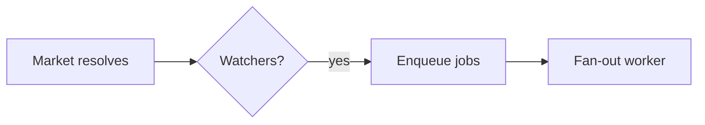

<!-- Adapted from ECC skills/plan-canvas/SKILL.md, ecc-universal 2.2.1 (MIT). See THIRD_PARTY_NOTICES.md. -->

## chaekcheck-plan notes

- Requires the `ecc-universal` npm package (installed with `npm install -g ecc-universal@2.2.1`). Check with `ecc-plan-canvas --help`; if it fails, review in the conversation instead and tell the user.
- Artifacts are this project's documents, e.g. `docs/cycles/NN-<slug>/design-delta.md`. Mermaid blocks in `flow.md` and `design-delta.md` render as diagrams.
- The ECC hook `stop:plan-canvas-pending` is **not** installed here. Before ending a turn while a review is open, run `ecc-plan-canvas pending` yourself.
- An Approve verdict confirms the reviewed document. Record any decision it contains with `/adr`.

## Proposal review mode (chaekcheck-plan default)

The user asked (2026-10-01) that every `[안]` be decided one by one in the canvas, and that the cycle move on by itself once all are decided. Use this mode for every document review in this project (spec, flow, architect proposal, design-delta, handoff):

1. Build the review page: `node .claude/skills/plan-canvas/proposal-review.cjs <doc.md>`. It writes `<dir>/.review/<name>.review.html` (git-ignored) and `<name>.proposals.json` (chip number → source line and context).
2. Open and await the **.html** page, not the .md: `ecc-plan-canvas open <dir>/.review/<name>.review.html`, then `await` in the background.
3. In the page each `[안]` is a numbered chip (💡 안 #N). Clicking it shows a text box and exactly three buttons: 승인 / 미승인 / 기타 (user's choice 2026-10-01: no separate 제안 button, because a suggestion can be written in 기타). Text typed in the box is sent with whichever button is pressed, 승인 included (user, 2026-10-04: a note written next to an approval must not be dropped). Choices are queued and sent with the 보내기 button. They arrive as annotations `"[안 #N] 승인"`, `"[안 #N] 승인: <note>"`, `"[안 #N] 미승인: <reason>"`, `"[안 #N] 기타: <free text>"` with `anchor.snippet` = the item's text. `[확정]` and `[확인 필요]` are shown as badges.
4. Apply decisions to the .md (map #N with the JSON or the snippet; if several decisions for the same #N arrive, the last one wins):
   - 승인 → change that `[안]` to `[확정]` with `(사용자 승인, YYYY-MM-DD)`. If a note came with it (`승인: <note>`), read the note before applying: a condition or change goes into the document in the user's words, a question gets answered, and if the note contradicts the approval ask which one is meant.
   - 미승인 → remove or replace the proposal as the user's reason says. If a replacement is needed and the reason does not give it, ask in the canvas; the replacement comes back as a new `[안]` to decide.
   - 기타 → free text: a question or the user's own suggestion. Answer a question in the canvas with `--reply` (the chip stays undecided). For a suggestion, replace the proposal with it and tag it `[확정]` with `(사용자 제안, YYYY-MM-DD)`, quoting the user's words; if it is not concrete enough to write down, or conflicts with another decision or rule, reply in the canvas and put the worked-out version back as a new `[안]` to decide.
   Also update the same value in other cycle documents (`spec.md`, `flow.md`, `scope.md`) where it appears.
5. Re-run the script after each edit (the canvas live-reloads the .html), reply in the canvas with what changed, and keep awaiting.
6. 승인 and 미승인 count as decisions, and so does a 기타 suggestion once applied; a 기타 question does not. When no `[안]` is left in the document (all decided) or the user sends Approve, end the canvas session and **continue to the skill's next step without asking** (e.g. after `/screen-flow` start `/design-delta`). Record decisions that need an ADR with `/adr` first.
7. Chat messages and freeform annotations in the canvas are handled as before.

## Plain-language decision page (user, 2026-10-04)

The user decides from a page written for a reader who is not a developer, not from the raw document. For every review in this project (spec, flow, architect proposal, design-delta, handoff, ADR draft):

0. **Never open the raw `.md` as the review page, even when the document has no `[안]` left** (user, 2026-10-04: `design-delta.md` was opened as rendered markdown because it had no chips, and it was far too hard to read). A document with nothing to decide still gets a plain-language page that walks through what it says (what is built, what is stored, the flows as pictures, what the user has to do), ending with one `[안]` chip of the form "이 문서대로 다음 단계로 감". The original is shown **in the conversation, not in the canvas** (user, 2026-10-04): whenever a review page is opened, the short note in the conversation gives the source document as a clickable markdown link with a path relative to the project root (e.g. `[design-delta.md](docs/cycles/NN-<slug>/design-delta.md)`), so the user can open the raw `.md` in the app's file pane. List every source document the page was built from. **When the source has Mermaid diagrams, also give a rendered original** (user, 2026-10-04: the file pane shows Mermaid as code): the app's file pane and pages sent with `SendUserFile` run no script, so draw the diagrams first. (1) run `node .claude/skills/plan-canvas/mermaid-svg-server.cjs <doc.md> <scratchpad>/svg` in the background; (2) in the built-in browser, on any `http://127.0.0.1` page, run: import Mermaid 11 from `https://cdn.jsdelivr.net/npm/mermaid@11/dist/mermaid.esm.min.mjs`, `initialize({startOnLoad:false, theme:'neutral', htmlLabels:false, flowchart:{htmlLabels:false}})`, fetch `http://127.0.0.1:4599/blocks`, `render` each block, POST each SVG to `/svg?i=<n>`, then GET `/done`; (3) run `node .claude/skills/plan-canvas/original-page.cjs <doc.md> <scratchpad>/svg`, which writes `<cycle>/easy/<name>-original.html` with the whole document and the diagrams as inline SVG. Link that file in the conversation next to the `.md` and send it with `SendUserFile`. Rebuild it when the `.md` changes. Do not open the rendered `.md` in the canvas unless the user asks for exactly that.
1. Write a decision page `<cycle>/easy/YYYY-MM-DD-<name>-decisions.html` and add a row to `<cycle>/easy/README.md`. Start from the head (style block) of an existing page in that folder so the look and the CSS variables stay the same. Write it with the project skill `plain-page` (`.claude/skills/plain-page/SKILL.md`): its writing rules, evidence rules and picture rules apply to every page; the points below are the minimum.
   - One numbered item per `[안]`, in the document's order, grouped under a few headings. Each item: what happens if the proposal is taken (a concrete example), 다른 선택 with what each costs, and which one is recommended. Mark the item with the literal text `[안]` once, so it becomes a chip.
   - Short sentences, everyday Korean words. Explain a technical term the first time it appears, or avoid it. Say plainly when a proposal changes something the user decided earlier.
   - Evidence: when a proposal rests on an external fact (a standard, a provider's API, a library's behaviour, what other services do), look it up in the official source and give the source name, URL and check date; record the detail in the cycle's `research.md` and point to its section. What could not be verified is written as "확인 못 함", never guessed.
   - Pictures: draw whatever makes the proposal easier to see, as inline SVG or HTML/CSS (no script: pages sent with `SendUserFile` do not run scripts, so Mermaid is pre-rendered or hand-drawn).
     - spec: flowchart of the rule, timeline for time values, comparison table for alternatives
     - flow: screen-to-screen diagram, and **a mock-up of every new or changed screen as it would look in the service, separately for PC, tablet and phone**, placed next to the proposals it illustrates. Mock-ups show position and order, not visual design; say so on the page. Base existing screens on the dev project's current screens.
     - design-delta / ADR: module relation diagram, table relation (class) diagram, sequence diagram of the main request
2. Build the canvas copy with `node .claude/skills/plan-canvas/proposal-review.cjs <page.html>` (writes `<cycle>/.review/<name>.review.html`), open it, and `await` in the background with the longest timeout. Also send the static page with `SendUserFile` so it can be read on another device.
3. Decisions come back numbered by the page's chips (#N = the N-th `[안]` on the page); map them to the source document by the item title in `anchor.snippet`. Apply them to the source document (`spec.md`, `flow.md`, ...) as in step 4 above. For a question (기타 or a chat message), research it and **answer on the same page, in place** (user, 2026-10-04): add an item with the answer, its evidence and a picture right next to the proposal it is about, re-run the script (the canvas reloads the page; the session stays open), and run `await` again with `--reply` giving a two- or three-sentence summary and where on the page the answer is. The chip stays so the user can decide after reading. Open a separate follow-up page only when a round ends with several items re-proposed (new wording after 미승인, split or merged proposals), and then keep the earlier page open as well.
4. The source document stays the record. The decision page is a view of it: when the two disagree, fix the page.
   - Theme: review pages open light. The canvas does not pass its own light/dark setting to the page inside it (the page is sandboxed), so the review script puts a 어둡게/밝게 button at the top right of the page; the user presses it when the canvas is set to dark. Pages must use the CSS variables listed in `plain-page` so the button can recolour them.
5. **Everything the user has to decide or confirm goes through the canvas** (user, 2026-10-04: "내가 일부러 클로드 코드 내의 선택 창에서 하고 싶다는 말 없으면 다 canvas로 해줘"). This includes, besides the first review of a document:
   - follow-up rounds: answers to 기타 questions, re-worded proposals after 미승인, and the "남은 N가지" list of what is still open. Do not write these out as a list in the conversation and ask there. An answer to a question goes onto the page it was asked on (see step 3); re-proposed items go on a follow-up page (only the open items, each with its answer, picture and chip).
   - single decisions that come up mid-work (a choice between alternatives, a wording to confirm, a go-ahead for a change to skills or rules).
   - ADR drafts (see the `adr` skill).
   - **A rebuild must not reset the user's choices** (user, 2026-10-04: after an in-place answer the chips and the "고른 것 N개" counter went back to empty). The page is sandboxed and cannot remember anything, so `proposal-review.cjs` reads the session's earlier annotations from the canvas state file and bakes them into the page: chips already answered show their choice again and count as chosen; clicking one again changes it. For this to work: always rebuild with the script (never hand-edit the `.review` copy), keep the same page file for the same session, and when editing a page in place do not add, remove or reorder `[안]` chips (numbers are positional) — put new proposals on a follow-up page instead. The build output's `keptChoices` says how many were restored; check it after a rebuild.
   - **Do not end a canvas session the user may still be reading** (user, 2026-10-04: a page was closed while they were reading the answers on it). Feedback arriving from a page does not mean the user is done with it: it may hold answers and items they have not reached. When a follow-up page is opened, leave the earlier page open and keep an `await` on it. End a session only when every item on that page is decided and the user has moved on (they sent decisions from a later page of the same step, or said so), or when the whole step is finished.
   In the conversation write only a short note: what was applied, how many items are open, and that the page is open in the canvas. Use `AskUserQuestion` or a numbered list in the conversation only when the user asks for it, says they are on another device (the canvas is a local address), or `ecc-plan-canvas` is unavailable; say which of these applies.


# Plan Canvas

Review loop for plans and visual artifacts: you write the artifact, the human
reviews it in the browser — annotating the exact element they mean, chatting,
and delivering an **Approve plan / Request changes** verdict — while you block
on a single CLI call that returns their feedback as JSON.

Inspired by [lavish-axi](https://github.com/kunchenguid/lavish-axi); rebuilt
ECC-native around the `/plan` confirmation gate, with zero dependencies.

## When to Use

- You just wrote a plan artifact (a cycle document such as `design-delta.md` or `handoff.md`) and
  need the CONFIRM/approve decision — the canvas verdict replaces a typed
  "yes/proceed".
- The user should *point at* what to change: reviewing designs, comparisons,
  reports, or any local `.md` / `.html` artifact.
- The user asks for `/plan-canvas`, a visual review, or "open it in the browser".

Do NOT use for: code review of diffs (`/code-review`), running web apps, or
remote URLs. The canvas serves local artifact files only.

## How It Works

Invoke the CLI as `ecc-plan-canvas` — the bin shipped by the `ecc-universal`
package (on PATH after a global/plugin install; `node "$CLAUDE_PLUGIN_ROOT/scripts/plan-canvas.js"`
also works for plugin installs). Run it from the project you are reviewing in;
it works from any working directory. It manages a detached loopback server
(`127.0.0.1:4517`) shared by all sessions, keyed by artifact path — no session
ids to track.

The workflow is a plain CLI-plus-JSON loop, so it is model- and harness-agnostic:
any agent that can run a shell command and read stdout drives it the same way
(Claude Code, Codex, Cursor, Gemini, OpenCode, Copilot). Trigger it however your
harness surfaces skills — e.g. `/plan-canvas` in Claude Code, `$plan-canvas` in
Codex — or just run the `ecc-plan-canvas` commands directly.

```bash
# 1. Open the artifact in the user's browser (returns immediately)
ecc-plan-canvas open docs/cycles/01-book-search/design-delta.md

# 2. Block until the human responds. Leave running; re-run if interrupted:
#    queued feedback is never lost.
ecc-plan-canvas await docs/cycles/01-book-search/design-delta.md
```

### Stay listening, or the human talks to an empty chair

Feedback only reaches you while an `await` is actually parked on the session.
If your turn ends with nothing listening, the message sits in the queue and,
from the human's side of the glass, sending appears to do nothing at all.

So **run `await` as a background task** when your harness supports one (in
Claude Code, a Bash call with `run_in_background: true`). It exits the moment
feedback arrives and the harness hands you the JSON, which keeps the loop alive
across turns instead of dying with the foreground call. A foreground `await`
works too, but only until the harness time-limits it.

Two backstops exist, and neither is an excuse to skip the above:

- `ecc-plan-canvas pending` lists feedback queued with no listener. Check it
  whenever you are unsure whether you missed something.
- (The ECC stop hook that enforces this is not installed in chaekcheck-plan; run `pending` yourself.)

`await` prints JSON when the human acts:

```json
{
  "status": "feedback",
  "items": [
    { "kind": "annotation", "text": "Split this into two phases",
      "anchor": { "selector": "h2:nth-of-type(3)", "tag": "h2", "snippet": "Phase 2: Migration" } },
    { "kind": "verdict", "verdict": "request-changes" }
  ]
}
```

- `kind: "chat"` — freeform message; answer in the canvas, not the terminal.
- `kind: "annotation"` — feedback anchored to an element (`anchor.selector`,
  `anchor.snippet` show what they pointed at; `anchor.textRange.text` when
  they highlighted a passage).
- `kind: "verdict"` — `approve` means the document is CONFIRMED: stop polling,
  end the session, and continue the skill step that opened the canvas. `request-changes` means revise the
  artifact (the canvas live-reloads it) and keep the loop going.

**3. Always respond in the canvas**, then keep listening. One command does both:

```bash
ecc-plan-canvas await <file> --reply "Split Phase 2 as requested. Take a look."
```

Every human message gets a reply in the canvas, even a one-liner like
"On it, rewriting the risk table now." Silence in the chat panel is
indistinguishable from a broken canvas, which is exactly the failure this loop
exists to prevent. Answer there, not only in the terminal.

While you work, keep the chat honest with the activity indicator:

```bash
# animated "agent is thinking..." bubble; refresh it during long work
ecc-plan-canvas typing <file> --state thinking
# switch to "agent is typing..." just before a reply lands
ecc-plan-canvas typing <file> --state typing
```

`await` sets `thinking` for you the moment it hands you a batch, and `--reply`
clears it. Both states self-expire, so a crashed agent decays to an honest
"queued" instead of leaving the human watching dots forever. Refresh `thinking`
if a revision takes more than a minute.

**4. End** when review concludes: `ecc-plan-canvas end <file>`.

## Diagrams (Mermaid)

When part of the plan is a flow, architecture, sequence, state machine, ER
model, or dependency graph, author it as a fenced ` ```mermaid ` block instead
of ASCII art or a wall of prose — the canvas renders it as a themed diagram the
human can point at. Reach for it when a picture reads faster than a paragraph;
skip it for simple lists or tables.

````markdown

````

Diagrams render in the ECC dark theme with the accent palette. Mermaid loads in
the browser from a pinned CDN; if that is unavailable (offline), the block
degrades to showing its source, so the review is never blocked. Point a local
mirror at `ECC_PLAN_CANVAS_MERMAID_URL` for air-gapped use.

## Rules

- Markdown artifacts render in ECC's plan template (including Mermaid blocks);
  `.html` artifacts render as-is with the annotation layer injected.
- Edit the artifact file to revise — the canvas live-reloads on save. Never
  re-run `open` to refresh.
- `{"status": "ended", "endedBy": "user"}` (or `sessionEnded: true` on a
  feedback batch) means the user closed the review: stop polling, deliver
  remaining updates in chat, and do not reopen. A plain `open` on that
  session is refused; pass `--reopen` only when the user asks to resume.
- Sibling assets (images, CSS) must sit next to the artifact and be
  referenced by relative path.
- The server is loopback-only and exits after 30 idle minutes
  (`ECC_PLAN_CANVAS_IDLE_MS`); `stop` shuts it down explicitly. State lives
  in `~/.claude/plan-canvas/` (`ECC_PLAN_CANVAS_STATE_DIR`).

## Examples

**Handoff approval flow** — `/cycle-close` saves
`docs/cycles/01-book-search/handoff.md` and must WAIT for confirmation:

```bash
ecc-plan-canvas open docs/cycles/01-book-search/handoff.md
ecc-plan-canvas await docs/cycles/01-book-search/handoff.md
# → {"status":"feedback","items":[{"kind":"verdict","verdict":"approve"}]}
ecc-plan-canvas end docs/cycles/01-book-search/handoff.md
# handoff is confirmed — copy it to docs/current/handoff.md
```

**Revision loop** — feedback arrives, you edit the file, reply, keep listening:

```bash
# await returned annotations → edit the document (canvas live-reloads)
ecc-plan-canvas await <file> --reply "Reworked the risk table."
# → blocks again until the next response
```

## Anti-Patterns

- Polling with `--timeout-ms` in a loop. It exists for tests. Leave the plain
  `await` running instead.
- Ending your turn with no `await` listening while the review is still open.
  That is the one failure the human experiences as "I sent a message and
  nothing happened".
- Reading the feedback but answering only in the terminal. The human is looking
  at the canvas.
- Reopening after a user-initiated end "just to show" something.
- Pasting the whole plan into chat *and* opening a canvas — pick the canvas
  and keep the terminal summary to one line.
- Parsing the canvas chat from state files — everything you need arrives via
  `await`.
