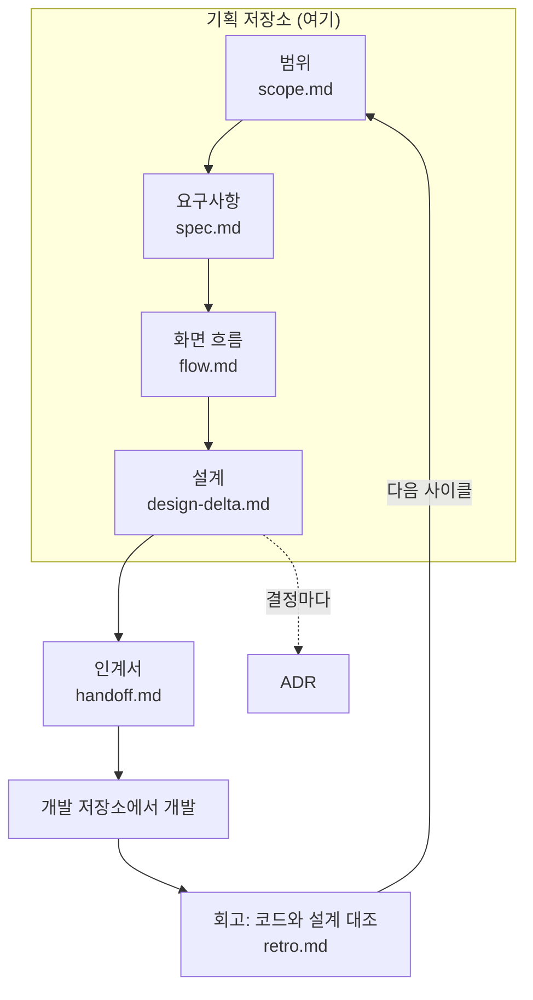

# 책첵 기획·설계 저장소 (chaekcheck-plan)

[책첵](https://chaekcheck.com)은 전국 공공도서관·전자도서관에 어떤 책이 있고 지금 빌릴 수 있는지 한 번에 찾아 주는 서비스입니다. 이 저장소는 책첵의 **기획과 설계 문서**만 담습니다. 코드는 [chaekcheck-dev](https://github.com/hodu-sketch/chaekcheck-dev)에 있습니다.

혼자 AI(Claude Code)와 함께 만들었습니다. AI가 빠르게 쓰고, 사람은 무엇을 만들지 정하고 AI의 제안을 고르고 고치고 검증합니다. 그 과정을 이 저장소에 남겼습니다.

## 숫자로 보면

- 기간: 2026-09-29 ~ 지금, 커밋 830여 개
- 사이클 27개: 기능 한 조각씩 기획 → 설계 → 개발 인계 → 회고
- 결정 기록(ADR) 160여 개: 무엇을 왜 골랐는지, 버린 대안과 치르는 값까지
- 운영: AWS 서울 EC2 한 대(메모리 2GB), Cloudflare Tunnel, 무중단 배포

## 일하는 방식

- **작은 조각으로 반복**: 제품 전체를 처음에 설계하지 않고, 사이클마다 한 조각만 끝까지 갑니다. 다음 사이클은 실제로 만들어진 코드를 보고 시작합니다.
- **기획과 개발 분리**: 이 저장소는 코드를 쓰지 않고, 개발 저장소는 인계서를 읽고 만듭니다. 회고 때 실제 코드와 설계를 대조해 어긋난 곳을 고칩니다.
- **결정은 사람이**: AI가 대안 2~3개를 장단점과 함께 내면, 사람이 승인·미승인·질문으로 답합니다. 값마다 `[확정]`(확인됨) / `[안]`(제안) / `[확인 필요]`(모름) 표시를 붙여, 지어낸 값이 사실처럼 섞이지 않게 합니다.
- **AI 작업 규칙도 코드처럼**: [`.claude/`](.claude/)에 AI가 따르는 규칙, 단계별 스킬(`/cycle-start`, `/feature-spec`, `/design-delta`, `/adr` 등), 역할별 에이전트(설계안, 설계 검토, 인계서)가 있습니다.

## 처음이면 여기부터

| 보고 싶은 것 | 열 곳 |
|---|---|
| 사이클 전체 순서와 상태 | [docs/cycles/README.md](docs/cycles/README.md) |
| 사이클 하나를 처음부터 끝까지 | [사이클 27 무중단 배포](docs/cycles/27-zero-downtime-deploy/) 또는 [사이클 20 조회 상태 신호](docs/cycles/20-lookup-status-and-extension/) |
| 지금 설계 전체(모듈·표·API·흐름) | [docs/current/module-map.md](docs/current/module-map.md) → [flows.md](docs/current/flows.md) |
| 왜 이렇게 정했나 | [docs/adr/README.md](docs/adr/README.md) |
| 문서 전체 지도 | [docs/README.md](docs/README.md) |

## 폴더

| 폴더 | 무엇 |
|---|---|
| `docs/cycles/NN-이름/` | 사이클 하나의 범위·요구사항·화면 흐름·설계·인계서·회고 |
| `docs/current/` | 사이클이 끝날 때마다 합친 지금 설계 전체 |
| `docs/adr/` | 결정 기록 |
| `docs/research/` | 사이클 밖에서 한 조사(데이터 출처, 수집 방법, 배포 등) |
| `docs/backlog.md` | 아직 사이클에 들어가지 않은 아이디어 |
| `…/easy/` | 결정할 때 본 쉬운 말 설명 페이지(HTML). 기록용이라 처음엔 안 봐도 됩니다 |
| `.claude/` | AI가 따르는 규칙·스킬·에이전트 |

문서는 한국어로 쓰고, 모듈·표·API 이름만 영어로 둡니다.
