# 지금까지 만든 코드 한눈에 보기 (클래스 그림과 설계 패턴)

- 읽은 곳: `chaekcheck-dev` 의 `backend/src/main/java/com/chaekcheck`, `backend/src/main/resources/db/changelog`, `backend/build/spring-modulith-docs/*.puml`, `fetch-service/src`, `web/src` [확정, 코드 직접 확인 2026-10-04]
- 이 문서는 "이미 만들어진 것"을 설명합니다. 새 설계는 들어 있지 않습니다. 클래스·표·주소 이름은 코드에 적힌 그대로입니다.
- 사이클 06(내 도서관, `mylibrary`)은 아직 코드에 없습니다. 아래 그림에도 없습니다. [확정, 패키지 없음 확인 2026-10-04]
- 그림에는 중요한 클래스와 필드·메서드만 넣었습니다. 전부가 아닙니다.

## 먼저 알아 두면 좋은 말 (한 번만 설명)

| 말 | 쉬운 뜻 |
|---|---|
| 모듈 | 프로그램 안의 큰 방 하나. 방끼리는 정해진 문(공개 인터페이스)으로만 드나듭니다. |
| 공개 인터페이스 | 다른 방이 불러도 되는 "창구". 예: `LibraryCatalog`. 방 안쪽(`internal` 패키지)은 다른 방이 직접 못 씁니다. |
| 인터페이스 / 구현 | "이런 일을 한다"는 약속(인터페이스)과 실제로 그 일을 하는 클래스(구현). 구현을 갈아 끼워도 부르는 쪽은 그대로입니다. |
| record | 값만 담는 작은 상자 클래스(자바). |
| enum | 정해진 몇 가지 값만 고를 수 있는 목록. |
| SSE | 서버가 결과를 한 번에 주지 않고, 준비되는 대로 조금씩 흘려보내는 방식. 화면이 "도서관 하나씩" 결과를 받는 데 씁니다. |
| 캐시 | 방금 가져온 페이지를 잠깐(3분) 기억해 두고 같은 요청이면 다시 사이트에 가지 않는 것. |
| 스로틀 | 같은 도서관 사이트에 너무 자주 요청하지 않도록 간격을 두는 장치. |

---

## 1. 한눈에

책첵은 **여러 전자도서관 사이트를 대신 검색해서 "지금 빌릴 수 있는 곳"을 모아 보여 주는 서비스**입니다. 화면(`web`, React)이 서버(`backend`, Spring Modulith 한 덩어리 앱)에 묻고, 서버는 두 가지 길로 답합니다. 첫째, 미리 모아 둔 책 목록(`catalog`)에서 책을 찾고, 둘째, 그 책을 가진 도서관 사이트에 실제로 들어가 대출 가능 여부를 실시간으로 읽어 옵니다(`availability`). 어느 도서관을 어떤 순서로 볼지는 사용자가 고른 지역(`region`)과 도서관 가입 자격(`library`)으로 정하고, 로그인과 회원 탈퇴는 `auth` 가 맡습니다. 도서관 사이트 호출은 서버가 직접 하거나, 설정에 따라 별도의 작은 대리 서버(`fetch-service`)를 거칩니다.

모듈 사이의 실제 의존(코드의 `import` 와 Spring Modulith 문서로 확인):

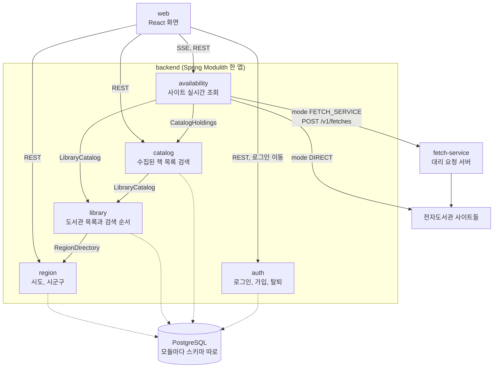

- 화살표 위 이름은 그 모듈이 다른 모듈에 쓰는 "창구"(공개 인터페이스)입니다. [확정]
- `auth` 는 다른 업무 모듈을 부르지 않고, 다른 모듈도 `auth` 를 부르지 않습니다. 탈퇴 소식은 이벤트(`AccountDeleted`)로만 밖에 알립니다. [확정]
- Spring Modulith 가 만든 `components.puml` 에는 위 4개 의존(catalog→library, availability→library, availability→catalog, library→region)이 그대로 있습니다. 다만 그 그림에는 `auth` 상자가 빠져 있습니다(별도 `module-auth.puml` 에는 있음). 빌드 문서가 최신인지 [확인 필요].
- `fetch-service` 는 같은 저장소의 **별도 앱**입니다. backend 와 코드를 공유하지 않고 HTTP 로만 이야기합니다. [확정]
- 어떤 길로 사이트를 부를지는 `chaekcheck.availability.fetch.mode` 설정(기본 `direct`)으로 정하고, 두 방식 사이 자동 전환은 없습니다. [확정]

---

## 2. 모듈별 설명

### 2-1. region (지역)

**이 모듈이 하는 일**: 전국 시·도와 시·군·구 목록을 갖고 있습니다. 화면의 "사는 곳/일하는 곳 고르기" 창에 목록을 주고, 예전에 저장해 둔 지역 번호가 지금도 쓸 수 있는지(없어졌거나 다른 구로 합쳐졌는지) 알려 줍니다. 지역 데이터는 DB 설치 스크립트(Liquibase)로만 들어가고, 앱은 읽기만 합니다.

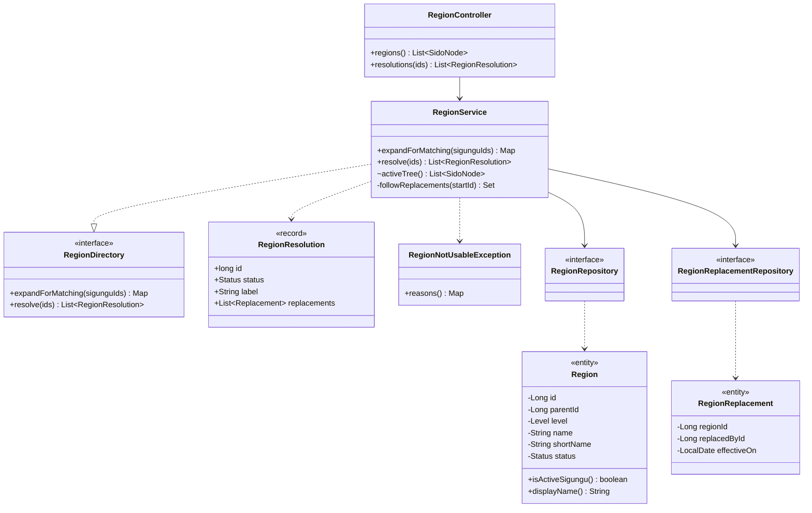

- `RegionResolution.Status` 값: `ACTIVE`, `REPLACED`, `SPLIT`, `UNKNOWN`. `Region` 안의 `Level` 은 `SIDO`/`SIGUNGU`, `Status` 는 `ACTIVE`/`ABOLISHED`. [확정]
- 요청 흐름: 화면이 `GET /api/v1/regions` 를 부르면 `RegionController` → `RegionService.activeTree()` 가 시·도 아래 시·군·구를 묶어 돌려줍니다. `GET /api/v1/regions/resolutions?ids=…`(최대 20개)는 `resolve()` 가 폐지된 지역을 대체 링크(A→B→C)를 끝까지 따라가 "바뀜/나뉨/모름"으로 알려 줍니다. 다른 모듈(`library`)은 `RegionDirectory.expandForMatching()` 으로 "이 시·군·구와 그 위 시·도" 묶음을 받습니다.

### 2-2. library (도서관)

**이 모듈이 하는 일**: 전자도서관 사이트 목록(이름, 사이트 주소, 화면 종류, 가입 방법)과 "누가 가입할 수 있는지" 규칙을 갖고 있습니다. 사용자가 고른 지역을 받아 **검색할 도서관 목록과 순서(검색 계획)**를 만들어 줍니다. 예: 내 시·군·구 도서관 → 내 시·도 도서관 → 누구나 가입 → 확인 필요. 운영자는 SQL 로 `enabled` 를 바꿔 도서관을 끄고 켭니다.

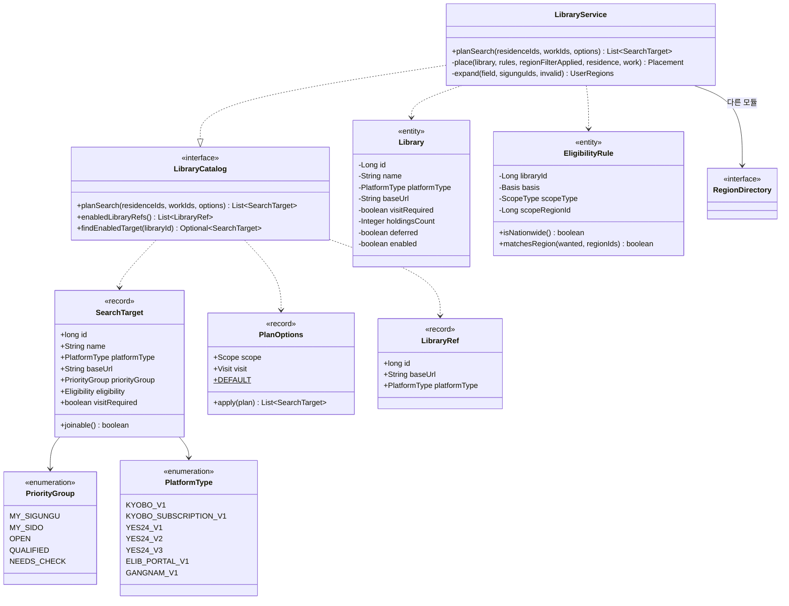

- 그림에서 뺀 것: `LibraryRepository`, `EligibilityRuleRepository`(Spring Data 저장소), `Eligibility` enum(`OPEN`, `ELIGIBLE`, `UNKNOWN`, `UNVERIFIED` 등), `InvalidRegionException`. [확정]
- `PlatformType` 은 "이 사이트는 어떤 화면 종류인가"이고, 이 값으로 `availability` 가 어느 어댑터(아래 2-4)를 쓸지 고릅니다. [확정]
- 요청 흐름: 다른 모듈이 `planSearch(사는 곳, 일하는 곳, 옵션)` 를 부르면 `LibraryService` 가 지역을 `RegionDirectory` 로 넓히고(시·군·구 + 시·도), 켜진 도서관과 규칙을 읽어 그룹을 나눈 뒤, 그룹 안에서 "방문 필요 없는 곳 먼저 → 보류(deferred) 아닌 곳 먼저 → 가입 주의 문구 없는 곳 먼저 → 장서 수 많은 순 → id" 로 줄 세웁니다. 마지막에 `PlanOptions.apply()` 가 "가입 가능한 곳만", "방문 없이 가입되는 곳만" 같은 걸러 내기를 합니다. 이 모듈에는 자기 REST 주소가 없습니다. [확정]

### 2-3. catalog (수집된 책 목록)

**이 모듈이 하는 일**: 미리 여러 도서관 사이트에서 모아 둔 전자책 목록을 DB 에 넣고(가져오기), 제목·저자·출판사로 책을 찾아 줍니다. 같은 책이 여러 도서관에 있으면 한 권(`book`)으로 묶고, 도서관별 소장 기록(`holding`)을 따로 둡니다. 검색은 PostgreSQL 의 `pg_bigm`(한국어 부분 일치에 강한 색인)으로 합니다. 이 모듈은 도서관 사이트에 직접 가지 않습니다.

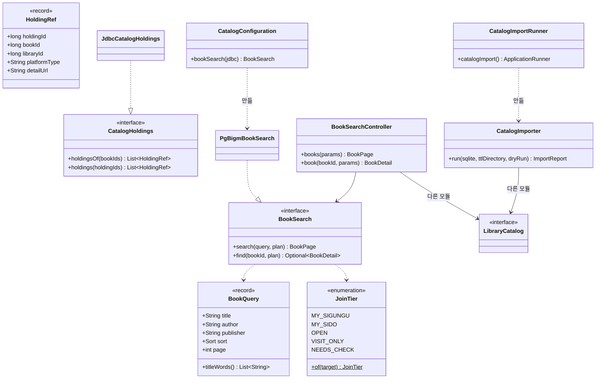

- 가져오기 단계(그림에서는 `CatalogImporter` 하나로 줄임): `CollectedCatalog.read()`(수집 SQLite 읽기) → `BookGrouping.byCodes()`(같은 책 묶기) → `NationalBibliography.lookup()`(국가서지 ISBN 찾기, 선택) → `BookGrouping.mergeSameText()` → `CatalogWriter.write()`(COPY 로 표 통째로 바꾸기). 정리 함수는 `catalog.internal.normalize`(`CatalogText`, `Contributors`, `Isbn`, `PublishedDates`). [확정]
- 가져오기는 `catalog-import` 프로필로 앱을 띄울 때만 한 번 돌고 앱이 끝납니다. 평소 서버에서는 돌지 않습니다. [확정]
- 요청 흐름: `GET /api/v1/books?title=…` → `BookSearchController` 가 `LibraryCatalog.planSearch()` 로 "검색할 도서관 목록"을 먼저 받고 → `PgBigmBookSearch.search(query, plan)` 가 그 도서관들에 있는 책만 골라 페이지로 돌려줍니다. `GET /api/v1/books/{bookId}` 는 책 한 권과 그 책을 가진 도서관 목록을 줍니다. `availability` 는 `CatalogHoldings.holdingsOf()` 로 "이 책은 어느 도서관의 어떤 상세 페이지에 있나"를 받습니다. [확정]

### 2-4. availability (사이트 실시간 조회)

가장 큰 모듈이라 네 부분으로 나눠 그립니다.

**이 모듈이 하는 일**: 도서관 사이트에 실제로 들어가 검색 결과 페이지나 책 상세 페이지를 읽고, "지금 빌릴 수 있음 / 예약 가능 / 모름"을 정해서 화면에 **도서관 하나씩 흘려보냅니다(SSE)**. 사이트를 괴롭히지 않도록 같은 사이트에는 한 번에 하나, 1초 간격으로만 요청하고(스로틀), 3분 동안은 같은 페이지를 다시 받지 않습니다(캐시). 서버는 검색 상태를 기억하지 않고, "다음 묶음"에 무엇을 물을지는 브라우저가 보냅니다.

#### (가) 사이트 화면 읽기: adapter

사이트마다 화면 모양이 달라서, 화면 종류(`PlatformType`)마다 "번역기" 하나씩을 둡니다.

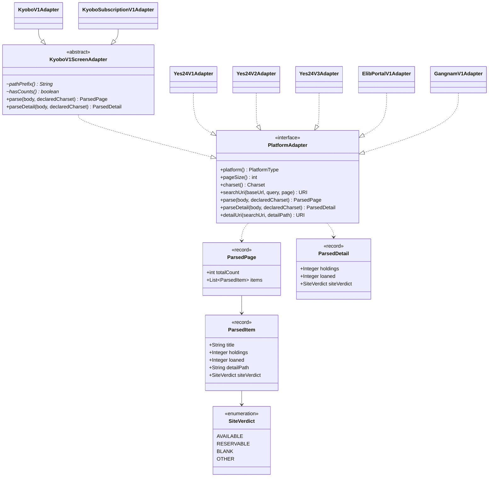

- 어댑터는 "화면에 적힌 것"만 읽습니다. 빌릴 수 있는지 판정은 다음 부분(`resolve`)이 합니다. [확정]
- `Yes24V3Adapter` 는 화면이 V2 와 같고 검색어만 EUC-KR 로 보내야 해서, 읽기는 `Yes24V2Adapter` 의 정적 함수를 빌려 씁니다. [확정]
- 도움 클래스 `HtmlParsing`(jsoup 로 HTML 읽기)은 그림에서 뺐습니다.

#### (나) 페이지 가져오기: fetch

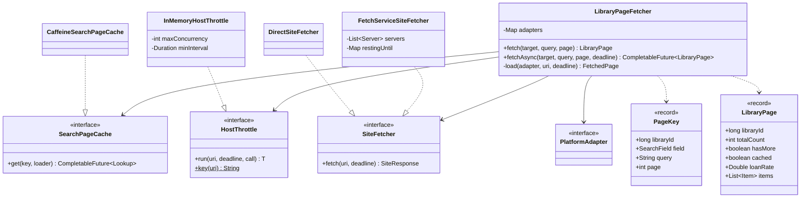

- 순서: **캐시 → 스로틀 → SiteFetcher → 어댑터**. 캐시에 있으면 사이트에 가지 않습니다. 캐시와 스로틀이 `SiteFetcher` 앞에 있어서, 직접 호출이든 대리 서버든 같은 규칙을 따릅니다. [확정]
- 설정값(`application.yml`): `cache-ttl: 3m`, `host-max-concurrency: 1`, `host-min-interval: 1s`, `fetch.mode` 기본 `direct`. [확정, 2026-10-04 파일 확인]
- 책 상세 페이지는 같은 구조의 `DetailPageFetcher` + `DetailVerdictCache`(`CaffeineDetailVerdictCache`)가 같은 스로틀과 `SiteFetcher` 를 거쳐 가져옵니다. [확정]
- 리다이렉트는 따라가지 않습니다(`HttpClient.Redirect.NEVER`). [확정]

#### (다) 빌릴 수 있는지 판정: resolve

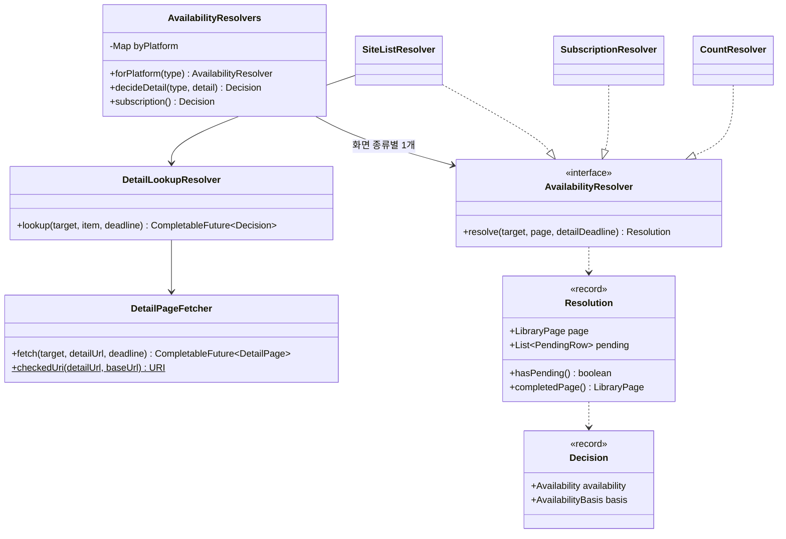

- 화면 종류별 판정 방식(`AvailabilityResolvers` 생성자에 적힌 그대로) [확정]:
  - `KYOBO_V1`, `YES24_V1~V3`, `GANGNAM_V1` → `CountResolver`: 소장 − 대출 ≥ 1 이면 AVAILABLE, 아니면 RESERVABLE
  - `KYOBO_SUBSCRIPTION_V1` → `SubscriptionResolver`: 구독형이라 늘 AVAILABLE
  - `ELIB_PORTAL_V1` → `SiteListResolver`: 사이트가 쓴 "대출 가능/예약 가능"을 따르고, 빈칸이면 상세 페이지를 더 읽어 나중에 알려 줌(PENDING → `row-verdict` 이벤트)
- `LibraryPage.Availability` 값: `AVAILABLE`, `RESERVABLE`, `PENDING`, `UNKNOWN`. 판정 근거 `AvailabilityBasis`: `COUNT`, `SITE_LIST`, `LOANED_ZERO`, `SITE_DETAIL`, `SUBSCRIPTION`. [확정]

#### (라) 묶음 실행과 흘려보내기: search, web

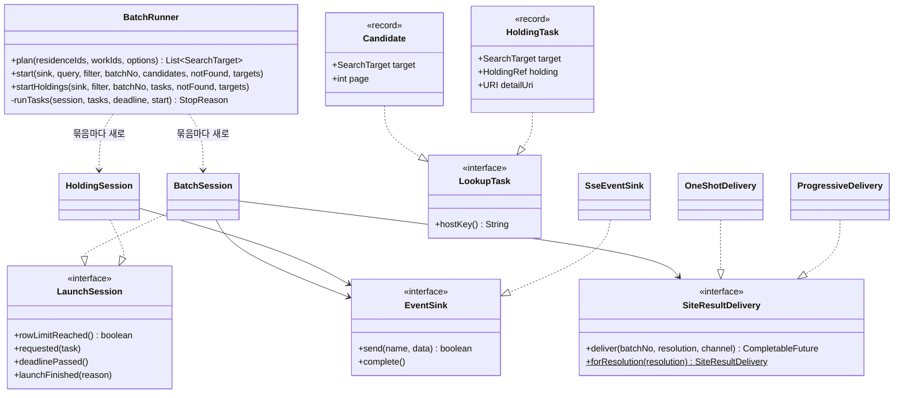

- `LookupTask` 는 `sealed` 인터페이스로, `Candidate`(검색 페이지 1장)와 `HoldingTask`(책 상세 1장) 두 가지만 허용합니다. [확정]
- SSE 주소를 여는 컨트롤러(`availability.internal.web`) [확정]:
  - `EbookSearchStreamController` — `GET /api/v1/ebook-searches/stream` (도서관에서 직접 찾기, 첫 묶음)
  - `EbookBatchStreamController` — `GET /api/v1/ebook-searches/batches/stream` (다음 묶음)
  - `BookAvailabilityStreamController` — `GET /api/v1/book-availabilities/stream` (찾은 책들의 도서관별 상태, 첫 묶음)
  - `BookAvailabilityBatchStreamController` — `GET /api/v1/book-availabilities/batches/stream` (다음 묶음)
  - `LibraryEbookController` — `GET /api/v1/availability/libraries/{libraryId}/ebooks` (도서관 하나의 다음 페이지, 스트림 아님)
- 이벤트 이름(`StreamEvents`): `targets`, `library-requested`, `library-result`, `library-failed`, `row-verdict`, `batch-done`, `done`, 그리고 책 상태용 `holding-requested`, `holding-result`, `holding-failed`. [확정]
- 묶음 규칙(설정 `batch.*`): 동시에 5곳(`parallelism: 5`), 결과 20줄(`row-limit: 20`)이 넘으면 새 요청 시작 안 함, 마감 시간 안에 못 시작한 도서관은 "아직 안 물어봄"으로 남겨 다음 묶음에 브라우저가 다시 보냄. [확정, 값은 application.yml 2026-10-04]
- 요청 흐름: 컨트롤러가 입력을 모두 검사하고 → `BatchRunner.plan()`(= `LibraryCatalog.planSearch`)로 도서관 목록을 받고 → `SseEmitter` 를 열고 → `BatchRunner.start()` 가 별도 가상 스레드에서 도서관을 하나씩 출발시킵니다. 페이지가 오면 화면 종류별 `AvailabilityResolver` 로 판정하고, `SiteResultDelivery` 가 결과를 `SseEventSink` 로 흘려보냅니다.

### 2-5. auth (로그인, 가입, 탈퇴)

**이 모듈이 하는 일**: 네이버·카카오 로그인, 약관 동의 후 가입, 로그아웃, 로그인 유지(토큰 새로 받기), 회원 탈퇴를 합니다. 저장하는 것은 계정 번호, 로그인 수단(네이버/카카오 번호), 동의 기록, 로그인 유지용 토큰의 **해시값**뿐입니다. 이 모듈 전체는 `chaekcheck.auth.enabled` 스위치(기본 `false`)로 통째로 켜고 끕니다. 꺼져 있으면 보안 필터 자체가 없습니다.

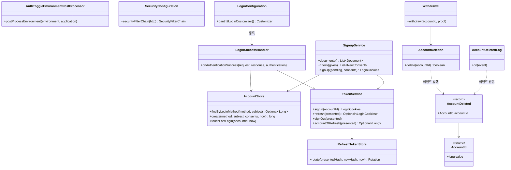

- 공개된 것은 `AccountId`, `AccountDeleted` 두 개뿐입니다(다른 모듈이 탈퇴 소식을 받을 때 씀). 나머지는 모두 `auth.internal`. [확정]
- 그림에서 뺀 것: 컨트롤러(`SignupController`, `MeController`, `AuthTokenController`, `CsrfTokenController`, `ProvidersController`, `UnlinkWebhookController`), `ProviderUnlinker`, `KakaoLinkedUsers`, `DailyAccountCleanup`(매일 04:00 정리), `RefreshTokenCleanup`, 세션 값 `PendingSignup`·`ReauthenticationProof`. [확정]
- 계정을 지우는 곳은 `AccountDeletion.delete()` **한 곳뿐**입니다. 탈퇴, 카카오·네이버 연결 끊기 웹훅, 매일 정리 작업이 모두 여기로 옵니다. [확정]
- 주소: `/api/v1/auth/oauth2/authorization/{naver|kakao}`(로그인 시작), `/api/v1/auth/login/oauth2/code/{registrationId}`(돌아오는 곳), `GET·POST·DELETE /api/v1/auth/signup`, `POST /api/v1/auth/refresh`, `POST /api/v1/auth/logout`, `GET /api/v1/auth/csrf-token`, `GET /api/v1/auth/providers`, `GET·DELETE /api/v1/me`, 웹훅 2개. 로그인이 꼭 필요한 주소는 `/api/v1/me` 뿐입니다. [확정]
- 요청 흐름: 로그인 버튼 → 네이버/카카오 → 돌아오면 `LoginSuccessHandler` 가 아는 번호면 바로 쿠키 2개(접근 토큰 15분, 유지 토큰 30일)를 주고, 처음이면 세션에 `PendingSignup` 을 넣고 `/signup` 화면으로 보냅니다. DB 에는 동의를 누를 때(`POST /api/v1/auth/signup`) 처음 씁니다.

### 2-6. fetch-service (대리 요청 서버)

**이 앱이 하는 일**: backend 대신 도서관 사이트에 GET 요청을 보내고 받은 내용을 그대로 돌려주는 작은 별도 서버입니다. 사이트가 특정 서버 주소를 막을 때를 대비한 것입니다. 정해진 토큰이 있어야만 받고, 내부망 주소로는 요청하지 않습니다(SSRF 방지).

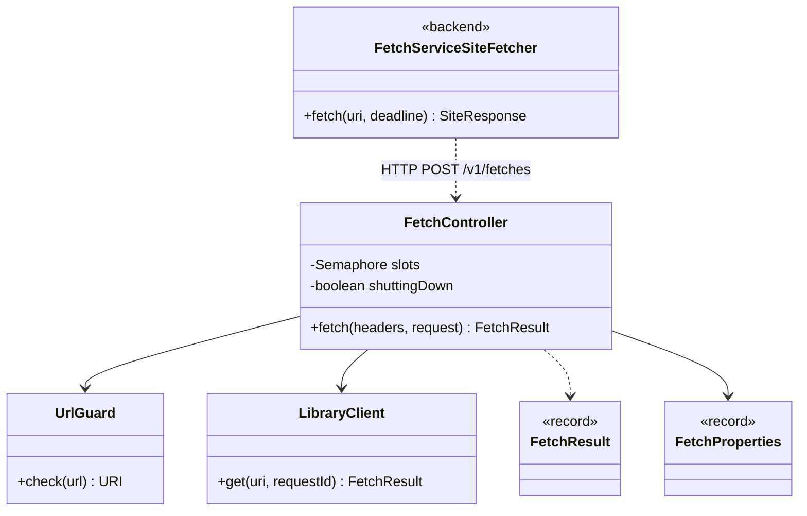

- 요청 흐름: backend 의 `FetchServiceSiteFetcher` 가 서버 목록을 우선순위대로 시도합니다. 연결이 안 되거나 503 이면 그 서버를 잠깐 쉬게 하고 다음 서버로 넘깁니다(읽기 시간 초과는 넘기지 않음). 받는 쪽 `FetchController` 는 토큰 확인 → 동시 처리 칸(`Semaphore`)이 없거나 종료 중이면 503 → `UrlGuard` 로 주소 검사 → `LibraryClient` 로 사이트 호출 순서로 처리합니다. [확정]
- `FetchResult`, `FetchProperties`, `LibraryClient` 의 필드는 읽지 않아 비워 두었습니다. [확인 필요: 필드 목록]

---

## 3. 실제 흐름 그림

### 3-1. 책 찾기 → 도서관별 대출 가능 여부 흘려보내기 (바로 보기)

화면에서 "바로 보기"로 검색했을 때입니다. 먼저 책 목록을 받고, 그 책들을 가진 도서관의 상세 페이지를 묶음 단위로 읽어 옵니다.

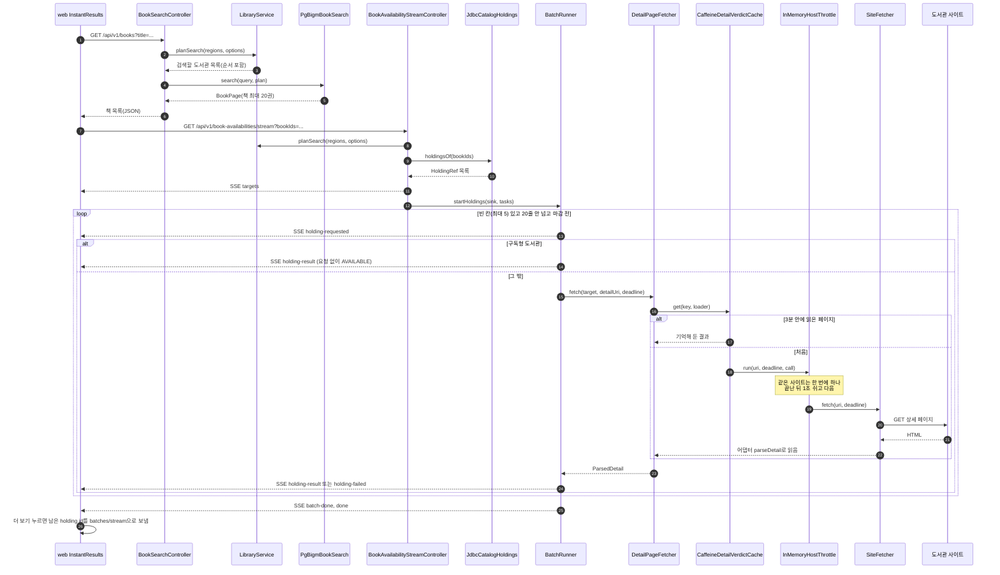

- "도서관에서 직접 찾기"(`/api/v1/ebook-searches/stream`)도 같은 `BatchRunner` 출발 규칙을 씁니다. 차이는 상세 페이지 대신 검색 결과 페이지를 `LibraryPageFetcher` → `CaffeineSearchPageCache` 로 가져오고, 판정을 `AvailabilityResolver` 로 한 뒤 `library-result`(와 필요하면 `row-verdict`)를 보낸다는 점입니다. [확정]
- 서버는 무엇을 이미 물어봤는지 기억하지 않습니다. 다음 묶음의 후보는 브라우저(`useHoldings`, `useSearch`)가 보냅니다. [확정]

### 3-2. 로그인 콜백 → 가입

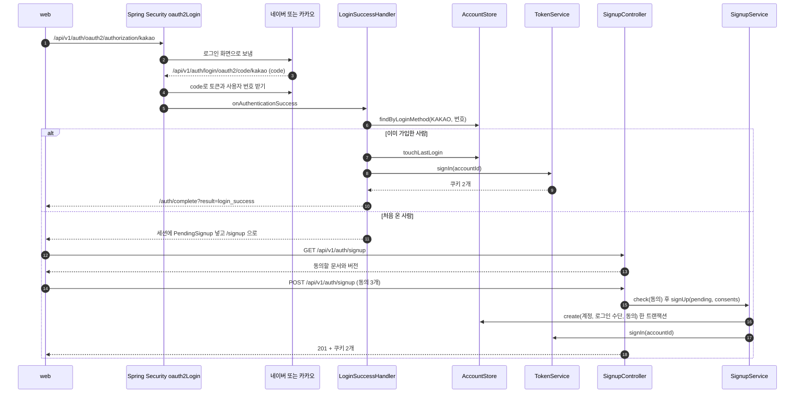

- 같은 번호로 두 번 가입을 눌러도(두 탭, 두 번 클릭) 두 번째는 먼저 만들어진 계정으로 로그인됩니다(`DuplicateKeyException` 처리). [확정]
- 가입 대기(`PendingSignup`)는 10분이 지나면 버립니다. [확정, `SignupController` 주석]
- 동의를 거절하면 `DELETE /api/v1/auth/signup` → `ProviderUnlinker.unlink()` 로 네이버/카카오 연결을 끊습니다. [확정]

### 3-3. 회원 탈퇴 → 계정 삭제 이벤트

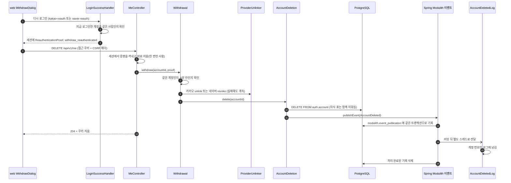

- 이벤트 기록 표에 남겨 두기 때문에, 듣는 쪽이 처리하기 전에 서버가 꺼져도 다시 처리할 수 있습니다. 완료된 기록은 지웁니다(`completion-mode: delete`). [확정, `application.yml` 2026-10-04]
- 지금은 듣는 쪽이 `AccountDeletedLog` 하나뿐입니다. 사이클 06 의 내 도서관 모듈이 같은 방식으로 듣게 될 예정이라고 코드 주석에 적혀 있습니다. [확정, 주석 확인]

---

## 4. 데이터 표 (ERD)

Liquibase 파일(`db/changelog/<모듈>/…`)에 있는 실제 표입니다. 표 이름은 `스키마_표` 로 적었습니다(예: `auth_account` = `auth.account`). 점선은 **외래 키 없이 번호만 담아 둔 관계**(모듈 사이)입니다.

```mermaid
erDiagram
    region_region {
        bigint id PK
        bigint parent_id FK "시도면 비어 있음"
        text level "SIDO 또는 SIGUNGU"
        text name
        text short_name
        text legal_dong_code "10자리"
        text status "ACTIVE 또는 ABOLISHED"
        date abolished_on
    }
    region_region_replacement {
        bigint region_id PK,FK
        bigint replaced_by_id PK,FK
        date effective_on
    }
    library_library {
        bigint id PK
        text name UK
        text library_type "EBOOK"
        text platform_type "화면 종류 7가지"
        text base_url UK
        text eligibility_summary
        text extra_condition_text
        boolean visit_required
        text join_method
        text join_url
        text join_caution
        text join_notice
        text homepage_url
        integer holdings_count
        date holdings_counted_on
        boolean deferred
        boolean enabled
    }
    library_eligibility_rule {
        bigint id PK
        bigint library_id FK
        text basis "RESIDENCE WORK SCHOOL AFFILIATION"
        text scope_type "REGION INSTITUTION NATIONWIDE"
        bigint scope_region_id "region id, FK 없음"
        bigint scope_institution_id
    }
    catalog_catalog_import {
        bigint id PK
        text source
        timestamptz imported_at
        integer book_count
        integer holding_count
        integer skipped_count
    }
    catalog_book {
        bigint id PK
        text title
        text author_display
        text publisher
        text title_norm "pg_bigm 색인"
        text main_title_norm
        text publisher_norm "pg_bigm 색인"
        date published_on
        text isbn13 UK
        text content_type
    }
    catalog_book_contributor {
        bigint id PK
        bigint book_id FK
        text name
        text name_norm "pg_bigm 색인"
        text name_exact
        text role
        smallint position
    }
    catalog_holding {
        bigint id PK
        bigint book_id FK
        bigint library_id "library id, FK 없음"
        text platform
        text item_key
        text detail_url
        text content_type
        timestamptz first_seen_at
    }
    catalog_catalog_library_snapshot {
        bigint library_id PK "FK 없음"
        timestamptz collected_at
        bigint import_id FK
    }
    auth_account {
        bigint id PK
        timestamptz created_at
        timestamptz last_login_at
    }
    auth_login_method {
        bigint id PK
        bigint account_id FK
        text method "NAVER 또는 KAKAO"
        text subject "제공자 번호"
        timestamptz created_at
    }
    auth_account_consent {
        bigint id PK
        bigint account_id FK
        text consent_type
        text document_version
        timestamptz agreed_at
    }
    auth_refresh_token {
        bigint id PK
        bigint account_id FK
        bytea token_hash UK "SHA-256"
        bytea previous_token_hash
        timestamptz expires_at
        timestamptz rotated_at
    }
    modulith_event_publication {
        uuid id PK
        text listener_id
        text event_type
        text serialized_event
        timestamptz publication_date
        timestamptz completion_date
        text status
    }

    region_region ||--o{ region_region : "parent_id"
    region_region ||--o{ region_region_replacement : "region_id"
    region_region ||--o{ region_region_replacement : "replaced_by_id"
    library_library ||--o{ library_eligibility_rule : "library_id"
    region_region ||..o{ library_eligibility_rule : "scope_region_id, FK 없음"
    catalog_book ||--o{ catalog_book_contributor : "book_id"
    catalog_book ||--o{ catalog_holding : "book_id"
    library_library ||..o{ catalog_holding : "library_id, FK 없음"
    catalog_catalog_import ||--o{ catalog_catalog_library_snapshot : "import_id"
    library_library ||..o| catalog_catalog_library_snapshot : "library_id, FK 없음"
    auth_account ||--o{ auth_login_method : "account_id"
    auth_account ||--o{ auth_account_consent : "account_id"
    auth_account ||--o{ auth_refresh_token : "account_id"
```

- 모든 표에는 위에 적지 않은 `created_at`/`updated_at` 같은 시각 열이 더 있는 경우가 있습니다(예: `region.region`, `library.library`). [확정]
- 같은 모듈 안 외래 키는 대부분 `ON DELETE CASCADE` 입니다. 그래서 `auth.account` 한 줄을 지우면 로그인 수단·동의·토큰이 함께 지워집니다. [확정]
- `catalog` 표는 Liquibase 가 아니라 가져오기 프로그램(`CatalogWriter`)이 채웁니다. `region`, `library` 데이터는 Liquibase 의 CSV/YAML 로 들어갑니다. [확정]
- `modulith.event_publication` 은 어느 업무 모듈에도 속하지 않는 Spring Modulith 의 기록 표입니다. [확정]
- 테스트용 `region/900-region-test-abolished.yaml` 이 마스터 changelog 에 포함되어 있습니다. 운영 DB 에도 들어가는지 [확인 필요].

---

## 5. 적용된 설계 패턴

코드에서 실제로 확인한 것만 적었습니다.

| 패턴 | 어디에 | 쉬운 말로 무엇을 얻나 | 근거 파일 |
|---|---|---|---|
| 어댑터 (Adapter) | `PlatformAdapter` 와 7개 구현(`KyoboV1Adapter`, `KyoboSubscriptionV1Adapter`, `Yes24V1Adapter`, `Yes24V2Adapter`, `Yes24V3Adapter`, `ElibPortalV1Adapter`, `GangnamV1Adapter`) | 모양이 제각각인 도서관 화면을 같은 모양(`ParsedPage`)으로 바꿔 줍니다. 새 화면 종류가 생기면 어댑터 하나만 추가하면 됩니다. | `backend/src/main/java/com/chaekcheck/availability/internal/adapter/PlatformAdapter.java` |
| 템플릿 메서드 (Template Method) | `KyoboV1ScreenAdapter`(추상)가 읽는 순서를 정하고, 하위 클래스는 `pathPrefix()`, `hasCounts()` 만 채움 | 교보 일반 사이트와 구독 사이트가 같은 읽기 코드를 나눠 씁니다. | `.../availability/internal/adapter/KyoboV1ScreenAdapter.java` |
| 전략 (Strategy) | `AvailabilityResolver` 구현 3개(`CountResolver`, `SubscriptionResolver`, `SiteListResolver`) | "빌릴 수 있나"를 정하는 방법을 화면 종류마다 바꿔 끼웁니다. 묶음 실행 코드는 방법을 몰라도 됩니다. | `.../availability/internal/resolve/AvailabilityResolver.java`, `AvailabilityResolvers.java` |
| 전략 (Strategy) | `SiteResultDelivery` 구현 2개(`OneShotDelivery`, `ProgressiveDelivery`), `forResolution()` 이 고름 | 결과를 한 번에 보낼지, 먼저 보내고 나중에 줄별 판정을 덧붙일지 상황에 따라 고릅니다. | `.../availability/internal/search/SiteResultDelivery.java` |
| 전략 + 설정으로 고르기 | `SiteFetcher` 구현 2개(`DirectSiteFetcher`, `FetchServiceSiteFetcher`), `AvailabilityConfiguration.siteFetcher()` 가 `fetch.mode` 로 고름 | 직접 호출과 대리 서버 호출을 코드 수정 없이 설정으로 바꿉니다. | `.../availability/internal/config/AvailabilityConfiguration.java` |
| 레지스트리 (Registry, 종류별 표) | `AvailabilityResolvers.byPlatform`, `LibraryPageFetcher.adapters`, `DetailPageFetcher.adapters` (모두 `EnumMap`) | "화면 종류 → 담당자" 짝을 한 곳에 모아 둡니다. | `.../resolve/AvailabilityResolvers.java`, `.../fetch/LibraryPageFetcher.java` |
| 캐시 (읽을 때 채우기, read-through) + 같은 요청 합치기 | `SearchPageCache`/`CaffeineSearchPageCache`, `DetailVerdictCache`/`CaffeineDetailVerdictCache` (Caffeine `AsyncCache`, 3분) | 같은 페이지를 3분 안에 다시 받지 않습니다. 동시에 같은 페이지를 원하면 사이트에는 한 번만 갑니다. 실패는 기억하지 않습니다. 인터페이스 뒤에 있어 나중에 Redis 로 바꿀 수 있습니다. | `.../availability/internal/fetch/SearchPageCache.java`, `CaffeineSearchPageCache.java` |
| 호출 간격 제한 (Throttle) | `HostThrottle`/`InMemoryHostThrottle` (사이트 주소별 `Semaphore` + 최소 간격) | 한 도서관 사이트에 한 번에 하나, 1초 간격으로만 요청해 사이트에 부담을 주지 않습니다. 기다리다 마감이 지나면 TIMEOUT. | `.../availability/internal/fetch/InMemoryHostThrottle.java` |
| 동시 처리 칸 제한 (Bulkhead) | `FetchController.slots`(`Semaphore`) | 대리 서버가 감당할 만큼만 받고, 넘치면 바로 503 으로 돌려보내 backend 가 다음 서버로 가게 합니다. | `fetch-service/src/main/java/com/chaekcheck/fetch/FetchController.java` |
| 장애 조치 (Failover) + 쉬는 시간 | `FetchServiceSiteFetcher.restingUntil` | 대리 서버 하나가 죽으면 잠시 쉬게 하고 다음 서버로 넘깁니다. 완전한 서킷 브레이커는 아니고, "일정 시간 건너뛰기"만 합니다. | `.../availability/internal/fetch/FetchServiceSiteFetcher.java` |
| 묶음 실행 틀 + 세션 인터페이스 | `BatchRunner.runTasks()` 하나를 `BatchSession`, `HoldingSession`(`LaunchSession` 구현)이 같이 씀 | 검색 페이지와 책 상세 페이지가 똑같은 출발 규칙(5곳 동시, 20줄 제한, 마감)을 따릅니다. | `.../availability/internal/search/BatchRunner.java` |
| 상태 없는 서버, 브라우저가 상태를 들고 다님 | 다음 묶음 후보를 브라우저가 `candidates` 로 보냄 | 서버를 여러 대로 늘리거나 재시작해도 검색이 꼬이지 않습니다. | `BatchRunner.java` 클래스 주석, `web/src/api/searchStream.ts` |
| SSE 스트리밍 + 출력 포트 | `SseEmitter`, `EventSink` 인터페이스와 `SseEventSink` 구현 | 도서관 결과가 오는 대로 화면에 보여 줍니다. 테스트에서는 `EventSink` 를 목록 모으기로 바꿔 씁니다. | `.../availability/internal/web/SseEventSink.java`, `.../search/EventSink.java` |
| 저장소 (Repository) | Spring Data `RegionRepository`, `LibraryRepository`, `EligibilityRuleRepository` / SQL 직접 쓰는 `AccountStore`, `RefreshTokenStore`, `JdbcCatalogHoldings`, `PgBigmBookSearch` | DB 읽고 쓰는 코드를 한 클래스에 모아, 업무 코드가 SQL 을 몰라도 되게 합니다. | `.../region/internal/RegionRepository.java`, `.../auth/internal/account/AccountStore.java` |
| 공개 창구 (Published interface, Facade 성격) | `RegionDirectory`, `LibraryCatalog`, `CatalogHoldings` + 패키지 안쪽 구현(`RegionService`, `LibraryService`, `JdbcCatalogHoldings`) | 다른 모듈은 창구만 보고, 안쪽 구조를 바꿔도 영향을 받지 않습니다. | `.../region/RegionDirectory.java`, `.../library/LibraryCatalog.java`, `.../catalog/CatalogHoldings.java` |
| 검색 저장소 교체용 인터페이스 | `BookSearch` / `PgBigmBookSearch` | pg_bigm 이 느려지면 다른 검색 방식으로 갈아 끼울 수 있게 해 둡니다. | `.../catalog/internal/search/BookSearch.java` |
| 도메인 이벤트 + 이벤트 기록 표 (outbox 비슷) | `AccountDeletion` 이 `AccountDeleted` 발행, `AccountDeletedLog` 가 `@ApplicationModuleListener` 로 받음, `modulith.event_publication` 표 | 탈퇴 사실을 다른 모듈에 직접 부르지 않고 알립니다. 같은 트랜잭션에 기록하므로 서버가 꺼져도 잃지 않습니다. | `.../auth/internal/account/AccountDeletion.java`, `AccountDeletedLog.java`, `db/changelog/modulith/001-event-publication.yaml` |
| 기능 스위치 (Feature toggle) | `AuthToggleEnvironmentPostProcessor` + `@ConditionalOnAuthEnabled` | `chaekcheck.auth.enabled` 하나로 로그인 기능 전체(보안 필터 포함)를 켜고 끕니다. | `.../auth/internal/AuthToggleEnvironmentPostProcessor.java`, `ConditionalOnAuthEnabled.java` |
| 한 곳에서만 지우기 (단일 진입점) | `AccountDeletion.delete()` 를 탈퇴·웹훅·매일 정리가 모두 사용 | 지우는 규칙(이벤트 발행 포함)이 한 군데에만 있어 빠뜨릴 일이 없습니다. | `AccountDeletion.java`, `DailyAccountCleanup.java`, `UnlinkWebhookController.java` |
| 토큰 교체와 재사용 감지 (Refresh token rotation) | `RefreshTokenStore.rotate()` 가 `Rotated` / `Reused` / `Rejected` 중 하나를 돌려줌 | 로그인 유지 토큰을 쓸 때마다 새것으로 바꾸고, 옛 토큰이 다시 오면 도난으로 보고 그 로그인을 끝냅니다. DB 에는 해시만 둡니다. | `.../auth/internal/token/RefreshTokenStore.java`, `TokenService.java` |
| 닫힌 결과 종류 (sealed interface) | `RefreshTokenStore.Rotation`, `LookupTask` | 가능한 경우를 코드로 못 박아 두어, 하나를 빠뜨리면 컴파일이 실패합니다. | `RefreshTokenStore.java`, `.../search/LookupTask.java` |
| 빈 값 대신 기본 객체 (Null object 성격) | `LibraryService.UserRegions.NONE`, `PlanOptions.DEFAULT`, `DetailLookupResolver` 의 `UNKNOWN` 판정 | "지역 없음", "거르지 않음", "모름"을 null 대신 실제 객체로 둬서 null 검사 없이 같은 코드가 돕니다. | `.../library/internal/LibraryService.java`, `.../library/PlanOptions.java`, `.../resolve/DetailLookupResolver.java` |
| 값 객체 (record) | `AccountId`, `SearchQuery`, `PageKey`, `SearchTarget`, `HoldingRef` 등 | 값만 담고 바뀌지 않아 여러 스레드에서 안심하고 씁니다. | `.../auth/AccountId.java`, `.../availability/internal/fetch/PageKey.java` |
| 단계별 처리 (Pipeline) | `CatalogImporter.run()`: 읽기 → 묶기 → 국가서지 → 같은 글 합치기 → 쓰기 | 책 목록 가져오기를 단계로 나눠 각 단계 시간과 개수를 보고서(`ImportReport`)에 남깁니다. | `.../catalog/internal/importer/CatalogImporter.java` |
| 공통 오류 응답 (Problem Details + `@RestControllerAdvice`) | `ApiExceptionHandler`, `CatalogErrors`, `AvailabilityErrors` | 잘못된 입력이나 실패를 모두 같은 모양(`code`, `errors`)의 JSON 으로 돌려줍니다. | `backend/src/main/java/com/chaekcheck/ApiExceptionHandler.java` |
| 입력 문지기 (Guard) | `UrlGuard.check()`, `DetailPageFetcher.checkedUri()` | 대리 서버가 내부망을 부르지 않게 하고, 책 상세 주소가 그 도서관 사이트 주소일 때만 요청합니다. | `fetch-service/.../UrlGuard.java`, `.../resolve/DetailPageFetcher.java` |
| 빌더 (Builder, 라이브러리 제공) | `Caffeine.newBuilder()`, `HttpClient.newBuilder()`, `JwtClaimsSet.builder()`, `UriComponentsBuilder` | 설정이 많은 객체를 한 줄씩 읽기 쉽게 만듭니다. 직접 만든 빌더 클래스는 없습니다. | `CaffeineSearchPageCache.java`, `TokenService.java`, `KyoboV1ScreenAdapter.java` |

- 가상 스레드: 페이지 가져오기는 `Executors.newVirtualThreadPerTaskExecutor()` 로 돌립니다. 기다리는 일이 많은 작업을 가볍게 많이 띄우기 위한 선택입니다. [확정, `AvailabilityConfiguration.java`]

---

## 6. 웹 화면 쪽

### 6-1. 화면 부품 나무

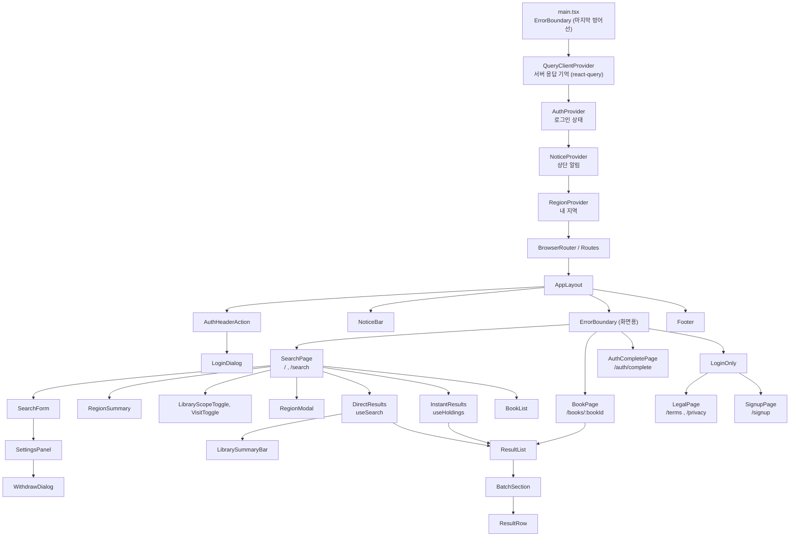

- `SearchPage` 는 설정에 따라 셋 중 하나를 보여 줍니다: `DirectResults`(도서관에서 직접 찾기), `InstantResults`(바로 보기: 책 목록 + 도서관별 상태), `BookList`(책 먼저 고르기: 책 목록만). [확정]
- `BookPage` 는 책 한 권(`fetchBook`)과 그 책의 도서관별 상태(`useHoldings`)를 보여 줍니다. [확정]

### 6-2. 화면이 쓰는 갈고리(hook)와 공유 상태(context)

| 이름 | 하는 일 | 파일 |
|---|---|---|
| `AuthProvider` / `useAuth` / `useOptionalAuth` | 로그인 상태를 `checking`, `off`, `signed-out`, `signed-in` 넷 중 하나로 화면 전체에 나눠 줍니다. | `web/src/features/auth/AuthContext.tsx` |
| `NoticeProvider` / `useNotice` / `NoticeBar` | 로그인·탈퇴 뒤 상단 알림 한 줄을 보여 줍니다. | `web/src/features/auth/NoticeContext.tsx` |
| `RegionProvider` / `useRegions` | 고른 지역을 브라우저(`localStorage`)에 저장하고, 앱을 열 때 서버에 "아직 쓸 수 있나" 물어 고칩니다. 확인이 끝나기 전(`ready` false)에는 검색을 미룹니다. | `web/src/features/region/RegionContext.tsx`, `regionStorage.ts` |
| `useRegionTree` | 지역 목록을 react-query 로 받아 기억합니다. | `web/src/features/region/useRegionTree.ts` |
| `useSearch` | "직접 찾기" 스트림을 열고, 들어오는 이벤트를 `reducer` 로 쌓습니다. 다음 묶음, 도서관별 더 보기, 지역 오류 시 한 번 다시 확인을 맡습니다. | `web/src/features/search/useSearch.ts` |
| `useHoldings` | 책들의 도서관별 상태 스트림을 열고 `holdingsReducer` 로 쌓습니다. 다음 묶음 후보도 여기서 계산합니다. | `web/src/features/search/useHoldings.ts`, `holdingPlan.ts` |
| `searchStream.ts` (`readStream`) | `EventSource` 대신 `fetch` 로 SSE 를 읽습니다. 그래야 400/422 오류 내용을 읽을 수 있고, 자동 재접속으로 도서관에 같은 요청을 반복하지 않습니다. | `web/src/api/searchStream.ts`, `sseParser.ts` |
| `auth.ts` (`meRequest`, `refresh`) | 401 이면 토큰을 새로 받고 다시 보냅니다. 여러 탭이 동시에 새로 받지 않게 `navigator.locks` 로 줄을 세웁니다. CSRF 쿠키를 헤더로 돌려보냅니다. | `web/src/api/auth.ts` |

### 6-3. 웹에 적용된 패턴

| 패턴 | 어디에 | 쉬운 말로 | 근거 |
|---|---|---|---|
| Context Provider | `AuthProvider`, `NoticeProvider`, `RegionProvider` | 여러 화면이 같은 상태(로그인, 알림, 지역)를 props 를 줄줄이 넘기지 않고 꺼내 씁니다. | `web/src/main.tsx` |
| 커스텀 훅 (custom hook) | `useSearch`, `useHoldings`, `useRegions`, `useAuth`, `useRegionTree` | 화면 그리기와 데이터 다루기를 나눕니다. 화면 부품은 훅이 준 값만 그립니다. | `web/src/features/search/useSearch.ts` 등 |
| 리듀서 (useReducer) | `useSearch` 의 `reducer`, `useHoldings` 의 `holdingsReducer` | 스트림 이벤트가 많이 들어와도 "이벤트 하나 → 새 상태 하나" 규칙으로만 바뀌어 예측하기 쉽고, 리듀서만 따로 시험할 수 있습니다. | `useSearch.ts`, `holdingPlan.ts` |
| 주소를 상태로 (URL as state) | 검색 조건, 필터, 범위, 방문, 설정이 주소(`useSearchParams`)에 들어감 | 주소를 복사해 보내면 같은 검색 화면이 열리고, 뒤로 가기가 자연스럽게 됩니다. | `web/src/features/search/SearchPage.tsx` |
| 서버 응답 캐시 (react-query) | `QueryClientProvider`, `useRegionTree`, `LoginDialog` 의 제공자 목록 | 한 번 받은 목록을 다시 받지 않습니다. | `web/src/main.tsx`, `useRegionTree.ts`, `LoginDialog.tsx` |
| 오류 경계 (Error Boundary) | 바깥 하나(`main.tsx`), 화면용 하나(`AppLayout`, 주소가 바뀌면 초기화) | 한 화면에서 오류가 나도 앱 전체가 하얗게 죽지 않고 "다시 시도"를 보여 줍니다. | `web/src/components/ErrorBoundary.tsx`, `AppLayout.tsx` |
| 요청 취소 (AbortController) | `useSearch`, `useHoldings`, `BookList`, `InstantResults`, `BookPage` | 검색 조건을 바꾸거나 화면을 떠나면 열려 있던 스트림을 끊어 낭비를 막습니다. | `useSearch.ts`, `useHoldings.ts` |
| 접근 문지기 부품 | `LoginOnly` | 로그인 기능이 꺼져 있으면 약관·가입 화면을 보여 주지 않습니다. | `web/src/features/auth/LoginOnly.tsx` |
| 브라우저 저장 | 지역·검색 설정은 `localStorage`, 로그인 뒤 돌아갈 주소는 `sessionStorage` | 다시 와도 지역과 설정이 남아 있습니다. 돌아갈 주소는 탭을 닫으면 사라집니다. | `regionStorage.ts`, `searchSettings.ts`, `authResult.ts` |

---

## 확인 필요

| 항목 | 내용 | 확인 방법 |
|---|---|---|
| Spring Modulith 문서 최신 여부 | `components.puml` 에 `auth` 상자가 없음(`module-auth.puml` 은 있음). 빌드 산출물이 오래됐거나, 관계 없는 모듈은 빠지는 것일 수 있음 | dev 에서 문서 생성 테스트 다시 실행 후 비교 (개발 쪽에 요청) |
| fetch-service 내부 필드 | `FetchResult`, `FetchProperties`, `LibraryClient` 의 필드·메서드는 읽지 않음 | 해당 파일 직접 읽기 |
| 테스트용 지역 데이터 | `region/900-region-test-abolished.yaml` 이 마스터 changelog 에 들어 있어 운영 DB 에도 적용되는지 | 그 파일의 `context`/`labels` 확인 |
| `Eligibility`, `LibraryType` enum 값 전체 | 그림에는 일부만 적음 | `library/Eligibility.java`, `LibraryType.java` 읽기 |
| `KyoboV1Adapter`, `KyoboSubscriptionV1Adapter` 의 `pathPrefix()` 값 | `PlatformType` 주석(`/elibrary-front`)으로만 짐작 | 두 파일 직접 읽기 |
