# 데이터 모델 (현재)

현재 설계 전체를 적은 문서입니다.

이 문서 맨 아래 「변경 기록」에 사이클마다 무엇을 반영했는지 적어 두었습니다.

- Liquibase 파일: `region/001-region-schema.yaml`, `region/002-region-seed.yaml`(+CSV), `region/900-region-test-abolished.yaml`(context `test-data`), `library/001-library-schema.yaml`, `library/002-library-seed.yaml`, `library/003-library-seed-cycle02.yaml`, `004-library-seed-kyobo.yaml`, `005-library-seed-yes24.yaml`, `006-library-seed-moved.yaml`(각각 CSV `loadData`)
- 사이클 07 Liquibase (구현됨 (사이클 07)): 처음에 새 파일 7개로 넣고 대조한 뒤, 배포 전(`PRE_DEPLOYMENT` 동안) 스키마 changeset을 모듈의 첫 파일로 접음 — `library/007` → `library/001`(`join_survey`, `lending_model`, `join_method` NULL 허용 + CHECK, 화면 종류 둘), `catalog/002`·`003` → `catalog/001`(`book.library_ids`와 GIN, `catalog.catalog_import` 표·`catalog_library_snapshot.import_id` 없앰), `collection/003` → `collection/001`(책 번호 셈 칸). seed 파일은 그대로 [확정] (인계서 C8, 합치기 [확정]. 접는 방식은 [이유 미확인: dev가 정함]). 지금 master 순서(사이클 07 부분): `library/008` → `collection/001` → `collection/002` → `library/009` → `library/010` [확정] (dev 구현 확인, 2026-10-05)
  - `library/008-library-seed-candidates.yaml` + CSV(`008-library-candidates.csv` 사이클 07에서 넣은 2,394곳 줄, `008-eligibility-rule-candidates.csv` 가입 규칙 줄) — IDENTITY 맞춤. 번호 1~280 도서관의 `lending_model`(C6)은 이 파일의 두 번째 changeset UPDATE
  - `collection/001-collection-schema.yaml`: 스키마 `collection`, `collection.collection_link`, 가져오기 기록 `collection.catalog_import` [확정] (dev 구현 확인, 2026-10-05)
  - `collection/002-collection-seed-candidates.yaml` + `002-collection-link.csv`(짝: 번호 1~280 도서관의 같은 번호 짝 + 사이클 07에서 넣은 2,394곳의 짝). 번호 1~280 짝도 `library.library`를 읽지 않고 CSV 줄로 적음(다른 모듈 표를 읽지 않기 위해) [확정] (dev 구현 확인, 2026-10-05)
  - `library/009-library-logos.yaml` + `009-library-logos.csv`: 로고 칸 둘 + `logo_file` 값(임시 표 `library.logo_seed`에 `loadData` → UPDATE → 표 지움) [확정] (dev 구현 확인, 2026-10-05)
  - `library/010-library-disabled.yaml`: 135 전라북도교육청통합도서관, 2194 장안대학교 (YES24), 2198 성균관대학교 (YES24)를 `enabled = false` [확정] (사용자 승인, 2026-10-05, 17단계)
  - 사이클 18 A1 구현됨 (dev 커밋 `d8513f7`~`d3e8413`, dev main `a0e438a`, 회고 2026-10-15): `library/016-library-disabled-cycle18.yaml` (changeset `library-016-disabled-cycle18`, author `chaekcheck`, master 끝 `# cycle 18` 주석 아래) — 44, 112, 168, 261, 269, 305, 318, 323, 378, 425, 455, 514, 537, 622, 623, 625, 626, 721, 1045, 1131, 1620, 2023을 `enabled = false` [확정] (사용자 승인, 2026-10-14, ADR-0109). 이유는 dev `scripts/library/disabled_reasons.tsv`·`docs/library-site-issues.md`. 이미 켜진 도서관을 끄거나 다시 켤 때는 새 변경 파일로 (내 PC·운영 같은 판, 반영 비교가 켜진 도서관을 보므로). 원래 DB(5432)에는 사이클 16 `bootRun` 때 적용됨(켜진 도서관 2,664 → 2,642). 운영 DB 반영(C)은 사이클 17 첫 배포 뒤
  - 합칠 때 대조 규칙 [확정] (사용자 제안, 2026-10-05): 둘 다 있으면 합치고 다른 점은 목록으로 보고, 새 파일에만 있으면 넣고, **옛 파일에만 있으면 지우지 않고** dev가 그 사이트 첫 화면을 열어 확인 → 열리지 않거나 바뀌었으면 `enabled = false` 제안 목록을 사용자에게 보여 주고 사용자가 정함 (ADR 없음, 사이클 07 design-delta "데이터"에만 기록). 대조 결과: 이름·화면 종류·주소 다른 곳 0, 옛 파일에만 있는 곳 2(59·131, 이미 꺼짐, 그대로 둠)
  - 지역 seed `region/002`에 증평군(4311) 추가, 전남광주통합특별시 `short_name` "전남광주" [확정] (사용자 결정, 2026-10-05, 배포 전 규칙으로 고침)
- 사이클 08 Liquibase (구현됨 (사이클 08)), 새 파일로 더함. 파일 이름은 dev가 정함 [확정] (dev 구현 확인, 2026-10-11; 설계 [안]의 `collection/004`·`005`, `library/011`·`012`·`013` 번호와 다름): `collection/003-import-period-and-timings.yaml`(changeset `collection-003-import-period-and-timings`: 수집 기간·단계별 시간, `collection-003-import-status`: 상태·실패 칸), `collection/004-national-bibliography.yaml`(두 표), `library/011-updated-at-trigger.sql`, `region/003-updated-at-trigger.sql`(master에서 이번 사이클 다른 changeset보다 앞), `library/012-library-mobile-site-differs.yaml`(칸 + 13곳 UPDATE), `library/013-library-name-overrides.yaml`(이름 고침 UPDATE). 트리거 파일은 dev `CLAUDE.md` 규칙대로 formatted SQL: 첫 줄 `--liquibase formatted sql`, `splitStatements:false`, `CREATE OR REPLACE`, `runOnChange:true` [확정] (사용자 승인, 2026-10-11, 설계 검토)
  - 교보 대여·혼합 11곳(2664~2674): `PRE_DEPLOYMENT`가 남아 있으므로 `library/008-library-candidates.csv`와 `collection/002-collection-link.csv`에서 그 줄을 지우고 로컬 `db`·`db-test`를 초기화해 다시 적용 [확정] (사용자: "그냥 DB에서 삭제", 2026-10-10; ADR-0067). 이유: 아직 다른 사용자에게 배포되지 않음 (사용자: "이거 다른 사용자들에게 배포 안 되었어. 그냥 DB에서 삭제", 2026-10-10)
- 사이클 13 Liquibase — 구현됨 (사이클 13, 회고 2026-10-14) (`docs/cycles/13-crawler-to-dev/design-delta.md` "데이터"):
  - `collection/001-collection-schema.yaml`: 칸 `candidate_library_count` → `other_library_count`, 제약 `catalog_import_candidate_library_count_check` → `catalog_import_other_library_count_check` 이름만 직접 고침(설명 주석이 붙어 지금 52·53행, `collection/001-collection-schema.yaml:36-53`). 배포 전 규칙(`PRE_DEPLOYMENT`)으로 기존 파일을 고치므로 체크섬이 바뀜 → 고침 방식 [확정] (사용자 선택 "기존 파일을 고침", 2026-10-12, 사이클 14와 같은 방식). 로컬 `db`·`db-ops`는 같은 이름 바꾸기 SQL + `databasechangelog.md5sum` NULL로 데이터를 지키며 맞춤(dev 세션이 함), `db-test`는 다시 띄움 [확정] (사용자 선택 "가벼운 방법", 2026-10-12). 이번 사이클에서 기존 파일을 고치는 것은 이 하나
  - `collection/006-library-insert-run.yaml`(changeset id `collection-006-library-insert-run`): 새 표 `collection.library_insert_run`만 [확정] (dev 구현 확인, 2026-10-14)
  - `library/015-library-name-1215.yaml`: 1215 이름 고침 [확정] (dev 구현 확인, 2026-10-14). 운영 역할 DB에도 판 2 반영 **전에** 적용돼 있어야 도서관 해시가 맞음
  - master(`db.changelog-master.yaml`) 끝줄은 사이클 13(`collection/006`, `library/015`)과 사이클 14(`popular/001` → `picks/001`)가 함께 손댐 — 합친 결과(실제 끝): `# cycle 13` 주석 아래 `library/015` → `collection/006`, 그 뒤 `# cycle 14: librarian picks (ADR-0089)` + `picks/001-picks-schema.yaml` (dev master 92~94행) [확정] (dev 구현 확인, 2026-10-14)
  - 앞으로 도서관 seed changeset을 만들지 않음 — 새 도서관은 `collection` 넣기 명령으로 [확정] (ADR-0084)
- 사이클 15 Liquibase — 구현됨 (사이클 15, 회고 2026-10-15): 새 파일 `db/changelog/usagelog/001-usagelog-schema.yaml`(changeset id `usagelog-001-*` 아홉 개)을 master 맨 끝에 [확정], 기존 changeset 수정 없음. 실제 master 끝 순서 (dev master 96~112행, 회고 2026-10-15): `# cycle 18` `library/016` → `# cycle 16` 세 줄(`sitecontent/001`, `sitecontent/002`, `auth/002`) → `# cycle 15` `usagelog/001` 맨 끝 [확정] (dev 구현 확인). 원래 DB(5432)에 적용, 표 여덟 확인. 사이클 16(`sitecontent` [확정])과는 schema가 달라 어느 쪽이 먼저여도 되고, main에 합치는 순서대로 끝에 붙이고 나중에 합치는 쪽이 rebase해 자기 줄을 맨 끝으로 옮김(이미 다른 DB에 돈 changeset은 고치지 않음) [확정] (사이클 15·16 인계서 같은 규칙)
- 사이클 16 Liquibase — 구현됨 (사이클 16, 회고 2026-10-15): 새 changelog 파일로 추가, 기존 changeset 수정 없음(사이클 15와 나란히 개발하고 작업 폴더마다 DB가 따로라 기존 changeset을 고치면 다른 작업 폴더의 DB 체크섬이 깨짐, 사이클 14 dev 기록) [확정]
  - `sitecontent/001-sitecontent-schema.yaml`: 스키마·표 셋(표·CHECK는 `sql` changeset), changeset id `sitecontent-001-*` 넷(`schema`·`notice`·`notice-version`·`document-version`) [확정] (dev 구현 확인, 2026-10-15)
  - `sitecontent/002-sitecontent-seed.yaml`: 개발 DB 첫 판 = 지금 웹 코드의 글을 마크다운으로(이용약관·동의문·처리방침·서비스 안내, 공지는 없음). `sql` + `$$` + `splitStatements: false` [확정] (dev 적용 시험, 2026-10-14: `$$`·세미콜론이 그대로 들어감). changeset id `sitecontent-002-*` 넷(`terms-of-service`·`privacy-collection`·`privacy-policy`·`about`). 개발 DB 시행일 `2026-10-04`(지금 동의 기록과 이어짐). 동의문·처리방침의 로그인 수단은 카카오만 [확정] (사용자, 2026-10-13). 서비스 안내 첫 판은 `docs/cycles/16-notices-and-policies/drafts/about.md`(dev `AboutPage.tsx`와 맞춤, 2026-10-14)
  - `auth/002-consent-version-number.yaml`(changeset id `auth-002-consent-version-number`): 테스트 계정 동의 기록 값 `'2026-10-04'` → `'1'` + 형식 CHECK(아래 `auth.account_consent`). 원래 DB(5432)에 사이클 16 `bootRun`으로 적용, 동의 값 2줄 바뀜 (회고 2026-10-15)
  - master 끝에 추가. 지금 끝줄은 `# cycle 14` `picks/001-picks-schema.yaml`(dev main 2026-10-14), 사이클 15가 `usagelog/001-usagelog-schema.yaml`을 붙임. main에 합치는 순서대로 끝에 붙이고, 나중에 합치는 쪽이 rebase해서 자기 줄을 맨 끝으로 옮김 [확정] (사이클 15 인계서와 같은 규칙). 실제: 18 `library/016` → 16 세 줄 → 15 `usagelog/001` (회고 2026-10-15)
  - 사이클 21 Liquibase — 구현됨 (사이클 21, 회고 2026-10-17): 새 파일 `picks/002-curated-lists.yaml`, `usagelog/003-screen-event-picks-list.yaml`을 master 끝에 `# cycle 21: recommended lists (ADR-0122, ADR-0126)` 주석과 함께 붙임, 기존 changeset은 고치지 않음 [확정] (dev 구현 확인, 2026-10-17). 실제 master 끝: `# cycle 19` `usagelog/002` → `# cycle 21` `picks/002` → `usagelog/003` (dev master 114~122행, 19가 먼저 main에 들어감). 운영 역할 DB(db-ops)·원래 DB 모두 가져오기 명령이 켜질 때 Liquibase로 적용(2026-10-17). `usagelog` 번호: 002는 사이클 19, 003은 21, 사이클 20은 004 [확정] (사용자 승인, 2026-10-16). 21이 19보다 먼저 main에 들어가면 번호를 바꾸지 말고 master 순서만 맞춤(나중에 합치는 쪽이 자기 줄을 끝으로). 자세한 것은 아래 `picks`·`usagelog` 절
  - 사이클 20 Liquibase — 설계됨(미구현, 사이클 20, 1단계): 새 파일 `usagelog/004-library-response-source-extension.yaml`을 master 끝에 `# cycle 20` 주석과 함께, 기존 changeset 수정 없음 [확정] (설계 결정 #6, 사이클 21 설계 검토 #4). 나중에 main에 합치는 쪽이 include를 master 맨 끝으로. 자세한 것은 아래 `usagelog` 절
  - 운영 첫 판: 운영 DB는 검토한 글(`docs/cycles/16-notices-and-policies/drafts/`, 승인 2026-10-13)부터 시작하고, 첫 판의 시행일은 모르는 사람에게도 공개하는 날(첫 배포일 아님). 그 전에 seed를 검토한 글·공개일로 바꾸고 개발 DB는 초기화, 테스트 계정은 다시 가입 [확정] (사용자 승인·제안, 2026-10-13). 이미 돈 `sitecontent/002`를 고치는 일이라 `PRE_DEPLOYMENT` 표시가 있는 동안에만 함 — 사이클 17이 표시를 지우기 전에 (사이클 17 체크리스트)
- CHECK, 부분 인덱스, `UNIQUE NULLS NOT DISTINCT`는 Liquibase OSS YAML이 지원하지 않아 changeset 안의 `sql`로 만듦
- **배포 전 규칙** [확정] (사용자, 2026-09-28): dev의 `db/changelog/PRE_DEPLOYMENT` 파일이 있는 동안에는 이미 적용된 changeset도 고칠 수 있습니다(로컬 DB를 지우고 다시 적용). 첫 배포 때 이 파일을 지우고, 그 뒤로는 새 파일만 더합니다. 그래서 사이클 02 스키마 변경은 `library/001`에 합쳐져 있습니다

원칙: 모듈마다 자기 스키마와 테이블을 가지고, 모듈 간 FK·JOIN은 두지 않습니다 (dev CLAUDE.md, spring-modulith 스킬, ADR-0002).

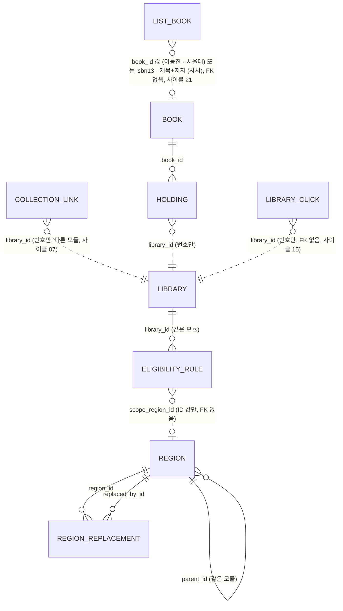

- `COLLECTION_LINK`는 사이클 07에 더한 표입니다(구현됨 (사이클 07)). `BOOK`·`HOLDING`의 자세한 관계는 아래 `catalog` 그림.
- `LIST_BOOK`(스키마 `picks`)은 사이클 21에 사이클 14의 `PICK`을 대신하는 표입니다 — 구현됨 (사이클 21, 회고 2026-10-17). `PICK`은 사이클 14에 더한 표(구현됨 (사이클 14))이고 `picks/002`가 줄을 옮긴 뒤 지움. 사이클 10의 `RANKING_ENTRY`(스키마 `popular`)는 지움 — 구현됨 (사이클 14). 자세한 것은 아래 `picks` 절.
- `LIBRARY_CLICK`(스키마 `usagelog`)은 사이클 15에 더한 표입니다 — 구현됨 (사이클 15, 회고 2026-10-15). `usagelog`의 다른 표도 도서관·책·지역 번호를 값으로만 남김. 자세한 것은 아래 `usagelog` 절.
- 스키마 `sitecontent`(사이클 16)는 다른 모듈 표와 FK·JOIN이 없어 이 그림에 넣지 않음 — 구현됨 (사이클 16, 회고 2026-10-15). `auth.account_consent.document_version`은 판 순번 값만 기억함. 자세한 것은 아래 `sitecontent` 절.

사이클 24 cycle-close (2026-10-24, 브랜치 `claude/compassionate-lovelace-mzvp4f`, 사이클 23과 나란히): AI 책 찾기 — 새 스키마 `aisearch`(`search_book`, `daily_usage`), `usagelog.ai_search_event` — . 근거 `docs/cycles/24-ai-book-search/design-delta.md`, ADR-0150~0153. 설계됨(미구현, 사이클 24)

## 스키마 `region` (소유: `region` 모듈) — 구현됨

### `region.region` — 시도·시군구

| 컬럼 | 타입 | 제약 | 설명 |
|---|---|---|---|
| id | bigint | PK, 자동 증가 없음 | seed에서 직접 부여. 모든 환경에서 같아야 함 (ADR-0003) |
| parent_id | bigint | NULL, FK → region.region(id) | 시군구의 상위 시도 |
| level | text | NOT NULL, CHECK IN ('SIDO','SIGUNGU') | 일반구는 넣지 않음 |
| name | text | NOT NULL | |
| short_name | text | NULL | 시도 표시용 짧은 이름 [안] |
| legal_dong_code | text | NOT NULL, 10자리 숫자 | 속성일 뿐 키가 아님 |
| status | text | NOT NULL, CHECK IN ('ACTIVE','ABOLISHED') | 폐지된 지역은 지우지 않음 |
| abolished_on | date | NULL | |
| created_at / updated_at | timestamptz | NOT NULL DEFAULT now() | 사이클 08 (구현됨 (사이클 08)): `updated_at`은 `BEFORE UPDATE FOR EACH ROW` 트리거로 고칠 때마다 DB가 적음(값이 그대로여도 바뀜), 함수 `region.set_updated_at()`, 트리거 `region_set_updated_at` (`region/003-updated-at-trigger.sql`) [확정] (dev 구현 확인, 2026-10-11). [확정] (사용자 승인, 2026-10-10; ADR-0068) |

- CHECK: 시도면 parent_id 없음, 시군구면 있음 / 폐지면 abolished_on 있음
- UNIQUE `(legal_dong_code) WHERE status='ACTIVE'`, INDEX `(parent_id) WHERE status='ACTIVE'`

### `region.region_replacement` — 폐지·대체 연결

| 컬럼 | 타입 | 제약 | 설명 |
|---|---|---|---|
| region_id | bigint | NOT NULL, FK → region.region(id) | 폐지된 지역 |
| replaced_by_id | bigint | NOT NULL, FK → region.region(id) | 대체한 지역 |
| effective_on | date | NOT NULL | 시행일 |

- PK `(region_id, replaced_by_id)`, CHECK `region_id <> replaced_by_id`, INDEX `(replaced_by_id)`
- 대체한 지역이 둘 이상이면 나뉨(SPLIT). 갱신할 때 순환이 없는지 테스트로 확인 [안]

## 스키마 `library` (소유: `library` 모듈) — 구현됨

### `library.library` — 도서관 (전자도서관 사이트 하나 = 한 줄, ADR-0017)

| 컬럼 | 타입 | 제약 | 설명 |
|---|---|---|---|
| id | bigint | PK, GENERATED BY DEFAULT AS IDENTITY | |
| name | text | NOT NULL. 사이클 09: UNIQUE `library_name_key`를 지우고 (이름, 업체, 대출 방식, 순번) 조합 UNIQUE `library_classification_key`로 바꿈 — 구현됨 (사이클 09) [확정] (ADR-0071) | 기관 정식 이름만. 이름 끝의 업체·대출 방식 괄호((YES24), (교보), (북큐브), (알라딘), (구독), (구독형), (소장), (소장형), (대여), "(교보, 호스트)" 꼴)는 두지 않고, 기관 이름의 일부인 괄호((주), (임직원) 등)는 남김 (spec R1). 같은 기관의 여러 사이트는 이름이 아니라 `vendor`·`lending_model`·`order_no`로 구분 — 구현됨 (사이클 09) [확정] (ADR-0071). (사이클 08까지: 같은 기관의 여러 사이트는 "(구독)", "(YES24)", "(교보)" 등을 이름에 붙여 구분, 이름 UNIQUE) |
| library_type | text | NOT NULL DEFAULT 'EBOOK', CHECK IN ('EBOOK') | 종류. 실물 도서관 사이클에 `PHYSICAL` 추가 |
| platform_type | text | NULL, CHECK IN ('KYOBO_V1','KYOBO_SUBSCRIPTION_V1','YES24_V1','YES24_V2','YES24_V3','ELIB_PORTAL_V1','GANGNAM_V1') — 사이클 07: `BOOKCUBE_FX`, `ALADIN_V1` 추가(9개) [확정] (ADR-0056), 구현됨 (사이클 07) | 화면 종류 (ADR-0016, 세대 번호 ADR-0023) |
| base_url | text | NULL, UNIQUE | adapter가 경로를 붙이는 사이트 루트(리다이렉트 뒤 최종 주소). 교보·YES24·구독형·강남구는 origin, 포털은 `…/elib`, 강원교육청 포털은 `?menu_idx=2`까지. 사이클 07에서 넣은 2,394곳도 리다이렉트를 따라간 https 최종 주소(248곳을 수집 DB 주소에서 바꿈) [확정] (사용자 요청, 2026-10-05) |
| eligibility_summary | text | NULL | 자격 문구 |
| extra_condition_text | text | NULL | 판정 못 하는 자격 문구 (예: "책이음 회원 가입 가능"). 참고 글로만 보이고 가입 판정·"가입 가능한 곳" 범위에 영향 없음 (C3-U-2) |
| visit_required | boolean | NOT NULL DEFAULT false | 방문 가입. 전자책 이용에 도서관 방문이 필요하면 true. 원문이 전자책 회원 등급을 따로 말하지 않고 가입 절차에 방문 단계만 있어도 true (C3-U-1). "방문 없이 가입" 필터(`visit=none`)와 무리 안 순서(맨 뒤)에 쓰임 (ADR-0027) |
| join_method | text | 사이클 07부터 NULL 허용 + CHECK `library_join_method_check`(`join_survey <> 'SURVEYED' OR join_method IS NOT NULL`) [확정], 구현됨 (사이클 07) | 가입 방법 한 줄. 전자책 기준으로 적음 (종이책 회원증 절차만 적으면 `visit_required`와 어긋남, C3-U-1). 가입 조건을 조사하지 않은 곳(`MEMBERS_ONLY`·`NOT_SURVEYED`, 사이클 07부터 넣은 곳)은 NULL |
| join_url | text | NULL | 가입·자격 안내 페이지. 없으면 링크 없이 글자만 (C2-U-4) |
| join_caution | text | NULL | "주의" 문구. 가입 판정·필터는 바꾸지 않고, 같은 그룹 안 순서에서 뒤로 (C2-U-11) |
| join_notice | text | NULL | "안내" 문구(누구를 위한 도서관인지). 판정·필터·정렬에 영향 없음 (C2-U-15) |
| homepage_url | text | NULL | 이 줄의 첫 화면(전자도서관 줄은 전자도서관 첫 화면). 요약 줄 이름 링크 (C2-U-13) |
| holdings_count | integer | NULL, CHECK ≥ 0 | 순위 값. 빈 검색 전체 건수(사실상 보유 전자책 수). 구독형은 NULL |
| holdings_counted_on | date | NULL | 조사일. `holdings_count`와 둘 다 있거나 둘 다 없음 |
| deferred | boolean | NOT NULL DEFAULT false | 판정 없는 포털 후순위 (경북·전북) |
| enabled | boolean | NOT NULL DEFAULT true | 사용 여부. 운영자가 SQL로 변경. 사이클 07에 135·2194·2198을 끔(`library/010`) |
| join_survey | text | NOT NULL DEFAULT 'SURVEYED', CONSTRAINT `library_join_survey_check` CHECK IN ('SURVEYED','NOT_FOUND','MEMBERS_ONLY','NOT_SURVEYED') | 가입 조사 상태(Java enum `JoinSurvey`). `MEMBERS_ONLY`·`NOT_SURVEYED`는 직접 추가일 때만 계획에, API 등급 `UNSURVEYED`. 사이클 07에서 넣은 2,394곳: `MEMBERS_ONLY` 2,252, `SURVEYED` 90, `NOT_SURVEYED` 35, `NOT_FOUND` 17 (dev 1단계 셈). 구현됨 (사이클 07). 태그: [확정] (ADR-0053), 값 이름 [확정] (dev 구현 확인, 2026-10-05) |
| lending_model | text | NULL, CONSTRAINT `library_lending_model_check` CHECK IN ('OWNED','SUBSCRIPTION','MIXED','RENTAL') | 교보 구독형 화면 기관의 소장·구독·혼합·대여(Java enum `LendingModel`). NULL이면 지금 규칙(화면 종류로 판정). 값 출처: 수집 세션 `kyobo-institutions-probe-2026-10-03.tsv` `library_model`(값이 소장·혼합·대여 셋뿐이라 `SUBSCRIPTION`을 받은 곳은 없음). 쓰는 곳: 소장 스트림에서 `OWNED`면 상세 쪽을 읽음(목록 판정은 줄마다 숫자 유무로, 이 값을 보지 않음). 구현됨 (사이클 07). 태그: [확정] (사용자 승인, 2026-10-05, 설계 검토). **사이클 09 — 구현됨 (사이클 09)**: 통합 포털(`vendor = 'PORTAL'`) 말고 모든 도서관에 값을 둠, 새 CHECK `library_lending_model_required_check ((vendor = 'PORTAL') = (lending_model IS NULL))` [확정] (사용자 승인, 2026-10-11). `vendor`가 NULL(실물 도서관)이면 식이 NULL이라 통과. 채우는 규칙은 아래 "도서관 이름과 분류". 검색·소장 판정 동작은 바뀌지 않음(대출 방식으로 갈리는 곳은 교보 구독형 && `!= OWNED` 하나이고, 교보 구독형에 `OWNED`를 새로 넣는 곳은 없음) [확정] (dev 코드 확인, `docs/cycles/09-library-naming/research.md` 2절). 화면 표시(업체 · 대출 방식)와 겹침 확인에도 씀. 014 적용 뒤(2,663줄): `OWNED` 2,634, `SUBSCRIPTION` 11, `RENTAL` 9, `MIXED` 2, NULL 7(통합 포털) — 포털 말고 NULL 0 [확정] (dev 측정, 2026-10-12, `docs/cycles/09-library-naming/retro.md`) |
| vendor | text | NULL 허용, CONSTRAINT `library_vendor_check` CHECK IN ('KYOBO','YES24','BOOKCUBE','ALADIN','PORTAL','IN_HOUSE'), CONSTRAINT `library_vendor_required_check` (`library_type <> 'EBOOK' OR vendor IS NOT NULL`) — 지금 `library_type`은 EBOOK뿐이라 늘 필수, 실물 도서관 사이클에서 다시 봄 | 업체(Java enum `Vendor`). 사이클 09 — 구현됨 (사이클 09). 도서관 수집이 정한 사실로 보고 seed 생성 스크립트가 씀, DB는 허용 값만 확인 [확정] (ADR-0071; DB가 화면 종류에서 계산하는 안은 미승인, 사용자: "역할 분리"). 지금은 화면 종류 대응표로 정함: `KYOBO_V1`·`KYOBO_SUBSCRIPTION_V1` → `KYOBO`, `YES24_V1~V3` → `YES24`, `BOOKCUBE_FX` → `BOOKCUBE`, `ALADIN_V1` → `ALADIN`, `ELIB_PORTAL_V1` → `PORTAL`, `GANGNAM_V1` → `IN_HOUSE` [확정] (spec R2). 교보 일반과 교보 구독형은 같은 `KYOBO`. 태그: 칸·값 [확정] (사용자 승인, 2026-10-11, `docs/cycles/09-library-naming/easy/2026-10-11-design-delta-review.html`), 필수 CHECK [확정] (사용자 승인, 2026-10-11, `easy/2026-10-11-review-decisions.html`). 014 적용 뒤: `KYOBO` 1,642, `YES24` 547, `BOOKCUBE` 441, `ALADIN` 25, `PORTAL` 7, `IN_HOUSE` 1, NULL 0 [확정] (dev 측정, 2026-10-12). 대응표와 다른 업체 0곳 |
| order_no | integer | NOT NULL DEFAULT 1, CONSTRAINT `library_order_no_check` CHECK (`order_no >= 1`) | 같은 (이름, 업체, 대출 방식) 묶음 안의 순번. 보통 1, 같은 묶음이 또 들어오면 seed 생성 스크립트가 서비스 번호 순으로 2, 3을 붙이고 목록으로 보여 줌. 사이트 이름을 확인하면 이름을 고치고 1로 되돌림 (spec R4-4). 지금은 모두 1 (014 적용 뒤 순번 2 이상 0곳 [확정], dev 측정 2026-10-12). 사이클 09 — 구현됨 (사이클 09). 태그: [확정] (사용자 승인, 2026-10-11) |
| logo_file | text | NULL | 로고 파일 이름(웹 정적 파일 `/library-logos/{logo_file}`), NULL = 없음(화면에 아무것도 그리지 않음). 198곳. 구현됨 (사이클 07). 태그: [확정] (ADR-0059, dev 구현 확인, 2026-10-05) |
| logo_visible | boolean | NOT NULL DEFAULT true | 운영자가 끄면 로고를 바로 숨김(`logoUrl` null). 구현됨 (사이클 07). 태그: [확정] 방법 (spec R9-7), 이름 [확정] (dev 구현 확인, 2026-10-05) |
| mobile_site_differs | boolean | NOT NULL DEFAULT false | 폰에서 사이트가 다르게 보임(API `mobileSiteDiffers`, 웹 YES24 폰 안내). 13곳 true (dev `library-site-issues.md` 10-1; 224, 230, 260, 2586, 238, 2190, 2277, 229, 2164, 2533, 2195, 2222, 1824 — 1824는 교보), `library/012-library-mobile-site-differs.yaml`. 구현됨 (사이클 08). 태그: [확정] (사용자 승인, 2026-10-10), 이름 [확정] (dev 구현 확인, 2026-10-11). 근거: ADR 없음, 사용자 결정 (사이클 08 scope 3, 2026-10-05; 칸으로 둠 2026-10-10) |
| created_at / updated_at | timestamptz | NOT NULL DEFAULT now() | 사이클 08 (구현됨 (사이클 08)): `updated_at`은 `BEFORE UPDATE FOR EACH ROW` 트리거로 고칠 때마다 DB가 적음(값이 그대로여도 바뀜), 함수 `library.set_updated_at()`, 트리거 `library_set_updated_at` (`library/011-updated-at-trigger.sql`) [확정] (dev 구현 확인, 2026-10-11). [확정] (사용자 승인, 2026-10-10; ADR-0068) |

- CHECK 이름: `library_library_type_check`, `library_platform_type_check`, `library_ebook_site_check`(`library_type <> 'EBOOK' OR (platform_type IS NOT NULL AND base_url IS NOT NULL)`), `library_holdings_count_check`, `library_holdings_counted_check`. UNIQUE `library_base_url_key`, `library_classification_key`(사이클 09; 사이클 08까지 있던 `library_name_key`는 014에서 지움). 사이클 07: `library_join_method_check`, `library_join_survey_check`, `library_lending_model_check` 추가 [확정] (dev 구현 확인, 2026-10-05) — 구현됨 (사이클 07). 사이클 09 — 구현됨 (사이클 09): UNIQUE `library_name_key`를 지우고 `library_vendor_check`, `library_vendor_required_check`, `library_lending_model_required_check`, `library_order_no_check`, UNIQUE `library_classification_key` 추가 (아래 "도서관 이름과 분류")
- 운영 기관으로 묶는 테이블은 없습니다 (backlog, 실물 도서관 사이클에서 검토)
- 이름 고침 (구현됨 (사이클 08), 사이클 08 design-delta "이름 고치기"): 이름 이력은 DB 표가 아니라 dev `scripts/library/name_overrides.tsv` 목록에 둠 [확정] (dev 구현 확인, 2026-10-11). 칸 `library_id`, `old_name`, `new_name`, `changed_on`, `source_url`, `checked_on` [확정] (사용자: "나. 이름 고침 목록에 옛 이름·새 이름·바뀐 날·출처를 함께 적음 … 이걸로 해줘", 2026-10-11). seed 생성 스크립트(`build_candidate_seed.py`)가 이 목록을 읽어 다음 seed에서도 새 이름을 유지(목록의 옛 이름이 seed 이름과 다르거나 겹침이 생기면 멈춤). 이미 적용된 seed 파일은 고치지 않고 changeset `library/013-library-name-overrides.yaml`에서 번호 + 옛 이름 조건으로 UPDATE(`WHERE l.id = v.id AND l.name = v.old_name`) [확정] (dev 구현 확인, 2026-10-11). `library.name` UNIQUE 위반 확인(사이클 09부터는 (이름, 업체, 대출 방식, 순번) 겹침 확인 — 구현됨 (사이클 09))
  - 고친 8곳 [확정] (사용자: "모두 바꿔줘", 2026-10-11; 공식 출처는 dev `library-maintenance.md` 4-12): 434 경상대학교 → 경상국립대학교 (북큐브), 456 국립안동대학교 → 국립경국대학교 (북큐브), 2264 서라벌대학교 → 신경주대학교, 2563 대검 도서관 → 공소청 도서관, 2611 강서공업고등학교 → 서울디지털콘텐츠고등학교, 2161 한국형사정책연구원 → 한국형사·법무정책연구원, 1079 농수산물유통공사 → 한국농수산식품유통공사, 1016 국가평가교육진흥원 → 국가평생교육진흥원
  - 434·456의 "(북큐브)"는 같은 학교의 다른 사이트(745 "경상국립대학교", 2239 "국립경국대학교")와 이름이 겹쳐(`library.name` UNIQUE) 붙음. 사이클 09에서 괄호를 떼고 업체로 구분: 434 "경상국립대학교", 456 "국립경국대학교" — 구현됨 (사이클 09) [확정] (ADR-0071, `docs/cycles/09-library-naming/architect-proposal.md` 결정 3)
  - 흡수된 학교 7곳(428, 429, 769, 2257, 607, 895, 1002)은 사이클 08에서 이름을 그대로 둠 [확정] (사용자: "모두 그대로", 2026-10-11). 사이클 09에서 6곳을 고침(895 "한경국립대학교", 1002 "한국공학대학교", 769·2257 "강원대학교 강릉캠퍼스", 428 "국립창원대학교 거창캠퍼스", 429 "국립창원대학교 남해캠퍼스"), 607 원광보건대학은 보류 — 구현됨 (사이클 09) [확정] (사용자 승인, 2026-10-11, spec R1-10; dev가 공식 출처로 다시 확인)
  - seed를 다시 만드는 방식 [확정] (사용자 승인, 2026-10-11, `docs/cycles/08-polish-swap-memory/easy/2026-10-11-midpoint-decisions.html`): 첫 배포 전까지는 번호로 UPDATE하는 changeset을 더함 → 첫 배포 바로 전에 seed를 한 번 다시 만듦 → 배포 뒤에는 seed를 고정하고 바뀐 것은 새 changeset으로 냄. 배경: seed CSV를 다시 만들면 이미 적용된 `loadData`의 checksum이 바뀜 (dev 설명; Liquibase는 적용된 changeset이 바뀌면 checksum 오류, https://docs.liquibase.com/concepts/changelogs/attributes/runonchange.html 확인 2026-10-11)
- 이번 괄호 떼기(사이클 09)는 한 번만 하는 예외이고, 그 뒤에는 "한 번 정한 이름은 바꾸지 않음"(예외: 공식 개명·틀린 이름, 이름 고침 목록)을 지킴 [확정] (ADR-0071, spec R1-5)
- 도서관을 찾고·넣고·끄는 절차는 dev `docs/library-maintenance.md`에 있습니다 (C2-U-7). plan `collection-method.md`와 겹침. **절차의 원본 = dev `library-maintenance.md`, 조사 기록·근거 = plan** [확정] (사용자, 2026-10-01. `docs/reference-index.md`). dev `plan-feedback.md` C2-U-7에 대한 답은 다음 인계서로 전달
- 사이클 13 — 구현됨 (사이클 13, 회고 2026-10-14) (ADR-0083·0084·0093): 칸 변경 없음. 새 도서관 줄과 가입 규칙 줄은 seed가 아니라 `library`의 공개 `LibraryRegistry.add`(`collection` 넣기 명령이 부름)로 들어가고, 번호는 부르는 쪽이 정함(`id`가 `GENERATED BY DEFAULT AS IDENTITY`라 직접 넣을 수 있음, 넣은 뒤 `setval(pg_get_serial_sequence('library.library','id'), GREATEST(max(id), 시퀀스 값))` [확정] (dev 구현 확인, `JdbcLibraryRegistry.java:81-82`)). 같은 번호가 있으면 실패, 값 검사는 이 표의 CHECK·UNIQUE. 넣기 비교용 읽기 `LibraryRegistry.listAll()`(꺼진 곳 포함, 화면 종류 `platform_type` 포함, `collection`은 이 표를 읽지 않음). 1215 `name` `한화S&amp;C` → `한화S&C` [확정] (사전 결정 8), changeset `library/015-library-name-1215.yaml` [확정] (dev 구현 확인, 2026-10-14)

### 도서관 이름과 분류 — 구현됨 (사이클 09)

ADR-0071(이름에는 기관 이름만, 업체·대출 방식은 분류로), ADR-0076(분류 값은 API로, 이름은 번호로 고치는 changeset). 근거 `docs/cycles/09-library-naming/design-delta.md` "데이터", spec R1~R4. 흐름 그림은 `flows.md` 흐름 23.

- 겹치면 안 되는 것: UNIQUE NULLS NOT DISTINCT `library_classification_key (name, vendor, lending_model, order_no)`. 비어 있는 대출 방식(통합 포털)끼리도 같은 값으로 보고, 꺼진 도서관도 셈. 이름 UNIQUE를 대신함 [확정] (ADR-0071, 사용자 승인 2026-10-11, spec R4-1·2). `UNIQUE NULLS NOT DISTINCT`는 YAML이 지원하지 않아 raw `sql`
- 다른 기관이 겹치면 정식 이름으로 나누고, 같은 사이트는 받지 않음으로 표시. 순번이 붙은 곳은 사이트 이름을 확인해 고치고 순번을 1로 되돌림 [확정] (ADR-0071)
- Liquibase: 새 파일 `library/014-library-classification.yaml`, changeSet 하나 `library-014-classification-2026-10-11` [확정] (dev 구현 확인, 2026-10-12, `014-library-classification.yaml:15`). 이미 적용된 changeset·seed는 고치지 않음 [확정] (ADR-0076). 칸·제약은 raw `sql`. 이름 UPDATE 문장만 `splitStatements: false`(1149 옛 이름 "메리츠(증권&amp;amp;캐피탈)"에 세미콜론이 있어 Liquibase가 문장을 나누므로) [확정] (사용자 승인, 2026-10-12, `docs/cycles/09-library-naming/easy/2026-10-12-retro-decisions.html` #3). 다음 이름 고침 changeset도 문자열에 세미콜론이 있으면 같음. 운영 `db`에 적용함(dev, 2026-10-12). changeset 안 순서 [확정] (사용자 승인, 2026-10-11; 구현도 같은 순서, 허용 값 CHECK `library_vendor_check`는 칸 추가와 함께, 나머지 CHECK 셋은 `order_no` 다음 한 문장으로 — 받아들임 [확정] (사용자 승인, 2026-10-12, retro-decisions #3)):
  1. `ALTER TABLE library.library DROP CONSTRAINT library_name_key`
  2. 이름 UPDATE: `(id, old_name, new_name)` VALUES, `WHERE l.id = v.id AND l.name = v.old_name` (013과 같은 꼴). 목록은 dev `scripts/library/name_overrides.tsv`에서 만듦
  3. `ADD COLUMN vendor text`, 화면 종류 대응표로 UPDATE
  4. `lending_model` UPDATE (아래 표, `WHERE lending_model IS NULL`인 줄만). 구현은 번호 VALUES 1,458줄 대신 **화면 종류 규칙 + 번호**: 번호는 북큐브 339·380·386·705와 교보 구독형 59·131·140·275~278만, 나머지는 화면 종류 규칙. 2단계 스크립트 출력(1,458줄)과 결과가 같음을 따로 띄운 DB에서 확인 [확정] (사용자 승인, 2026-10-12, retro-decisions #3)
  5. `ADD COLUMN order_no integer NOT NULL DEFAULT 1`
  6. CHECK 셋(`library_vendor_check`·`library_vendor_required_check`, `library_lending_model_required_check`, `library_order_no_check`) 추가
  7. UNIQUE `library_classification_key` 추가 (마지막에 둬서 도중 상태에서 위반이 나지 않게). 겹치는 줄이 남으면 unique 위반으로 배포가 멈춤
- 이름 UPDATE 대상 (spec R1, 번호당 한 줄, 새 이름은 최종 이름 하나)

| 무엇 | 곳 | 근거 |
|---|---|---|
| 이름 끝 업체·대출 방식 괄호 떼기 | 277 (dev seed 셈 2026-10-11) | spec R1-1 |
| 434 "경상국립대학교 (북큐브)" → "경상국립대학교", 456 "국립경국대학교 (북큐브)" → "국립경국대학교" | 2 | ADR-0071 |
| 76 "서대문구립도서관", 64 "경상남도교육청 마산도서관", 93 "양산시립도서관", 943 "경상남도교육청 양산도서관", 1575 "완주동상초등학교", 1149 "메리츠(증권&캐피탈)", 386 "진천군립도서관" | 7 | spec R1-3·4·8·11, R4-3 |
| 977 "국립경국대학교" | 1 | spec R1-9 |
| 895, 1002, 769·2257, 428, 429 (흡수된 학교) | 6 | spec R1-10, dev가 공식 출처로 다시 확인 |

- 위 표의 합(293)은 겹침을 빼지 않은 수이고, 실제 이름 UPDATE는 289줄 [확정] (사용자: 이름 바꿀 289줄 목록을 보고 "승인, 커밋", 2026-10-11; `014-library-classification.yaml:26-314`). 괄호 셈 뗄 277 / 남길 45 / 애매 2가 plan과 같음 [확정] (dev, 2026-10-12). `name_overrides.tsv`는 최종 295줄(이번에 287줄 더함). 014 `old_name`은 013까지 적용한 로컬 `db`를 내보내 `--changes-only <db-state.tsv>`에 넣어 만듦 [확정] (dev 구현 확인, 2026-10-12). 공식 이름 10곳(학교 6곳, 977, 943, 64 등)은 spec 이름과 같음 [확정]. 괄호 떼기는 `name_overrides.tsv`의 `changed_on`에 `label-removed` [확정], 사이트 제목·공식 출처로 고친 곳은 그 출처
- 대출 방식 채우기 (spec R3, 값이 비어 있는 줄만)

| 도서관 | 값 | 태그 |
|---|---|---|
| `KYOBO_V1`, `YES24_V1~V3`, `ALADIN_V1`, `GANGNAM_V1` | `OWNED` (화면에 보유·대출·예약 권수가 보임) | [확정] |
| `BOOKCUBE_FX` 중 목록 XML 전체 권수(`totalVolume`)가 0이고 책이 있는 곳: 339·380·386·705 | `SUBSCRIPTION` | 규칙 [확정], 번호 339·380·386·705 [확정] (dev가 `bookcube-volume-2026-10-11.tsv` + `collection_link`로 다시 맞춤, 2026-10-12) |
| 나머지 `BOOKCUBE_FX` (응답 없음·책 0종 5곳 포함, 다음 수집 때 다시 봄) | `OWNED` | [확정] |
| `KYOBO_SUBSCRIPTION_V1` 중 비어 있는 번호 1~280 도서관 59, 131, 140, 275, 276, 277, 278 | `SUBSCRIPTION` (지금도 구독으로 동작, 동작 그대로) | [확정] |
| `KYOBO_SUBSCRIPTION_V1` 중 값이 있는 곳 | 그대로 (수집 세션 probe) | [확정] (사이클 07) |
| `ELIB_PORTAL_V1` (7곳) | NULL 그대로 | [확정] |

- 적용 뒤 확인: 겹침 0(UNIQUE가 걸리면 됨), `order_no`가 모두 1, `vendor` NULL 0, 포털 말고 `lending_model` NULL 0 — 모두 통과 (dev 014 적용 결과 2,663줄, 2026-10-12). 남은 기관 이름 속 괄호 45줄은 0단계 "남길 줄"과 같은 번호·이름(1149만 이스케이프를 고침, AC-2)
- R1~R3을 적용해도 겹치던 곳은 이 규칙으로 풀림: 부산광역시 전자도서관 338/339(339가 구독), 양산 93/943(이름), 제주한라도서관 140/1109(140이 구독), 부여대왕초등학교 1575/1576(1575를 "완주동상초등학교"로) [확정] (spec R4-3)
- 도서관 번호는 바뀌지 않으므로 내 도서관(브라우저·로그인 계정)에 넣은 도서관은 그대로 남음 [확정] (dev 코드 확인, spec R1-6)
- 수집 DB(`chaekcheck-data`)의 이름도 같은 이름으로 바꿈(서비스 번호 ↔ 수집 번호는 `collection_link`) [확정] (사용자: "이렇게 가자", 2026-10-11). 방법·때: 지금 한 번에, 수집 세션이 수집기가 쉬는 때 수집 번호와 옛 이름이 맞을 때만 UPDATE [확정] (사용자 승인, 2026-10-12, `docs/cycles/09-library-naming/easy/2026-10-12-retro-decisions.html` #2). 넘길 목록 dev `data/cycle09/collection-rename-list.tsv`(git 밖, 서비스 번호·수집 번호·최종 이름 289줄, 그중 237줄은 수집 번호가 서비스 번호와 다름 → `collection_link`가 반드시 필요). 실제로 바꿨는지 [확인 필요: 수집 세션]

### `library.eligibility_rule` — 자격 규칙 (ADR-0004 구조, ADR-0013으로 뜻 변경)

| 컬럼 | 타입 | 제약 | 설명 | 상태 |
|---|---|---|---|---|
| id | bigint | PK, GENERATED BY DEFAULT AS IDENTITY | |
| library_id | bigint | NOT NULL, FK → library.library(id) ON DELETE CASCADE | 도서관 한 줄(전자도서관 사이트 하나)을 가리킴 |
| basis | text | NOT NULL, CHECK IN ('RESIDENCE','WORK','SCHOOL','AFFILIATION') | 근거 |
| scope_type | text | NOT NULL, CHECK IN ('REGION','INSTITUTION','NATIONWIDE') | 범위 종류. `NATIONWIDE` = 누구나 |
| scope_region_id | bigint | NULL | `region` 모듈 ID (FK 없음) |
| scope_institution_id | bigint | NULL | 다음 사이클용 (FK 없음) |
| created_at | timestamptz | NOT NULL DEFAULT now() | |

- CHECK: REGION이면 scope_region_id만, INSTITUTION이면 scope_institution_id만, NATIONWIDE이면 둘 다 없음
- UNIQUE NULLS NOT DISTINCT `(library_id, basis, scope_type, scope_region_id, scope_institution_id)`, INDEX `(library_id)`
- **규칙이 없는 도서관 = 자격 미확인** (ADR-0013). 규칙이 SCHOOL/AFFILIATION뿐인 도서관은 "지역 규칙 있음"과 같이 봄 (지역 없음 → `QUALIFIED`)
- 사이클 07 (구현됨 (사이클 07)): 이 규칙은 `join_survey = 'SURVEYED'`·`'NOT_FOUND'` 도서관에 그대로 적용합니다. `MEMBERS_ONLY`·`NOT_SURVEYED`는 규칙 줄이 없어도 "자격 미확인"으로 전체 검색에 넣지 않고 직접 추가했을 때만 넣습니다 [확정] (ADR-0053, ADR-0013 보완). 사이클 07에서 넣은 곳 중 가입 조건을 조사한 공공도서관(`public-join-2026-10-05.tsv`, `decision` 칸)은 `SURVEYED` + 이 표에 규칙 줄을 seed로 넣음 [확정]. 넣은 규칙 253줄(증평군 추가 뒤) [확정] (dev 구현 확인, 2026-10-05). 기관 소속 규칙(`AFFILIATION` + `INSTITUTION`)은 기관 표가 없어 쓰지 않음 → 대구학생전자도서관(100049)은 `MEMBERS_ONLY` [확정] (사용자 결정 "구성원용으로", 2026-10-05)

## 스키마 `catalog` (소유: `catalog` 모듈) — 구현됨(사이클 04), 사이클 07 변경 구현됨 (사이클 07), 사이클 08 바꿔 끼우기 구현됨 (사이클 08)

> 사이클 26 — 구현됨 (사이클 26, 회고 2026-10-29): 책 설명 표 6개(`book_summary`·`book_cover`·`book_profile`·`book_search`·`tag_dictionary`·`book_tag`)가 이 스키마에 더해짐. 가져오기 바꿔 끼우기는 책 목록 표 4개만 DROP·SET SCHEMA하고, 설명 표는 남기되 버려진 책 번호의 줄을 같은 트랜잭션에서 지움(ADR-0162). 이 문서 끝 「책 설명 표 (사이클 26)」

수집한 전자책 목록(사실 정보)입니다. 데이터는 Liquibase가 아니라 가져오기(importer)가 넣습니다(ADR-0031). 사이클 04~06에는 `catalog` importer가 넣었고, 사이클 07부터는 `collection` 모듈이 가져오기를 맡아 `catalog`의 공개 기능 `CatalogLoad.replaceAll(source, loader)`로 이 표들을 통째로 바꿉니다 — 구현됨 (사이클 07), ADR-0060이 ADR-0031의 가져오기 위치를 바꿈. **바꾸는 방식은 새 표에 쓰고 바꿔 끼우기**입니다 — 구현됨 (사이클 08), ADR-0065·0070 (아래 "가져오기: 새 표에 쓰고 바꿔 끼우기"). 사이클 07 코드는 한 트랜잭션에서 임시 표에 COPY → 책 번호 잇기 → `TRUNCATE`로 표 비우고 옮김 → 커밋 뒤 `VACUUM (ANALYZE)`이라 쓰는 동안 검색이 기다리고 소장 번호를 새로 매겼습니다(사이클 08 가져오기 #1에서 검색이 멈춘 시간 9분 37초). 사이클 08 가져오기 #2(2026-10-11, 교보 대여·혼합 11곳을 뺀 같은 사본): 책 1,615,125, 사람 1,810,906, 소장 17,714,665, kept 1,615,125 / new 0 / dropped 0, 끝난 뒤 DB 8,550MB(`holding` 6,714MB, `book` 1,000MB, `book_contributor` 312MB) (dev 측정). 책 번호 잇기: 옛 `holding`과 `(library_id, item_key)`로 맞대어 `docs/research/ebook-catalog/catalog-refresh.md` 5.2절 규칙대로 옛 번호를 이어 줌 [확정] (사용자: "이것도 같이 구현해 줘", 모듈 "catalog 해줘", 2026-10-05). 실데이터 2회차(같은 사본): kept 1,617,445, new 0, dropped 0. 로컬 DB 적재(2026-10-05): 책 1,617,445, 사람 1,812,646, 소장 20,383,882, DB 전체 9,812MB(`holding` 8,353MB, `book_library_ids_gin` 48MB). 주기 갱신은 별도 사이클(`docs/research/ebook-catalog/catalog-refresh.md`), 앞으로 갱신도 `collection`에서.

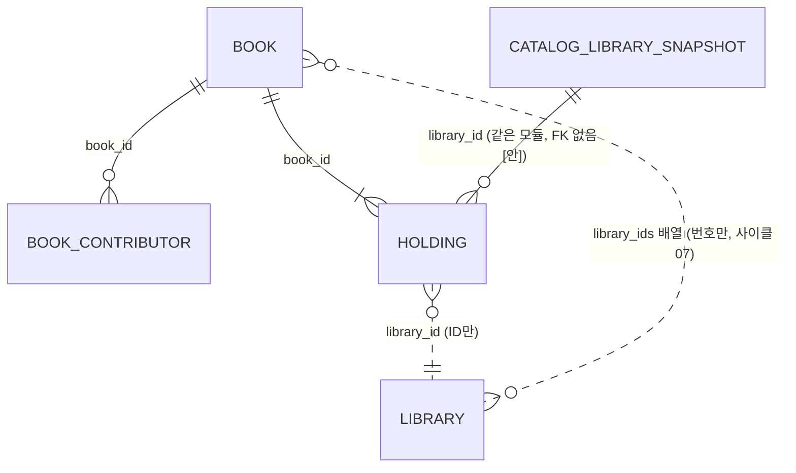

- 사이클 07부터 `catalog_import` 표와 `catalog_library_snapshot.import_id`는 없습니다(가져오기 기록은 `collection.catalog_import`).

| 테이블.컬럼 | 타입 | 제약 | 설명 | 상태 태그 |
|---|---|---|---|---|
| `book.id` | bigint | PK, GENERATED BY DEFAULT AS IDENTITY | 책 번호 잇기로 옛 번호를 이음, 다시 쓰지 않음(ADR-0062). 사이클 08 바꿔 끼우기: 새 표 IDENTITY = max(옛 최대값, 옛 시퀀스) + 1 (구현됨 (사이클 08)) | [확정] 이름, [확정] 번호 규칙 |
| `book.title` | text | NOT NULL | 표시용 대표 제목(묶인 소장 원문 중 가장 많이 나온 것) | [안] 규칙 |
| `book.author_display` | text | NULL | 표시용 대표 저자 원문. 사이클 19 — 구현됨 (사이클 19, 회고 2026-10-18) (ADR-0113): 묶음에서 가장 많은 원문 표기를 고른 뒤, 가져올 때 기호(꺾쇠 `<>`·`＜＞`, `〈〉「」《》` 표시)를 떼고 붙은 역할 낱말 뒤를 띄운 글(`Contributors.displayText`, 보호 장치 표기는 그대로). 반영 뒤 꺾쇠·다른 괄호가 든 값 104,853 → 0 (dev 측정, 2026-10-16) | [안], 사이클 19 뜻 [확정] (명세 결정 #4, 화면 흐름 #1) |
| `book.publisher` | text | NULL | 표시용 대표 출판사 원문 | [안] |
| `book.title_norm` | text | NOT NULL | 전체 제목 정리값(NFKC·소문자·공백 제거) | [안] |
| `book.main_title_norm` | text | NOT NULL | 본제목(첫 ` : `·` - ` 앞, 앞 `〈…〉`·`[…]` 시리즈 뗌) 정리값 | [안] |
| `book.publisher_norm` | text | NULL | 출판사 정리값(`(주)`·`주식회사`·`도서출판`·Inc 등 제거) | [안] |
| `book.published_on` | date | NULL | 대표 출판일: 소장들의 날짜 중 가장 많이 나온 것, 같으면 이른 것. 미래 날짜는 빼고 계산 | [확정] 미래 날짜 규칙, 나머지 [안] |
| `book.isbn13` | text | NULL, UNIQUE | 종이책 ISBN (교보식 코드 계산 또는 국가서지) | [확정] 종이책 ISBN |
| `book.content_type` | text | NOT NULL, CHECK IN ('EBOOK','KIDS_BOOK','PAPER','UNKNOWN') | 소장들의 가장 많은 종류. 처음 [안]은 `EBOOK`만이었으나 개발 중 사용자 결정으로 넓힘(2026-09-30, `search-and-normalization.md` 4.6절) | [확정] |
| `book.created_at` | timestamptz | NOT NULL DEFAULT now() | | |
| `book.library_ids` | bigint[] | NOT NULL | 그 책을 가진 서비스 도서관 번호(정렬 배열, 가져오기가 묶기 뒤에 채움). 책 검색은 `library_ids && :planned`로 거르고 `holding`을 읽지 않음. GIN 인덱스 `book_library_ids_gin`(계획 도서관 50곳 [안] 이하일 때만 이 인덱스로 거르고, 넘으면 인덱스 없이 거름 — [이유 미확인: dev가 정함], 회고에서 그대로 둠 [확정] (사용자 승인, 2026-10-05)). 구현됨 (사이클 07) | [확정] (ADR-0055), 이름 [확정] (dev 구현 확인, 2026-10-05) |
| `book_contributor.id` | bigint | PK, IDENTITY | | |
| `book_contributor.book_id` | bigint | NOT NULL, FK → book(id) ON DELETE CASCADE | | |
| `book_contributor.name` | text | NOT NULL | 원문에서 나눈 이름 (별명 괄호 뗌). 사이클 19 — 구현됨 (사이클 19, 회고 2026-10-18) (ADR-0113): 꺾쇠는 떼고 `〈〉「」《》`는 표시만 떼며(`[ ]` 그대로, 기호만 있어 비면 사람 없음), 붙은 역할 낱말(「루이스 캐럴 저이소연 역」)은 좁은 규칙 + 셋째 역할 + 보호 장치로 나눔 → 사람·역할 줄이 늘거나 바뀜. 칸 구조 그대로 | [안] |
| `book_contributor.alias` | text | NULL | 괄호 속 별명 | [안] |
| `book_contributor.name_norm` | text | NOT NULL | 이름(+별명) 정리값, 부분 일치용 | [안] |
| `book_contributor.name_exact` | text | NOT NULL | 공백·마침표 제거, 완전 일치용 | [안] |
| `book_contributor.role` | text | NOT NULL, CHECK IN ('AUTHOR','TRANSLATOR','ILLUSTRATOR','EDITOR','OTHER','UNKNOWN') | 역할. 글그림은 AUTHOR와 ILLUSTRATOR 두 줄 | [안] 값 |
| `book_contributor.position` | smallint | NOT NULL | 원문 순서 | |
| `holding.id` | bigint | PK, IDENTITY | 스트림 키 `holdingId`. 가져오기에서 같은 소장(`library_id`, `item_key`)은 옛 번호를 그대로 넣고, 새 소장만 IDENTITY 시작값 = 옛 최대값 + 1부터. 바꿔 끼운 뒤에도 열린 책 화면의 소장 번호가 그대로 맞음. 빠진 소장 번호로 물으면 스트림 `holding_not_found` (구현됨 (사이클 08); 사이클 07까지는 가져올 때마다 새로 매김). 책 번호와 소장 번호는 좁은 맞대기 표 `load_match(load_id, load_book_id, old_book_id, holding_id)` 한 번으로 정함 (dev 4단계). 빠진 번호는 다시 쓰지 않음(`CatalogLoadSwapTests`) | [확정] (사용자 승인, 2026-10-11, ADR-0070) |
| `holding.book_id` | bigint | NOT NULL, FK → book(id) ON DELETE CASCADE | | |
| `holding.library_id` | bigint | NOT NULL | `library` 모듈 ID (FK 없음) | |
| `holding.platform` | text | NOT NULL | 수집 원천의 플랫폼 | |
| `holding.item_key` | text | NOT NULL | 도서관 안 책 코드 | |
| `holding.detail_url` | text | NOT NULL | 상세 페이지 주소 (http(s)). 사이클 07부터 가져오기는 수집 주소와 서비스 도서관 주소를 호스트·경로·쿼리로 비교하고(http/https·포트 차이는 같은 사이트), 상세 주소를 서비스 도서관 주소의 scheme·포트로 옮겨 씀 (인계서 C10 변경, 사용자 요청 2026-10-05) | [확정] 상세 페이지 읽기, [확정] 비교·옮겨 쓰기 (dev 구현 확인, 2026-10-05) |
| `holding.title_raw`, `author_raw`, `publisher_raw`, `published_raw`, `supplier`, `alt_code` | text | NULL | 원문 보관. 사이클 19 — 구현됨 (사이클 19, 회고 2026-10-18) (ADR-0115): 예외로 수집 11·12·15(통합 포털 세 곳, dev `author_publisher_swapped.tsv`)의 `author_raw`·`publisher_raw`는 가져오기가 읽을 때(`CollectedCatalog.scan`) 두 칸을 바꾼 값 | [확정] 원문 보존, 세 도서관 예외 [확정] (설계 결정 #3) |
| `holding.first_seen_at` | timestamptz | NOT NULL | 수집 원천 값 | |
| `holding.content_type` | text | NOT NULL | 수집 원천의 자료 종류(`EBOOK`/`KIDS_BOOK`/`PAPER`/`UNKNOWN`). 개발 중 추가(2026-09-30) | [확정] |
| `catalog_library_snapshot.library_id` | bigint | PK | 도서관 (ID만) | [안] 테이블 이름 |
| `catalog_library_snapshot.collected_at` | timestamptz | NOT NULL | 그 도서관 목록을 마지막으로 성공 수집한 시각(수집 `library.last_full_success_at`) → 화면 "○월 ○일 기준". 그 값이 없는 도서관(dry run 기준 12곳)은 그 도서관 소장의 가장 늦은 `last_seen_at`으로 대신함(dev 결정, 2026-09-30) | [확정] 도서관별 기준일 (사용자, 2026-09-30), 대체 규칙 [안] |

- 사이클 07 (구현됨 (사이클 07)): `catalog.catalog_import` 표를 지우고(옛 줄은 옮기지 않음) 가져오기 기록은 `collection.catalog_import`에 둡니다. `catalog_library_snapshot.import_id` 칸과 FK도 지웠습니다 [확정] (dev 구현 확인, 2026-10-05) [이유 미확인: dev가 정함] (검색이 읽지 않고, 기록은 `collection`이 가짐), 회고에서 그대로 둠 [확정] (사용자 승인, 2026-10-05). 사용자 질문 "몇 번째 수집에서 얻은 정보인지는 알아야 하지 않나" → 책 목록은 매번 통째로 바뀌어 가져오기 기록 한 줄이 출처. 대신 가져오기 기록에 사본의 수집 기간을 더함 [확정] (사용자: "이거 넣어주는 것으로 해", 2026-10-05) → `collection.catalog_import.collected_from`·`collected_to` (구현됨 (사이클 08))

인덱스 [안] (측정: `docs/research/ebook-catalog/search-and-normalization.md` 3.2.1)
- `book`: GIN `gin_bigm_ops` (`title_norm`), (`publisher_norm`) / B-tree `COLLATE "C"` (`main_title_norm`), (`title_norm`), (`publisher_norm`) — 완전 일치 / B-tree `(published_on DESC NULLS LAST, id)`, `(published_on ASC NULLS LAST, id)` — 역방향 스캔으로는 NULLS LAST를 지킬 수 없어 둘 다 / UNIQUE `(isbn13)` / 사이클 07: GIN `book_library_ids_gin` (`library_ids`) [확정] (ADR-0055), 이름 [확정] (dev 구현 확인, 2026-10-05), 구현됨 (사이클 07)
- `book_contributor`: GIN `gin_bigm_ops` (`name_norm`) / B-tree `(name_exact COLLATE "C")` / `(book_id)`
- `holding`: UNIQUE `(library_id, item_key)`, `(book_id, library_id)`
- 파티션 없음 (research 3.3)
- 같은 모듈 안 FK는 모두 `ON DELETE CASCADE` [안] (가져오기를 다시 할 때 책·가져오기 단위로 지움)
- `holding.library_id` → `catalog_library_snapshot` FK는 두지 않음 [안]: 두 표 모두 한 번 가져오기에서 같이 채워지고, 주기 갱신 사이클에서 도서관 단위 교체 순서를 정할 때까지 삽입 순서 제약을 만들지 않기 위함 (Claude 제안)

- Liquibase: 새 파일 `catalog/001-catalog-schema.yaml`. `CREATE EXTENSION IF NOT EXISTS pg_bigm`은 sql changeset. **데이터는 Liquibase로 넣지 않음** (importer, ADR-0031)
- 사이클 07: `library_ids` + GIN, `catalog_import` 표·`import_id` 없앰을 `catalog/001`에 접음(처음 `catalog/002`·`003`으로 넣은 뒤 17단계에 합침) — 구현됨 (사이클 07)
- 가져오기 범위 [확정]: `removed_at IS NULL`, 오디오북·동영상북만 제외(`EBOOK`·`KIDS_BOOK`·`UNKNOWN`·`PAPER` 모두 넣음, 사용자 2026-09-30), 서비스 `library`와 id·`base_url`이 같은 도서관. 꺼진 59·131번은 대조에서 빠짐
- 사이클 07에서 가져오기 범위가 바뀌었습니다 (구현됨 (사이클 07), ADR-0054가 사이클 04 범위 결정을 바꿈):
  - 도서관 찾기: `collection.collection_link` 짝 표로 수집 번호 → 서비스 번호. 짝 있는 **모든 서비스 도서관**(번호 1~280 + 사이클 07에서 넣은 2,394곳)의 책을 옮김. 사이트 검사는 안전장치(호스트·경로·쿼리 비교, http/https·포트 차이 허용, 다르면 `library_base_url_mismatch`), 짝 없음·꺼짐은 `library_not_in_service`로 셈 [확정] (D5, 비교 방식은 인계서 C10을 바꿈, 사용자 요청 2026-10-05). 알려진 빈틈: 리다이렉트로 호스트까지 바뀐 411(`ebook2.ezville.net` → `gsenc.bookcube.biz`)은 안전장치에 걸려 소장 64,461줄이 빠짐. 사이클 08에 수집 DB 주소를 새 주소로 고치고 다시 수집함(2026-10-11 22:54 전체 성공, 64,461줄 모두 새 호스트 `detail_url`) → 서비스에는 다음 사본·가져오기 때 들어옴 [확인 필요] (다음 가져오기에서 `library_base_url_mismatch`가 0인지 확인)
  - 나눠 읽기: 사본을 같은 SQLite 읽기 트랜잭션에서 두 번 읽음(첫 번째는 같은 책 코드 묶음마다 값별 줄 수만 셈, 두 번째에 줄마다 소장을 바로 COPY). 묶음 크기 설정 없음 [확정] (dev 구현 확인, 2026-10-05)
  - 제외: 지금 규칙 + 북큐브 `content_kind` `book/wma`·`book/vod`·`book/wmv`, 교보 `동영상` → 새 이유 `kind_sound_video` [확정] (Q2, 이름 dev 구현 확인, 2026-10-05)
  - 날짜: 8자리 `YYYYMMDD`(실제 날짜만) 읽음. 설정 `chaekcheck.collection.import.placeholder-date-libraries`(값 `100555`, 수집 번호) 도서관의 1950년 이전 날짜는 NULL [확정] (D6, 설정 이름 dev 구현 확인, 2026-10-05)
  - 실행: 프로필 `collection-import`, 설정 `chaekcheck.collection.import.*`(`sqlite-path`, `ttl-path`, `dry-run`, `placeholder-date-libraries`) [확정] (dev 구현 확인, 2026-10-05)
  - 원본: 배포용 사본 `ebook-catalog-2026-10-05-0745.sqlite` [확정]
  - 쓴 뒤 `VACUUM (ANALYZE)` [확정] (D7). 사이클 08부터는 바꿔 끼우기 전에 `catalog_next`에 (구현됨 (사이클 08))
  - 실제 양(2026-10-05, 17단계 다시 가져오기): 읽음 22,051,238줄, 책 1,617,445, 소장 20,383,882, DB 9,812MB, 시간 36분 43초(2회차 40분 36초, 그동안 검색이 기다림), JVM 기본 최대 힙 8,096MB에서 끝남 [확정] (dev 측정)
- 묶기 [확정]: ① 같은 플랫폼 코드(번호 체계: 교보·교보 구독형·YES24 V1~V3는 공유, 포털·강남구는 도서관 안) ② 교보식 코드 → 종이책 ISBN ③ 국가서지 ISBN (정리한 본제목·대표 저자·출판사로 하나만 맞을 때) ④ 정리한 전체 제목 + 대표 저자 + 정리한 출판사 (개발 중 사용자 결정, 2026-09-30). 규칙·수치는 `docs/research/ebook-catalog/same-book-isbn.md` 5절
  - 사이클 12 — 구현됨 (사이클 12, 회고 2026-10-14) (ADR-0082, ADR-0106): ④를 "비교 제목 + 권 표시 + 첫 저자 + 출판사"로 비교 [확정]. 비교 제목 = 본제목에서 꼬리 넷(`(PC만 열람 가능)`, `(스마트 패드 전용)`, `(잠 못 이루는 밤을 위해)`, `(한국인이 가장 좋아하는 단편소설)`)을 끝에서 떼고 숫자 앞의 0을 뗀 것, 본제목이 첫 저자 이름이면 전체 제목. 권 표시 = 본제목·짧은 부제 조각(공백 빼고 8자 이하)의 모든 숫자 + 긴 조각의 권·판처럼 보이는 숫자 + 권 자리의 로마·한자 숫자, 상·중·하, 판 낱말 11개. 같은 키 안 ISBN이 둘 이상이면 판마다 따로(ISBN 없는 묶음끼리 한 책), 부제가 둘 이상이면 같은 도서관이 서로 다른 부제를 따로 가질 때만 나눔(`SubtitleParts`). 저자 "기타"·"unknown", 출판사 "기타"·"미상"·"unknown"은 값 없음(첫 저자가 자리 채움이면 다음 저자). 판 표시·ISBN 없는 다른 판은 지금처럼 합쳐짐(받아들인 위험, 사용자: "규칙 더하지 않음 (Recommended)", 2026-10-14). 표·칸 변경 없음, 기록은 기존 `catalog_import`의 `book_count`·`kept/new/dropped_book_id_count`
  - 실제 양 (2026-10-14, 같은 사본 `ebook-catalog-2026-10-12-0135.sqlite`, `compact`, 가져오기 기록 9번) [확정] (dev 측정, `plan-feedback.md` 3479행): 책 1,563,167(사이클 11 1,619,668), 사람 1,740,854, 소장 17,778,801. 번호(8번 대비) 이어 씀 1,550,778 / 새 12,389 / 사라짐 0, 사이클 12 전 대비 합쳐짐 67,129·나뉨 10,932. 확정 규칙 dry run에서 ISBN으로 나뉨 7,529, 자리 채움으로 키 없음 60,672, 부제로 나뉨 12,389. 규칙 원본 `docs/research/ebook-catalog/same-book-isbn.md` 5.7절
  - 사이클 19 — 구현됨 (사이클 19, 회고 2026-10-18) (ADR-0114·0115): ②에 같은 공급사 코드 잇기 — (공급사 묶음, 코드, 그 줄의 ④ 비교 제목, 다듬은 출판사)가 같으면 저자를 보지 않고 이음(`BOOKCUBE_FX`는 `alt_code`, `KYOBO_V1`·`KYOBO_SUBSCRIPTION_V1`·`YES24_V1~V3`는 `item_key`, 공급사 이름은 다듬은 뒤 묶음 이름으로). 제목·출판사 조건 [확정] (사용자 결정, dev 세션 2026-10-16: "제목도 같아야 잇기 (추천)", "출판사도 같아야 잇기 (추천)"). 키 없음: 코드·비교 제목이 빔, 출판사가 비거나 자리 채움(기타·미상·unknown), 공급사가 비거나 「기타」·「기타 전자책」 [확정] (사용자 승인, 2026-10-18, 회고 결정 #1). ADR-0114에 "결정 고침 (2026-10-16)" 절을 덧붙임 [확정] (사용자 승인, 2026-10-18, 회고 결정 #1). ④ 비교 제목에서 맨 앞 `( … )` 하나를 뗌(남길 낱말 코드 상수, "…판"·EDITION은 남김). 수집 11·12·15는 저자·출판사 두 칸을 바꿔 읽음. 표·칸 변경 없음
- 사이클 19 가져오기 규칙 파일과 설정 — 구현됨 (사이클 19, 회고 2026-10-18) (ADR-0114·0115, ADR-0085 꼴): DB 표가 아니라 dev `scripts/library/rules/`의 TSV [확정: 설계 결정 #4, 이름·칸 dev 구현 확인]
  - `author_publisher_swapped.tsv` 칸 `collection_id, name, decided_on, swap_before, note`: 11 대구전자도서관, 12 경기도교육청 전자도서관, 15 전북특별자치도교육청 전자도서관. `swap_before` = 고친 수집기를 합친 날 = **2026-10-16** [확정] (dev 파일). 세 도서관의 수집 시각(`last_full_success_at`)이 그날 0시(한국 시각) 이후인 사본을 만나면 가져오기가 멈추고 검증 스크립트로 다시 확인
  - `supplier_families.tsv` 칸 `supplier, family, decided_on, note`: 같은 공급사의 다른 이름 → 같은 묶음. dev가 2026-10-12 사본의 공급사 이름 133가지로 46줄·묶음 16가지(kyobo·yes24·y2books·bookcube·booktopia·aladin·woori·opms·youngpoong·nurimedia·ipafrica·acadipia·bookrail·eco·contentsportal·efuture)를 만듦. 넣지 않은 것: 웅진·웅진북센, 한국학술정보·(주)학술정보, 북큐브D, 누리미디어 이러닝, 컨텐츠포탈(오디오락)·오디오락. 내용 그대로 승인, 넣지 않은 것은 같은 회사로 확인될 때까지 따로 [확정] (사용자 승인, 2026-10-18, 회고 결정 #2)
  - 가져오기 설정 `chaekcheck.collection.import.rules-dir`(기본 `../scripts/library/rules`, `application-collection-import.yml`): 수집 사본을 읽는 모드(`in-place`·`export`)에서 사본을 열기 전에 읽고, 파일이 없으면 멈춤 [확정: 설계 결정 #4, 이름 dev 구현 확인]
  - 가져오기 설정 `chaekcheck.collection.import.stored-bibliography`(사이클 19에 더함): 참이면 국가서지 TTL 파일 없이 `collection.national_bibliography_record`(2026-10-11에 풀어 둔 `book_ttl_20260807`)로 ③을 함, `ttl-path`와 함께 주면 멈춤 [확정] (사용자 결정, dev 세션 2026-10-16: "저장된 표로 읽기 (추천)"). 내 PC `data/nlk/ttl`은 2026-10-16 비어 있었음 — "지금 다시 받아 둠" [확정] (사용자 선택, 2026-10-18, 회고 결정 #3) — 받기는 아직 안 함(이용 설문·약 1.1GB, 사용자가 "받아"라고 할 때). 받으면 `ttl-path`로 읽음
- 국가서지 파일 위치: dev 저장소 안 `data/nlk/` (git 제외, 사용자 결정 2026-09-30). 인계서 [안]은 저장소 밖이었음. 사이클 08부터 TTL에서 뽑은 원문은 `collection.national_bibliography_record`에 남김(아래 `collection` 절, ADR-0069)

### 가져오기: 새 표에 쓰고 바꿔 끼우기 — 구현됨 (사이클 08), 따로 하기(내보내기·반영·마저·지우기)는 구현됨 (사이클 11, 회고 2026-10-14)

ADR-0065(가져오기는 새 표에 쓰고 바꿔 끼운다), ADR-0070(소장 번호 잇기), ADR-0062(책 번호 잇기 유지). 흐름 그림은 `flows.md` 흐름 20. 절차는 dev `docs/maintenance/3-import.md` 8~12절.

- 바꿔 끼우는 표: `catalog.book`, `catalog.book_contributor`, `catalog.holding`, `catalog.catalog_library_snapshot`. 다른 모듈 표가 이 표들을 외래 키로 가리키지 않음(2026-10-06 dev changelog 확인). 앞으로 가리키는 표가 생기면 바꿔 끼우기도 고쳐야 함. 구현은 바꿔 끼우기 직전에 바깥 외래 키를 조회하고, 있으면 실패 `outside_foreign_key`로 멈춤 [확정] (dev 구현 확인, 2026-10-11, `CatalogLoadSwapTests`)
- 순서: ① 책 번호 잇기 — 임시 표(`load_*`)에 COPY한 뒤 좁은 맞대기 표로 옛 `holding`과 (`library_id`, `item_key`)를 맞대 책 번호와 소장 번호를 확정 ② 준비 스키마 `catalog_next`에 네 표를 `LIKE … INCLUDING DEFAULTS IDENTITY GENERATED STORAGE COMPRESSION`으로 만들고(색인·제약 없음) 확정된 책 번호 순으로 INSERT, 소장은 `ORDER BY book_id, library_id, holding_id`(같은 책 소장 줄이 붙음) [확정] (dev 구현 확인, 2026-10-11). 넓은 줄(소장)은 임시 표에 한 번, `catalog_next`에 정렬해서 한 번, 두 번 씀(`book_id` 순 정렬 때문) — 쓰기 시간이 이미 줄어 바꾸지 않음 (dev) [확정] (사용자 승인, 2026-10-11, `docs/cycles/08-polish-swap-memory/easy/2026-10-11-midpoint-decisions.html`) ③ 색인·제약을 한 번에 만듦(정의는 운영 표에서 `pg_get_indexdef`·`pg_get_constraintdef`로 읽어 같은 이름으로, 가져오기 세션만 `maintenance_work_mem`·`work_mem`↑) ④ `VACUUM (ANALYZE)` ⑤ 짧은 트랜잭션에서 옛 표 `DROP`, `catalog_next`의 표를 `SET SCHEMA catalog`. 옛 표는 바로 지움 [확정] (ADR-0065)
- 잠금: 바꿔 끼우기는 `lock_timeout` 2초, 실패하면 10초 뒤 다시, 최대 5번 [확정] (사용자 승인, 2026-10-11, 설계 검토)(값은 측정 뒤 바꿀 수 있음). `lock_timeout` 기본값 0은 한도 없음, https://www.postgresql.org/docs/18/runtime-config-client.html (확인 2026-10-11). 5번 다 실패하면 `catalog_next`를 지우고 옛 표 그대로, 가져오기 기록에 실패(`failure_reason` `lock_not_acquired`) [확정] (사용자 승인, 2026-10-11, 설계 검토). 바꿔 끼우기 전 어느 단계에서 실패해도 같음(`error`). 설정 `chaekcheck.catalog.load.*`(`lock-timeout`, `swap-attempts`, `swap-retry-wait`, 가져오기 세션에만 `maintenance-work-mem`·`max-parallel-maintenance-workers`·`work-mem`) [확정] (dev 구현 확인, 2026-10-11). 잠금 줄 서기 확인: 바꿔 끼우기가 기다리는 동안 뒤에 온 검색도 줄을 서지만 `lock_timeout` 2초에 포기하므로 한 번에 검색이 기다리는 시간은 최대 2초, 2초·10초·5번은 바꾸지 않음 [확정] (dev 시험 `db-test`, 2026-10-11)
- 가져오는 동안 검색은 옛 표를 읽고, 바꿔 끼우는 순간만 잠깐 기다림. 가져오기 #2(2026-10-11): 검색이 기다린 시간 0.33초(#1 지금 방식 9분 37초), 전체 약 41분(#1 약 47분), 가져오는 동안 검색 p95 560ms·5xx 0 (AC-8, AC-8b) [확정] (dev 측정). 바꾸는 동안 디스크는 두 벌: `pg_database_size` 최대 19.1GiB(시작 8.5GiB, 약 2.2배) → 운영 서버 디스크 크기에 반영 (dev 측정, 2026-10-11)
- 바꿔 끼운 뒤 줄 붙이기: `pg_stats` `holding.book_id` 상관도 0.0116 → 1.0, 책 3권 소장 읽기 1,169쪽·78ms → 77쪽·1.4ms (dev 측정, 2026-10-11)
- 실패 기록: 바꿔 끼우기 전에 실패해도 `collection.catalog_import`에 `status = 'FAILED'` 줄을 남기고, 그때까지 센 숫자를 둠(아래 `collection` 절). 가져오기 시작 전 실패(예: 사본 경로 오류)는 기록 줄이 남지 않음. 색인 단계에서 프로세스를 멈췄을 때 검색 결과가 그대로이고 `catalog_next`가 지워지는지(AC-9 둘째 경우)는 측정 중 [확인 필요]
- 책 번호: 새 표 IDENTITY = max(옛 최대값, 옛 시퀀스) + 1, 다시 쓰지 않음 [확정] (ADR-0062 유지). 소장 번호: 같은 소장은 옛 번호, 새 소장만 옛 최대값 + 1부터 [확정] (ADR-0070, ADR-0065의 "옛 최대값 다음부터"를 바꿈)
- Liquibase 정의와 바꿔 끼운 표가 같은지: 시험에서 새 DB를 Liquibase로 만든 정의와 바꿔 끼운 뒤 `pg_get_indexdef`·`pg_get_constraintdef`·칸 목록을 비교 — 두 번 바꿔 끼운 뒤에도 같음 (`CatalogLoadSwapTests`, 2026-10-11)
- 단계별 시간은 `collection.catalog_import.step_seconds`에 남김(키는 아래 `collection` 절). 먼저 쓰기 단계 안의 시간을 나눠 잰 뒤 가장 느린 곳만 더 고침 [확정] (ADR-0065). 가져오기 #2에서 가장 긴 것은 첫 읽기 `read` 826초와 두 번째 읽기 `holdings_read` 514초, 읽기 방식은 이번에 바꾸지 않음 (dev)
- 메모리 설정 (ADR-0066): PostgreSQL `shared_buffers`·`effective_cache_size`·`work_mem`은 dev `compose.yaml`의 `db` `command:`에 `-c 이름=${환경 변수:-기본값}` [확정] 자리 (사용자 승인, 2026-10-11). 컨테이너 `mem_limit`, `shm_size: 128mb`는 측정 단계에서만, 커밋하지 않음 [확정] (사용자 승인, 2026-10-11). 측정 순서·멈추는 기준은 `docs/cycles/08-polish-swap-memory/research.md` 7절(첫 쪽 1초 안 + 기준 대비 20% 안) [확정] (사용자 승인, 2026-10-06)
  - 값 — 구현됨 (사이클 08), 모두 로컬 PC(WSL2, 32GB) 기준 (dev 측정 2026-10-11): compose 기본값 `shared_buffers` 64MB, `effective_cache_size` 768MB, `work_mem` 4MB (`.env.example` 같음), 컨테이너 상한은 권장 1GB로 적기만 함, 서비스 힙 512MB(`backend/build.gradle` `bootRun` 기본 `-Xmx512m`, 속성 `-PbootRunXmx`로 바꿈) [확정] (사용자: DB는 "한 단계 여유롭게 하고 운영 서버에서는 다시 재도록 남겨줘", 서비스 힙 "512MB (권장)", 2026-10-11). 운영 서버가 정해지면 같은 도구(dev `scripts/catalog/measure_round.py`, 상한 단계는 페이지 캐시를 비우고)로 다시 잼 → backlog [확정] (사용자 승인, 2026-10-11)
  - 가져오기 힙: 사이클 08 방식(지금 `objects`)은 `-PbootRunXmx=6g`, 4GB는 첫 읽기에서 멈춤(살아 있는 데이터 4,066MB). 사이클 11부터 기본 `compact`는 2GB, `sql`은 1GB에서 끝까지 [확정] (dev 측정, `plan-feedback.md` 3022~3048행). 사이클 12 새 규칙 뒤 `objects`는 살아 있는 데이터 약 5,751MB라 `-PbootRunXmx=8g` 권장 [확정] (dev `plan-feedback.md` 3402행, `3-import.md` 38행)
  - 서비스 힙 512MB는 동시 검색이 많을 때(응답 본문 최대 4MB × 100) 여유가 작음 (dev) [확인 필요] (실제 이용 기록으로 보거나 본문 상한을 낮출지 사용자에게 질문)

#### 따로 하기: 내 PC에서 만들고 운영 DB에는 파일로 — 구현됨 (사이클 11, 회고 2026-10-14) — AC-1~AC-7·AC-11~AC-15 실데이터 통과(dev `plan-feedback.md` "# 사이클 11" 중간 전달(2828~2968행, `ac26ee2`))

ADR-0078. 흐름 그림은 `flows.md` 흐름 27(내보내기)·28(반영)·29(마저 바꿔 끼우기·지우기)과 "내 PC의 `catalog_next` 상태". 위 순서 ①~⑤를 모드에 따라 두 DB에 나눠 돌립니다. 모드 `in-place`(기본)는 위 순서 그대로입니다.

| 모드 | 어디서 | 하는 일 | 끝난 뒤 |
|---|---|---|---|
| `export` | 내 PC | ① 번호 잇기 → ② `catalog_next`에 쓰기 → `load_manifest` 한 줄 → `pg_dump -Fc -n catalog_next -O -x`로 파일 하나(`.part`에 쓰고 `export_id`가 맞으면 이름 바꿈) | 내 PC `catalog`는 그대로, `catalog_next`(+ `load_manifest`)는 남아 "기다림". 기록 줄 없음. 실패하면 `catalog_next` 지우고 `FAILED` `error` |
| `apply` | 운영 역할 DB | 파일 속 `load_manifest`만 먼저 읽어 비교 — 구현: 같은 한 줄을 표 설명(COMMENT)에도 넣고 `pg_restore -s -n catalog_next -t load_manifest -f -`로 목차만 읽음(파이프 `-Fc`는 표 데이터가 이름 순이라 데이터를 읽으면 파일 전체를 훑음, 목차만은 1초 안) [확정] (dev 프로토타입 5, 2026-10-12). 같은 이름 파일이 있으면 `export`는 시작하지 않음(덮어쓰지 않음) → 같으면 기준값 다시 확인 → 남은 `catalog_next` 지움 → `pg_restore --single-transaction --exit-on-error -O -x` → `export_id` 확인·`load_manifest` 지움 → ③ 색인·제약(운영 정의) → ④ `VACUUM (ANALYZE)` → ⑤ 바꿔 끼우기 | 성공이면 `SUCCEEDED` 한 줄(내 PC 기록 + 반영 단계 시간, `export_id`). 다르면 운영 표에 손대지 않고 `FAILED` `mismatch`(무엇이 다른지). 복원·색인·통계 실패는 `catalog_next` 지우고 `error`, 잠금 5번 실패는 `lock_not_acquired` |
| `finish` | 내 PC (운영 반영 성공 뒤) | 기다리는 `catalog_next`의 `load_manifest.export_id`·기준값이 파일과 같은지 → (다시 돌릴 때) 만들다 만 색인·제약 지움 → ③ → ④ → ⑤ 한 트랜잭션에서 `load_manifest` 지움 + 옛 표 지움 + `catalog`로 옮김 | `SUCCEEDED` 한 줄(`export_id`). 다르거나 `catalog_next`가 없으면 멈추고 DB 그대로("같은 파일을 내 PC에 `apply`"로 되살림). 색인·통계에서 실패하면 `load_manifest`가 남아 "기다림" 그대로 → `finish`를 다시 돌림 [확정] (사용자 승인, 2026-10-12, `docs/cycles/11-separate-import/easy/2026-10-12-review-decisions.html` #1) |
| `discard` | 어느 DB든 | `DROP SCHEMA IF EXISTS catalog_next CASCADE` | 기록 줄 없음. 기다리는 새 표를 지울 때는 "운영 반영이 실패했을 때만" 안내. 구현: 무엇을 지웠는지 돌려줌(`Discarded { NOTHING, LEFT_OVER, WAITING }`) |

- 구현에서 정한 것 (dev, 2026-10-12, 설계에 없던 것): `apply`·`discard` 시작 때 남은 복원 세션(`application_name` `chaekcheck-restore`)을 `pg_terminate_backend`로 끝냄 — 복원 입력을 파일로 넘기면 Java가 죽어도 `wsl.exe`가 끝까지 읽어 커밋될 수 있어서(프로토타입 4) Java가 입력을 직접 씀. `finish`가 실패하면 기록 줄을 남기지 않음(로그만, 기다림 유지). 잠금 5번 실패 때 `finish`는 새 표를 남김. `mismatch`의 `failure_detail`은 다른 항목을 `; `로 이음(예 "도서관: 이 DB 2658곳 315e87cf5b9a / 파일 2658곳 761ce0ae2994"). dry run은 기다리는 새 표가 있어도 돎(`in-place`에서만). 가져오기 실패는 종료 코드 1. 처음에 기다리는 새 표를 확인하는 `CatalogLoad.hasWaitingExport()`(10분 읽은 뒤가 아니라 시작 때 멈춤)

- 기다리는 새 표 보호 [확정] (스펙 R-A7): 내 PC에 `load_manifest`가 있는 `catalog_next`가 있으면 다음 `export`·`in-place`는 시작하지 않고 "먼저 finish 또는 discard"를 알림(DB 그대로). `load_manifest`가 없는 `catalog_next`(죽고 남은 것)는 지금처럼 지우고 시작
- `finish`가 `load_manifest`를 바꿔 끼우는 트랜잭션 안에서 지우는 까닭: 바꿔 끼우기의 `DROP SCHEMA catalog_next`가 CASCADE 없이 돌기 때문이고, 그 전에 실패해도 "기다림"이 남아 다시 돌릴 수 있게 하려고 [확정] (스펙 R-A10, AC-15). `apply`도 복원 뒤 같은 까닭으로 `load_manifest`를 지움
- 비교 항목 [확정] (스펙 R-A3, 설계 #2), 계산식 [안]: 도서관 해시(`enabledLibraryRefs()` id 순 `id\tbaseUrl\tplatformType\n` SHA-256 + 개수), 연결표 해시(`collection_library_id, library_id` 순 SHA-256 + 개수), `book`·`holding`의 줄 수·가장 큰 번호·시퀀스 값 6개, 네 표의 (표, 칸, 타입) 목록 SHA-256. 기준값과 표 구조 해시는 `catalog`가 계산(`baseline()`), 도서관·연결표 해시는 `collection`이 계산해 `notes`에 실음
- 색인 메모리 [확정] (사용자 승인, 2026-10-12, `docs/cycles/11-separate-import/easy/2026-10-12-handoff-review.html` #1; 설계 #12): 운영 `apply` 연결만 `maintenance_work_mem` 256MB(서버 기본 64MB 그대로). 내 PC `finish`는 1GB, 내 PC `export`·`in-place`는 지금(1GB, 병렬 4) 그대로. 근거: 사이클 08 #3b, 컨테이너 상한 512MB에서 1GB로 `OOMKilled`(`docs/cycles/08-polish-swap-memory/retro.md`). 설명 `docs/research/deploy/easy/2026-10-12-memory-kinds.html`
- `pg_dump`·`pg_restore`는 DB 컨테이너 이미지 안의 18판을 Java가 불러 돌림(`PgTools`, 설정 — 구현: `chaekcheck.catalog.load.pg-command` 하나(쉼표로 나눈 명령 앞부분, 도구 이름은 앱이 붙임. 실제 값 `wsl -d Ubuntu --exec docker compose -p chaekcheck exec -T <db|db-ops|db-test>`, `application_name`은 `-d` 연결 문자열로)). 공식 문서 사실은 `docs/cycles/11-separate-import/research.md` 9·11절
- 운영 역할 DB (dev `compose.yaml`) [확정 값] (설계 #12, 스펙 R-A6): 서비스 `db-ops`(이름 [안]), 이미지 `chaekcheck/postgres-bigm:18`, `db`와 같은 `command:`, 포트 `${OPS_DB_PORT:-5434}:5432`, 자기 볼륨 `db-ops-data`, `mem_limit: 1g`. 처음에는 `db`를 통째로 복사해 기준을 같게 시작
- 새 색인 없음. 확인 필요(시퀀스 값이 덤프로 넘어가는지, 파이프로 바이너리가 깨지지 않는지 등)는 아래 "확인 필요 (사이클 11)"

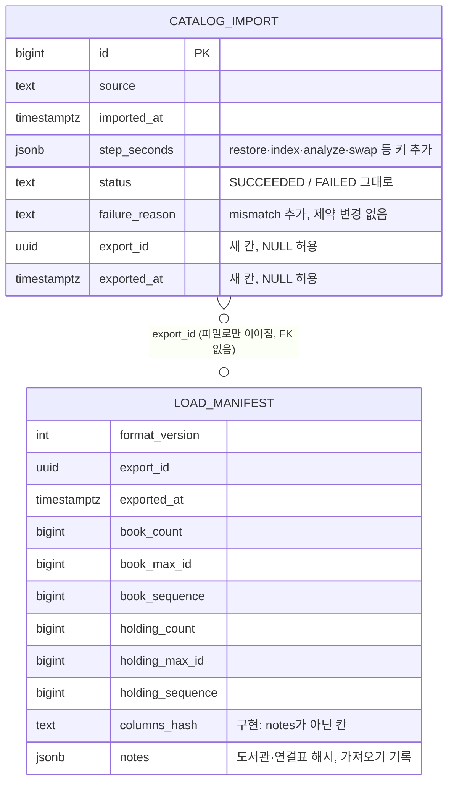

`catalog_next.load_manifest` — 실행 중에만 있는 한 줄 표, Liquibase 아님 (구현됨 (사이클 11, 회고 2026-10-14), 같은 줄을 `row_to_json`으로 표 COMMENT에도 넣음). 내보낼 때 만들고, 반영·마저 때 복원 뒤 지움. 표 [확정] (설계 #1), 칸 이름 [안].

| 칸 | 타입 | 설명 |
|---|---|---|
| `format_version` | int | 파일 형식 판 |
| `export_id` | uuid | 이 내보내기의 번호. 운영·내 PC 기록 줄을 잇는 값 |
| `exported_at` | timestamptz | 내보낸 시각 |
| `book_count`, `book_max_id`, `book_sequence` | bigint | 내보낼 때 내 PC `catalog.book`의 줄 수·가장 큰 번호·시퀀스 값 |
| `holding_count`, `holding_max_id`, `holding_sequence` | bigint | 같은 값의 `catalog.holding` |
| `columns_hash` | text | 네 표의 (표, 칸, 타입) 목록 SHA-256. 구현에서 `notes` 밖 칸으로 뺌(`catalog`가 `notes`를 해석하지 않게, `Baseline` 레코드 안에서 `equals` 하나로 비교) |
| `notes` | jsonb | 도서관·연결표 해시, 내 PC 가져오기 기록(`catalog`는 해석하지 않음) |

- `format_version`은 3 (사이클 21, dev `JdbcCatalogLoad.java` 79행 `FORMAT_VERSION = 3`; 사이클 13에서 2) — 구현됨 (사이클 21, 회고 2026-10-17). 형식 2 파일은 거절(`ManifestsTests.aFormatTwoFileIsRefused`). `notes.libraryPart`에 새 도서관 부분을 실음. 옛 앱은 다른 판 파일을 반영하지 않음 [확정] (dev 구현 확인, 2026-10-14). 4만 자 넘는 `notes`도 `Manifests.parse`가 그대로 읽음(`ManifestsTests`)
- 사이클 21 — 구현됨 (사이클 21, 회고 2026-10-17) (ADR-0123, `docs/cycles/21-recommended-books/design-delta.md` "반영 파일 `notes.listPart` (파일 형식 번호 3)"): 파일 형식 번호 2 → 3 (`FORMAT_VERSION`, `catalog` 소유). 앱과 파일의 번호가 다르면 apply·finish 거절 — 지금 코드와 같음(dev `JdbcCatalogLoad` 76행) [확정] (ADR-0123, 사이클 21 설계 검토 3 #2). `notes.listPart`에 이동진·서울대 목록을 실음(`catalog`는 해석하지 않음, 해석은 `collection`·`picks`). 내 PC export 때 `lists-dir` 폴더나 그 안의 `fields.tsv`·`leedongjin.tsv`·`snu100.tsv`를 못 찾으면 사본을 읽기 전에 멈춤(사이클 19 `rules-dir`와 같음), 형식 번호 3 파일에는 늘 `listPart`가 있음 [확정] (사용자 승인, 2026-10-16, 설계 검토 3 #2)

  | `notes.listPart` 칸 | 내용 | 태그 |
  |---|---|---|
  | `fields` | `fields.tsv`의 이동진·서울대 줄 | [안] |
  | `books` | 줄마다 목록 파일 칸(`pinned_by`·`checked_on`·`note` 빼고) + 맞춘 `bookId`·`coverUrl` | [안] (dev 구현 확인, 2026-10-17) |
  | `covers` | `{sourceUrl, fetchedAt, jpegBase64}`, 줄이 쓰는 표지만, `fetchedAt` = 표지 파일 시각 | [안] (dev 구현 확인) |
  | `counts` | 목록별 줄 수·맞춘 수·못 맞춘 수 (export·apply 기록에 씀) | [안] |

  - 크기: `listPart` 2,202,199바이트(표지 140장), 반영 파일 전체 591,196,594바이트 (dev 운영 역할 반영, 2026-10-17)

  - 크기: 표지 약 144장 1~3MB가 manifest JSON 하나에 들어감(TOAST) [안]. 형식 번호 3 배포 때 내 PC에 기다리는 형식 번호 2 내보내기가 있으면 `finish`가 거절됨 — 배포 전에 finish나 discard (ADR-0086과 같은 감수) [확정]
  - 반영 차례: 첫 트랜잭션(도서관 부분 · 지문 비교)에는 목록을 넣지 않고, 책 표를 바꿔 끼운 **뒤** 작은 트랜잭션 하나로 `picks`가 `listPart`를 넣음(apply·finish·in-place 모두) [확정] (사용자 승인, 2026-10-16, 설계 검토 3 #3). 자세한 것은 아래 스키마 `picks` 절, 흐름은 `flows.md` 흐름 46
- 시퀀스 값 = `CASE WHEN is_called THEN last_value ELSE last_value - 1 END`. IDENTITY 시퀀스 값은 덤프·복원으로 그대로 넘어감(복원 뒤 `setval` 없음) [확정] (dev 프로토타입 1)

### 정리 규칙을 바꿀 때 — [확정] (사용자 제안, 2026-10-11: "이렇게 해줘"), ADR-0069

| 상황 | 할 일 |
|---|---|
| 새 사본으로 갱신 (규칙 그대로) | 가져오기 → 바꿔 끼우기. 서비스는 그대로 |
| 묶기·대표값·날짜 규칙을 고침 | 새 코드로 가져오기 → 바꿔 끼우기. 서비스는 그대로 |
| 검색어 다듬기 규칙을 고침 | 옛 서비스 켜 둔 채 새 코드로 가져오기 → 바꿔 끼우자마자 서비스를 새 코드로 다시 켬 |

- 표 교체는 한 트랜잭션에서 이름 자리만 바꾸므로 켜진 서비스는 다음 검색부터 새 표를 읽음. 준비된 쿼리도 PostgreSQL이 쓰는 표가 바뀌면 다시 분석·계획함 [확정: https://www.postgresql.org/docs/18/sql-prepare.html , 2026-10-11]. 우리 연결 풀에서도 그럼: 바꿔 끼우기 전에 만든 서비스 풀 연결로 바꿔 끼운 뒤 같은 검색을 돌려도 모두 200, 계획·결과 형식 오류 없음 [확정] (dev 측정, 2026-10-11, AC-21)
- 정리 규칙 판 번호는 두지 않음: 책·사람·소장 표는 다시 가져오면 통째로 새로 만들어지고, 국가서지는 원문을 남기므로 규칙과 상관없음
- dev 가져오기 절차(`docs/maintenance/3-import.md` 12절)에 위 표를 적음 — 구현됨 (사이클 08, AC-16)

## 스키마 `collection` (소유: `collection` 모듈) — 구현됨 (사이클 07), 사이클 08 변경 구현됨 (사이클 08), 사이클 11 칸 구현됨 (사이클 11, 회고 2026-10-14), 사이클 13 변경 구현됨 (사이클 13, 회고 2026-10-14)

수집 DB 도서관 번호와 서비스 도서관 번호의 짝, 그리고 가져오기 기록입니다(ADR-0052, ADR-0060). 사이클 08부터 국가서지 TTL에서 뽑은 원문과 그 파일 지문도 둡니다(ADR-0069, 구현됨 (사이클 08)). 다른 모듈 표에는 FK를 두지 않고 번호만 둡니다. 사이클 07까지의 짝 줄은 Liquibase seed(CSV, 번호 명시)로 넣었고, 사이클 13부터 새 짝 줄은 넣기 명령이 새 도서관과 같은 트랜잭션에서 넣고 넣기 실행 기록(`library_insert_run`)을 남깁니다 — 구현됨 (사이클 13, 회고 2026-10-14) (ADR-0084).

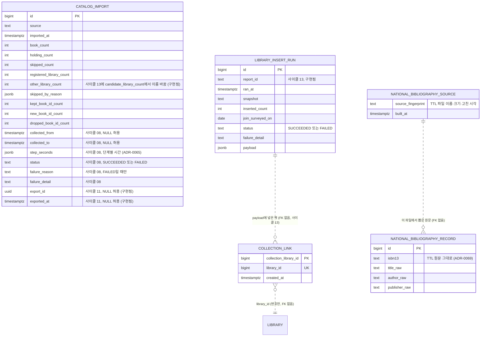

| 테이블.컬럼 | 타입 | 제약 | 설명 | 상태 태그 |
|---|---|---|---|---|
| `collection_link.collection_library_id` | bigint | PK `collection_link_pkey`, CHECK > 0 | 수집 DB 도서관 번호 | [확정] 표 (ADR-0052), 이름 [확정] (dev 구현 확인, 2026-10-05) |
| `collection_link.library_id` | bigint | NOT NULL, UNIQUE `collection_link_library_id_key`, CHECK > 0. FK 없음(다른 모듈) | 서비스 도서관 번호 | [확정] 표 (ADR-0052), 이름 [확정] (dev 구현 확인, 2026-10-05) |
| `collection_link.created_at` | timestamptz | NOT NULL DEFAULT now() | | [확정] (dev 구현 확인, 2026-10-05) |
| `catalog_import.id` | bigint | PK, IDENTITY | 가져올 때마다 한 줄씩 쌓임(지우지 않음) | [확정] (dev 구현 확인, 2026-10-05) |
| `catalog_import.source` | text | NOT NULL | 예: 사본 파일 이름 | |
| `catalog_import.imported_at` | timestamptz | NOT NULL | | |
| `catalog_import.book_count`, `holding_count`, `skipped_count` | integer | NOT NULL, CHECK ≥ 0 | 요약(옛 `catalog.catalog_import`와 같은 칸) | |
| `catalog_import.registered_library_count`, `other_library_count` | integer | NOT NULL, CHECK ≥ 0 (`other_library_count`의 제약 `catalog_import_other_library_count_check`) | 가져온 도서관 수: 사이클 06까지 있던 도서관 / 그 밖의 도서관(사이클 07부터 넣은 곳)(AC-11). **사이클 13 — 구현됨 (사이클 13, 회고 2026-10-14)**: `candidate_library_count` → `other_library_count`, 제약 `catalog_import_candidate_library_count_check` → `catalog_import_other_library_count_check`("후보" 이름 없애기, 사이클 13 AC-11). 기존 `collection/001-collection-schema.yaml`을 직접 고침(지금 52·53행)(배포 전 `PRE_DEPLOYMENT` 동안 dev 규칙, 사이클 14와 같은 방식) → 로컬 `db`·`db-ops`는 데이터를 지키며 같은 이름 바꾸기 SQL + `databasechangelog.md5sum` NULL로 맞춤(dev 세션이 함, `db-test`는 다시 띄움) [확정] (사용자 선택 "가벼운 방법", 2026-10-12). Java `ImportReport`·`ImportRecords`·`Notes`의 `otherLibraries`와 그 시험의 칸 이름도 바꿈. 로컬 `db` 맞추기 SQL은 dev `docs/maintenance/3-import.md` 13-5 (데이터 그대로, 9단계에서 확인) | 칸 [확정] (dev 구현 확인, 2026-10-05). 바꿈 [확정] (설계 결정 4), 방식 [확정] (사용자 선택 "기존 파일을 고침", 2026-10-12, cycle-close 검토), 새 이름 [확정] (dev 구현 확인, 2026-10-14) |
| `catalog_import.skipped_by_reason` | jsonb | NOT NULL | 이유별 건너뛴 줄, 예 `{"library_not_in_service": 123, ...}` | [확정] (dev 구현 확인, 2026-10-05) |
| `catalog_import.kept_book_id_count`, `new_book_id_count`, `dropped_book_id_count` | integer | NOT NULL DEFAULT 0, CHECK ≥ 0 | 책 번호 잇기 셈(옛 번호를 이은 책, 새 번호 책, 지금 어느 책에도 없는 옛 번호) | [확정] (dev 구현 확인, 2026-10-05) |
| `catalog_import.collected_from`, `collected_to` | timestamptz | NULL 허용(옛 줄) | 그 가져오기에 들어간 도서관 수집 시각(`collected_at`)의 최솟값·최댓값. 건너뛴 도서관은 뺌(스냅숏에 넣는 것과 같은 목록). 실데이터 2026-09-29 15:27:09Z ~ 2026-10-04 22:22:55Z (AC-7). 구현됨 (사이클 08) | 칸 [확정] (사용자 승인, 2026-10-11), 이름 [확정] (dev 구현 확인, 2026-10-11). 근거: ADR 없음, 사용자 결정 (사이클 08 scope 7, "이거 넣어주는 것으로 해", 2026-10-05) |
| `catalog_import.step_seconds` | jsonb | NOT NULL DEFAULT `'{}'` | 단계별 시간(초, 숫자, 순서 유지; 공개 `CatalogLoad.Result`의 `steps`). 키 [확정] (dev 구현 확인, 2026-10-11; 늘어난 키 받아들임 [확정] (사용자 승인, 2026-10-11, `docs/cycles/08-polish-swap-memory/easy/2026-10-11-midpoint-decisions.html`)), 읽는 법은 dev `3-import.md` 10절: 앞부분 `read`(첫 읽기), `group`(코드로 묶기), `nb`(국가서지 원문 읽기 또는 TTL 풀기), `normalize`(원문 다듬어 키 만들기), `same_text`(같은 글 묶기); 쓰기 `books_copy`(책·사람 임시 표 COPY), `holdings_read`(두 번째 읽기에서 COPY를 뺀 시간), `holdings_copy`, `match`(책·소장 번호 잇기 맞대기); 옛 방식(사이클 07 쓰기)만 `move`(TRUNCATE~커밋 = 검색이 멈춘 시간)·`vacuum`; 새 방식(바꿔 끼우기)만 `write`(`catalog_next`에 쓰기), `index`(색인·제약), `analyze`(`VACUUM (ANALYZE)`), `swap`(바꿔 끼우기); 마지막 `load`(`replaceAll` 전체). 가져오기 #2 값(초): read 826, group 12, nb 475, normalize 46, same_text 126, books_copy 45, holdings_read 514, holdings_copy 22, match 139, write 147, index 99, analyze 43, swap 0.33, load 1,010 (dev 측정, 2026-10-11). 구현됨 (사이클 08). **사이클 11 새 키 — 구현됨 (사이클 11, 회고 2026-10-14)**: 내보내기 `dump`·`export`, 반영 `compare`·`restore`·`index`·`analyze`·`swap`·`apply`, 마저 `index`·`analyze`·`swap`·`finish`, `sql` 방식 `rows_copy`. 운영 반영 줄에는 내 PC 기록(단계 시간 포함)과 반영 단계 시간을 한 줄로 [확정] (스펙 R-A5). `restore`·`index`·`analyze`·`swap` [확정], 나머지 [안] | 칸 [확정] (dev 구현 확인, 2026-10-11). 근거: ADR-0065("먼저 쓰기 단계 안의 시간을 나눠 잰 뒤") |
| `catalog_import.status` | text | NOT NULL DEFAULT 'SUCCEEDED', CONSTRAINT `catalog_import_status_check` CHECK IN ('SUCCEEDED','FAILED') | 가져오기 결과. 바꿔 끼우기 전에 실패해도 줄을 남기고(옛 표 그대로), 그때까지 센 숫자를 둠. 구현됨 (사이클 08) | [확정] (dev 구현 확인, 2026-10-11; 받아들임 [확정] (사용자 승인, 2026-10-11, 같은 결정 페이지)). 설계에 없던 칸, 이유 [이유 미확인] |
| `catalog_import.failure_reason` | text | NULL. CONSTRAINT `catalog_import_failure_check` CHECK `(status = 'FAILED') = (failure_reason IS NOT NULL)` | 실패 이유: `lock_not_acquired`(잠금 5번 다 못 얻음), `outside_foreign_key`(다른 표가 catalog 표를 외래 키로 가리킴), `error`(그 밖). 공개 API 예외 `CatalogLoad.NotSwappedException(reason)`. 구현됨 (사이클 08). 사이클 11: 값 `mismatch`(반영 전 두 DB 비교가 다름, `failure_detail`에 무엇이 다른지) — 값 CHECK가 없어 changeset 없음 [확정] (dev `003-import-period-and-timings.yaml` 30-42행 확인, 2026-10-12), 구현됨 (사이클 11, 회고 2026-10-14) | [확정] (dev 구현 확인, 2026-10-11; 받아들임 [확정] (사용자 승인, 2026-10-11)) |
| `catalog_import.failure_detail` | text | NULL | 실패 설명 글. 구현됨 (사이클 08) | [확정] (dev 구현 확인, 2026-10-11) |
| `catalog_import.export_id` | uuid | NULL 허용(내보내기를 거치지 않은 줄) | 반영(`apply`)·마저(`finish`) 줄이 받은 파일의 `load_manifest.export_id`. 한 내보내기에 운영 반영 한 줄 + 내 PC `finish` 한 줄을 이음. 구현됨 (사이클 11, 회고 2026-10-14) | 칸·뜻 [확정] (설계 #7), 이름 [안]. 근거 ADR-0078 |
| `catalog_import.exported_at` | timestamptz | NULL 허용. CHECK `(export_id IS NULL) = (exported_at IS NULL)` | 그 파일을 내보낸 시각(`load_manifest.exported_at`). 구현됨 (사이클 11, 회고 2026-10-14) | 칸·뜻 [확정] (설계 #7), 이름·제약 이름 [안] |
| `catalog_import.description_deleted_count` | integer | `>= 0` | 바꿔 끼울 때 지운 설명 줄 수(설명 표 5개 합). 구현됨 (사이클 26, 회고 2026-10-29; 성공한 가져오기에만 적고 실패·내보내기는 NULL), changeset `collection/007-description-deleted-count.yaml` [안: 번호] (ADR-0162) | [안] |
| `national_bibliography_record` | 표 | 없음(가져오기만 읽음) | 국가서지 TTL(Turtle, https://www.w3.org/TR/turtle/ 확인 2026-10-11)에서 뽑은 원문. 칸: `id` bigint 기본 키 `national_bibliography_record_pkey`, `isbn13` text NOT NULL(13자리), `title_raw` text NOT NULL, `author_raw` text NULL, `publisher_raw` text NULL. 색인 없음(가져오기가 처음부터 끝까지 읽기만 함) [확정] (사용자 승인, 2026-10-11, 설계 검토). **한 기록에 ISBN이 여럿이면 ISBN마다 한 줄**(`isbn13`은 13자리 유지) — 같은 키에 다른 ISBN이 둘 오므로 지금 규칙대로 "애매함"이 되어 결과는 같음 (dev). ISBN이나 제목이 없는 기록은 남기지 않음. 3,999,211줄(ISBN별), TTL을 풀며 쓰는 데 7분 55초 (dev 측정, 2026-10-11). 다듬지 않은 값이라 정리 규칙이 바뀌어도 그대로 씀. 가져올 때마다 지금 규칙으로 다듬어 키 → ISBN을 만듦. 구현됨 (사이클 08) (`collection/004-national-bibliography.yaml`, 코드 `NationalBibliographyStore`). 표에서 다시 읽는 시간(AC-15)은 측정 중 [확인 필요] | ISBN마다 한 줄 [확정] (사용자 승인, 2026-10-11, `easy/2026-10-11-midpoint-decisions.html`; 이유 [이유 미확인]). 남기기 [확정] (사용자 승인, 2026-10-10), 원문으로 [확정] (`catalog` 절 "정리 규칙을 바꿀 때"), 이름 [확정] (dev 구현 확인, 2026-10-11). 근거: ADR-0065(결과 남기기) → ADR-0069(원문으로) | 남기기 [확정] (사용자 승인, 2026-10-10), 원문으로 [확정] (`catalog` 절 "정리 규칙을 바꿀 때"), 이름 [안]. 근거: ADR-0065(결과 남기기) → ADR-0069(원문으로) |
| `national_bibliography_source` | 표 (한 줄) | — | 원문을 뽑은 파일: `source_fingerprint` text NOT NULL, `built_at` timestamptz NOT NULL. 지문은 TTL 파일마다 `상대경로\|크기\|고친 시각(Instant)`을 경로 순으로 `;`로 이은 글자(TTL 20개) [확정] (dev 구현 확인, 2026-10-11; 설계는 "파일 이름 + 크기 + 고친 시각을 `\|`로"). 항상 한 줄. 지문이 같으면 원문을 다시 쓰고, 다르면 ① 지문 줄 지우고 커밋 → ② (한 트랜잭션) 원문 표 TRUNCATE + COPY + 지문 줄 INSERT → 커밋. 중간에 멈추면 지문이 없어 다음 가져오기가 처음부터 다시 풂 [확정] (사용자 승인, 2026-10-11, 설계 검토; 순서는 `NationalBibliographyTests`로 확인). 구현됨 (사이클 08) | 표로 남김 [확정] (사용자 승인, 2026-10-11), 이름 [확정] (dev 구현 확인, 2026-10-11). 근거: ADR-0069 |
| `library_insert_run.id` | bigint | PK, IDENTITY | 새 도서관 넣기 실행마다 한 줄(지우지 않음). 넣을 곳 0이면 줄 없음. 구현됨 (사이클 13, 회고 2026-10-14) | 표 [확정] (scope 도서관 날짜 3), 이름 [확정] (dev 구현 확인, 2026-10-14) |
| `library_insert_run.report_id` | text | NOT NULL, CHECK `^[0-9a-f]{12}$` | 보고서 번호 | [확정] (dev 구현 확인, 2026-10-14) |
| `library_insert_run.ran_at` | timestamptz | NOT NULL DEFAULT now() | | [확정] (dev 구현 확인, 2026-10-14) |
| `library_insert_run.snapshot` | text | NOT NULL | 수집 사본 파일 이름 | [확정] (dev 구현 확인, 2026-10-14) |
| `library_insert_run.inserted_count` | integer | NOT NULL, CHECK ≥ 0 | 넣은 도서관 수 | [확정] (dev 구현 확인, 2026-10-14) |
| `library_insert_run.join_surveyed_on` | date | NULL 허용 | 가입 조건 조사 기준일(규칙 폴더 날짜 파일). 성공한 줄 중 최신 값을 `GET /api/v1/join-surveys/latest`가 돌려줌 (최신 = 최댓값) | 뜻 [확정] (ADR-0087), 이름 [확정] (dev 구현 확인, 2026-10-14) |
| `library_insert_run.status` | text | NOT NULL, CHECK IN ('SUCCEEDED','FAILED') | | [확정] (dev 구현 확인, 2026-10-14) |
| `library_insert_run.failure_detail` | text | NULL. CHECK `(status = 'FAILED') = (failure_detail IS NOT NULL)` | 실패 설명 | [확정] (dev 구현 확인, 2026-10-14) |
| `library_insert_run.payload` | jsonb | NOT NULL | 넣은 도서관·가입 규칙·짝 줄 그대로. `export`가 `load_manifest.notes.libraryPart`로 실음(ADR-0086) | [확정] (dev 구현 확인, 2026-10-14) |
| `library_insert_run` 부분 UNIQUE | — | 색인 `library_insert_run_report_id_succeeded_key` = `UNIQUE (report_id) WHERE status = 'SUCCEEDED'` | 같은 보고서로 두 번 넣지 않음 | [확정] (dev 구현 확인, `collection/006-library-insert-run.yaml:33-34`) |

- 번호 1~280 도서관은 같은 번호끼리 짝(59·131 포함), 사이클 07에서 넣은 2,394곳은 서비스 새 번호(281~2674)와 짝, 2,674줄 [확정] (ADR-0052, dev 구현 확인, 2026-10-05). 2026-10-13 서비스 DB의 사이클 07 도서관 짝은 2,383줄(켜짐 2,381, 꺼짐 2): 2664~2674 11곳은 사이클 08에서 뺌(ADR-0067), 2194·2198은 `library/010`으로 꺼짐 [확정] (dev `plan-feedback.md` 3408~3412행)
- 사이클 13 — 구현됨 (사이클 13, 회고 2026-10-14) (ADR-0084·0086·0093): 넣기(`insert`)는 한 트랜잭션(`pg_advisory_xact_lock`)에서 `library.library`·`eligibility_rule`(`LibraryRegistry.add`) → `collection_link` → `library_insert_run` SUCCEEDED 줄, 제약 위반이면 ROLLBACK 뒤 FAILED 줄(종료 5). 잠금 뒤 `nextId()`가 보고서 첫 번호와 다르면 넣지 않음(종료 4). 운영 반영(`apply`)은 파일의 `notes.libraryPart`에서 운영에 없는 도서관·짝 줄·성공한 실행 기록 줄을 넣음(같은 `report_id`의 성공 줄이 있으면 건너뜀. 이미 있는 번호가 다른 도서관이거나 짝이 다른 도서관을 가리키면 멈춤: 롤백, `catalog_import` `FAILED`·`error`·`library part: …`) — 그래서 운영 DB에서도 기준일 API가 값을 냄. 반영 파일 판 2는 `load_manifest.notes.libraryPart` = 성공한 넣기 실행 기록 전부(`reportId`·`ranAt`·`snapshot`·`insertedCount`·`joinSurveyedOn`·`payload`) [확정] (dev 구현 확인, 2026-10-14), 새 표 없음. 9단계 운영 흉내: 도서관 부분 1.0초(실행 기록 1, 도서관 6, 짝 6), `mismatch` 없음. 흐름은 `flows.md` 흐름 32·33
- 사이클 08: 교보 대여·혼합 11곳(서비스 번호 2664~2674)의 짝 줄을 `002-collection-link.csv`에서 지움 → 짝 줄이 11줄 줄어듦 (구현됨 (사이클 08), ADR-0067). 수집 DB의 교보 대여·혼합 230곳은 `crawl_skip`(받지 않음) 표시 — 수집기 명령이 1곳에 약 50초라 24곳 뒤에는 같은 UPDATE를 한 트랜잭션으로 실행 (dev) [확정] (사용자 승인, 2026-10-11)
- Liquibase: `collection/001-collection-schema.yaml`, `collection/002-collection-seed-candidates.yaml` + `002-collection-link.csv` (위 "Liquibase 파일" 목록). 사이클 08: `collection/003-import-period-and-timings.yaml`(changeset 둘: 수집 기간·단계별 시간, 상태·실패 칸), `collection/004-national-bibliography.yaml` [확정] (dev 구현 확인, 2026-10-11; 설계 [안]의 `004`·`005`와 번호가 다름)
- 사이클 11 (구현됨 (사이클 11, 회고 2026-10-14)): changeset `collection/005-import-export.yaml`(id `collection-005-import-export`, 제약 `catalog_import_export_check`) — `catalog_import`에 `export_id`·`exported_at`과 CHECK. 번호는 인계 때 dev의 마지막 `collection` 번호를 보고 정함(지금 004까지). `failure_reason` `mismatch`는 changeset 없음
- 사이클 13 Liquibase — 구현됨 (사이클 13, 회고 2026-10-14): `collection/006-library-insert-run.yaml`(새 표) [확정] (dev 구현 확인, 2026-10-14), `collection/001` 칸·제약 이름 고침(위 "Liquibase 파일" 사이클 13 줄)
- `collection`은 `library.library`를 읽지 않고, 짝 맞춘 서비스 도서관이 켜졌는지와 사이트 주소는 `LibraryCatalog.enabledLibraryRefs()`로 확인합니다 [확정] (dev 구현 확인, 2026-10-05). 사이클 13 넣기 비교는 `LibraryRegistry.listAll()`로 서비스 도서관 전체(꺼진 곳 포함)를 봄 — 구현됨 (사이클 13, 회고 2026-10-14) [확정] (ADR-0093)
- 가져오기 기록에 사본의 수집 기간을 더함 [확정] (사용자: "이거 넣어주는 것으로 해", 2026-10-05) — `collected_from`·`collected_to` (위 표), 구현됨 (사이클 08)

## 스키마 `auth` (소유: `auth` 모듈), `modulith` (발행 저장소) — 구현됨(사이클 05, 2026-10-04 retro 반영)

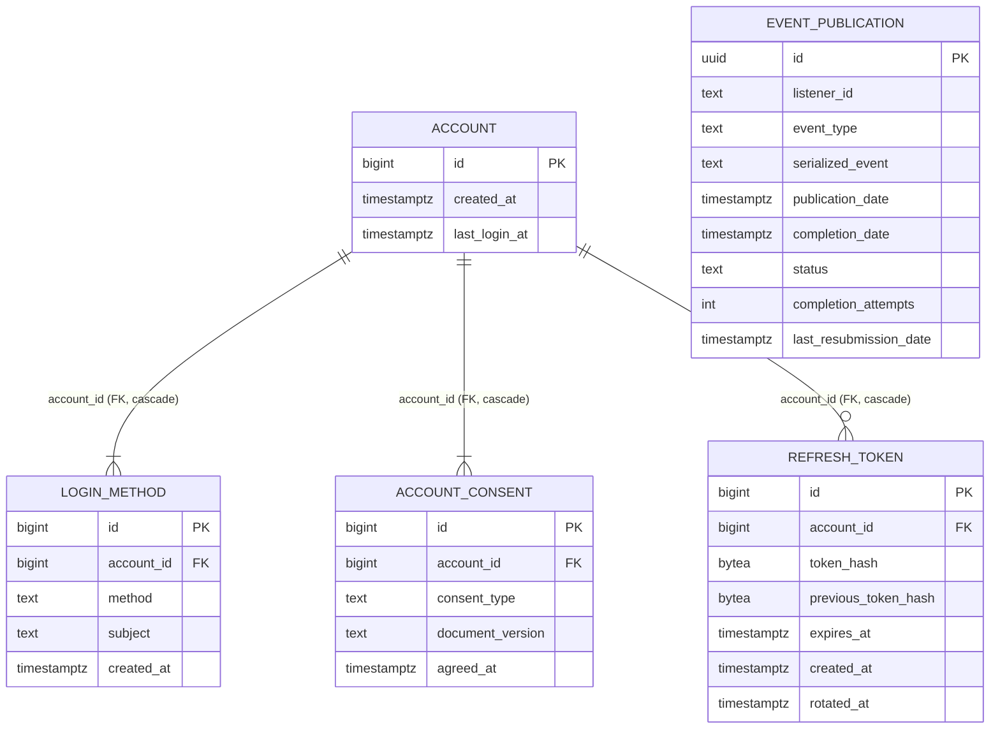

**`auth.account`**
| 컬럼 | 타입 | 제약 | 설명 |
|---|---|---|---|
| id | bigint | PK, GENERATED BY DEFAULT AS IDENTITY | JWT `sub` |
| created_at | timestamptz | NOT NULL DEFAULT now() | |
| last_login_at | timestamptz | NOT NULL | 가입·다시 로그인 때 갱신 (R3) |

**`auth.login_method`**
| 컬럼 | 타입 | 제약 | 설명 |
|---|---|---|---|
| id | bigint | PK, IDENTITY | |
| account_id | bigint | NOT NULL, FK → auth.account(id) ON DELETE CASCADE | |
| method | text | NOT NULL, CHECK IN ('NAVER','KAKAO') | 나중에 `PASSWORD` 추가 |
| subject | text | NOT NULL | 그 수단 안의 식별자. 소셜은 제공자 쪽 번호(Kakao 숫자도 문자열로) |
| created_at | timestamptz | NOT NULL DEFAULT now() | |
- UNIQUE `(method, subject)`, INDEX `(account_id)`. 이번에는 계정당 한 줄이고 이것은 앱 코드가 지킵니다(DB에 UNIQUE(account_id)를 걸지 않음. 나중의 연결 기능을 막지 않기 위해. ADR-0039)

**`auth.account_consent`**
| 컬럼 | 타입 | 제약 | 설명 |
|---|---|---|---|
| id | bigint | PK, IDENTITY | |
| account_id | bigint | NOT NULL, FK → auth.account(id) ON DELETE CASCADE | |
| consent_type | text | NOT NULL, CHECK IN ('TERMS_OF_SERVICE','PRIVACY_COLLECTION','AGE_OVER_14') | 확인란 셋 [확정] |
| document_version | text | NULL | 이용약관·수집 이용 고지 버전. 형식 `YYYY-MM-DD`(시행 날짜) [확정] (사용자 승인, 2026-10-04, 설계 검토 10). 사이클 16부터 `sitecontent.document_version.version_no`의 판 순번 글자(`'1'`, `'2'`…), 새 CHECK `account_consent_document_version_format_check (document_version IS NULL OR document_version ~ '^[1-9][0-9]*$')`, 테스트 계정 기록 `'2026-10-04'` → `'1'` [확정] (사용자 승인, 2026-10-13, ADR-0099; CHECK 이름·식 글자 모양은 [안: dev가 정해도 됨]) — 구현됨 (사이클 16, 회고 2026-10-15) |
| agreed_at | timestamptz | NOT NULL | |
- CHECK: `AGE_OVER_14`가 아니면 `document_version IS NOT NULL`. UNIQUE `(account_id, consent_type, document_version)` NULLS NOT DISTINCT(sql changeset). INDEX `(account_id)`
- 현재 버전은 서버 설정이 원본: 웹은 화면에 보인 버전을 보내고, 서버의 현재 버전과 다르면 409. 사이클 16 — 구현됨 (사이클 16, 회고 2026-10-15) (ADR-0099): 원본이 `sitecontent`(`SiteDocuments.currentVersion`)로 바뀌고 서버 설정 `chaekcheck.auth.documents`는 지움. 칸 타입(`text`)은 그대로, 다른 schema로 FK 없음(판 순번 값만). "다시 동의 필요" 칸은 두지 않음 — 다시 동의 화면을 만들 때 함께 더함 [확정] (사용자 승인, 2026-10-13)

**`auth.refresh_token`**
| 컬럼 | 타입 | 제약 | 설명 |
|---|---|---|---|
| id | bigint | PK, IDENTITY | 브라우저 로그인 하나 |
| account_id | bigint | NOT NULL, FK → auth.account(id) ON DELETE CASCADE | |
| token_hash | bytea | NOT NULL, UNIQUE | SHA-256(현재 값) |
| previous_token_hash | bytea | NULL | 바로 앞 값. 재사용 감지 |
| expires_at | timestamptz | NOT NULL | 로그인 + 30일 [확정], 교체해도 그대로 |
| created_at | timestamptz | NOT NULL DEFAULT now() | 로그인한 때 |
| rotated_at | timestamptz | NULL | |
- INDEX `(previous_token_hash)`, `(account_id)`, `(expires_at)`. 만료된 줄은 하루 한 번 정리 [확정] (사용자 승인, 2026-10-04, 설계 검토 10)

**`modulith.event_publication`**: Spring Modulith 2.1.1 공식 DDL 그대로(Liquibase 별도 파일. https://docs.spring.io/spring-modulith/reference/appendix.html). 설정: `spring.modulith.events.jdbc.schema=modulith`, `spring.modulith.events.jdbc.schema-initialization.enabled=false`, `spring.modulith.events.completion-mode=delete` [확정] (사용자 승인, 2026-10-04, 설계 검토 8).

- Liquibase: `db/changelog/auth/001-auth-schema.yaml`(CHECK, NULLS NOT DISTINCT는 `sql` changeset), `db/changelog/modulith/001-event-publication.yaml`, master에 include 두 줄. 새 파일만 더합니다 [확정]. 사이클 16: `auth/002-consent-version-number.yaml` — 구현됨 (사이클 16, 회고 2026-10-15)
- JPA 매핑 참고: cascade는 DB FK에 맡기고 JPA 연관 cascade는 쓰지 않습니다. 삭제는 `account` 한 줄 삭제 쿼리로 합니다. 엔티티를 쓸지 `JdbcClient`를 쓸지는 dev가 정합니다.
- `auth` 스키마는 사이클 06에서 바뀌지 않습니다. 동의 항목 추가(지역·직접 추가 도서관)는 문서 문구뿐이고 `document_version`은 그대로 [확정] (사이클 06 spec R7).

## 스키마 `mylibrary` (소유: `mylibrary` 모듈) — 구현됨 (사이클 06)

로그인한 계정의 거주·직장 지역과 직접 추가한 도서관입니다(ADR-0048, ADR-0049). 다른 모듈 ID는 번호만 두고 FK가 없습니다. 탈퇴하면 `AccountDeleted` listener가 두 표에서 그 계정 줄을 지웁니다(ADR-0051).

- Liquibase: 새 파일 `db/changelog/mylibrary/001-mylibrary-schema.yaml`(master에서 `modulith/001` 뒤) [확정] (dev 구현 확인, 2026-10-05). changeSet id `mylibrary-001-schema`(스키마), `mylibrary-001-account-region`, `mylibrary-001-account-library`, author `chaekcheck`. 기존 changeset 수정 없음(DB 초기화 필요 없었음). CHECK 때문에 표는 `sql` change(Liquibase OSS YAML은 `addCheckConstraint` 없음, auth와 같은 방식)
- 제약 이름 [확정] (dev 구현 확인, 2026-10-05): `account_region_kind_check`, `account_region_region_id_check`, `account_region_position_check`, `account_region_pkey`, `account_library_library_id_check`, `account_library_pkey`

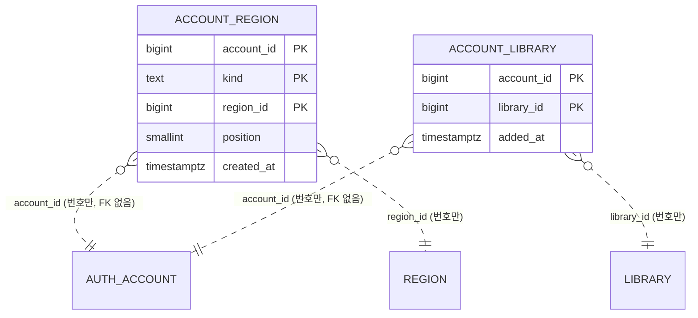

| 테이블.컬럼 | 타입 | 제약 | 설명 | 상태 태그 |
|---|---|---|---|---|
| `account_region.account_id` | bigint | NOT NULL | `auth.account.id`. 모듈 경계라 FK 없음, 탈퇴는 이벤트로 지움 | [확정] (ADR-0036·0048) |
| `account_region.kind` | text | NOT NULL, CHECK (`kind IN ('RESIDENCE','WORK')`) | 거주·직장 | [확정] (dev 구현 확인, 2026-10-05) |
| `account_region.region_id` | bigint | NOT NULL, CHECK (`region_id > 0`) | `region` ID(FK 없음). 저장할 때는 사용 중인 시군구만 받고(422), 나중에 폐지되면 그대로 남음(읽을 때 웹이 해석, [확정] spec R6) | [확정] 읽기 / [확정] (dev 구현 확인, 2026-10-05) 저장 검증 |
| `account_region.position` | smallint | NOT NULL, CHECK (`position BETWEEN 0 AND 19`) | 고른 순서 | [확정] (사용자 승인, 2026-10-04) |
| `account_region.created_at` | timestamptz | NOT NULL DEFAULT now() | | [확정] (dev 구현 확인, 2026-10-05) |
| PK `(account_id, kind, region_id)` | | | 읽기·지우기는 `WHERE account_id = ?`를 PK 앞부분이 맡음. 칸마다 20곳은 앱에서 검사 | [확정] (dev 구현 확인, 2026-10-05) |
| `account_library.account_id` | bigint | NOT NULL | `auth.account.id`(FK 없음) | [확정] |
| `account_library.library_id` | bigint | NOT NULL, CHECK (`library_id > 0`) | `library.library.id`(FK 없음). 꺼져도 남고 읽는 쪽이 거름 | [확정] 규칙 (spec R3) |
| `account_library.added_at` | timestamptz | NOT NULL DEFAULT now() | 목록 순서 `added_at, library_id` | [확정] (dev 구현 확인, 2026-10-05) |
| PK `(account_id, library_id)` | | | 추가는 `INSERT … ON CONFLICT DO NOTHING`(멱등). 20곳은 계정 줄 잠금 뒤 `count(*)`로 검사. 꺼진 도서관도 지울 때까지 20곳에 셈 | [확정] 상한·셈 (사용자, 2026-10-04) |

- 지역 저장은 같은 트랜잭션에서 `DELETE … WHERE account_id = ?` 뒤 INSERT. 두 칸 모두 비면 행 없음(사이클 06 AC-13)
- 다른 인덱스 없음(질의는 모두 `account_id` 같음 조건)
- 넣지 않는 것: 이메일·이름 등. 탈퇴하면 계정 번호도 남지 않음(ADR-0041)
- JPA 엔티티 없이 `JdbcClient`(사이클 05 `auth`와 같은 방식, `mylibrary/internal/MyLibraryStore`) [확정] (dev 구현 확인, 2026-10-05)

## 스키마 `picks` (소유: `picks` 모듈) — 구현됨 (사이클 14, 회고 2026-10-14; 세 목록 표는 사이클 21, 회고 2026-10-17)

### 세 목록: `list_field`·`list_book` — 구현됨 (사이클 21, 회고 2026-10-17)

이동진 추천도서(`leedongjin`)·사서 추천도서(`librarian`)·서울대 100선(`snu100`)의 책 줄을 표 `list_book` 하나에, 목록별 분야·순서를 `list_field`에 둡니다. 사이클 14의 `pick`과 코드 상수 분류(`PickCategory`)를 대신합니다 [확정] (ADR-0122). `cover`·`fetch_run`은 그대로입니다. 다른 모듈과 FK·조인 없음 — `book_id`는 값으로만, FK 없음(`catalog` 바꿔 끼우기의 바깥 FK 검사에 걸리지 않음). 이동진·서울대는 짝(`book_id`)을 저장함 — ADR-0090의 "짝은 저장하지 않음"을 이 두 목록에 한해 바꿈(ADR-0124). 사서는 그대로 저장하지 않음 [확정]. 근거 `docs/cycles/21-recommended-books/design-delta.md` "데이터", 실제 changelog dev `db/changelog/picks/002-curated-lists.yaml`(칸·제약이 아래 표와 같음, 회고 2026-10-17). 칸 이름은 따로 적지 않으면 [안].

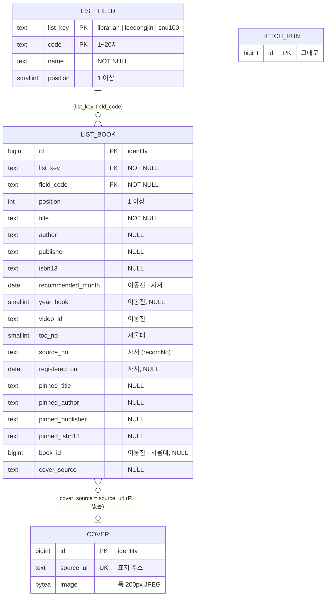

| 테이블.컬럼 | 타입 | 제약 | 설명 | 상태 태그 |
|---|---|---|---|---|
| `list_field.list_key` | text | PK 앞, CHECK IN (`librarian`,`leedongjin`,`snu100`) | 목록 이름 | [확정] (ADR-0122·0126) |
| `list_field.code` | text | PK 뒤, CHECK `length(code) BETWEEN 1 AND 20` | 사서는 `drCode`(11·6·5·4·425, 모르는 코드도), 이동진·서울대는 `fields.tsv` 코드(예 `korean_fiction`, `korean_lit`) | [안] |
| `list_field.name` | text | NOT NULL, CHECK `length(name) >= 1` (dev가 더함) | 화면 이름. 사서의 모르는 새 코드는 받은 이름, 비면 "기타" [확정] (C14 R2-5, dev `PicksCache.OTHER_NAME`) | [안] |
| `list_field.position` | smallint | NOT NULL, ≥ 1, UNIQUE(`list_key`,`position`) | 분류 목록 순서. 사서 새 코드는 끝에 붙임 (옮길 때는 6번째부터 코드 순서) | [안] |
| `list_book.id` | bigint | PK, `GENERATED ALWAYS AS IDENTITY` | 이동진·서울대 응답 `id` (바꿀 때마다 새로 매김) | [안] |
| `list_book.(list_key, field_code)` | text | NOT NULL, FK → `list_field` ON DELETE CASCADE, 색인 | 목록·분야 | [안] |
| `list_book.position` | int | NOT NULL, ≥ 1 | 이동진: 같은 달 안 소개 순서, 서울대: 목차 번호와 같음, 사서: 받은 순서 | [안] |
| `list_book.title` | text | NOT NULL | 목록의 책 이름 (못 맞춘 줄의 화면 제목, 맞춘 줄은 책 창의 "목록 이름") | [확정] (책 이름 보정 #1) |
| `list_book.author`·`publisher` | text | NULL | 목록의 저자·출판사 | [안] |
| `list_book.isbn13` | text | NULL, CHECK `^97[89][0-9]{10}$` | 목록의 ISBN | [안] |
| `list_book.recommended_month` | date | NULL, CHECK 1일 | 이동진·사서 추천 연·월 | [안] |
| `list_book.year_book` | smallint | NULL, 2000~2100 | 이동진 올해의 책 해 (" · 2025 올해의 책") | [안] |
| `list_book.video_id` | text | NULL, CHECK `^[A-Za-z0-9_-]{1,64}$` | 이동진 영상 ID. 공식 문서에는 꼴이 없음(`videos` `id` = string), 받은 603개가 모두 11자 `[A-Za-z0-9_-]`라 CHECK 근거는 관찰 (dev 0단계, 2026-10-16) | [안] (plan 지시, 2026-10-16) |
| `list_book.toc_no` | smallint | NULL, 1~100, 부분 UNIQUE `(toc_no) WHERE list_key = 'snu100'` | 서울대 목차 번호 | [안] |
| `list_book.source_no` | text | NULL, CHECK `^[0-9]{1,20}$`, 부분 UNIQUE `WHERE list_key = 'librarian'` | 사서 `recomNo` (사이클 14 `pick.recom_no`). 사서 응답 `id` | [확정] (결정 3 #1), 이름 [안] |
| `list_book.registered_on` | date | NULL | 사서 `regdate`, 같은 달 안 정렬 | [확정] (결정 3 #1) |
| `list_book.pinned_title`·`pinned_author`·`pinned_publisher`·`pinned_isbn13` | text | NULL, ISBN CHECK 같음 | 수집기가 고른 판(또는 사람이 적은 판). `pinned_by`는 목록 파일에만 | [확정] (ADR-0124), 칸 [안] |
| `list_book.book_id` | bigint | NULL, CHECK `book_id >= 1` (dev가 더함) | 이동진·서울대: export 때 맞춘 우리 책 번호(`catalog.book.id` 값, FK 없음). 사서는 늘 NULL | [확정] (ADR-0124) |
| `list_book.cover_source` | text | NULL. 사서 ⇒ `LIKE 'https://www.nl.go.kr/afile/%'`, 그 밖 ⇒ `LIKE 'https://%'` | `cover.source_url`과 맞춤. 색인 `list_book_cover_source_idx`(표지 정리용, dev가 더함). 접두 검사는 목록별 CHECK 안 | [안]. 이동진·서울대 접두 `https://`: 수집기가 `http`를 `https`로 바꿔 적음, ISBN 서지 `TITLE_URL` 호스트 셋(`http://www.nl.go.kr`·`https://nl.go.kr`·`https://www.nl.go.kr`, 경로 `/seoji/fu/ecip/`, 키 없음) [확정] (dev 0단계 API 시험, 2026-10-16) |
| 목록별 CHECK | | 대칭으로: `librarian` ⇒ `source_no`·`recommended_month` NOT NULL, `book_id`·`toc_no`·`video_id`·`year_book` NULL. `leedongjin` ⇒ `recommended_month`·`video_id` NOT NULL, `source_no`·`registered_on`·`toc_no` NULL. `snu100` ⇒ `toc_no` NOT NULL, `source_no`·`registered_on`·`recommended_month`·`video_id`·`year_book` NULL | 이름 `list_book_librarian_check`·`list_book_leedongjin_check`·`list_book_snu100_check`, 부분 UNIQUE `list_book_snu100_toc_no_key`·`list_book_librarian_source_no_key`, 색인 `list_book_field_idx` | [안] (dev 구현 확인, 2026-10-17) |
| `cover` | | **사이클 26 배포 2에서 지움 (v1.20.6, 2026-10-29)** — 그림은 S3 `covers/<sha1>.jpg`로 옮김(ADR-0163). 아래는 지우기 전 모습 (`source_url` UNIQUE, 200px JPEG, 아래 사이클 14 표) | 이동진·서울대 표지는 `replace`가 넣음: `ON CONFLICT (source_url) DO NOTHING`, `content_type = image/jpeg`, `byte_size` = 그림 길이, `fetched_at` = 수집기가 받은 때 | [확정] (ADR-0123) |
| `fetch_run` | | 그대로(아래 사이클 14 표). 사이클 26 배포 2에서 그림 받기를 지웠지만 `cover_fetched_count`·`cover_failed_count` 칸은 남음(기본 0, 지우려면 새 changeset이 필요해 남김, 회고). "목록 없음" 판단은 `list_book`의 `librarian` 줄로 | 사서 받기 기록 | [확정] (ADR-0122) |

- 누가 어느 줄을 바꾸나 [확정: ADR-0122]: 서버 사서 받기는 `list_key = 'librarian'` 줄만(지우고 넣기 + `fetch_run` 한 트랜잭션, 사이클 14와 같은 규칙), 가져오기 `replace`는 `leedongjin`·`snu100` 줄만(`list_book` 지우기 → `list_field` 지우기 → 넣기, 책 표를 바꿔 끼운 뒤 한 트랜잭션). 두 쓰기가 겹칠 때는 `list_book` 줄 잠금 대신 목록별 `pg_advisory_xact_lock(hashtext('picks.list_book'), hashtext(list_key))` 하나 [안] (dev `PicksStore`·`CuratedLists`). 사서 받기는 저장할 때 `position`을 `BOOK_ORDER` 순서로 매기고, 새 분야는 `list_field` 끝에 붙임(이름은 API 이름, 없으면 "기타"), 이미 있는 분야는 이름·자리를 그대로 둠. "같은 목록인가" 비교에서 분야 이름은 뺌 [안] [이유 미확인 — dev가 적은 이유: 아는 분야는 우리 짧은 이름으로 저장돼 API 이름과 달라 매주 "바뀜"이 됨]. `missingCoverSources`는 `librarian` 줄만, `deleteUnusedCovers`는 모든 목록 줄 기준
- 잠금 [안]: 목록별 `pg_advisory_xact_lock`은 넣는 트랜잭션 끝까지 잡힘. 가져오기 프로필(`collection-import`)은 사서 받기를 끄므로(dev `application-collection-import.yml` 14~17행) 같은 프로세스 안에서 겹치지 않고, 운영 서버의 사서 받기(월요일 05:00)와 반영이 겹칠 때만 잠깐 기다림
- 사서 받기의 "목록 없음"(`FetchDecision`, `PicksStore.hasPicks()`)과 "같은 목록인가" 비교는 `list_book`의 `librarian` 줄만 봄 [확정] (사용자 승인, 2026-10-16, 설계 검토 3 #1)
- 표지 정리: 사서 받기 뒤와 `replace` 뒤 모두 "어느 `list_book.cover_source`도 쓰지 않는 `cover`"를 지움 [확정: ADR-0091 규칙을 한 표로]
- 크기: 사서 108줄 + 이동진 43줄(월 1~4줄씩 늚) + 서울대 100줄 = 251줄, `list_field` 19줄(사서 5 + 이동진 9 + 서울대 5). 이동진·서울대 표지 140장(목록 넣기: 분야 14, 줄 143, 표지 140) [확정] (dev 운영 역할 반영, 2026-10-17). 맞춘 `book_id`: 이동진 36, 서울대 87
- Liquibase: 새 파일 `db/changelog/picks/002-curated-lists.yaml`, master 끝에 `# cycle 21` 주석과 include. 기존 changeset은 고치지 않음 — 구현됨 (사이클 21, 회고 2026-10-17): changeset `picks-002-list-field`(1), `picks-002-list-book`(1·색인), `picks-002-move-librarian`(2·3·4). 옮기기 SQL은 `PicksSchemaTests`가 YAML에서 읽어 사이클 14 꼴 `pick`에 다시 돌려 봄(같은 달 등록일 순, NULL 끝, `recom_no COLLATE "C"`, 모르는 코드 6번부터, 빈 이름 "기타")
  1. `list_field`·`list_book` 만들기 (CHECK·색인은 changeset 안 `sql`)
  2. 사서 분야 넣기: 아는 다섯(11 문학, 6 인문, 5 사회, 4 자연, 425 테마, C14 순서, `position` 1~5) + `pick`에 있는 그 밖의 `dr_code`를 `DISTINCT`로(이름은 `min(dr_code_name)`, 비면 "기타" — C14 R2-5 [확정]), `position`은 6부터 코드 순서 [확정] (사용자 승인, 2026-10-16, 설계 검토 3 #1)
  3. `INSERT INTO list_book (list_key='librarian', …) SELECT … FROM pick`, `position` = `ROW_NUMBER() OVER (PARTITION BY dr_code ORDER BY recom_month DESC, registered_on DESC NULLS LAST, recom_no DESC)` (dev `PicksCache.BOOK_ORDER` 52~55행과 같은 순서) [확정] (사용자 승인, 2026-10-16, 설계 검토 3 #1) — 옮기지 않으면 "목록 없음 → 받기"(dev `FetchDecision` 규칙 2)로 켜지자마자 다시 받는 1~2분 동안 비고, 그날 이미 받았으면(규칙 1) 다음 날 05:00까지 비므로 옮김 [확정] (사용자 승인, 2026-10-16, 설계 정리 #8)
  4. `DROP TABLE picks.pick`
- 목록 파일(이동진·서울대 줄의 원본)은 DB가 아니라 dev `scripts/crawl/lists/`(UTF-8 TSV, 머리 줄; 칸은 머리 줄 이름으로 읽어 순서 무관, 모르는 칸은 무시) — 구현됨 (사이클 21, 회고 2026-10-17): `fields.tsv`(`list, code, name, position`, 이동진·서울대만), `leedongjin.tsv`(`month, position, year_book, video_id, field, title, author, publisher, isbn13, cover_url, pinned_title, pinned_author, pinned_publisher, pinned_isbn13, pinned_by, checked_on, note`; (연월, position) 겹침 안 됨), `snu100.tsv`(`toc_no, field, title, author, cover_url, cover_title, pinned_title, pinned_author, pinned_publisher, pinned_isbn13, pinned_by, note`; `cover_title`은 dev가 더한 표지 찾기용 제목 [안]; toc_no 겹침 안 됨), `covers/<sha1(cover_url)>.jpg`(폭 200px, JPEG 품질 0.8, 원본 5MB 넘으면 받지 않음 [확정]; `http://` 주소는 `https://`로 바꿔 적음 [확정] (dev 0단계)) — 여기까지 export에 실림(`pinned_by`·`checked_on`·`note` 빼고). 수집기만 쓰는 것: `subject_fields.tsv`(`subject, field_suggestion, note`), `leedongjin_pending.tsv`(`video_id, month, reason, title, author, isbn13, field_suggestion`), 규칙 파일 `collector_words.tsv`(`kind, word, note`: `year_book_title`·`not_a_book`·`excluded_title`·`excluded_publisher`·`excluded_name`), `cover_sources.tsv`(표지 차례 다섯), `cover_hosts.tsv`, `cover_placeholders.tsv`(빈 그림 해시) [확정: ADR-0128 위치, 칸 이름 안]. 영상 제목·설명은 어느 파일에도 두지 않음 [확정] (spec R4-5)

### 사이클 14 표 — 구현됨 (사이클 14, 회고 2026-10-14). `pick`은 사이클 21에서 `list_book`의 `librarian` 줄로 옮긴 뒤 지움 — 구현됨 (사이클 21, 회고 2026-10-17)

> `picks.cover`는 사이클 26 배포 2에서 지움 (v1.20.6, 2026-10-29): 그림은 S3로 옮기고 `/api/v1/picks/covers/{coverId}`도 지움 (ADR-0163·0166)

국립중앙도서관 사서추천도서 Open API에서 주 1회 받은 최근 12번(추천 연월이 다른 최근 12개 달, 약 2년) 추천 책 [확정] (사용자 결정, dev 2026-10-14; 처음 6번, ADR-0108), 줄인 표지, 받기 기록입니다(ADR-0089·0091). 사이클 10 스키마 `popular`(`fetch_run`, `ranking_month`, `ranking_category`, `ranking_entry`, `cover`, 출판유통통합전산망 순위)를 대체하고 `popular`는 지웠습니다 [확정] (ADR-0089) — 구현됨 (사이클 14). 스키마 이름 `picks`, 표·칸 이름 [확정] (사용자 승인 "이름·값: … 승인", 2026-10-12). 다른 모듈과 FK·조인이 없고, `catalog`와는 값으로만 맞춥니다(공용 캐시를 만들 때 `BookLookup.byIsbn13` → `BookLookup.byTitleAndAuthor`, ADR-0090). JPA 엔티티 없이 JdbcClient. 근거 `docs/cycles/14-librarian-picks/design-delta.md` "데이터".

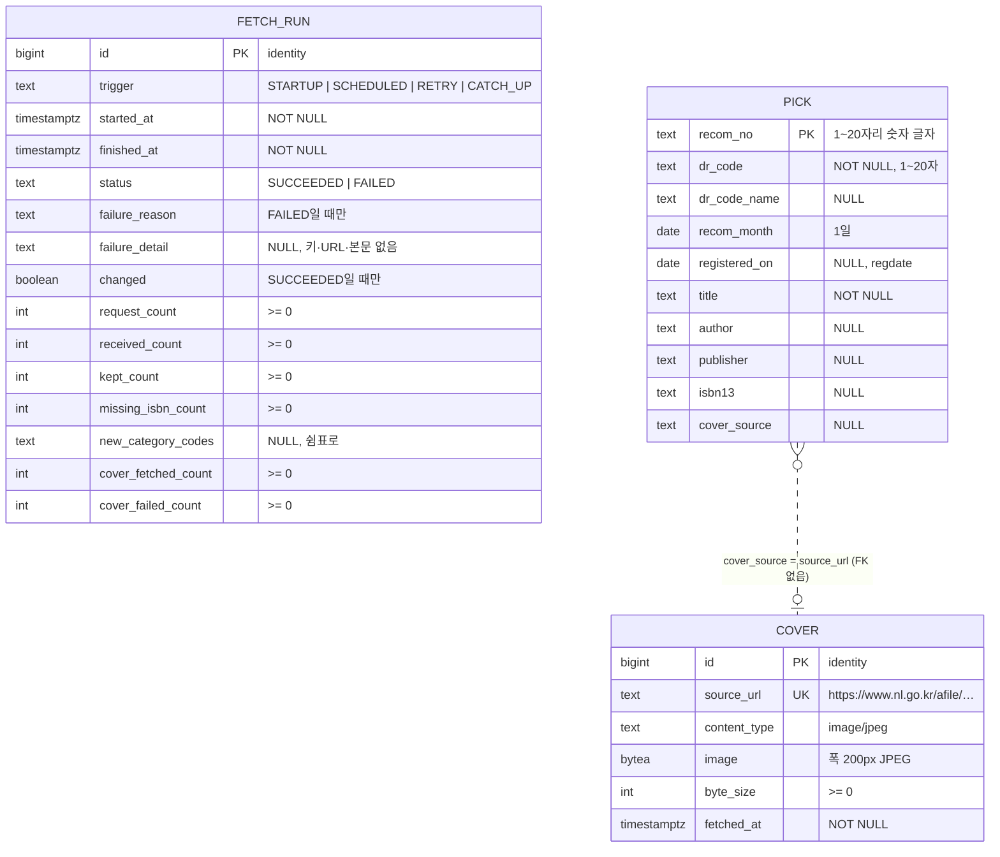

| 테이블.컬럼 | 타입 | 제약 | 설명 | 상태 태그 |
|---|---|---|---|---|
| `fetch_run.trigger` | text | CHECK `STARTUP`·`SCHEDULED`·`RETRY`·`CATCH_UP` | 시작(목록 없음)·월요일·실패 뒤 매일 다시(ADR-0092, 05:00에만)·따라잡기(마지막 성공이 7일보다 오래됨, 서버 시작 또는 05:00 판단 때; 05:00에 목록이 없을 때도 `CATCH_UP` — dev [안], `FetchDecision.java`) | [확정] (따라잡기: 사용자 "켜질 때 따라잡기 (추천)", 2026-10-12) |
| `fetch_run.status` | text | CHECK `SUCCEEDED`·`FAILED` | | [확정] |
| `fetch_run.failure_reason` | text | `FAILED`일 때만 NOT NULL. CHECK `key_missing`·`network_error`·`request_rejected`·`format_changed`·`incomplete`·`no_books` | | [확정] |
| `fetch_run.failure_detail` | text | NULL | HTTP 상태·API 오류 코드만. 키·요청 URL·응답 본문은 넣지 않음 | [확정] |
| `fetch_run.changed` | boolean | `(status = 'SUCCEEDED') = (changed IS NOT NULL)` | 목록을 바꿨는지 | [확정] |
| `fetch_run.new_category_codes` | text | NULL | 모르는 `drCode`가 왔으면 그 코드들 (ADR-0089) | [확정] |
| `fetch_run` 개수 칸 | int | NOT NULL DEFAULT 0, CHECK >= 0 | 요청·받은·남긴·ISBN 없는·표지 받은·표지 실패 | [확정] |
| `fetch_run` 색인 | | `(status, started_at)` | 받을지 판단, 출처 줄 "받은 날"(마지막 `SUCCEEDED`의 `finished_at`) | [확정] |
| `pick.recom_no` | text | PK, CHECK `^[0-9]{1,20}$` | 옛 추천 1~4자리, 최근 20자리 (2026-10-12 시험) | [확정] |
| `pick.dr_code` | text | NOT NULL, CHECK `length(dr_code) BETWEEN 1 AND 20` | 11·6·5·4·425, 모르는 코드도 받음(모양을 묶지 않아 새 코드에 받기가 막히지 않게) | [확정] (ADR-0089) |
| `pick.dr_code_name` | text | NULL | API 이름(테마는 빈 값 → NULL). 새 분류 이름에 씀 | [확정] |
| `pick.recom_month` | date | NOT NULL, CHECK 1일 | `recomYear`·`recomMonth` | [확정] |
| `pick.registered_on` | date | NULL | `regdate`(`YYYY.MM.DD`). 같은 달 안 정렬(늦은 순) | [확정] |
| `pick.isbn13` | text | NULL, CHECK `^97[89][0-9]{10}$` | `Isbn.toIsbn13`로 정리, 안 되면 NULL | [확정] |
| `pick.cover_source` | text | NULL, CHECK `LIKE 'https://www.nl.go.kr/afile/%'` | http → https 바꾼 뒤. 규칙에 안 맞으면 NULL | [확정] |
| `cover.source_url` | text | NOT NULL UNIQUE | 같은 주소는 다시 받지 않음 | [확정] |
| `cover.image` | bytea | NOT NULL | 폭 200px JPEG, 품질 0.8 (ADR-0091) | [확정] |

- (사이클 21부터 `pick` 대신 `list_book`의 `librarian` 줄 — 구현됨 (사이클 21, 회고 2026-10-17)) 받기가 성공하고 목록이 다르면 `pick`을 지우고 넣기와 `fetch_run`(`SUCCEEDED`, `changed = true`)을 **한 트랜잭션**에서, 같으면 `fetch_run`(`changed = false`)만. 실패면 `FAILED` 줄만 넣고 앞 목록 그대로 [확정] (`flows.md` 흐름 24)
- 표지: 목록이 바뀐 뒤 저장 안 된 표지만 받아 넣고, 지금 `pick.cover_source`에 없는 `cover` 줄은 지움, 그 뒤 `fetch_run`의 표지 수 UPDATE [확정] (ADR-0091)
- 다른 모듈과 FK·조인 없음. `catalog`와는 값으로만 맞춤(ADR-0090). 사서 줄은 짝을 저장하지 않음(공용 캐시를 만들 때 맞춤). 사이클 21부터 이동진·서울대 줄은 export 때 맞춘 `list_book.book_id`를 값으로 저장함(ADR-0124, 위 "세 목록") — 구현됨 (사이클 21, 회고 2026-10-17)
- `updated_at` 칸 없음 → 트리거 없음(ADR-0068 대상 아님)
- 크기: `pick` 108줄(범위 12번), `cover` 108장 1,285,929바이트(장당 4,158~22,290바이트) [확정] (dev 받기 시험 실측, 2026-10-14). `fetch_run` 한 번 받기에 `request_count` 109(목록 1 + 표지 108), `received_count` 163(3년 범위) / `kept_count` 108
- 목차·추천 글은 받아도 저장하지 않음 [확정] (spec 비목표)
- Liquibase: changelog `db/changelog/picks/001-picks-schema.yaml`. `popular/001-popular-schema.yaml`은 지우고 마스터의 include를 바꿈 — 배포 전 규칙으로 기존 changelog를 바꿈 [확정] (ADR-0089, 사이클 10 회고 `display_order` 선례). 로컬 DB(`db`, `db-test`) 정리: `DROP SCHEMA popular CASCADE`; `DELETE FROM databasechangelog WHERE id LIKE 'popular-001-%'`. `catalog` 등 다른 스키마는 그대로(다시 가져오지 않음), 빠뜨리면 표가 남으므로 AC-22로 확인 [확정] (ADR-0089). CHECK는 맨 위 규칙대로 changeset 안 `sql`. 구현됨 (사이클 14): `popular/001` 파일 없음, master 92~94행에 `picks/001`. 로컬 정리 끝남(14 worktree 5452·5453, 원래 5432·5433은 합친 뒤 사용자 승인으로, 2026-10-14, AC-22). changelog 머리 주석(1~2행)은 아직 "latest six recommendation months" — 동작과 무관, dev에 알릴 것

## 스키마 `usagelog` (소유: `usagelog` 모듈) — 구현됨 (사이클 15, 회고 2026-10-15)

사용자 행동 기록입니다: 검색(수집 목록·직접 찾기), 책 상세, 더 보기 세 종류, 도서관 클릭, 화면 행동(사서 추천 목록·책 창 열기, 지역 바꾸기, 내 도서관 넣기·빼기), 도서관 응답 하루 요약, 이상한 사용 알림, 버린 묶음 (ADR-0096·0097). 스키마 이름 `usagelog` [확정] (사용자 승인, 2026-10-13). 근거 `docs/cycles/15-usage-log/design-delta.md` "데이터".

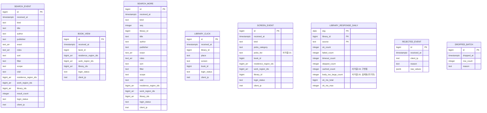

| 테이블.컬럼 | 타입 | 제약 | 설명 | 상태 태그 |
|---|---|---|---|---|
| `id` (`library_response_daily` 빼고 모든 표) | `bigint GENERATED ALWAYS AS IDENTITY` | PK | 지우기를 나눠 할 때 | [확정] (dev 측정으로 둠, 회고 2026-10-15: 1만 줄 넣기 `id` PK·부분 색인 있음 27.6ms / 둘 다 없음 13.1ms) |
| `*.received_at` | `timestamptz` | NOT NULL | 서버가 받은 시각 | [확정] (spec) |
| `search_event.kind` | `text` | CHECK (`catalog`,`direct`) | 검색 종류 | [확정] ([남은 제안](../cycles/15-usage-log/easy/2026-10-14-remaining-proposals.html) #2) |
| `title`/`author`/`publisher` | `text` | 셋 중 하나 이상 | 서버가 다듬은 검색어, 2~50자 | [확정] (spec) |
| `exact`, `roles`, `sort` | `text[]`, `text[]`, `text` | 수집 목록만(CHECK `*_kind_fields_check`: `catalog`·`catalog_next_page`면 셋 다 NOT NULL, 아니면 NULL) | 받은 값, 없으면 기본값. `exact`는 정확히 찾을 칸 목록(`title`·`author`·`publisher` 중 여럿, 없으면 빈 배열) | `exact` 꼴: [확정] (사용자 승인, 2026-10-15, 회고 결정 #1 — 설계 `boolean`에서 바꿈, dev 까닭: 여러 칸이라 참·거짓 하나로는 받은 값을 못 남김). 나머지 [확정] |
| `filter` | `text` | 직접 찾기만, CHECK (`all`,`available`) | `all`/`available` | [확정]. CHECK는 [확정] (사용자 승인, 2026-10-15, 회고 결정 #4) |
| `scope`, `visit` | `text` | `search_event`는 NOT NULL, `search_more`는 NULL 가능(다음 묶음·도서관별 더 보기가 기록용 쿼리 값으로 받고, 없거나 틀리면 NULL). CHECK `scope IN ('all','joinable')`, `visit IN ('any','none')` | 받은 값 | [확정] (`search_more` NULL 허용: 사용자 "그래 이대로 해", 2026-10-14). CHECK는 [확정] (사용자 승인, 2026-10-15, 회고 결정 #4) |
| `residence_region_ids`, `work_region_ids`, `library_ids` | `bigint[]` | `search_event`·`book_view`·`search_more`는 NOT NULL DEFAULT `'{}'`, `screen_event`는 종류에 맞지 않으면 NULL | 받은 값 그대로 | [확정] ([남은 제안](../cycles/15-usage-log/easy/2026-10-14-remaining-proposals.html) #3) |
| `search_event.result_count` | `integer` | NULL 가능, CHECK `>= 0` | 직접 찾기가 첫 묶음 전 끊기면 NULL | [확정]. CHECK는 [확정] (사용자 승인, 2026-10-15, 회고 결정 #4) |
| `*.login_status` | `text` | CHECK (`signed_in`,`signed_out`,`login_off`) | `auth` 판별 부품(`LoginStatusReader`)이 정함 | [확정] ([로그인 판별](../cycles/15-usage-log/easy/2026-10-14-login-status.html) #2), 값 이름 [확정] (dev 구현 확인, 2026-10-15) |
| `*.client_ip` | `inet` | NULL 가능 | `X-Real-IP`, 30일 뒤 NULL | [확정] ([남은 제안](../cycles/15-usage-log/easy/2026-10-14-remaining-proposals.html) #3) |
| `search_more.kind` | `text` | CHECK (`direct_next_batch`,`library_more`,`catalog_next_page`) | 더 보기 종류 | [확정] ([남은 제안](../cycles/15-usage-log/easy/2026-10-14-remaining-proposals.html) #2) |
| `search_more.seq`, `library_id` | `integer`, `bigint` | `seq` NOT NULL CHECK `>= 1`. `search_more_library_id_check`: `library_id`는 `library_more`일 때만 NOT NULL | 묶음·쪽 번호, 도서관 | 칸 이름 [확정] (dev 구현 확인, 2026-10-15). CHECK는 [확정] (사용자 승인, 2026-10-15, 회고 결정 #4) |
| `search_more` 조건 칸 | 검색 기록과 같은 조건 칸 전부 | | 더 보기 줄만으로 어떤 검색인지 알게 | [확정] ([늘린 기록 설계](../cycles/15-usage-log/easy/2026-10-13-more-actions-design.html) #4) |
| `library_click.library_id` | `bigint` | NOT NULL, FK 없음 | 확인된 서비스 도서관 번호 | [확정] |
| `library_click.place` | `text` | CHECK | `result_card`,`join_link`,`join_guide`,`home_page`,`logo`,`summary_bar` | [확정] ([남은 제안](../cycles/15-usage-log/easy/2026-10-14-remaining-proposals.html) #2) |
| `library_click.screen` | `text` | CHECK | `direct_results`,`catalog_results`,`book_page`,`picks`,`my_libraries` | [확정] (같음) |
| `*.book_id` | `bigint` | FK 없음 | 책 번호 (가져오기 때 이어 씀, ADR-0062) | [확정] |
| `screen_event.kind` | `text` | CHECK (`picks_list_view`,`picks_book_view`,`region_change`,`my_library_add`,`my_library_remove`) | 화면 행동 | [확정] ([남은 제안](../cycles/15-usage-log/easy/2026-10-14-remaining-proposals.html) #2) |
| `screen_event` 종류별 칸 | `picks_category`, `book_id`, 지역들, `library_id` | 종류에 맞지 않는 칸은 NULL (CHECK) | JSON 칸 없음, 회원 번호 없음 | [확정] ([늘린 기록 설계](../cycles/15-usage-log/easy/2026-10-13-more-actions-design.html) #3) |
| `screen_event.picks_list` — 구현됨 (사이클 21, 회고 2026-10-17) | `text` | NULL, CHECK IN (`librarian`,`leedongjin`,`snu100`), `picks_*` 종류일 때만 NOT NULL (종류별 칸 CHECK 고침) | 어느 목록 (사용 알림 `list`) | [확정] (ADR-0126) |
| `library_response_daily` | (day, library_id, source) PK, 수 `integer`, 시간 ms | `source` CHECK (`direct_search`,`holding_fill`; 사이클 20에서 `extension`·`server_for_extension`을 더함 — 아래 줄), `day`는 서울 날짜 | 서비스 메모리에서 세다가 5초 묶음 때 `ON CONFLICT (day, library_id, source) DO UPDATE SET …_count = …_count + EXCLUDED…, ok_ms_total = … + EXCLUDED…, ok_ms_max = GREATEST(…)`. 보관 1년 | [확정] ([요약 방법](../cycles/15-usage-log/easy/2026-10-13-summary-method.html) #1~#3, [남은 제안](../cycles/15-usage-log/easy/2026-10-14-remaining-proposals.html) #2) |
| `library_response_daily.cached_count` — 구현됨 (사이클 19, 회고 2026-10-18) | `integer` | NOT NULL DEFAULT 0, CHECK `library_response_daily_cached_count_check (cached_count >= 0)` | 그 날·도서관·갈래에서 3분 캐시로 답한 수. 캐시에서 답을 꺼낼 때마다 1(결과 값 `CACHED`). 응답 시간·성공/실패 수·서버 로그 줄에는 넣지 않음 (ADR-0116) | [확정] (사용자 제안 2026-10-15 회고 결정 #3, 모양·때 사용자 승인 2026-10-15 회고 이어서 #2). 칸 이름 `cached_count` [확정] (명세 결정 #10), 제약 [확정] (설계 결정 #9) |
| `library_response_daily.source` 값 더함 — 설계됨, 1단계 일부만 구현(v1.4.0: `GET /api/v1/lookup-status`·`HostQueueBoard`·`ParseSlots`·`BodyLimit`·`usagelog-004`; 웹 머리말 상태 불은 지움, `extension/` 없음 — ADR-0146, 2026-10-23 dev main 확인. 사이클 20 회고 전) | `text` (그대로) | CHECK `library_response_daily_source_check`를 지우고 같은 이름으로 `IN ('direct_search','holding_fill','extension','server_for_extension')` | 확장 모드의 도서관 응답(검색·소장·더 보기)은 `extension`, 확장 모드 중 서버 대행 목록 도서관을 서버가 부른 것은 `server_for_extension`. 확장 모드는 서버 캐시를 보지 않아 `cached_count`는 0, 보내지 못한 것은 `skipped_count`(close의 `notSent`) | `extension` [확정] (설계 결정 #9) / `server_for_extension` 기록 [확정] (세 관점 검토 #16), 값 이름 [안] |
| `library_response_daily.body_too_large_count` — 설계됨, 1단계 일부만 구현(v1.4.0: `GET /api/v1/lookup-status`·`HostQueueBoard`·`ParseSlots`·`BodyLimit`·`usagelog-004`; 웹 머리말 상태 불은 지움, `extension/` 없음 — ADR-0146, 2026-10-23 dev main 확인. 사이클 20 회고 전) | `integer` | NOT NULL DEFAULT 0, CHECK `library_response_daily_body_too_large_count_check (body_too_large_count >= 0)` | 서버 모드 도서관 응답이 본문 상한(풀었을 때 포함 1MB)을 넘어 실패한 수. 같은 건이 `failed_count`에도 들어감 (ADR-0132) | [확정] (사용자 승인, 2026-10-17, 마무리 확인 #6) |
| `rejected_event.reason` | `text` | CHECK | `unknown_library`,`invalid_place`,`invalid_screen`,`invalid_book_id`,`malformed`,`unknown_type`,`invalid_value`. 사이클 20 — 설계됨, 1단계 일부만 구현(v1.4.0: `GET /api/v1/lookup-status`·`HostQueueBoard`·`ParseSlots`·`BodyLimit`·`usagelog-004`; 웹 머리말 상태 불은 지움, `extension/` 없음 — ADR-0146, 2026-10-23 dev main 확인. 사이클 20 회고 전): CHECK `rejected_event_reason_check`를 지우고 같은 이름으로 그 7개 + `invalid_plan`·`invalid_client_key`. 두 줄은 IP·이유마다 1분 1줄 [안], `raw_values`에 본문 없음(planId·itemId·이유만). `client_ip_changed`는 정상 경우라 남기지 않음 [안] | [확정] ([남은 제안](../cycles/15-usage-log/easy/2026-10-14-remaining-proposals.html) #2, [검증](../cycles/15-usage-log/easy/2026-10-14-verify-decisions.html) #2) |
| `rejected_event.raw_values` | `jsonb` | 2KB 넘으면 잘라 냄 | 받은 값 | [확정] ([남은 제안](../cycles/15-usage-log/easy/2026-10-14-remaining-proposals.html) #4) |
| `dropped_batch.reason` | `text` | CHECK (`db_failure`,`buffer_full`) | 버린 이유 | [확정] ([남은 제안](../cycles/15-usage-log/easy/2026-10-14-remaining-proposals.html) #2) |
| 색인 | BRIN `(received_at)` 각 표 | — | 지우기·기간 조회 | [확정] ([남은 제안](../cycles/15-usage-log/easy/2026-10-14-remaining-proposals.html) #3) |
| 부분 색인 | `<표>_ip_received_at_idx` `(received_at) WHERE client_ip IS NOT NULL` — 다섯 기록 표(`search_event`·`book_view`·`search_more`·`library_click`·`screen_event`) | — | 30일 IP 비우기 | [확정] (dev 구현 확인, 2026-10-15) |
| 그 밖의 CHECK | `book_id`·`library_id` 등 번호 `>= 1`, `library_response_daily`·`dropped_batch`의 수 칸 `>= 0`, `screen_event` 종류에 따른 칸 CHECK | — | dev가 더 둠 (dev `001-usagelog-schema.yaml`) | [확정] (사용자 승인, 2026-10-15, 회고 결정 #4) |
| `book_view` 겹침 | — | — | 책 페이지에서 거르기(전체/지금 빌릴 수 있는)를 바꾸면 책 정보를 다시 받아 한 줄 더 생김(운영 빌드 기준, 개발 모드는 첫 열기도 두 줄). 통계를 만들 때 "같은 사람·같은 책·몇 초 안"은 한 번으로 셈 | [확정] (사용자 승인, 2026-10-15, 회고 결정 #2) |

- 쓰기 [확정] (ADR-0097): `usagelog`가 메모리 큐(상한 1만 줄)에 모았다가 5초마다 한 트랜잭션 — 묶음의 도서관 번호 확인 한 번(켜진 도서관만) → `SET LOCAL synchronous_commit TO OFF` → 표마다 `batchUpdate` → `library_response_daily` `ON CONFLICT … 더하기` → 지난번 버린 묶음을 `dropped_batch`에 → COMMIT. 실패하면 묶음을 버리고 버린 사실을 메모리에 들고 서버 로그(흐름 37)
- 보관 [확정] (ADR-0096): `client_ip`는 30일 뒤 NULL, `rejected_event`는 30일 뒤 지움, 나머지는 1년 뒤 지움. 매일 04:30 (Asia/Seoul) 정리, 1만 줄씩(`chaekcheck.usagelog.cleanup.batch-size` 10000) [확정] (dev 구현 확인, 2026-10-15)
- 쓰기 전에 값의 NUL 문자(`\u0000`)를 뺌, NUL이 든 `raw_values`는 글자로 바꿔 넣음 — PostgreSQL `text`·`jsonb`는 NUL을 받지 않아 값 하나 때문에 묶음 전체가 실패함 [확정] (dev 시험, 2026-10-14; dev `UsageLogWriter.java`, `UsageEventReader.java`)
- 남기지 않는 것 [확정] (ADR-0096): 쿠키·User-Agent. ~~회원 번호, 기록끼리 잇는 칸 없음~~ → ADR-0134 (2026-10-18)로 바뀜, 아래
- ADR-0134 — 구현됨 (dev 보고 2026-10-23, main 머지 6b40067; dev `docs/plan-feedback.md` "# 기록 변경 (ADR-0134, 사이클 20 1단계와 함께)"). `auth`의 `LoginStatusReader.read`는 새 record `LoginState(status, accountId)`를 돌려줌(토큰 subject가 양의 정수면 `accountId`), listener 이름 `UsageLogAccountDeletedCleanup`, 사용 알림 본문 `visitKey`가 없으면 헤더도 봄, changeset `usagelog/005-visit-key-account-id`. 감수 1건(dev 지적): 토큰 subject만 믿어 탈퇴 뒤 만료 토큰이 남은 브라우저가 책을 열면 그 번호가 다시 들어갈 수 있음 → AI 추천 3단계 "맞춤 추천 끄기"와 함께 볼 것 [확인 필요]. 원래 [확정] (사용자 승인, 2026-10-18, `docs/research/ai-recommend/easy/2026-10-18-logging-change-decisions.html` #1~#7): `book_view`·`library_click`·`screen_event`에 `visit_key text NULL`(CHECK 길이 16~64·영숫자, 브라우저 탭마다 `sessionStorage`의 32자 난수, 쿠키 아님)과 `account_id bigint NULL`(CHECK > 0, FK 없음, 로그인한 회원만) — `search_event`·`search_more`에는 없음. 색인 없음. 탈퇴(`AccountDeleted`)하면 `usagelog`가 그 회원의 `account_id`를 NULL로(줄은 남김). "맞춤 추천 끄기" 설정은 AI 추천 3단계에서, 그 전엔 로그인 회원 모두 저장. 통계 SQL은 `account_id`를 읽지 않고, 같이 본 책 계산(PC)은 `client_ip`를 읽지 않음. Liquibase 새 파일 `usagelog/005-visit-key-account-id.yaml`(master 끝, `usagelog/004` 다음), 기존 changeset 안 고침. 회원 번호 출처: `auth` `LoginStatusReader`가 로그인함일 때 회원 번호도 돌려줌(이름은 dev). 근거 ADR-0134
- `library_response_daily` 수의 뜻 [확정] (사이클 15 회고 결정 #1~#3, 사용자 승인 2026-10-14): `skipped_count` = 직접 찾기에서 시작 마감(`LAUNCH_CUTOFF`, 3초)까지 요청을 보내지 못한 후보 도서관 하나마다 1, 조회 서버 바꿔 보내기는 한 번으로 셈, 켜진 도서관만(꺼진 번호의 사용 알림은 `rejected_event` `unknown_library`)
- 파티션 없음 [확정] ([설계](../cycles/15-usage-log/easy/2026-10-13-design-decisions.html) #2)
- 다른 schema로 FK 없음 (모듈 경계, 번호만 남김)
- Liquibase: 새 파일 `db/changelog/usagelog/001-usagelog-schema.yaml`을 master 끝에 [확정] ([남은 제안](../cycles/15-usage-log/easy/2026-10-14-remaining-proposals.html) #2). 기존 changeset 수정 없음. changeset id `usagelog-001-*`, 제약 이름 `<표>_<칸>_check`. 실제 master 끝 순서: 18 `library/016` → 16 세 줄 → 15 `usagelog/001` 맨 끝 (회고 2026-10-15)
- 사이클 19 — 구현됨 (사이클 19, 회고 2026-10-18) (ADR-0116): 새 파일 `db/changelog/usagelog/002-library-response-cached-count.yaml`, changeset id `usagelog-002-cached-count`, master에서 `usagelog/001` 뒤에 `# cycle 19: usage log cached answers (ADR-0116)` 주석과 include(그 뒤에 사이클 21 줄). 기존 changeset 수정 없음 [확정: 설계 결정 #9, 이름 dev 구현 확인]. db·db-ops 모두 칸 기본 0 확인(2026-10-16). `ALTER TABLE usagelog.library_response_daily ADD COLUMN cached_count integer NOT NULL DEFAULT 0 CONSTRAINT library_response_daily_cached_count_check CHECK (cached_count >= 0);` — 상수 기본값이라 표를 다시 쓰지 않음 [확정] (PostgreSQL 18 ALTER TABLE Notes, https://www.postgresql.org/docs/current/sql-altertable.html, 확인 2026-10-15), CHECK 확인을 위한 표 읽기는 한 번(작은 표). 5초 묶음 upsert에 `cached_count = cached_count + EXCLUDED.cached_count`가 더해짐(`UsageLogWriter`)
- 사이클 20 — 설계됨(미구현, 사이클 20, 1단계) (ADR-0119·0132): 새 파일 `db/changelog/usagelog/004-library-response-source-extension.yaml` 하나에서 ① `library_response_daily_source_check`에 `extension`·`server_for_extension` ② `rejected_event_reason_check`에 `invalid_plan`·`invalid_client_key`(지금 7개 그대로) ③ 칸 `body_too_large_count` [확정] (마무리 확인 #6). changeset은 1단계에 한 번에 넣고 2·3단계 값은 미리 허용, 1단계 dev는 아직 쓰지 않는 값이 CHECK에 있는 것을 오류로 보지 않음 [확정] (사용자 승인, 2026-10-17, 마무리 확인 #10). 번호 004 [확정] (사이클 21 설계 검토 #4)
- 사이클 21 — 구현됨 (사이클 21, 회고 2026-10-17) (ADR-0126): 새 파일 `db/changelog/usagelog/003-screen-event-picks-list.yaml`(changeset `usagelog-003-screen-event-picks-list`) — 칸 `screen_event.picks_list` + CHECK `screen_event_picks_list_check` 더함 → 있던 `picks_*` 줄을 `librarian`으로 채움 → `screen_event_kind_fields_check`를 지우고 picks 종류일 때 `picks_list IS NOT NULL`, 그 밖일 때 NULL로 다시 검 [확정] (dev 구현 확인, 2026-10-17). 번호: 002는 사이클 19, **003은 21, 사이클 20은 004** [확정] (사용자 승인, 2026-10-16, 사이클 21 설계 검토 #4). 21이 19보다 먼저 main에 들어가면 번호를 바꾸지 말고 master 순서만 맞춤(나중에 합치는 쪽이 자기 줄을 끝으로)
- 사이클 15 [확인 필요] 결과 (회고 2026-10-15, dev `plan-feedback.md` 4354~4361행): pgjdbc 42.7.13 [확정] (dev 확인). 1만 줄 넣기 `id` PK·부분 색인 있음 27.6ms / 없음 13.1ms → 둘 다 둠. 공용 `@Scheduled` 실행기는 Spring Boot 기본 스레드 1개(04:30 정리가 회원 정리·사서추천 받기와 같은 스레드), 5초 쓰기는 자기 스레드 `usagelog-flush`. 남은 [확인 필요]: 모니터링 도구를 켠 상태의 메모리, nginx realip·광고 차단 비율·로봇의 API 호출(배포 뒤, 사이클 17·운영)

## `availability` 메모리 값 (DB 표 없음) — 설계됨, 1단계 일부만 구현(v1.4.0: `GET /api/v1/lookup-status`·`HostQueueBoard`·`ParseSlots`·`BodyLimit`·`usagelog-004`; 웹 머리말 상태 불은 지움, `extension/` 없음 — ADR-0146, 2026-10-23 dev main 확인. 사이클 20 회고 전)

`availability`는 스키마가 없습니다. 사이클 20이 더하는 값은 모두 서버 메모리에 두고, 서버를 다시 켜면 비워집니다. 근거 `docs/cycles/20-lookup-status-and-extension/design-delta.md` "데이터", 도메인 모델은 `module-map.md` "대출 조회 상태·확장 계획 도메인 모델", 숫자 근거는 [`../settings-index.md`](../settings-index.md). 괄호 = dev 단계.

| 값 | 꼴 | 상한·만료 | 설명 | 상태 태그 |
|---|---|---|---|---|
| 계획 보관함 `SearchPlanStore` (2) | Caffeine [안] | 쓴 뒤 10분 만료, 무게(주소 수) 25,000(약 10MB), 가득이면 새 계획 503(다른 사람 계획을 밀어내지 않음), close·`replaces`는 바로 지움 | `SearchPlan`(`planId` `SecureRandom` 16바이트, 2단계 만든 IP(/64) `creatorIp`, 3단계 `clientId`) + `PlanItem`. 3단계에는 번호당 열린 계획 20(넘으면 그 번호의 가장 오래된 것만 지움). 받은 본문은 보관 안 함. item당 약 400B | [확정] (명세 #11, 검토 #8·#22, 전반 점검 #1) / 번호 꼴 [안] |
| 캐시 값 `FetchedPage` (2) | 기존 + `via`(`server`\|`extension`)·`storedAt` | 확장 값은 따로 둔 500칸, 처음 넣은 시각 + 3분 고정 | 해석 값만(원본 바이트 없음). 서버 모드는 서버 칸 → 확장 칸 차례로 봄. 확장 칸을 비우는 방법은 서비스 재시작 | [확정] (설계 결정 #4, 검토 #9·#10, 전반 점검 #2) |
| `HostQueueBoard` 기다림 (1) | `ConcurrentHashMap` [안] | 시작한 지 10초 지난 기다림은 세지 않음, 비면 줄 지움 | `(laneId, hostKey, libraryId)` → 기다림마다 시작 시각 + 최근 시간 초과 시각. 길 21 × 실제로 기다리는 사이트만 | [확정] (전반 점검 #3) / 자료 구조 [안] |
| 마지막 DB 오류 시각 (1) | 시각 하나 | 30초 안이면 상태 회색 | `availability` 공개 메서드(예: `LookupHealth.recordDbError()`, 이름 [안])를 루트 `ApiExceptionHandler`가 부름 | [확정] (사용자 승인, 2026-10-17, 설계 검토 #3) |
| 브라우저 번호 장부 `LookupClientLedger` (3) | 접근 순서 `LinkedHashMap` + 잠금 | 5만 줄(약 5MB [안: 어림]), 받은 지 1일 지나면 지움, 차면 가장 오래 쓰지 않은 줄(LRU)을 밀어냄, 방금 준 번호는 밀려나지 않음 | 번호 → 받은 공인 IP(/64)·받은 시각·마지막 쓴 시각·열린 계획 수·계획 무게 합·최근 실패 수(1분)·잠긴 때까지(10분). 서명 없음, 장부에 없는 번호는 거절. 번호는 HttpOnly 쿠키로만 | 장부·5만 줄·1일 [확정] (검토 #32) / 밀어내기 [확정] (전반 점검 #10; LRU·`LinkedHashMap` 사용자 승인, 2026-10-17, 설계 검토 #1) |
| 공인 IP별 합계 (3) | Caffeine [안] | 장부와 같은 상한 안 [안] | IP(/64) → 그 IP 번호들의 계획 무게 합·1분 새 번호 수 (울타리 둘) | 울타리 값 [확정] (검토 #31·전반 점검 #12) / 구조 [안] |

- 위 값과 기존 검색 페이지 캐시·상세 판정 캐시·`SearchSlots`는 저장소 인터페이스 뒤에 두고 설정 하나로 구현을 고름, 지금은 메모리 구현만(Redis는 나중) [확정] (사용자 승인, 2026-10-17, 설계 검토 #1, ADR-0133). 옮길 때 볼 점: [`../research/maintenance/memory-state-and-redis.md`](../research/maintenance/memory-state-and-redis.md)

## 스키마 `sitecontent` (소유: `sitecontent` 모듈) — 구현됨 (사이클 16, 회고 2026-10-15)

공지와 네 문서(서비스 안내, 이용약관, 개인정보 처리방침, 개인정보 수집·이용 동의문)의 모든 판입니다 (ADR-0098). 스키마 이름 `sitecontent` [확정]. 근거 `docs/cycles/16-notices-and-policies/design-delta.md` "데이터".

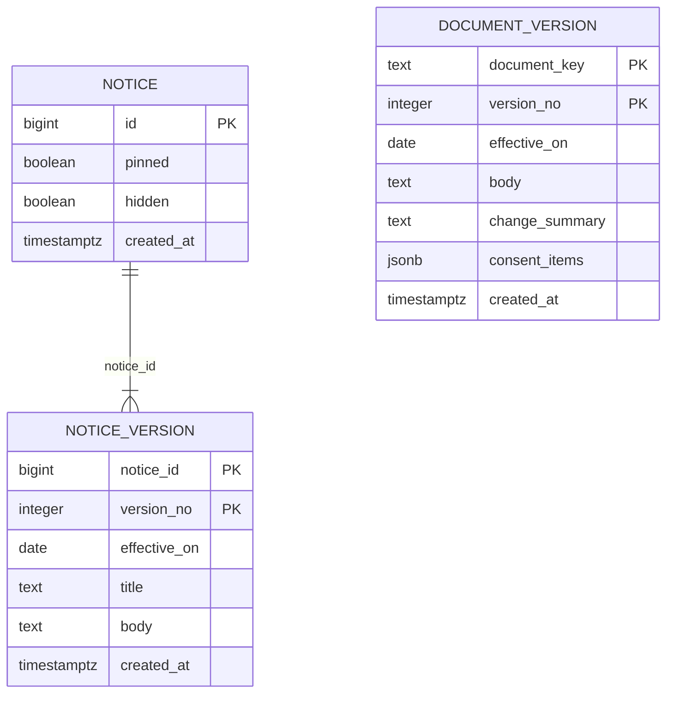

태그 읽는 법: 표 구조·칸·규칙은 사용자 승인(2026-10-13)으로 [확정]. 제약·PK·색인의 **이름**과 CHECK 식의 글자 모양은 [안: dev가 postgres-patterns 규칙에 맞게 정해도 됨].

| 테이블.컬럼 | 타입 | 제약 | 설명 | 상태 태그 |
|---|---|---|---|---|
| notice.id | bigint | PK `notice_pkey`, GENERATED BY DEFAULT AS IDENTITY | 공지 번호, 주소 `/notices/{id}` | [확정] |
| notice.pinned | boolean | NOT NULL DEFAULT false | 고정 공지 — 1쪽 맨 위에만, 10개 셈·총 개수에서 뺌 | [확정] (사용자 승인, 2026-10-13; "고정 빼기"는 미승인 "보기 어려워") |
| notice.hidden | boolean | NOT NULL DEFAULT false | 숨긴 공지는 목록·주소 모두 404. 지우지 않고 DB에 남김 | [확정] (사용자: "이전에 기록을 봤으면 해", 2026-10-13; "숨김 빼기"는 미승인) |
| notice.created_at | timestamptz | NOT NULL DEFAULT now() | 넣은 때 | [확정] |
| notice_version.notice_id | bigint | NOT NULL, FK `notice_version_notice_id_fkey` → `sitecontent.notice(id)` (같은 모듈) | | [확정] |
| notice_version.version_no | integer | NOT NULL, CHECK `notice_version_version_no_check (version_no >= 1)` | 판 순번, 주소 `?version=` | [확정] (사용자 제안, 2026-10-13) |
| notice_version.effective_on | date | NOT NULL | 판 1 = 게시일, 그 뒤 = 고친 날. 앞날이면 그날부터 보임 | [확정] |
| notice_version.title | text | NOT NULL, CHECK `notice_version_title_check (btrim(title, E' \t\r\n') <> '')` (회고 2026-10-15: dev가 줄바꿈·탭까지 지우게 바꿈, [확정] (사용자 승인, 2026-10-15, 회고 이어서 #1)) | 그 판의 제목 | [확정] |
| notice_version.body | text | NOT NULL, CHECK `notice_version_body_check (btrim(body, E' \t\r\n') <> '')` | 제한된 마크다운 | [확정] |
| notice_version.created_at | timestamptz | NOT NULL DEFAULT now() | | [확정] |
| (PK) | | `notice_version_pkey (notice_id, version_no)` | 색인을 더 두지 않음. 공지가 많아지면 `WHERE NOT hidden` 부분 색인을 그때 질의 계획을 보고 더함 | [확정] |
| document_version.document_key | text | NOT NULL, CHECK `document_version_document_key_check (document_key IN ('ABOUT','TERMS_OF_SERVICE','PRIVACY_POLICY','PRIVACY_COLLECTION'))` | | [확정] |
| document_version.version_no | integer | NOT NULL, CHECK `>= 1` | 판 순번 | [확정] |
| document_version.effective_on | date | NOT NULL | 시행일(서비스 안내는 게시일) | [확정] |
| document_version.body | text | NOT NULL, CHECK `document_version_body_check (btrim(body, E' \t\r\n') <> '')` | 제한된 마크다운 | [확정] |
| document_version.change_summary | text | NULL, CHECK `document_version_change_summary_check (document_key <> 'ABOUT' OR change_summary IS NULL)` | 바뀐 점(사람이 씀) | [확정] |
| document_version.consent_items | jsonb | NULL, CHECK `document_version_consent_items_check ((document_key = 'PRIVACY_COLLECTION') = (consent_items IS NOT NULL))`, CHECK `document_version_consent_items_shape_check (consent_items IS NULL OR (jsonb_typeof(consent_items) = 'array' AND jsonb_array_length(consent_items) = 4))` (이름은 dev가 정함, 회고 2026-10-15) | 동의문 4항목(목적·항목·보유 기간·거부할 권리 — 문구는 `docs/cycles/16-notices-and-policies/drafts/privacy-collection.md`) | [확정] |
| document_version.created_at | timestamptz | NOT NULL DEFAULT now() | | [확정] |
| (PK) | | `document_version_pkey (document_key, version_no)` | | [확정] |

- 지금 판 = 시행일 ≤ 오늘(`Asia/Seoul`)인 판 중 순번 최대 [확정]. 판 번호는 마지막 + 1, 새 시행일은 앞 판 시행일 이후(운영자가 넣는 SQL 조건, 흐름 41)
- `updated_at` 없음: 판은 고치지 않고 새로 넣음 [확정]. 다른 모듈과 FK·JOIN 없음(`auth`는 판 순번 값만 기억)
- "다시 동의 필요" 칸은 두지 않음 — 다시 동의 화면을 만들 때 함께 더함 [확정] (사용자 승인, 2026-10-13)
- 쓰기 API 없음. 운영 DB 계정 권한: 사이클 17이 정한 "`sitecontent` schema 쓰기만 있는 DB 계정"은 `sitecontent` 표의 SELECT·INSERT·UPDATE와 시퀀스 `sitecontent.notice_id_seq`(`notice.id` `GENERATED BY DEFAULT AS IDENTITY`) USAGE가 필요함 (사이클 17에 알림)
- Liquibase: `sitecontent/001-sitecontent-schema.yaml`, `sitecontent/002-sitecontent-seed.yaml`, `auth/002-consent-version-number.yaml`, master 끝에 추가 [확정] (위 "사이클 16 Liquibase")

## 스키마 `aisearch` (소유: `aisearch` 모듈) — 설계됨(미구현, 사이클 24)

> **사이클 26이 바꿈 (2026-10-28, plan main 2440b84):** `aisearch.search_book`은 **사이클 26 배포 2에서 지움 (v1.20.6, 2026-10-29)** — 낱말 맞추기는 `catalog.book_search`로 옮김(ADR-0165, ADR-0151의 "aisearch 표 사본에서 낱말 맞추기" 부분을 대신함), `library_ids`만 중복 저장 예외(ADR-0160). 책 프로필은 `catalog.book_profile` + 새 넣기 모드 `book-profiles`, `book-texts`에 `export_id` 검사(ADR-0162). `aisearch` 코드 변경은 dev 사이클 26 배포 1에서 함(사용자 결정), 24 dev 브랜치는 rebase로 맞춤. 아래 `search_book` 설명은 사이클 24 설계 당시 그대로 둠

ADR-0151·0152. 모듈 넘는 FK 없음(`book_id`는 `catalog.book.id` 값, ADR-0124와 같은 원칙). Liquibase 새 파일 `aisearch/001-aisearch-schema.yaml` [안], `usagelog/00N-ai-search-event.yaml`(번호는 23과 합칠 때) [안]. `search_book`은 넣기 명령 `book-texts`가 한 트랜잭션에서 지우고 넣음(`ListedBooks.loadFromDb()`가 0권이면 거부). 목록 책이 늘면 다시 넣기 전까지 AI 찾기에 안 나옴(감수, 사용자 "추천도서가 중간에 바뀌기는 어렵고 일단 있는 것으로 해줘").

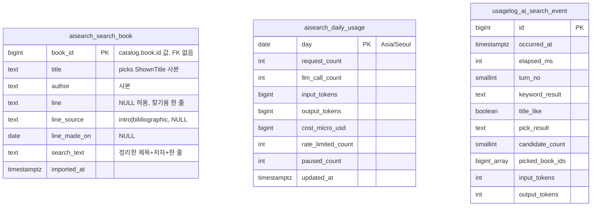

| 테이블.컬럼 | 타입 | 제약 | 설명 | 상태 태그 |
|---|---|---|---|---|
| `aisearch.search_book.book_id` | bigint | PK, CHECK `>= 1` | 목록 책 번호(`catalog.book.id` 값, 모듈 넘는 FK 없음 — ADR-0124와 같은 원칙) | [안] |
| `…title`, `…author` | text | NOT NULL / NULL 허용 | 넣을 때의 `ListedBooks` 사본. 추천도서가 바뀌어도 다음 넣기까지 그대로 | [확정] 사본 방식 (결정 #3, 사용자 "추천도서가 중간에 바뀌기는 어렵고 일단 있는 것으로 해줘") |
| `…line` | text | NULL 허용, CHECK `char_length(line) BETWEEN 1 AND 300` | 찾기용 한 줄. 없으면 제목·저자로만 찾음 | 300자 [확정] (결정 #8) |
| `…line_source` | text | NULL, CHECK IN ('intro','bibliographic') | 원문으로 만들었는지, 서지만으로 만들었는지 | [안] |
| `…line_made_on` | date | NULL | PC 배치 날짜 | [안] |
| `…search_text` | text | NOT NULL | NFKC → 소문자 → 빈칸 지운 제목+저자+한 줄. 색인 `search_book_search_text_bigm` GIN (`gin_bigm_ops`) | [안] (pg_bigm은 `catalog`가 이미 씀) |
| `…imported_at` | timestamptz | NOT NULL DEFAULT now() | 넣은 시각 | [안] |
| `aisearch.daily_usage.day` | date | PK | 한국 날짜 | [안] |
| `…request_count`·`llm_call_count`·`rate_limited_count`·`paused_count` | integer | NOT NULL DEFAULT 0 | 그날 수 | [안] |
| `…input_tokens`·`output_tokens`·`cost_micro_usd` | bigint | NOT NULL DEFAULT 0 | 비용 = 입력 × 0.10 + 출력 × 0.50 (100만 토큰당 달러, 10만 토큰 이하 요청) → 백만분의 1달러 | 가격 [확정] (https://platform.claude.com/docs/en/about-claude/pricing , 2026-10-24) |
| `usagelog.ai_search_event` | 위 그림 | `turn_no` 1~20, `keyword_result` IN ('ok','failed','timeout'), `pick_result` IN ('ok','no_match','no_text','partial','skipped'), `picked_book_ids` 최대 8 | 질문 글·IP·`visit_key`·`account_id` 없음. 보관은 지금 `usagelog` 정리 규칙 | 칸 [확정] (결정 #7 "이대로"), 보관 기간 [확인 필요] |

## seed

- 켜진 도서관 278곳 (2026-09-29, dev 보고). 중단된 2곳(id 59, 131)은 `enabled=false`. 방문 가입 86곳, 그중 누구나 가입 16곳 (2026-09-30, dev 보고: `visit=none`이면 계획 192곳)
  - `002`: 시범 2곳 — 1 강서(`YES24_V2`), 2 고흥(`KYOBO_V1`, `RESIDENCE × NATIONWIDE`)
  - `003`: 화면 종류별 확인 13곳(교보 4, 구독형 1, `YES24_V1` 1, 강남구 1, 포털 6)
  - `004`: 교보 공식 목록(구독형 포함), 인증서 불완전 24곳, 이름에 "도서관"이 없는 공공도서관 17곳 등 (id ~205)
  - `005`: YES24 66곳 (id 206–271)
  - `006`: 새 주소를 찾은 9곳 (id 272–280)
  - 사이클 07 `library/008`: 사이클 07에서 넣은 도서관 2,394곳 (id 281~2674), `library/009`: 로고 198곳, `library/010`: 135·2194·2198 끔 — 구현됨 (사이클 07). seed 도서관 2,674곳, `GET /api/v1/libraries` 측정 때 켜진 곳 2,672곳(그 뒤 `library/010`으로 3곳을 더 끔)
  - 사이클 08 (구현됨 (사이클 08)): 교보 대여·혼합 11곳(id 2664~2674)을 `library/008-library-candidates.csv`에서 지움(배포 전 규칙으로 기존 seed를 고치고 로컬 `db`·`db-ops`는 이름 바꾸기 SQL + 체크섬 비우기로 맞춤(데이터 유지, 사용자 선택 2026-10-12), `build_candidate_seed.py` 규칙 `kyobo_rental_mixed`, diff는 두 CSV의 22줄). 번호는 다시 쓰지 않음. 그 도서관을 직접 추가한 계정·브라우저의 번호는 꺼진 도서관처럼 건너뜀(사이클 06 규칙) [확정] (ADR-0067). 소장 −2,669,217, 책 −2,320 (사이클 07 2회차 대비, dev 측정). `library/011-updated-at-trigger.sql`: 트리거, `library/012-library-mobile-site-differs.yaml`: `mobile_site_differs` 13곳, `library/013-library-name-overrides.yaml`: 이름 고침 8곳 UPDATE [확정] (dev 구현 확인, 2026-10-11)
  - 사이클 09 — 구현됨 (사이클 09): `library/014-library-classification.yaml` [확정] (changeSet 하나 `library-014-classification-2026-10-11`, dev 구현 확인, 2026-10-12): 이름 UNIQUE 지움, 이름 UPDATE(괄호 떼기 등, 위 "도서관 이름과 분류"), `vendor`·`order_no` 칸, `lending_model` 채움, CHECK 셋, UNIQUE `library_classification_key`
  - 사이클 13 — 구현됨 (사이클 13, 회고 2026-10-14) (ADR-0084): **앞으로 도서관 seed changeset을 만들지 않음** [확정]. 새 도서관은 `collection` 넣기 명령(미리 보기 → 보고서 → 넣기)으로 넣고, 사람이 정한 규칙(이름 고침, 같은 사이트, 같은 호스트지만 남김, 가입 범위 등)은 dev `scripts/library/rules/` TSV(ADR-0085). 이미 적용된 seed 파일(`library/002`~`010`, `collection/002`)은 그대로. `library/015-library-name-1215.yaml`: 1215 `한화S&amp;C` → `한화S&C` [확정] (사전 결정 8), 파일 이름 [확정] (dev 구현 확인, 2026-10-14). 2026-10-12 사본(보고서 `1af0721e4a3e`)으로 넣은 6곳: 2675 여주대학교(교보, 수집 100584) · 2676 한국선원복지고용센터(102029) · 2677 여주대학교(YES24, 102084) · 2678 김천대학교(102092) · 2679 경운대학교(102101) · 2680 천상중학교(102171), 모두 순번 1, `MEMBERS_ONLY`, 규칙 줄 없음 [확정] (dev 9단계, 2026-10-14. 102029 종류는 사용자: "이대로 넣기", 2026-10-12)
- 사이클 07 도서관 2,394곳 seed 규칙 [확정] (ADR-0052, ADR-0053, `architect-proposal.md` D3) — 구현됨 (사이클 07). 스크립트 dev `scripts/library/build_candidate_seed.py`(테스트 `test_build_candidate_seed.py`, 같은 입력이면 같은 출력)
  - 넣는 곳: 수집 번호 ≥ 100001, `crawl_skip` 없음, `last_full_success_at` 있음. 교보 대여·혼합(교보 구독형 플랫폼 서버의 대여·혼합 기관)은 넣지 않음 [확정] (ADR-0067, 사이클 08 seed 규칙, 구현됨 (사이클 08)). 체험용·운영 중단 4곳(삼각산 북라이브, 대구동구안심 북큐브, 순창 북라이브, 양평 북큐브) 제외 (사용자, 2026-10-05). 시험용 6곳은 넣지 않음 (사용자 승인, 2026-10-05, 설계 검토). 번호 1~280 도서관과 책 번호 목록이 같고 상세 주소가 포트만 다른 8곳 제외, 같은 기관의 다른 북큐브 사이트 6곳은 넣음 [확정] (사용자 결정 "① 8곳만 빼기", 2026-10-05). 스크립트는 읽어 본 쌍을 `SAME_HOST_KEPT`에 두고 새로 걸리는 같은 호스트 쌍이 있으면 종료 코드 2로 멈춤
  - 새 번호: 지금 최대(280) 다음부터("마지막 번호 다음", 두 번 돌려도 같고 새 곳 1곳만 다음 번호를 받는지 테스트로 확인) [확정] (dev 구현 확인, 2026-10-05). 이름이 겹치면 `이름 (북큐브|교보|YES24|알라딘)`, 그래도 겹치면 `이름 (라벨, 호스트)` (사이클 08까지). 사이클 09부터 — 구현됨 (사이클 09) [확정] (ADR-0071, 설계 결정 3번): 이름에 라벨을 붙이지 않음(`LABELS`·`name_candidates()`를 지움). `vendor`는 수집이 따로 적은 값이 있으면 그 값, 없으면 화면 종류 대응표(`VENDORS`, 한 곳) [확정] (수집이 따로 적는 자리는 [확인 필요: 수집 세션]); `lending_model`은 교보 probe, 북큐브 전체 권수 결과, 포털 NULL, 나머지 `OWNED`; 이름 고침 목록을 번호 280 이하 도서관에도 메모리 속 이름에 적용; 겹침 열쇠는 (이름, 업체, 대출 방식, 순번)이고 같은 (이름, 업체, 대출 방식) 묶음은 서비스 번호 순으로 `order_no`(`assign_order_no()`), 2 이상은 목록 출력하고 종료 코드 3(사람이 사이트 이름 확인) [확정] (dev 구현 확인, 2026-10-12). 사이클 09 구현의 실행 방법 [확정] (dev 구현 확인, 2026-10-12): 다섯째 위치 인자 `<bookcube-volume.tsv>`(dev `scripts/library/bookcube-volume-2026-10-11.tsv`, 북큐브 전체 권수), 옵션 `--changes-only <db-state.tsv>`(seed CSV 셋을 바꾸지 않고 바뀔 줄 목록만 냄, 옛 이름은 DB 상태 파일에서 읽음). 이번 사이클은 `--changes-only`로만 돌림, `vendor`·`order_no`는 아직 seed 칸이 아님(첫 배포 직전 seed 정리 때) [확정] (seed 고치는 방식, 사이클 08). 수집이 업체를 따로 적는 자리는 스크립트에 빈 자리 `COLLECTION_VENDORS = {}`와 `TODO(확인 필요)`만 (`build_candidate_seed.py:96-98`) [확인 필요: 수집 세션]. 처음 정한 이름은 다음 seed에서 바꾸지 않음. 예외: 공식 개명·틀린 이름은 이름 고침 목록에 있을 때만 고치고 번호는 유지 [확정] (사용자 승인, 2026-10-05; 사이클 08 scope 4) — 위 `library` 절 "이름 고침", 구현됨 (사이클 08). seed를 다시 만드는 방식(첫 배포 전·직전·뒤)도 그 절
  - `homepage_url = base_url`, `holdings_count = NULL`, `enabled = true`. `base_url`은 리다이렉트를 따라간 https 최종 주소(248곳, `scripts/library/CheckFinalOrigins.java` → `final-origins.tsv`) [확정] (사용자 요청, 2026-10-05)
  - `lending_model`(사이클 07에서 넣은 곳): OWNED 1,182, MIXED 8, RENTAL 3, NULL 1,201. 번호 1~280 중 16곳: OWNED 5, MIXED 2, RENTAL 9 (dev 1단계 셈). 사이클 09에서 통합 포털 말고 NULL을 모두 채움(위 "도서관 이름과 분류") — 구현됨 (사이클 09)
  - 가입: 가입 조건을 조사한 공공도서관(`public-join-2026-10-05.tsv`)은 `SURVEYED` + 가입 규칙 줄 + `join_method`·`visit_required`·`join_caution`·`extra_condition_text`(책이음 9곳). 원문 못 찾은 곳은 `NOT_FOUND` + 규칙 없음. 종류 표(`candidate-kinds-2026-10-05.tsv`)의 초·중·고·대학·회사·정부·공공기관·단체·아파트는 `MEMBERS_ONLY`, 모름은 `NOT_SURVEYED`, 둘 다 `join_method = NULL`
  - dev 규칙 "자격 조사 없이 도서관 추가 금지"의 예외: `MEMBERS_ONLY`·`NOT_SURVEYED` 곳(약 2,500곳)은 ADR-0053대로 조사 상태 표시로 넣음 [확정] (사용자 승인, 2026-10-05, 설계 검토)
- 자격 규칙은 원문을 확인한 값만 넣음. 조사 기록은 dev `docs/library-research/*.tsv`, 사용자가 나중에 확인할 항목은 dev `docs/library-maintenance.md` 14절
- 도서관 ID는 seed에서 직접 넣고 IDENTITY는 마지막 seed 다음부터 시작. 사이클 13부터는 넣기 명령이 번호를 정해 `LibraryRegistry.add`로 넣고 시퀀스를 올림. 첫 번호는 `nextId()` = `GREATEST(max(id)+1, IDENTITY 다음 값)`이라 `library/008`의 `RESTART WITH 2675` 때문에 2675(2664~2674는 비워 둠, ADR-0067). 옛 스크립트 `build_library_seed.py`도 같은 규칙으로 고침 [확정] (dev 구현 확인, 2026-10-14) — 구현됨 (사이클 13, 회고 2026-10-14) (ADR-0083)
- 지역: 2026-07-01 법정동 코드(`jscode20260701`) 기준 시도 16개, 시군구 232개 [확정] (시군구 234개 중 도 출장소 2개 제외). 세종특별자치시는 시군구 행 하나(`3601`)를 둠. 사이클 07: 그 파일에서 빠져 있던 증평군(충북)을 `4311`(충북의 다른 번호 뒤, 코드 순서가 아님)로 추가해 시군구 233개 [확정] (사용자 결정, 2026-10-05)
- 지역 ID 규칙 [확정] (사용자, 2026-09-27): 시도 2자리 = 법정동 코드 앞 두 자리, 시군구 4자리 = 시도 ID + 법정동 코드 순서(01, 02, …). 번호는 다시 쓰지 않고, 소속은 `parent_id`로만 판단. 일반구·읍면동을 넣게 되면 상위 ID 뒤에 자리를 붙임
- 시험용 폐지 데이터 (context `test-data`): 시도 90, 9001 → 1116 (REPLACED), 9002 → 1114·1116 (SPLIT), 9003 → 9004 → 1101 (연쇄)
- 전남광주통합특별시 `short_name`은 "전남광주" [확정] (사용자 결정, 2026-10-05, 사이클 07 dev 1단계 뒤)

## 확인 필요 (사이클 07)

| 항목 | 방법 |
|---|---|
| ~~`catalog_library_snapshot.import_id` FK를 어떻게 할지~~ | 해결: 칸과 FK를 지움 (dev `catalog/001-catalog-schema.yaml`, 2026-10-05) |
| ~~importer 나눠 읽기 크기, 가져오기 시간, DB 크기~~ | 해결: 두 번 읽기(크기 설정 없음), 36분 43초~40분 36초, 9,812MB (dev `plan-feedback.md` "# 사이클 07" 14~17단계, 2026-10-05) |
| ~~새 도서관을 넣을 때 seed 번호가 겹치지 않는 규칙("마지막 번호 다음")~~ | 해결: dev `scripts/library/build_candidate_seed.py`가 마지막 번호 다음을 주고 테스트로 확인 (`test_build_candidate_seed.py`, 2026-10-05) |
| ~~리다이렉트로 호스트까지 바뀐 도서관(411)의 소장을 어떻게 이을지(수집 쪽 주소 갱신 / 짝 표에 수집 주소 기록)~~ | 사이클 08: 수집 DB 주소를 고치고 다시 수집함(2026-10-11). 서비스에 들어오는지는 다음 가져오기에서 확인 (위 "도서관 찾기") |
| `/books` GIN 기준 50곳, 동시 검색 20, 응답 본문 4MB·전체 15초, nginx 30r/m·burst 20·연결 6 숫자 | 사용자에게 질문, 실제 사용량으로 측정 |

## 확인 필요 (사이클 08)

| 항목 | 방법 |
|---|---|
| ~~`SET SCHEMA`·`DROP`을 기다리는 동안 뒤에 온 검색도 줄을 서는지, `lock_timeout` 값·다시 시도 횟수~~ | 해결: 줄을 서지만 2초에 포기해 한 번에 최대 2초, 2초·10초·5번 그대로 (dev `db-test` 시험, 2026-10-11) |
| ~~바꿔 끼운 뒤 서비스(Hikari)가 준비해 둔 쿼리가 새 표를 보는지~~ | 해결: 바꿔 끼우기 전 연결로 검색 모두 200, 오류 없음 (dev 실데이터, AC-21, 2026-10-11) |
| ~~쓰기 단계 네 조각의 시간 → 더 고칠 곳~~ | 해결: `step_seconds` 키를 나눠 잼. 가장 긴 것은 읽기(`read`·`holdings_read`), 이번에는 바꾸지 않음 (dev, 2026-10-11) |
| 국가서지 원문 크기와 다시 읽는 시간 | 크기는 해결: 3,999,211줄(ISBN별), TTL을 풀며 쓰기 7분 55초. 표에서 다시 읽는 시간: 2분 46초 + 정리 24초(가져오기 #3c, AC-15). 이전 표기: 측정 중 (가져오기 #3, AC-15) |
| ~~바꿔 끼우는 동안 디스크 최대 사용량~~ | 해결: 최대 19.1GiB(시작 8.5GiB) (dev, 2026-10-11) |
| ~~catalog로 들어오는 외래 키가 없는지 다시 확인~~ | 해결: 바꿔 끼우기 직전에 코드가 조회하고, 있으면 `outside_foreign_key`로 실패 (dev `CatalogLoadSwapTests`, 2026-10-11) |
| ~~이름 고칠 새 이름 문자열, 흡수된 학교 사이트 6~7곳(428, 429, 769, 2257, 607, 895, 1002) 처리~~ | 해결: 8곳 고침(`library/013`), 흡수된 학교 7곳은 그대로 (사용자, 2026-10-11) |
| 가져오기 힙 6GB로 끝까지 가는지 | 해결: 가져오기 #3c 통과(AC-12), 살아 있는 데이터 최대 약 4.8GB라 여유가 작음. 4GB는 멈춤 (dev `plan-feedback.md` 사이클 08 덧붙임 "가져오기 #3"·"#3c", 2026-10-11) |
| 색인 단계에서 멈췄을 때 검색 결과가 그대로이고 `catalog_next`가 지워지는지 | 해결(다르게): #4는 돌리지 않고 #3b의 실제 실패(DB 메모리 부족)로 확인. 검색 결과·`catalog` 그대로, 기록 `FAILED`. 다만 DB·프로세스가 죽으면 빈 `catalog_next`가 다음 가져오기 시작 때까지 남음 — 남은 빈 표를 지우는 명령을 따로 만들기로 함 [확정] (사용자, 2026-10-11, backlog) (dev `plan-feedback.md` 사이클 08 덧붙임 "가져오기 #3"·"#3c", 2026-10-11) |
| 교보 구독형 서버가 응답하지 않던 날 본 이름 3곳(1016·1079·2161)의 사이트 제목, 456의 교육부 원문 날짜, 2264의 통합 날짜 | 교보 서버가 다시 응답하면 사이트 확인 (dev `library-maintenance.md` 4-12) |
| 운영 서버 메모리 값(DB·컨테이너 상한·서비스 힙) | 운영 서버가 정해지면 `measure_round.py`로 다시 잼 (backlog) |

## 확인 필요 (사이클 09)

회고(2026-10-12)에서 dev 확인으로 끝난 줄(changeset 번호 014, 이름 UPDATE 289줄, 북큐브 구독 번호, 공식 이름, `eligibility_rules.py` — 첫 배포 직전 seed 정리 때 고침 [확정] (사용자 승인, 2026-10-12, retro-decisions #4))은 지움. 수집 세션 줄만 남김.

| 항목 | 방법 |
|---|---|
| ~~수집 DB 이름 289줄 바꾸기, 수집이 업체를 따로 적는 자리~~ | 해결 (수집 세션, 2026-10-12, `docs/research/maintenance/cycle09-collection-result.md`): 수집 번호로 한 트랜잭션, 바꿈 64 · 이미 같음 223(수집 DB 이름에는 처음부터 괄호가 없었고 라벨은 서비스 넣기 스크립트가 붙였던 것) · 못 바꿈 2(59·131은 수집 DB에 없는 번호). 목록 밖 괄호 10곳(서비스에 넣지 않는 줄)도 뗌. 업체 칸: 수집 DB `library.vendor` TEXT NULL, CHECK 6개 값, 화면 종류 대응표와 다를 때만 채움(지금 0줄) [확정] (사용자 승인, 2026-10-12). dev `build_candidate_seed.py`의 `COLLECTION_VENDORS`는 `SELECT id, vendor FROM library WHERE vendor IS NOT NULL`로 읽으면 됨(다음 사본부터 칸 있음) — dev 연결은 backlog |

## 확인 필요 (사이클 10)

`docs/cycles/10-popular-books/design-delta.md` "확인 필요"에서 연 줄. 회고(2026-10-12, `docs/cycles/10-popular-books/retro.md`)에서 닫은 줄은 지움 표시. 사이클 14에서 `popular`(출판유통통합전산망 받기)를 지우므로 아래 남은 줄은 더 확인하지 않음("공용 캐시 메모리"·"표지 응답 시간"은 `picks`에서 같은 방식으로 운영 측정).

| 항목 | 방법 |
|---|---|
| 연결 5초·읽기 10초를 측정 뒤 조정(값은 승인됨). "전체" 순위 POST 7.2~7.3초로 읽기 10초에 가까움 | 운영 지켜보기 (backlog) |
| ~~작은 표지(`s_`)가 3×3에 충분한지~~ | 해결: 폭 200px JPEG로 줄여 게시 (ADR-0081) |
| 공용 캐시 메모리, 새로 고침 한 번 시간(ISBN 최대 750개) | 운영 측정 (회고 때 재지 않음) |
| ~~서비스 DB ISBN 일치율~~ | 해결: 34.6%(809개 중 280, 수집 DB 시안 27.8%보다 높음) (dev 측정, 2026-10-12) |
| 받기를 켠 채 다시 켜서 "같은 달이 있으면 요청 0건" | 실제로는 못 봄, 시험 `FetchDecisionTests`로만 확인 → 운영에서 확인 |
| 줄인 표지(`GET …/covers/{coverId}`) 응답 시간 | 운영 측정 |
| 지난달 값이 들어온 뒤 고쳐지는지(3일 받기) | API 호출 시험 (11-03, 11-10) |
| 사이클 08 웹과 `AppLayout` 변경 순서 | dev 회고 때 |
| ~~표 크기~~ | 해결: 실측 표지 808장 11MB, 중간값 14KB (dev 받기 시험, 2026-10-12) |

## 확인 필요 (사이클 15)

`docs/cycles/15-usage-log/design-delta.md` "확인 필요"에서 연 줄.

| 항목 | 방법 |
|---|---|
| `id` PK·`client_ip IS NOT NULL` 부분 색인을 둘지 (넣기 비용) | 프로토타입, AC-16 측정 (개발) |
| `SmartLifecycle` 정지 phase와 Hikari 닫힘 순서 (끌 때 남은 큐 넣기) | 프로토타입 (개발) |
| dev pgjdbc 실제 버전 | 의존성 트리 (개발) |
| nginx 이미지의 realip 모듈, compose 네트워크 범위, Cloudflare "Remove visitor IP headers" 꺼짐 | 배포 때 `nginx -V`, 지인 기간 시험에서 기록된 IP 확인 |
| 광고 차단으로 빠지는 알림 비율 | 지인 기간 실서버 시험 |

## 확인 필요 (사이클 16)

`docs/cycles/16-notices-and-policies/design-delta.md` "확인 필요"에서 연 줄(데이터에 닿는 것).

| 항목 | 방법 |
|---|---|
| seed 본문의 세미콜론·`$$` 처리 (`sitecontent/002`) | dev 적용 시험 (개발) |
| 사이클 15와 병합: master 끝줄 | 규칙은 위 "사이클 16 Liquibase". 병합 때 확인 (개발) |
| 운영 첫 판의 공개 전 값: AWS 계약 법인, Cloudflare 연락처·보유 기간·쿠키 여부, 공개일 | 사용자에게 질문(공개일), 사이클 17 배포 때 계정·계약서(나머지) (공개 전) |

## 확인 필요 (사이클 19)

근거 `docs/cycles/19-author-angle-brackets/design-delta.md` "확인 필요". 회고 (2026-10-18): 설계 때 항목은 아래처럼 끝남, 사용자 확인 셋은 2026-10-18 회고 결정 #1~#3으로 정해짐(사이클 19 `retro.md` "사용자에게 확인할 것"; TTL 다시 받기는 남은 일).

| 항목 | 결과 |
|---|---|
| `supplier_families.tsv` 내용 | dev가 만들어 보고(46줄·묶음 16가지). 끝남: 그대로 승인 [확정] (사용자 승인, 2026-10-18, 회고 결정 #2) |
| `KYOBO_SUBSCRIPTION_V1`의 `item_key`가 교보 상품 번호와 같은 번호 공간인지, 코드 다듬기 | 끝남: 구독형 `480D…`·`480N…`은 소장형(`480…`·`480KB…`)과 모양이 달라 섞이지 않음, 키에 넣음. 다듬기는 앞뒤 공백만(앞의 0 그대로) |
| 코드로 이었는데 ISBN이 둘 이상인 묶음 수 | 끝남: dry run 네 번 모두 0. 다만 ISBN 없는 잘못 이음은 이 셈으로 못 잡음 — 첫 dry run 표본에서 잡혀 키에 제목·출판사를 더함 |
| `author_publisher_swapped.tsv`의 `swap_before` 날짜 | 끝남: 2026-10-16 |
| ADR-0114 본문을 실제 키(묶음, 코드, 비교 제목, 출판사)로 고칠지, 자리 채움 출판사·공급사 「기타」 빼기 | 끝남: ADR-0114에 "결정 고침 (2026-10-16)" 절 [확정] (사용자 승인, 2026-10-18, 회고 결정 #1) |
| 국가서지 TTL 파일을 다시 받을지 | 정함: 지금 다시 받아 둠 [확정] (사용자 선택, 2026-10-18, 회고 결정 #3). 받기는 아직 안 함(사용자가 "받아"라고 할 때, 사이클 19 `retro.md` "사용자에게 확인할 것" #3) |

## 확인 필요 (사이클 21)

근거 `docs/cycles/21-recommended-books/design-delta.md` "확인 필요". 회고 (2026-10-17): 아래처럼 끝남, 남은 것은 표지 이용 조건(인계서 #17, 공개 배포 전)뿐.

| 항목 | 결과 |
|---|---|
| `TITLE_URL` 주소의 호스트·경로, 인증키가 붙는지 | 끝남: 호스트 셋, 경로 `/seoji/fu/ecip/`, 키 없음, `http` → `https`로 열림 (dev 0단계, 2026-10-16) |
| 유튜브 영상 ID 꼴 | 끝남: 공식 문서에 꼴 없음, CHECK `^[A-Za-z0-9_-]{1,64}$`(관찰 근거) |
| 색인 없는 `catalog_next`에서 고정 판 맞추는 시간 | 끝남: export 목록 단계 3.6초 |
| 출판사 정리 함수 이름 | 끝남: `CatalogText.publisherNorm` (`catalog.book.publisher_norm`을 채우는 함수) |
| 형식 번호 3과 사이클 19 병합 순서 | 끝남: 19가 먼저 main·반영(기록 12번), 21은 따로 반영(13번), 기다리는 형식 2 내보내기 없음 |
| 사이클 19 `name_exact` 변경 뒤 세 목록 맞은 수 | 끝남: 이동진 36/43, 서울대 87/100, 사서 72/108 (19 AC-14 기준과 같음) |
| 표지 이용 조건(ISBN 서지·소장자료 `cover.nl.go.kr`·출판사 공식 페이지), 사서 출처 "공공누리 제1유형"을 기준 보기 안에만 둬도 되는지 | [확인 필요] 공개 배포 전 (인계서 #17, backlog). 사용자: "5는 따로 하지 마" (2026-10-17, 이번에 따로 확인하지 않음) |

## 확인 필요 (사이클 20)

설계됨, 1단계 일부만 구현(v1.4.0: `GET /api/v1/lookup-status`·`HostQueueBoard`·`ParseSlots`·`BodyLimit`·`usagelog-004`; 웹 머리말 상태 불은 지움, `extension/` 없음 — ADR-0146, 2026-10-23 dev main 확인. 사이클 20 회고 전). 근거 `docs/cycles/20-lookup-status-and-extension/design-delta.md` "확인 필요".

| 항목 | 방법 | 막는 단계 |
|---|---|---|
| 운영 2GB에서 JVM 전체 메모리(해석 자리 8·검색 자리 40·계획 보관함·확장 캐시·장부의 여유) | 사이클 17 배포 뒤 측정 | 없음(배포 뒤) |
| 장부 줄 하나 크기(어림 약 100B → 5만 줄 약 5MB) | dev 측정 | 3단계 |
| 도서관 응답 gzip 압축률 | dev가 도서관 몇 곳에서 잼(1초 간격) | 없음(참고) |

## 확인 필요 (사이클 14)

`docs/cycles/14-librarian-picks/design-delta.md` "확인 필요"에서 연 줄.

| 항목 | 방법 |
|---|---|
| ~~국립중앙도서관 표지를 저장해 보여 줘도 되는지(공공누리 제1유형이 표지 그림에도 해당하는지)~~ | 공식 문서 확인 (Open API 가이드 파일·이용약관) / 문의 (정보기술기반과 02-590-0727). 배포 전. 개발 중 확인 못 함, 코드에 `TODO(확인 필요)`(dev `FetchJob.fetchCovers`, `AboutPage.tsx` 42행) → 따로 확인하지 않음 [확정] (사용자: "어짜피 api받았으니까 괜찮아.... 키 같은 것은 따로 설정으로 빼던가", 2026-10-14, 회고 결정 #23) |
| Open API 하루 호출 한도 | 공식 문서 확인 (주 1~2건이라 막지 않음). 개발 중 문서 확인 못 함, 하루 1건만 불러 거절·오류 없음 (dev, 2026-10-14) |
| ~~제목+저자 조회 52권 시간, dev DB에서 맞는 비율(수집 DB 측정 32/52)~~ | 해결: 52건 73~87ms, 맞음 ① 30 / ①이나 ② 33 of 52(서비스 DB 복사본), 12번(108권) 캐시 72 / 108, 캐시 새로 고침 53~114ms (dev, 2026-10-14) |
| ~~같은 달 같은 등록일·`recomNo` 글자 순이 사서가 올린 순서와 맞는지~~ | 해결(맞지 않음): 웹 목록 순서 = API 응답 순서, 같은 달 안은 등록일순도 `recomNo`순도 아닌 사서의 배치. 우리 순서와 거의 거꾸로 (dev 웹 1쪽 확인, 2026-10-14) → 지금 순서 유지 [확정] (사용자 승인, 2026-10-14, 회고 결정 #22) |
| 국립중앙도서관 API 오류 응답 모양 | 운영에서 만나면 기록하고 규칙 손봄(지금 오류 요소 이름 `*error*`·`err_code`·`result_code`는 짐작) |
| 공용 캐시 메모리 | 운영 측정 (추정 수백 KB 안쪽 [안: 추정, 측정 아님], dev 2026-10-14) |

## 확인 필요 (사이클 13)

`docs/cycles/13-crawler-to-dev/design-delta.md` "확인 필요"에서 연 줄 중 데이터에 걸린 것.

| 항목 | 방법 |
|---|---|
| 새 곳의 최종 주소가 `final_origins`에 없을 때 `base_url` | 프로토타입 (dev 구현 때 수집 DB 값으로 대체할지) |
| "바뀐 곳" 비교에 최종 주소·이름 바꾸기를 먼저 적용해야 소음이 없음 | 프로토타입 (2026-10-12 사본 기대값: 바뀐 곳 0) |
| `load_manifest` COMMENT가 길어져도 `Manifests.parse`가 맞게 읽는지 | 프로토타입 (dev 시험) |
| 판 2 배포 때 내 PC에 판 1 내보내기가 기다리면 `finish` 거절 | 절차 문서에 "배포 전 finish·discard" |
| 기준일을 날짜 파일 대신 조사 파일 날짜 칸에서 뽑을지 | 사용자에게 질문 (다음 가입 조사 때) |

## 확인 필요 (사이클 11) — 결과 (dev 최종 전달 2026-10-12 18:40, 회고 2026-10-14)

| 항목 | 결과 |
|---|---|
| `pg_dump -n catalog_next`로 IDENTITY 시퀀스 값이 넘어가는지 | 넘어감 (프로토타입 1, AC-2·AC-6) [확정] |
| `wsl --exec docker compose exec -T` 파이프로 `-Fc` 바이너리가 깨지지 않는지 | 깨지지 않음, 양방향 SHA-256 같음. 표준 입출력으로 주고받음(bind mount·`docker cp` 안 씀) [확정] |
| 컨테이너 안 도구가 암호 없이 로컬 소켓으로 붙는지 | 됨(이미지 `pg_hba` `local all all trust`). 운영 DB가 다른 이미지면 배포 때 다시 확인 [확인 필요: 배포 사이클] |
| Java가 죽었을 때 컨테이너 안 `pg_restore`가 계속 도는지(AC-13) | Java가 입력을 직접 쓰면 입력이 끝나 롤백. 시작 때 남은 복원 세션은 끝냄 [확정] |
| 덤프 크기, 복원 시간, 운영 디스크 최대, 상한 1GB에서 색인 시간(AC-14) | 606MB, 복원 65초, 운영 역할 DB 최대 17.4GB(시작 9.0GB), 색인 2분 30초, `OOMKilled` 없음 [확정] (새 사본 2026-10-12 01:35) |
| `sql` 방식 사슬 반복 수·시간·임시 표 디스크, 43분 안 | 실데이터(새 사본) 약 34분(43분 안), 1GB 힙에서 끝까지, 실행마다 임시 쓰기 약 61GB(그중 묶기 약 40GB), DB 최대 약 27GB(시작 약 9GB) [확정] (dev 측정, `plan-feedback.md` 3029·3105행). 실데이터 반복 수는 로그에 없음(시험 데이터: ② 6~14번, ③④ 1~2번, 3,000단위 사슬 12번, 상한 1000번) [확인 필요: 다음에 `sql`로 가져올 때 — 기본이 아니라 급하지 않음] |
| 비교(`count(*)` 약 1,770만 줄 등) 시간 | `compare` 3.2초 [확정] |

## 사이클 22 이후 dev 변경 (사후 정리, 2026-10-23)

사이클 22 회고 때 dev main `d3c2696`(v1.9.10)을 읽고 정리함. 모두 [확정] (dev 구현 확인, 2026-10-23). 결정 기록은 ADR-0140~0146(사후 기록), 화면이 바뀐 이유는 `docs/cycles/22-first-screen-usability/retro.md`.

| 표·칸 | 내용 | changeset | ADR |
|---|---|---|---|
| `library.library.visit_outside_region` | `boolean NOT NULL DEFAULT false`. 데이터 `library-018`·`019`·`021` | `library-017-visit-outside-region` | 0141 |
| `library.library.platform_type` CHECK | `SEOUL_ELIB_V1` 더함 | `library-020-platform-seoul-elib` | 0145 |
| `picks.list_field`·`list_book` | 목록 키 `kaist`(`year_book` 필수, 색인 `(year_book, position) WHERE list_key='kaist'`), `nobel`(부분 UNIQUE `(field_code, position) WHERE list_key='nobel'`) | `picks-003`·`004`·`005` | 0143 |
| `picks.cover` | 사서추천 표지만 남음(나머지 목록 표지는 nginx 파일). 사이클 26 배포 2에서 지움 (v1.20.6, 2026-10-29), 그림은 S3로 | — | 0144 |
| `availability.lookup_sample` | `sampled_at timestamptz` PK + 셈 칸 19개(`window_ms`, `slots_max`, `slots_in_use`, `slots_max_in_use`, `refused`, `library_requests`, `body_too_large`, `db_errors`, `parse_max`, `parse_in_use`, `parse_max_in_use`, `queued_libraries`, `paused_lanes`, `heap_used_mb`, `heap_max_mb`(NULL 허용), `egress_mode text`, `lane_requests`, `lane_pauses`, `lane_retests`, `lane_resumes`), `PARTITION BY RANGE (sampled_at)` 달마다 + 기본 파티션, 함수 `lookup_sample_ensure_partitions`·`lookup_sample_drop_before` | `availability-001`·`002`(runOnChange)·`003` | 0146 |
| `usagelog.book_view`·`library_click`·`screen_event` | `visit_key text`(16~64 영숫자 CHECK), `account_id bigint`(>0), FK·색인 없음 | `usagelog-005-visit-key-account-id` | 0134 |
| `usagelog.screen_event.picks_list` | CHECK에 `kaist`·`nobel` | `usagelog-006`·`007` | 0143 |
| `sitecontent.document_version` | `('PRIVACY_POLICY', 2, DATE '2026-10-20', …)` | `sitecontent-003-privacy-policy-v2` | 0140 |

DB 밖:
- `backend/src/main/resources/picks/ai-summaries.tsv`(칸 `list, isbn13, title, summary`, 약 2,804줄) — 빌드에 실림 (ADR-0142) — 사이클 26에서 없앰 (구현됨, 2026-10-29), 요약은 `catalog.book_summary` (ADR-0161)
- `backend/src/main/resources/geo/kr-sido.csv.gz`(줄 `4|시작|끝|시도`·`6|…`) (ADR-0140)
- 운영 `/srv/chaekcheck/covers/<sha1(url)>.jpg` (ADR-0144) — 사이클 26 배포 2에서 치움 (v1.20.6, 2026-10-29, 운영 1.1GB), 그림은 S3 + CloudFront (ADR-0163)
- 수집 DB(내 PC): `holding.intro_raw`(목록 화면 소개 원문, 교보 500자·YES24 "…" 잘림, 알라딘·포털·서울 NULL), `covers/covers.sqlite`(`fetch-covers`, 서비스가 안 씀)

## 사이클 23 「나에게 맞는 책」 — 설계됨(미구현, 사이클 23)

근거: `docs/cycles/23-for-you-picks/design-delta.md`, ADR-0147·0148·0149, spec·flow 같은 폴더. 사이클 24(`aisearch`, `ListedBooks`, `book-texts`)는 다른 브랜치 설계라 여기 없음 — 먼저 개발하는 쪽이 공통 부분을 만듦

- 스키마: `foryou` (새), `picks` (표 둘 더함)

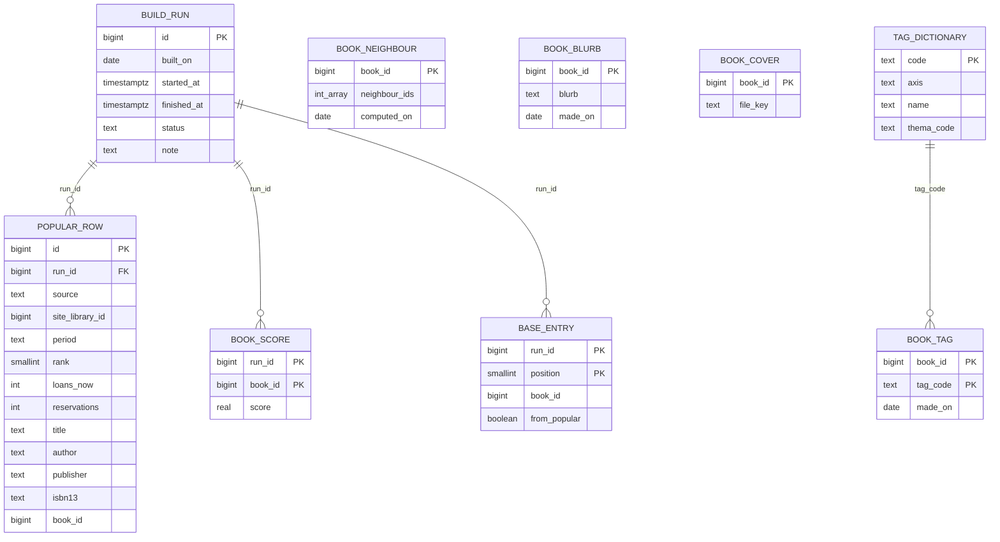

| 테이블.컬럼 | 타입 | 제약 | 설명 | 상태 태그 |
|---|---|---|---|---|
| `foryou.build_run.id` | bigint | identity PK | | [안] |
| `foryou.build_run.built_on` | date | NOT NULL | Asia/Seoul 날짜 | [안] |
| `foryou.build_run.status` | text | NOT NULL, CHECK IN (`running`,`succeeded`,`failed`), 색인 `(status, built_on DESC)` | 마지막 성공 목록 찾기 | [안] |
| `foryou.build_run.note` | text | NULL | 출처별 받은 줄 수·맞춘 수 (검증 노트 [to-dev-popular-list-check.md](to-dev-popular-list-check.md) 5번) | [안] |
| `foryou.popular_row.run_id` | bigint | FK `build_run` ON DELETE CASCADE | 같은 모듈 안 FK | [안] |
| `foryou.popular_row.source` | text | NOT NULL, CHECK IN (`kyobo_elib`,`yes24_elib`,`kpipa_rank`,`kpipa_200`,`klwave`) | 출처 | [안] |
| `foryou.popular_row.site_library_id` | bigint | NULL (출판유통·KLWAVE), FK 없음 | `library.id` 값 | [안] |
| `foryou.popular_row.period` | text | NULL, CHECK IN (`day`,`week`,`month`,`quarter`) | 출판유통·KLWAVE 기간 | [안] |
| `foryou.popular_row.rank` | smallint | NOT NULL, ≥ 1 | | [안] |
| `foryou.popular_row.loans_now`·`reservations` | int | NULL, ≥ 0 | 교보·YES24만 | [안] |
| `foryou.popular_row.title`·`author`·`publisher`·`isbn13` | text | title NOT NULL | 맞추기 전 원래 값 | [안] |
| `foryou.popular_row.book_id` | bigint | NULL | 맞춘 책 | [안] |
| `foryou.popular_row` 보관 | | 실행 기록과 함께 30일 지난 것 지움. **마지막 succeeded 실행 하나는 30일이 지나도 지우지 않음** [확정] (사용자 승인 2026-10-24, 마무리 검토 페이지 #2) | 가중치 조정(R2-3a) 원재료 | 30일 [안] |
| `foryou.popular_row.run_id` 색인 | | 색인 `(run_id)` | CASCADE·30일 정리 | [안] |
| `foryou.build_run` 남은 `running` | | 서버를 켤 때 오래된 `running`은 `failed`로 바꿈 [확정] (사용자 승인 2026-10-24, 마무리 검토 페이지 #2) | 크래시 뒤 정리 | |
| `foryou.book_score` | PK (`run_id`, `book_id`), `score real` NOT NULL ≥ 0 | FK `build_run` CASCADE | 판을 모은 뒤 대표 판에만. 개인 추천 "인기 먼저" 정렬 | [안] |
| `foryou.base_entry` | PK (`run_id`, `position`), `book_id` NOT NULL, `from_popular boolean` NOT NULL | `position` 1~40, UNIQUE (`run_id`, `book_id`), FK CASCADE | 기본 목록 차례 | 40 [안] (R2-4) |
| `foryou.book_neighbour.book_id` | bigint | PK | | [안] |
| `foryou.book_neighbour.neighbour_ids` | integer[] | NOT NULL, CHECK `cardinality BETWEEN 1 AND 20`, `array_ndims = 1` | 가까운 차례. 자기 자신·중복 없음(넣을 때 검사). 책 번호가 2,147,483,647을 넘으면 넣기 거부 | 20 [확정] (R6-1), 4바이트 [확정] (결정 #3) |
| `foryou.book_neighbour.computed_on` | date | NOT NULL | 반년 전체 다시(결정 #8) 판단용 | [안] |
| `foryou.book_blurb` | **사이클 26 배포 2에서 지움 (v1.20.6, 2026-10-29)** — `catalog`로 옮김. `book_id` PK, `blurb text` NOT NULL, `made_on date` NOT NULL | `char_length(blurb)` 1~300 | 80~150자 규칙(R8-4)은 PC가 지킴 | 300 [안] |
| `foryou.book_cover` | **사이클 26 배포 2에서 지움 (v1.20.6, 2026-10-29)** — `catalog`로 옮김. `book_id` PK, `file_key text` NOT NULL | `~ '^[0-9a-f]{40}$'` | `/covers/<file_key>.jpg` | [안] |
| `picks.tag_dictionary` | **사이클 26 배포 2에서 지움 (v1.20.6, 2026-10-29)** — `catalog`로 옮김. `code text` PK, `axis text` NOT NULL, `name text` NOT NULL, `thema_code text` NULL, `active boolean` NOT NULL DEFAULT true | `code ~ '^[A-Za-z0-9_]{1,20}$'`, `axis` IN (`mood`,`subject`,`audience`) | 사전 (결정 #9). 사전에서 빠진 코드는 지우지 않고 `active=false` | [안] |
| `picks.book_tag` | **사이클 26 배포 2에서 지움 (v1.20.6, 2026-10-29)** — `catalog`로 옮김. PK (`book_id`, `tag_code`), `made_on date` NOT NULL (사전 쪽 `tag_code` 색인은 두지 않음: 사전은 지우지 않고 `active=false`만 하므로 FK 검사 조회가 없음) | FK `tag_code → picks.tag_dictionary(code)` | 추천목록 책만(R9-1). 카드에는 `active` 코드 가운데 느낌 1 + 주제 1~2 | [안] |

- 크기 어림 [추론]: 이웃 약 0.2GB(134만 줄), 탭 글 약 15MB(3.3만 줄), 표지 파일 약 0.3GB(3.3만 장 × 약 10KB, 수집 세션이 잼 [확인 필요]), 나머지 작음
- 다른 모듈과 FK·조인 없음. 가져오기로 사라진 책 번호는 `BookLookup`이 돌려주지 않아 읽을 때 빠짐
- 바뀌는 기존 CHECK: `usagelog.screen_event.picks_list`에 `for_you` 더함(서버 검사 상수도). `picks.list_field`·`list_book`의 목록 키 CHECK는 그대로(`for_you`는 목록이 아님)
- Liquibase: 새 changelog 파일로 추가 (기존 changeset 수정 없음), 번호는 23·24를 합칠 때 다음 번호
  - `db/changelog/foryou/001-for-you.yaml` — 스키마 `foryou`, 표 일곱, CHECK는 changeset 안 `sql`
  - `db/changelog/picks/006-tag-dictionary-and-book-tag.yaml` [안: 번호]
  - `db/changelog/usagelog/00N-picks-list-for-you.yaml` — CHECK 지우고 다시 만듦, 24 `usagelog-ai-search-event` 다음
  - master 끝에 include

## 책 설명 표 (스키마 `catalog`, 사이클 26) — 구현됨 (사이클 26, 회고 2026-10-29)

근거: `docs/cycles/26-book-descriptions/design-delta.md` "데이터", ADR-0160~0166. 종류마다 표 하나 [확정] (설계 #1 승인, ADR-0161). 다른 모듈은 이 표를 직접 읽지 않고 `catalog` 공개 API(`BookTexts`·`CoverUrls`·`BookProfiles`·`AiSearchIndex`, 쓰기 `BookTextsTransfer`)로만 씀.

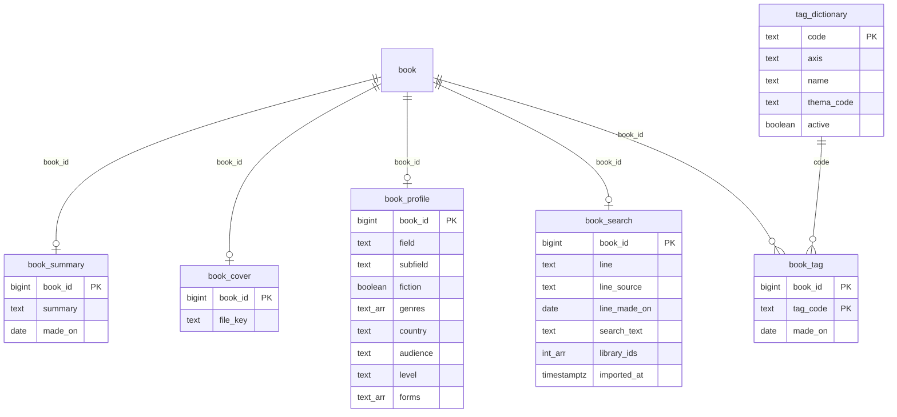

`book`과의 선은 값으로만 맞춤(FK 없음). `book_tag.tag_code → tag_dictionary.code`만 FK.

| 테이블.컬럼 | 타입 | 제약 | 설명 | 상태 태그 |
|---|---|---|---|---|
| `book_summary.book_id` (설명 표 다섯 모두 같음) | bigint | PK, `>= 1` CHECK(구현: `book_id`가 있는 표 모두), FK 없음 | `catalog.book.id` 값. 가져오기 때 `book`을 DROP하므로 FK 없음, 바꿔 끼우기 DELETE로 지킴 (ADR-0162) | [안] |
| `book_summary.summary` | text COLLATE "C" (구현: 기본 정렬 규칙이면 ANALYZE가 388초 걸려 바꿈, 회고) | `char_length` 1~300 | 책첵 요약(해요체), 책마다 하나 — 옛 `foryou.book_blurb.blurb` 규칙 그대로 | [확정] (범위 #3) |
| `book_summary.made_on` | date | NOT NULL | 만든 날 | [안] |
| `book_cover.file_key` | text | `^[0-9a-f]{40}$` | 그림 이름(sha1). 주소는 `CoverUrls`가 `<base-url>/covers/<key>.jpg`로 만듦(`chaekcheck.covers.base-url`) | [확정] (지금 규칙) |
| `book_profile.*` | text / boolean / text[] | 어휘 CHECK 없음. 구현: `genres`·`forms`는 `NOT NULL DEFAULT '{}'` | 지금 `book-profiles.tsv` 칸 그대로. 서버 시작 때 `BookProfiles.all()`로 한 번 읽음 (ADR-0165) | [확정] (설계 #7 승인) |
| `book_search.line` | text COLLATE "C" | NULL 또는 1~300, `line`·`line_source`·`line_made_on` 함께 있거나 함께 없음 | 찾기용 한 줄 — `aisearch.search_book`에서 옮김 | [확정] (명세 #3) |
| `book_search.search_text` | text COLLATE "C" | NOT NULL, `gin_bigm_ops` 색인(구현: 한 번 복사한 뒤에 만듦) | 찾기 글 (제목은 `catalog.book.title`로 만듦, 저자·제목 칸은 두지 않음) | [확정] |
| `book_search.library_ids` | integer[] | NOT NULL | 찾기 전용 칸(같은 모듈 안 `catalog.book.library_ids`와 같은 값). 측정: 캐시 빈 상태 중간값 106ms ↔ 이어 읽기 230ms, 최대 234ms ↔ 1,054ms (dev `plan-feedback.md` "# 사이클 26 질의 속도", 2026-10-28) | [확정] 예외 (사용자 "승인하고 예외라고 기록해 줘", 2026-10-28, ADR-0160) |
| `book_search.imported_at` | timestamptz | | 넣은 시각 | [안] |
| `tag_dictionary`, `book_tag` | — | 옛 `picks` 표 규칙 그대로(`code ~ '^[A-Za-z0-9_]{1,20}$'`, `axis` IN (`mood`,`subject`,`audience`), `active`; `book_tag` PK (`book_id`, `tag_code`)), `book_tag.tag_code → tag_dictionary.code` FK | 지금 0줄 | [확정] |
| `collection.catalog_import.description_deleted_count` | integer | `>= 0` | 바꿔 끼울 때 지운 설명 수 (위 `collection` 절). 구현: 성공한 가져오기에만 적고 실패·내보내기는 NULL | [안] |

- 다시 가져오기 바꿔 끼우기 [확정] (ADR-0162): `swap`의 첫 트랜잭션에서 DROP 앞에 설명 표 5개(`book_summary`·`book_cover`·`book_profile`·`book_search`·`book_tag`)를 `DELETE … WHERE NOT EXISTS (catalog_next.book)`로 지움(`tag_dictionary`는 `book_id`가 없어 제외). 잠금 시간을 넘기면 지운 것도 되돌아가고 쉬었다 다시. `createIndexesAndConstraints`는 `t.relname = ANY(TABLES)`로 책 목록 표만 거름
- 설명 넣기 파일(`book-texts`, 새 모드 `book-profiles`)은 `# export_id=` 줄을 운영 `catalog_import.export_id`와 대조, 다르면 멈춤(`neighbours`와 같은 강제 설정) [확정] (ADR-0162)
- 크기 [추론]: `book_cover` 134만 줄 약 110MB + PK 약 30MB, `book_summary` 약 25MB, `book_search`는 옛 `aisearch.search_book`에서 옮김(약 70MB + bigm 색인). 배포 1~2 사이 옛 표·새 표 함께 약 +110~150MB(디스크 여유 11GB 안)
- Liquibase (새 changelog 파일, 기존 changeset 수정 없음) [안: 번호는 23·24 브랜치와 겹치면 올림] (ADR-0166)
  - 배포 1: `catalog/002-book-descriptions.yaml` — 표 6개, 색인, 한 번 복사(`foryou.book_blurb` → `book_summary`, `foryou.book_cover` → `book_cover`, `picks.tag_dictionary` → `tag_dictionary` 다음 `picks.book_tag` → `book_tag`, `aisearch.search_book` → `book_search`(제목·저자 빼고)), 줄 수를 옛 표와 비교(AC-4). `collection/007-description-deleted-count.yaml`
  - 배포 2: `foryou/002-drop-book-blurb-cover.yaml`, `picks/007-drop-moved-tables.yaml`(`book_tag`, `tag_dictionary`, `cover`), `aisearch/005-drop-search-book.yaml`
  - 프로필은 배포 1 뒤 `book-profiles` 모드로 처음 넣음 (운영 2026-10-29 77,551줄)
  - 구현 뒤 더함 (회고): `catalog/003-intarray`(intarray 확장, 따로 된 스키마), `catalog/004-plan-library-count`(PL/pgSQL 함수, COST 1000) — v1.20.3. 낱말 찾기는 낱말 하나이거나 계획 도서관 500곳 이하면 이 함수, 아니면 SubPlan (v1.20.4, 500은 [안])
- 사이클 26 배포 2에서 지운 옛 표 (v1.20.6, 2026-10-29): `foryou.book_blurb`·`foryou.book_cover`(위 사이클 23 절), `picks.book_tag`·`picks.tag_dictionary`(위 사이클 23 절), `picks.cover`(위 `picks` 절), `aisearch.search_book`(사이클 24 표, 이 문서에 따로 절이 없음 — 사이클 24는 다른 브랜치 설계라 plan에 폴더가 없음, 근거 ADR-0165)

## 변경 기록 (사이클별 반영)

문서 머리에 쌓여 있던 반영 기록을 2026-11-05에 이곳으로 옮겼습니다(내용은 그대로).

- 사이클 09 cycle-close (2026-10-11): `library.library` 이름은 기관 이름만(UNIQUE `library_name_key` 지움), 새 칸 `vendor`·`order_no`, 통합 포털 말고 모두 `lending_model`을 채움, CHECK 셋과 UNIQUE `library_classification_key (name, vendor, lending_model, order_no)`, 이름·분류 changeset `library/014-library-classification.yaml` [확정], seed 생성 스크립트의 겹침 규칙(순번) — 구현됨 (사이클 09). 근거 `docs/cycles/09-library-naming/design-delta.md` "데이터"·"dev 스크립트와 문서", spec R1~R4, ADR-0071·0076.
- 사이클 09 회고 (2026-10-12): dev 보고(`plan-feedback.md` "# 사이클 09", AC-1~9 통과)와 dev Liquibase `library/014-library-classification.yaml`로 대조해 사이클 09 변경을 구현됨으로 바꿈. Modulith `components.puml`(2026-10-12) 대조 결과 모듈 관계 그대로. 달라진 점·확정된 값: changeSet 하나 `library-014-classification-2026-10-11`, 이름 UPDATE 289줄(`splitStatements: false`), 대출 방식은 화면 종류 규칙 + 번호, 014 뒤 셈(업체·대출 방식), 북큐브 구독 339·380·386·705, `name_overrides.tsv` 295줄, seed 스크립트 `--changes-only`·다섯째 인자·종료 코드 3. 근거 `docs/cycles/09-library-naming/retro.md`.
- 사이클 10 cycle-close (2026-10-12): 새 스키마 `popular`(`fetch_run`, `ranking_month`, `ranking_category`, `ranking_entry`, `cover`) — 구현됨 (사이클 10). 다른 모듈 표는 바뀌지 않음(`catalog.book`은 `isbn13` 값으로만 맞춤). 근거 `docs/cycles/10-popular-books/design-delta.md` "데이터", ADR-0073~0075·0077, ADR-0080·ADR-0081.
- 사이클 10 회고 (2026-10-12): 구현 대조, 분류 14개·표지 200px JPEG·User-Agent·문구 반영 (`docs/cycles/10-popular-books/retro.md`). dev Liquibase `popular/001-popular-schema.yaml`로 제약·색인·changeSet 이름을 대조함.
- 사이클 11 cycle-close (2026-10-12): 가져오기 따로 하기(export·apply·finish·discard, load_manifest, db-ops) + 묶는 방식 compact(기본)·objects(옛 이름 current)·sql — 구현됨 (사이클 11, 회고 2026-10-14). `collection.catalog_import` 칸 `export_id`·`exported_at`과 CHECK, `failure_reason` 값 `mismatch`(changeset 없음), `step_seconds` 새 키, 실행 중에만 있는 `catalog_next.load_manifest`(Liquibase 아님), dev compose `db-ops`. 새 스키마·새 색인 없음. 근거 `docs/cycles/11-separate-import/design-delta.md` "데이터", spec.md, ADR-0078·0079. 이름·번호는 따로 적지 않으면 [안].
- 사이클 12 (2026-10-12, 사이클 11 dev 진행 중에 미리 한 plan): 책 묶기 네 번째 단계 규칙 — 구현됨 (사이클 12, 회고 2026-10-14). 근거 `docs/cycles/12-grouping-rules/design-delta.md`, ADR-0082, ADR-0106.
- 사이클 11 최종·사이클 12 회고 (2026-10-14): 표·Liquibase 변경 없음(사이클 12). 서비스 DB 책 1,619,668 → 1,563,167(가져오기 기록 9번, 소장 17,778,801 그대로), 묶는 방식 기본 `compact`·옛 이름 `objects`, 가져오기 힙 값, `sql` 측정 결과. 회고 `docs/cycles/11-separate-import/retro.md` "최종 회고", `docs/cycles/12-grouping-rules/retro.md`.
- 사이클 14 cycle-close (2026-10-12): 스키마 `popular`(사이클 10, 구현됨·배포 전)를 지우고 새 스키마 `picks`(`fetch_run`, `pick`, `cover`) — 설계됨(미구현, 사이클 14). changelog `picks/001-picks-schema.yaml`, `popular/001-popular-schema.yaml`은 지움(배포 전 규칙), 로컬 `db`·`db-test`에서 `DROP SCHEMA popular CASCADE`와 `databasechangelog`의 `popular-001-%` 줄 지움. 다른 모듈 표는 바뀌지 않음(`catalog.book`과는 ISBN·제목+저자 값으로만 맞춤). 근거 `docs/cycles/14-librarian-picks/design-delta.md` "데이터", ADR-0089·0090·0091.
- 사이클 14 회고 (2026-10-14): 스키마 `picks` 구현됨 — dev `db/changelog/picks/001-picks-schema.yaml`(changeset `picks-001-schema`·`picks-001-fetch-run`·`picks-001-pick`·`picks-001-cover`), 칸·제약·색인이 설계와 같음. 스키마 `popular`는 changeset·14 worktree DB·원래 `db`·`db-test`에서 지움(원래 DB는 사용자 승인 뒤). 범위 최근 12번으로 크기 실측 반영 (`docs/cycles/14-librarian-picks/retro.md`).
- 사이클 13 회고 반영 (2026-10-14): `collection.library_insert_run`, `other_library_count` 이름 바꿈, `library/015` 1215 이름, 반영 파일 판 2 — 구현됨 (사이클 13, 회고 2026-10-14). 새 도서관 6곳(서비스 번호 2675~2680)을 넣기 명령으로 넣음. 근거 `docs/cycles/13-crawler-to-dev/retro.md`, dev Liquibase `collection/001`(52·53행)·`collection/006`·`library/015`.
- 사이클 15 cycle-close (2026-10-14, 12·13·14 회고 뒤): 새 스키마 `usagelog`(`search_event`, `book_view`, `search_more`, `library_click`, `screen_event`, `library_response_daily`, `rejected_event`, `dropped_batch`) — 구현됨 (사이클 15, 회고 2026-10-15). 다른 모듈 표는 바뀌지 않음(도서관·책·지역은 번호 값으로만). 근거 `docs/cycles/15-usage-log/design-delta.md` "데이터", ADR-0096·0097.
- 사이클 16 cycle-close (2026-10-14, 12·13·14·15 회고·인계 뒤): 새 스키마 `sitecontent`(`notice`, `notice_version`, `document_version`), `auth.account_consent.document_version` 값을 판 순번 글자로 + 형식 CHECK — 구현됨 (사이클 16, 회고 2026-10-15). changelog `sitecontent/001`·`002`, `auth/002`. 근거 `docs/cycles/16-notices-and-policies/design-delta.md` "데이터", ADR-0098·0099.
- 사이클 15·16·18 회고 (2026-10-15): 구현됨으로 바꾸고 실제 이름·값을 맞춤. 15 `usagelog`·16 `sitecontent` 구현됨, 18은 A1·A2·B 구현됨(dev main `a0e438a`), C(운영 반영)는 `docs/backlog.md` "사이클 18 C"로 옮김 (사용자: "운영 반영은 백로그랑 CYCLE19 PLAN에게 알려주고 이거 마무리하자", 2026-10-15). 근거 `docs/cycles/15-usage-log/retro.md`, `docs/cycles/16-notices-and-policies/retro.md`, `docs/cycles/18-empty-library-holdings/retro.md`, dev `plan-feedback.md` "# 사이클 15"·"# 사이클 16"·"# 사이클 18".
- 사이클 19 cycle-close (2026-10-15): 저자·제목 표기 정리 — 설계됨(미구현, 사이클 19). ADR-0113~0117. `catalog` 표·칸 변경 없음(값의 뜻만: `book.author_display`, `book_contributor`, 수집 11·12·15의 `holding.author_raw`·`publisher_raw`), `usagelog.library_response_daily.cached_count` 새 칸(`usagelog/002`), dev 규칙 파일 `supplier_families.tsv`·`author_publisher_swapped.tsv`와 가져오기 설정 `rules-dir`. 근거 `docs/cycles/19-author-angle-brackets/design-delta.md` "데이터".
- 사이클 21 cycle-close (2026-10-16): 추천도서 세 목록 — 설계됨(미구현, 사이클 21). ADR-0122~0126. 스키마 `picks`에 새 표 `list_field`·`list_book`, `pick`은 줄을 `list_book`으로 옮긴 뒤 지움(`picks/002-curated-lists.yaml`), `fetch_run`·`cover` 그대로. `usagelog.screen_event.picks_list` 새 칸(`usagelog/003`). 반영 파일 형식 번호 2 → 3, `load_manifest.notes.listPart`(새 표 없음). 이동진·서울대 줄은 `book_id`를 값으로 저장(FK 없음, ADR-0124). 근거 `docs/cycles/21-recommended-books/design-delta.md` "데이터".
- 사이클 20 cycle-close (2026-10-17): 조회 상태 신호와 브라우저 확장 조회 — 설계됨, 1단계 일부만 구현(v1.4.0: `GET /api/v1/lookup-status`·`HostQueueBoard`·`ParseSlots`·`BodyLimit`·`usagelog-004`; 웹 머리말 상태 불은 지움, `extension/` 없음 — ADR-0146, 2026-10-23 dev main 확인. 사이클 20 회고 전). ADR-0118·0119·0132·0133. 새 표 없음. `usagelog/004`: `library_response_daily.source` CHECK에 `extension`·`server_for_extension`, `rejected_event.reason` CHECK에 `invalid_plan`·`invalid_client_key`, 새 칸 `library_response_daily.body_too_large_count`. `availability`의 계획 보관함·호스트 대기·브라우저 번호 장부·확장 결과 캐시는 메모리만(아래 "`availability` 메모리 값"). 근거 `docs/cycles/20-lookup-status-and-extension/design-delta.md` "데이터".
- 사이클 21 회고 (2026-10-17): 스키마 `picks`의 `list_field`·`list_book`, `pick` 지움, `usagelog.screen_event.picks_list`, 반영 파일 형식 번호 3·`notes.listPart` 구현됨 — dev main `836bd7b`, `picks/002-curated-lists.yaml`(changeset `picks-002-list-field`·`picks-002-list-book`·`picks-002-move-librarian`)·`usagelog/003-screen-event-picks-list.yaml`(changeset `usagelog-003-screen-event-picks-list`), 칸·목록별 CHECK가 설계와 같고 dev가 CHECK 둘·색인 하나를 더함. 운영 역할 DB(db-ops) 반영 기록 13번, 내 PC 원래 DB 13번 SUCCEEDED (2026-10-17). 근거 `docs/cycles/21-recommended-books/retro.md`.
- 사이클 19 회고 (2026-10-18): 저자·제목 표기 정리 구현됨 (dev main `1c129e8`, 운영 역할 DB 반영 기록 12번, 2026-10-16). `catalog` 표·칸 변경 없음, 값만 바뀜(책 1,568,453 → 1,331,194, `author_display`·`name_exact`에 꺾쇠 0). `usagelog/002`의 `cached_count` 구현됨. 규칙 파일 두 개와 `rules-dir` 구현됨, 공급사 코드 키에 비교 제목·출판사가 더해짐(ADR-0114 "결정 고침 (2026-10-16)" 절 [확정] (사용자 승인, 2026-10-18, 회고 결정 #1)), 국가서지 원문 표 읽기 설정 `stored-bibliography`를 더함. 근거 `docs/cycles/19-author-angle-brackets/retro.md`, dev `plan-feedback.md` "# 사이클 19".
- 사이클 26 cycle-close (2026-10-28): 책 설명 한 곳에 모으기 — 구현됨 (사이클 26, 회고 2026-10-29). ADR-0160~0166. 스키마 `catalog`에 새 표 6개(`book_summary`, `book_cover`, `book_profile`, `book_search`, `tag_dictionary`, `book_tag`), `collection.catalog_import.description_deleted_count`. 배포 1에서 옛 표 내용을 한 번 복사하고, 배포 2에서 `foryou.book_blurb`·`book_cover`, `picks.book_tag`·`tag_dictionary`·`cover`, `aisearch.search_book`을 지움(ADR-0166). 배포 1 v1.20.0, 배포 2 v1.20.6 (2026-10-29), 달라진 점은 회고 `docs/cycles/26-book-descriptions/retro.md`. 근거 `docs/cycles/26-book-descriptions/design-delta.md`. 이 문서 끝 「책 설명 표 (사이클 26)」
- 사이클 13 cycle-close (2026-10-12, 사이클 12와 나란히 미리 한 plan, 사이클 12 뒤에 개발): 수집기 dev로 갈아타기 + 새 도서관 넣기 명령 — 새 표 `collection.library_insert_run`(넣기 실행 기록), `collection.catalog_import.candidate_library_count` → `other_library_count` 이름 바꿈(배포 전 규칙으로 `collection/001`을 고치고 로컬 `db`·`db-ops`는 이름 바꾸기 SQL + 체크섬 비우기로 맞춤(데이터 유지, 사용자 선택 2026-10-12)), `library.library` 1215 이름 고침 changeset, 반영 파일 판 2(`load_manifest.notes.libraryPart`, 새 표 없음), 앞으로 도서관 seed changeset을 만들지 않음 — 구현됨 (사이클 13, 회고 2026-10-14). `library` 칸 변경 없음. 근거 `docs/cycles/13-crawler-to-dev/design-delta.md` "데이터", ADR-0083~0087·0093. 이름·번호는 따로 적지 않으면 [안] (dev가 바꿀 수 있음).
- 사이클 08 cycle-close (2026-10-11): `catalog` 가져오기를 새 표(`catalog_next`)에 쓰고 바꿔 끼우기, 소장 번호 잇기, `collection.catalog_import` 칸 추가, `collection.national_bibliography_record`·`national_bibliography_source`, `library.library.mobile_site_differs`, 도서관 이름 고침 changeset, `library`·`region` `updated_at` 트리거, 교보 대여·혼합 11곳 seed에서 뺌, 정리 규칙을 바꿀 때의 순서 — 구현됨 (사이클 08). 근거 `docs/cycles/08-polish-swap-memory/design-delta.md` "데이터"·"정리 규칙을 바꿀 때"·"이름 고치기", ADR-0065~0070. 이름·숫자는 따로 적지 않으면 [안].
- 사이클 08 회고 (2026-10-11): dev Liquibase(`collection/003`·`004`, `library/011`~`013`, `region/003`)와 dev `plan-feedback.md` "# 사이클 08"로 대조함. 달라진 점: 국가서지 원문은 ISBN마다 한 줄, `step_seconds` 키가 늘어남, 가져오기 기록에 `status`·`failure_reason`·`failure_detail`, 넓은 줄은 임시 표와 `catalog_next`에 두 번 씀, 파일 번호가 설계 [안]과 다름, 이름 고침은 `library/013`. 가져오기 힙(AC-12), 국가서지 원문 재사용 시간(AC-15), 색인 단계 중단(AC-9 둘째 경우)은 측정 중 [확인 필요]. 근거 `docs/cycles/08-polish-swap-memory/retro.md`.
- 사이클 07 회고 반영 (2026-10-05): 수집 목록에서 찾은 도서관 2,394곳 넣기 — 새 스키마 `collection`, `library.library` 칸 추가·바꿈, `catalog.book.library_ids`, `catalog.catalog_import`를 `collection.catalog_import`로 옮김, `catalog_library_snapshot.import_id` 지움 — 구현됨 (사이클 07). dev Liquibase(`library/001`, `catalog/001`, `collection/001`, seed `library/008`~`010`, `collection/002`)와 대조함. 근거 docs/cycles/07-candidate-libraries/retro.md, dev plan-feedback.md '# 사이클 07'. 설계 근거 `docs/cycles/07-candidate-libraries/design-delta.md` "데이터", ADR-0052~0055, 0059, 0060.
- 사이클 06 회고 반영 (2026-10-05): 내 도서관(`mylibrary`)을 더함 — 구현됨 (사이클 06). dev changelog `mylibrary/001-mylibrary-schema.yaml`과 대조함. 근거 `docs/cycles/06-my-libraries/design-delta.md`.
- 사이클 05 cycle-close (2026-10-04): 스키마 `auth`와 `modulith`를 더함 — 구현됨(사이클 05, 2026-10-04 retro 반영). 근거 `docs/cycles/05-login-account/design-delta.md`.
- 마지막 반영: 사이클 04 회고 (2026-10-01). 모든 테이블을 dev Liquibase 파일과 대조했습니다(구현됨). `catalog` 스키마는 데이터 미적재(backlog "미뤄 둔 사이클 04 마무리 작업"). Liquibase에만 있는 세부: `book.isbn13` CHECK `^97[89][0-9]{10}$`, `holding.detail_url` CHECK `^https?://`, `catalog_import` 건수 CHECK `>= 0`, 인덱스 이름 `book_title_norm_bigm` 등(`catalog/001-catalog-schema.yaml`). 그 밖은 사이클 03 회고 (2026-09-30) 기준: 모든 테이블을 dev Liquibase 파일과 대조했습니다(구현됨). 사이클 03은 테이블 변경이 없고, seed `003`~`006` csv의 `visit_required`·`join_method` 값만 고쳤습니다(C3-U-1, 배포 전 규칙).
