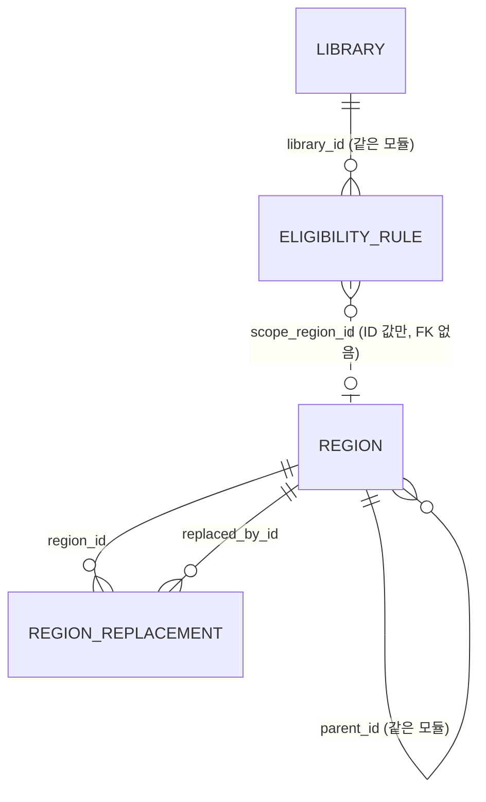

# 데이터 모델 (현재)

현재 설계 전체를 적은 문서입니다.

마지막 반영: 사이클 03 회고 (2026-09-30). 모든 테이블을 dev Liquibase 파일과 대조했습니다(구현됨). 사이클 03은 테이블 변경이 없고, seed `003`~`006` csv의 `visit_required`·`join_method` 값만 고쳤습니다(C3-U-1, 배포 전 규칙).

- Liquibase 파일: `region/001-region-schema.yaml`, `region/002-region-seed.yaml`(+CSV), `region/900-region-test-abolished.yaml`(context `test-data`), `library/001-library-schema.yaml`, `library/002-library-seed.yaml`, `library/003-library-seed-cycle02.yaml`, `004-library-seed-kyobo.yaml`, `005-library-seed-yes24.yaml`, `006-library-seed-moved.yaml`(각각 CSV `loadData`)
- CHECK, 부분 인덱스, `UNIQUE NULLS NOT DISTINCT`는 Liquibase OSS YAML이 지원하지 않아 changeset 안의 `sql`로 만듦
- **배포 전 규칙** [확정] (사용자, 2026-09-28): dev의 `db/changelog/PRE_DEPLOYMENT` 파일이 있는 동안에는 이미 적용된 changeset도 고칠 수 있습니다(로컬 DB를 지우고 다시 적용). 첫 배포 때 이 파일을 지우고, 그 뒤로는 새 파일만 더합니다. 그래서 사이클 02 스키마 변경은 `library/001`에 합쳐져 있습니다

원칙: 모듈마다 자기 스키마와 테이블을 가지고, 모듈 간 FK·JOIN은 두지 않습니다 (dev CLAUDE.md, spring-modulith 스킬, ADR-0002).

## 스키마 `region` (소유: `region` 모듈) — 구현됨

### `region.region` — 시도·시군구

| 컬럼 | 타입 | 제약 | 설명 |
|---|---|---|---|
| id | bigint | PK, 자동 증가 없음 | seed에서 직접 부여. 모든 환경에서 같아야 함 (ADR-0003) |
| parent_id | bigint | NULL, FK → region.region(id) | 시군구의 상위 시도 |
| level | text | NOT NULL, CHECK IN ('SIDO','SIGUNGU') | 일반구는 넣지 않음 |
| name | text | NOT NULL | |
| short_name | text | NULL | 시도 표시용 짧은 이름 [안] |
| legal_dong_code | text | NOT NULL, 10자리 숫자 | 속성일 뿐 키가 아님 |
| status | text | NOT NULL, CHECK IN ('ACTIVE','ABOLISHED') | 폐지된 지역은 지우지 않음 |
| abolished_on | date | NULL | |
| created_at / updated_at | timestamptz | NOT NULL DEFAULT now() | |

- CHECK: 시도면 parent_id 없음, 시군구면 있음 / 폐지면 abolished_on 있음
- UNIQUE `(legal_dong_code) WHERE status='ACTIVE'`, INDEX `(parent_id) WHERE status='ACTIVE'`

### `region.region_replacement` — 폐지·대체 연결

| 컬럼 | 타입 | 제약 | 설명 |
|---|---|---|---|
| region_id | bigint | NOT NULL, FK → region.region(id) | 폐지된 지역 |
| replaced_by_id | bigint | NOT NULL, FK → region.region(id) | 대체한 지역 |
| effective_on | date | NOT NULL | 시행일 |

- PK `(region_id, replaced_by_id)`, CHECK `region_id <> replaced_by_id`, INDEX `(replaced_by_id)`
- 대체한 지역이 둘 이상이면 나뉨(SPLIT). 갱신할 때 순환이 없는지 테스트로 확인 [안]

## 스키마 `library` (소유: `library` 모듈) — 구현됨

### `library.library` — 도서관 (전자도서관 사이트 하나 = 한 줄, ADR-0017)

| 컬럼 | 타입 | 제약 | 설명 |
|---|---|---|---|
| id | bigint | PK, GENERATED BY DEFAULT AS IDENTITY | |
| name | text | NOT NULL, UNIQUE | 같은 기관의 여러 사이트는 "(구독)", "(YES24)", "(교보)" 등으로 구분 |
| library_type | text | NOT NULL DEFAULT 'EBOOK', CHECK IN ('EBOOK') | 종류. 실물 도서관 사이클에 `PHYSICAL` 추가 |
| platform_type | text | NULL, CHECK IN ('KYOBO_V1','KYOBO_SUBSCRIPTION_V1','YES24_V1','YES24_V2','YES24_V3','ELIB_PORTAL_V1','GANGNAM_V1') | 화면 종류 (ADR-0016, 세대 번호 ADR-0023) |
| base_url | text | NULL, UNIQUE | adapter가 경로를 붙이는 사이트 루트(리다이렉트 뒤 최종 주소). 교보·YES24·구독형·강남구는 origin, 포털은 `…/elib`, 강원교육청 포털은 `?menu_idx=2`까지 |
| eligibility_summary | text | NULL | 자격 문구 |
| extra_condition_text | text | NULL | 판정 못 하는 자격 문구 (예: "책이음 회원 가입 가능"). 참고 글로만 보이고 가입 판정·"가입 가능한 곳" 범위에 영향 없음 (C3-U-2) |
| visit_required | boolean | NOT NULL DEFAULT false | 방문 가입. 전자책 이용에 도서관 방문이 필요하면 true. 원문이 전자책 회원 등급을 따로 말하지 않고 가입 절차에 방문 단계만 있어도 true (C3-U-1). "방문 없이 가입" 필터(`visit=none`)와 무리 안 순서(맨 뒤)에 쓰임 (ADR-0027) |
| join_method | text | NOT NULL | 가입 방법 한 줄. 전자책 기준으로 적음 (종이책 회원증 절차만 적으면 `visit_required`와 어긋남, C3-U-1) |
| join_url | text | NULL | 가입·자격 안내 페이지. 없으면 링크 없이 글자만 (C2-U-4) |
| join_caution | text | NULL | "주의" 문구. 가입 판정·필터는 바꾸지 않고, 같은 그룹 안 순서에서 뒤로 (C2-U-11) |
| join_notice | text | NULL | "안내" 문구(누구를 위한 도서관인지). 판정·필터·정렬에 영향 없음 (C2-U-15) |
| homepage_url | text | NULL | 이 줄의 첫 화면(전자도서관 줄은 전자도서관 첫 화면). 요약 줄 이름 링크 (C2-U-13) |
| holdings_count | integer | NULL, CHECK ≥ 0 | 순위 값. 빈 검색 전체 건수(사실상 보유 전자책 수). 구독형은 NULL |
| holdings_counted_on | date | NULL | 조사일. `holdings_count`와 둘 다 있거나 둘 다 없음 |
| deferred | boolean | NOT NULL DEFAULT false | 판정 없는 포털 후순위 (경북·전북) |
| enabled | boolean | NOT NULL DEFAULT true | 사용 여부. 운영자가 SQL로 변경 |
| created_at / updated_at | timestamptz | NOT NULL DEFAULT now() | |

- CHECK 이름: `library_library_type_check`, `library_platform_type_check`, `library_ebook_site_check`(`library_type <> 'EBOOK' OR (platform_type IS NOT NULL AND base_url IS NOT NULL)`), `library_holdings_count_check`, `library_holdings_counted_check`. UNIQUE `library_name_key`, `library_base_url_key`
- 운영 기관으로 묶는 테이블은 없습니다 (backlog, 실물 도서관 사이클에서 검토)
- 도서관을 찾고·넣고·끄는 절차는 dev `docs/library-maintenance.md`에 있습니다 (C2-U-7). plan `collection-method.md`와 겹치며, 어느 쪽을 원본으로 할지는 [확인 필요]

### `library.eligibility_rule` — 자격 규칙 (ADR-0004 구조, ADR-0013으로 뜻 변경)

| 컬럼 | 타입 | 제약 | 설명 | 상태 |
|---|---|---|---|---|
| id | bigint | PK, GENERATED BY DEFAULT AS IDENTITY | |
| library_id | bigint | NOT NULL, FK → library.library(id) ON DELETE CASCADE | 도서관 한 줄(전자도서관 사이트 하나)을 가리킴 |
| basis | text | NOT NULL, CHECK IN ('RESIDENCE','WORK','SCHOOL','AFFILIATION') | 근거 |
| scope_type | text | NOT NULL, CHECK IN ('REGION','INSTITUTION','NATIONWIDE') | 범위 종류. `NATIONWIDE` = 누구나 |
| scope_region_id | bigint | NULL | `region` 모듈 ID (FK 없음) |
| scope_institution_id | bigint | NULL | 다음 사이클용 (FK 없음) |
| created_at | timestamptz | NOT NULL DEFAULT now() | |

- CHECK: REGION이면 scope_region_id만, INSTITUTION이면 scope_institution_id만, NATIONWIDE이면 둘 다 없음
- UNIQUE NULLS NOT DISTINCT `(library_id, basis, scope_type, scope_region_id, scope_institution_id)`, INDEX `(library_id)`
- **규칙이 없는 도서관 = 자격 미확인** (ADR-0013). 규칙이 SCHOOL/AFFILIATION뿐인 도서관은 "지역 규칙 있음"과 같이 봄 (지역 없음 → `QUALIFIED`)

## seed

- 켜진 도서관 278곳 (2026-09-29, dev 보고). 중단된 2곳(id 59, 131)은 `enabled=false`. 방문 가입 86곳, 그중 누구나 가입 16곳 (2026-09-30, dev 보고: `visit=none`이면 계획 192곳)
  - `002`: 시범 2곳 — 1 강서(`YES24_V2`), 2 고흥(`KYOBO_V1`, `RESIDENCE × NATIONWIDE`)
  - `003`: 화면 종류별 확인 13곳(교보 4, 구독형 1, `YES24_V1` 1, 강남구 1, 포털 6)
  - `004`: 교보 공식 목록(구독형 포함), 인증서 불완전 24곳, 이름에 "도서관"이 없는 공공도서관 17곳 등 (id ~205)
  - `005`: YES24 66곳 (id 206–271)
  - `006`: 새 주소를 찾은 9곳 (id 272–280)
- 자격 규칙은 원문을 확인한 값만 넣음. 조사 기록은 dev `docs/library-research/*.tsv`, 사용자가 나중에 확인할 항목은 dev `docs/library-maintenance.md` 14절
- 도서관 ID는 seed에서 직접 넣고 IDENTITY는 마지막 seed 다음부터 시작
- 지역: 2026-07-01 법정동 코드(`jscode20260701`) 기준 시도 16개, 시군구 232개 [확정] (시군구 234개 중 도 출장소 2개 제외). 세종특별자치시는 시군구 행 하나(`3601`)를 둠
- 지역 ID 규칙 [확정] (사용자, 2026-09-27): 시도 2자리 = 법정동 코드 앞 두 자리, 시군구 4자리 = 시도 ID + 법정동 코드 순서(01, 02, …). 번호는 다시 쓰지 않고, 소속은 `parent_id`로만 판단. 일반구·읍면동을 넣게 되면 상위 ID 뒤에 자리를 붙임
- 시험용 폐지 데이터 (context `test-data`): 시도 90, 9001 → 1116 (REPLACED), 9002 → 1114·1116 (SPLIT), 9003 → 9004 → 1101 (연쇄)
- 전남광주통합특별시 `short_name`은 NULL [확인 필요]
