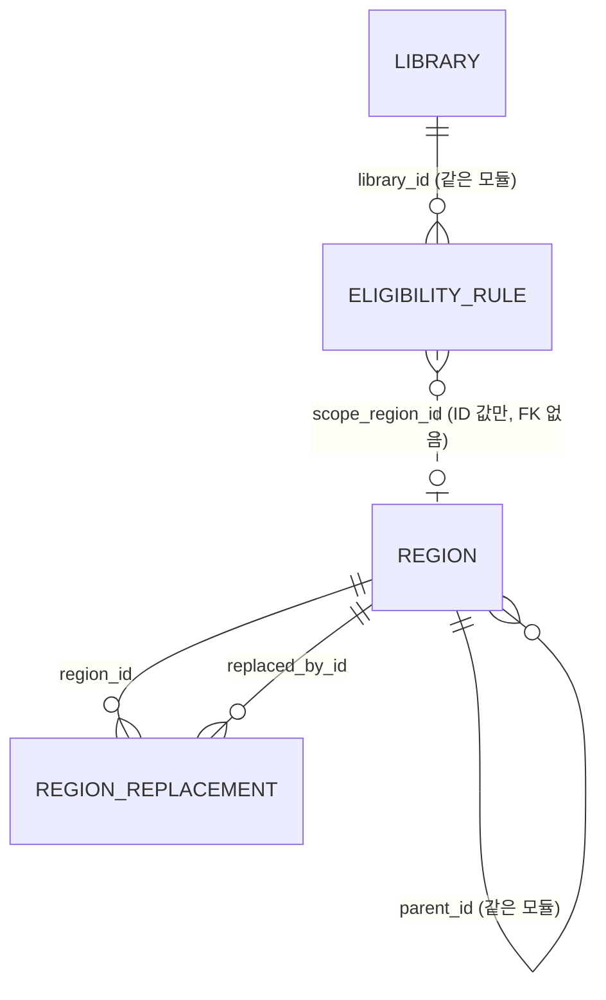
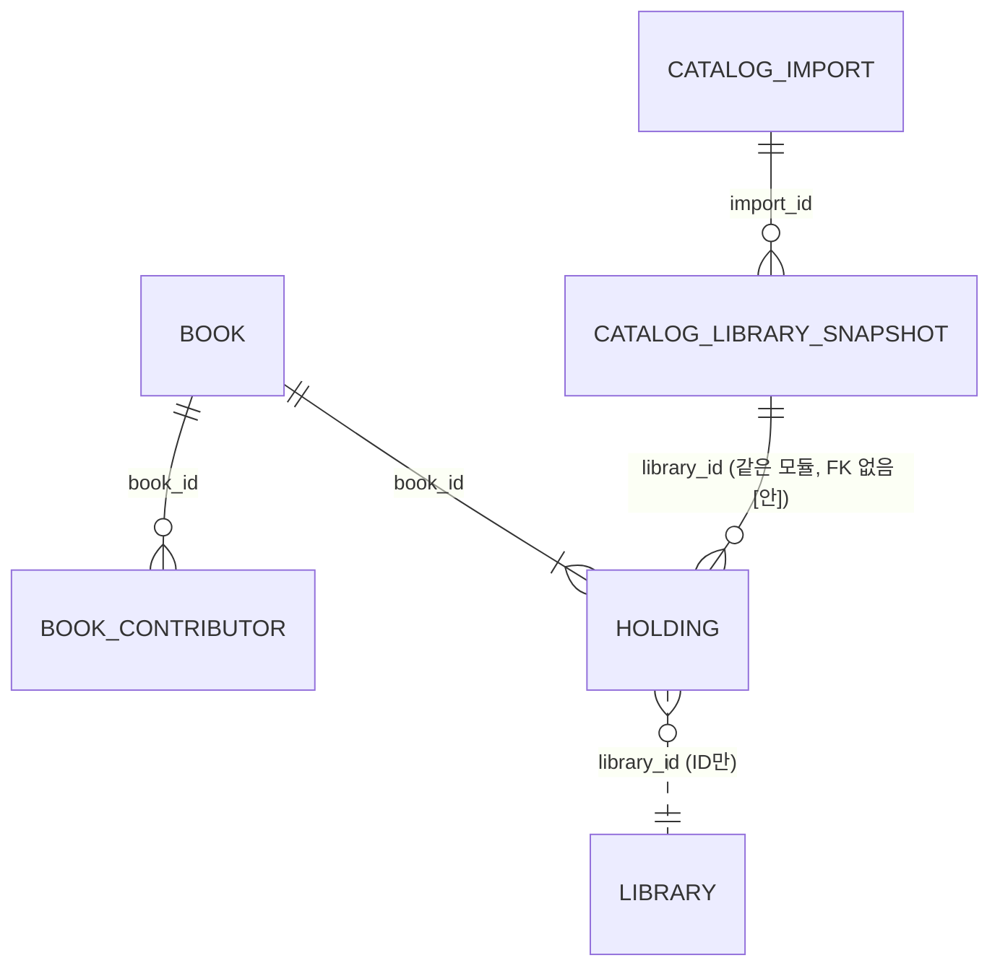
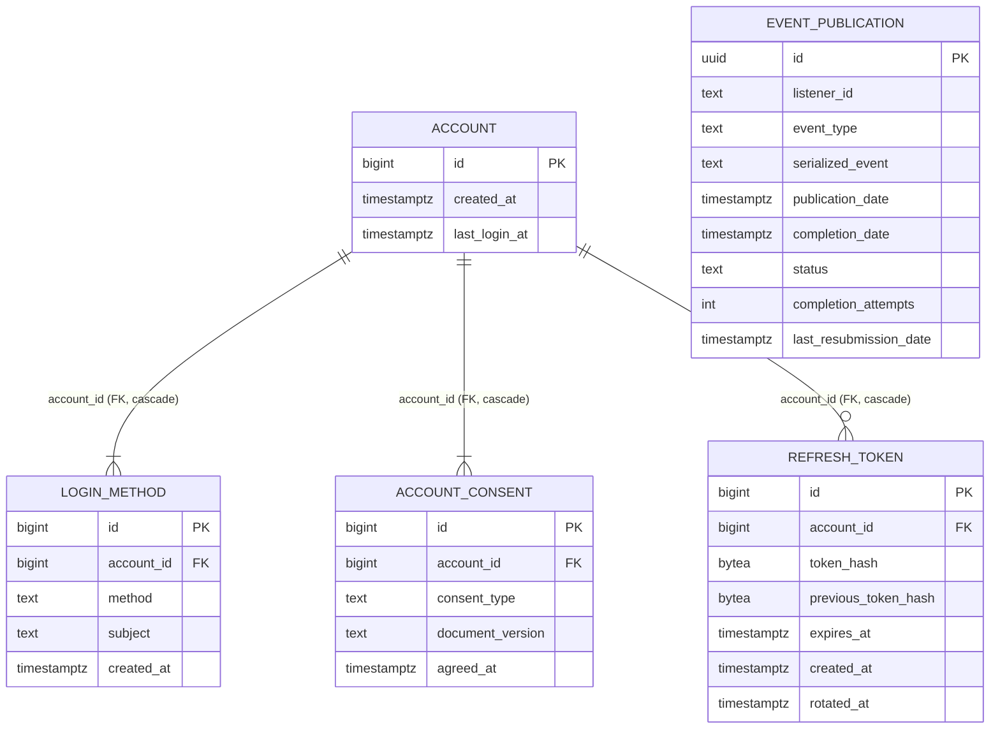

# 데이터 모델 (현재)

현재 설계 전체를 적은 문서입니다.

사이클 05 cycle-close (2026-10-04): 스키마 `auth`와 `modulith`를 더함 — 설계됨(미구현, 사이클 05). 근거 `docs/cycles/05-login-account/design-delta.md`.

마지막 반영: 사이클 04 회고 (2026-10-01). 모든 테이블을 dev Liquibase 파일과 대조했습니다(구현됨). `catalog` 스키마는 데이터 미적재(backlog "미뤄 둔 사이클 04 마무리 작업"). Liquibase에만 있는 세부: `book.isbn13` CHECK `^97[89][0-9]{10}$`, `holding.detail_url` CHECK `^https?://`, `catalog_import` 건수 CHECK `>= 0`, 인덱스 이름 `book_title_norm_bigm` 등(`catalog/001-catalog-schema.yaml`). 그 밖은 사이클 03 회고 (2026-09-30) 기준: 모든 테이블을 dev Liquibase 파일과 대조했습니다(구현됨). 사이클 03은 테이블 변경이 없고, seed `003`~`006` csv의 `visit_required`·`join_method` 값만 고쳤습니다(C3-U-1, 배포 전 규칙).

- Liquibase 파일: `region/001-region-schema.yaml`, `region/002-region-seed.yaml`(+CSV), `region/900-region-test-abolished.yaml`(context `test-data`), `library/001-library-schema.yaml`, `library/002-library-seed.yaml`, `library/003-library-seed-cycle02.yaml`, `004-library-seed-kyobo.yaml`, `005-library-seed-yes24.yaml`, `006-library-seed-moved.yaml`(각각 CSV `loadData`)
- CHECK, 부분 인덱스, `UNIQUE NULLS NOT DISTINCT`는 Liquibase OSS YAML이 지원하지 않아 changeset 안의 `sql`로 만듦
- **배포 전 규칙** [확정] (사용자, 2026-09-28): dev의 `db/changelog/PRE_DEPLOYMENT` 파일이 있는 동안에는 이미 적용된 changeset도 고칠 수 있습니다(로컬 DB를 지우고 다시 적용). 첫 배포 때 이 파일을 지우고, 그 뒤로는 새 파일만 더합니다. 그래서 사이클 02 스키마 변경은 `library/001`에 합쳐져 있습니다

원칙: 모듈마다 자기 스키마와 테이블을 가지고, 모듈 간 FK·JOIN은 두지 않습니다 (dev CLAUDE.md, spring-modulith 스킬, ADR-0002).

## 스키마 `region` (소유: `region` 모듈) — 구현됨

### `region.region` — 시도·시군구

| 컬럼 | 타입 | 제약 | 설명 |
|---|---|---|---|
| id | bigint | PK, 자동 증가 없음 | seed에서 직접 부여. 모든 환경에서 같아야 함 (ADR-0003) |
| parent_id | bigint | NULL, FK → region.region(id) | 시군구의 상위 시도 |
| level | text | NOT NULL, CHECK IN ('SIDO','SIGUNGU') | 일반구는 넣지 않음 |
| name | text | NOT NULL | |
| short_name | text | NULL | 시도 표시용 짧은 이름 [안] |
| legal_dong_code | text | NOT NULL, 10자리 숫자 | 속성일 뿐 키가 아님 |
| status | text | NOT NULL, CHECK IN ('ACTIVE','ABOLISHED') | 폐지된 지역은 지우지 않음 |
| abolished_on | date | NULL | |
| created_at / updated_at | timestamptz | NOT NULL DEFAULT now() | |

- CHECK: 시도면 parent_id 없음, 시군구면 있음 / 폐지면 abolished_on 있음
- UNIQUE `(legal_dong_code) WHERE status='ACTIVE'`, INDEX `(parent_id) WHERE status='ACTIVE'`

### `region.region_replacement` — 폐지·대체 연결

| 컬럼 | 타입 | 제약 | 설명 |
|---|---|---|---|
| region_id | bigint | NOT NULL, FK → region.region(id) | 폐지된 지역 |
| replaced_by_id | bigint | NOT NULL, FK → region.region(id) | 대체한 지역 |
| effective_on | date | NOT NULL | 시행일 |

- PK `(region_id, replaced_by_id)`, CHECK `region_id <> replaced_by_id`, INDEX `(replaced_by_id)`
- 대체한 지역이 둘 이상이면 나뉨(SPLIT). 갱신할 때 순환이 없는지 테스트로 확인 [안]

## 스키마 `library` (소유: `library` 모듈) — 구현됨

### `library.library` — 도서관 (전자도서관 사이트 하나 = 한 줄, ADR-0017)

| 컬럼 | 타입 | 제약 | 설명 |
|---|---|---|---|
| id | bigint | PK, GENERATED BY DEFAULT AS IDENTITY | |
| name | text | NOT NULL, UNIQUE | 같은 기관의 여러 사이트는 "(구독)", "(YES24)", "(교보)" 등으로 구분 |
| library_type | text | NOT NULL DEFAULT 'EBOOK', CHECK IN ('EBOOK') | 종류. 실물 도서관 사이클에 `PHYSICAL` 추가 |
| platform_type | text | NULL, CHECK IN ('KYOBO_V1','KYOBO_SUBSCRIPTION_V1','YES24_V1','YES24_V2','YES24_V3','ELIB_PORTAL_V1','GANGNAM_V1') | 화면 종류 (ADR-0016, 세대 번호 ADR-0023) |
| base_url | text | NULL, UNIQUE | adapter가 경로를 붙이는 사이트 루트(리다이렉트 뒤 최종 주소). 교보·YES24·구독형·강남구는 origin, 포털은 `…/elib`, 강원교육청 포털은 `?menu_idx=2`까지 |
| eligibility_summary | text | NULL | 자격 문구 |
| extra_condition_text | text | NULL | 판정 못 하는 자격 문구 (예: "책이음 회원 가입 가능"). 참고 글로만 보이고 가입 판정·"가입 가능한 곳" 범위에 영향 없음 (C3-U-2) |
| visit_required | boolean | NOT NULL DEFAULT false | 방문 가입. 전자책 이용에 도서관 방문이 필요하면 true. 원문이 전자책 회원 등급을 따로 말하지 않고 가입 절차에 방문 단계만 있어도 true (C3-U-1). "방문 없이 가입" 필터(`visit=none`)와 무리 안 순서(맨 뒤)에 쓰임 (ADR-0027) |
| join_method | text | NOT NULL | 가입 방법 한 줄. 전자책 기준으로 적음 (종이책 회원증 절차만 적으면 `visit_required`와 어긋남, C3-U-1) |
| join_url | text | NULL | 가입·자격 안내 페이지. 없으면 링크 없이 글자만 (C2-U-4) |
| join_caution | text | NULL | "주의" 문구. 가입 판정·필터는 바꾸지 않고, 같은 그룹 안 순서에서 뒤로 (C2-U-11) |
| join_notice | text | NULL | "안내" 문구(누구를 위한 도서관인지). 판정·필터·정렬에 영향 없음 (C2-U-15) |
| homepage_url | text | NULL | 이 줄의 첫 화면(전자도서관 줄은 전자도서관 첫 화면). 요약 줄 이름 링크 (C2-U-13) |
| holdings_count | integer | NULL, CHECK ≥ 0 | 순위 값. 빈 검색 전체 건수(사실상 보유 전자책 수). 구독형은 NULL |
| holdings_counted_on | date | NULL | 조사일. `holdings_count`와 둘 다 있거나 둘 다 없음 |
| deferred | boolean | NOT NULL DEFAULT false | 판정 없는 포털 후순위 (경북·전북) |
| enabled | boolean | NOT NULL DEFAULT true | 사용 여부. 운영자가 SQL로 변경 |
| created_at / updated_at | timestamptz | NOT NULL DEFAULT now() | |

- CHECK 이름: `library_library_type_check`, `library_platform_type_check`, `library_ebook_site_check`(`library_type <> 'EBOOK' OR (platform_type IS NOT NULL AND base_url IS NOT NULL)`), `library_holdings_count_check`, `library_holdings_counted_check`. UNIQUE `library_name_key`, `library_base_url_key`
- 운영 기관으로 묶는 테이블은 없습니다 (backlog, 실물 도서관 사이클에서 검토)
- 도서관을 찾고·넣고·끄는 절차는 dev `docs/library-maintenance.md`에 있습니다 (C2-U-7). plan `collection-method.md`와 겹침. **절차의 원본 = dev `library-maintenance.md`, 조사 기록·근거 = plan** [확정] (사용자, 2026-10-01. `docs/reference-index.md`). dev `plan-feedback.md` C2-U-7에 대한 답은 다음 인계서로 전달

### `library.eligibility_rule` — 자격 규칙 (ADR-0004 구조, ADR-0013으로 뜻 변경)

| 컬럼 | 타입 | 제약 | 설명 | 상태 |
|---|---|---|---|---|
| id | bigint | PK, GENERATED BY DEFAULT AS IDENTITY | |
| library_id | bigint | NOT NULL, FK → library.library(id) ON DELETE CASCADE | 도서관 한 줄(전자도서관 사이트 하나)을 가리킴 |
| basis | text | NOT NULL, CHECK IN ('RESIDENCE','WORK','SCHOOL','AFFILIATION') | 근거 |
| scope_type | text | NOT NULL, CHECK IN ('REGION','INSTITUTION','NATIONWIDE') | 범위 종류. `NATIONWIDE` = 누구나 |
| scope_region_id | bigint | NULL | `region` 모듈 ID (FK 없음) |
| scope_institution_id | bigint | NULL | 다음 사이클용 (FK 없음) |
| created_at | timestamptz | NOT NULL DEFAULT now() | |

- CHECK: REGION이면 scope_region_id만, INSTITUTION이면 scope_institution_id만, NATIONWIDE이면 둘 다 없음
- UNIQUE NULLS NOT DISTINCT `(library_id, basis, scope_type, scope_region_id, scope_institution_id)`, INDEX `(library_id)`
- **규칙이 없는 도서관 = 자격 미확인** (ADR-0013). 규칙이 SCHOOL/AFFILIATION뿐인 도서관은 "지역 규칙 있음"과 같이 봄 (지역 없음 → `QUALIFIED`)

## 스키마 `catalog` (소유: `catalog` 모듈) — 구현됨(사이클 04), 데이터 미적재

수집한 전자책 목록(사실 정보)입니다. 데이터는 Liquibase가 아니라 `catalog` importer가 한 번 넣습니다(ADR-0031). 주기 갱신은 별도 사이클(`docs/research/ebook-catalog/catalog-refresh.md`).

| 테이블.컬럼 | 타입 | 제약 | 설명 | 상태 태그 |
|---|---|---|---|---|
| `book.id` | bigint | PK, GENERATED BY DEFAULT AS IDENTITY | | [확정] 이름 |
| `book.title` | text | NOT NULL | 표시용 대표 제목(묶인 소장 원문 중 가장 많이 나온 것) | [안] 규칙 |
| `book.author_display` | text | NULL | 표시용 대표 저자 원문 | [안] |
| `book.publisher` | text | NULL | 표시용 대표 출판사 원문 | [안] |
| `book.title_norm` | text | NOT NULL | 전체 제목 정리값(NFKC·소문자·공백 제거) | [안] |
| `book.main_title_norm` | text | NOT NULL | 본제목(첫 ` : `·` - ` 앞, 앞 `〈…〉`·`[…]` 시리즈 뗌) 정리값 | [안] |
| `book.publisher_norm` | text | NULL | 출판사 정리값(`(주)`·`주식회사`·`도서출판`·Inc 등 제거) | [안] |
| `book.published_on` | date | NULL | 대표 출판일: 소장들의 날짜 중 가장 많이 나온 것, 같으면 이른 것. 미래 날짜는 빼고 계산 | [확정] 미래 날짜 규칙, 나머지 [안] |
| `book.isbn13` | text | NULL, UNIQUE | 종이책 ISBN (교보식 코드 계산 또는 국가서지) | [확정] 종이책 ISBN |
| `book.content_type` | text | NOT NULL, CHECK IN ('EBOOK','KIDS_BOOK','PAPER','UNKNOWN') | 소장들의 가장 많은 종류. 처음 [안]은 `EBOOK`만이었으나 개발 중 사용자 결정으로 넓힘(2026-09-30, `search-and-normalization.md` 4.6절) | [확정] |
| `book.created_at` | timestamptz | NOT NULL DEFAULT now() | | |
| `book_contributor.id` | bigint | PK, IDENTITY | | |
| `book_contributor.book_id` | bigint | NOT NULL, FK → book(id) ON DELETE CASCADE | | |
| `book_contributor.name` | text | NOT NULL | 원문에서 나눈 이름 (별명 괄호 뗌) | [안] |
| `book_contributor.alias` | text | NULL | 괄호 속 별명 | [안] |
| `book_contributor.name_norm` | text | NOT NULL | 이름(+별명) 정리값, 부분 일치용 | [안] |
| `book_contributor.name_exact` | text | NOT NULL | 공백·마침표 제거, 완전 일치용 | [안] |
| `book_contributor.role` | text | NOT NULL, CHECK IN ('AUTHOR','TRANSLATOR','ILLUSTRATOR','EDITOR','OTHER','UNKNOWN') | 역할. 글그림은 AUTHOR와 ILLUSTRATOR 두 줄 | [안] 값 |
| `book_contributor.position` | smallint | NOT NULL | 원문 순서 | |
| `holding.id` | bigint | PK, IDENTITY | 스트림 키 `holdingId` | |
| `holding.book_id` | bigint | NOT NULL, FK → book(id) ON DELETE CASCADE | | |
| `holding.library_id` | bigint | NOT NULL | `library` 모듈 ID (FK 없음) | |
| `holding.platform` | text | NOT NULL | 수집 원천의 플랫폼 | |
| `holding.item_key` | text | NOT NULL | 도서관 안 책 코드 | |
| `holding.detail_url` | text | NOT NULL | 상세 페이지 주소 (http(s), 호스트가 그 도서관 `base_url` 호스트와 같은 것만 가져옴) | [확정] 상세 페이지 읽기, 검사 [안] |
| `holding.title_raw`, `author_raw`, `publisher_raw`, `published_raw`, `supplier`, `alt_code` | text | NULL | 원문 보관 | [확정] 원문 보존 |
| `holding.first_seen_at` | timestamptz | NOT NULL | 수집 원천 값 | |
| `holding.content_type` | text | NOT NULL | 수집 원천의 자료 종류(`EBOOK`/`KIDS_BOOK`/`PAPER`/`UNKNOWN`). 개발 중 추가(2026-09-30) | [확정] |
| `catalog_library_snapshot.library_id` | bigint | PK | 도서관 (ID만) | [안] 테이블 이름 |
| `catalog_library_snapshot.collected_at` | timestamptz | NOT NULL | 그 도서관 목록을 마지막으로 성공 수집한 시각(수집 `library.last_full_success_at`) → 화면 "○월 ○일 기준". 그 값이 없는 도서관(dry run 기준 12곳)은 그 도서관 소장의 가장 늦은 `last_seen_at`으로 대신함(dev 결정, 2026-09-30) | [확정] 도서관별 기준일 (사용자, 2026-09-30), 대체 규칙 [안] |
| `catalog_library_snapshot.import_id` | bigint | NOT NULL, FK → catalog_import(id) ON DELETE CASCADE | | |
| `catalog_import.id` | bigint | PK, IDENTITY | | |
| `catalog_import.source` | text | NOT NULL | 예: `chaekcheck-data/ebook-catalog.sqlite` | |
| `catalog_import.imported_at` | timestamptz | NOT NULL | | |
| `catalog_import.book_count`, `holding_count`, `skipped_count` | integer | NOT NULL | 요약 | |

인덱스 [안] (측정: `docs/research/ebook-catalog/search-and-normalization.md` 3.2.1)
- `book`: GIN `gin_bigm_ops` (`title_norm`), (`publisher_norm`) / B-tree `COLLATE "C"` (`main_title_norm`), (`title_norm`), (`publisher_norm`) — 완전 일치 / B-tree `(published_on DESC NULLS LAST, id)`, `(published_on ASC NULLS LAST, id)` — 역방향 스캔으로는 NULLS LAST를 지킬 수 없어 둘 다 / UNIQUE `(isbn13)`
- `book_contributor`: GIN `gin_bigm_ops` (`name_norm`) / B-tree `(name_exact COLLATE "C")` / `(book_id)`
- `holding`: UNIQUE `(library_id, item_key)`, `(book_id, library_id)`
- 파티션 없음 (research 3.3)
- 같은 모듈 안 FK는 모두 `ON DELETE CASCADE` [안] (가져오기를 다시 할 때 책·가져오기 단위로 지움)
- `holding.library_id` → `catalog_library_snapshot` FK는 두지 않음 [안]: 두 표 모두 한 번 가져오기에서 같이 채워지고, 주기 갱신 사이클에서 도서관 단위 교체 순서를 정할 때까지 삽입 순서 제약을 만들지 않기 위함 (Claude 제안)

- Liquibase: 새 파일 `catalog/001-catalog-schema.yaml`. `CREATE EXTENSION IF NOT EXISTS pg_bigm`은 sql changeset. **데이터는 Liquibase로 넣지 않음** (importer, ADR-0031)
- 가져오기 범위 [확정]: `removed_at IS NULL`, 오디오북·동영상북만 제외(`EBOOK`·`KIDS_BOOK`·`UNKNOWN`·`PAPER` 모두 넣음, 사용자 2026-09-30), 서비스 `library`와 id·`base_url`이 같은 도서관. 꺼진 59·131번은 대조에서 빠짐
- 묶기 [확정]: ① 같은 플랫폼 코드(번호 체계: 교보·교보 구독형·YES24 V1~V3는 공유, 포털·강남구는 도서관 안) ② 교보식 코드 → 종이책 ISBN ③ 국가서지 ISBN (정리한 본제목·대표 저자·출판사로 하나만 맞을 때) ④ 정리한 전체 제목 + 대표 저자 + 정리한 출판사 (개발 중 사용자 결정, 2026-09-30). 규칙·수치는 `docs/research/ebook-catalog/same-book-isbn.md` 5절
- 국가서지 파일 위치: dev 저장소 안 `data/nlk/` (git 제외, 사용자 결정 2026-09-30). 인계서 [안]은 저장소 밖이었음

## 스키마 `auth` (소유: `auth` 모듈), `modulith` (발행 저장소) — 설계됨(미구현, 사이클 05)

**`auth.account`**
| 컬럼 | 타입 | 제약 | 설명 |
|---|---|---|---|
| id | bigint | PK, GENERATED BY DEFAULT AS IDENTITY | JWT `sub` |
| created_at | timestamptz | NOT NULL DEFAULT now() | |
| last_login_at | timestamptz | NOT NULL | 가입·다시 로그인 때 갱신 (R3) |

**`auth.login_method`**
| 컬럼 | 타입 | 제약 | 설명 |
|---|---|---|---|
| id | bigint | PK, IDENTITY | |
| account_id | bigint | NOT NULL, FK → auth.account(id) ON DELETE CASCADE | |
| method | text | NOT NULL, CHECK IN ('NAVER','KAKAO') | 나중에 `PASSWORD` 추가 |
| subject | text | NOT NULL | 그 수단 안의 식별자. 소셜은 제공자 쪽 번호(Kakao 숫자도 문자열로) |
| created_at | timestamptz | NOT NULL DEFAULT now() | |
- UNIQUE `(method, subject)`, INDEX `(account_id)`. 이번에는 계정당 한 줄이고 이것은 앱 코드가 지킵니다(DB에 UNIQUE(account_id)를 걸지 않음. 나중의 연결 기능을 막지 않기 위해. ADR-0039)

**`auth.account_consent`**
| 컬럼 | 타입 | 제약 | 설명 |
|---|---|---|---|
| id | bigint | PK, IDENTITY | |
| account_id | bigint | NOT NULL, FK → auth.account(id) ON DELETE CASCADE | |
| consent_type | text | NOT NULL, CHECK IN ('TERMS_OF_SERVICE','PRIVACY_COLLECTION','AGE_OVER_14') | 확인란 셋 [확정] |
| document_version | text | NULL | 이용약관·수집 이용 고지 버전. 형식 `YYYY-MM-DD`(시행 날짜) [확정] (사용자 승인, 2026-10-04, 설계 검토 10) |
| agreed_at | timestamptz | NOT NULL | |
- CHECK: `AGE_OVER_14`가 아니면 `document_version IS NOT NULL`. UNIQUE `(account_id, consent_type, document_version)` NULLS NOT DISTINCT(sql changeset). INDEX `(account_id)`
- 현재 버전은 서버 설정이 원본: 웹은 화면에 보인 버전을 보내고, 서버의 현재 버전과 다르면 409

**`auth.refresh_token`**
| 컬럼 | 타입 | 제약 | 설명 |
|---|---|---|---|
| id | bigint | PK, IDENTITY | 브라우저 로그인 하나 |
| account_id | bigint | NOT NULL, FK → auth.account(id) ON DELETE CASCADE | |
| token_hash | bytea | NOT NULL, UNIQUE | SHA-256(현재 값) |
| previous_token_hash | bytea | NULL | 바로 앞 값. 재사용 감지 |
| expires_at | timestamptz | NOT NULL | 로그인 + 30일 [확정], 교체해도 그대로 |
| created_at | timestamptz | NOT NULL DEFAULT now() | 로그인한 때 |
| rotated_at | timestamptz | NULL | |
- INDEX `(previous_token_hash)`, `(account_id)`, `(expires_at)`. 만료된 줄은 하루 한 번 정리 [확정] (사용자 승인, 2026-10-04, 설계 검토 10)

**`modulith.event_publication`**: Spring Modulith 2.1.1 공식 DDL 그대로(Liquibase 별도 파일. https://docs.spring.io/spring-modulith/reference/appendix.html). 설정: `spring.modulith.events.jdbc.schema=modulith`, `spring.modulith.events.jdbc.schema-initialization.enabled=false`, `spring.modulith.events.completion-mode=delete` [확정] (사용자 승인, 2026-10-04, 설계 검토 8).

- Liquibase: `db/changelog/auth/001-auth-schema.yaml`(CHECK, NULLS NOT DISTINCT는 `sql` changeset), `db/changelog/modulith/001-event-publication.yaml`, master에 include 두 줄. 새 파일만 더합니다 [확정].
- JPA 매핑 참고: cascade는 DB FK에 맡기고 JPA 연관 cascade는 쓰지 않습니다. 삭제는 `account` 한 줄 삭제 쿼리로 합니다. 엔티티를 쓸지 `JdbcClient`를 쓸지는 dev가 정합니다.

## seed

- 켜진 도서관 278곳 (2026-09-29, dev 보고). 중단된 2곳(id 59, 131)은 `enabled=false`. 방문 가입 86곳, 그중 누구나 가입 16곳 (2026-09-30, dev 보고: `visit=none`이면 계획 192곳)
  - `002`: 시범 2곳 — 1 강서(`YES24_V2`), 2 고흥(`KYOBO_V1`, `RESIDENCE × NATIONWIDE`)
  - `003`: 화면 종류별 확인 13곳(교보 4, 구독형 1, `YES24_V1` 1, 강남구 1, 포털 6)
  - `004`: 교보 공식 목록(구독형 포함), 인증서 불완전 24곳, 이름에 "도서관"이 없는 공공도서관 17곳 등 (id ~205)
  - `005`: YES24 66곳 (id 206–271)
  - `006`: 새 주소를 찾은 9곳 (id 272–280)
- 자격 규칙은 원문을 확인한 값만 넣음. 조사 기록은 dev `docs/library-research/*.tsv`, 사용자가 나중에 확인할 항목은 dev `docs/library-maintenance.md` 14절
- 도서관 ID는 seed에서 직접 넣고 IDENTITY는 마지막 seed 다음부터 시작
- 지역: 2026-07-01 법정동 코드(`jscode20260701`) 기준 시도 16개, 시군구 232개 [확정] (시군구 234개 중 도 출장소 2개 제외). 세종특별자치시는 시군구 행 하나(`3601`)를 둠
- 지역 ID 규칙 [확정] (사용자, 2026-09-27): 시도 2자리 = 법정동 코드 앞 두 자리, 시군구 4자리 = 시도 ID + 법정동 코드 순서(01, 02, …). 번호는 다시 쓰지 않고, 소속은 `parent_id`로만 판단. 일반구·읍면동을 넣게 되면 상위 ID 뒤에 자리를 붙임
- 시험용 폐지 데이터 (context `test-data`): 시도 90, 9001 → 1116 (REPLACED), 9002 → 1114·1116 (SPLIT), 9003 → 9004 → 1101 (연쇄)
- 전남광주통합특별시 `short_name`은 NULL [확인 필요]
