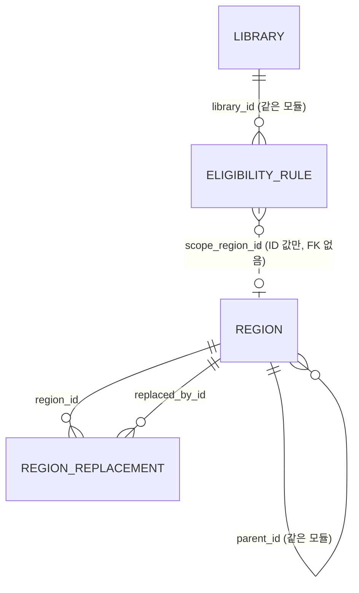

# 데이터 모델 (현재)

현재 설계 전체를 적은 문서입니다.

마지막 반영: 사이클 02 cycle-close (2026-09-28). `region`은 사이클 01 구현 그대로, `library`의 사이클 02 변경은 **설계됨(미구현)** 입니다 (ADR-0013, ADR-0017).

- Liquibase 파일: `region/001-region-schema.yaml`, `region/002-region-seed.yaml`(+CSV), `region/900-region-test-abolished.yaml`(context `test-data`), `library/001-library-schema.yaml`, `library/002-library-seed.yaml`
- CHECK, 부분 인덱스, `UNIQUE NULLS NOT DISTINCT`는 Liquibase OSS YAML이 지원하지 않아 changeset 안의 `sql`로 만듦

원칙: 모듈마다 자기 스키마와 테이블을 가지고, 모듈 간 FK·JOIN은 두지 않습니다 (dev CLAUDE.md, spring-modulith 스킬, ADR-0002).

## 스키마 `region` (소유: `region` 모듈) — 구현됨

### `region.region` — 시도·시군구

| 컬럼 | 타입 | 제약 | 설명 |
|---|---|---|---|
| id | bigint | PK, 자동 증가 없음 | seed에서 직접 부여. 모든 환경에서 같아야 함 (ADR-0003) |
| parent_id | bigint | NULL, FK → region.region(id) | 시군구의 상위 시도 |
| level | text | NOT NULL, CHECK IN ('SIDO','SIGUNGU') | 일반구는 넣지 않음 |
| name | text | NOT NULL | |
| short_name | text | NULL | 시도 표시용 짧은 이름 [안] |
| legal_dong_code | text | NOT NULL, 10자리 숫자 | 속성일 뿐 키가 아님 |
| status | text | NOT NULL, CHECK IN ('ACTIVE','ABOLISHED') | 폐지된 지역은 지우지 않음 |
| abolished_on | date | NULL | |
| created_at / updated_at | timestamptz | NOT NULL DEFAULT now() | |

- CHECK: 시도면 parent_id 없음, 시군구면 있음 / 폐지면 abolished_on 있음
- UNIQUE `(legal_dong_code) WHERE status='ACTIVE'`, INDEX `(parent_id) WHERE status='ACTIVE'`

### `region.region_replacement` — 폐지·대체 연결

| 컬럼 | 타입 | 제약 | 설명 |
|---|---|---|---|
| region_id | bigint | NOT NULL, FK → region.region(id) | 폐지된 지역 |
| replaced_by_id | bigint | NOT NULL, FK → region.region(id) | 대체한 지역 |
| effective_on | date | NOT NULL | 시행일 |

- PK `(region_id, replaced_by_id)`, CHECK `region_id <> replaced_by_id`, INDEX `(replaced_by_id)`
- 대체한 지역이 둘 이상이면 나뉨(SPLIT). 갱신할 때 순환이 없는지 테스트로 확인 [안]

## 스키마 `library` (소유: `library` 모듈) — 사이클 01 구현 + 사이클 02 설계됨(미구현)

### `library.library` — 도서관 (전자도서관 사이트 하나 = 한 줄, ADR-0017)

| 컬럼 | 타입 | 제약 | 설명 | 상태 |
|---|---|---|---|---|
| id | bigint | PK, GENERATED BY DEFAULT AS IDENTITY | | 구현됨 |
| library_type | text | NOT NULL DEFAULT 'EBOOK', CHECK IN ('EBOOK') | 종류. 실물 도서관 사이클에 `PHYSICAL` 추가 | 설계됨 [안 이름] |
| name | text | NOT NULL, UNIQUE | 같은 기관의 여러 사이트는 "(구독)" 등으로 구분 | 구현됨 |
| platform_type | text | NULL, CHECK IN ('KYOBO','KYOBO_SUBSCRIPTION','YES24','YES24_LEGACY','ELIB_PORTAL','GANGNAM') | 화면 종류 (ADR-0016). 사이클 01의 `platform`(KYOBO, YES24)을 바꿈 | 설계됨 [안] |
| base_url | text | NULL, UNIQUE | 사이트 루트 URL(경로 포함). 사이클 01은 NOT NULL·origin만 | 설계됨 [안] |
| eligibility_summary | text | NULL | 자격 문구 | 구현됨 |
| extra_condition_text | text | NULL | 판정 못 하는 자격 문구 (예: "책이음 회원 가입 가능") | 설계됨 [안 이름] |
| visit_required | boolean | NOT NULL DEFAULT false | 방문 가입만 가능 | 설계됨 [안 이름] |
| join_method | text | NOT NULL | 가입 방법 한 줄 | 구현됨 |
| enabled | boolean | NOT NULL DEFAULT true | 사용 여부. 운영자가 SQL로 변경 | 구현됨 |
| holdings_count | integer | NULL, CHECK ≥ 0 | 순위 값 (보유 전자책 수) | 설계됨 [안 이름] |
| holdings_counted_on | date | NULL | 조사일. `holdings_count`와 둘 다 있거나 둘 다 없음 | 설계됨 [안] |
| deferred | boolean | NOT NULL DEFAULT false | 판정 없는 포털 후순위 | 설계됨 [안 이름] |
| created_at / updated_at | timestamptz | NOT NULL DEFAULT now() | | 구현됨 |

- CHECK: `library_type <> 'EBOOK' OR (platform_type IS NOT NULL AND base_url IS NOT NULL)` (설계됨)
- 운영 기관으로 묶는 테이블은 없습니다 (backlog, 실물 도서관 사이클에서 검토)

### `library.eligibility_rule` — 자격 규칙 (ADR-0004 구조, ADR-0013으로 뜻 변경)

| 컬럼 | 타입 | 제약 | 설명 | 상태 |
|---|---|---|---|---|
| id | bigint | PK, GENERATED BY DEFAULT AS IDENTITY | | 구현됨 |
| library_id | bigint | NOT NULL, FK → library.library(id) ON DELETE CASCADE | 도서관 한 줄(전자도서관 사이트 하나)을 가리킴 | 구현됨 |
| basis | text | NOT NULL, CHECK IN ('RESIDENCE','WORK','SCHOOL','AFFILIATION') | 근거 | 구현됨 |
| scope_type | text | NOT NULL, CHECK IN ('REGION','INSTITUTION','NATIONWIDE') | 범위 종류. `NATIONWIDE` = 누구나 | `NATIONWIDE` 설계됨 |
| scope_region_id | bigint | NULL | `region` 모듈 ID (FK 없음) | 구현됨 |
| scope_institution_id | bigint | NULL | 다음 사이클용 (FK 없음) | 구현됨 |
| created_at | timestamptz | NOT NULL DEFAULT now() | | 구현됨 |

- CHECK: REGION이면 scope_region_id만, INSTITUTION이면 scope_institution_id만, NATIONWIDE이면 둘 다 없음
- UNIQUE NULLS NOT DISTINCT `(library_id, basis, scope_type, scope_region_id, scope_institution_id)`, INDEX `(library_id)`
- **규칙이 없는 도서관 = 자격 미확인** (ADR-0013, 설계됨). 사이클 01 구현은 아직 "규칙 없음 = 누구나 가입"이라, 고흥에 `RESIDENCE × NATIONWIDE`를 더하는 마이그레이션과 코드가 같은 배포에 들어가야 함

## seed

| id | 도서관 | platform | base_url | 규칙 |
|---|---|---|---|---|
| 1 | 서울 강서구 전자도서관 | YES24 | `https://ebook.gangseo.seoul.kr` | RESIDENCE / WORK / SCHOOL × 서울특별시 |
| 2 | 고흥군립도서관 전자도서관 | KYOBO | `https://www.ghlib.go.kr:446` | 없음 (사이클 02에서 RESIDENCE × NATIONWIDE 추가 예정) |

- 사이클 02 seed (설계됨): 교보·YES24·통합 포털·강남구 등 수백 곳을 CSV `loadData`(library, eligibility_rule)로 추가. 목록과 자격은 `docs/cycles/02-library-expansion/research.md`, `eligibility-by-library.md`

- 도서관 ID는 seed에서 직접 넣고 IDENTITY는 3부터 시작
- 지역: 2026-07-01 법정동 코드(`jscode20260701`) 기준 시도 16개, 시군구 232개 [확정] (시군구 234개 중 도 출장소 2개 제외). 세종특별자치시는 시군구 행 하나(`3601`)를 둠
- 지역 ID 규칙 [확정] (사용자, 2026-09-27): 시도 2자리 = 법정동 코드 앞 두 자리, 시군구 4자리 = 시도 ID + 법정동 코드 순서(01, 02, …). 번호는 다시 쓰지 않고, 소속은 `parent_id`로만 판단. 일반구·읍면동을 넣게 되면 상위 ID 뒤에 자리를 붙임
- 시험용 폐지 데이터 (context `test-data`): 시도 90, 9001 → 1116 (REPLACED), 9002 → 1114·1116 (SPLIT), 9003 → 9004 → 1101 (연쇄)
- 전남광주통합특별시 `short_name`은 NULL [확인 필요]
