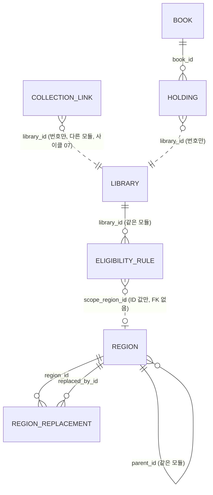
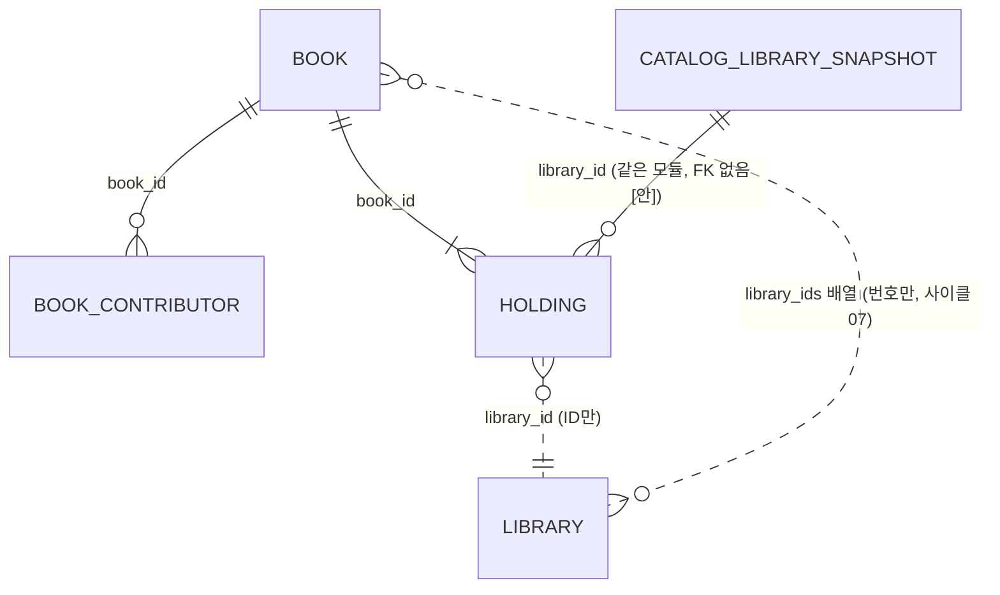
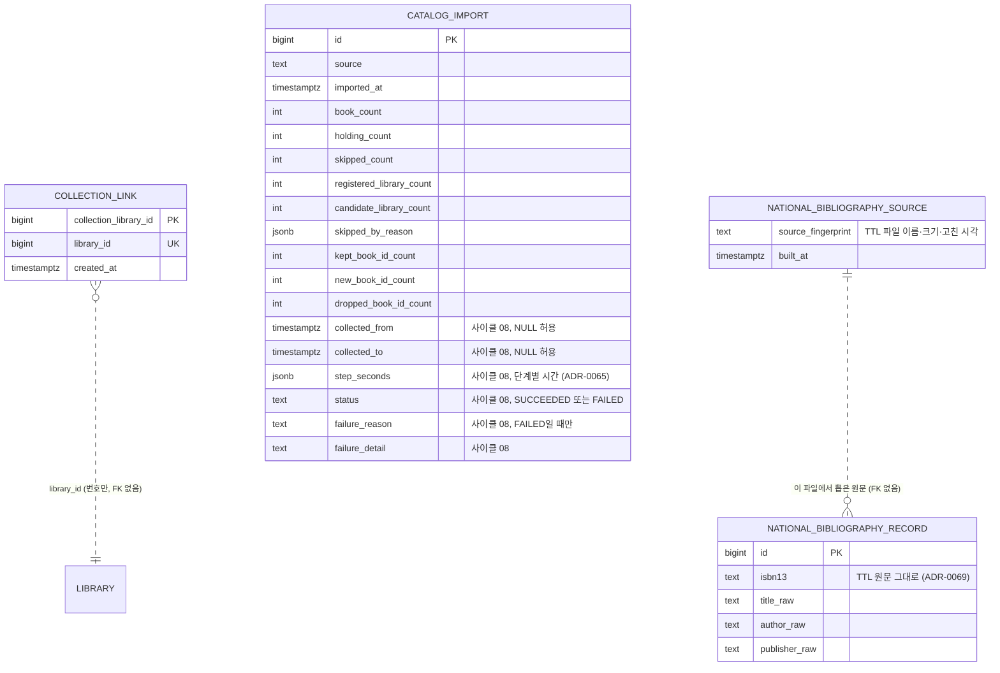
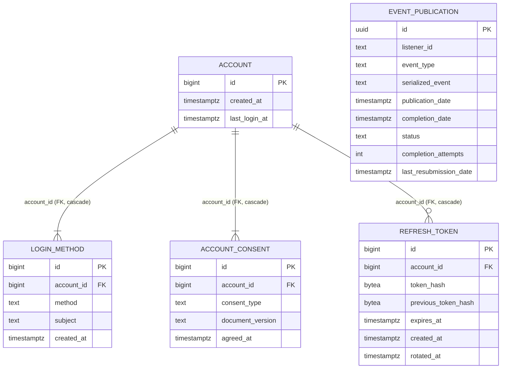
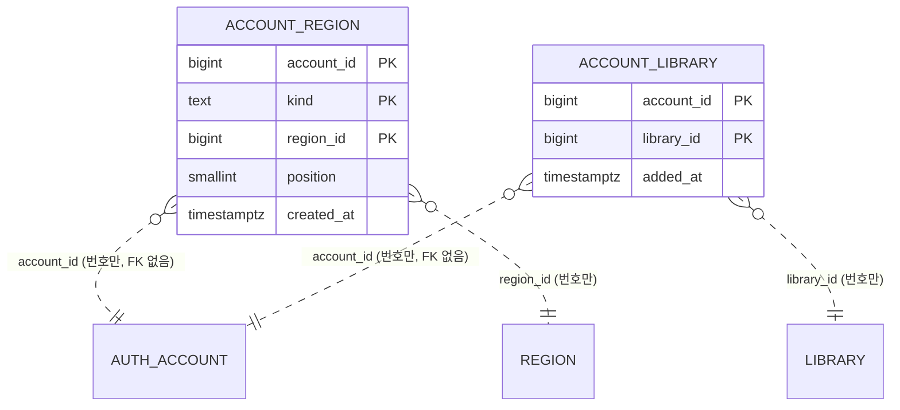

# 데이터 모델 (현재)

현재 설계 전체를 적은 문서입니다.

사이클 09 cycle-close (2026-10-11): `library.library` 이름은 기관 이름만(UNIQUE `library_name_key` 지움), 새 칸 `vendor`·`order_no`, 통합 포털 말고 모두 `lending_model`을 채움, CHECK 셋과 UNIQUE `library_classification_key (name, vendor, lending_model, order_no)`, 이름·분류 changeset `library/014-library-classification.yaml` [안 번호], seed 생성 스크립트의 겹침 규칙(순번) — 설계됨(미구현, 사이클 09). 근거 `docs/cycles/09-library-naming/design-delta.md` "데이터"·"dev 스크립트와 문서", spec R1~R4, ADR-0071·0076.
사이클 08 cycle-close (2026-10-11): `catalog` 가져오기를 새 표(`catalog_next`)에 쓰고 바꿔 끼우기, 소장 번호 잇기, `collection.catalog_import` 칸 추가, `collection.national_bibliography_record`·`national_bibliography_source`, `library.library.mobile_site_differs`, 도서관 이름 고침 changeset, `library`·`region` `updated_at` 트리거, 교보 대여·혼합 11곳 seed에서 뺌, 정리 규칙을 바꿀 때의 순서 — 구현됨 (사이클 08). 근거 `docs/cycles/08-polish-swap-memory/design-delta.md` "데이터"·"정리 규칙을 바꿀 때"·"이름 고치기", ADR-0065~0070. 이름·숫자는 따로 적지 않으면 [안].
사이클 08 회고 (2026-10-11): dev Liquibase(`collection/003`·`004`, `library/011`~`013`, `region/003`)와 dev `plan-feedback.md` "# 사이클 08"로 대조함. 달라진 점: 국가서지 원문은 ISBN마다 한 줄, `step_seconds` 키가 늘어남, 가져오기 기록에 `status`·`failure_reason`·`failure_detail`, 넓은 줄은 임시 표와 `catalog_next`에 두 번 씀, 파일 번호가 설계 [안]과 다름, 이름 고침은 `library/013`. 가져오기 힙(AC-12), 국가서지 원문 재사용 시간(AC-15), 색인 단계 중단(AC-9 둘째 경우)은 측정 중 [확인 필요]. 근거 `docs/cycles/08-polish-swap-memory/retro.md`.

사이클 07 회고 반영 (2026-10-05): 후보 도서관 넣기 — 새 스키마 `collection`, `library.library` 칸 추가·바꿈, `catalog.book.library_ids`, `catalog.catalog_import`를 `collection.catalog_import`로 옮김, `catalog_library_snapshot.import_id` 지움 — 구현됨 (사이클 07). dev Liquibase(`library/001`, `catalog/001`, `collection/001`, seed `library/008`~`010`, `collection/002`)와 대조함. 근거 docs/cycles/07-candidate-libraries/retro.md, dev plan-feedback.md '# 사이클 07'. 설계 근거 `docs/cycles/07-candidate-libraries/design-delta.md` "데이터", ADR-0052~0055, 0059, 0060.

사이클 06 회고 반영 (2026-10-05): 내 도서관(`mylibrary`)을 더함 — 구현됨 (사이클 06). dev changelog `mylibrary/001-mylibrary-schema.yaml`과 대조함. 근거 `docs/cycles/06-my-libraries/design-delta.md`.

사이클 05 cycle-close (2026-10-04): 스키마 `auth`와 `modulith`를 더함 — 구현됨(사이클 05, 2026-10-04 retro 반영). 근거 `docs/cycles/05-login-account/design-delta.md`.

마지막 반영: 사이클 04 회고 (2026-10-01). 모든 테이블을 dev Liquibase 파일과 대조했습니다(구현됨). `catalog` 스키마는 데이터 미적재(backlog "미뤄 둔 사이클 04 마무리 작업"). Liquibase에만 있는 세부: `book.isbn13` CHECK `^97[89][0-9]{10}$`, `holding.detail_url` CHECK `^https?://`, `catalog_import` 건수 CHECK `>= 0`, 인덱스 이름 `book_title_norm_bigm` 등(`catalog/001-catalog-schema.yaml`). 그 밖은 사이클 03 회고 (2026-09-30) 기준: 모든 테이블을 dev Liquibase 파일과 대조했습니다(구현됨). 사이클 03은 테이블 변경이 없고, seed `003`~`006` csv의 `visit_required`·`join_method` 값만 고쳤습니다(C3-U-1, 배포 전 규칙).

- Liquibase 파일: `region/001-region-schema.yaml`, `region/002-region-seed.yaml`(+CSV), `region/900-region-test-abolished.yaml`(context `test-data`), `library/001-library-schema.yaml`, `library/002-library-seed.yaml`, `library/003-library-seed-cycle02.yaml`, `004-library-seed-kyobo.yaml`, `005-library-seed-yes24.yaml`, `006-library-seed-moved.yaml`(각각 CSV `loadData`)
- 사이클 07 Liquibase (구현됨 (사이클 07)): 처음에 새 파일 7개로 넣고 대조한 뒤, 배포 전(`PRE_DEPLOYMENT` 동안) 스키마 changeset을 모듈의 첫 파일로 접음 — `library/007` → `library/001`(`join_survey`, `lending_model`, `join_method` NULL 허용 + CHECK, 화면 종류 둘), `catalog/002`·`003` → `catalog/001`(`book.library_ids`와 GIN, `catalog.catalog_import` 표·`catalog_library_snapshot.import_id` 없앰), `collection/003` → `collection/001`(책 번호 셈 칸). seed 파일은 그대로 [확정] (인계서 C8, 합치기 [확정]. 접는 방식은 [이유 미확인: dev가 정함]). 지금 master 순서(사이클 07 부분): `library/008` → `collection/001` → `collection/002` → `library/009` → `library/010` [확정] (dev 구현 확인, 2026-10-05)
  - `library/008-library-seed-candidates.yaml` + CSV(`008-library-candidates.csv` 후보 도서관 줄, `008-eligibility-rule-candidates.csv` 가입 규칙 줄) — IDENTITY 맞춤. 등록 도서관 `lending_model`(C6)은 이 파일의 두 번째 changeset UPDATE
  - `collection/001-collection-schema.yaml`: 스키마 `collection`, `collection.collection_link`, 가져오기 기록 `collection.catalog_import` [확정] (dev 구현 확인, 2026-10-05)
  - `collection/002-collection-seed-candidates.yaml` + `002-collection-link.csv`(짝: 등록 도서관 같은 번호 짝 + 후보 도서관 짝). 등록 도서관 짝도 `library.library`를 읽지 않고 CSV 줄로 적음(다른 모듈 표를 읽지 않기 위해) [확정] (dev 구현 확인, 2026-10-05)
  - `library/009-library-logos.yaml` + `009-library-logos.csv`: 로고 칸 둘 + `logo_file` 값(임시 표 `library.logo_seed`에 `loadData` → UPDATE → 표 지움) [확정] (dev 구현 확인, 2026-10-05)
  - `library/010-library-disabled.yaml`: 135 전라북도교육청통합도서관, 2194 장안대학교 (YES24), 2198 성균관대학교 (YES24)를 `enabled = false` [확정] (사용자 승인, 2026-10-05, 17단계)
  - 합칠 때 대조 규칙 [확정] (사용자 제안, 2026-10-05): 둘 다 있으면 합치고 다른 점은 목록으로 보고, 새 파일에만 있으면 넣고, **옛 파일에만 있으면 지우지 않고** dev가 그 사이트 첫 화면을 열어 확인 → 열리지 않거나 바뀌었으면 `enabled = false` 제안 목록을 사용자에게 보여 주고 사용자가 정함 (ADR 없음, 사이클 07 design-delta "데이터"에만 기록). 대조 결과: 이름·화면 종류·주소 다른 곳 0, 옛 파일에만 있는 곳 2(59·131, 이미 꺼짐, 그대로 둠)
  - 지역 seed `region/002`에 증평군(4311) 추가, 전남광주통합특별시 `short_name` "전남광주" [확정] (사용자 결정, 2026-10-05, 배포 전 규칙으로 고침)
- 사이클 08 Liquibase (구현됨 (사이클 08)), 새 파일로 더함. 파일 이름은 dev가 정함 [확정] (dev 구현 확인, 2026-10-11; 설계 [안]의 `collection/004`·`005`, `library/011`·`012`·`013` 번호와 다름): `collection/003-import-period-and-timings.yaml`(changeset `collection-003-import-period-and-timings`: 수집 기간·단계별 시간, `collection-003-import-status`: 상태·실패 칸), `collection/004-national-bibliography.yaml`(두 표), `library/011-updated-at-trigger.sql`, `region/003-updated-at-trigger.sql`(master에서 이번 사이클 다른 changeset보다 앞), `library/012-library-mobile-site-differs.yaml`(칸 + 13곳 UPDATE), `library/013-library-name-overrides.yaml`(이름 고침 UPDATE). 트리거 파일은 dev `CLAUDE.md` 규칙대로 formatted SQL: 첫 줄 `--liquibase formatted sql`, `splitStatements:false`, `CREATE OR REPLACE`, `runOnChange:true` [확정] (사용자 승인, 2026-10-11, 설계 검토)
  - 교보 대여·혼합 11곳(2664~2674): `PRE_DEPLOYMENT`가 남아 있으므로 `library/008-library-candidates.csv`와 `collection/002-collection-link.csv`에서 그 줄을 지우고 로컬 `db`·`db-test`를 초기화해 다시 적용 [확정] (사용자: "그냥 DB에서 삭제", 2026-10-10; ADR-0067). 이유: 아직 다른 사용자에게 배포되지 않음 (사용자: "이거 다른 사용자들에게 배포 안 되었어. 그냥 DB에서 삭제", 2026-10-10)
- CHECK, 부분 인덱스, `UNIQUE NULLS NOT DISTINCT`는 Liquibase OSS YAML이 지원하지 않아 changeset 안의 `sql`로 만듦
- **배포 전 규칙** [확정] (사용자, 2026-09-28): dev의 `db/changelog/PRE_DEPLOYMENT` 파일이 있는 동안에는 이미 적용된 changeset도 고칠 수 있습니다(로컬 DB를 지우고 다시 적용). 첫 배포 때 이 파일을 지우고, 그 뒤로는 새 파일만 더합니다. 그래서 사이클 02 스키마 변경은 `library/001`에 합쳐져 있습니다

원칙: 모듈마다 자기 스키마와 테이블을 가지고, 모듈 간 FK·JOIN은 두지 않습니다 (dev CLAUDE.md, spring-modulith 스킬, ADR-0002).

- `COLLECTION_LINK`는 사이클 07에 더한 표입니다(구현됨 (사이클 07)). `BOOK`·`HOLDING`의 자세한 관계는 아래 `catalog` 그림.

## 스키마 `region` (소유: `region` 모듈) — 구현됨

### `region.region` — 시도·시군구

| 컬럼 | 타입 | 제약 | 설명 |
|---|---|---|---|
| id | bigint | PK, 자동 증가 없음 | seed에서 직접 부여. 모든 환경에서 같아야 함 (ADR-0003) |
| parent_id | bigint | NULL, FK → region.region(id) | 시군구의 상위 시도 |
| level | text | NOT NULL, CHECK IN ('SIDO','SIGUNGU') | 일반구는 넣지 않음 |
| name | text | NOT NULL | |
| short_name | text | NULL | 시도 표시용 짧은 이름 [안] |
| legal_dong_code | text | NOT NULL, 10자리 숫자 | 속성일 뿐 키가 아님 |
| status | text | NOT NULL, CHECK IN ('ACTIVE','ABOLISHED') | 폐지된 지역은 지우지 않음 |
| abolished_on | date | NULL | |
| created_at / updated_at | timestamptz | NOT NULL DEFAULT now() | 사이클 08 (구현됨 (사이클 08)): `updated_at`은 `BEFORE UPDATE FOR EACH ROW` 트리거로 고칠 때마다 DB가 적음(값이 그대로여도 바뀜), 함수 `region.set_updated_at()`, 트리거 `region_set_updated_at` (`region/003-updated-at-trigger.sql`) [확정] (dev 구현 확인, 2026-10-11). [확정] (사용자 승인, 2026-10-10; ADR-0068) |

- CHECK: 시도면 parent_id 없음, 시군구면 있음 / 폐지면 abolished_on 있음
- UNIQUE `(legal_dong_code) WHERE status='ACTIVE'`, INDEX `(parent_id) WHERE status='ACTIVE'`

### `region.region_replacement` — 폐지·대체 연결

| 컬럼 | 타입 | 제약 | 설명 |
|---|---|---|---|
| region_id | bigint | NOT NULL, FK → region.region(id) | 폐지된 지역 |
| replaced_by_id | bigint | NOT NULL, FK → region.region(id) | 대체한 지역 |
| effective_on | date | NOT NULL | 시행일 |

- PK `(region_id, replaced_by_id)`, CHECK `region_id <> replaced_by_id`, INDEX `(replaced_by_id)`
- 대체한 지역이 둘 이상이면 나뉨(SPLIT). 갱신할 때 순환이 없는지 테스트로 확인 [안]

## 스키마 `library` (소유: `library` 모듈) — 구현됨

### `library.library` — 도서관 (전자도서관 사이트 하나 = 한 줄, ADR-0017)

| 컬럼 | 타입 | 제약 | 설명 |
|---|---|---|---|
| id | bigint | PK, GENERATED BY DEFAULT AS IDENTITY | |
| name | text | NOT NULL. 사이클 09: UNIQUE `library_name_key`를 지우고 (이름, 업체, 대출 방식, 순번) 조합 UNIQUE `library_classification_key`로 바꿈 — 설계됨(미구현, 사이클 09) [확정] (ADR-0071) | 기관 정식 이름만. 이름 끝의 업체·대출 방식 괄호((YES24), (교보), (북큐브), (알라딘), (구독), (구독형), (소장), (소장형), (대여), "(교보, 호스트)" 꼴)는 두지 않고, 기관 이름의 일부인 괄호((주), (임직원) 등)는 남김 (spec R1). 같은 기관의 여러 사이트는 이름이 아니라 `vendor`·`lending_model`·`order_no`로 구분 — 설계됨(미구현, 사이클 09) [확정] (ADR-0071). (사이클 08까지: 같은 기관의 여러 사이트는 "(구독)", "(YES24)", "(교보)" 등을 이름에 붙여 구분, 이름 UNIQUE) |
| library_type | text | NOT NULL DEFAULT 'EBOOK', CHECK IN ('EBOOK') | 종류. 실물 도서관 사이클에 `PHYSICAL` 추가 |
| platform_type | text | NULL, CHECK IN ('KYOBO_V1','KYOBO_SUBSCRIPTION_V1','YES24_V1','YES24_V2','YES24_V3','ELIB_PORTAL_V1','GANGNAM_V1') — 사이클 07: `BOOKCUBE_FX`, `ALADIN_V1` 추가(9개) [확정] (ADR-0056), 구현됨 (사이클 07) | 화면 종류 (ADR-0016, 세대 번호 ADR-0023) |
| base_url | text | NULL, UNIQUE | adapter가 경로를 붙이는 사이트 루트(리다이렉트 뒤 최종 주소). 교보·YES24·구독형·강남구는 origin, 포털은 `…/elib`, 강원교육청 포털은 `?menu_idx=2`까지. 사이클 07 후보 도서관도 리다이렉트를 따라간 https 최종 주소(248곳을 수집 DB 주소에서 바꿈) [확정] (사용자 요청, 2026-10-05) |
| eligibility_summary | text | NULL | 자격 문구 |
| extra_condition_text | text | NULL | 판정 못 하는 자격 문구 (예: "책이음 회원 가입 가능"). 참고 글로만 보이고 가입 판정·"가입 가능한 곳" 범위에 영향 없음 (C3-U-2) |
| visit_required | boolean | NOT NULL DEFAULT false | 방문 가입. 전자책 이용에 도서관 방문이 필요하면 true. 원문이 전자책 회원 등급을 따로 말하지 않고 가입 절차에 방문 단계만 있어도 true (C3-U-1). "방문 없이 가입" 필터(`visit=none`)와 무리 안 순서(맨 뒤)에 쓰임 (ADR-0027) |
| join_method | text | 사이클 07부터 NULL 허용 + CHECK `library_join_method_check`(`join_survey <> 'SURVEYED' OR join_method IS NOT NULL`) [확정], 구현됨 (사이클 07) | 가입 방법 한 줄. 전자책 기준으로 적음 (종이책 회원증 절차만 적으면 `visit_required`와 어긋남, C3-U-1). 조사하지 않은 후보 도서관(`MEMBERS_ONLY`·`NOT_SURVEYED`)은 NULL |
| join_url | text | NULL | 가입·자격 안내 페이지. 없으면 링크 없이 글자만 (C2-U-4) |
| join_caution | text | NULL | "주의" 문구. 가입 판정·필터는 바꾸지 않고, 같은 그룹 안 순서에서 뒤로 (C2-U-11) |
| join_notice | text | NULL | "안내" 문구(누구를 위한 도서관인지). 판정·필터·정렬에 영향 없음 (C2-U-15) |
| homepage_url | text | NULL | 이 줄의 첫 화면(전자도서관 줄은 전자도서관 첫 화면). 요약 줄 이름 링크 (C2-U-13) |
| holdings_count | integer | NULL, CHECK ≥ 0 | 순위 값. 빈 검색 전체 건수(사실상 보유 전자책 수). 구독형은 NULL |
| holdings_counted_on | date | NULL | 조사일. `holdings_count`와 둘 다 있거나 둘 다 없음 |
| deferred | boolean | NOT NULL DEFAULT false | 판정 없는 포털 후순위 (경북·전북) |
| enabled | boolean | NOT NULL DEFAULT true | 사용 여부. 운영자가 SQL로 변경. 사이클 07에 135·2194·2198을 끔(`library/010`) |
| join_survey | text | NOT NULL DEFAULT 'SURVEYED', CONSTRAINT `library_join_survey_check` CHECK IN ('SURVEYED','NOT_FOUND','MEMBERS_ONLY','NOT_SURVEYED') | 가입 조사 상태(Java enum `JoinSurvey`). `MEMBERS_ONLY`·`NOT_SURVEYED`는 직접 추가일 때만 계획에, API 등급 `UNSURVEYED`. 후보: `MEMBERS_ONLY` 2,252, `SURVEYED` 90, `NOT_SURVEYED` 35, `NOT_FOUND` 17 (dev 1단계 셈). 구현됨 (사이클 07). 태그: [확정] (ADR-0053), 값 이름 [확정] (dev 구현 확인, 2026-10-05) |
| lending_model | text | NULL, CONSTRAINT `library_lending_model_check` CHECK IN ('OWNED','SUBSCRIPTION','MIXED','RENTAL') | 교보 구독형 화면 기관의 소장·구독·혼합·대여(Java enum `LendingModel`). NULL이면 지금 규칙(화면 종류로 판정). 값 출처: 수집 세션 `kyobo-institutions-probe-2026-10-03.tsv` `library_model`(값이 소장·혼합·대여 셋뿐이라 `SUBSCRIPTION`을 받은 곳은 없음). 쓰는 곳: 소장 스트림에서 `OWNED`면 상세 쪽을 읽음(목록 판정은 줄마다 숫자 유무로, 이 값을 보지 않음). 구현됨 (사이클 07). 태그: [확정] (사용자 승인, 2026-10-05, 설계 검토). **사이클 09 — 설계됨(미구현, 사이클 09)**: 통합 포털(`vendor = 'PORTAL'`) 말고 모든 도서관에 값을 둠, 새 CHECK `library_lending_model_required_check ((vendor = 'PORTAL') = (lending_model IS NULL))` [확정] (사용자 승인, 2026-10-11). `vendor`가 NULL(실물 도서관)이면 식이 NULL이라 통과. 채우는 규칙은 아래 "도서관 이름과 분류". 검색·소장 판정 동작은 바뀌지 않음(대출 방식으로 갈리는 곳은 교보 구독형 && `!= OWNED` 하나이고, 교보 구독형에 `OWNED`를 새로 넣는 곳은 없음) [확정] (dev 코드 확인, `docs/cycles/09-library-naming/research.md` 2절). 화면 표시(업체 · 대출 방식)와 겹침 확인에도 씀 |
| vendor | text | NULL 허용, CONSTRAINT `library_vendor_check` CHECK IN ('KYOBO','YES24','BOOKCUBE','ALADIN','PORTAL','IN_HOUSE'), CONSTRAINT `library_vendor_required_check` (`library_type <> 'EBOOK' OR vendor IS NOT NULL`) — 지금 `library_type`은 EBOOK뿐이라 늘 필수, 실물 도서관 사이클에서 다시 봄 | 업체(Java enum `Vendor`). 사이클 09 — 설계됨(미구현, 사이클 09). 도서관 수집이 정한 사실로 보고 seed 생성 스크립트가 씀, DB는 허용 값만 확인 [확정] (ADR-0071; DB가 화면 종류에서 계산하는 안은 미승인, 사용자: "역할 분리"). 지금은 화면 종류 대응표로 정함: `KYOBO_V1`·`KYOBO_SUBSCRIPTION_V1` → `KYOBO`, `YES24_V1~V3` → `YES24`, `BOOKCUBE_FX` → `BOOKCUBE`, `ALADIN_V1` → `ALADIN`, `ELIB_PORTAL_V1` → `PORTAL`, `GANGNAM_V1` → `IN_HOUSE` [확정] (spec R2). 교보 일반과 교보 구독형은 같은 `KYOBO`. 태그: 칸·값 [확정] (사용자 승인, 2026-10-11, `docs/cycles/09-library-naming/easy/2026-10-11-design-delta-review.html`), 필수 CHECK [확정] (사용자 승인, 2026-10-11, `easy/2026-10-11-review-decisions.html`) |
| order_no | integer | NOT NULL DEFAULT 1, CONSTRAINT `library_order_no_check` CHECK (`order_no >= 1`) | 같은 (이름, 업체, 대출 방식) 묶음 안의 순번. 보통 1, 같은 묶음이 또 들어오면 seed 생성 스크립트가 서비스 번호 순으로 2, 3을 붙이고 목록으로 보여 줌. 사이트 이름을 확인하면 이름을 고치고 1로 되돌림 (spec R4-4). 지금은 모두 1. 사이클 09 — 설계됨(미구현, 사이클 09). 태그: [확정] (사용자 승인, 2026-10-11) |
| logo_file | text | NULL | 로고 파일 이름(웹 정적 파일 `/library-logos/{logo_file}`), NULL = 없음(화면에 아무것도 그리지 않음). 198곳. 구현됨 (사이클 07). 태그: [확정] (ADR-0059, dev 구현 확인, 2026-10-05) |
| logo_visible | boolean | NOT NULL DEFAULT true | 운영자가 끄면 로고를 바로 숨김(`logoUrl` null). 구현됨 (사이클 07). 태그: [확정] 방법 (spec R9-7), 이름 [확정] (dev 구현 확인, 2026-10-05) |
| mobile_site_differs | boolean | NOT NULL DEFAULT false | 폰에서 사이트가 다르게 보임(API `mobileSiteDiffers`, 웹 YES24 폰 안내). 13곳 true (dev `library-site-issues.md` 10-1; 224, 230, 260, 2586, 238, 2190, 2277, 229, 2164, 2533, 2195, 2222, 1824 — 1824는 교보), `library/012-library-mobile-site-differs.yaml`. 구현됨 (사이클 08). 태그: [확정] (사용자 승인, 2026-10-10), 이름 [확정] (dev 구현 확인, 2026-10-11). 근거: ADR 없음, 사용자 결정 (사이클 08 scope 3, 2026-10-05; 칸으로 둠 2026-10-10) |
| created_at / updated_at | timestamptz | NOT NULL DEFAULT now() | 사이클 08 (구현됨 (사이클 08)): `updated_at`은 `BEFORE UPDATE FOR EACH ROW` 트리거로 고칠 때마다 DB가 적음(값이 그대로여도 바뀜), 함수 `library.set_updated_at()`, 트리거 `library_set_updated_at` (`library/011-updated-at-trigger.sql`) [확정] (dev 구현 확인, 2026-10-11). [확정] (사용자 승인, 2026-10-10; ADR-0068) |

- CHECK 이름: `library_library_type_check`, `library_platform_type_check`, `library_ebook_site_check`(`library_type <> 'EBOOK' OR (platform_type IS NOT NULL AND base_url IS NOT NULL)`), `library_holdings_count_check`, `library_holdings_counted_check`. UNIQUE `library_name_key`, `library_base_url_key`. 사이클 07: `library_join_method_check`, `library_join_survey_check`, `library_lending_model_check` 추가 [확정] (dev 구현 확인, 2026-10-05) — 구현됨 (사이클 07). 사이클 09 — 설계됨(미구현, 사이클 09): UNIQUE `library_name_key`를 지우고 `library_vendor_check`, `library_vendor_required_check`, `library_lending_model_required_check`, `library_order_no_check`, UNIQUE `library_classification_key` 추가 (아래 "도서관 이름과 분류")
- 운영 기관으로 묶는 테이블은 없습니다 (backlog, 실물 도서관 사이클에서 검토)
- 이름 고침 (구현됨 (사이클 08), 사이클 08 design-delta "이름 고치기"): 이름 이력은 DB 표가 아니라 dev `scripts/library/name_overrides.tsv` 목록에 둠 [확정] (dev 구현 확인, 2026-10-11). 칸 `library_id`, `old_name`, `new_name`, `changed_on`, `source_url`, `checked_on` [확정] (사용자: "나. 이름 고침 목록에 옛 이름·새 이름·바뀐 날·출처를 함께 적음 … 이걸로 해줘", 2026-10-11). seed 생성 스크립트(`build_candidate_seed.py`)가 이 목록을 읽어 다음 seed에서도 새 이름을 유지(목록의 옛 이름이 seed 이름과 다르거나 겹침이 생기면 멈춤). 이미 적용된 seed 파일은 고치지 않고 changeset `library/013-library-name-overrides.yaml`에서 번호 + 옛 이름 조건으로 UPDATE(`WHERE l.id = v.id AND l.name = v.old_name`) [확정] (dev 구현 확인, 2026-10-11). `library.name` UNIQUE 위반 확인(사이클 09부터는 (이름, 업체, 대출 방식, 순번) 겹침 확인 — 설계됨(미구현, 사이클 09))
  - 고친 8곳 [확정] (사용자: "모두 바꿔줘", 2026-10-11; 공식 출처는 dev `library-maintenance.md` 4-12): 434 경상대학교 → 경상국립대학교 (북큐브), 456 국립안동대학교 → 국립경국대학교 (북큐브), 2264 서라벌대학교 → 신경주대학교, 2563 대검 도서관 → 공소청 도서관, 2611 강서공업고등학교 → 서울디지털콘텐츠고등학교, 2161 한국형사정책연구원 → 한국형사·법무정책연구원, 1079 농수산물유통공사 → 한국농수산식품유통공사, 1016 국가평가교육진흥원 → 국가평생교육진흥원
  - 434·456의 "(북큐브)"는 같은 학교의 다른 사이트(745 "경상국립대학교", 2239 "국립경국대학교")와 이름이 겹쳐(`library.name` UNIQUE) 붙음. 사이클 09에서 괄호를 떼고 업체로 구분: 434 "경상국립대학교", 456 "국립경국대학교" — 설계됨(미구현, 사이클 09) [확정] (ADR-0071, `docs/cycles/09-library-naming/architect-proposal.md` 결정 3)
  - 흡수된 학교 7곳(428, 429, 769, 2257, 607, 895, 1002)은 사이클 08에서 이름을 그대로 둠 [확정] (사용자: "모두 그대로", 2026-10-11). 사이클 09에서 6곳을 고침(895 "한경국립대학교", 1002 "한국공학대학교", 769·2257 "강원대학교 강릉캠퍼스", 428 "국립창원대학교 거창캠퍼스", 429 "국립창원대학교 남해캠퍼스"), 607 원광보건대학은 보류 — 설계됨(미구현, 사이클 09) [확정] (사용자 승인, 2026-10-11, spec R1-10; dev가 공식 출처로 다시 확인)
  - seed를 다시 만드는 방식 [확정] (사용자 승인, 2026-10-11, `docs/cycles/08-polish-swap-memory/easy/2026-10-11-midpoint-decisions.html`): 첫 배포 전까지는 번호로 UPDATE하는 changeset을 더함 → 첫 배포 바로 전에 seed를 한 번 다시 만듦 → 배포 뒤에는 seed를 고정하고 바뀐 것은 새 changeset으로 냄. 배경: seed CSV를 다시 만들면 이미 적용된 `loadData`의 checksum이 바뀜 (dev 설명; Liquibase는 적용된 changeset이 바뀌면 checksum 오류, https://docs.liquibase.com/concepts/changelogs/attributes/runonchange.html 확인 2026-10-11)
- 이번 괄호 떼기(사이클 09)는 한 번만 하는 예외이고, 그 뒤에는 "한 번 정한 이름은 바꾸지 않음"(예외: 공식 개명·틀린 이름, 이름 고침 목록)을 지킴 [확정] (ADR-0071, spec R1-5)
- 도서관을 찾고·넣고·끄는 절차는 dev `docs/library-maintenance.md`에 있습니다 (C2-U-7). plan `collection-method.md`와 겹침. **절차의 원본 = dev `library-maintenance.md`, 조사 기록·근거 = plan** [확정] (사용자, 2026-10-01. `docs/reference-index.md`). dev `plan-feedback.md` C2-U-7에 대한 답은 다음 인계서로 전달

### 도서관 이름과 분류 — 설계됨(미구현, 사이클 09)

ADR-0071(이름에는 기관 이름만, 업체·대출 방식은 분류로), ADR-0076(분류 값은 API로, 이름은 번호로 고치는 changeset). 근거 `docs/cycles/09-library-naming/design-delta.md` "데이터", spec R1~R4. 흐름 그림은 `flows.md` 흐름 23.

- 겹치면 안 되는 것: UNIQUE NULLS NOT DISTINCT `library_classification_key (name, vendor, lending_model, order_no)`. 비어 있는 대출 방식(통합 포털)끼리도 같은 값으로 보고, 꺼진 도서관도 셈. 이름 UNIQUE를 대신함 [확정] (ADR-0071, 사용자 승인 2026-10-11, spec R4-1·2). `UNIQUE NULLS NOT DISTINCT`는 YAML이 지원하지 않아 raw `sql`
- 다른 기관이 겹치면 정식 이름으로 나누고, 같은 사이트는 받지 않음으로 표시. 순번이 붙은 곳은 사이트 이름을 확인해 고치고 순번을 1로 되돌림 [확정] (ADR-0071)
- Liquibase: 새 파일 `library/014-library-classification.yaml` [안 번호·이름] (dev가 개발 시작 때 마지막 번호 확인). 이미 적용된 changeset·seed는 고치지 않음 [확정] (ADR-0076). 칸·제약은 raw `sql`. changeset 안 순서 [확정] (사용자 승인, 2026-10-11):
  1. `ALTER TABLE library.library DROP CONSTRAINT library_name_key`
  2. 이름 UPDATE: `(id, old_name, new_name)` VALUES, `WHERE l.id = v.id AND l.name = v.old_name` (013과 같은 꼴). 목록은 dev `scripts/library/name_overrides.tsv`에서 만듦
  3. `ADD COLUMN vendor text`, 화면 종류 대응표로 UPDATE
  4. `lending_model` UPDATE (아래 표, `WHERE lending_model IS NULL`인 줄만)
  5. `ADD COLUMN order_no integer NOT NULL DEFAULT 1`
  6. CHECK 셋(`library_vendor_check`·`library_vendor_required_check`, `library_lending_model_required_check`, `library_order_no_check`) 추가
  7. UNIQUE `library_classification_key` 추가 (마지막에 둬서 도중 상태에서 위반이 나지 않게). 겹치는 줄이 남으면 unique 위반으로 배포가 멈춤
- 이름 UPDATE 대상 (spec R1, 번호당 한 줄, 새 이름은 최종 이름 하나)

| 무엇 | 곳 | 근거 |
|---|---|---|
| 이름 끝 업체·대출 방식 괄호 떼기 | 277 (dev seed 셈 2026-10-11) | spec R1-1 |
| 434 "경상국립대학교 (북큐브)" → "경상국립대학교", 456 "국립경국대학교 (북큐브)" → "국립경국대학교" | 2 | ADR-0071 |
| 76 "서대문구립도서관", 64 "경상남도교육청 마산도서관", 93 "양산시립도서관", 943 "경상남도교육청 양산도서관", 1575 "완주동상초등학교", 1149 "메리츠(증권&캐피탈)", 386 "진천군립도서관" | 7 | spec R1-3·4·8·11, R4-3 |
| 977 "국립경국대학교" | 1 | spec R1-9 |
| 895, 1002, 769·2257, 428, 429 (흡수된 학교) | 6 | spec R1-10, dev가 공식 출처로 다시 확인 |

- 위 표의 합(293)은 겹침을 빼지 않은 수라 실제 줄 수는 그보다 적음 [확인 필요: dev가 `name_overrides.tsv`로 셈]. 괄호 떼기는 `name_overrides.tsv`의 `changed_on`에 `label-removed` [확정], 사이트 제목·공식 출처로 고친 곳은 그 출처
- 대출 방식 채우기 (spec R3, 값이 비어 있는 줄만)

| 도서관 | 값 | 태그 |
|---|---|---|
| `KYOBO_V1`, `YES24_V1~V3`, `ALADIN_V1`, `GANGNAM_V1` | `OWNED` (화면에 보유·대출·예약 권수가 보임) | [확정] |
| `BOOKCUBE_FX` 중 목록 XML 전체 권수(`totalVolume`)가 0이고 책이 있는 곳: 339·380·386·705 | `SUBSCRIPTION` | 규칙 [확정], 번호 [확인 필요: dev가 `bookcube-volume-2026-10-11.tsv` + `collection_link`로 다시 맞춤] |
| 나머지 `BOOKCUBE_FX` (응답 없음·책 0종 5곳 포함, 다음 수집 때 다시 봄) | `OWNED` | [확정] |
| `KYOBO_SUBSCRIPTION_V1` 중 비어 있는 등록 도서관 59, 131, 140, 275, 276, 277, 278 | `SUBSCRIPTION` (지금도 구독으로 동작, 동작 그대로) | [확정] |
| `KYOBO_SUBSCRIPTION_V1` 중 값이 있는 곳 | 그대로 (수집 세션 probe) | [확정] (사이클 07) |
| `ELIB_PORTAL_V1` (7곳) | NULL 그대로 | [확정] |

- 적용 뒤 확인: 겹침 0(UNIQUE가 걸리면 됨), `order_no`가 모두 1, `vendor` NULL 0, 포털 말고 `lending_model` NULL 0
- R1~R3을 적용해도 겹치던 곳은 이 규칙으로 풀림: 부산광역시 전자도서관 338/339(339가 구독), 양산 93/943(이름), 제주한라도서관 140/1109(140이 구독), 부여대왕초등학교 1575/1576(1575를 "완주동상초등학교"로) [확정] (spec R4-3)
- 도서관 번호는 바뀌지 않으므로 내 도서관(브라우저·로그인 계정)에 넣은 도서관은 그대로 남음 [확정] (dev 코드 확인, spec R1-6)
- 수집 DB(`chaekcheck-data`)의 이름도 같은 이름으로 바꿈(서비스 번호 ↔ 수집 번호는 `collection_link`) [확정] (사용자: "이렇게 가자", 2026-10-11), 방법·때 [확인 필요: 수집 세션]

### `library.eligibility_rule` — 자격 규칙 (ADR-0004 구조, ADR-0013으로 뜻 변경)

| 컬럼 | 타입 | 제약 | 설명 | 상태 |
|---|---|---|---|---|
| id | bigint | PK, GENERATED BY DEFAULT AS IDENTITY | |
| library_id | bigint | NOT NULL, FK → library.library(id) ON DELETE CASCADE | 도서관 한 줄(전자도서관 사이트 하나)을 가리킴 |
| basis | text | NOT NULL, CHECK IN ('RESIDENCE','WORK','SCHOOL','AFFILIATION') | 근거 |
| scope_type | text | NOT NULL, CHECK IN ('REGION','INSTITUTION','NATIONWIDE') | 범위 종류. `NATIONWIDE` = 누구나 |
| scope_region_id | bigint | NULL | `region` 모듈 ID (FK 없음) |
| scope_institution_id | bigint | NULL | 다음 사이클용 (FK 없음) |
| created_at | timestamptz | NOT NULL DEFAULT now() | |

- CHECK: REGION이면 scope_region_id만, INSTITUTION이면 scope_institution_id만, NATIONWIDE이면 둘 다 없음
- UNIQUE NULLS NOT DISTINCT `(library_id, basis, scope_type, scope_region_id, scope_institution_id)`, INDEX `(library_id)`
- **규칙이 없는 도서관 = 자격 미확인** (ADR-0013). 규칙이 SCHOOL/AFFILIATION뿐인 도서관은 "지역 규칙 있음"과 같이 봄 (지역 없음 → `QUALIFIED`)
- 사이클 07 (구현됨 (사이클 07)): 이 규칙은 `join_survey = 'SURVEYED'`·`'NOT_FOUND'` 도서관에 그대로 적용합니다. `MEMBERS_ONLY`·`NOT_SURVEYED`는 규칙 줄이 없어도 "자격 미확인"으로 전체 검색에 넣지 않고 직접 추가했을 때만 넣습니다 [확정] (ADR-0053, ADR-0013 보완). 조사된 후보 공공도서관(`public-join-2026-10-05.tsv`, `decision` 칸)은 `SURVEYED` + 이 표에 규칙 줄을 seed로 넣음 [확정]. 넣은 규칙 253줄(증평군 추가 뒤) [확정] (dev 구현 확인, 2026-10-05). 기관 소속 규칙(`AFFILIATION` + `INSTITUTION`)은 기관 표가 없어 쓰지 않음 → 대구학생전자도서관(100049)은 `MEMBERS_ONLY` [확정] (사용자 결정 "구성원용으로", 2026-10-05)

## 스키마 `catalog` (소유: `catalog` 모듈) — 구현됨(사이클 04), 사이클 07 변경 구현됨 (사이클 07), 사이클 08 바꿔 끼우기 구현됨 (사이클 08)

수집한 전자책 목록(사실 정보)입니다. 데이터는 Liquibase가 아니라 가져오기(importer)가 넣습니다(ADR-0031). 사이클 04~06에는 `catalog` importer가 넣었고, 사이클 07부터는 `collection` 모듈이 가져오기를 맡아 `catalog`의 공개 기능 `CatalogLoad.replaceAll(source, loader)`로 이 표들을 통째로 바꿉니다 — 구현됨 (사이클 07), ADR-0060이 ADR-0031의 가져오기 위치를 바꿈. **바꾸는 방식은 새 표에 쓰고 바꿔 끼우기**입니다 — 구현됨 (사이클 08), ADR-0065·0070 (아래 "가져오기: 새 표에 쓰고 바꿔 끼우기"). 사이클 07 코드는 한 트랜잭션에서 임시 표에 COPY → 책 번호 잇기 → `TRUNCATE`로 표 비우고 옮김 → 커밋 뒤 `VACUUM (ANALYZE)`이라 쓰는 동안 검색이 기다리고 소장 번호를 새로 매겼습니다(사이클 08 가져오기 #1에서 검색이 멈춘 시간 9분 37초). 사이클 08 가져오기 #2(2026-10-11, 교보 대여·혼합 11곳을 뺀 같은 사본): 책 1,615,125, 사람 1,810,906, 소장 17,714,665, kept 1,615,125 / new 0 / dropped 0, 끝난 뒤 DB 8,550MB(`holding` 6,714MB, `book` 1,000MB, `book_contributor` 312MB) (dev 측정). 책 번호 잇기: 옛 `holding`과 `(library_id, item_key)`로 맞대어 `docs/research/ebook-catalog/catalog-refresh.md` 5.2절 규칙대로 옛 번호를 이어 줌 [확정] (사용자: "이것도 같이 구현해 줘", 모듈 "catalog 해줘", 2026-10-05). 실데이터 2회차(같은 사본): kept 1,617,445, new 0, dropped 0. 로컬 DB 적재(2026-10-05): 책 1,617,445, 사람 1,812,646, 소장 20,383,882, DB 전체 9,812MB(`holding` 8,353MB, `book_library_ids_gin` 48MB). 주기 갱신은 별도 사이클(`docs/research/ebook-catalog/catalog-refresh.md`), 앞으로 갱신도 `collection`에서.

- 사이클 07부터 `catalog_import` 표와 `catalog_library_snapshot.import_id`는 없습니다(가져오기 기록은 `collection.catalog_import`).

| 테이블.컬럼 | 타입 | 제약 | 설명 | 상태 태그 |
|---|---|---|---|---|
| `book.id` | bigint | PK, GENERATED BY DEFAULT AS IDENTITY | 책 번호 잇기로 옛 번호를 이음, 다시 쓰지 않음(ADR-0062). 사이클 08 바꿔 끼우기: 새 표 IDENTITY = max(옛 최대값, 옛 시퀀스) + 1 (구현됨 (사이클 08)) | [확정] 이름, [확정] 번호 규칙 |
| `book.title` | text | NOT NULL | 표시용 대표 제목(묶인 소장 원문 중 가장 많이 나온 것) | [안] 규칙 |
| `book.author_display` | text | NULL | 표시용 대표 저자 원문 | [안] |
| `book.publisher` | text | NULL | 표시용 대표 출판사 원문 | [안] |
| `book.title_norm` | text | NOT NULL | 전체 제목 정리값(NFKC·소문자·공백 제거) | [안] |
| `book.main_title_norm` | text | NOT NULL | 본제목(첫 ` : `·` - ` 앞, 앞 `〈…〉`·`[…]` 시리즈 뗌) 정리값 | [안] |
| `book.publisher_norm` | text | NULL | 출판사 정리값(`(주)`·`주식회사`·`도서출판`·Inc 등 제거) | [안] |
| `book.published_on` | date | NULL | 대표 출판일: 소장들의 날짜 중 가장 많이 나온 것, 같으면 이른 것. 미래 날짜는 빼고 계산 | [확정] 미래 날짜 규칙, 나머지 [안] |
| `book.isbn13` | text | NULL, UNIQUE | 종이책 ISBN (교보식 코드 계산 또는 국가서지) | [확정] 종이책 ISBN |
| `book.content_type` | text | NOT NULL, CHECK IN ('EBOOK','KIDS_BOOK','PAPER','UNKNOWN') | 소장들의 가장 많은 종류. 처음 [안]은 `EBOOK`만이었으나 개발 중 사용자 결정으로 넓힘(2026-09-30, `search-and-normalization.md` 4.6절) | [확정] |
| `book.created_at` | timestamptz | NOT NULL DEFAULT now() | | |
| `book.library_ids` | bigint[] | NOT NULL | 그 책을 가진 서비스 도서관 번호(정렬 배열, 가져오기가 묶기 뒤에 채움). 책 검색은 `library_ids && :planned`로 거르고 `holding`을 읽지 않음. GIN 인덱스 `book_library_ids_gin`(계획 도서관 50곳 [안] 이하일 때만 이 인덱스로 거르고, 넘으면 인덱스 없이 거름 — [이유 미확인: dev가 정함], 회고에서 그대로 둠 [확정] (사용자 승인, 2026-10-05)). 구현됨 (사이클 07) | [확정] (ADR-0055), 이름 [확정] (dev 구현 확인, 2026-10-05) |
| `book_contributor.id` | bigint | PK, IDENTITY | | |
| `book_contributor.book_id` | bigint | NOT NULL, FK → book(id) ON DELETE CASCADE | | |
| `book_contributor.name` | text | NOT NULL | 원문에서 나눈 이름 (별명 괄호 뗌) | [안] |
| `book_contributor.alias` | text | NULL | 괄호 속 별명 | [안] |
| `book_contributor.name_norm` | text | NOT NULL | 이름(+별명) 정리값, 부분 일치용 | [안] |
| `book_contributor.name_exact` | text | NOT NULL | 공백·마침표 제거, 완전 일치용 | [안] |
| `book_contributor.role` | text | NOT NULL, CHECK IN ('AUTHOR','TRANSLATOR','ILLUSTRATOR','EDITOR','OTHER','UNKNOWN') | 역할. 글그림은 AUTHOR와 ILLUSTRATOR 두 줄 | [안] 값 |
| `book_contributor.position` | smallint | NOT NULL | 원문 순서 | |
| `holding.id` | bigint | PK, IDENTITY | 스트림 키 `holdingId`. 가져오기에서 같은 소장(`library_id`, `item_key`)은 옛 번호를 그대로 넣고, 새 소장만 IDENTITY 시작값 = 옛 최대값 + 1부터. 바꿔 끼운 뒤에도 열린 책 화면의 소장 번호가 그대로 맞음. 빠진 소장 번호로 물으면 스트림 `holding_not_found` (구현됨 (사이클 08); 사이클 07까지는 가져올 때마다 새로 매김). 책 번호와 소장 번호는 좁은 맞대기 표 `load_match(load_id, load_book_id, old_book_id, holding_id)` 한 번으로 정함 (dev 4단계). 빠진 번호는 다시 쓰지 않음(`CatalogLoadSwapTests`) | [확정] (사용자 승인, 2026-10-11, ADR-0070) |
| `holding.book_id` | bigint | NOT NULL, FK → book(id) ON DELETE CASCADE | | |
| `holding.library_id` | bigint | NOT NULL | `library` 모듈 ID (FK 없음) | |
| `holding.platform` | text | NOT NULL | 수집 원천의 플랫폼 | |
| `holding.item_key` | text | NOT NULL | 도서관 안 책 코드 | |
| `holding.detail_url` | text | NOT NULL | 상세 페이지 주소 (http(s)). 사이클 07부터 가져오기는 수집 주소와 서비스 도서관 주소를 호스트·경로·쿼리로 비교하고(http/https·포트 차이는 같은 사이트), 상세 주소를 서비스 도서관 주소의 scheme·포트로 옮겨 씀 (인계서 C10 변경, 사용자 요청 2026-10-05) | [확정] 상세 페이지 읽기, [확정] 비교·옮겨 쓰기 (dev 구현 확인, 2026-10-05) |
| `holding.title_raw`, `author_raw`, `publisher_raw`, `published_raw`, `supplier`, `alt_code` | text | NULL | 원문 보관 | [확정] 원문 보존 |
| `holding.first_seen_at` | timestamptz | NOT NULL | 수집 원천 값 | |
| `holding.content_type` | text | NOT NULL | 수집 원천의 자료 종류(`EBOOK`/`KIDS_BOOK`/`PAPER`/`UNKNOWN`). 개발 중 추가(2026-09-30) | [확정] |
| `catalog_library_snapshot.library_id` | bigint | PK | 도서관 (ID만) | [안] 테이블 이름 |
| `catalog_library_snapshot.collected_at` | timestamptz | NOT NULL | 그 도서관 목록을 마지막으로 성공 수집한 시각(수집 `library.last_full_success_at`) → 화면 "○월 ○일 기준". 그 값이 없는 도서관(dry run 기준 12곳)은 그 도서관 소장의 가장 늦은 `last_seen_at`으로 대신함(dev 결정, 2026-09-30) | [확정] 도서관별 기준일 (사용자, 2026-09-30), 대체 규칙 [안] |

- 사이클 07 (구현됨 (사이클 07)): `catalog.catalog_import` 표를 지우고(옛 줄은 옮기지 않음) 가져오기 기록은 `collection.catalog_import`에 둡니다. `catalog_library_snapshot.import_id` 칸과 FK도 지웠습니다 [확정] (dev 구현 확인, 2026-10-05) [이유 미확인: dev가 정함] (검색이 읽지 않고, 기록은 `collection`이 가짐), 회고에서 그대로 둠 [확정] (사용자 승인, 2026-10-05). 사용자 질문 "몇 번째 수집에서 얻은 정보인지는 알아야 하지 않나" → 책 목록은 매번 통째로 바뀌어 가져오기 기록 한 줄이 출처. 대신 가져오기 기록에 사본의 수집 기간을 더함 [확정] (사용자: "이거 넣어주는 것으로 해", 2026-10-05) → `collection.catalog_import.collected_from`·`collected_to` (구현됨 (사이클 08))

인덱스 [안] (측정: `docs/research/ebook-catalog/search-and-normalization.md` 3.2.1)
- `book`: GIN `gin_bigm_ops` (`title_norm`), (`publisher_norm`) / B-tree `COLLATE "C"` (`main_title_norm`), (`title_norm`), (`publisher_norm`) — 완전 일치 / B-tree `(published_on DESC NULLS LAST, id)`, `(published_on ASC NULLS LAST, id)` — 역방향 스캔으로는 NULLS LAST를 지킬 수 없어 둘 다 / UNIQUE `(isbn13)` / 사이클 07: GIN `book_library_ids_gin` (`library_ids`) [확정] (ADR-0055), 이름 [확정] (dev 구현 확인, 2026-10-05), 구현됨 (사이클 07)
- `book_contributor`: GIN `gin_bigm_ops` (`name_norm`) / B-tree `(name_exact COLLATE "C")` / `(book_id)`
- `holding`: UNIQUE `(library_id, item_key)`, `(book_id, library_id)`
- 파티션 없음 (research 3.3)
- 같은 모듈 안 FK는 모두 `ON DELETE CASCADE` [안] (가져오기를 다시 할 때 책·가져오기 단위로 지움)
- `holding.library_id` → `catalog_library_snapshot` FK는 두지 않음 [안]: 두 표 모두 한 번 가져오기에서 같이 채워지고, 주기 갱신 사이클에서 도서관 단위 교체 순서를 정할 때까지 삽입 순서 제약을 만들지 않기 위함 (Claude 제안)

- Liquibase: 새 파일 `catalog/001-catalog-schema.yaml`. `CREATE EXTENSION IF NOT EXISTS pg_bigm`은 sql changeset. **데이터는 Liquibase로 넣지 않음** (importer, ADR-0031)
- 사이클 07: `library_ids` + GIN, `catalog_import` 표·`import_id` 없앰을 `catalog/001`에 접음(처음 `catalog/002`·`003`으로 넣은 뒤 17단계에 합침) — 구현됨 (사이클 07)
- 가져오기 범위 [확정]: `removed_at IS NULL`, 오디오북·동영상북만 제외(`EBOOK`·`KIDS_BOOK`·`UNKNOWN`·`PAPER` 모두 넣음, 사용자 2026-09-30), 서비스 `library`와 id·`base_url`이 같은 도서관. 꺼진 59·131번은 대조에서 빠짐
- 사이클 07에서 가져오기 범위가 바뀌었습니다 (구현됨 (사이클 07), ADR-0054가 사이클 04 범위 결정을 바꿈):
  - 도서관 찾기: `collection.collection_link` 짝 표로 수집 번호 → 서비스 번호. 짝 있는 **모든 서비스 도서관**(등록 + 후보)의 책을 옮김. 사이트 검사는 안전장치(호스트·경로·쿼리 비교, http/https·포트 차이 허용, 다르면 `library_base_url_mismatch`), 짝 없음·꺼짐은 `library_not_in_service`로 셈 [확정] (D5, 비교 방식은 인계서 C10을 바꿈, 사용자 요청 2026-10-05). 알려진 빈틈: 리다이렉트로 호스트까지 바뀐 411(`ebook2.ezville.net` → `gsenc.bookcube.biz`)은 안전장치에 걸려 소장 64,461줄이 빠짐. 사이클 08에 수집 DB 주소를 새 주소로 고치고 다시 수집함(2026-10-11 22:54 전체 성공, 64,461줄 모두 새 호스트 `detail_url`) → 서비스에는 다음 사본·가져오기 때 들어옴 [확인 필요] (다음 가져오기에서 `library_base_url_mismatch`가 0인지 확인)
  - 나눠 읽기: 사본을 같은 SQLite 읽기 트랜잭션에서 두 번 읽음(첫 번째는 같은 책 코드 묶음마다 값별 줄 수만 셈, 두 번째에 줄마다 소장을 바로 COPY). 묶음 크기 설정 없음 [확정] (dev 구현 확인, 2026-10-05)
  - 제외: 지금 규칙 + 북큐브 `content_kind` `book/wma`·`book/vod`·`book/wmv`, 교보 `동영상` → 새 이유 `kind_sound_video` [확정] (Q2, 이름 dev 구현 확인, 2026-10-05)
  - 날짜: 8자리 `YYYYMMDD`(실제 날짜만) 읽음. 설정 `chaekcheck.collection.import.placeholder-date-libraries`(값 `100555`, 수집 번호) 도서관의 1950년 이전 날짜는 NULL [확정] (D6, 설정 이름 dev 구현 확인, 2026-10-05)
  - 실행: 프로필 `collection-import`, 설정 `chaekcheck.collection.import.*`(`sqlite-path`, `ttl-path`, `dry-run`, `placeholder-date-libraries`) [확정] (dev 구현 확인, 2026-10-05)
  - 원본: 배포용 사본 `ebook-catalog-2026-10-05-0745.sqlite` [확정]
  - 쓴 뒤 `VACUUM (ANALYZE)` [확정] (D7). 사이클 08부터는 바꿔 끼우기 전에 `catalog_next`에 (구현됨 (사이클 08))
  - 실제 양(2026-10-05, 17단계 다시 가져오기): 읽음 22,051,238줄, 책 1,617,445, 소장 20,383,882, DB 9,812MB, 시간 36분 43초(2회차 40분 36초, 그동안 검색이 기다림), JVM 기본 최대 힙 8,096MB에서 끝남 [확정] (dev 측정)
- 묶기 [확정]: ① 같은 플랫폼 코드(번호 체계: 교보·교보 구독형·YES24 V1~V3는 공유, 포털·강남구는 도서관 안) ② 교보식 코드 → 종이책 ISBN ③ 국가서지 ISBN (정리한 본제목·대표 저자·출판사로 하나만 맞을 때) ④ 정리한 전체 제목 + 대표 저자 + 정리한 출판사 (개발 중 사용자 결정, 2026-09-30). 규칙·수치는 `docs/research/ebook-catalog/same-book-isbn.md` 5절
- 국가서지 파일 위치: dev 저장소 안 `data/nlk/` (git 제외, 사용자 결정 2026-09-30). 인계서 [안]은 저장소 밖이었음. 사이클 08부터 TTL에서 뽑은 원문은 `collection.national_bibliography_record`에 남김(아래 `collection` 절, ADR-0069)

### 가져오기: 새 표에 쓰고 바꿔 끼우기 — 구현됨 (사이클 08)

ADR-0065(가져오기는 새 표에 쓰고 바꿔 끼운다), ADR-0070(소장 번호 잇기), ADR-0062(책 번호 잇기 유지). 흐름 그림은 `flows.md` 흐름 20. 절차는 dev `docs/maintenance/3-import.md` 8~12절.

- 바꿔 끼우는 표: `catalog.book`, `catalog.book_contributor`, `catalog.holding`, `catalog.catalog_library_snapshot`. 다른 모듈 표가 이 표들을 외래 키로 가리키지 않음(2026-10-06 dev changelog 확인). 앞으로 가리키는 표가 생기면 바꿔 끼우기도 고쳐야 함. 구현은 바꿔 끼우기 직전에 바깥 외래 키를 조회하고, 있으면 실패 `outside_foreign_key`로 멈춤 [확정] (dev 구현 확인, 2026-10-11, `CatalogLoadSwapTests`)
- 순서: ① 책 번호 잇기 — 임시 표(`load_*`)에 COPY한 뒤 좁은 맞대기 표로 옛 `holding`과 (`library_id`, `item_key`)를 맞대 책 번호와 소장 번호를 확정 ② 준비 스키마 `catalog_next`에 네 표를 `LIKE … INCLUDING DEFAULTS IDENTITY GENERATED STORAGE COMPRESSION`으로 만들고(색인·제약 없음) 확정된 책 번호 순으로 INSERT, 소장은 `ORDER BY book_id, library_id, holding_id`(같은 책 소장 줄이 붙음) [확정] (dev 구현 확인, 2026-10-11). 넓은 줄(소장)은 임시 표에 한 번, `catalog_next`에 정렬해서 한 번, 두 번 씀(`book_id` 순 정렬 때문) — 쓰기 시간이 이미 줄어 바꾸지 않음 (dev) [확정] (사용자 승인, 2026-10-11, `docs/cycles/08-polish-swap-memory/easy/2026-10-11-midpoint-decisions.html`) ③ 색인·제약을 한 번에 만듦(정의는 운영 표에서 `pg_get_indexdef`·`pg_get_constraintdef`로 읽어 같은 이름으로, 가져오기 세션만 `maintenance_work_mem`·`work_mem`↑) ④ `VACUUM (ANALYZE)` ⑤ 짧은 트랜잭션에서 옛 표 `DROP`, `catalog_next`의 표를 `SET SCHEMA catalog`. 옛 표는 바로 지움 [확정] (ADR-0065)
- 잠금: 바꿔 끼우기는 `lock_timeout` 2초, 실패하면 10초 뒤 다시, 최대 5번 [확정] (사용자 승인, 2026-10-11, 설계 검토)(값은 측정 뒤 바꿀 수 있음). `lock_timeout` 기본값 0은 한도 없음, https://www.postgresql.org/docs/18/runtime-config-client.html (확인 2026-10-11). 5번 다 실패하면 `catalog_next`를 지우고 옛 표 그대로, 가져오기 기록에 실패(`failure_reason` `lock_not_acquired`) [확정] (사용자 승인, 2026-10-11, 설계 검토). 바꿔 끼우기 전 어느 단계에서 실패해도 같음(`error`). 설정 `chaekcheck.catalog.load.*`(`lock-timeout`, `swap-attempts`, `swap-retry-wait`, 가져오기 세션에만 `maintenance-work-mem`·`max-parallel-maintenance-workers`·`work-mem`) [확정] (dev 구현 확인, 2026-10-11). 잠금 줄 서기 확인: 바꿔 끼우기가 기다리는 동안 뒤에 온 검색도 줄을 서지만 `lock_timeout` 2초에 포기하므로 한 번에 검색이 기다리는 시간은 최대 2초, 2초·10초·5번은 바꾸지 않음 [확정] (dev 시험 `db-test`, 2026-10-11)
- 가져오는 동안 검색은 옛 표를 읽고, 바꿔 끼우는 순간만 잠깐 기다림. 가져오기 #2(2026-10-11): 검색이 기다린 시간 0.33초(#1 지금 방식 9분 37초), 전체 약 41분(#1 약 47분), 가져오는 동안 검색 p95 560ms·5xx 0 (AC-8, AC-8b) [확정] (dev 측정). 바꾸는 동안 디스크는 두 벌: `pg_database_size` 최대 19.1GiB(시작 8.5GiB, 약 2.2배) → 운영 서버 디스크 크기에 반영 (dev 측정, 2026-10-11)
- 바꿔 끼운 뒤 줄 붙이기: `pg_stats` `holding.book_id` 상관도 0.0116 → 1.0, 책 3권 소장 읽기 1,169쪽·78ms → 77쪽·1.4ms (dev 측정, 2026-10-11)
- 실패 기록: 바꿔 끼우기 전에 실패해도 `collection.catalog_import`에 `status = 'FAILED'` 줄을 남기고, 그때까지 센 숫자를 둠(아래 `collection` 절). 가져오기 시작 전 실패(예: 사본 경로 오류)는 기록 줄이 남지 않음. 색인 단계에서 프로세스를 멈췄을 때 검색 결과가 그대로이고 `catalog_next`가 지워지는지(AC-9 둘째 경우)는 측정 중 [확인 필요]
- 책 번호: 새 표 IDENTITY = max(옛 최대값, 옛 시퀀스) + 1, 다시 쓰지 않음 [확정] (ADR-0062 유지). 소장 번호: 같은 소장은 옛 번호, 새 소장만 옛 최대값 + 1부터 [확정] (ADR-0070, ADR-0065의 "옛 최대값 다음부터"를 바꿈)
- Liquibase 정의와 바꿔 끼운 표가 같은지: 시험에서 새 DB를 Liquibase로 만든 정의와 바꿔 끼운 뒤 `pg_get_indexdef`·`pg_get_constraintdef`·칸 목록을 비교 — 두 번 바꿔 끼운 뒤에도 같음 (`CatalogLoadSwapTests`, 2026-10-11)
- 단계별 시간은 `collection.catalog_import.step_seconds`에 남김(키는 아래 `collection` 절). 먼저 쓰기 단계 안의 시간을 나눠 잰 뒤 가장 느린 곳만 더 고침 [확정] (ADR-0065). 가져오기 #2에서 가장 긴 것은 첫 읽기 `read` 826초와 두 번째 읽기 `holdings_read` 514초, 읽기 방식은 이번에 바꾸지 않음 (dev)
- 메모리 설정 (ADR-0066): PostgreSQL `shared_buffers`·`effective_cache_size`·`work_mem`은 dev `compose.yaml`의 `db` `command:`에 `-c 이름=${환경 변수:-기본값}` [확정] 자리 (사용자 승인, 2026-10-11). 컨테이너 `mem_limit`, `shm_size: 128mb`는 측정 단계에서만, 커밋하지 않음 [확정] (사용자 승인, 2026-10-11). 측정 순서·멈추는 기준은 `docs/cycles/08-polish-swap-memory/research.md` 7절(첫 쪽 1초 안 + 기준 대비 20% 안) [확정] (사용자 승인, 2026-10-06)
  - 값 — 구현됨 (사이클 08), 모두 로컬 PC(WSL2, 32GB) 기준 (dev 측정 2026-10-11): compose 기본값 `shared_buffers` 64MB, `effective_cache_size` 768MB, `work_mem` 4MB (`.env.example` 같음), 컨테이너 상한은 권장 1GB로 적기만 함, 서비스 힙 512MB(`backend/build.gradle` `bootRun` 기본 `-Xmx512m`, 속성 `-PbootRunXmx`로 바꿈) [확정] (사용자: DB는 "한 단계 여유롭게 하고 운영 서버에서는 다시 재도록 남겨줘", 서비스 힙 "512MB (권장)", 2026-10-11). 운영 서버가 정해지면 같은 도구(dev `scripts/catalog/measure_round.py`, 상한 단계는 페이지 캐시를 비우고)로 다시 잼 → backlog [확정] (사용자 승인, 2026-10-11)
  - 가져오기 힙: `-PbootRunXmx=6g`(dev `3-import.md`). 4GB는 첫 읽기에서 멈춤(첫 읽기가 값별 줄 수를 모두 들고 있음, 살아 있는 데이터 4,066MB). 6GB로 끝까지 가는지는 측정 중(AC-12) [확인 필요]
  - 서비스 힙 512MB는 동시 검색이 많을 때(응답 본문 최대 4MB × 100) 여유가 작음 (dev) [확인 필요] (실제 이용 기록으로 보거나 본문 상한을 낮출지 사용자에게 질문)

### 정리 규칙을 바꿀 때 — [확정] (사용자 제안, 2026-10-11: "이렇게 해줘"), ADR-0069

| 상황 | 할 일 |
|---|---|
| 새 사본으로 갱신 (규칙 그대로) | 가져오기 → 바꿔 끼우기. 서비스는 그대로 |
| 묶기·대표값·날짜 규칙을 고침 | 새 코드로 가져오기 → 바꿔 끼우기. 서비스는 그대로 |
| 검색어 다듬기 규칙을 고침 | 옛 서비스 켜 둔 채 새 코드로 가져오기 → 바꿔 끼우자마자 서비스를 새 코드로 다시 켬 |

- 표 교체는 한 트랜잭션에서 이름 자리만 바꾸므로 켜진 서비스는 다음 검색부터 새 표를 읽음. 준비된 쿼리도 PostgreSQL이 쓰는 표가 바뀌면 다시 분석·계획함 [확정: https://www.postgresql.org/docs/18/sql-prepare.html , 2026-10-11]. 우리 연결 풀에서도 그럼: 바꿔 끼우기 전에 만든 서비스 풀 연결로 바꿔 끼운 뒤 같은 검색을 돌려도 모두 200, 계획·결과 형식 오류 없음 [확정] (dev 측정, 2026-10-11, AC-21)
- 정리 규칙 판 번호는 두지 않음: 책·사람·소장 표는 다시 가져오면 통째로 새로 만들어지고, 국가서지는 원문을 남기므로 규칙과 상관없음
- dev 가져오기 절차(`docs/maintenance/3-import.md` 12절)에 위 표를 적음 — 구현됨 (사이클 08, AC-16)

## 스키마 `collection` (소유: `collection` 모듈) — 구현됨 (사이클 07), 사이클 08 변경 구현됨 (사이클 08)

수집 DB 도서관 번호와 서비스 도서관 번호의 짝, 그리고 가져오기 기록입니다(ADR-0052, ADR-0060). 사이클 08부터 국가서지 TTL에서 뽑은 원문과 그 파일 지문도 둡니다(ADR-0069, 구현됨 (사이클 08)). 다른 모듈 표에는 FK를 두지 않고 번호만 둡니다. 짝 줄은 Liquibase seed(CSV, 번호 명시)로 넣습니다.

| 테이블.컬럼 | 타입 | 제약 | 설명 | 상태 태그 |
|---|---|---|---|---|
| `collection_link.collection_library_id` | bigint | PK `collection_link_pkey`, CHECK > 0 | 수집 DB 도서관 번호 | [확정] 표 (ADR-0052), 이름 [확정] (dev 구현 확인, 2026-10-05) |
| `collection_link.library_id` | bigint | NOT NULL, UNIQUE `collection_link_library_id_key`, CHECK > 0. FK 없음(다른 모듈) | 서비스 도서관 번호 | [확정] 표 (ADR-0052), 이름 [확정] (dev 구현 확인, 2026-10-05) |
| `collection_link.created_at` | timestamptz | NOT NULL DEFAULT now() | | [확정] (dev 구현 확인, 2026-10-05) |
| `catalog_import.id` | bigint | PK, IDENTITY | 가져올 때마다 한 줄씩 쌓임(지우지 않음) | [확정] (dev 구현 확인, 2026-10-05) |
| `catalog_import.source` | text | NOT NULL | 예: 사본 파일 이름 | |
| `catalog_import.imported_at` | timestamptz | NOT NULL | | |
| `catalog_import.book_count`, `holding_count`, `skipped_count` | integer | NOT NULL, CHECK ≥ 0 | 요약(옛 `catalog.catalog_import`와 같은 칸) | |
| `catalog_import.registered_library_count`, `candidate_library_count` | integer | NOT NULL, CHECK ≥ 0 | 가져온 등록·후보 도서관 수(AC-11) | [확정] (dev 구현 확인, 2026-10-05) |
| `catalog_import.skipped_by_reason` | jsonb | NOT NULL | 이유별 건너뛴 줄, 예 `{"library_not_in_service": 123, ...}` | [확정] (dev 구현 확인, 2026-10-05) |
| `catalog_import.kept_book_id_count`, `new_book_id_count`, `dropped_book_id_count` | integer | NOT NULL DEFAULT 0, CHECK ≥ 0 | 책 번호 잇기 셈(옛 번호를 이은 책, 새 번호 책, 지금 어느 책에도 없는 옛 번호) | [확정] (dev 구현 확인, 2026-10-05) |
| `catalog_import.collected_from`, `collected_to` | timestamptz | NULL 허용(옛 줄) | 그 가져오기에 들어간 도서관 수집 시각(`collected_at`)의 최솟값·최댓값. 건너뛴 도서관은 뺌(스냅숏에 넣는 것과 같은 목록). 실데이터 2026-09-29 15:27:09Z ~ 2026-10-04 22:22:55Z (AC-7). 구현됨 (사이클 08) | 칸 [확정] (사용자 승인, 2026-10-11), 이름 [확정] (dev 구현 확인, 2026-10-11). 근거: ADR 없음, 사용자 결정 (사이클 08 scope 7, "이거 넣어주는 것으로 해", 2026-10-05) |
| `catalog_import.step_seconds` | jsonb | NOT NULL DEFAULT `'{}'` | 단계별 시간(초, 숫자, 순서 유지; 공개 `CatalogLoad.Result`의 `steps`). 키 [확정] (dev 구현 확인, 2026-10-11; 늘어난 키 받아들임 [확정] (사용자 승인, 2026-10-11, `docs/cycles/08-polish-swap-memory/easy/2026-10-11-midpoint-decisions.html`)), 읽는 법은 dev `3-import.md` 10절: 앞부분 `read`(첫 읽기), `group`(코드로 묶기), `nb`(국가서지 원문 읽기 또는 TTL 풀기), `normalize`(원문 다듬어 키 만들기), `same_text`(같은 글 묶기); 쓰기 `books_copy`(책·사람 임시 표 COPY), `holdings_read`(두 번째 읽기에서 COPY를 뺀 시간), `holdings_copy`, `match`(책·소장 번호 잇기 맞대기); 옛 방식(사이클 07 쓰기)만 `move`(TRUNCATE~커밋 = 검색이 멈춘 시간)·`vacuum`; 새 방식(바꿔 끼우기)만 `write`(`catalog_next`에 쓰기), `index`(색인·제약), `analyze`(`VACUUM (ANALYZE)`), `swap`(바꿔 끼우기); 마지막 `load`(`replaceAll` 전체). 가져오기 #2 값(초): read 826, group 12, nb 475, normalize 46, same_text 126, books_copy 45, holdings_read 514, holdings_copy 22, match 139, write 147, index 99, analyze 43, swap 0.33, load 1,010 (dev 측정, 2026-10-11). 구현됨 (사이클 08) | 칸 [확정] (dev 구현 확인, 2026-10-11). 근거: ADR-0065("먼저 쓰기 단계 안의 시간을 나눠 잰 뒤") |
| `catalog_import.status` | text | NOT NULL DEFAULT 'SUCCEEDED', CONSTRAINT `catalog_import_status_check` CHECK IN ('SUCCEEDED','FAILED') | 가져오기 결과. 바꿔 끼우기 전에 실패해도 줄을 남기고(옛 표 그대로), 그때까지 센 숫자를 둠. 구현됨 (사이클 08) | [확정] (dev 구현 확인, 2026-10-11; 받아들임 [확정] (사용자 승인, 2026-10-11, 같은 결정 페이지)). 설계에 없던 칸, 이유 [이유 미확인] |
| `catalog_import.failure_reason` | text | NULL. CONSTRAINT `catalog_import_failure_check` CHECK `(status = 'FAILED') = (failure_reason IS NOT NULL)` | 실패 이유: `lock_not_acquired`(잠금 5번 다 못 얻음), `outside_foreign_key`(다른 표가 catalog 표를 외래 키로 가리킴), `error`(그 밖). 공개 API 예외 `CatalogLoad.NotSwappedException(reason)`. 구현됨 (사이클 08) | [확정] (dev 구현 확인, 2026-10-11; 받아들임 [확정] (사용자 승인, 2026-10-11)) |
| `catalog_import.failure_detail` | text | NULL | 실패 설명 글. 구현됨 (사이클 08) | [확정] (dev 구현 확인, 2026-10-11) |
| `national_bibliography_record` | 표 | 없음(가져오기만 읽음) | 국가서지 TTL(Turtle, https://www.w3.org/TR/turtle/ 확인 2026-10-11)에서 뽑은 원문. 칸: `id` bigint 기본 키 `national_bibliography_record_pkey`, `isbn13` text NOT NULL(13자리), `title_raw` text NOT NULL, `author_raw` text NULL, `publisher_raw` text NULL. 색인 없음(가져오기가 처음부터 끝까지 읽기만 함) [확정] (사용자 승인, 2026-10-11, 설계 검토). **한 기록에 ISBN이 여럿이면 ISBN마다 한 줄**(`isbn13`은 13자리 유지) — 같은 키에 다른 ISBN이 둘 오므로 지금 규칙대로 "애매함"이 되어 결과는 같음 (dev). ISBN이나 제목이 없는 기록은 남기지 않음. 3,999,211줄(ISBN별), TTL을 풀며 쓰는 데 7분 55초 (dev 측정, 2026-10-11). 다듬지 않은 값이라 정리 규칙이 바뀌어도 그대로 씀. 가져올 때마다 지금 규칙으로 다듬어 키 → ISBN을 만듦. 구현됨 (사이클 08) (`collection/004-national-bibliography.yaml`, 코드 `NationalBibliographyStore`). 표에서 다시 읽는 시간(AC-15)은 측정 중 [확인 필요] | ISBN마다 한 줄 [확정] (사용자 승인, 2026-10-11, `easy/2026-10-11-midpoint-decisions.html`; 이유 [이유 미확인]). 남기기 [확정] (사용자 승인, 2026-10-10), 원문으로 [확정] (`catalog` 절 "정리 규칙을 바꿀 때"), 이름 [확정] (dev 구현 확인, 2026-10-11). 근거: ADR-0065(결과 남기기) → ADR-0069(원문으로) | 남기기 [확정] (사용자 승인, 2026-10-10), 원문으로 [확정] (`catalog` 절 "정리 규칙을 바꿀 때"), 이름 [안]. 근거: ADR-0065(결과 남기기) → ADR-0069(원문으로) |
| `national_bibliography_source` | 표 (한 줄) | — | 원문을 뽑은 파일: `source_fingerprint` text NOT NULL, `built_at` timestamptz NOT NULL. 지문은 TTL 파일마다 `상대경로\|크기\|고친 시각(Instant)`을 경로 순으로 `;`로 이은 글자(TTL 20개) [확정] (dev 구현 확인, 2026-10-11; 설계는 "파일 이름 + 크기 + 고친 시각을 `\|`로"). 항상 한 줄. 지문이 같으면 원문을 다시 쓰고, 다르면 ① 지문 줄 지우고 커밋 → ② (한 트랜잭션) 원문 표 TRUNCATE + COPY + 지문 줄 INSERT → 커밋. 중간에 멈추면 지문이 없어 다음 가져오기가 처음부터 다시 풂 [확정] (사용자 승인, 2026-10-11, 설계 검토; 순서는 `NationalBibliographyTests`로 확인). 구현됨 (사이클 08) | 표로 남김 [확정] (사용자 승인, 2026-10-11), 이름 [확정] (dev 구현 확인, 2026-10-11). 근거: ADR-0069 |

- 등록 도서관은 같은 번호끼리 짝(59·131 포함), 후보 도서관은 서비스 새 번호(281~2674)와 짝, 2,674줄 [확정] (ADR-0052, dev 구현 확인, 2026-10-05)
- 사이클 08: 교보 대여·혼합 11곳(서비스 번호 2664~2674)의 짝 줄을 `002-collection-link.csv`에서 지움 → 짝 줄이 11줄 줄어듦 (구현됨 (사이클 08), ADR-0067). 수집 DB의 교보 대여·혼합 230곳은 `crawl_skip`(받지 않음) 표시 — 수집기 명령이 1곳에 약 50초라 24곳 뒤에는 같은 UPDATE를 한 트랜잭션으로 실행 (dev) [확정] (사용자 승인, 2026-10-11)
- Liquibase: `collection/001-collection-schema.yaml`, `collection/002-collection-seed-candidates.yaml` + `002-collection-link.csv` (위 "Liquibase 파일" 목록). 사이클 08: `collection/003-import-period-and-timings.yaml`(changeset 둘: 수집 기간·단계별 시간, 상태·실패 칸), `collection/004-national-bibliography.yaml` [확정] (dev 구현 확인, 2026-10-11; 설계 [안]의 `004`·`005`와 번호가 다름)
- `collection`은 `library.library`를 읽지 않고, 짝 맞춘 서비스 도서관이 켜졌는지와 사이트 주소는 `LibraryCatalog.enabledLibraryRefs()`로 확인합니다 [확정] (dev 구현 확인, 2026-10-05)
- 가져오기 기록에 사본의 수집 기간을 더함 [확정] (사용자: "이거 넣어주는 것으로 해", 2026-10-05) — `collected_from`·`collected_to` (위 표), 구현됨 (사이클 08)

## 스키마 `auth` (소유: `auth` 모듈), `modulith` (발행 저장소) — 구현됨(사이클 05, 2026-10-04 retro 반영)

**`auth.account`**
| 컬럼 | 타입 | 제약 | 설명 |
|---|---|---|---|
| id | bigint | PK, GENERATED BY DEFAULT AS IDENTITY | JWT `sub` |
| created_at | timestamptz | NOT NULL DEFAULT now() | |
| last_login_at | timestamptz | NOT NULL | 가입·다시 로그인 때 갱신 (R3) |

**`auth.login_method`**
| 컬럼 | 타입 | 제약 | 설명 |
|---|---|---|---|
| id | bigint | PK, IDENTITY | |
| account_id | bigint | NOT NULL, FK → auth.account(id) ON DELETE CASCADE | |
| method | text | NOT NULL, CHECK IN ('NAVER','KAKAO') | 나중에 `PASSWORD` 추가 |
| subject | text | NOT NULL | 그 수단 안의 식별자. 소셜은 제공자 쪽 번호(Kakao 숫자도 문자열로) |
| created_at | timestamptz | NOT NULL DEFAULT now() | |
- UNIQUE `(method, subject)`, INDEX `(account_id)`. 이번에는 계정당 한 줄이고 이것은 앱 코드가 지킵니다(DB에 UNIQUE(account_id)를 걸지 않음. 나중의 연결 기능을 막지 않기 위해. ADR-0039)

**`auth.account_consent`**
| 컬럼 | 타입 | 제약 | 설명 |
|---|---|---|---|
| id | bigint | PK, IDENTITY | |
| account_id | bigint | NOT NULL, FK → auth.account(id) ON DELETE CASCADE | |
| consent_type | text | NOT NULL, CHECK IN ('TERMS_OF_SERVICE','PRIVACY_COLLECTION','AGE_OVER_14') | 확인란 셋 [확정] |
| document_version | text | NULL | 이용약관·수집 이용 고지 버전. 형식 `YYYY-MM-DD`(시행 날짜) [확정] (사용자 승인, 2026-10-04, 설계 검토 10) |
| agreed_at | timestamptz | NOT NULL | |
- CHECK: `AGE_OVER_14`가 아니면 `document_version IS NOT NULL`. UNIQUE `(account_id, consent_type, document_version)` NULLS NOT DISTINCT(sql changeset). INDEX `(account_id)`
- 현재 버전은 서버 설정이 원본: 웹은 화면에 보인 버전을 보내고, 서버의 현재 버전과 다르면 409

**`auth.refresh_token`**
| 컬럼 | 타입 | 제약 | 설명 |
|---|---|---|---|
| id | bigint | PK, IDENTITY | 브라우저 로그인 하나 |
| account_id | bigint | NOT NULL, FK → auth.account(id) ON DELETE CASCADE | |
| token_hash | bytea | NOT NULL, UNIQUE | SHA-256(현재 값) |
| previous_token_hash | bytea | NULL | 바로 앞 값. 재사용 감지 |
| expires_at | timestamptz | NOT NULL | 로그인 + 30일 [확정], 교체해도 그대로 |
| created_at | timestamptz | NOT NULL DEFAULT now() | 로그인한 때 |
| rotated_at | timestamptz | NULL | |
- INDEX `(previous_token_hash)`, `(account_id)`, `(expires_at)`. 만료된 줄은 하루 한 번 정리 [확정] (사용자 승인, 2026-10-04, 설계 검토 10)

**`modulith.event_publication`**: Spring Modulith 2.1.1 공식 DDL 그대로(Liquibase 별도 파일. https://docs.spring.io/spring-modulith/reference/appendix.html). 설정: `spring.modulith.events.jdbc.schema=modulith`, `spring.modulith.events.jdbc.schema-initialization.enabled=false`, `spring.modulith.events.completion-mode=delete` [확정] (사용자 승인, 2026-10-04, 설계 검토 8).

- Liquibase: `db/changelog/auth/001-auth-schema.yaml`(CHECK, NULLS NOT DISTINCT는 `sql` changeset), `db/changelog/modulith/001-event-publication.yaml`, master에 include 두 줄. 새 파일만 더합니다 [확정].
- JPA 매핑 참고: cascade는 DB FK에 맡기고 JPA 연관 cascade는 쓰지 않습니다. 삭제는 `account` 한 줄 삭제 쿼리로 합니다. 엔티티를 쓸지 `JdbcClient`를 쓸지는 dev가 정합니다.
- `auth` 스키마는 사이클 06에서 바뀌지 않습니다. 동의 항목 추가(지역·직접 추가 도서관)는 문서 문구뿐이고 `document_version`은 그대로 [확정] (사이클 06 spec R7).

## 스키마 `mylibrary` (소유: `mylibrary` 모듈) — 구현됨 (사이클 06)

로그인한 계정의 거주·직장 지역과 직접 추가한 도서관입니다(ADR-0048, ADR-0049). 다른 모듈 ID는 번호만 두고 FK가 없습니다. 탈퇴하면 `AccountDeleted` listener가 두 표에서 그 계정 줄을 지웁니다(ADR-0051).

- Liquibase: 새 파일 `db/changelog/mylibrary/001-mylibrary-schema.yaml`(master에서 `modulith/001` 뒤) [확정] (dev 구현 확인, 2026-10-05). changeSet id `mylibrary-001-schema`(스키마), `mylibrary-001-account-region`, `mylibrary-001-account-library`, author `chaekcheck`. 기존 changeset 수정 없음(DB 초기화 필요 없었음). CHECK 때문에 표는 `sql` change(Liquibase OSS YAML은 `addCheckConstraint` 없음, auth와 같은 방식)
- 제약 이름 [확정] (dev 구현 확인, 2026-10-05): `account_region_kind_check`, `account_region_region_id_check`, `account_region_position_check`, `account_region_pkey`, `account_library_library_id_check`, `account_library_pkey`

| 테이블.컬럼 | 타입 | 제약 | 설명 | 상태 태그 |
|---|---|---|---|---|
| `account_region.account_id` | bigint | NOT NULL | `auth.account.id`. 모듈 경계라 FK 없음, 탈퇴는 이벤트로 지움 | [확정] (ADR-0036·0048) |
| `account_region.kind` | text | NOT NULL, CHECK (`kind IN ('RESIDENCE','WORK')`) | 거주·직장 | [확정] (dev 구현 확인, 2026-10-05) |
| `account_region.region_id` | bigint | NOT NULL, CHECK (`region_id > 0`) | `region` ID(FK 없음). 저장할 때는 사용 중인 시군구만 받고(422), 나중에 폐지되면 그대로 남음(읽을 때 웹이 해석, [확정] spec R6) | [확정] 읽기 / [확정] (dev 구현 확인, 2026-10-05) 저장 검증 |
| `account_region.position` | smallint | NOT NULL, CHECK (`position BETWEEN 0 AND 19`) | 고른 순서 | [확정] (사용자 승인, 2026-10-04) |
| `account_region.created_at` | timestamptz | NOT NULL DEFAULT now() | | [확정] (dev 구현 확인, 2026-10-05) |
| PK `(account_id, kind, region_id)` | | | 읽기·지우기는 `WHERE account_id = ?`를 PK 앞부분이 맡음. 칸마다 20곳은 앱에서 검사 | [확정] (dev 구현 확인, 2026-10-05) |
| `account_library.account_id` | bigint | NOT NULL | `auth.account.id`(FK 없음) | [확정] |
| `account_library.library_id` | bigint | NOT NULL, CHECK (`library_id > 0`) | `library.library.id`(FK 없음). 꺼져도 남고 읽는 쪽이 거름 | [확정] 규칙 (spec R3) |
| `account_library.added_at` | timestamptz | NOT NULL DEFAULT now() | 목록 순서 `added_at, library_id` | [확정] (dev 구현 확인, 2026-10-05) |
| PK `(account_id, library_id)` | | | 추가는 `INSERT … ON CONFLICT DO NOTHING`(멱등). 20곳은 계정 줄 잠금 뒤 `count(*)`로 검사. 꺼진 도서관도 지울 때까지 20곳에 셈 | [확정] 상한·셈 (사용자, 2026-10-04) |

- 지역 저장은 같은 트랜잭션에서 `DELETE … WHERE account_id = ?` 뒤 INSERT. 두 칸 모두 비면 행 없음(사이클 06 AC-13)
- 다른 인덱스 없음(질의는 모두 `account_id` 같음 조건)
- 넣지 않는 것: 이메일·이름 등. 탈퇴하면 계정 번호도 남지 않음(ADR-0041)
- JPA 엔티티 없이 `JdbcClient`(사이클 05 `auth`와 같은 방식, `mylibrary/internal/MyLibraryStore`) [확정] (dev 구현 확인, 2026-10-05)

## seed

- 켜진 도서관 278곳 (2026-09-29, dev 보고). 중단된 2곳(id 59, 131)은 `enabled=false`. 방문 가입 86곳, 그중 누구나 가입 16곳 (2026-09-30, dev 보고: `visit=none`이면 계획 192곳)
  - `002`: 시범 2곳 — 1 강서(`YES24_V2`), 2 고흥(`KYOBO_V1`, `RESIDENCE × NATIONWIDE`)
  - `003`: 화면 종류별 확인 13곳(교보 4, 구독형 1, `YES24_V1` 1, 강남구 1, 포털 6)
  - `004`: 교보 공식 목록(구독형 포함), 인증서 불완전 24곳, 이름에 "도서관"이 없는 공공도서관 17곳 등 (id ~205)
  - `005`: YES24 66곳 (id 206–271)
  - `006`: 새 주소를 찾은 9곳 (id 272–280)
  - 사이클 07 `library/008`: 후보 도서관 2,394곳 (id 281~2674), `library/009`: 로고 198곳, `library/010`: 135·2194·2198 끔 — 구현됨 (사이클 07). seed 도서관 2,674곳, `GET /api/v1/libraries` 측정 때 켜진 곳 2,672곳(그 뒤 `library/010`으로 3곳을 더 끔)
  - 사이클 08 (구현됨 (사이클 08)): 교보 대여·혼합 11곳(id 2664~2674)을 `library/008-library-candidates.csv`에서 지움(배포 전 규칙으로 기존 seed를 고치고 로컬 DB 초기화, `build_candidate_seed.py` 규칙 `kyobo_rental_mixed`, diff는 두 CSV의 22줄). 번호는 다시 쓰지 않음. 그 도서관을 직접 추가한 계정·브라우저의 번호는 꺼진 도서관처럼 건너뜀(사이클 06 규칙) [확정] (ADR-0067). 소장 −2,669,217, 책 −2,320 (사이클 07 2회차 대비, dev 측정). `library/011-updated-at-trigger.sql`: 트리거, `library/012-library-mobile-site-differs.yaml`: `mobile_site_differs` 13곳, `library/013-library-name-overrides.yaml`: 이름 고침 8곳 UPDATE [확정] (dev 구현 확인, 2026-10-11)
  - 사이클 09 — 설계됨(미구현, 사이클 09): `library/014-library-classification.yaml` [안 번호·이름]: 이름 UNIQUE 지움, 이름 UPDATE(괄호 떼기 등, 위 "도서관 이름과 분류"), `vendor`·`order_no` 칸, `lending_model` 채움, CHECK 셋, UNIQUE `library_classification_key`
- 사이클 07 후보 도서관 seed 규칙 [확정] (ADR-0052, ADR-0053, `architect-proposal.md` D3) — 구현됨 (사이클 07). 스크립트 dev `scripts/library/build_candidate_seed.py`(테스트 `test_build_candidate_seed.py`, 같은 입력이면 같은 출력)
  - 후보: 수집 번호 ≥ 100001, `crawl_skip` 없음, `last_full_success_at` 있음. 교보 대여·혼합(교보 구독형 플랫폼 서버의 대여·혼합 기관)은 넣지 않음 [확정] (ADR-0067, 사이클 08 seed 규칙, 구현됨 (사이클 08)). 체험용·운영 중단 4곳(삼각산 북라이브, 대구동구안심 북큐브, 순창 북라이브, 양평 북큐브) 제외 (사용자, 2026-10-05). 시험용 6곳은 넣지 않음 (사용자 승인, 2026-10-05, 설계 검토). 등록 도서관과 책 번호 목록이 같고 상세 주소가 포트만 다른 8곳 제외, 같은 기관의 다른 북큐브 사이트 6곳은 넣음 [확정] (사용자 결정 "① 8곳만 빼기", 2026-10-05). 스크립트는 읽어 본 쌍을 `SAME_HOST_KEPT`에 두고 새로 걸리는 같은 호스트 쌍이 있으면 종료 코드 2로 멈춤
  - 새 번호: 지금 최대(280) 다음부터("마지막 번호 다음", 두 번 돌려도 같고 새 후보 1곳만 다음 번호를 받는지 테스트로 확인) [확정] (dev 구현 확인, 2026-10-05). 이름이 겹치면 `이름 (북큐브|교보|YES24|알라딘)`, 그래도 겹치면 `이름 (라벨, 호스트)` (사이클 08까지). 사이클 09부터 — 설계됨(미구현, 사이클 09) [확정] (ADR-0071, 설계 결정 3번): 이름에 라벨을 붙이지 않음(`LABELS`·`name_candidates()`를 지움). `vendor`는 수집이 따로 적은 값이 있으면 그 값, 없으면 화면 종류 대응표(`VENDORS`, 한 곳) [확정] (수집이 따로 적는 자리는 [확인 필요: 수집 세션]); `lending_model`은 교보 probe, 북큐브 전체 권수 결과, 포털 NULL, 나머지 `OWNED`; 이름 고침 목록을 등록 도서관(번호 280 이하)에도 메모리 속 이름에 적용; 겹침 열쇠는 (이름, 업체, 대출 방식, 순번)이고 같은 (이름, 업체, 대출 방식) 묶음은 서비스 번호 순으로 `order_no`(`assign_order_no()`), 2 이상은 목록 출력. 처음 정한 이름은 다음 seed에서 바꾸지 않음. 예외: 공식 개명·틀린 이름은 이름 고침 목록에 있을 때만 고치고 번호는 유지 [확정] (사용자 승인, 2026-10-05; 사이클 08 scope 4) — 위 `library` 절 "이름 고침", 구현됨 (사이클 08). seed를 다시 만드는 방식(첫 배포 전·직전·뒤)도 그 절
  - `homepage_url = base_url`, `holdings_count = NULL`, `enabled = true`. `base_url`은 리다이렉트를 따라간 https 최종 주소(248곳, `scripts/library/CheckFinalOrigins.java` → `final-origins.tsv`) [확정] (사용자 요청, 2026-10-05)
  - `lending_model`(후보): OWNED 1,182, MIXED 8, RENTAL 3, NULL 1,201. 등록 도서관 16곳: OWNED 5, MIXED 2, RENTAL 9 (dev 1단계 셈). 사이클 09에서 통합 포털 말고 NULL을 모두 채움(위 "도서관 이름과 분류") — 설계됨(미구현, 사이클 09)
  - 가입: 조사된 후보 공공도서관(`public-join-2026-10-05.tsv`)은 `SURVEYED` + 가입 규칙 줄 + `join_method`·`visit_required`·`join_caution`·`extra_condition_text`(책이음 9곳). 원문 못 찾은 곳은 `NOT_FOUND` + 규칙 없음. 종류 표(`candidate-kinds-2026-10-05.tsv`)의 초·중·고·대학·회사·정부·공공기관·단체·아파트는 `MEMBERS_ONLY`, 모름은 `NOT_SURVEYED`, 둘 다 `join_method = NULL`
  - dev 규칙 "자격 조사 없이 도서관 추가 금지"의 예외: `MEMBERS_ONLY`·`NOT_SURVEYED` 곳(약 2,500곳)은 ADR-0053대로 조사 상태 표시로 넣음 [확정] (사용자 승인, 2026-10-05, 설계 검토)
- 자격 규칙은 원문을 확인한 값만 넣음. 조사 기록은 dev `docs/library-research/*.tsv`, 사용자가 나중에 확인할 항목은 dev `docs/library-maintenance.md` 14절
- 도서관 ID는 seed에서 직접 넣고 IDENTITY는 마지막 seed 다음부터 시작
- 지역: 2026-07-01 법정동 코드(`jscode20260701`) 기준 시도 16개, 시군구 232개 [확정] (시군구 234개 중 도 출장소 2개 제외). 세종특별자치시는 시군구 행 하나(`3601`)를 둠. 사이클 07: 그 파일에서 빠져 있던 증평군(충북)을 `4311`(충북의 다른 번호 뒤, 코드 순서가 아님)로 추가해 시군구 233개 [확정] (사용자 결정, 2026-10-05)
- 지역 ID 규칙 [확정] (사용자, 2026-09-27): 시도 2자리 = 법정동 코드 앞 두 자리, 시군구 4자리 = 시도 ID + 법정동 코드 순서(01, 02, …). 번호는 다시 쓰지 않고, 소속은 `parent_id`로만 판단. 일반구·읍면동을 넣게 되면 상위 ID 뒤에 자리를 붙임
- 시험용 폐지 데이터 (context `test-data`): 시도 90, 9001 → 1116 (REPLACED), 9002 → 1114·1116 (SPLIT), 9003 → 9004 → 1101 (연쇄)
- 전남광주통합특별시 `short_name`은 "전남광주" [확정] (사용자 결정, 2026-10-05, 사이클 07 dev 1단계 뒤)

## 확인 필요 (사이클 07)

| 항목 | 방법 |
|---|---|
| ~~`catalog_library_snapshot.import_id` FK를 어떻게 할지~~ | 해결: 칸과 FK를 지움 (dev `catalog/001-catalog-schema.yaml`, 2026-10-05) |
| ~~importer 나눠 읽기 크기, 가져오기 시간, DB 크기~~ | 해결: 두 번 읽기(크기 설정 없음), 36분 43초~40분 36초, 9,812MB (dev `plan-feedback.md` "# 사이클 07" 14~17단계, 2026-10-05) |
| ~~새 도서관을 넣을 때 seed 번호가 겹치지 않는 규칙("마지막 번호 다음")~~ | 해결: dev `scripts/library/build_candidate_seed.py`가 마지막 번호 다음을 주고 테스트로 확인 (`test_build_candidate_seed.py`, 2026-10-05) |
| ~~리다이렉트로 호스트까지 바뀐 도서관(411)의 소장을 어떻게 이을지(수집 쪽 주소 갱신 / 짝 표에 수집 주소 기록)~~ | 사이클 08: 수집 DB 주소를 고치고 다시 수집함(2026-10-11). 서비스에 들어오는지는 다음 가져오기에서 확인 (위 "도서관 찾기") |
| `/books` GIN 기준 50곳, 동시 검색 20, 응답 본문 4MB·전체 15초, nginx 30r/m·burst 20·연결 6 숫자 | 사용자에게 질문, 실제 사용량으로 측정 |

## 확인 필요 (사이클 08)

| 항목 | 방법 |
|---|---|
| ~~`SET SCHEMA`·`DROP`을 기다리는 동안 뒤에 온 검색도 줄을 서는지, `lock_timeout` 값·다시 시도 횟수~~ | 해결: 줄을 서지만 2초에 포기해 한 번에 최대 2초, 2초·10초·5번 그대로 (dev `db-test` 시험, 2026-10-11) |
| ~~바꿔 끼운 뒤 서비스(Hikari)가 준비해 둔 쿼리가 새 표를 보는지~~ | 해결: 바꿔 끼우기 전 연결로 검색 모두 200, 오류 없음 (dev 실데이터, AC-21, 2026-10-11) |
| ~~쓰기 단계 네 조각의 시간 → 더 고칠 곳~~ | 해결: `step_seconds` 키를 나눠 잼. 가장 긴 것은 읽기(`read`·`holdings_read`), 이번에는 바꾸지 않음 (dev, 2026-10-11) |
| 국가서지 원문 크기와 다시 읽는 시간 | 크기는 해결: 3,999,211줄(ISBN별), TTL을 풀며 쓰기 7분 55초. 표에서 다시 읽는 시간은 측정 중 (가져오기 #3, AC-15) |
| ~~바꿔 끼우는 동안 디스크 최대 사용량~~ | 해결: 최대 19.1GiB(시작 8.5GiB) (dev, 2026-10-11) |
| ~~catalog로 들어오는 외래 키가 없는지 다시 확인~~ | 해결: 바꿔 끼우기 직전에 코드가 조회하고, 있으면 `outside_foreign_key`로 실패 (dev `CatalogLoadSwapTests`, 2026-10-11) |
| ~~이름 고칠 새 이름 문자열, 흡수된 학교 사이트 6~7곳(428, 429, 769, 2257, 607, 895, 1002) 처리~~ | 해결: 8곳 고침(`library/013`), 흡수된 학교 7곳은 그대로 (사용자, 2026-10-11) |
| 가져오기 힙 6GB로 끝까지 가는지 | 측정 중 (가져오기 #3, AC-12) |
| 색인 단계에서 멈췄을 때 검색 결과가 그대로이고 `catalog_next`가 지워지는지 | 측정 중 (가져오기 #4, AC-9 둘째 경우) |
| 교보 구독형 서버가 응답하지 않던 날 본 이름 3곳(1016·1079·2161)의 사이트 제목, 456의 교육부 원문 날짜, 2264의 통합 날짜 | 교보 서버가 다시 응답하면 사이트 확인 (dev `library-maintenance.md` 4-12) |
| 운영 서버 메모리 값(DB·컨테이너 상한·서비스 힙) | 운영 서버가 정해지면 `measure_round.py`로 다시 잼 (backlog) |

## 확인 필요 (사이클 09)

| 항목 | 방법 |
|---|---|
| changeset 번호 `library/014` | dev가 개발 시작 때 마지막 번호 확인 |
| 이름 UPDATE 실제 줄 수(겹침 뺀 수) | dev가 `name_overrides.tsv`로 셈 |
| 북큐브 구독 서비스 번호 339·380·386·705 | dev가 북큐브 결과 파일 + `collection_link`로 대조 |
| 흡수된 학교 6곳(R1-10)·977·943·64의 공식 이름 | dev가 공식 출처로 다시 확인, 다르면 사용자에게 |
| 수집 DB 이름을 바꾸는 방법·때, 수집이 업체를 따로 적는 자리 | 수집 세션 |
| `eligibility_rules.py`의 이름 열쇠를 다시 돌리는지 | dev |
