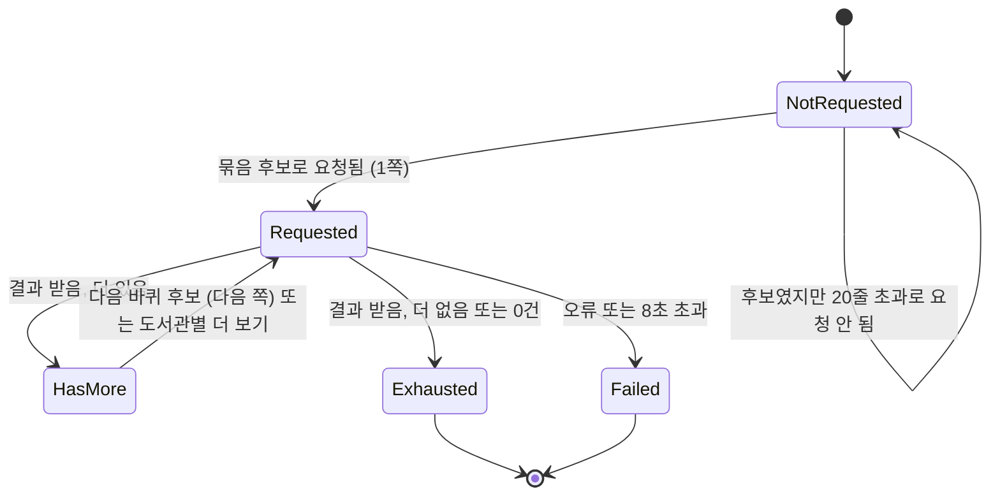
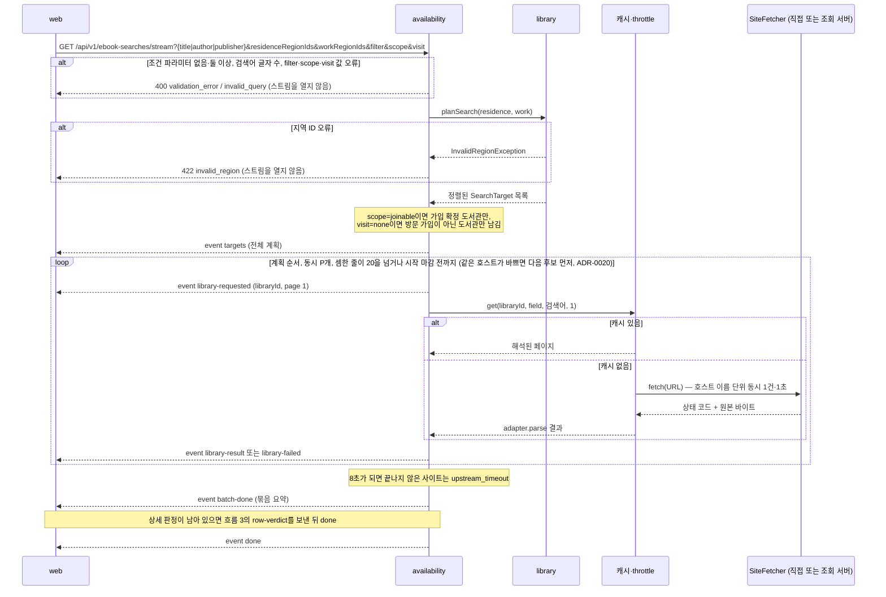
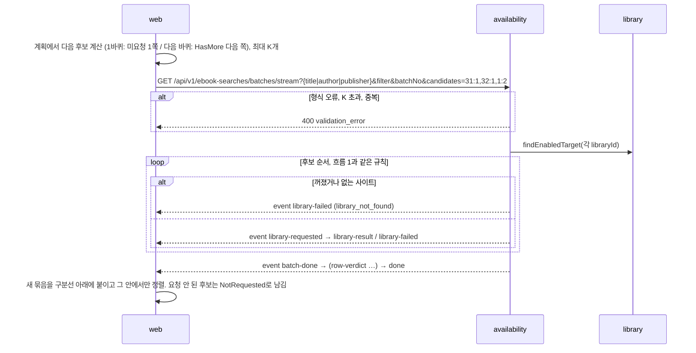
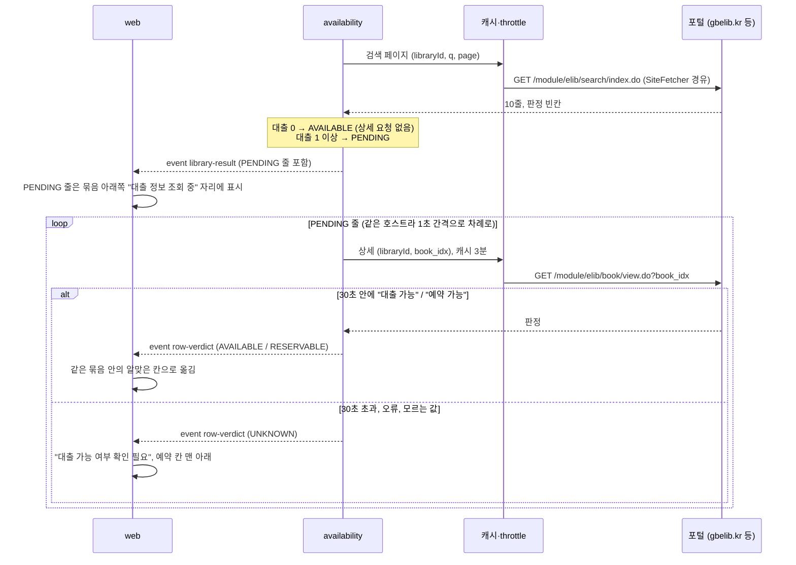
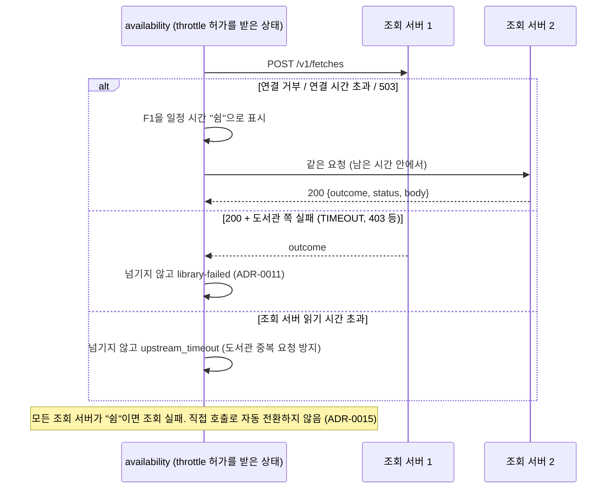
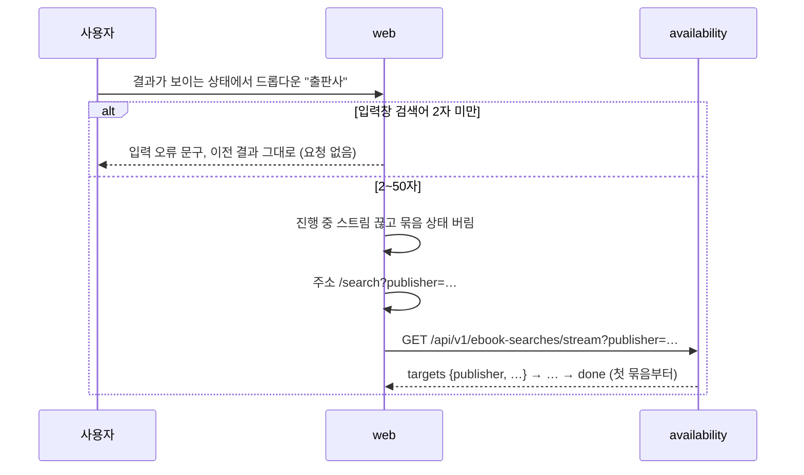

# 주요 흐름 (현재)

현재 설계의 주요 흐름을 그림으로 모은 문서입니다. 변경 기록이 아닙니다.

마지막 반영: 사이클 03 회고 (2026-09-30). 모든 흐름이 **구현됨**입니다(dev 코드·테스트·plan-feedback 실측으로 대조).

- 근거: `docs/cycles/02-library-expansion/design-delta.md` "구조 그림", `retro.md`, ADR-0011, ADR-0014, ADR-0015, ADR-0019, ADR-0020
- 모듈 구성도와 도메인 모델은 `module-map.md`에 있습니다.

## 도서관 하나의 조회 상태 (브라우저)

- 1바퀴: `NotRequested`가 남아 있으면 계획 순서대로 후보로 보냅니다.
- 다음 바퀴: `HasMore`인 사이트를 계획 순서대로 다음 쪽으로 보냅니다.
- 모두 `Exhausted`나 `Failed`이면 목록 맨 아래 "더 보기"를 없앱니다.
- `Failed`는 같은 검색에서 다시 조회하지 않습니다 [확정] (ADR-0014).
- 필터, 조회 범위(`scope`), "방문 없이 가입"(`visit`), 지역, 검색 조건(제목/저자/출판사)이 바뀌면 상태를 버리고 첫 묶음부터 다시 검색합니다 [확정].
- 조회 서버가 모두 멈춘 동안에는 후보가 곧바로 실패해 한 묶음이 계획 대부분을 `Failed`로 만듭니다. 그 검색에서는 다시 묻지 않습니다(알려진 한계, 다음 사이클 후보).

## 흐름 1: 첫 묶음 검색

## 흐름 2: 목록 맨 아래 "더 보기"

- 도서관별 "더 보기"는 `GET /api/v1/availability/libraries/{libraryId}/ebooks?{title|author|publisher}&page`(사이클 01 경로, 사이클 03에서 조건 파라미터로 바뀜)를 부르고, 결과를 목록 맨 아래 새 묶음으로 붙입니다. 이 API는 JSON 한 번에 응답하므로, 상세 판정이 필요한 줄은 판정을 읽은 뒤(최대 30초) 함께 돌려줍니다 [안].

## 흐름 3: 경북·전북 포털 상세 판정

- 30초는 **묶음을 시작한 시각부터**입니다 [안]. 묶음의 8초 마감은 검색 페이지 요청에만 적용합니다.
- 30초 동안 한 호스트에서 읽을 수 있는 상세는 대략 25건입니다 (1초 간격). 실측(dev, 2026-09-29, `사랑` 첫·둘째 묶음): 경북·전북 대출 중 줄은 각 1~2건이었고 모두 30초 안에 끝났습니다.
- 인천 포털은 상세 페이지가 로그인을 요구해, 대출 1 이상 줄은 모두 `UNKNOWN`("대출 가능 여부 확인 필요")입니다.

## 흐름 4: 조회 서버 경유 모드에서 서버 넘기기

## 흐름 5: 검색 조건 바꾸기

- 검색 전(첫 화면)에서 드롭다운을 바꾸면 안내 문구만 바뀌고 검색하지 않습니다. 드롭다운 기본값은 항상 제목입니다.
- 포털의 저자·출판사 검색은 1쪽부터 `table.do` + 거르기로 부릅니다(ADR-0026). `table.do`에서 목록 판정 칸이 비는 포털은 흐름 3(상세 판정)으로 이어집니다. 실측(dev, 2026-09-29): 부산·대구·경기교육청은 상세 0~1건, 수량 칸이 없는 전북은 쪽마다 10건(약 20초, 30초 안).
