# 주요 흐름 (현재)

현재 설계의 주요 흐름을 그림으로 모은 문서입니다. 변경 기록이 아닙니다.

사이클 09 cycle-close (2026-10-11): 흐름 23(도서관 이름과 분류: 이름·분류 changeset, 화면에 분류 보이기, 수집 목록에서 찾은 새 도서관을 넣을 때)을 더하고 "화면 공통"에 분류 표시를 적음 — 구현됨 (사이클 09). 근거 `docs/cycles/09-library-naming/design-delta.md` "주요 흐름", flow.md, ADR-0071·0076.
사이클 09 회고 (2026-10-12): dev 보고(`plan-feedback.md` "# 사이클 09", AC-1~9 통과)와 대조해 흐름 23과 화면 공통의 사이클 09 부분을 구현됨으로 바꿈(그림 모양은 그대로). Modulith `components.puml`(2026-10-12) 대조 결과 모듈 관계 그대로. 달라진 점: `library/014-library-classification.yaml` [확정] changeSet 하나, 이름 UPDATE만 `splitStatements: false`, 대출 방식은 규칙 + 번호, 같은 이름 여러 줄의 업체 순서는 한글 가나다순(교보 → 북큐브 → 알라딘 → 자체 → 통합 포털 → YES24). 근거 `docs/cycles/09-library-naming/retro.md`.
사이클 10 cycle-close (2026-10-12): 흐름 24(인기 도서 매달 받기, 실패 포함)와 받기 상태, 흐름 25(인기 도서 화면 S13 열기), 흐름 26(가운데 창 S14 열기, `holdingLimit=3`)을 더하고 "화면 공통"에 사이클 10을 적음 — 구현됨 (사이클 10). 근거 `docs/cycles/10-popular-books/design-delta.md` "구조 그림", flow.md, ADR-0072~0075·0077, ADR-0080·ADR-0081.
사이클 10 회고 (2026-10-12): 구현 대조, 분류 14개·표지 200px JPEG·User-Agent·문구 반영 (`docs/cycles/10-popular-books/retro.md`). 흐름 24 그림을 구현에 맞춤(세션 GET 한 번, 표지 줄이기, 캐시 알림 두 번).
사이클 11 cycle-close (2026-10-12): 가져오기 따로 하기(export·apply·finish·discard, load_manifest, db-ops) + 묶는 방식 compact(기본)·objects(옛 이름 current)·sql — 구현됨 (사이클 11, 회고 2026-10-14). 흐름 27(내보내기), 28(반영, 다름·실패 포함), 29(마저 바꿔 끼우기·지우기)와 "내 PC의 `catalog_next` 상태"를 더함. 흐름 20(`in-place`)은 그대로. 근거 `docs/cycles/11-separate-import/design-delta.md` "구조 그림", spec.md, ADR-0078·0079.
사이클 12 (2026-10-12, 사이클 11 dev 진행 중에 미리 한 plan): 책 묶기 네 번째 단계 규칙 — 구현됨 (사이클 12, 회고 2026-10-14). 근거 `docs/cycles/12-grouping-rules/design-delta.md`, ADR-0082, ADR-0106.
사이클 11 최종·사이클 12 회고 (2026-10-14): 흐름 27~29·30·31을 구현됨으로, 흐름 30 그림에 부제 나누기(`SubtitleParts`)를 더함, 흐름 20·27의 힙·이름(`current` → `objects`) 주석. 회고 `docs/cycles/11-separate-import/retro.md` "최종 회고", `docs/cycles/12-grouping-rules/retro.md`.
사이클 14 cycle-close (2026-10-12): 인기 도서 → 사서추천도서 — 흐름 24를 "사서추천도서 받기 (주 1회, 실패 포함)"와 "받기 판단 상태"로, 흐름 25를 "사서추천도서 화면 열기와 공용 캐시 (S13)"로 바꾸고(사이클 10 인기 도서 매달 받기·화면 열기는 지움), 흐름 26(S14)·"화면 공통"에 바뀌는 점을 적음 — 설계됨(미구현, 사이클 14). 근거 `docs/cycles/14-librarian-picks/design-delta.md` "구조 그림", flow.md, ADR-0089·0090·0091.
사이클 14 회고 (2026-10-14): 흐름 24~26·"화면 공통" 구현됨, 요청 3년·남기는 범위 12개 달, 받기 판단 세부(오늘 성공이면 쉼, 시작 때는 목록 없음·7일만), 진짜 받기 시험 값 반영 (`docs/cycles/14-librarian-picks/retro.md`).
사이클 13 회고 반영 (2026-10-14): 흐름 32·33과 S12 한 줄 — 구현됨 (사이클 13, 회고 2026-10-14). 흐름 32에 `nextId` 다시 확인·종료 5, 흐름 33에 "같은 번호가 다른 도서관이면 멈춤"을 더함(ADR-0107). 첫 실행(여주대 빈 곳 채우기)은 뺌(AC-1). 근거 `docs/cycles/13-crawler-to-dev/retro.md`.
사이클 15 cycle-close (2026-10-14, 12·13·14 회고 뒤): 사용자 행동 기록 — 흐름 34(수집 목록 검색 기록), 35(직접 찾기 첫 묶음과 "더 보기" 기록), 36(사용 알림), 37(기록 쓰기와 지우기)을 더함 — 구현됨 (사이클 15, 회고 2026-10-15). 근거 `docs/cycles/15-usage-log/design-delta.md` "주요 흐름", ADR-0096·0097·0102.
사이클 16 cycle-close (2026-10-14, 12·13·14·15 회고·인계 뒤): 공지사항과 안내·약관 페이지를 DB로 — 흐름 38(공지 목록·공지 글), 39(서비스 안내·이용약관·처리방침 글), 40(가입 화면의 약관·동의문, 글을 못 불러올 때), 41(운영자가 새 판을 넣을 때)을 더하고 흐름 9에 문서 버전의 원본을 적음 — 구현됨 (사이클 16, 회고 2026-10-15). 근거 `docs/cycles/16-notices-and-policies/design-delta.md` "주요 흐름", ADR-0098~0101.
사이클 15·16·18 회고 (2026-10-15): 구현됨으로 바꾸고 실제 이름·값을 맞춤. 15 `usagelog`·16 `sitecontent` 구현됨, 18은 A1·A2·B 구현됨(dev main `a0e438a`), C(운영 반영)는 사이클 17 첫 배포 뒤. 근거 `docs/cycles/15-usage-log/retro.md`, `docs/cycles/16-notices-and-policies/retro.md`, `docs/cycles/18-empty-library-holdings/retro.md`, dev `plan-feedback.md` "# 사이클 15"·"# 사이클 16"·"# 사이클 18".
사이클 19 cycle-close (2026-10-15): 저자·제목 표기 정리 — 설계됨(미구현, 사이클 19). ADR-0113~0117. 흐름 44(다시 가져오기 → 비교 → 반영 → 다시 켜기), 45(캐시 답 세기)를 더하고, 흐름 20·27에 `rules-dir` 읽기와 멈춤 줄을 더함. 근거 `docs/cycles/19-author-angle-brackets/design-delta.md` "구조 그림".
사이클 21 cycle-close (2026-10-16): 추천도서 세 목록 — 설계됨(미구현, 사이클 21). ADR-0122~0129. 흐름 46(이동진·서울대: 수집기 → export → apply → 화면), 47(사서 추천도서 주 1회 받기, 담는 표와 고르기 규칙만 바뀜), 48(목록 화면 요청)을 더하고, 흐름 24·25·27·28·33에 바뀐 그림을 가리키는 줄을 더함. 근거 `docs/cycles/21-recommended-books/design-delta.md` "구조 그림".

사이클 13 cycle-close (2026-10-12, 사이클 12와 나란히 미리 한 plan, 사이클 12 뒤에 개발): 새 도서관 넣기 — 흐름 32(넣기 미리 보기 → 넣기, 내 PC)와 흐름 33(운영 반영 판 2: 도서관 → 비교 → 책)을 더하고, "화면 공통"에 S12 `/about` 가입 조사 기준일 한 줄을 적음. 흐름 16·23-3의 seed로 넣기는 사이클 07~09 방식으로 남김 — 구현됨 (사이클 13, 회고 2026-10-14). 근거 `docs/cycles/13-crawler-to-dev/design-delta.md` "구조 그림", flow.md, ADR-0083~0088·0093.
사이클 08 cycle-close (2026-10-11): 흐름 20(가져오기: 새 표에 쓰고 바꿔 끼우기), 21(검색 계획과 책 화면 소장 읽기), 22(막혔을 때 429·503)를 더하고, 흐름 6·16과 "화면 공통"에 바뀌는 점을 적음 — 구현됨 (사이클 08). 근거 `docs/cycles/08-polish-swap-memory/design-delta.md` "주요 흐름"(흐름 A~C), ADR-0065~0070.
사이클 08 회고 (2026-10-11): dev 보고(`plan-feedback.md` "# 사이클 08")와 대조해 흐름 20~22와 화면 공통을 구현됨으로 바꾸고 달라진 점(넓은 줄 두 번 쓰기, 실패 기록 칸, S2 그대로·돌아가기는 S8·S9·S10만, "정렬 없음 ⓘ"은 검색 줄, 이름 찾기 가운뎃점 무시)과 측정값을 적음. 흐름 21 그림의 "지금은 …" 두 곳을 "사이클 07까지는 …"으로 고침. 가져오기 힙(AC-12)·색인 단계 중단(AC-9 둘째)·국가서지 재사용 시간(AC-15)은 측정 중 [확인 필요]. 근거 `docs/cycles/08-polish-swap-memory/retro.md`.

사이클 07 회고 반영 (2026-10-05): 수집 목록에서 찾은 도서관 2,394곳 넣기 — 흐름 16~19를 더하고 흐름 6(교보 구독형 화면)·흐름 8(가져오기)·흐름 13(S11)에 사이클 07 변경을 적음 — 구현됨 (사이클 07). 근거 docs/cycles/07-candidate-libraries/retro.md, dev plan-feedback.md '# 사이클 07'. 설계 근거 `docs/cycles/07-candidate-libraries/design-delta.md` "주요 흐름"(흐름 A~D), ADR-0052~0060.

사이클 06 회고 반영 (2026-10-05): 내 도서관(`mylibrary`)을 더함 — 구현됨 (사이클 06). 근거 `docs/cycles/06-my-libraries/design-delta.md`, dev 보고 `chaekcheck-dev/docs/plan-feedback.md` "# 사이클 06"~"plan에 넘길 요약". 흐름 13~15.

사이클 05 cycle-close (2026-10-04): 흐름 9~12(로그인·계정)를 더함 — 구현됨(사이클 05, 2026-10-04 retro 반영). 근거 `docs/cycles/05-login-account/design-delta.md`.

사이클 04 반영 (2026-09-30, 상태는 2026-10-05에 고침). 흐름 1~5와 흐름 6~8 모두 **구현됨**입니다(흐름 8 첫 실제 적재 2026-10-03). 사이클 04부터 흐름 1~2는 "도서관에서 직접 찾기"의 흐름입니다.

- 근거: `docs/cycles/02-library-expansion/design-delta.md` "구조 그림", `retro.md`, ADR-0011, ADR-0014, ADR-0015, ADR-0019, ADR-0020
- 모듈 구성도와 도메인 모델은 `module-map.md`에 있습니다.

## 도서관 하나의 조회 상태 (브라우저)

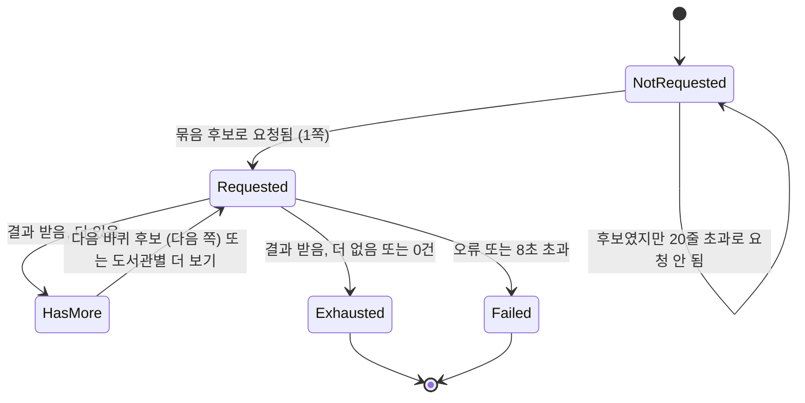

- 1바퀴: `NotRequested`가 남아 있으면 계획 순서대로 후보로 보냅니다.
- 다음 바퀴: `HasMore`인 사이트를 계획 순서대로 다음 쪽으로 보냅니다.
- 모두 `Exhausted`나 `Failed`이면 목록 맨 아래 "더 보기"를 없앱니다.
- `Failed`는 같은 검색에서 다시 조회하지 않습니다 [확정] (ADR-0014).
- 필터, 조회 범위(`scope`), "방문 없이 가입"(`visit`), 지역, 검색 조건(제목/저자/출판사)이 바뀌면 상태를 버리고 첫 묶음부터 다시 검색합니다 [확정].
- 조회 서버가 모두 멈춘 동안에는 후보가 곧바로 실패해 한 묶음이 계획 대부분을 `Failed`로 만듭니다. 그 검색에서는 다시 묻지 않습니다(알려진 한계, 다음 사이클 후보).

## 흐름 1: 첫 묶음 검색

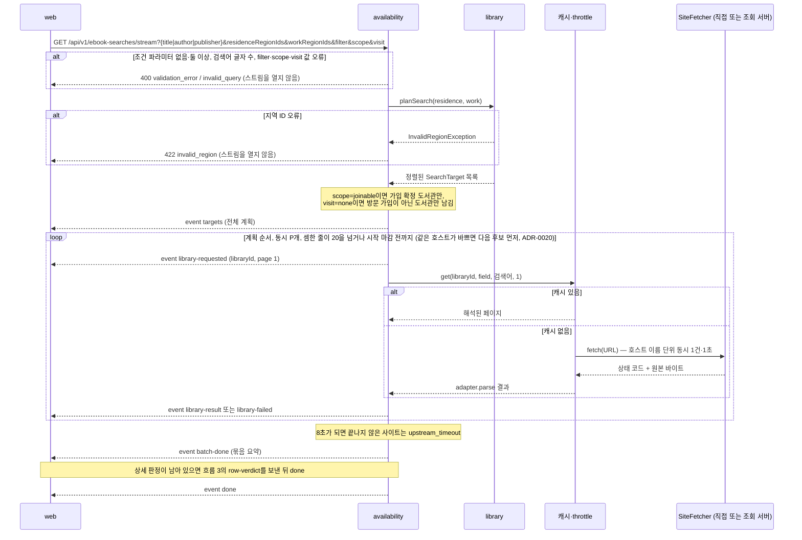

## 흐름 2: 목록 맨 아래 "더 보기"

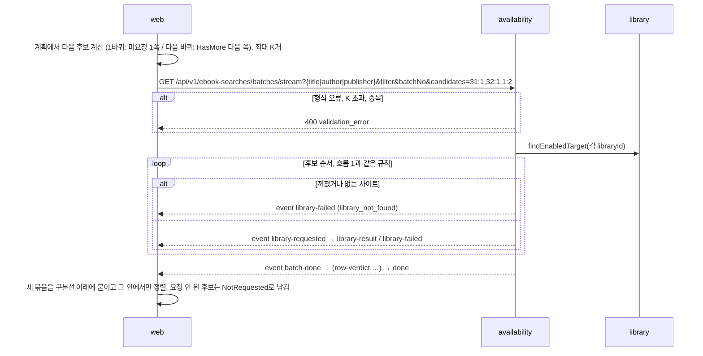

- 도서관별 "더 보기"는 `GET /api/v1/availability/libraries/{libraryId}/ebooks?{title|author|publisher}&page`(사이클 01 경로, 사이클 03에서 조건 파라미터로 바뀜)를 부르고, 결과를 목록 맨 아래 새 묶음으로 붙입니다. 이 API는 JSON 한 번에 응답하므로, 상세 판정이 필요한 줄은 판정을 읽은 뒤(최대 30초) 함께 돌려줍니다 [안].

## 흐름 3: 경북·전북 포털 상세 판정

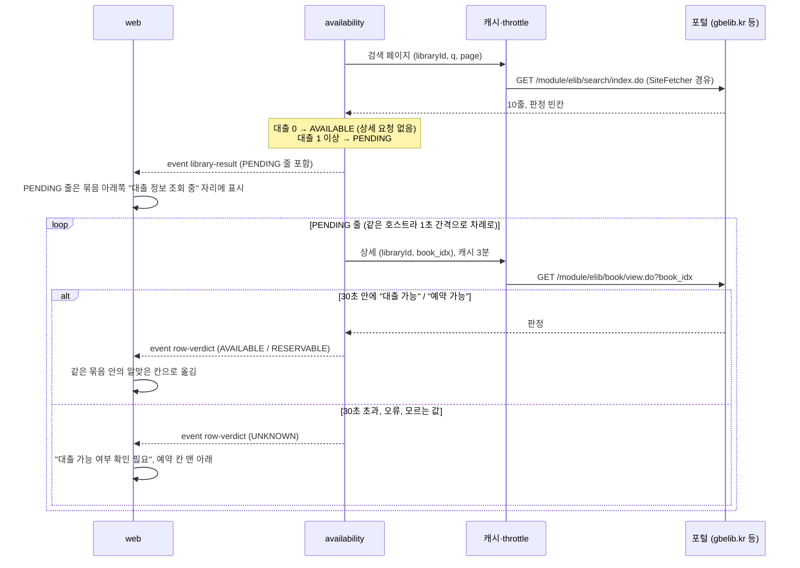

- 30초는 **묶음을 시작한 시각부터**입니다 [안]. 묶음의 8초 마감은 검색 페이지 요청에만 적용합니다.
- 30초 동안 한 호스트에서 읽을 수 있는 상세는 대략 25건입니다 (1초 간격). 실측(dev, 2026-09-29, `사랑` 첫·둘째 묶음): 경북·전북 대출 중 줄은 각 1~2건이었고 모두 30초 안에 끝났습니다.
- 인천 포털은 상세 페이지가 로그인을 요구해, 대출 1 이상 줄은 모두 `UNKNOWN`("대출 가능 여부 확인 필요")입니다.

## 흐름 4: 조회 서버 경유 모드에서 서버 넘기기

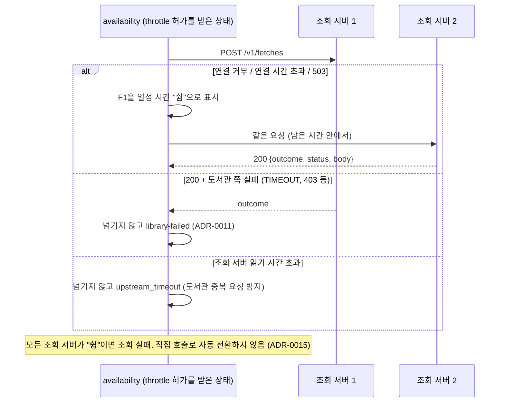

## 흐름 5: 검색 조건 바꾸기

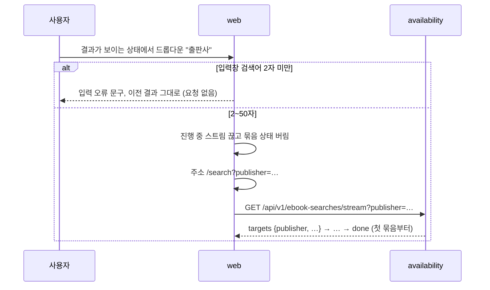

- 검색 전(첫 화면)에서 드롭다운을 바꾸면 안내 문구만 바뀌고 검색하지 않습니다. 드롭다운 기본값은 항상 제목입니다.
- 포털의 저자·출판사 검색은 1쪽부터 `table.do` + 거르기로 부릅니다(ADR-0026). `table.do`에서 목록 판정 칸이 비는 포털은 흐름 3(상세 판정)으로 이어집니다. 실측(dev, 2026-09-29): 부산·대구·경기교육청은 상세 0~1건, 수량 칸이 없는 전북은 쪽마다 10건(약 20초, 30초 안).

## 흐름 6: 책 목록 검색과 바로 보기 — 구현됨(dev `BookSearchController`·`BookAvailabilityStreamController`, 사이클 04)

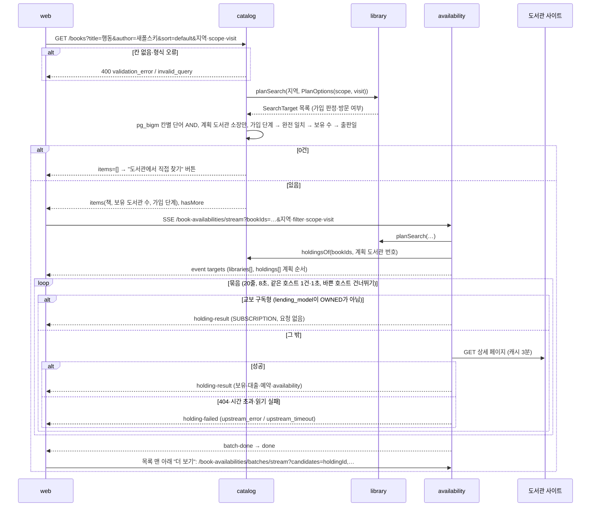

- 사이클 07 (구현됨 (사이클 07), ADR-0056·0055): 책 화면(소장 스트림)의 "교보 구독형 → 요청 없이 `SUBSCRIPTION`"은 `lending_model = OWNED`가 아닐 때만이고, `OWNED`면 상세 쪽을 읽어 숫자를 보입니다. "도서관에서 직접 찾기" 목록은 `lending_model`과 상관없이 줄마다 숫자가 있으면 숫자, 없으면 구독으로 판정합니다(혼합형은 줄마다 다름, dev 사이트 시험 2026-10-05). 북큐브는 상세 XML(`detailFetchUri`)을 읽고 대여형이면 `SUBSCRIPTION`, 알라딘은 상세 HTML "보유현황"을 읽습니다. `catalog`의 "계획 도서관 소장만"은 `book.library_ids && 계획 번호`로 거릅니다(흐름 17). 계획 도서관이 50곳 [안]을 넘으면 GIN 인덱스 없이 거릅니다 [이유 미확인: dev가 정함]
- 사이클 07: 묶음 스트림과 도서관별 더 보기는 동시 검색이 20 [안]을 넘으면 스트림을 열지 않고 503 `server_busy`, nginx IP별 한도를 넘으면 429 `too_many_requests`(`api.md` "요청 수·응답 크기 제한"). 사이클 08: 503에 `Retry-After: 5`, 화면은 두 경우를 따로 안내(흐름 22) — 구현됨 (사이클 08)
- 사이클 08 (구현됨 (사이클 08), ADR-0066·0070): 소장 스트림은 `planSearch`로 계획을 먼저 만든 뒤 `holdingsOf(bookIds, 계획 도서관 번호)`로 계획에 든 도서관 소장 줄만 읽음(흐름 21). 위 그림도 이 순서로 고침(사이클 08 회고, 2026-10-11; 사이클 07까지는 `holdingsOf(bookIds)` → `planSearch`, 옛 `holdingsOf(bookIds)`는 지움). 소장 번호가 지금 목록에 없으면 `holding-failed` `holding_not_found`(꺼진·없는 도서관 `library_not_found`와 나눔)
- 도서관 하나의 조회 상태 그림(맨 위)은 사이클 04에서 도서관 대신 소장(`holdingId`) 단위로 같게 적용합니다. 상세 페이지 조회라 "다음 쪽" 상태는 없습니다.

## 흐름 7: 책 먼저 고르기 → 책 화면 — 구현됨(dev, 사이클 04)

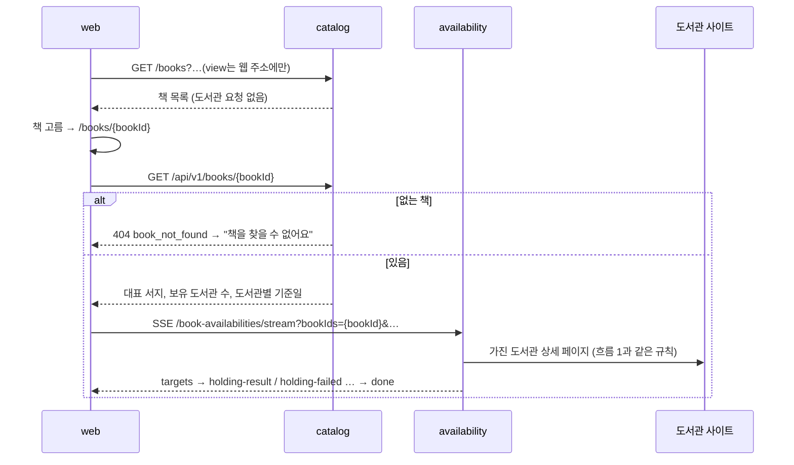

## 흐름 8: 수집 목록 한 번 가져오기 — 구현됨(dev `c6028c9`), 첫 실제 적재 2026-10-03 18:05 (책 680,689권, 소장 4,954,360줄. dev `plan-feedback.md` "실제 가져오기 결과"). 사이클 07부터는 `collection`이 맡음(흐름 16, 구현됨 (사이클 07))

**사이클 07부터 가져오기는 `collection` 모듈이 맡습니다** (구현됨 (사이클 07), ADR-0060이 ADR-0031의 "가져오기는 `catalog` 안"을 바꿈). 아래 그림은 사이클 04~06 모양(지금 코드에는 없음)이고, 사이클 07 모양(짝 표, 모든 서비스 도서관, 두 번 읽기, `library_ids`, `CatalogLoad.replaceAll`, 책 번호 잇기, 기록은 `collection.catalog_import`)은 흐름 16입니다. 그림의 "서비스 library와 id·base_url 같은 곳만" 대조는 짝 표 대조로 바뀌고, 주소 비교는 호스트·경로·쿼리만 보는 안전장치로 남습니다(ADR-0052·0054, 인계서 C10 변경). 프로필 `catalog-import`·설정 `chaekcheck.catalog.import.*`은 `collection-import`·`chaekcheck.collection.import.*`로 바뀜.

개발 중 더한 것: 묶기 4(정리한 전체 제목 + 대표 저자 + 정리한 출판사, 사용자 결정 2026-09-30)와 dry run 옵션(`--chaekcheck.catalog.import.dry-run=true`: 읽고 묶기만, DB에 쓰지 않음). 규칙은 `docs/research/ebook-catalog/same-book-isbn.md` 5절.

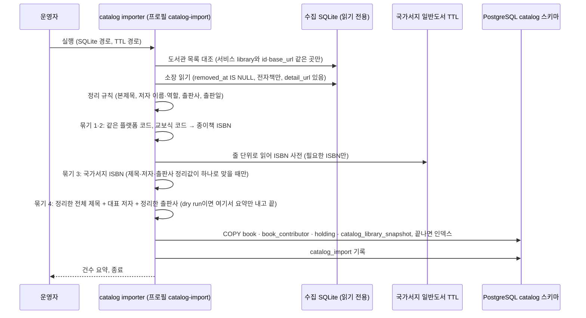

## 흐름 9: 첫 로그인과 동의, 다시 로그인 — 구현됨(사이클 05, 2026-10-04 retro 반영)

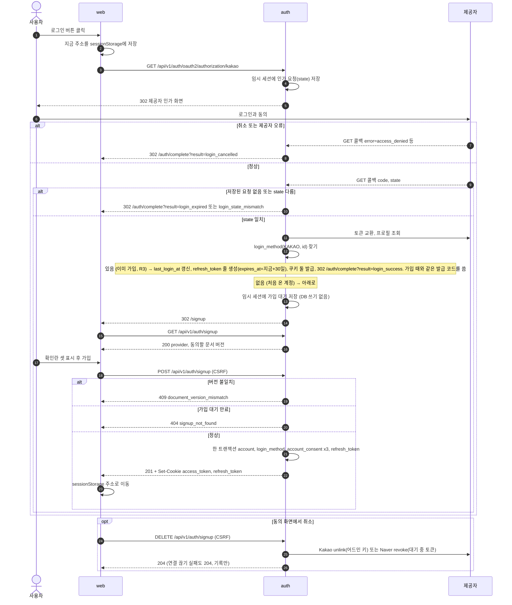

- 사이클 16 — 구현됨 (사이클 16, 회고 2026-10-15) (ADR-0099): "동의할 문서 버전"은 서버 설정이 아니라 `sitecontent`의 지금 판 순번이고, S6은 그 판의 약관·동의문 글을 `sitecontent`에서 읽음. 자세한 것은 흐름 40

## 흐름 10: 토큰 갱신과 교체 — 구현됨(사이클 05, 2026-10-04 retro 반영)

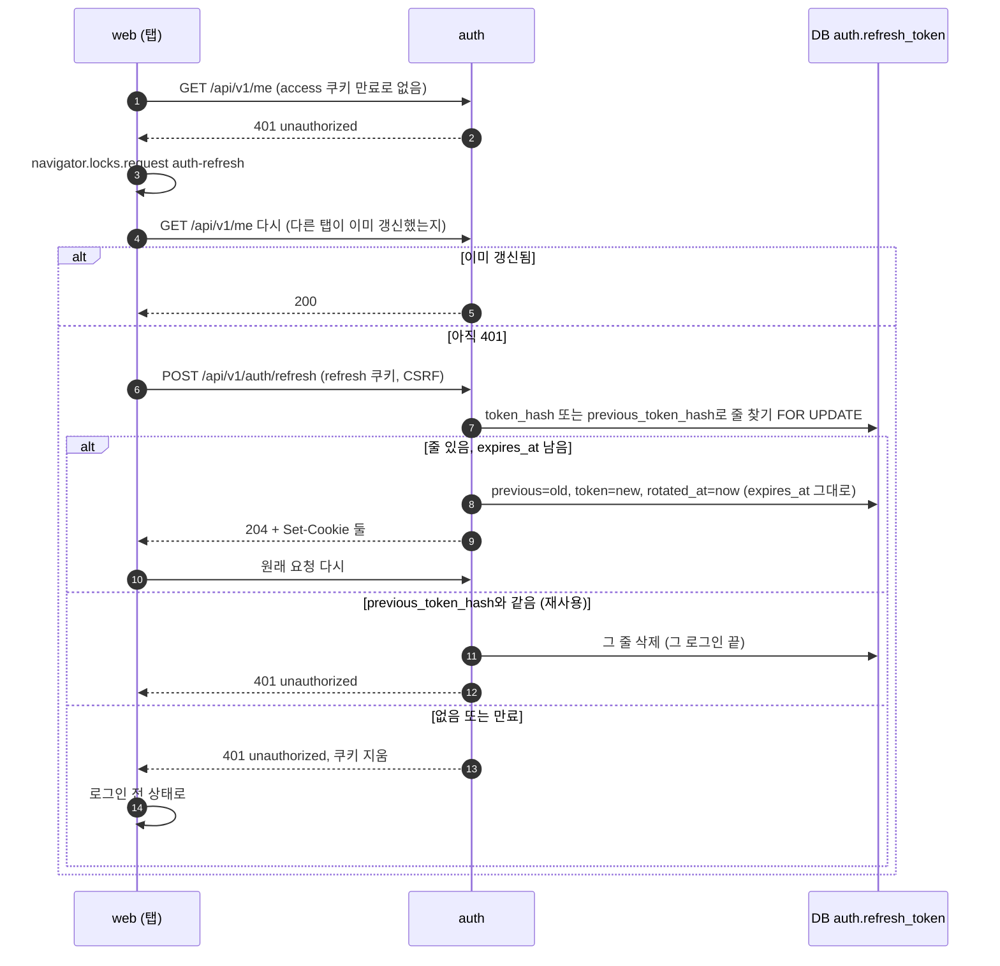

- 여러 탭이 동시에 갱신하지 않게 웹이 Web Locks로 한 번에 한 탭만 갱신합니다(ADR-0038).

## 흐름 11: 탈퇴 (재인증) — 구현됨(사이클 05, 2026-10-04 retro 반영)

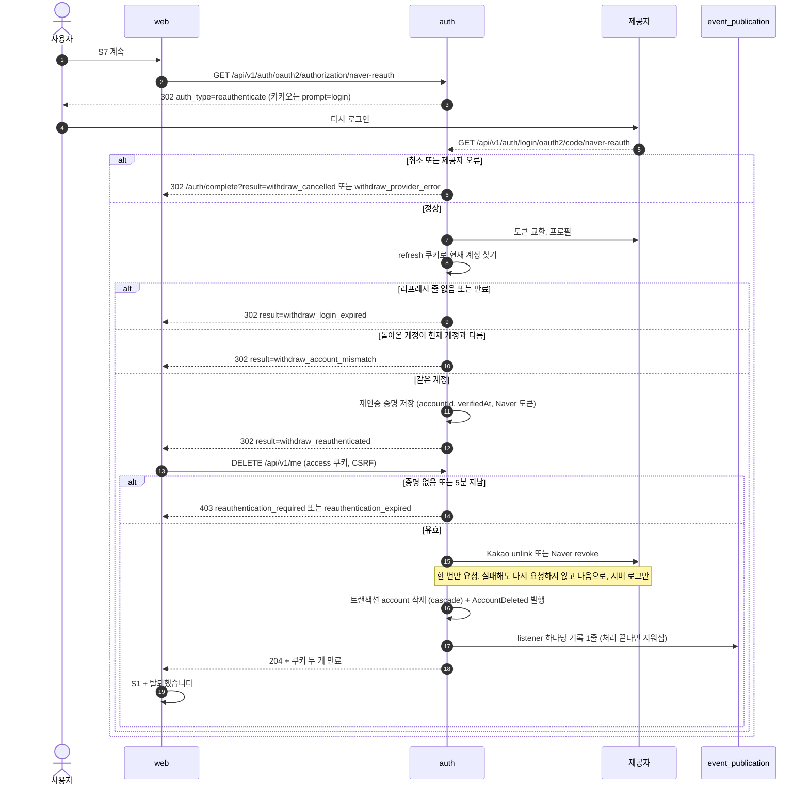

## 흐름 12: 제공자 쪽에서 연결을 끊음 — 구현됨(사이클 05, 2026-10-04 retro 반영)

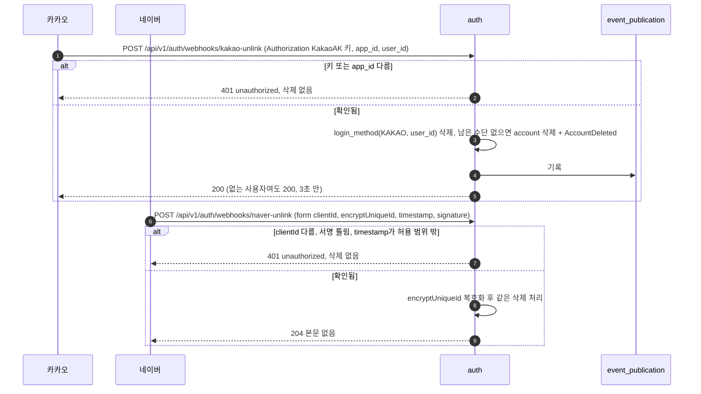

- 놓친 알림은 카카오 연결 대조(하루 한 번)와 1년 미로그인 계정 정리로 메웁니다.

## 흐름 13: 로그인 직후 내 도서관 읽기와 지역 옮기기(S11) — 구현됨 (사이클 06)

로그인 직후 웹이 저장된 지역·직접 추가 도서관을 읽고, 서버 지역이 비어 있으면 브라우저 지역을 계정에 옮길지 물은 뒤 검색 주소를 만듭니다(ADR-0049).

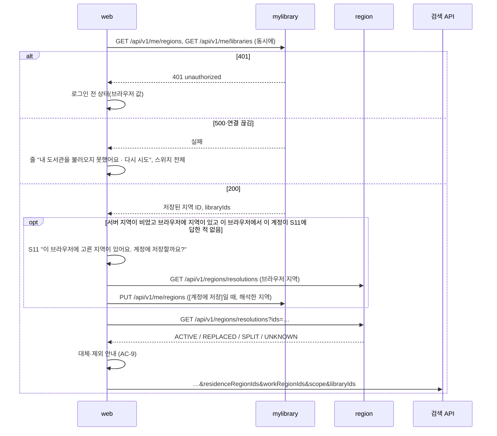

- 로그인 확인(`GET /api/v1/me`)이 끝나기 전에는 웹이 브라우저 지역(`chaekcheck.regions.v1`)을 읽지 않고 검색도 기다립니다(지역 출처 `source=waiting`). 로그인한 사람의 브라우저 값을 읽지 않기 위해서입니다. 그래서 로그인 전 사용자의 첫 검색이 `/me` 응답 한 번만큼 늦어집니다(요청 내용은 사이클 05와 같음, AC-14). 확인 뒤 출처는 로그인 전·로그인 꺼짐이면 `browser`, 로그인 후면 `account`(내 도서관을 다 불러오기 전에는 지역 없이 "전체"로 검색을 막지 않고, 다 불러오면 그 값으로 첫 묶음부터 한 번 다시 검색) [확정] (dev 구현 확인, 2026-10-05)
- S11은 예외로, 로그인한 상태에서 브라우저 지역을 한 번 읽습니다(옮기기 제안 때문). 브라우저 값은 지우거나 고치지 않습니다.
- 사이클 07 (구현됨 (사이클 07), ADR-0057): S11은 지역뿐 아니라 로그인 전에 직접 넣은 도서관도 함께 옮깁니다. 열리는 조건과 요청은 흐름 19
- 사이클 07부터 로그인 전 첫 검색 요청에 `scope=joinable`이 붙어(검색 범위 기본값이 가입할 수 있는 쪽) 위 "요청 내용은 사이클 05와 같음, AC-14"는 더 맞지 않습니다 [확정] (사용자: "이 프로젝트의 편의성을 생각했을 때 가입할 수 있는 곳으로 가는 것이 사용자 측면에서 좋다고 봐서", 2026-10-05)
- S11 답(계정 번호)은 브라우저 `chaekcheck.regionImport.v1` [확정] (dev 구현 확인, 2026-10-05)에 적어 같은 브라우저·같은 계정에는 다시 묻지 않습니다. 로그인한 동안 `chaekcheck.regions.v1`은 읽지도 쓰지도 않습니다 [확정].

## 흐름 14: 내 도서관 직접 추가(S10) — 구현됨 (사이클 06)

누르면 화면에 먼저 추가해 보이고 바로 저장하며, 실패하면 되돌립니다. 서버 순서는 잠금 → 켜진 도서관 확인 → 이미 있으면 204 → 20곳이면 409 → INSERT입니다.

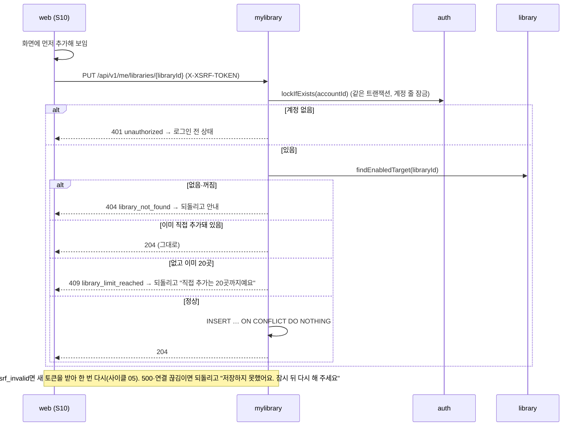

- 빼기(`DELETE /api/v1/me/libraries/{libraryId}`)도 처음에 계정 줄을 잠그고, 계정이 없으면 401입니다(dev가 ADR-0051 "모든 저장의 처음"을 따름). 숫자가 아닌 경로(`abc`, `0`, `-1`)는 PUT·DELETE 모두 404 `library_not_found` [확정] (dev 구현 확인, 2026-10-05).
- S10 화면은 구역 셋입니다(2026-10-05 바뀜. 사이클 06 flow S10 "여섯 구역"을 사용자 요청으로 바꿈) [확정] (사용자 요청, 2026-10-05): 맨 위 "누구나 가입하는 도서관 N곳" 줄, ① 지역 선택([변경] 하나. 안에 차례로 "거주 X" / "거주 지역으로 자동 N곳 ▸" / "직장 Y" / "직장 지역으로 자동 N곳 ▸", 누르면 이름 목록이 펼쳐짐) ② 직접 도서관 추가 ③ 직접 추가한 도서관 N/20. [변경]은 S2를 "거주" 탭으로 엽니다(직장은 S2 안의 탭).

## 흐름 15: 저장과 탈퇴가 겹칠 때 — 구현됨 (사이클 06)

저장이 계정 줄을 먼저 잠그면 탈퇴가 기다렸다가 지우고, 커밋 뒤 `AccountDeleted`를 받은 `mylibrary` listener가 두 표를 지워 지워진 계정의 자료가 남지 않습니다(ADR-0051).

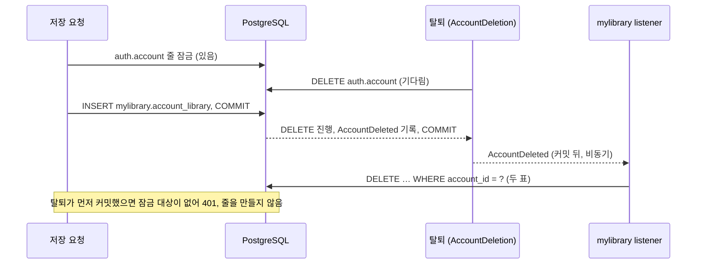

- listener가 실패한 기록은 재시작 때 다시 처리합니다(`republish-outstanding-events-on-restart: true` [확정]). 실패(`FAILED`) 기록도 다시 처리합니다 — 확인함 (dev, 2026-10-04): 공식 문서는 상태별 동작을 적지 않아 Spring Modulith 2.1.1 jar를 확인함. `JdbcEventPublicationRepositoryV2`가 `COMPLETION_DATE IS NULL OR STATUS != 'COMPLETED'`인 기록을 다시 처리하고, 시험 `mylibrary/AccountDeletedRepublishTests`(실제 잠금 시간 초과로 `FAILED`를 만든 뒤 재시작 → 두 표·발행 기록 0)로 확인.
- 알고 받아들인 것(dev 리뷰): 로그인 기능을 끈 동안 남은 `AccountDeleted` 기록은 listener도 꺼져 있어 처리되지 않고, 다시 켜고 재시작하면 처리됩니다.

## 흐름 16: 사이클 07 도서관 2,394곳 넣기와 가져오기 (배포 전 한 번) — 구현됨 (사이클 07)

사이클 07에서 넣은 도서관 2,394곳(서비스 번호 281~2674)의 줄과 짝 줄은 Liquibase seed로 넣고, 가져오기는 `collection`이 짝 표로 모든 서비스 도서관의 책을 사본에서 두 번 읽어 `catalog`의 `CatalogLoad.replaceAll(source, loader)` 콜백 세션으로 표를 통째로 바꿉니다(ADR-0052, 0054, 0055, 0060). 흐름 8(사이클 04 importer)을 대신합니다. 사이클 13부터 새 도서관은 seed가 아니라 `collection` 넣기 명령으로 넣습니다(흐름 32, ADR-0084) — 구현됨 (사이클 13, 회고 2026-10-14).

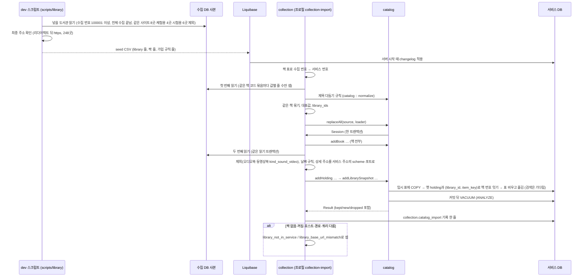

- 짝 맞춘 서비스 도서관이 켜졌는지와 사이트 주소는 `LibraryCatalog.enabledLibraryRefs()`로 확인합니다(`library` 표는 읽지 않음). 비교는 호스트·경로·쿼리만(http/https·포트 차이 허용, `CollectedCatalog.sameSite`) [확정] (dev 구현 확인, 2026-10-05; 인계서 C10을 바꿈, 사용자 요청 2026-10-05)
- `collection`이 만든 책·사람·소장을 `catalog`에 넘기는 모양: `CatalogLoad.replaceAll(source, loader)`의 콜백 세션(`addBook` → `addHolding` → `addLibrarySnapshot`, 책을 다 넣은 뒤 소장), 한 트랜잭션, 실패하면 이전 그대로 [확정] (dev 구현 확인, 2026-10-05). `addBook`이 돌려주는 번호는 이번 가져오기 안에서만 쓰고, 저장 번호는 끝에 책 번호 잇기(`docs/research/ebook-catalog/catalog-refresh.md` 5.2절)로 정함 [확정] (사용자: "이것도 같이 구현해 줘", 2026-10-05)
- 실행: 프로필 `collection-import`, 설정 `chaekcheck.collection.import.*`(`sqlite-path`, `ttl-path`, `dry-run`, `placeholder-date-libraries`) [확정] (dev 구현 확인, 2026-10-05). 원본은 배포용 사본 `ebook-catalog-2026-10-05-0745.sqlite` [확정]. 걸린 시간 36분 43초(빈 DB), 2회차 40분 36초(kept 1,617,445, new 0, dropped 0). 절차는 dev `docs/maintenance/3-import.md`
- 알려진 빈틈: 리다이렉트로 호스트까지 바뀐 411(`ebook2.ezville.net` → `gsenc.bookcube.biz`)은 안전장치에 걸려 소장 64,461줄이 빠짐. 사이클 08에 수집 DB 주소를 고치고 다시 수집함(2026-10-11) → 서비스에는 다음 사본·가져오기 때 들어옴 [확인 필요] (다음 가져오기에서 확인)
- 사이클 08 (구현됨 (사이클 08), ADR-0065·0069·0070): 위 그림의 "한 트랜잭션, 임시 표 → 표 비우고 옮김(검색은 기다림)"과 커밋 뒤 `VACUUM`은 사이클 07 코드 모양입니다. 사이클 08부터 `replaceAll`은 새 표(`catalog_next`)에 쓰고 바꿔 끼우며, 국가서지는 남긴 원문을 다시 쓰고, 같은 소장은 옛 소장 번호를 잇습니다(흐름 20). 교보 대여·혼합 11곳(2664~2674)은 seed와 짝 표에서 빠짐(ADR-0067)

## 흐름 17: 로그인 전 직접 추가한 도서관(사이클 07에서 넣은 곳)으로 검색 — 구현됨 (사이클 07)

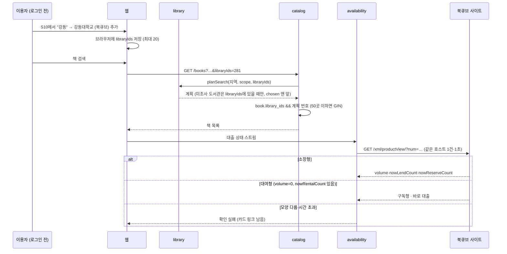

- 로그인 전(로그인 기능이 꺼져 있어도) S10(`/my-libraries`)도 열리고, 직접 추가는 브라우저 키 `chaekcheck.chosenLibraries.v1` [확정] (dev 구현 확인, 2026-10-05)에 저장합니다 [확정] (ADR-0057). 이름 찾기에서 이미 추가한 곳은 "직접 추가함"(흐리게, 누를 수 없음), 없으면 "찾는 도서관이 없어요". S10 도서관 찾기는 `GET /api/v1/libraries`를 통째로 받아 화면에서 거릅니다(두 글자 이상, 앞 글자 맞는 것 먼저·가나다순, 20곳씩) [확정] (ADR-0058)
- 사이클 07에서 넣은 도서관 이름을 누르면 열리는 가입 정보 창 맨 위에 가입 조사 상태별 안내가 있습니다 [확정] (ADR-0053). `joinSurvey`가 `SURVEYED`가 아니면 안내 문구 + (가입 방법·주의가 있으면 그것) + [도서관 첫 화면] 링크(`homepageUrl`)
- 북큐브 사이트 그림의 "/xml/productView/?num=" 주소는 서비스 도서관 주소(https 최종 주소)의 scheme·포트로 옮겨 쓴 상세 주소에서 만듭니다(강동대학교 북큐브가 검색되지 않던 원인, 사이클 07 고침)
- S10의 긴 목록(이름 찾기 결과·누구나 가입·지역 도서관)은 10곳씩 "더 보기" (세 목록, 직접 추가한 도서관은 그대로; 사용자 요청 2026-10-14, ADR-0058 덧붙임 [확정] (사용자 승인, 2026-10-15, 회고 결정 #5)). 사이클 07에서는 20곳씩. dev `MyLibrariesPage.tsx` `PAGE = 10` (사이클 15 회고 2026-10-15)

## 흐름 18: 직접 추가하지 않은 이용자 — 구현됨 (사이클 07)

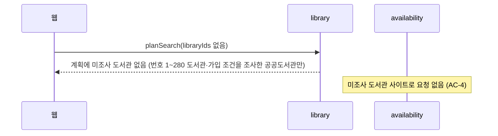

- 가입 조사 상태가 `MEMBERS_ONLY`·`NOT_SURVEYED`이고 직접 추가가 아니면 계획에서 뺍니다("전체 도서관"이어도) [확정] (ADR-0053). dev 확인값: 직접 추가 없이 `scope=all` 계획 385곳(`SURVEYED` 368 + `NOT_FOUND` 17, 278 + 사이클 07에서 넣은 곳 중 가입 조건을 조사한 107), 구성원용·종류 모름 0곳, 그 사이트 요청 0건(AC-4). 3곳을 끈 뒤의 수는 다시 세지 않음
- AC-15 문장 (회고에서 바꿈) [확정] (사용자 제안, 2026-10-05: "이렇게 해줘"): "로그인하지 않고 직접 추가한 도서관도 없는 사람의 검색은 가입 조사를 한 공공도서관(지금 385곳)만 찾는다. 학교·대학·회사·기관처럼 구성원만 쓰는 도서관과 종류를 모르는 도서관은 찾지 않고, 그 사이트에 요청도 보내지 않는다." 처음 문장("이 사이클 전과 같다")은 ADR-0053과 함께 지킬 수 없었음
- 사이클 07 전부터 있던 도서관(278곳)만 쓰는 이용자: 검색 대상(278·114·31곳, 순서 같음)과 소장 (도서관, 책 코드) 집합은 같고(새로 뺀 교보 "동영상" 391줄만 차이), 책 목록은 사이클 07에 넣은 도서관의 책이 같은 책 묶기에 함께 들어가 묶음이 합쳐져 57개 응답 중 38개가 다름(권수 0~2.5% 감소, 대표 제목·순서 바뀜) — 받아들임 [확정] (사용자 승인, 2026-10-05, 회고 질문 #5. Q1 "책 순서는 같음"을 바꿈)

## 흐름 19: 로그인 직후 옮기기 (S11) — 구현됨 (사이클 07)

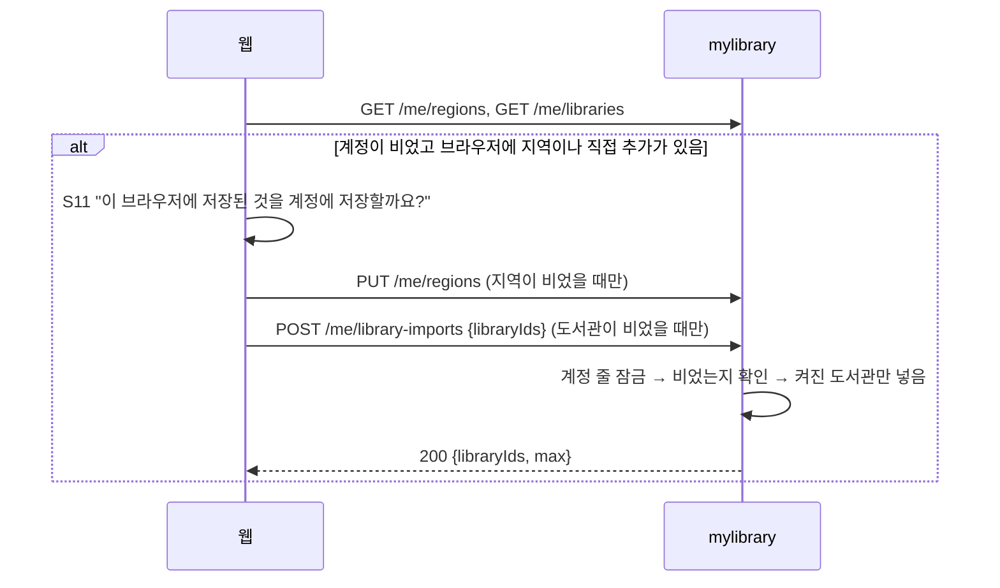

- 흐름 13의 S11(지역만)을 넓힙니다(ADR-0057). 한 번 누르면 지역·도서관을 함께 옮기고, 계정에 이미 있는 쪽은 옮기지 않으며 창에도 보이지 않습니다. 브라우저 값은 지우지 않습니다. 계정 직접 추가가 20곳을 넘게 되면 넘는 것은 옮기지 않고 "20곳까지만 저장했어요" [확정] (사용자 승인, 2026-10-05). 응답 수가 보낸 수보다 적은 그 밖의 경우(그 사이 꺼지거나 지워진 도서관)는 "지금 쓸 수 없는 도서관 N곳은 빼고 저장했어요" [안 문구] (dev 결정)
- 계정에 이미 직접 추가가 있으면 409 `library_import_not_empty` [확정] (dev 구현 확인, 2026-10-05) → 웹은 계정 값을 다시 읽음. 형식 오류는 400 `validation_error` (`api.md` "내 도서관")
- 답한 기록 키는 `chaekcheck.regionImport.v1` 하나를 지역·도서관이 함께 씀 [이유 미확인: dev가 정함] (한 질문으로 둘을 묻기 때문), 회고에서 그대로 둠 [확정] (사용자 승인, 2026-10-05). 한 번 답한 계정은 그 브라우저에서 다시 묻지 않음(나중에 브라우저에 추가한 도서관은 계정으로 옮겨지지 않음)

## 흐름 20: 가져오기 — 새 표에 쓰고 바꿔 끼우기 — 구현됨 (사이클 08)

흐름 16의 쓰기 단계를 바꿉니다(ADR-0065, ADR-0069, ADR-0070). 공개 `CatalogLoad.replaceAll` 모양과 모듈 방향은 그대로입니다.

- 사이클 19 — 설계됨(미구현, 사이클 19) (ADR-0115): 가져오기(모든 모드)는 사본을 읽기 전에 규칙 폴더 `chaekcheck.collection.import.rules-dir`(기본 `../scripts/library/rules`)의 `author_publisher_swapped.tsv`·`supplier_families.tsv`를 읽음. 파일이 없으면 읽기 전에 멈추고, 사본이 `swap_before` 뒤 것이면 멈춤(검증 스크립트로 다시 확인). 흐름 44

```mermaid
sequenceDiagram
  participant Op as 운영자 (collection-import 실행)
  participant Col as collection 가져오기
  participant NB as 국가서지 결과 (collection)
  participant Cat as catalog.CatalogLoad
  participant DB as PostgreSQL
  participant Web as 검색 요청
  Op->>Col: 사본 경로로 실행
  Col->>Col: 사본 읽기 (단계별 시간 기록)
  Col->>NB: TTL 파일 지문이 같은가?
  alt 같음
    NB-->>Col: 남긴 원문 (ISBN, 제목, 저자, 출판사)
  else 다름 또는 처음
    Col->>Col: TTL 풀기 (6.5~9분)
    Col->>NB: 원문 저장 (지문 함께)
  end
  Col->>Col: 원문을 지금 정리 규칙으로 다듬어 키 → ISBN (매번)
  Col->>Cat: replaceAll(책·사람·소장 흘려 넘김)
  Cat->>DB: 책 번호 잇기 (좁은 맞대기 표로 옛 holding과 맞대 책 번호·소장 번호 확정, ADR-0062·0070)
  Note over Web,DB: 이 동안 검색은 catalog의 옛 표를 읽음
  Cat->>DB: catalog_next에 색인 없이 확정된 책 번호 순으로 COPY/INSERT
  Cat->>DB: 색인·제약 만들기 (가져오기 세션만 maintenance_work_mem↑)
  Cat->>DB: VACUUM (ANALYZE) catalog_next
  Cat->>DB: 짧은 트랜잭션: 옛 표 DROP, catalog_next 표를 catalog로 SET SCHEMA (lock_timeout 2초, 실패하면 10초 뒤 다시, 최대 5번)
  Note over Web,DB: 이 순간만 검색이 잠깐 기다림
  Cat-->>Col: 결과 (kept/new/dropped, 단계별 시간)
  Col->>DB: collection.catalog_import 한 줄 (수집 시작·끝 포함)
  alt 바꿔 끼우기 전에 실패 (잠금 5번 다 못 얻음 포함)
    Cat->>DB: catalog_next 지움, 옛 표 그대로
    Col->>DB: 가져오기 기록에 실패
  end
```

- 국가서지 원문 표와 지문 표: `data-model.md` `collection` 절. 원문은 ISBN마다 한 줄 [확정] (사용자 승인, 2026-10-11). 지문이 다르면 ① 지문 줄 지우기 → ② 원문 표 비우고 다시 쓰기 → ③ 맨 마지막에 지문 줄 쓰기 [확정] (사용자 승인, 2026-10-11, 설계 검토). 구현은 ②·③을 한 트랜잭션으로 함 (dev 3단계)
- `lock_timeout` 2초·10초 뒤 다시·최대 5번 [확정] (사용자 승인, 2026-10-11, 설계 검토). 측정 뒤에도 바꾸지 않음(잠금 줄 서기 시험, dev 2026-10-11). "TTL 풀기 6.5~9분"은 추정이었고, 가져오기 #2에서 TTL을 풀며 원문 표를 처음 쓴 `nb`는 475초(7분 55초) (dev 측정, 2026-10-11). 표에서 다시 읽는 시간은 측정 중 [확인 필요] (AC-15)
- 그림의 "replaceAll" 안 쓰기는 실제로 임시 표(`load_*`)에 COPY → 맞대기 → `catalog_next`에 책 번호 순 INSERT로, 넓은 줄(소장)을 두 번 씀(`book_id` 순 정렬 때문) [확정] (사용자 승인, 2026-10-11). 바꿔 끼우기 직전 바깥 외래 키 조회(있으면 `outside_foreign_key`로 실패) (dev 4단계)
- 실패하면 가져오기 기록에 `status = 'FAILED'`와 `failure_reason`(`lock_not_acquired`, `outside_foreign_key`, `error`), `failure_detail`을 남김. 가져오기 시작 전 실패(사본 경로 오류)는 기록 줄이 없음. 색인 단계에서 멈췄을 때(AC-9 둘째 경우)는 측정 중 [확인 필요]
- 결과(가져오기 #2, 2026-10-11, dev 측정): 검색이 기다린 시간 0.33초(#1 지금 방식 9분 37초), 전체 약 41분, 가져오는 동안 검색 p95 560ms·5xx 0, 디스크 최대 19.1GiB(시작 8.5GiB). 가져오기 힙 `-PbootRunXmx=6g`로 끝까지 감(사이클 08 #3c, 당시 방식 = 지금 `objects`). 사이클 11부터 기본 `compact`는 2GB, 사이클 12 규칙 뒤 `objects`는 8GB 권장 [확정] (dev 측정, `plan-feedback.md` 3022~3048·3402행)
- 바꿔 끼운 뒤 옛 화면의 요청: 같은 소장은 옛 번호 그대로라 정상, 빠진 소장은 `holding_not_found`, 빠진 책은 `book_not_found` (ADR-0070)
- 정리 규칙을 바꿀 때 서비스를 다시 켤지는 `data-model.md` "정리 규칙을 바꿀 때" (ADR-0069)
- 사이클 11 — 구현됨 (사이클 11, 회고 2026-10-14): 이 흐름은 가져오기 모드 `in-place`(기본)입니다. 내 PC에서 만들어 운영 DB에 파일로 옮기는 모드는 흐름 27~29 (ADR-0078). 이 흐름도 내 PC에 운영 반영을 기다리는 새 표가 있으면 시작하지 않음 (스펙 R-A7)

## 흐름 21: 검색 계획과 책 화면 소장 읽기 — 구현됨 (사이클 08)

ADR-0066. 계획에 들어갈 도서관만, 그 도서관의 소장 줄만 DB에서 읽습니다. 켜짐 여부는 요청마다 읽습니다(ADR-0004 그대로).

```mermaid
sequenceDiagram
  participant W as web
  participant A as availability 스트림
  participant L as library.planSearch
  participant C as catalog.CatalogHoldings
  participant DB as PostgreSQL
  W->>A: 책 대출 현황 스트림 (bookIds, 지역, libraryIds)
  A->>L: planSearch
  L->>DB: 켜진 도서관 중 join_survey IN (SURVEYED, NOT_FOUND) OR id = ANY(직접 추가)
  DB-->>L: 약 385곳 + 직접 추가 (사이클 07까지는 전부)
  L-->>A: 계획
  A->>C: holdingsOf(bookIds, 계획 도서관 번호)
  C->>DB: book_id = ANY AND library_id = ANY
  DB-->>C: 계획에 든 소장 줄만 (사이클 07까지는 모든 도서관 줄)
  A-->>W: targets + 줄별 결과
```

- 두 캐시는 통계(`recordStats()`)를 켜고 캐시마다 상한 설정을 나눔(ADR-0066). 상한은 측정 뒤에도 두 캐시 모두 1,000 그대로 — ADR-0006 값 변경 없음 [확정] (사용자 승인, 2026-10-11)
- 계획 결과가 바꾸기 전과 같음(12묶음, AC-17). 소장 읽기: 줄 붙이기 뒤 책 3권 77쪽·1.4ms(전 1,169쪽·78ms) (dev 측정, 2026-10-11)

## 흐름 22: 막혔을 때 (429·503) — 구현됨 (사이클 08)

```mermaid
sequenceDiagram
  participant W as web
  participant N as nginx
  participant A as availability
  W->>N: 검색 스트림 요청
  alt IP 한도 넘음
    N-->>W: 429 too_many_requests, Retry-After 2 (이미 있음)
    W->>W: "검색을 너무 자주 했어요…" 안내 줄, 받은 결과는 남김
  else 동시 검색 20개 넘음
    N->>A: 전달
    A-->>W: 503 server_busy, Retry-After 5 (새)
    W->>W: "지금 찾는 사람이 많아요…" 안내 줄
  end
```

- 문구 전체와 태그는 `api.md` "요청 수·응답 크기 제한"·오류 코드 표. `Retry-After: 5` [확정] (사용자 승인, 2026-10-11). 웹은 상태 코드만 보고 결과 목록 위에 안내 줄 하나, 다시 버튼 없음, 첫 요청이 막히면 결과 자리에 같은 문구 (dev 7단계). 실제 429·503 화면은 띄워 보지 않고 Vitest로 확인 (AC-3)

## 흐름 23: 도서관 이름과 분류 — 구현됨 (사이클 09)

ADR-0071(이름에는 기관 이름만, 업체·대출 방식은 분류로), ADR-0076(분류 값은 API로 보내고 화면이 글자를 만듦, 이름은 번호로 고치는 changeset, 이름 찾기는 화면에서). 표·제약은 `data-model.md` "도서관 이름과 분류", 화면은 `module-map.md` "사이클 09 웹".

### 23-1. 이름·분류를 바꾸는 changeset (배포 때 Liquibase가 한 번 실행)

```mermaid
sequenceDiagram
  participant LB as Liquibase library/014
  participant DB as library.library
  LB->>DB: DROP CONSTRAINT library_name_key
  LB->>DB: UPDATE name (번호와 옛 이름이 맞을 때만)
  LB->>DB: ADD COLUMN vendor, UPDATE vendor (화면 종류 대응표)
  LB->>DB: UPDATE lending_model (규칙 + 번호 목록)
  LB->>DB: ADD COLUMN order_no DEFAULT 1
  LB->>DB: ADD CHECK (vendor 값, 대출 방식 필수, 순번)
  LB->>DB: ADD UNIQUE NULLS NOT DISTINCT (name, vendor, lending_model, order_no)
  alt 겹치는 줄이 남음
    DB-->>LB: unique 위반 → 배포 멈춤
  end
```

- 파일 `library/014-library-classification.yaml`, changeSet 하나 `library-014-classification-2026-10-11` [확정] (dev 구현 확인, 2026-10-12). 순서 [확정] (사용자 승인, 2026-10-11, 구현도 같은 순서). 이름 UPDATE 문장만 `splitStatements: false`(옛 이름 속 세미콜론), 대출 방식 UPDATE는 화면 종류 규칙 + 번호(북큐브 339·380·386·705, 교보 구독형 59·131·140·275~278) [확정] (사용자 승인, 2026-10-12, `docs/cycles/09-library-naming/easy/2026-10-12-retro-decisions.html` #3). 적용 결과 2,663줄, 겹침 없이 통과. 이미 적용된 seed·changeset은 고치지 않음 [확정] (ADR-0076)

### 23-2. 화면에 분류를 보이기

```mermaid
sequenceDiagram
  participant W as 웹
  participant L as library
  participant A as availability
  W->>L: GET /api/v1/libraries
  L-->>W: [{id, name, vendor, lendingModel, orderNo, …}]
  W->>W: S10 목록: "이름 · YES24 · 소장" (폰은 이름 아래 줄)
  W->>W: 이름 찾기: 낱말마다 이름 또는 분류 글자에 있으면 맞음
  W->>A: 검색 스트림 · 대출 현황 스트림 (ebook-searches, book-availabilities)
  A-->>W: targets.libraries[]: {id, name, vendor, lendingModel, orderNo, …}
  W->>W: 결과 카드: 이름, 다음 줄 "교보 · 소장"(순번 2 이상이면 "· 2번째 사이트")
  alt 분류 값이 없음 (배포 순서가 어긋남)
    W->>W: 이름만 보임
  end
```

- 스트림 경로는 `/api/v1/ebook-searches/stream`(직접 찾기)과 `/api/v1/book-availabilities/stream`(대출 현황)이고 두 곳의 `targets` 이벤트에 세 칸이 실림 (`api.md`). design-delta 그림의 `GET /api/v1/books/search/stream`은 이 두 스트림을 줄여 적은 것
- 통합 포털은 `lendingModel`이 null이라 "통합 포털"만 보임. 검색·소장 판정 동작은 바뀌지 않음 [확정] (spec R3)

### 23-3. 새 도서관을 넣을 때 (seed 생성 스크립트, 사이클 09까지)

```mermaid
sequenceDiagram
  participant S as build_candidate_seed.py
  participant C as 수집 결과·probe·북큐브 권수
  participant O as name_overrides.tsv
  S->>C: 화면 종류, 대출 방식 근거 읽기
  S->>S: vendor = 수집이 적은 값, 없으면 VENDORS 대응표
  S->>S: lending_model 규칙 (교보 probe, 북큐브 전체 권수, 포털 NULL, 나머지 OWNED)
  S->>O: 이름 고침 적용 (번호 1~280과 그 뒤 모두, 메모리에서)
  S->>S: (이름, vendor, lending_model) 묶음마다 서비스 번호 순 order_no
  alt order_no 2 이상
    S-->>S: (id, order_no) 목록 출력 → dev가 changeset
  end
```

- 배포 뒤에는 seed 파일을 다시 쓰지 않고 바뀐 것만 changeset으로 냄 [확정] (seed 고치는 방식, `data-model.md` "이름 고침"). 사이클 09 구현은 `--changes-only <db-state.tsv>`로 목록만 냈고, 순번 2 이상이 나오면 종료 코드 3 [확정] (dev 구현 확인, 2026-10-12). 수집이 업체를 따로 적는 자리 [확인 필요: 수집 세션] (스크립트에는 빈 자리 `COLLECTION_VENDORS = {}`)
- 사이클 13 — 구현됨 (사이클 13, 회고 2026-10-14) (ADR-0084·0085): 이 스크립트(이름 `build_library_seed.py`, 폴더 `scripts/library/discover/` [확정], dev 구현 확인 2026-10-14)는 더 seed를 만들지 않고, 같은 고르기·값 정하기 규칙을 `collection` 넣기 명령이 씀(흐름 32). 옛 스크립트는 결과 비교(AC-6)용으로 남김. 이름 고침 목록 등 사람이 정한 규칙은 dev `scripts/library/rules/` TSV

## 흐름 24: 사서추천도서 받기 (주 1회, 실패하면 성공할 때까지 매일) — 구현됨 (사이클 14, 회고 2026-10-14)

ADR-0089(출처: 국립중앙도서관 사서추천도서 Open API, 모듈 `picks`, `popular` 지움), ADR-0091(표지 받아 200px JPEG). 사이클 10의 "인기 도서 매달 받기"(출판유통통합전산망)를 대체합니다. 표는 `data-model.md` 스키마 `picks`, 판단 규칙은 `module-map.md` "`picks` 도메인 모델".

사이클 21 — 설계됨(미구현, 사이클 21): 받기 판단·요청·실패 처리는 이 그림 그대로이고, 담는 표가 `pick`에서 `list_book`의 `librarian` 줄로, 새 분야는 `list_field`에 더하는 것으로 바뀝니다. 바뀐 그림은 흐름 47.

```mermaid
sequenceDiagram
  autonumber
  participant S as FetchScheduler (매일 05:00 판단 / 시작)
  participant J as FetchJob (단일 스레드)
  participant N as 국립중앙도서관 saseoApi.do
  participant DB as picks 스키마
  participant C as PicksCache
  S->>S: 받을지 판단 (오늘 이미 성공이면 쉼 / 목록 없음 / 월요일 / 마지막 받기가 실패이고 그 뒤 성공 없음 / 마지막 성공이 7일보다 오래됨, 시작 때는 목록 없음·7일만)
  S->>J: run(trigger)
  J->>N: GET ?key=…&startRowNumApi=1&endRowNumApi=1000&start_date=오늘-3년&end_date=오늘
  alt 키 설정 없음
    J->>DB: fetch_run FAILED key_missing (요청 안 보냄)
  else 연결 실패·시간 초과
    J->>DB: fetch_run FAILED network_error
  else 오류 코드·키 거절
    J->>DB: fetch_run FAILED request_rejected (URL·본문 안 남김)
  else XML 모양이 다름 / totalCount > 받은 수
    J->>DB: fetch_run FAILED format_changed / incomplete
  else 최근 12개 달 0권
    J->>DB: fetch_run FAILED no_books
  else 정상
    J->>J: 추천 연월 최근 12개 달만 남김, ISBN 정리, 새 분야 코드는 넣고 셈
    alt 저장된 목록과 같음
      J->>DB: fetch_run SUCCEEDED changed=false
    else 다름
      J->>DB: [한 트랜잭션] pick 지우고 넣기 + fetch_run SUCCEEDED changed=true
      J->>C: refresh
      loop 저장 안 된 표지만 (1초 간격)
        J->>N: GET https://www.nl.go.kr/afile/… (호스트·경로 검사 통과한 것만)
        J->>DB: cover 넣기 (200px JPEG) / 실패 수
      end
      J->>DB: 안 쓰는 cover 지움, fetch_run 표지 수
      J->>C: refresh
    end
  end
```

- 요청: 받기 한 번 = 목록 요청 1건(3년 범위 실측 163건·2,511,752바이트·771ms, 남긴 108권, 2026-10-14 dev 받기 시험; 2년 범위는 108건·1.56MB·0.46초였음. 3년은 dev 변경 → [확정] (사용자 승인, 2026-10-14, 회고 결정 #21, ADR-0108. 이유: 제안 → 승인 (2026-10-14). dev가 적은 이유(사용자 말 아님): 12번이 늘 들어가게)) + 목록이 바뀌었을 때만 새 표지(`www.nl.go.kr`, 1초 간격; 2026-10-14 시험 108장, 실패 0, 최소 간격 1,000ms, 1분 56초). 출판유통통합전산망(`bnk.kpipa.or.kr`)으로 가는 요청은 0건 [확정] (AC-12). 목록 본문 상한 10MB, 표지 원본 상한 5MB, 1,600만 화소 상한 [확정] (사용자 승인, 2026-10-12)
- 실패 이유 `failure_reason`: `key_missing`·`network_error`·`request_rejected`·`format_changed`·`incomplete`·`no_books` [확정]. 실패면 저장하지 않고 앞 목록 그대로, 받기 기록 한 줄 + 서버 오류 기록 [확정] (spec R1-3)
- 인증키는 쿼리(`key=`)에 들어가므로 로그에는 키를 뺀 경로만(또는 `key=***`), 예외·`failure_detail`에 요청 URI·응답 본문을 넣지 않음 [확정]. XML 파싱은 DTD·외부 엔티티 끔(XXE) [확정]
- 표지: http → https로 바꾼 뒤 호스트 `www.nl.go.kr`, 경로 `/afile/`만, redirect 따르지 않음. 몇 장 실패해도 받기는 성공(그 책은 제목 글자) [확정] (ADR-0091)
- 새 분야 코드(모르는 `drCode`)는 받아 넣고 `fetch_run.new_category_codes`에 남김 [확정] (ADR-0089). 새 코드끼리는 숫자면 수 순서, 아니면 글자 순서 뒤 (dev `KeptPicks.java` 26~30행, [안])
- 구현 세부 — dev 결정 [안] [이유 미확인] (dev `plan-feedback.md` 3867행): "같은 목록" = 모든 칸이 같은 줄의 집합. `format_changed`는 한 권이라도 `recomNo`·제목·분야 코드·추천 연월이 틀리거나 본문 10MB 초과. `missing_isbn_count`는 남긴 책 기준. 응답은 항목마다 `<list>`가 `<item>`을 감쌈(요소 이름으로 읽음). 목록이 같은 주(`changed=false`)에는 실패한 표지를 다시 받지 않음. API 오류 응답 모양은 아직 못 봄(오류 요소 이름은 짐작) [확인 필요: 운영에서 만나면 기록]

### 받기 판단 상태

```mermaid
stateDiagram-v2
  state "판단" as Decide
  state "받기" as Fetch
  state "쉼" as Idle
  state "성공" as Ok
  state "실패" as Fail
  [*] --> Decide: 05시 또는 시작
  Decide --> Fetch: 저장된 목록 없음
  Decide --> Fetch: 월요일
  Decide --> Fetch: 마지막 받기 실패, 그 뒤 성공 없음 (매일 다시)
  Decide --> Fetch: 마지막 성공이 7일보다 오래됨 (따라잡기)
  Decide --> Idle: 그 밖
  Fetch --> Ok: 목록 저장 또는 같음
  Fetch --> Fail: 기록 한 줄, 앞 목록 그대로
  Fail --> Decide: 다음 날 (성공할 때까지 매일)
  Ok --> Decide: 다음 월요일
```

- trigger 값: `STARTUP`(시작 때 목록 없음) · `SCHEDULED`(월요일) · `RETRY`(실패 뒤 매일 다시, 05:00에만) · `CATCH_UP`(따라잡기, 05:00에 목록이 없을 때도 — dev [안]) [확정] (따라잡기: 사용자 "켜질 때 따라잡기 (추천)", 2026-10-12)
- 판단은 단일 스레드에서 돌고 실행 중이면 겹쳐 시작하지 않음(`AtomicBoolean`, 사이클 10 틀을 옮겨 씀). 설정 `cron` `0 0 5 * * *`, `zone` `Asia/Seoul` [확정]
- 새 추천이 등록되는 날은 일정하지 않음(2026.10 추천 등록일 2026.09.22~28) — 주 1회로 받음 [확정] (spec R1-2)

## 흐름 25: 사서추천도서 화면 열기와 공용 캐시 (S13) — 구현됨 (사이클 14, 회고 2026-10-14)

사이클 21 — 설계됨(미구현, 사이클 21): 주소가 `GET /api/v1/picks/{listKey}`로, 캐시가 세 목록을 담고(이동진·서울대는 저장된 `book_id`를 `byIds`로), 같은 책 고르기가 ADR-0125 규칙으로 바뀝니다. 캐시는 흐름 47 끝, 화면 요청은 흐름 48. 아래 그림은 사이클 14 구현 그대로입니다.

```mermaid
sequenceDiagram
  autonumber
  participant W as web S13
  participant P as PicksController
  participant L as library
  participant C as PicksCache
  participant K as catalog BookLookup
  Note over C,K: 시작·10분마다·목록 바뀐 직후
  C->>C: 저장된 목록 + 마지막 성공 받기 시각 + 표지 번호 읽기
  C->>K: byIsbn13(ISBN들)
  C->>K: byTitleAndAuthor(①로 못 맞은 책들)
  C->>C: 후보 여럿이면 libraryIds 가장 긴 책 → bookId 작은 책
  W->>P: GET /api/v1/picks?계획 파라미터
  P->>L: planSearch(…) (실패 422 invalid_region)
  P->>C: snapshot()
  P->>P: available = libraryIds ∩ 계획 도서관 ≠ ∅ (요청마다)
  P-->>W: 200 {fetchedAt, categories[…]} / 목록 없음 {fetchedAt:null, categories:[]}
  W->>P: GET /api/v1/picks/covers/{id}
  P-->>W: 200 image/jpeg / 404 cover_not_found → 제목 글자
```

- 계획 파라미터는 웹이 브라우저에 저장한 검색 기준으로 만듦(`BookPage`와 같은 방식, AC-7, 사이클 10 그대로). 검색 기준을 바꾸면 있음/흐림이 바뀜
- 맞추기(ADR-0090): ① ISBN(`BookLookup.byIsbn13`) ② 못 맞으면 본제목 + 첫 저자(`BookLookup.byTitleAndAuthor`). 짝은 저장하지 않고 캐시를 만들 때 맞춤. 이용자별 겹침 계산은 캐시하지 않음 [확정]. 공용 캐시 새로 고침 `chaekcheck.picks.cache.refresh-interval` 10분 [확정]. ② 후보는 첫 저자 `name_exact`로 좁힘(`module-map.md` `catalog`). 실측 새로 고침 53~114ms, 108권 중 72권 우리 책 (dev, 2026-10-14)
- 목록이 없으면 "아직 사서추천도서를 준비하고 있어요", 요청 실패면 "사서추천도서를 불러오지 못했어요. 잠시 뒤에 다시 해 주세요." [확정] (flow S13)
- 표지 응답은 폭 200px JPEG(`image/jpeg`), `Cache-Control: public, max-age=2592000, immutable`(30일), 없으면 404 `cover_not_found` → 제목 글자 [확정] (`api.md` "사서추천도서")
- 흐린 책(`available=false`)을 누르면 S15 신청 안내, 있는 책은 S14(흐름 26) [확정] (사이클 10 R6 그대로)
- 출처 줄의 받은 날은 `fetchedAt`(마지막으로 성공한 받기). 받기가 실패해도 앞 받은 날 그대로 [확정]

## 흐름 26: 가운데 창 열기 (S14, 앞의 3곳만 확인) — 구현됨 (사이클 10), 사이클 14 추천 줄도 구현됨 (사이클 14)

```mermaid
sequenceDiagram
  autonumber
  participant W as web S14
  participant C as catalog
  participant A as availability
  W->>C: GET /api/v1/books/{bookId}?(같은 계획)
  alt 404 book_not_found
    C-->>W: 창 안에 "책을 찾을 수 없어요"
  else 200
    C-->>W: 제목·지은이·출판사(우리 값)
    W->>A: SSE book-availabilities/stream (holdingLimit=3: 계획 순서 앞 3곳만)
    A-->>W: 도서관별 결과 / 실패 (스트림 통째 실패면 안내 문구)
    W->>W: 그 3곳을 대출 가능·구독형 → 대출 중(예약 적은 순) → 실패 순으로
  end
```

- 새 API 없이 지금 API를 씀. `holdingLimit` 이름·동작 [확정] (이름·검증 순서 dev 구현 확인, 2026-10-12) (사용자: "가. 앞의 3곳만 확인 이걸로 해줘 api좀 손봐줘", 2026-10-12, `docs/cycles/10-popular-books/easy/2026-10-12-handoff-review.html` #1). 없으면 대출 현황 스트림은 지금과 같음 (`api.md`)
- 창 안 안내 "검색하는 도서관 중 앞의 3곳", 첫 묶음만 씀. 스트림이 통째로 실패하면 "대출 정보를 확인하지 못했어요. 잠시 뒤 다시 시도해 주세요." [확정] (사용자 "이대로", 2026-10-12). 표지는 격자에서 누른 그 `coverUrl`(없으면 제목 글자). 그 밖의 오류·끊김은 S3과 같은 오류 문구 [확정] (사용자 승인, 2026-10-12, 인계 전 결정 #4). 줄 모양·상태 글은 S3 줄과 같음(사이클 09 분류 표시 포함)
- [책 검색 >>] → S3 `/books/{bookId}`, 뒤로 가기 → S13 보던 분류·쪽·스크롤 자리 [확정] (flow). 도서관 줄 → 그 도서관 사이트 책 페이지 새 창
- 사이클 14 — 구현됨 (사이클 14): 제목 바로 아래, 지은이·출판사 위에 한 줄 "2026년 10월 사서추천 · 문학"(`GET /api/v1/picks` 응답의 `recommendedMonth`·`category`로 웹이 만듦, 새 API 없음) [확정] (spec R6-1). 표지는 격자에서 누른 국립중앙도서관 표지(없으면 제목 글자). 나머지 흐름은 위 그대로 [확정]

## 흐름 27: 가져오기 내보내기 (내 PC) — 구현됨 (사이클 11, 회고 2026-10-14)

사이클 21 — 설계됨(미구현, 사이클 21): export는 prepare 뒤 목록 폴더(`lists-dir`)를 `picks`의 `CuratedListTransfer.read`로 읽어 `notes.listPart`에 싣고 파일 형식 번호 3으로 냅니다. 목록 폴더가 없거나 검사가 실패하면 사본을 읽기 전에 멈춤. 그림은 흐름 46.

실측(새 사본, `current`(지금 이름 `objects`), `-Xmx6g`, 사이클 12 규칙 전): 약 26분 43초 — 읽기 8분 32초, 묶기 6초, 국가서지 2분 14초 + 키 21초, 같은 글 1분 15초, 임시 표 COPY·둘째 읽기 9분 20초, 번호 잇기 1분 21초, 쓰기 2분 9초, 덤프와 되읽기 약 1분 22초. 파일 606,053,524 B. 책 번호 이어 씀 1,615,124 / 새 4,544 / 사라짐 1 (dev, 2026-10-12) 사이클 11 측정(2026-10-12): `compact` 2GB 약 21분, `sql` 1GB 약 34분, 세 방식 번호까지 같음 — 기본 `compact` [확정] (사용자 결정 2026-10-12, `docs/cycles/11-separate-import/retro.md` "최종 회고")


가져오기를 내 PC에서 끝까지 돌려 `catalog_next`를 만들고, 그것을 `pg_dump -Fc` 파일 하나로 내보냅니다. 내 PC `catalog`는 그대로이고 새 표는 운영 반영을 기다리며 남습니다(ADR-0078). 운영 반영을 기다리는 새 표가 있으면 시작하지 않습니다(스펙 R-A7). 묶는 방식은 `grouping`으로 고릅니다(ADR-0079). 표·칸은 `data-model.md` "따로 하기".

- 사이클 19 — 설계됨(미구현, 사이클 19) (ADR-0115): 내보내기도 먼저 `rules-dir`의 규칙 파일을 읽고, 없으면 멈추며 `swap_before` 뒤 사본이면 멈춤(흐름 20 줄과 같음). 저자·제목 정리 뒤 다시 가져오기는 흐름 44

```mermaid
sequenceDiagram
  autonumber
  actor Op as 운영자
  participant Col as collection (export)
  participant Cat as catalog
  participant DB as 내 PC DB
  participant Tool as pg_dump 18
  Op->>Col: sqlite-path, ttl-path, file, grouping
  Col->>Cat: prepare(source, loader)
  Cat->>DB: catalog_next.load_manifest 있나?
  alt 기다리는 새 표 있음
    Cat-->>Op: 멈춤 "먼저 finish 또는 discard" (DB 그대로)
  else 없음 / 죽고 남은 것
    Cat->>DB: catalog_next 지움, 임시 표 COPY, 번호 잇기, 쓰기
    Col->>Cat: export(file, notes: 기록·도서관 해시·연결표 해시)
    Cat->>DB: load_manifest 한 줄 (export_id, 기준값, 표 구조 해시, notes)
    Cat->>Tool: pg_dump -Fc -n catalog_next -O -x → file.part
    alt 덤프 성공, export_id 맞음
      Cat->>Cat: file.part → file
      Cat-->>Op: 파일 하나, catalog_next 남음 (기록 줄 없음)
    else 실패
      Cat->>DB: catalog_next 지움
      Col->>DB: catalog_import FAILED error
    end
  end
```

- 모드 값 `export`·`grouping` 자리 [확정] (설계 #3), 메서드·설정 이름 [안]. `step_seconds` 키 `dump`·`export` [안]
- 기준값 6개는 내보낼 때 내 PC `catalog`(마지막 반영분)의 값 [확정] (설계 #2)

## 흐름 28: 가져오기 반영 (운영 역할 DB, 다름·실패 포함) — 구현됨 (사이클 11, 회고 2026-10-14)

사이클 21 — 설계됨(미구현, 사이클 21): apply·finish·in-place 모두 책 표를 바꿔 끼운 **뒤** 작은 트랜잭션 하나로 이동진·서울대 목록을 넣습니다(`CuratedListTransfer.replace`). 앱과 파일의 형식 번호가 다르면 거절. 그림은 흐름 46.

실측(`db-ops`, 상한 1GB, `maintenance_work_mem` 256MB): 비교 3.2초, 복원 65초, 색인 2분 30초, ANALYZE 52초, 바꿔 끼우기 0.08초, 전체 4분 35초. 반영하는 동안 서비스 검색 194번 실패 0, p95 760ms, 최대 1,522ms(색인 중). 다름 시험(도서관 주소, 연결표 한 줄, 옛 파일, 표 칸 하나) 모두 `mismatch`로 멈추고 아무것도 안 바뀜 (dev, 2026-10-12)


운영 역할 DB(이 사이클은 같은 PC의 `db-ops`, 포트 5434)에서 파일을 받아, 먼저 파일 속 `load_manifest`만 읽어 두 DB가 같은지 봅니다. 다르면 운영 표에 손대지 않고 `mismatch`를 남깁니다. 같으면 복원 → 색인·제약 → 통계 → 바꿔 끼우기(흐름 20의 ③~⑤, ADR-0065 그대로)입니다(ADR-0078, 스펙 R-A3·R-A4).

```mermaid
sequenceDiagram
  autonumber
  actor Op as 운영자
  participant Col as collection (apply)
  participant Cat as catalog
  participant DB as 운영 DB (5434)
  participant Tool as pg_restore 18
  participant Web as 검색 요청
  Op->>Col: file
  Col->>Cat: readManifest(file)
  Cat->>Tool: pg_restore -a -n catalog_next -t load_manifest -f -
  Tool-->>Cat: manifest 한 줄
  Col->>Col: 도서관 해시, 연결표 해시 (자기 DB)
  Col->>Cat: baseline() (catalog가 계산: 이 DB catalog의 기준값 6개 + 네 표 칸 구조 해시)
  alt 하나라도 다름
    Col->>DB: catalog_import FAILED mismatch (무엇이 다른지)
    Note over DB,Web: catalog 그대로, 검색은 옛 표
  else 모두 같음
    Col->>Cat: apply(file)
    Cat->>DB: 기준값 다시 확인, 남은 catalog_next 지움
    Cat->>Tool: pg_restore --single-transaction --exit-on-error -O -x
    Cat->>DB: export_id 확인, load_manifest 지움
    Cat->>DB: 색인·제약 (운영 정의, maintenance_work_mem 256MB), VACUUM (ANALYZE)
    Web->>DB: 검색 (옛 표)
    Cat->>DB: swap (lock_timeout 2초, 10초 뒤 다시, 최대 5번)
    alt 복원·색인·통계 실패
      Cat->>DB: catalog_next 지움
      Col->>DB: FAILED error
    else 잠금 5번 실패
      Cat->>DB: catalog_next 지움
      Col->>DB: FAILED lock_not_acquired
    else 바꿔 끼움
      Col->>DB: SUCCEEDED 한 줄 (내 PC 기록 + compare·restore·index·analyze·swap·apply, export_id)
    end
  end
```

- 비교 항목 [확정] (스펙 R-A3, 설계 #2), 계산식 [안]: 도서관 해시, 연결표 해시, `book`·`holding` 줄 수·가장 큰 번호·시퀀스 값, 네 표 칸 구조 해시 (`data-model.md` "따로 하기")
- 반영 연결의 `maintenance_work_mem` 256MB, 서버 기본 64MB 그대로 [확정] (사용자 승인, 2026-10-12; 설계 #12). 반영 동안 검색 기다림 1초 안·5xx 0 (스펙 AC-3)
- 도중에 죽으면 빈 `catalog_next`가 남고 다음 반영이 시작할 때 지움, 또는 그 DB에서 `discard` [확정] (스펙 상태별 동작, AC-5·AC-13)

## 흐름 29: 마저 바꿔 끼우기 / 지우기 (내 PC) — 구현됨 (사이클 11, 회고 2026-10-14)

실측: `finish` 1분 28초(색인 60초, ANALYZE 25초, 바꿔 끼우기 0.1초). 색인 도중 강제 종료 뒤 다시 돌리면 만들다 만 제약·색인부터 지우고 끝까지(AC-15) (dev, 2026-10-12)


운영 반영이 성공하면 내 PC도 남겨 둔 새 표로 바꿔 끼워(`finish`) 두 DB의 기준값을 다시 같게 맞춥니다. 운영 반영이 실패했거나 어느 DB에든 빈 `catalog_next`가 남았으면 `discard`로 지웁니다(ADR-0078, 스펙 R-A2·R-A8·R-A10).

```mermaid
sequenceDiagram
  autonumber
  actor Op as 운영자
  participant Col as collection (finish / discard)
  participant Cat as catalog
  participant DB as 내 PC DB
  Op->>Col: finish, file (운영 반영 성공 뒤)
  Col->>Cat: finishPrepared(file)
  Cat->>DB: load_manifest.export_id·기준값이 파일과 같나?
  alt 다름 / catalog_next 없음
    Cat-->>Op: 멈춤, DB 그대로 ("같은 파일을 내 PC에 apply"로 되살림)
  else 같음
    Cat->>DB: (다시 돌릴 때) 만들다 만 색인·제약 지움
    Cat->>DB: 색인·제약, VACUUM (ANALYZE)
    alt 색인·통계 실패
      Cat-->>Op: 실패, load_manifest 그대로 (기다림 유지 → finish 다시)
    else 성공
      Cat->>DB: swap 한 트랜잭션: load_manifest 지움 + 옛 표 지움 + catalog로 옮김
      Col->>DB: SUCCEEDED 한 줄 (export_id)
    end
  end
  Op->>Col: discard (운영 반영 실패, 또는 어느 DB든 남은 빈 표)
  Col->>Cat: discardPrepared()
  Cat->>DB: DROP SCHEMA IF EXISTS catalog_next CASCADE (기록 없음)
```

- `finish`는 `load_manifest`를 swap 트랜잭션 안에서 지움. 그 전에 실패하면 기다림 상태가 남고, 다시 돌리면 만들다 만 색인·제약부터 지움 [확정] (사용자 승인, 2026-10-12, `docs/cycles/11-separate-import/easy/2026-10-12-review-decisions.html` #1) (스펙 R-A10, AC-15)
- 내 PC `finish`의 `maintenance_work_mem`은 1GB [확정] (사용자 승인, 2026-10-12, `docs/cycles/11-separate-import/easy/2026-10-12-handoff-review.html` #1)
- `step_seconds` 키 마저 `index`·`analyze`·`swap`·`finish` (`index`·`analyze`·`swap` [확정], `finish` [안])

### 내 PC의 `catalog_next` 상태 — 구현됨 (사이클 11, 회고 2026-10-14)

```mermaid
stateDiagram-v2
  [*] --> 없음
  없음 --> 쓰는중: export / in-place 시작
  쓰는중 --> 기다림: 파일 만듦 (load_manifest 있음)
  쓰는중 --> 없음: 실패 → 지움 / in-place 성공 (catalog로)
  쓰는중 --> 죽고남음: 프로세스·DB 죽음
  죽고남음 --> 쓰는중: 다음 시작이 지움
  죽고남음 --> 없음: discard
  기다림 --> 없음: finish 성공 (catalog로) / discard
  기다림 --> 기다림: finish 중 색인·통계 실패 → finish 다시
  기다림 --> 기다림: 다른 export·in-place → 멈춤
```

- "기다림"은 `load_manifest`가 있는 `catalog_next`, "죽고남음"은 `load_manifest`가 없는 남은 `catalog_next` [확정] (스펙 R-A7, ADR-0078)

## 화면 공통: 안내 줄과 검색 결과 머리 — 구현됨 (사이클 06 마무리, 2026-10-05)

- 머리말 아래 안내 줄(`NoticeBar`)은 한 번 보이고 닫을 수 있으며, **다른 페이지(경로가 다른 곳)로 가면 사라집니다**. 안내가 지나가기만 하는 `/auth/complete`, `/signup`은 세지 않고 안내가 처음 보인 페이지를 기준으로 하며, 같은 페이지에서 주소의 검색 조건만 바뀌면 그대로 둡니다. "가입했어요"뿐 아니라 모든 안내(탈퇴했습니다, 로그인 실패, S11 저장 안내)에 같습니다 [확정] (사용자, 2026-10-05: "바로 가입햇어요가 뜨긴 하는데 이거 한 번만 보여주고 페이지 바꾸면 사라졌으면 해", AC-17 후속)
- `signup_success`("가입했어요")는 서버 결과 코드가 아니라 웹 상태입니다: `SignupPage`가 201 뒤에 안내 줄을 한 번 띄움 [확정] (사용자 선택, 2026-10-04)
- S1 검색 결과 머리: "N월 N일 기준 수집 목록 · 책 N권" 줄을 없앴습니다(사이클 04 S1 결과 머리 줄을 바꿈). 정렬은 결과 판의 탭 줄("지금 빌릴 수 있는 책만 | 전체") 오른쪽 끝으로 옮기고, 옆의 "?"를 누르면 "기본 순서" 기준 설명이 열립니다. "도서관에서 직접 찾기"에서는 같은 자리에 흐린 정렬 + 이유 글이고 "?"는 없습니다. 찾은 책이 없을 때의 "(N월 N일 기준)" 안내와 책 화면(S3)의 "… 수집 목록 · 보유 도서관 N곳" 줄은 그대로입니다 [확정] (사용자, 2026-10-05: "… 이거 정보 필요 없다고 생각해 빼고 정렬을 좀 … 위치로 올려줘", "? 기본 순서의 우측에 뒀으면 해")
- 결과 거르기 탭의 기본값은 "지금 빌릴 수 있는 책만"(왼쪽)이고 "전체"는 `filter=all`입니다. 첫 검색 요청도 `filter=available`입니다(사이클 04 "기본 전체" [안]을 바꿈) [확정] (사용자, 2026-10-05: "정렬이 지금 빌릴 수 있는 책만이 기본으로 하고 / 왼쪽에 나오도록 해줘", 해석 확인 "응")
- 결과 줄의 가입 정보는 모든 폭에서 도서관 이름을 누르면 열리는 팝오버에 있고, "가입 자격 확인 필요"도 그 안 맨 위에 있습니다. 직접 추가 도서관도 같은 정보를 보이며 차이는 이름 옆 "직접 추가" 표시와 정렬뿐입니다(자세한 것은 `module-map.md`) [확정] (사용자 요청, 2026-10-05)
- 사이클 07 (구현됨 (사이클 07), ADR-0059): S1·S3 결과 카드(약 20px)와 S10 도서관 줄(약 24px)의 **이름 위 줄**에 로고, 누르면 그 도서관 메인 페이지 새 창(결과 카드에서도 카드 링크와 따로), **로고가 없으면 아무것도 그리지 않음**(로고로 홈페이지를 열 수 없고, 카드의 "홈페이지 (새 창)" 링크는 있음) [확정] (사용자: "실제로 확인해보고 디자인 측면의 안정감때문에", 2026-10-05, AC-20의 "이름 앞, 빈 상자"를 바꿈). 모든 화면 바닥글에 "서비스 안내" 링크 → 새 화면 S12 `/about`(소개, "각 도서관의 로고와 이름은 그 기관의 것이며 책첵은 제휴·후원 관계가 없습니다", 로고 내림 요청 이메일 — 주소는 사용자가 알려 줌 [확인 필요], S8·S9와 같은 흰 카드) [확정]
- 사이클 07 (구현됨 (사이클 07)): 로그인 전 S1의 [내 지역 ▾]/[내 지역 설정]을 로그인 후와 같은 [내 도서관 관리 ▾](폰은 [내 도서관 관리], 지역도 직접 추가도 없으면 "내 도서관 설정" → S10)로 바꾸고 S10을 로그인 전에도 엽니다 [확정] (사용자 승인, 2026-10-05). 결과 카드의 북큐브·알라딘은 보유·대출 중·예약 칸, 북큐브 대여형은 "구독형 · 바로 대출 ⓘ", 교보 구독형 화면은 줄에 숫자가 있으면 숫자 칸(책 화면은 `lending_model = OWNED`일 때) [확정] (spec R5, 판정 방식은 dev 사이트 시험 2026-10-05). 알라딘 수가 없는 줄은 "확인 필요"
- 사이클 07 (구현됨 (사이클 07)): 검색 범위 스위치 기본값은 가입할 수 있는 쪽, 그 버튼이 왼쪽(로그인 전 지역 없음 "누구나 가입", 지역 있음 "가입 가능한 곳", 로그인 후 "내 도서관", 비어 있어도) [확정] (사용자: "이 프로젝트의 편의성을 생각했을 때 가입할 수 있는 곳으로 가는 것이 사용자 측면에서 좋다고 봐서", 2026-10-05)
- 사이클 07 (구현됨 (사이클 07)): 브라우저 `chaekcheck.searchSettings.v1`에 기억하는 것은 범위(로그인 전 `guestScope`, 로그인 후 `myScope`), 방문 없이 가입, 지금 빌릴 수 있는 책만, 보기 방식(`view`), 직접 찾기(`direct`) [확정]. 주소 값이 이기고 검색어는 저장 안 함. 지금 코드는 정렬·완전 일치·옮긴이·그림·엮은이(`sort`·`exact`·`roles`)도 저장하지만 사용자가 "정렬, 상세검색의 완전 일치·옮긴이·그림·엮은이 … 이건 기억하지 마"(2026-10-05, 회고 질문 #2)라고 정해 다음 dev 인계서에서 뺌(backlog)
- 동시 검색이 다 차거나(503 `server_busy`) IP별 한도를 넘으면(429 `too_many_requests`) 화면은 따로 안내 줄: 429 "검색을 너무 자주 했어요. 1분쯤 뒤에 다시 해 주세요.", 503 "지금 찾는 사람이 많아요. 잠시 뒤에 다시 해 주세요." 받은 결과는 남김 [확정] (사이클 08 spec R2) — 구현됨 (사이클 08), 흐름 22. (사이클 07까지: 두 경우 모두 일반 문구 "검색하지 못했어요. 잠시 뒤 다시 시도해 주세요.")
- 사이클 08 (구현됨 (사이클 08)): `mobileSiteDiffers`인 도서관은 폭 640px 이하에서 결과 카드 이름 아래(바로 보기·직접 찾기·책 화면 줄)·가입 정보 창 "도서관 첫 화면"·"전자도서관에서 가입 안내 보기" 링크 옆에 YES24 폰 안내 [확정] 자리, 문구 "폰에서는 사이트가 다른 화면을 보여요. PC에서 열어 주세요" [확정] (사용자: 인계서 안 그대로, dev 세션 2026-10-11). 빠진 책은 "책을 찾을 수 없어요" 아래 "도서관 목록을 새로 받으면서 빠진 책일 수 있어요. 다시 검색해 주세요.", 빠진 소장은 책 화면 그 도서관 줄에 "이 도서관 목록에서 빠졌어요" [확정] (ADR-0070). 브라우저 `chaekcheck.searchSettings.v1`에서 정렬·완전 일치·역할을 쓰지 않고 남아 있으면 읽을 때 지움 [확정] (spec R1)
- 사이클 08 (구현됨 (사이클 08)): 폰 설정 창은 바텀 시트 유지 [확정] (사용자 승인, 2026-10-11, `docs/cycles/08-polish-swap-memory/easy/2026-10-11-final-decisions.html`) (되돌림 `PHONE_SETTINGS_SHEET = false`). 폰 직접 찾기의 흐린 "정렬 없음 ⓘ"은 **검색 줄 끝**("N곳" 옆) — 처음 둔 결과 위 도구줄이 폰에서 숨겨져 옮김 (dev 12단계), 설계 자리("검색줄 둘째 줄 오른쪽 끝")와 같음. 돌아가기("← 돌아가기")와 ⓘ는 **S8·S9·S10만**, **S2(지역 고르기 창)는 바꾸지 않음** [확정] (사용자: "A. 그대로", dev 세션 2026-10-11; S2는 [저장]을 눌러야 저장되어 "즉시 저장" 안내가 맞지 않음). S10 ⓘ 문구 "고르는 즉시 이 브라우저에 저장돼요"(로그인 전)/"고르는 즉시 계정에 저장돼요"(로그인 뒤) [확정] (사용자, dev 세션 2026-10-11). S10 이름 찾기는 공백과 함께 가운뎃점(·)도 무시 [확정] (사용자 승인, 2026-10-11). 글꼴은 줄인 파일("Chaekcheck Barun")을 먼저 쓰고 드문 음절이 있을 때만 원래 나눔바른고딕을 받음
- 사이클 09 — 구현됨 (사이클 09) (ADR-0071·0076, 흐름 23): 도서관 이름은 기관 이름만 보이고, 결과 카드(S1·S3)는 모든 폭에서 이름 다음 줄에 "교보 · 소장", S10 세 목록은 "이름 · 업체 · 대출 방식"(폰은 이름 아래 줄), 순번 2 이상이면 "· N번째 사이트". 요약 줄·지역 가져오기 창·직접 찾기 결과 이름 나열·가입 정보 창은 이름만. 분류 값이 없으면 이름만 [확정]. 교보 구독형 중 대여 9곳 가운데 8곳은 이름의 "(구독)"이 빠지고 분류가 "대여"로 보임 [확정] (spec R3). S10 이름 찾기에서 같은 이름 여러 줄은 업체 글자 한글 가나다순(교보 → 북큐브 → 알라딘 → 자체 → 통합 포털 → YES24), 같은 이름·같은 업체는 순번 순 [확정] (사용자 승인, 2026-10-12, `docs/cycles/09-library-naming/easy/2026-10-12-retro-decisions.html` #1)
- 사이클 10 — 구현됨 (사이클 10), 이름·문구는 사이클 14가 바꿈 (흐름 24~26, `module-map.md` "사이클 10·14 웹"): 머리에 "인기 도서"(사이클 14부터 "사서추천도서") 링크(로고 바로 옆, S8·S9·`/terms`·`/privacy` 제외) [확정] (사용자: "로고 바로 옆 (지금 구현)", 2026-10-12), 로고 옆 설명 글 "전자도서관 대출 가능 확인"은 모든 폭에서 지움 [확정]. 폰에서 아래에서 올라오는 창 넷(S13c 분류 목록, S13i 도움말, S14 가운데 창, S15 신청 안내)은 손잡이 끌어내리기·ⓧ·바깥으로 닫히고 사이클 08 검색 설정 바텀 시트와 같은 공용 부품 `BottomSheet`(끌어내리기 80px, 폰 뒤로 가기는 창만 닫음, `useBackToClose`) [확정] (사용자, 2026-10-11; 이름 dev 구현 확인, 2026-10-12). ⓘ 말풍선은 앱 전체에서 밝은 둥근 네모 [확정] (사용자, 2026-10-12). 흐린 책 안내는 "검색하는 도서관"으로 씀(S13i "흐린 책은 검색하는 도서관에 전자책이 없어요", S15 두 줄) [확정]. 표지는 작은 그림을 폭 200px JPEG로 줄여서만, 큰 그림·확대 보기 없음, S12 `/about`에 표지 게시 중단 요청 안내(연락처는 배포 때) [확정] (handoff C10)
- 사이클 14 — 구현됨 (사이클 14, 회고 2026-10-14) (흐름 24~26, `module-map.md` "사이클 10·14 웹"): 머리 링크 "인기 도서" → "사서추천도서"(자리 그대로), S13 경로 `/picks`, 순위 칩 없음, 카드 머리 "1 - 9 / 18"(범위 12번), "? 추천 기준 보기", 도움말·출처 줄·S14 추천 줄·S12 `/about` 문구가 바뀜. 표지는 국립중앙도서관 표지를 200px JPEG로 줄여서만 [확정] (flow, ADR-0091). 바텀 시트·ⓘ 말풍선·S15는 그대로. 폰 표지 크게(3×3 그대로)·제목 글자 카드는 본제목만 (`module-map.md` "사이클 10·14 웹"). 앱에 없는 주소(`*` 경로)는 빈 화면 — "없는 주소예요 + 처음으로" 화면 하나를 첫 배포 전 작은 일로 [확정] (사용자 승인, 2026-10-14, 회고 결정 #24; `docs/backlog.md`)
- 사이클 13 — 구현됨 (사이클 13, 회고 2026-10-14) (흐름 32·33, `docs/cycles/13-crawler-to-dev/flow.md` S12, ADR-0087·0093): S12 `/about` 첫 문단("책첵은 …") 바로 아래, 제휴 안내 문단 위에 "가입 조건은 {YYYY}년 {M}월에 조사한 내용입니다." 한 줄 [확정] (자리·문구, 사용자 승인 2026-10-12). 날짜는 `GET /api/v1/join-surveys/latest`의 `surveyedOn`(넣기 실행 기록의 최신 가입 조건 조사 기준일)을 "YYYY년 M월"로. 로딩 중에는 그 줄 자리를 비우고(나머지 글은 바로 보임), 기준일이 없거나(`null`) 오류면 줄을 보이지 않음 [확정] (사용자 승인, 2026-10-12). 태블릿·폰은 지금 S12와 같은 흰 카드 한 열. 사이클 14와 맞춘 문단 순서 [확정] (dev 구현 확인, `AboutPage.tsx`, 2026-10-14): ① 첫 문단 → ② 가입 조사 기준일 줄(사이클 13) → ③ 사서추천도서 자료 문단(사이클 14) → ④ "각 도서관의 로고와 이름은 … 제휴·후원 관계가 없습니다" → ⑤ 로고 내림 요청 문단. 그 밖의 화면은 그대로: 새로 넣은 도서관(예: 여주대학교 교보·YES24)은 S10 이름 찾기에 나오고, 소속 전용(`MEMBERS_ONLY`)이면 직접 추가한 사람의 검색에만 들어가며(ADR-0053) 책은 다음 가져오기 뒤에 보임. 1215는 "한화S&C"로 보임

## 흐름 30: 가져오기의 네 번째 묶기 단계 (같은 키 안에서 ISBN으로 나누기) — 구현됨 (사이클 12, 회고 2026-10-14)

ADR-0082, ADR-0106, 규칙 `docs/research/ebook-catalog/same-book-isbn.md` 5.7절(사이클 12 확정 규칙). 흐름 20·27의 "묶기" 안에서 일어남. 그림은 `sql`, `compact`·`objects`는 같은 판정을 Java 안에서 함(결과 번호까지 같음, 사이클 12 AC-6).

```mermaid
sequenceDiagram
  participant I as CatalogImporter
  participant S as SqlGrouping
  participant K as SameTextKey (Java)
  participant P as PostgreSQL 임시 표
  I->>S: mergeSameText(report)
  S->>P: 묶음마다 대표 제목·저자·출판사 읽기
  loop 묶음마다
    S->>K: sameTextKey(title, author, publisher)
    K-->>S: key 또는 null (자리 채움·저자 없음)
  end
  S->>P: COPY grp_text(label, key)
  S->>P: ISBN 붙이기, key별 ISBN 수로 mergeKey (grp_merge)
  S->>P: 부제가 둘 이상인 key의 묶음·도서관 목록 읽기 (grp_unitlib)
  S->>K: SubtitleParts.of(부제, 도서관)
  K-->>S: 묶음마다 나뉜 번호 (따로 / 같음)
  S->>P: COPY grp_part
  S->>P: mergeKey마다 min(label) → 간선 → 라벨 전파
  alt 반복 상한을 넘음
    S-->>I: 예외
    I->>I: FAILED 기록, 옛 catalog 그대로
  else 정상
    S-->>I: 단계별 책 수, 카운터
  end
```

```mermaid
flowchart TD
  A["같은 key의 묶음들"] --> B{"서로 다른 ISBN 수"}
  B -->|"0 또는 1"| I1["ISBN 칸: 모두 같음"]
  B -->|"2 이상"| I2["ISBN 칸: ISBN마다 하나, ISBN 없는 묶음끼리 하나"]
  A --> S{"서로 다른 부제 수 (포함 관계는 같은 부제)"}
  S -->|"0 또는 1"| P1["부제 칸: 모두 같음"]
  S -->|"2 이상"| L{"같은 도서관이 서로 다른 부제를 따로 가짐?"}
  L -->|"아니오"| P1
  L -->|"예"| P2["부제 칸: 나뉜 묶음 번호, 부제 없는 묶음은 따로"]
  I1 --> M["한 책 = key + ISBN 칸 + 부제 칸이 같은 묶음들"]
  I2 --> M
  P1 --> M
  P2 --> M
```

## 흐름 31: 묶기 규칙 비교 (dev dry run, 새로 넣은 도서관 이어 붙음·번호·두 방식) — 구현됨 (사이클 12, 회고 2026-10-14)

```mermaid
sequenceDiagram
  participant D as dev
  participant A as 가져오기 dry run
  participant C as compare_grouping.py
  D->>A: 새 규칙, 사이클 07 도서관 뺌 (dry run 전용 설정)
  D->>A: 새 규칙, 전체
  D->>C: regroup 뺀 결과 vs 전체 결과
  C-->>D: 새 도서관 때문에 합쳐진 기존 책 목록 (R5)
  D->>C: regroup 서비스 DB 지금 번호 vs 새 규칙 결과
  C-->>D: 나뉜 책·합쳐진 책 목록 → 표본 10권 (R7-3)
  D->>C: dryrun / ids-compare compact vs sql
  C-->>D: 다른 책 0권 (R8-2, AC-6)
```

- 실제 결과 (2026-10-13, dev `plan-feedback.md` 3355~3391행): R5 새 도서관 때문에 합쳐진 기존 책 7,047권(그중 2,944권은 꺾쇠 저자 표기), 표본 20권 중 잘못 합침 1권. 세 방식(`compact`·`sql`·`objects`) 차이 0. 사이클 07 도서관은 2,381곳(빼기 설정 dry run에서 뺀 줄 12,890,441)

## 흐름 32: 새 도서관 넣기 — 미리 보기 → 넣기 (내 PC) — 구현됨 (사이클 13, 회고 2026-10-14)

ADR-0083(`LibraryRegistry`), ADR-0084(넣기 명령), ADR-0085(규칙 TSV), ADR-0087(기준일), ADR-0093(`listAll`). 사이클 12와 나란히 미리 설계했고 사이클 11·12 뒤에 dev main에 합침(`a21bde5`, 2026-10-14). 실데이터: 보고서 `1af0721e4a3e`로 6곳(2675~2680) 넣음. 명령·설정·종료 코드는 `module-map.md` `collection` 줄, 표는 `data-model.md` `library_insert_run`.

```mermaid
sequenceDiagram
  actor O as 운영자(Claude)
  participant C as collection 넣기 명령
  participant R as 규칙 폴더
  participant S as 수집 DB 사본
  participant L as library LibraryRegistry
  participant D as 서비스 DB
  O->>C: mode=preview
  C->>R: TSV·기준일 읽기
  alt 규칙 오류
    C-->>O: 종료 1, 보고서 없음
  end
  C->>S: 도서관·책 코드 읽기
  C->>L: listAll() 서비스 도서관 전체(꺼진 곳 포함)
  C->>D: 짝 표 collection_link 읽기
  C-->>O: 보고서 파일(번호 abc123…) + 개수, 의심 있으면 종료 2·3
  O->>O: 의심·바뀐 곳·사라진 곳 있으면 사용자에게 물음
  O->>C: mode=insert, report-id
  C->>C: 다시 계산, 보고서와 비교
  alt 다름
    C-->>O: 종료 4, 넣지 않음
  end
  C->>D: BEGIN, pg_advisory_xact_lock
  C->>L: nextId() 다시 확인 (보고서 첫 번호와 다르면 종료 4)
  C->>L: add(새 도서관 + 가입 규칙)
  L->>D: INSERT library·eligibility_rule, IDENTITY 올림
  C->>D: INSERT collection_link, library_insert_run SUCCEEDED
  C->>D: COMMIT (제약 위반이면 ROLLBACK 뒤 FAILED 줄, 종료 5)
  C-->>O: 넣은 수, 보고서 번호
```

- 운영자 흐름(`docs/cycles/13-crawler-to-dev/flow.md` 1절): 수집기 갈아타기 준비(dev `scripts/crawl/`, 옛 코드 `_old-scripts-2026-10-12`) → 첫 실행(여주대 102084 빈 곳 채우기 — 이번 사이클에서 뺌, AC-1, 사용자: "여주대는 빼자", 2026-10-12) → 사본 만들기 → 넣기 미리 보기 → Claude가 보고서 확인(의심·바뀐 곳·사라진 곳이 있으면 사용자에게) → 넣기 → 다음 가져오기·운영 반영(흐름 27·33)
- 같은 보고서로 다시 넣으면 0곳(부분 UNIQUE `library_insert_run_report_id_succeeded_key`, AC-8). 같은 사본으로 다시 미리 보기 → "넣을 도서관 없음"(보고서 `b2174dfd426d`) [확정] (dev 9단계, 2026-10-14)

## 흐름 33: 운영 반영 판 2 — 도서관 → 비교 → 책 — 구현됨 (사이클 13, 회고 2026-10-14)

사이클 21 — 설계됨(미구현, 사이클 21): 파일 형식 번호가 3이 되고, 책을 바꿔 끼운 뒤 목록을 넣는 단계가 끝에 붙습니다(첫 트랜잭션의 도서관 부분·비교는 그대로). 그림은 흐름 46.

ADR-0086(반영 파일 판 2), ADR-0093(실행 기록 줄도 옮김). 흐름 27·28(사이클 11 내보내기·반영)에 도서관 부분이 앞에 붙습니다.

```mermaid
sequenceDiagram
  participant P as 내 PC export
  participant F as 반영 파일
  participant A as 운영 apply
  participant L as library LibraryRegistry
  participant D as 운영 DB
  P->>F: catalog_next + load_manifest(notes.libraryPart, 판 2)
  A->>F: load_manifest만 읽기
  alt 판이 2가 아님
    A-->>A: 거절
  end
  A->>D: BEGIN
  A->>L: add(운영에 없는 도서관만)
  alt 도서관 부분 실패 (같은 번호가 다른 도서관이거나 짝이 다른 도서관을 가리킬 때 포함)
    A->>D: ROLLBACK, 반영 시작 안 함
  end
  A->>D: collection_link·성공한 넣기 실행 기록 줄 (같은 report_id 있으면 건너뜀)
  A->>D: 지문 비교(도서관·짝 해시)
  alt 다름
    A->>D: ROLLBACK, mismatch 기록
  else 같음
    A->>D: COMMIT
    A->>D: 복원·색인·바꿔 끼우기 (사이클 11 그대로)
  end
```

- 도서관 부분을 커밋한 뒤 책 바꿔 끼우기가 실패(`lock_not_acquired` 등)하면 도서관은 들어간 채 남음. 다시 돌리면 같은 줄은 건너뛰므로 안전 (ADR-0086)
- 도서관 부분 실패는 `catalog_import` `FAILED`·`failure_reason` `error`·`failure_detail` `library part: …`로 남고, `step_seconds`에 `library part` 단계가 있음 [확정] (dev 구현 확인, 2026-10-14). 9단계 운영 흉내(`db-ops`): 도서관 부분 1.0초, `compare` 4.1초, 전체 4분 35초, `mismatch` 없음
- 1215 이름 고침 changeset(`library/015-library-name-1215.yaml` [확정])은 운영 역할 DB에도 판 2 반영 전에 적용돼 있어야 도서관 해시가 맞음
- 판 2 배포 때 내 PC에 판 1 내보내기가 기다리면 `finish`가 거절됨 → 배포 전 `finish`·`discard` [확인 필요: 절차 문서]

## 흐름 34: 수집 목록 검색 기록 (첫 쪽·다음 쪽·책 상세) — 구현됨 (사이클 15, 회고 2026-10-15)

ADR-0097·0102. 모듈 구성은 `module-map.md` "사용자 행동 기록".

```mermaid
sequenceDiagram
  participant W as 웹
  participant C as catalog
  participant U as usagelog
  participant A as auth
  W->>C: GET /api/v1/books?title=… (access_token 쿠키 함께)
  C->>C: 검사 (400·422면 기록 없이 끝)
  C-->>W: BookPage (totalCount)
  C->>U: recordSearch(kind=catalog, 조건, totalCount, 요청)
  U->>U: 기록 설정 꺼짐·로봇 이름이면 버림
  U->>A: 로그인 상태 판별(요청)
  A-->>U: signed_in / signed_out / login_off
  U->>U: 큐에 넣음 (5초마다 DB)
```

- `page=1`이면 `recordSearch(kind=catalog, totalCount)`, `page` ≥ 2면 `recordMore(catalog_next_page, seq=page)`, 책 상세(`GET /api/v1/books/{bookId}`)는 `recordBookView`. 400·422·404면 기록 없음
- `catalog`는 로그인을 모름. 쿠키 경로가 `/api/v1`이라 요청에 `access_token`이 함께 오고, `usagelog`가 `auth`의 판별 부품으로 정함 [확정] (ADR-0102)
- 기록 설정 `chaekcheck.usagelog.enabled`(기본 꺼짐)가 꺼져 있으면 곧바로 돌아감 [확정] (dev 구현 확인, 2026-10-15)
- 실제 부르는 꼴 (dev `UsageLog.java`, 회고 2026-10-15): 컨트롤러가 요청 스레드에서 `UsageLog.capture(request)`로 `UsageRequest`를 만들고 `recordSearch(UsageRequest, SearchKind.CATALOG, SearchConditions, totalCount)`·`recordMore(UsageRequest, MoreKind.CATALOG_NEXT_PAGE, page, null, SearchConditions)`·`recordBookView(...)`를 부름 (dev `catalog/internal/web/BookSearchController.java` 53~76행)

## 흐름 35: 도서관에서 직접 찾기 기록 (첫 묶음과 "더 보기") — 구현됨 (사이클 15, 회고 2026-10-15)

```mermaid
sequenceDiagram
  participant W as 웹
  participant A as availability
  participant U as usagelog
  W->>A: GET /api/v1/ebook-searches/stream?… (쿠키 함께)
  A-->>W: SSE 첫 묶음
  A->>U: recordLibraryResponse(도서관마다 결과·걸린 시간)
  alt 첫 묶음 끝
    A->>U: recordSearch(kind=direct, countedRows)
  else 창 닫음·오류·시간 초과 (먼저 온 하나만)
    A->>U: recordSearch(kind=direct, resultCount=null)
  end
  W->>A: 사람이 "더 보기" → GET …/batches/stream
  A->>U: recordMore(direct_next_batch, 몇 번째) + recordLibraryResponse
```

- 첫 묶음 기록은 세션마다 한 번만 [확정] (dev 구현 확인, 2026-10-15; 방법은 dev가 정함: `SseEmitter` 콜백 대신 `BatchRunner.start`에 `Consumer<Integer> searched`, `BatchSession`이 `synchronized` 필드 하나로 한 번만 부름): 첫 `batch-done`을 보낸 순간 `recordSearch(kind=direct, countedRows)`, 그 전에 `clientGone`이 되거나 `finish()`·emitter 시간 초과(`streamDuration()+5s`)·오류로 끝나면 `recordSearch(resultCount=null)`. 세션 안 "기록함" 표시 하나로 두 번 남기지 않음. 보낼 것이 없어 끊김을 모르는 경우도 묶음 마감(8초) 뒤 `finish()`가 `done`을 보내다 알게 되므로 늦어도 그때 남김
- 다음 묶음(`batchNo` ≥ 2)은 `recordMore(direct_next_batch, seq=batchNo)`, 도서관별 더 보기는 `recordMore(library_more, libraryId, seq=page)`. 두 요청은 기록용 쿼리 값 `scope`·`visit`·`residenceRegionIds`·`workRegionIds`·`libraryIds`(도서관별 더 보기는 `filter`도)를 더 받아 `search_more`에 남김. 틀린 값이어도 검색을 막지 않고 그 칸만 비움(NULL·빈 배열) [확정] (사용자: "그래 이대로 해", 2026-10-14; dev `EbookBatchStreamController.java` 40~44행, `LibraryEbookController.java` 69~73행)
- `recordLibraryResponse`는 모든 도서관 요청(직접 찾기 `source=direct_search`, 대출 수 채우기 `source=holding_fill`)마다. 결과: 성공 / 오류 → 실패 / 시간 초과·묶음 마감 → 시간 초과 / 시작 마감(`LAUNCH_CUTOFF`, 3초)까지 요청을 못 보낸 후보 → 건너뜀 [확정]. 조회 서버 바꿔 보내기는 한 번으로 셈 [확정]. 켜진 도서관만 [확정] (사이클 15 회고 결정 #1~#3, 사용자 승인 2026-10-14). 끊긴 뒤에도 이미 보낸 도서관 요청의 응답은 끝날 때 셈 (spec R6-4)
- dev가 더 정한 셈 [확정] (사용자 승인, 2026-10-15, 회고 결정 #3; dev `BatchRunner.java` 181행): 3분 캐시에서 나온 답은 도서관 응답으로 세지 않음(도서관에 요청을 보내지 않았으므로). 캐시 답은 지금 어디에도 남지 않으며, 도서관별 하루 표에 "캐시 답" 칸을 따로 더하기로 함(사용자 제안, 만들 사이클은 [확인 필요: 사용자]), 같은 페이지를 다른 검색과 함께 기다리면 두 번 셀 수 있음, 묶음 마감 뒤에 온 성공한 답은 `TIMEOUT`, `ROW_LIMIT`으로 멈춘 것은 건너뜀(`SKIPPED`)이 아님. 대출 수 채우기에서 구독형과 도서관 주소 밖 상세 주소는 세지 않음 [확정] (dev 구현 확인, 2026-10-15)

## 흐름 36: 사용 알림 (도서관 클릭·화면 행동) — 구현됨 (사이클 15, 회고 2026-10-15)

ADR-0097·0102. 주소는 `api.md` "사용 알림".

```mermaid
sequenceDiagram
  participant W as 웹
  participant N as nginx
  participant U as usagelog
  W->>W: 링크는 새 탭으로 바로 열림
  alt 로그인 기능 켜짐
    W->>W: XSRF-TOKEN 없으면 받아 옴
    W->>N: POST /api/v1/usage-events (JSON, X-XSRF-TOKEN, keepalive)
  else 로그인 기능 꺼짐
    W->>N: POST /api/v1/usage-events (JSON, keepalive, 표시 없음)
  end
  alt IP당 1분 60번 넘음
    N-->>W: 204 (기록 안 함)
  else
    N->>U: 전달 (X-Real-IP)
    U->>U: 값 검사 → 정상이면 library_click·screen_event 큐 / 이상하면 rejected_event 큐
    U-->>W: 204
  end
```

- 로그인 기능 켜짐에서 CSRF 표시가 없거나 틀리면 403 `csrf_invalid`(웹은 새 표시를 받아 한 번 다시; 로그인 기능 상태를 아직 모를 때는 쿠키가 있으면 표시를 붙이고 403이면 한 번 더 [확정] (사용자 승인, 2026-10-15, 회고 결정 #4)). 웹 함수 `web/src/api/usageEvents.ts` `sendUsageEvent`, 도서관 클릭 `web/src/lib/libraryClick.ts` [확정] (dev 구현 확인, 2026-10-15). 로그인은 요구하지 않음 [확정] (ADR-0102)
- 값이 틀려도 204, `rejected_event`(IP와 받은 값, 30일) [확정]. 기록 설정이 꺼져 있어도 204 [확정] (dev 구현 확인, 2026-10-15). 본문 8KB 넘으면 `malformed` [확정] (사용자 승인, 2026-10-15, 회고 결정 #4)
- nginx 한도 IP당 60r/m(zone `chaekcheck_usage_events`, `burst=20 nodelay`), 넘치면 `@usage_events_limited` → 204 [확정]. 로봇 User-Agent 거절(map `$chaekcheck_named_bot`, 403 [확정] (dev 구현 확인, 2026-10-15))은 직접 찾기·대출 조회 스트림과 `/api/v1/availability/` location에만 [확정]. dev 측정(AC-11): 같은 IP 약 10초에 80번 → 모두 204, 기록 31줄

## 흐름 37: 기록 쓰기와 지우기 — 구현됨 (사이클 15, 회고 2026-10-15)

ADR-0096·0097. 표는 `data-model.md` 스키마 `usagelog`.

```mermaid
sequenceDiagram
  participant U as usagelog
  participant L as library
  participant D as DB
  loop 5초마다
    U->>L: 이번 묶음의 도서관 번호 확인 (한 번)
    U->>D: BEGIN, SET LOCAL synchronous_commit TO OFF
    U->>D: batchUpdate search_event, book_view, search_more, library_click, screen_event, rejected_event
    U->>D: library_response_daily ON CONFLICT … 더하기
    U->>D: 지난번 버린 묶음 → dropped_batch
    U->>D: COMMIT
    alt 실패
      U->>U: 묶음 버림, 버린 사실을 메모리에 들고 서버 로그
    end
  end
  Note over U,D: 매일 04:30 서울: 30일 지난 client_ip 비움, 30일 지난 rejected_event 지움, 1년 지난 줄 지움(1만 줄씩 [안])
```

- 메모리 큐 상한 1만 줄, 넘치면 버리고 `dropped_batch`(`buffer_full`) [확정] (ADR-0097). DB 실패는 `db_failure`. 쓰기는 자기 단일 스레드 `usagelog-flush`, 버린 묶음 메모는 메모리에 100개까지(`chaekcheck.usagelog.max-dropped-notes`) [확정] (사용자 승인, 2026-10-15, 회고 결정 #4)
- 쓰기 전에 값의 NUL 문자를 뺌, NUL이 든 `raw_values`는 글자로 바꿔 넣음(PostgreSQL `text`·`jsonb`는 NUL을 받지 않아 묶음 전체가 실패) [확정] (dev 시험, 2026-10-14)
- 정상 종료 순서: 웹 서버 정상 종료 → 남은 기록 씀 → Hikari 닫힘 [확정] (dev 시험 로그, 2026-10-14)
- 도서관 번호 확인은 `LibraryCatalog.enabledLibraryRefs()`(켜진 도서관만) [확정]
- 04:30 정리 설정 이름 `chaekcheck.usagelog.cleanup.cron`·`zone`·`batch-size`(10000) [확정] (dev 구현 확인, 2026-10-15). 기록 설정이 꺼져 있어도 돎. 공용 `@Scheduled` 실행기(스레드 1개)를 회원 정리·사서추천 받기와 같이 씀. DB 백업 매일 03:00(사이클 17)과 겹치지 않음

## 흐름 38: 공지 목록과 공지 글 (S16·S17) — 구현됨 (사이클 16, 회고 2026-10-15)

ADR-0098. 모듈 구성은 `module-map.md` "공지·안내·약관 글", 표는 `data-model.md` 스키마 `sitecontent`, 주소는 `api.md` "공지·안내·약관 글".

```mermaid
sequenceDiagram
  participant W as 웹 S16·S17
  participant S as sitecontent
  participant DB as sitecontent schema
  W->>S: GET /api/v1/notices?page=n
  S->>S: 오늘 = Asia/Seoul 날짜
  S->>DB: 숨김 아니고 첫 판 게시일 ≤ 오늘인 일반 공지 수, 쪽 맞춤
  S->>DB: 그 쪽의 공지별 시행 중인 최신 판 제목·첫 판 게시일 (1쪽이면 고정 공지도)
  S-->>W: 200 pinned, items, page, pageSize, totalCount, hasMore
  W->>S: GET /api/v1/notices/{id}?version=n
  alt 없음·숨김·첫 판이 앞날
    S-->>W: 404 notice_not_found → 찾을 수 없어요 + 목록 링크
  else 판 없음·시행 전
    S-->>W: 404 version_not_found → 찾을 수 없어요 + 지금 판 링크
  else
    S-->>W: 200 글 + 판 목록(effectiveOn, supersededOn)
  end
```

- 로그인 없음, 캐시 없음 [확정]. 지금 판 = 시행일 ≤ 오늘(`Asia/Seoul`)인 판 중 순번 최대 [확정]
- 목록 10개씩, 최신 게시일순(같으면 번호 큰 순). 고정 공지는 1쪽 맨 위 `pinned`에만, 10개 셈·총 개수에서 뺌. 없는 쪽(`?page=99`)은 마지막 쪽으로 맞춤 [확정]
- 숨긴 공지·첫 판이 앞날인 공지는 목록과 주소 모두 404 [확정]
- dev가 정한 세부 [확정] (사용자 승인, 2026-10-15, 회고 이어서 #1; dev `plan-feedback.md` 4117~4136행): 공지가 0개면 `page` 1, `items` [] / 고정 공지 순서는 일반 공지와 같음 / 옛 판을 볼 때 `title`은 그 판 제목, `editedOn`은 지금 판 기준. 웹: "목록으로"는 보던 쪽으로, 404 링크 글 "지금 버전 보기"·"공지 목록 보기", 5xx·끊김은 1초 뒤 한 번 더 읽고 "글을 불러오지 못했어요", 틀린 `?page=`는 1쪽, 쪽 번호는 PC 10개·폰 5개 묶음

## 흐름 39: 서비스 안내·이용약관·처리방침 글 (S8·S9·S12) — 구현됨 (사이클 16, 회고 2026-10-15)

ADR-0098·0100.

```mermaid
sequenceDiagram
  participant W as 웹 S8·S9·S12
  participant S as sitecontent
  participant C as collection
  W->>S: GET /api/v1/documents/{key}?version=n
  alt 모르는 key
    S-->>W: 404 document_not_found
  else 판 없음·시행 전
    S-->>W: 404 version_not_found
  else
    S-->>W: 200 판 본문·시행일·바뀐 점·판 목록
  end
  opt S12 서비스 안내일 때
    W->>C: GET /api/v1/join-surveys/latest (사이클 13 그대로)
    C-->>W: 조사 기준일 → 글 아래 한 줄
  end
```

- `versions`에는 시행 중이거나 지난 판만(앞날 판 빠짐). 날짜 고르기 칸 문구: 지난 판 "A ~ (B-1일) 적용", 같은 날 바뀐 판 "A 적용 (같은 날 바뀜)", 지금 판 "A ~ 지금" [확정] (사용자 승인, 2026-10-13)
- 이용약관 REST는 로그인 기능이 꺼져도 열어 두고, 웹 경로 `/terms`만 숨김 [확정]. 처리방침은 로그인 기능과 상관없이 공개 [확정] (ADR-0100)

## 흐름 40: 가입 화면의 약관·동의문 (S6) — 구현됨 (사이클 16, 회고 2026-10-15)

ADR-0099. 흐름 9의 "동의할 문서 버전"이 어디서 오는지와 S6이 글을 읽는 순서입니다.

```mermaid
sequenceDiagram
  participant W as 웹 S6
  participant A as auth
  participant S as sitecontent
  W->>A: GET /api/v1/auth/signup
  A->>S: SiteDocuments.currentVersion(TERMS_OF_SERVICE, PRIVACY_COLLECTION)
  S-->>A: 1, 1
  A-->>W: documents version "1", "1"
  W->>S: GET /api/v1/documents/terms-of-service?version=1
  W->>S: GET /api/v1/documents/privacy-collection?version=1
  S-->>W: 약관 전문, 동의문 4항목 + 전문 (보인 글 = 동의할 판)
  Note over W: 둘 중 하나라도 실패하면 체크 칸·가입 버튼 잠금 + 다시 시도 (flow S6)
  W->>A: POST /api/v1/auth/signup consents version "1"
  A->>S: 지금 판 다시 물음
  alt 그사이 새 판이 시행됨
    A-->>W: 409 document_version_mismatch → 약관이 바뀌었어요. 다시 확인해 주세요 → 처음부터
  else 같음
    A->>A: 계정·로그인 수단·동의 기록(판 순번)·갱신 토큰을 한 번에 저장
    A-->>W: 201
  end
```

- 문서 버전의 원본은 `sitecontent`(서버 설정 `chaekcheck.auth.documents`가 아님), 동의 기록 `document_version`은 판 순번 글자(`"1"`) [확정] (ADR-0099)
- 약관·동의문 글을 못 불러오면 체크 칸과 가입 버튼을 잠그고 "약관 글을 불러오지 못했어요" + "다시 시도"(같은 판을 다시 읽음). 첫 화면으로 돌려보내지 않음 [확정] (사용자 승인, 2026-10-14)
- 가입은 동기 읽기가 필요해 이벤트를 쓰지 않음
- 웹 세부 [확정] (사용자 승인, 2026-10-15, 회고 이어서 #1): 두 글을 읽는 동안 체크 칸·가입 버튼 잠금 + 회색 줄. 실제 카카오 가입으로는 확인하지 않음(가짜 응답과 서버 시험 `SignupTests`만, 사용자: "지금은 일단 가짜응답으로만확인", 2026-10-14)

## 흐름 41: 운영자가 공지·문서 새 판을 넣을 때 — 구현됨 (사이클 16, 회고 2026-10-15)

쓰기 API는 없음 [확정]. 실행 문장은 인계서의 예시 SQL(`docs/cycles/16-notices-and-policies/drafts/ops-sql.md`).

```mermaid
sequenceDiagram
  participant U as 사용자
  participant C as Claude
  participant DB as 운영 DB sitecontent
  U->>C: 점검 공지 올려 줘 / 처리방침에 ○○ 넣어 줘
  C-->>U: 글·바뀐 점 초안
  U->>C: 확인
  C->>DB: 인계서 예시 SQL (판 번호 = 마지막 + 1, 시행일은 앞 판 이후)
  Note over DB: 시행일이 되면 새로고침으로 보임, 배포 없음
```

- 새 공지: `notice` INSERT RETURNING id → `notice_version` 판 1 INSERT, 한 트랜잭션. 고치기: 판 = 마지막 + 1, 새 날짜 ≥ 마지막 판 날짜. 숨기기·고정: `UPDATE sitecontent.notice SET hidden = … / pinned = …`
- 문서 새 판: 동의문은 4항목 필수. 약관·동의문을 바꿀 때 공지도 함께. 중요하거나 불리한 변경은 다시 동의 화면이 생기기 전에는 넣지 않음 (ADR-0101)
- 운영 SQL은 "줄 수를 보고 확정하기"로 실행: psql에 파일을 한 번에 넣으면 `COMMIT;`까지 멈추지 않으므로 `\gset` + `\if :ok COMMIT \else ROLLBACK`으로 바뀐 줄 수를 확인한 뒤에만 확정 [확정] (사용자 승인, 2026-10-15, 회고 이어서 #1; dev가 c16 개발 DB에서 1~6절 실행, 고친 문장 없음). 이 PC의 WSL psql은 한국어 오류가 깨져 `SET lc_messages = 'C'`
- 공지 운영 규칙 [확정] (사용자: "근데 어짜피 기능 공유해서 이런거니까 공지 판 있는 설정으로 안 쓰면 되는거아닌가?", 2026-10-14; dev `docs/maintenance/5-sitecontent.md` 2절): 공지는 보통 고치지 않음. 꼭 고칠 때만 새 판, 아니면 숨기고 새 공지. 코드는 그대로, 공지 판 기능은 줄이지 않음 [확정] (사용자 승인, 2026-10-15, 회고 결정 #8)

## 흐름 42: 새 도서관 넣기 미리 보기의 "전자책 0권" — 구현됨 (사이클 18 B, dev main `a0e438a`, 회고 2026-10-15)

- 근거: `docs/cycles/18-empty-library-holdings/design-delta.md`, ADR-0110. 기존 이유 6개 다음 맨 마지막, 가져오기와 같은 거르기 규칙으로 센 줄이 0이면 뺌, 묻지 않음, 종료 코드 그대로
- 회고 2026-10-15 (dev 구현 확인): 줄 세기 `CollectedLibraries.importableRows(collectionId, libraryHost)`, 판정 `HoldingRowFilter.skipReason(removedAt, contentType, contentKind, detailUrl, title, libraryHost)`, 이유 값 `no_ebooks`(`LibraryInsertPlanner.NO_EBOOKS`) [확정]. `no_ebooks` 검사는 규칙 파일 오류 검사(`library_kinds`·`final_origins`) 앞에 둠(0권 곳 때문에 규칙 파일 오류로 멈추지 않게) [확정] (dev 구현 확인, 2026-10-15; 인계서가 dev에게 맡긴 [안]). 시험 `LibraryInsertCommandTests` ①②③ 통과. 이번 사본은 새 곳이 0이라 줄 세기 시간은 재지 못함 [확인 필요: 다음 새 도서관 넣기 때]

```mermaid
sequenceDiagram
  actor O as 운영자
  participant P as LibraryInsertPlanner
  participant S as CollectedLibraries
  participant F as HoldingRowFilter
  O->>P: preview
  loop 짝이 없는 수집 도서관마다
    P->>P: 이유 1~6 (교보 대여·혼합 … 시험용)
    alt 1~6에 걸림
      P->>P: 빠진 곳[그 이유]
    else 통과
      P->>S: 가져올 줄 수(id, 넣을 주소 호스트)
      S->>F: 줄마다 skipReason
      S-->>P: 줄 수
      alt 0줄
        P->>P: 빠진 곳[no_ebooks] 전자책 0권
      else 1줄 이상
        P->>P: 넣을 곳
      end
    end
  end
  P-->>O: 보고서 (묻지 않음, 종료 코드 그대로)
```

## 흐름 43: 호스트에 밑줄이 있는 도서관의 가져오기와 대출 조회 — 구현됨 (사이클 18 A2·B, dev main `a0e438a`, 회고 2026-10-15; 운영 반영 C는 사이클 17 첫 배포 뒤)

- 근거: `docs/cycles/18-empty-library-holdings/design-delta.md`, ADR-0111. 지금 해당 도서관은 현대제철 2624 한 곳(2026-10-14). 조회 서버 앱 모드도 같은 길
- 회고 2026-10-15 (dev 구현 확인): 가져오기 쪽 호스트 읽기 `collection/internal/SiteHosts`(`host`·`httpHost`). 대출 조회 쪽 `HostRoutingSiteFetcher` → `UnderscoreHostSiteFetcher`(Apache HttpClient 5 `httpclient5` 5.6.4, SNI 없음, 인증서 이름 검사는 HttpClient `DefaultHostnameVerifier`·`HostnameVerificationPolicy.CLIENT`, redirect·재시도·쿠키·압축 없음, 로그 `via=direct-underscore`). 조회 서버 앱은 `UnderscoreHosts`·`UrlGuard`(authority의 `@` 거부, 내부망 거부)·`LibraryClient` (ADR-0112). 실제 확인: direct·조회 서버 모드 둘 다 「1984」 보유 1·대출 0
- 241권 가져오기(B7)는 복사본 DB에서만 함(기록 11번, `detail_url_not_http` 283 → 42). 원래 DB와 첫 배포 데이터에는 아직 없음 [확인 필요: 넣는 길, 사이클 17·회고 결정]

```mermaid
sequenceDiagram
  participant I as 가져오기
  participant H as SiteHosts
  participant DB as 서비스 DB
  actor U as 이용자 (2624 직접 추가)
  participant A as availability 사이트 요청 부품
  participant N as 밑줄 주소 길
  participant W as 현대제철 사이트
  I->>H: 도서관·책 주소 호스트 (hs_partners.yes24library.com)
  H-->>I: 읽음
  I->>DB: 전자책 241권 (detail_url_not_http 283 → 42)
  U->>A: 검색 (범위 2624)
  A->>A: 호스트에 밑줄?
  A->>N: 예 → 따로 만든 길
  N->>W: 요청 (SNI 없이, 인증서 이름 검사)
  alt 응답
    W-->>N: 대출 상태
    N-->>U: 그 줄에 보유·대출 수
  else 인증서 검사 실패·시간 초과 등
    N-->>U: 그 줄만 "대출 가능 여부 확인 필요"
  end
```

## 흐름 44: 저자·제목 정리 뒤 다시 가져오기 → 비교 → 반영 → 다시 켜기 — 설계됨(미구현, 사이클 19)

- 근거: `docs/cycles/19-author-angle-brackets/design-delta.md` "주요 흐름: 다시 가져오기 → 비교 → 반영 → 다시 켜기", ADR-0069·0078·0113~0115
- 사본은 2026-10-12 사본, 도서관 목록은 가져오기 기록 11번과 같음. 가져오기는 먼저 `rules-dir`(`chaekcheck.collection.import.rules-dir`)를 읽고, 규칙 파일이 없으면 읽기 전에 멈추고, `swap_before` 뒤 사본이면 멈춰 검증 스크립트로 다시 확인함(ADR-0115)
- dry run 셈: 공급사 코드 잇기, 코드로 이었는데 ISBN이 둘 이상인 묶음, 뒤바꾼 줄, 앞 괄호 뗌(`ImportReport` 셈 넷). `compare_grouping.py`로 기록 11번 결과와 비교해 원인별 합쳐짐·나뉨 표본 각 20권
- 잘못 합친 책이 1권 이상이거나 ISBN 둘 이상 묶음이 있으면 반영하지 않고 plan에 알림 [확정]. 반영은 사이클 11 방식(흐름 27~29), 바꿔 끼우자마자 새 코드로 다시 켬(짧은 틈 받아들임, ADR-0069, 설계 결정 #11) [확정]
- 반영 뒤 확인: AC-3·7·9 검색, 반영 중 5xx 0, 사서추천 다시 잼(AC-14: 사서추천·이동진 추천도서·서울대 100선 세 목록)

```mermaid
sequenceDiagram
  actor Dev as dev (내 PC)
  participant Imp as 가져오기(새 코드)
  participant Cmp as compare_grouping.py
  participant PC as 내 PC 원래 DB(5432)
  participant Prod as 운영 역할 DB
  participant Svc as 운영 역할 서비스
  Dev->>Imp: dry run (2026-10-12 사본, 기록 11번과 같은 도서관 목록)
  Imp->>Imp: rules-dir 읽기 (파일 없음 → 멈춤, swap_before 뒤 사본 → 멈춤·다시 검증)
  Imp-->>Dev: 덤프 + 셈(공급사 코드 잇기, ISBN 둘 이상 묶음, 뒤바꾼 줄, 앞 괄호 뗌)
  Dev->>Cmp: 기록 11번 결과와 비교
  Cmp-->>Dev: 원인별 합쳐짐·나뉨 표본 각 20권
  alt 잘못 합친 책 1권 이상 또는 ISBN 둘 이상 묶음이 있음
    Dev-->>Dev: 반영 멈춤, plan에 알림
  else 0권
    Dev->>PC: prepare (옛 서비스 켜 둔 채) → export
    Dev->>Prod: apply(파일)
    alt baseline 다름 (mismatch)
      Prod-->>Dev: 아무것도 바꾸지 않음
    else 같음
      Prod->>Prod: restore → index → swap
      Dev->>Svc: 바꿔 끼우자마자 새 코드로 다시 켬 (ADR-0069)
      Dev->>PC: finish (내 PC도 바꿔 끼우고 서비스 다시 켬)
      Dev->>Svc: AC-3·7·9 검색, 반영 중 5xx 0, 사서추천 다시 잼
    end
  end
```

## 흐름 45: 캐시 답 세기 — 설계됨(미구현, 사이클 19)

- 근거: `docs/cycles/19-author-angle-brackets/design-delta.md` "주요 흐름: 캐시 답 세기", ADR-0116. 흐름 35(직접 찾기 기록)와 흐름 37(기록 쓰기)에 이어짐
- 캐시 답을 꺼내는 두 곳: `BatchRunner.answered`(직접 찾기 묶음), `LibraryEbookController.fetch`(도서관별 더 보기). 결과 값 `CACHED`면 `cached_count`만 1 올리고 응답 시간·성공/실패 수·서버 로그 줄은 없음. 도서관 번호 확인은 다른 결과와 같음(켜진 도서관만, 꺼진 번호는 `rejected_event` `unknown_library`)

```mermaid
sequenceDiagram
  participant W as 웹
  participant A as availability (BatchRunner / LibraryEbookController)
  participant C as 3분 캐시
  participant U as usagelog
  W->>A: 직접 찾기 묶음 / 도서관별 더 보기
  A->>C: 같은 검색 페이지?
  alt 캐시에 있음
    C-->>A: 저장된 답
    A->>U: recordLibraryResponse(library, source, CACHED, 0)
    Note over U: cached_count +1 (응답 시간·성공/실패 수·로그 줄 없음)
  else 없음
    A->>A: 도서관에 요청
    A->>U: recordLibraryResponse(library, source, OK/FAILED/TIMEOUT, ms)
  end
```

## 흐름 46: 이동진·서울대 목록 — 수집기 → export → apply → 화면 — 설계됨(미구현, 사이클 21)

- 근거: `docs/cycles/21-recommended-books/design-delta.md` "흐름 (a)", ADR-0123·0124·0128. 흐름 27(내보내기)·28(반영)·33(형식 번호 2 반영)에 이어짐
- 수집기는 사람이 다른 수집과 같이 돌릴 때, 지난 목록 갱신 뒤 한 달 넘었으면 함께 함. 실패(키 거절·할당량·응답 없음)면 목록 파일 그대로, 수집 기록 한 줄 [확정] (spec R4-6)
- 고정 판 → 책 번호: export가 넘긴 찾기(그 export가 새로 만든 책 표 `catalog_next`, `CatalogLoad.preparedLookup()`)로 맞춤. in-place는 바꿔 끼운 뒤의 `BookLookup` [확정] (사용자 승인, 2026-10-16, 설계 검토 3 #1)
- 목록 폴더(`lists-dir`)나 그 안의 `fields.tsv`·`leedongjin.tsv`·`snu100.tsv`가 없으면 사본을 읽기 전에 멈춤 [확정] (설계 검토 3 #2). 파일 형식 번호가 앱과 다르면 apply·finish 거절 [확정]
- 목록 넣기는 첫 트랜잭션이 아니라 책 표를 바꿔 끼운 **뒤** 작은 트랜잭션 하나 [확정] (사용자 승인, 2026-10-16, 설계 검토 3 #3: "(B) 바꿔 끼운 뒤 작은 트랜잭션")
- 서버는 재시작·커밋 없이 다음 캐시 새로 읽기(10분) 안에 새 목록을 보임 [확정] (spec R4-7)

```mermaid
sequenceDiagram
  actor U as 사용자
  participant C as 수집기 (Python)
  participant YT as YouTube Data API
  participant NI as ISBN 서지 API
  participant PDB as 내 PC DB
  participant F as 목록 파일
  participant X as export (collection)
  participant PK as picks
  participant O as 운영 apply (collection)
  participant ODB as 운영 DB
  participant S as 운영 서버 (PicksCache)
  U->>C: 수집 실행 (지난 목록 갱신 뒤 한 달 넘었으면 함께)
  C->>YT: 「이달의 책」 · 업로드 재생목록 읽기
  alt 키 거절 · 할당량 · 응답 없음
    C-->>U: 수집 기록에 실패 한 줄, 목록 파일 그대로
  else 성공
    C->>NI: 괄호 안 책 이름으로 ISBN · 저자 · 출판사 · 주제 한 자리
    alt 책 이름 없음 · 여럿
      C->>F: 확인 필요 파일에 영상 ID · 연월 · 까닭만
    else 하나 맞음
      C->>F: 확인 필요 파일에 새 책 + 분야 제안
      U->>F: 분야를 정해 목록 파일에 적음
    end
    C->>PDB: 같은 책 판들의 보유량 (SELECT만)
    C->>F: 고정 판 (사람이 적은 판은 그대로)
    C->>NI: 없는 표지만 받아 200px JPEG로 줄여 파일로
  end
  U->>X: export (prepare 뒤)
  X->>PK: CuratedListTransfer.read(lists-dir, preparedLookup)
  PK->>PK: 파일 검사 (분야 · 번호 · 연월 · 영상 ID · 표지 파일)
  alt 검사 실패
    PK-->>X: 오류 (파일 · 몇째 줄 · 무엇)
    X-->>U: 사본을 읽기 전에 멈춤
  else 통과
    PK->>PK: X가 넘긴 찾기(새로 만든 책 표 catalog_next)로 고정 판 → 책 번호
    PK-->>X: listPart (줄 · 책 번호 · 표지) + 맞춘 수
    X->>X: notes.listPart, 파일 형식 번호 3 → 반영 파일
    X-->>U: 기록: 목록별 맞춘 책 · 못 맞춘 책
  end
  U->>O: 같은 파일로 apply
  O->>ODB: 첫 트랜잭션: 도서관 부분 · 지문 비교
  alt 다름
    O->>ODB: 되돌림 (목록 그대로)
  else 같음
    O->>ODB: 커밋 → 복원 · 색인 · 바꿔 끼우기
    alt 바꿔 끼우기 실패
      O-->>U: 책 표 · 목록 모두 옛것 그대로
    else 성공
      O->>PK: replace(listPart) (바꿔 끼운 뒤 작은 트랜잭션)
      alt 목록 넣기 실패
        PK-->>U: 옛 목록 그대로 (책 번호는 이어지므로 대개 맞음), 기록 남김
      end
    end
  end
  S->>ODB: 10분마다 다시 읽기 (메모리, 응답 속도용)
  Note over S: 이동진 · 서울대 줄은 저장된 책 번호를 그대로 씀
```

## 흐름 47: 사서 추천도서 주 1회 받기와 공용 캐시 (세 목록) — 설계됨(미구현, 사이클 21)

- 근거: `docs/cycles/21-recommended-books/design-delta.md` "흐름 (b)", ADR-0122·0124·0125. 받기 판단·요청·실패 처리는 흐름 24 그대로이고, 담는 표와 고르기 규칙만 바뀜
- 사서 받기는 `list_book`의 `librarian` 줄만 지우고 넣음. "목록 없음"·"같은 목록인가"도 `librarian` 줄만 봄 [확정] (ADR-0122, 설계 검토 3 #1). 표지 정리는 어느 `list_book`도 쓰지 않는 `cover`만 지움(다른 목록 표지는 남음) [확정]
- 같은 책 고르기 `BookChoice`: 켜진 도서관만 보아 구독형 아닌 수 + 켜진 구독형이 하나라도 있으면 1, 같으면 1권 먼저 → 책 번호 작은 것 [확정] (ADR-0125). 구독형 여부는 `LibraryCatalog.lendingKinds()`(켜진 도서관 번호마다 구독형인지) [확정: ADR-0125, 설계 검토 #7, 이름 안]
- 캐시가 담을 때 맞춘 책 제목을 함께 읽어 판 표시를 덜어 낸 화면 이름을 만듦(이동진·서울대는 `byIds`, 사서는 맞춘 결과) [확정] (ADR-0129)

```mermaid
sequenceDiagram
  participant J as 받기 (주 1회, 그대로)
  participant N as saseoApi.do
  participant DB as picks 스키마
  participant CA as PicksCache
  participant L as library
  participant CT as catalog BookLookup
  J->>N: 요청 1건
  alt 실패
    J->>DB: fetch_run FAILED, 앞 목록 그대로
  else 성공 · 목록이 다름
    J->>DB: 한 트랜잭션: list_book의 librarian 줄만 지우고 넣기, 새 분야는 list_field에 더함, fetch_run
    J->>DB: 저장 안 된 표지만 받아 넣고, 어느 list_book도 안 쓰는 표지 지움
    J->>CA: picksChanged()
  end
  CA->>CT: librarian 줄: byIsbn13 → byTitleAndAuthor
  CA->>CT: leedongjin · snu100 줄: byIds(book_id) (보유 도서관 · 제목)
  CA->>L: lendingKinds() (새)
  CA->>CA: BookChoice — 구독형 아닌 수 + 구독형 있으면 1 (바뀜)
```

## 흐름 48: 추천 목록 화면 요청 (S13 `/picks/:listKey`) — 설계됨(미구현, 사이클 21)

- 근거: `docs/cycles/21-recommended-books/design-delta.md` "흐름 (c)", ADR-0126·0127. 흐름 25(사이클 14 화면 열기)를 목록별 주소로 바꿈. 그림의 예는 이동진, 사서·서울대도 같은 꼴
- 예전 주소 `/picks`는 `/picks/librarian`으로 넘김, 모르는 목록 이름은 404 `list_not_found` [확정] (spec R2-6, ADR-0126)
- 상태 문구: 목록 없음 "아직 이동진 추천도서를 준비하고 있어요", 요청 실패 "이동진 추천도서를 불러오지 못했어요. 잠시 뒤에 다시 해 주세요." [확정] (spec R7-1)
- 사용 알림 `picks_list_view`·`picks_book_view`에 `list` [확정] (ADR-0126)

```mermaid
sequenceDiagram
  actor B as 브라우저
  participant W as web
  participant PC as PicksController
  participant L as library
  participant CA as PicksCache
  participant UL as usagelog
  B->>W: /picks (예전 주소)
  W-->>B: /picks/librarian 으로 넘김
  B->>W: /picks/leedongjin
  W->>PC: GET /api/v1/picks/leedongjin?지역…
  alt 모르는 목록 이름
    PC-->>W: 404 list_not_found
  else 아는 목록
    PC->>L: planSearch
    alt 지역 번호가 틀림
      PC-->>W: 422 invalid_region
    else 계획 만듦
      PC->>CA: snapshot(leedongjin) (메모리)
      PC-->>W: 200 {list, categories}
    end
  end
  alt categories 비어 있음
    W-->>B: 아직 이동진 추천도서를 준비하고 있어요
  else 요청 실패
    W-->>B: 이동진 추천도서를 불러오지 못했어요
  else 목록 있음
    W-->>B: 전체 3×3, 표지 아래 26.06
    W->>UL: 사용 알림 {picks_list_view, list, category}
  end
```
