# 주요 흐름 (현재)

현재 설계의 주요 흐름을 그림으로 모은 문서입니다. 변경 기록이 아닙니다.

사이클 08 cycle-close (2026-10-11): 흐름 20(가져오기: 새 표에 쓰고 바꿔 끼우기), 21(검색 계획과 책 화면 소장 읽기), 22(막혔을 때 429·503)를 더하고, 흐름 6·16과 "화면 공통"에 바뀌는 점을 적음 — 설계됨(미구현, 사이클 08). 근거 `docs/cycles/08-polish-swap-memory/design-delta.md` "주요 흐름"(흐름 A~C), ADR-0065~0070.

사이클 07 회고 반영 (2026-10-05): 후보 도서관 넣기 — 흐름 16~19를 더하고 흐름 6(교보 구독형 화면)·흐름 8(가져오기)·흐름 13(S11)에 사이클 07 변경을 적음 — 구현됨 (사이클 07). 근거 docs/cycles/07-candidate-libraries/retro.md, dev plan-feedback.md '# 사이클 07'. 설계 근거 `docs/cycles/07-candidate-libraries/design-delta.md` "주요 흐름"(흐름 A~D), ADR-0052~0060.

사이클 06 회고 반영 (2026-10-05): 내 도서관(`mylibrary`)을 더함 — 구현됨 (사이클 06). 근거 `docs/cycles/06-my-libraries/design-delta.md`, dev 보고 `chaekcheck-dev/docs/plan-feedback.md` "# 사이클 06"~"plan에 넘길 요약". 흐름 13~15.

사이클 05 cycle-close (2026-10-04): 흐름 9~12(로그인·계정)를 더함 — 구현됨(사이클 05, 2026-10-04 retro 반영). 근거 `docs/cycles/05-login-account/design-delta.md`.

사이클 04 반영 (2026-09-30, 상태는 2026-10-05에 고침). 흐름 1~5와 흐름 6~8 모두 **구현됨**입니다(흐름 8 첫 실제 적재 2026-10-03). 사이클 04부터 흐름 1~2는 "도서관에서 직접 찾기"의 흐름입니다.

- 근거: `docs/cycles/02-library-expansion/design-delta.md` "구조 그림", `retro.md`, ADR-0011, ADR-0014, ADR-0015, ADR-0019, ADR-0020
- 모듈 구성도와 도메인 모델은 `module-map.md`에 있습니다.

## 도서관 하나의 조회 상태 (브라우저)

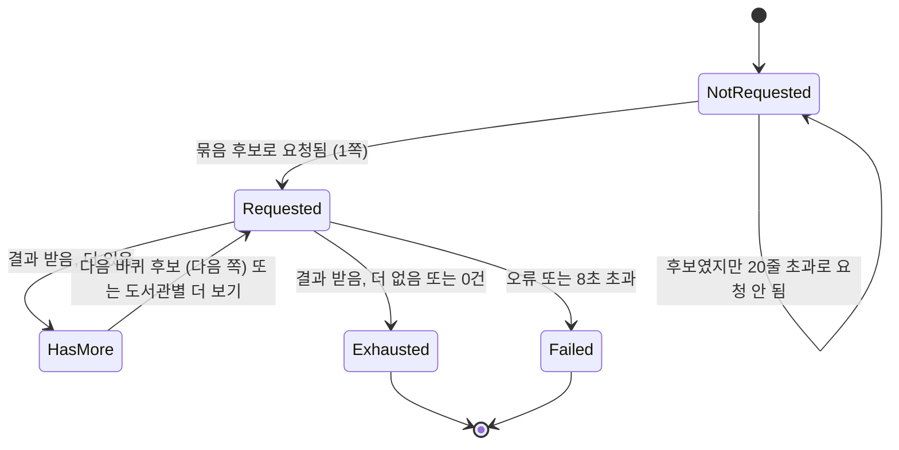

- 1바퀴: `NotRequested`가 남아 있으면 계획 순서대로 후보로 보냅니다.
- 다음 바퀴: `HasMore`인 사이트를 계획 순서대로 다음 쪽으로 보냅니다.
- 모두 `Exhausted`나 `Failed`이면 목록 맨 아래 "더 보기"를 없앱니다.
- `Failed`는 같은 검색에서 다시 조회하지 않습니다 [확정] (ADR-0014).
- 필터, 조회 범위(`scope`), "방문 없이 가입"(`visit`), 지역, 검색 조건(제목/저자/출판사)이 바뀌면 상태를 버리고 첫 묶음부터 다시 검색합니다 [확정].
- 조회 서버가 모두 멈춘 동안에는 후보가 곧바로 실패해 한 묶음이 계획 대부분을 `Failed`로 만듭니다. 그 검색에서는 다시 묻지 않습니다(알려진 한계, 다음 사이클 후보).

## 흐름 1: 첫 묶음 검색

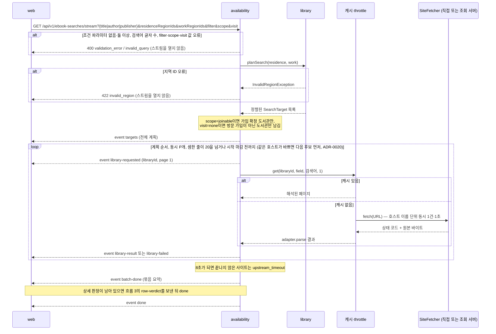

## 흐름 2: 목록 맨 아래 "더 보기"

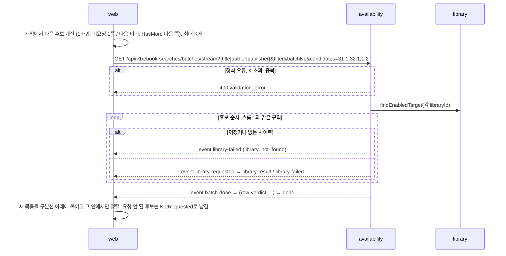

- 도서관별 "더 보기"는 `GET /api/v1/availability/libraries/{libraryId}/ebooks?{title|author|publisher}&page`(사이클 01 경로, 사이클 03에서 조건 파라미터로 바뀜)를 부르고, 결과를 목록 맨 아래 새 묶음으로 붙입니다. 이 API는 JSON 한 번에 응답하므로, 상세 판정이 필요한 줄은 판정을 읽은 뒤(최대 30초) 함께 돌려줍니다 [안].

## 흐름 3: 경북·전북 포털 상세 판정

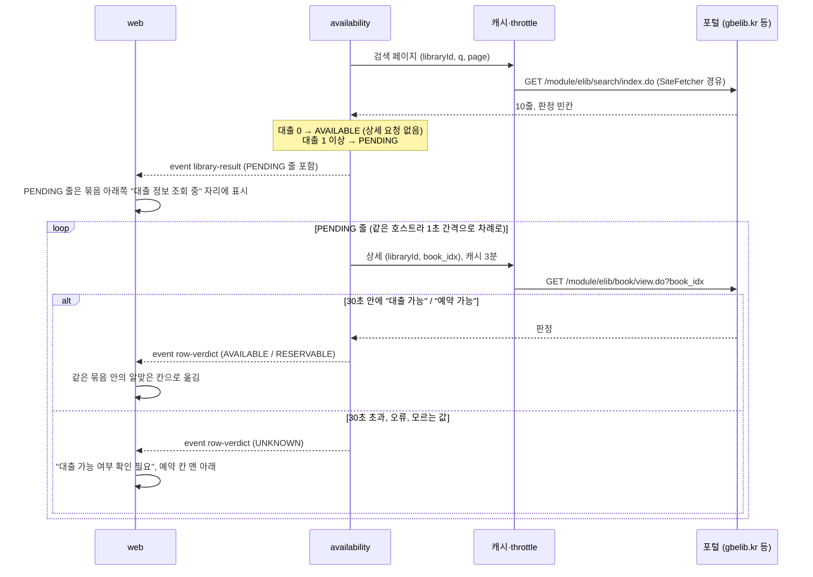

- 30초는 **묶음을 시작한 시각부터**입니다 [안]. 묶음의 8초 마감은 검색 페이지 요청에만 적용합니다.
- 30초 동안 한 호스트에서 읽을 수 있는 상세는 대략 25건입니다 (1초 간격). 실측(dev, 2026-09-29, `사랑` 첫·둘째 묶음): 경북·전북 대출 중 줄은 각 1~2건이었고 모두 30초 안에 끝났습니다.
- 인천 포털은 상세 페이지가 로그인을 요구해, 대출 1 이상 줄은 모두 `UNKNOWN`("대출 가능 여부 확인 필요")입니다.

## 흐름 4: 조회 서버 경유 모드에서 서버 넘기기

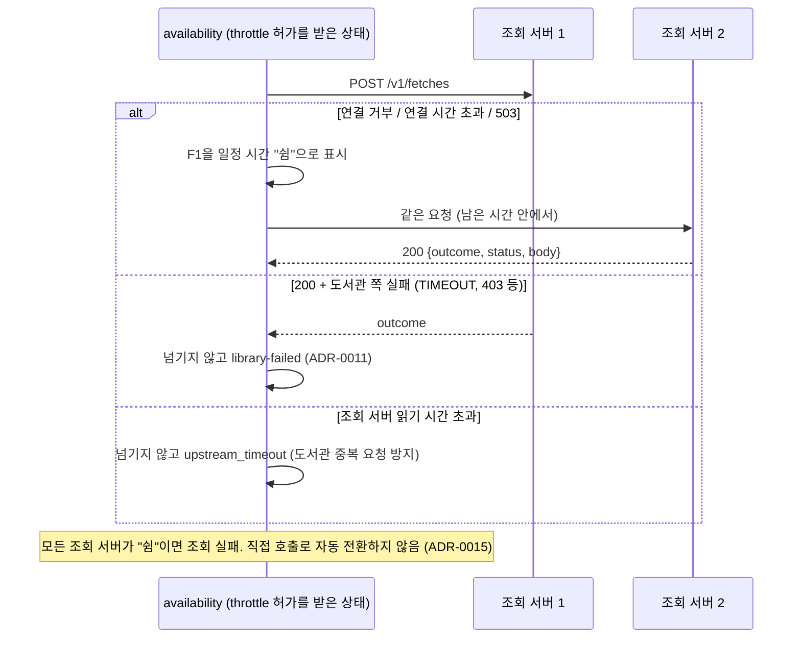

## 흐름 5: 검색 조건 바꾸기

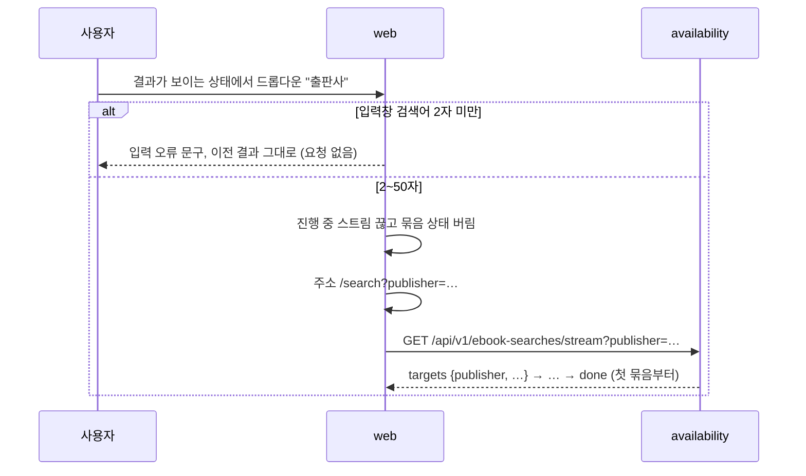

- 검색 전(첫 화면)에서 드롭다운을 바꾸면 안내 문구만 바뀌고 검색하지 않습니다. 드롭다운 기본값은 항상 제목입니다.
- 포털의 저자·출판사 검색은 1쪽부터 `table.do` + 거르기로 부릅니다(ADR-0026). `table.do`에서 목록 판정 칸이 비는 포털은 흐름 3(상세 판정)으로 이어집니다. 실측(dev, 2026-09-29): 부산·대구·경기교육청은 상세 0~1건, 수량 칸이 없는 전북은 쪽마다 10건(약 20초, 30초 안).

## 흐름 6: 책 목록 검색과 바로 보기 — 구현됨(dev `BookSearchController`·`BookAvailabilityStreamController`, 사이클 04)

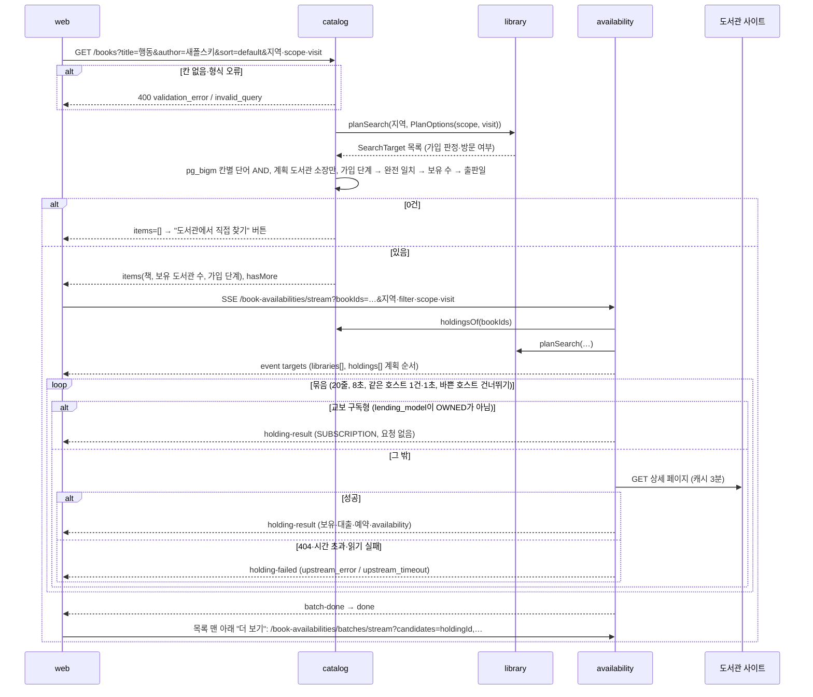

- 사이클 07 (구현됨 (사이클 07), ADR-0056·0055): 책 화면(소장 스트림)의 "교보 구독형 → 요청 없이 `SUBSCRIPTION`"은 `lending_model = OWNED`가 아닐 때만이고, `OWNED`면 상세 쪽을 읽어 숫자를 보입니다. "도서관에서 직접 찾기" 목록은 `lending_model`과 상관없이 줄마다 숫자가 있으면 숫자, 없으면 구독으로 판정합니다(혼합형은 줄마다 다름, dev 사이트 시험 2026-10-05). 북큐브는 상세 XML(`detailFetchUri`)을 읽고 대여형이면 `SUBSCRIPTION`, 알라딘은 상세 HTML "보유현황"을 읽습니다. `catalog`의 "계획 도서관 소장만"은 `book.library_ids && 계획 번호`로 거릅니다(흐름 17). 계획 도서관이 50곳 [안]을 넘으면 GIN 인덱스 없이 거릅니다 [이유 미확인: dev가 정함]
- 사이클 07: 묶음 스트림과 도서관별 더 보기는 동시 검색이 20 [안]을 넘으면 스트림을 열지 않고 503 `server_busy`, nginx IP별 한도를 넘으면 429 `too_many_requests`(`api.md` "요청 수·응답 크기 제한"). 사이클 08: 503에 `Retry-After: 5`, 화면은 두 경우를 따로 안내(흐름 22) — 설계됨(미구현, 사이클 08)
- 사이클 08 (설계됨(미구현, 사이클 08), ADR-0066·0070): 소장 스트림은 `planSearch`로 계획을 먼저 만든 뒤 `holdingsOf(bookIds, 계획 도서관 번호)`로 계획에 든 도서관 소장 줄만 읽음(흐름 21). 위 그림의 `holdingsOf(bookIds)` → `planSearch` 순서는 지금 코드(사이클 07). 소장 번호가 지금 목록에 없으면 `holding-failed` `holding_not_found`(꺼진·없는 도서관 `library_not_found`와 나눔)
- 도서관 하나의 조회 상태 그림(맨 위)은 사이클 04에서 도서관 대신 소장(`holdingId`) 단위로 같게 적용합니다. 상세 페이지 조회라 "다음 쪽" 상태는 없습니다.

## 흐름 7: 책 먼저 고르기 → 책 화면 — 구현됨(dev, 사이클 04)

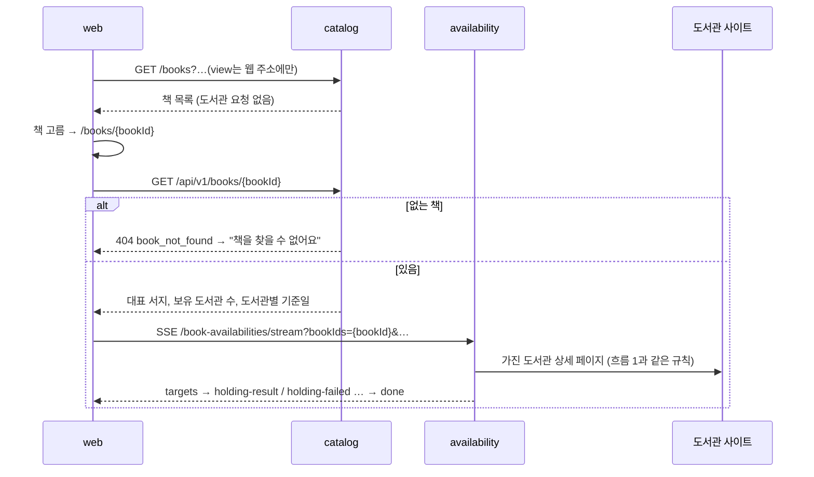

## 흐름 8: 수집 목록 한 번 가져오기 — 구현됨(dev `c6028c9`), 첫 실제 적재 2026-10-03 18:05 (책 680,689권, 소장 4,954,360줄. dev `plan-feedback.md` "실제 가져오기 결과"). 사이클 07부터는 `collection`이 맡음(흐름 16, 구현됨 (사이클 07))

**사이클 07부터 가져오기는 `collection` 모듈이 맡습니다** (구현됨 (사이클 07), ADR-0060이 ADR-0031의 "가져오기는 `catalog` 안"을 바꿈). 아래 그림은 사이클 04~06 모양(지금 코드에는 없음)이고, 사이클 07 모양(짝 표, 모든 서비스 도서관, 두 번 읽기, `library_ids`, `CatalogLoad.replaceAll`, 책 번호 잇기, 기록은 `collection.catalog_import`)은 흐름 16입니다. 그림의 "서비스 library와 id·base_url 같은 곳만" 대조는 짝 표 대조로 바뀌고, 주소 비교는 호스트·경로·쿼리만 보는 안전장치로 남습니다(ADR-0052·0054, 인계서 C10 변경). 프로필 `catalog-import`·설정 `chaekcheck.catalog.import.*`은 `collection-import`·`chaekcheck.collection.import.*`로 바뀜.

개발 중 더한 것: 묶기 4(정리한 전체 제목 + 대표 저자 + 정리한 출판사, 사용자 결정 2026-09-30)와 dry run 옵션(`--chaekcheck.catalog.import.dry-run=true`: 읽고 묶기만, DB에 쓰지 않음). 규칙은 `docs/research/ebook-catalog/same-book-isbn.md` 5절.

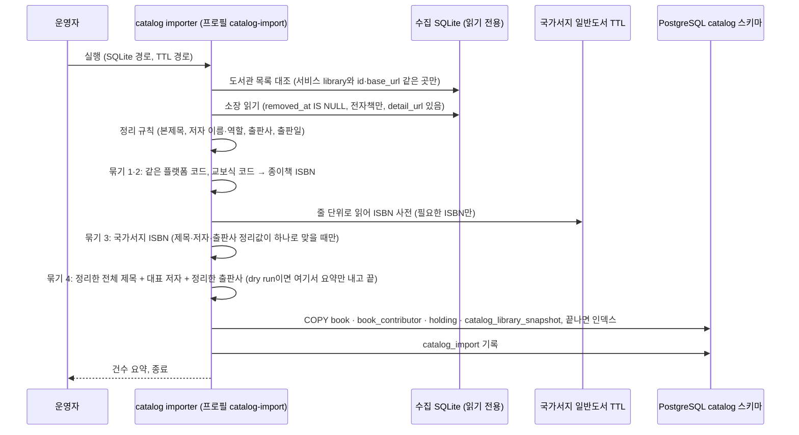

## 흐름 9: 첫 로그인과 동의, 다시 로그인 — 구현됨(사이클 05, 2026-10-04 retro 반영)

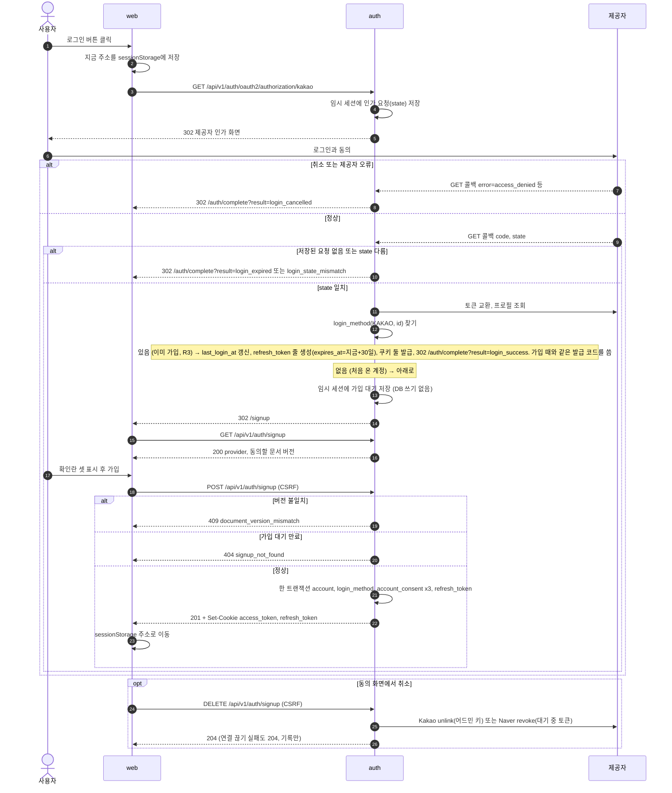

## 흐름 10: 토큰 갱신과 교체 — 구현됨(사이클 05, 2026-10-04 retro 반영)

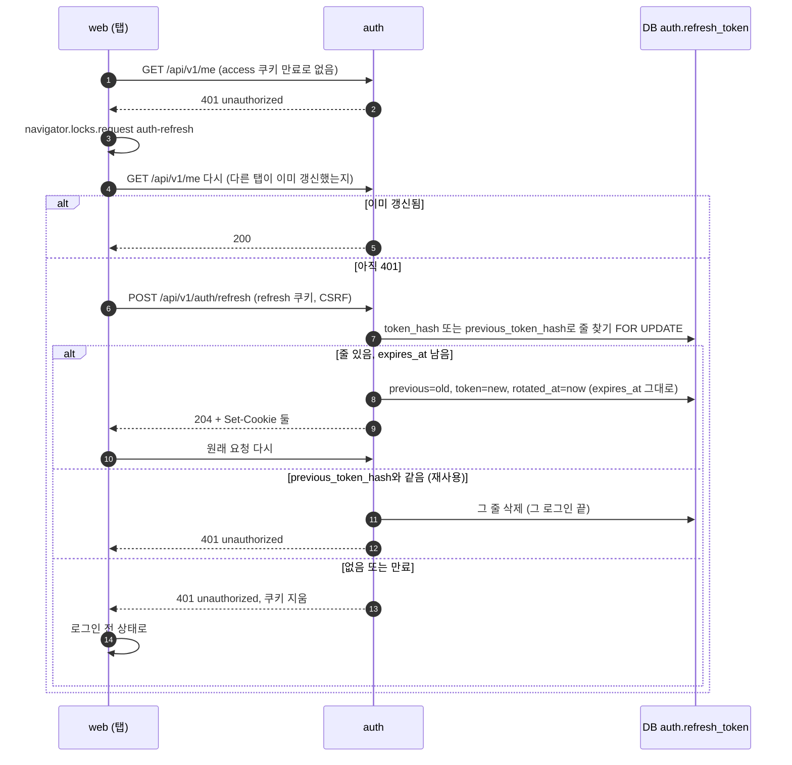

- 여러 탭이 동시에 갱신하지 않게 웹이 Web Locks로 한 번에 한 탭만 갱신합니다(ADR-0038).

## 흐름 11: 탈퇴 (재인증) — 구현됨(사이클 05, 2026-10-04 retro 반영)

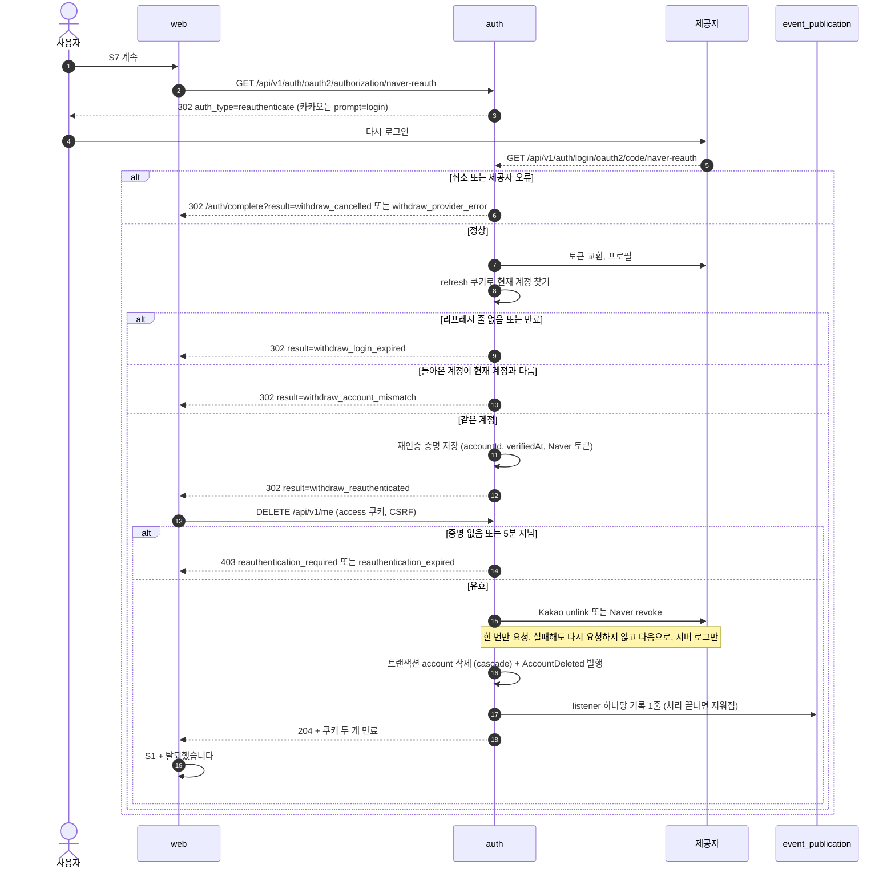

## 흐름 12: 제공자 쪽에서 연결을 끊음 — 구현됨(사이클 05, 2026-10-04 retro 반영)

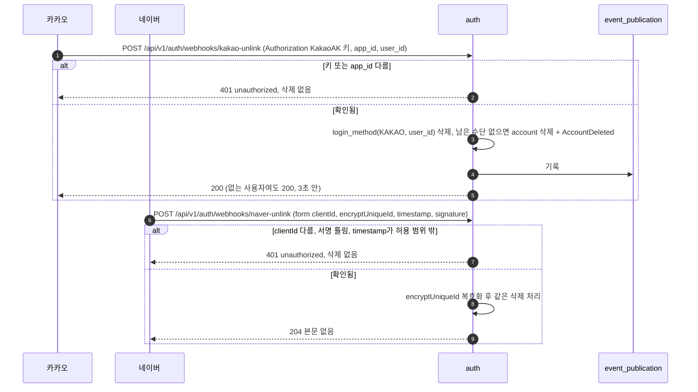

- 놓친 알림은 카카오 연결 대조(하루 한 번)와 1년 미로그인 계정 정리로 메웁니다.

## 흐름 13: 로그인 직후 내 도서관 읽기와 지역 옮기기(S11) — 구현됨 (사이클 06)

로그인 직후 웹이 저장된 지역·직접 추가 도서관을 읽고, 서버 지역이 비어 있으면 브라우저 지역을 계정에 옮길지 물은 뒤 검색 주소를 만듭니다(ADR-0049).

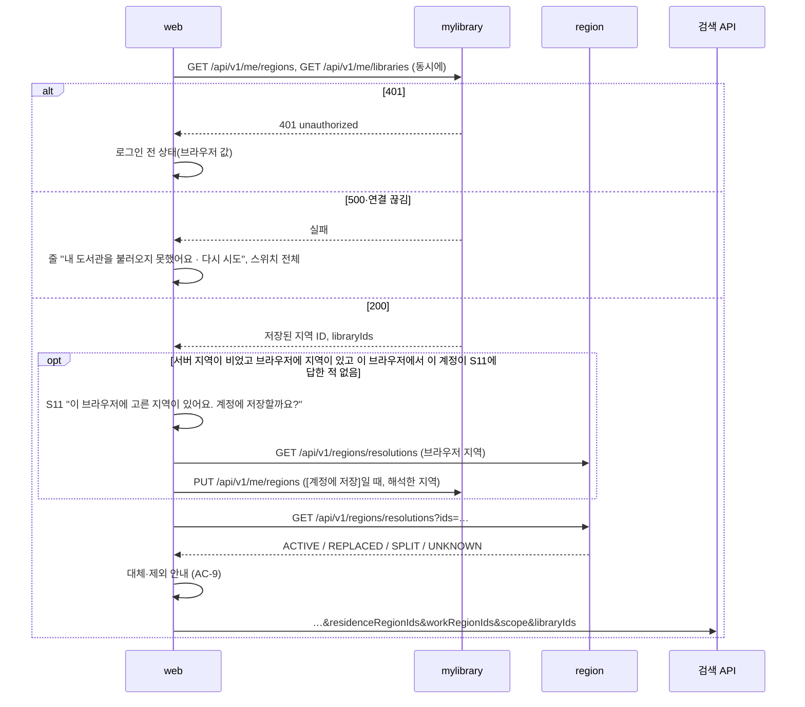

- 로그인 확인(`GET /api/v1/me`)이 끝나기 전에는 웹이 브라우저 지역(`chaekcheck.regions.v1`)을 읽지 않고 검색도 기다립니다(지역 출처 `source=waiting`). 로그인한 사람의 브라우저 값을 읽지 않기 위해서입니다. 그래서 로그인 전 사용자의 첫 검색이 `/me` 응답 한 번만큼 늦어집니다(요청 내용은 사이클 05와 같음, AC-14). 확인 뒤 출처는 로그인 전·로그인 꺼짐이면 `browser`, 로그인 후면 `account`(내 도서관을 다 불러오기 전에는 지역 없이 "전체"로 검색을 막지 않고, 다 불러오면 그 값으로 첫 묶음부터 한 번 다시 검색) [확정] (dev 구현 확인, 2026-10-05)
- S11은 예외로, 로그인한 상태에서 브라우저 지역을 한 번 읽습니다(옮기기 제안 때문). 브라우저 값은 지우거나 고치지 않습니다.
- 사이클 07 (구현됨 (사이클 07), ADR-0057): S11은 지역뿐 아니라 로그인 전에 직접 넣은 도서관도 함께 옮깁니다. 열리는 조건과 요청은 흐름 19
- 사이클 07부터 로그인 전 첫 검색 요청에 `scope=joinable`이 붙어(검색 범위 기본값이 가입할 수 있는 쪽) 위 "요청 내용은 사이클 05와 같음, AC-14"는 더 맞지 않습니다 [확정] (사용자: "이 프로젝트의 편의성을 생각했을 때 가입할 수 있는 곳으로 가는 것이 사용자 측면에서 좋다고 봐서", 2026-10-05)
- S11 답(계정 번호)은 브라우저 `chaekcheck.regionImport.v1` [확정] (dev 구현 확인, 2026-10-05)에 적어 같은 브라우저·같은 계정에는 다시 묻지 않습니다. 로그인한 동안 `chaekcheck.regions.v1`은 읽지도 쓰지도 않습니다 [확정].

## 흐름 14: 내 도서관 직접 추가(S10) — 구현됨 (사이클 06)

누르면 화면에 먼저 추가해 보이고 바로 저장하며, 실패하면 되돌립니다. 서버 순서는 잠금 → 켜진 도서관 확인 → 이미 있으면 204 → 20곳이면 409 → INSERT입니다.

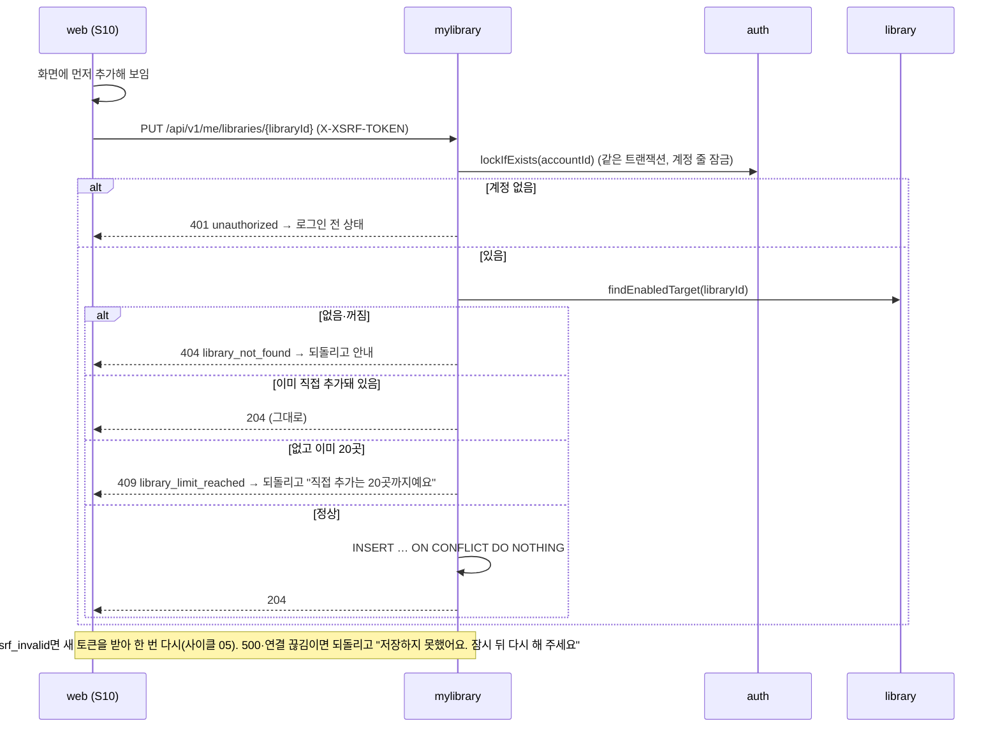

- 빼기(`DELETE /api/v1/me/libraries/{libraryId}`)도 처음에 계정 줄을 잠그고, 계정이 없으면 401입니다(dev가 ADR-0051 "모든 저장의 처음"을 따름). 숫자가 아닌 경로(`abc`, `0`, `-1`)는 PUT·DELETE 모두 404 `library_not_found` [확정] (dev 구현 확인, 2026-10-05).
- S10 화면은 구역 셋입니다(2026-10-05 바뀜. 사이클 06 flow S10 "여섯 구역"을 사용자 요청으로 바꿈) [확정] (사용자 요청, 2026-10-05): 맨 위 "누구나 가입하는 도서관 N곳" 줄, ① 지역 선택([변경] 하나. 안에 차례로 "거주 X" / "거주 지역으로 자동 N곳 ▸" / "직장 Y" / "직장 지역으로 자동 N곳 ▸", 누르면 이름 목록이 펼쳐짐) ② 직접 도서관 추가 ③ 직접 추가한 도서관 N/20. [변경]은 S2를 "거주" 탭으로 엽니다(직장은 S2 안의 탭).

## 흐름 15: 저장과 탈퇴가 겹칠 때 — 구현됨 (사이클 06)

저장이 계정 줄을 먼저 잠그면 탈퇴가 기다렸다가 지우고, 커밋 뒤 `AccountDeleted`를 받은 `mylibrary` listener가 두 표를 지워 지워진 계정의 자료가 남지 않습니다(ADR-0051).

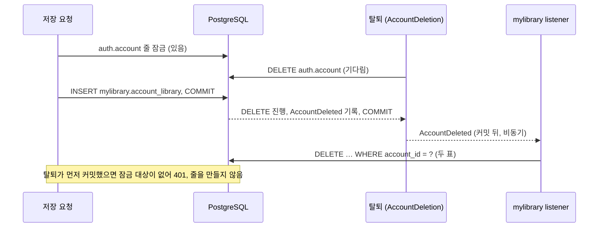

- listener가 실패한 기록은 재시작 때 다시 처리합니다(`republish-outstanding-events-on-restart: true` [확정]). 실패(`FAILED`) 기록도 다시 처리합니다 — 확인함 (dev, 2026-10-04): 공식 문서는 상태별 동작을 적지 않아 Spring Modulith 2.1.1 jar를 확인함. `JdbcEventPublicationRepositoryV2`가 `COMPLETION_DATE IS NULL OR STATUS != 'COMPLETED'`인 기록을 다시 처리하고, 시험 `mylibrary/AccountDeletedRepublishTests`(실제 잠금 시간 초과로 `FAILED`를 만든 뒤 재시작 → 두 표·발행 기록 0)로 확인.
- 알고 받아들인 것(dev 리뷰): 로그인 기능을 끈 동안 남은 `AccountDeleted` 기록은 listener도 꺼져 있어 처리되지 않고, 다시 켜고 재시작하면 처리됩니다.

## 흐름 16: 후보 도서관 넣기와 가져오기 (배포 전 한 번) — 구현됨 (사이클 07)

후보 도서관 줄과 짝 줄은 Liquibase seed로 넣고, 가져오기는 `collection`이 짝 표로 모든 서비스 도서관의 책을 사본에서 두 번 읽어 `catalog`의 `CatalogLoad.replaceAll(source, loader)` 콜백 세션으로 표를 통째로 바꿉니다(ADR-0052, 0054, 0055, 0060). 흐름 8(사이클 04 importer)을 대신합니다.

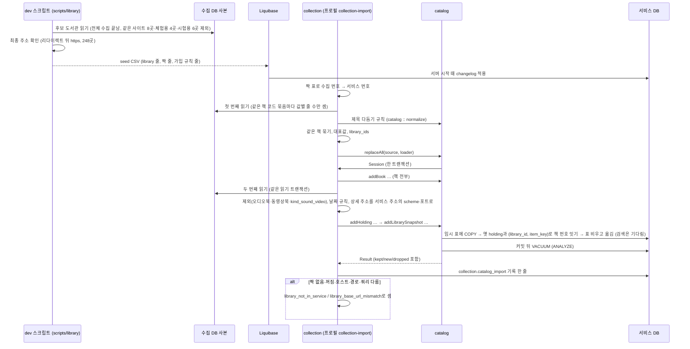

- 짝 맞춘 서비스 도서관이 켜졌는지와 사이트 주소는 `LibraryCatalog.enabledLibraryRefs()`로 확인합니다(`library` 표는 읽지 않음). 비교는 호스트·경로·쿼리만(http/https·포트 차이 허용, `CollectedCatalog.sameSite`) [확정] (dev 구현 확인, 2026-10-05; 인계서 C10을 바꿈, 사용자 요청 2026-10-05)
- `collection`이 만든 책·사람·소장을 `catalog`에 넘기는 모양: `CatalogLoad.replaceAll(source, loader)`의 콜백 세션(`addBook` → `addHolding` → `addLibrarySnapshot`, 책을 다 넣은 뒤 소장), 한 트랜잭션, 실패하면 이전 그대로 [확정] (dev 구현 확인, 2026-10-05). `addBook`이 돌려주는 번호는 이번 가져오기 안에서만 쓰고, 저장 번호는 끝에 책 번호 잇기(`docs/research/ebook-catalog/catalog-refresh.md` 5.2절)로 정함 [확정] (사용자: "이것도 같이 구현해 줘", 2026-10-05)
- 실행: 프로필 `collection-import`, 설정 `chaekcheck.collection.import.*`(`sqlite-path`, `ttl-path`, `dry-run`, `placeholder-date-libraries`) [확정] (dev 구현 확인, 2026-10-05). 원본은 배포용 사본 `ebook-catalog-2026-10-05-0745.sqlite` [확정]. 걸린 시간 36분 43초(빈 DB), 2회차 40분 36초(kept 1,617,445, new 0, dropped 0). 절차는 dev `docs/maintenance/3-import.md`
- 알려진 빈틈: 리다이렉트로 호스트까지 바뀐 411(`ebook2.ezville.net` → `gsenc.bookcube.biz`)은 안전장치에 걸려 소장 64,461줄이 빠짐 [확인 필요] (어떻게 이을지 사용자에게 질문)
- 사이클 08 (설계됨(미구현, 사이클 08), ADR-0065·0069·0070): 위 그림의 "한 트랜잭션, 임시 표 → 표 비우고 옮김(검색은 기다림)"과 커밋 뒤 `VACUUM`은 지금 코드(사이클 07) 모양입니다. 사이클 08부터 `replaceAll`은 새 표(`catalog_next`)에 쓰고 바꿔 끼우며, 국가서지는 남긴 원문을 다시 쓰고, 같은 소장은 옛 소장 번호를 잇습니다(흐름 20). 교보 대여·혼합 11곳(2664~2674)은 seed와 짝 표에서 빠짐(ADR-0067)

## 흐름 17: 로그인 전 직접 추가한 후보 도서관으로 검색 — 구현됨 (사이클 07)

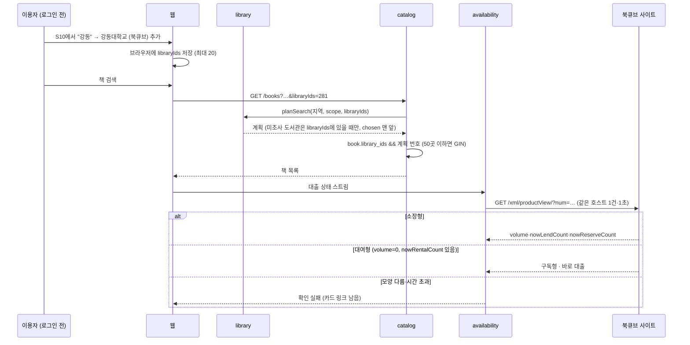

- 로그인 전(로그인 기능이 꺼져 있어도) S10(`/my-libraries`)도 열리고, 직접 추가는 브라우저 키 `chaekcheck.chosenLibraries.v1` [확정] (dev 구현 확인, 2026-10-05)에 저장합니다 [확정] (ADR-0057). 이름 찾기에서 이미 추가한 곳은 "직접 추가함"(흐리게, 누를 수 없음), 없으면 "찾는 도서관이 없어요". S10 도서관 찾기는 `GET /api/v1/libraries`를 통째로 받아 화면에서 거릅니다(두 글자 이상, 앞 글자 맞는 것 먼저·가나다순, 20곳씩) [확정] (ADR-0058)
- 후보 도서관 이름을 누르면 열리는 가입 정보 창 맨 위에 가입 조사 상태별 안내가 있습니다 [확정] (ADR-0053). `joinSurvey`가 `SURVEYED`가 아니면 안내 문구 + (가입 방법·주의가 있으면 그것) + [도서관 첫 화면](`homepageUrl`)
- 북큐브 사이트 그림의 "/xml/productView/?num=" 주소는 서비스 도서관 주소(https 최종 주소)의 scheme·포트로 옮겨 쓴 상세 주소에서 만듭니다(강동대학교 북큐브가 검색되지 않던 원인, 사이클 07 고침)

## 흐름 18: 직접 추가하지 않은 이용자 — 구현됨 (사이클 07)

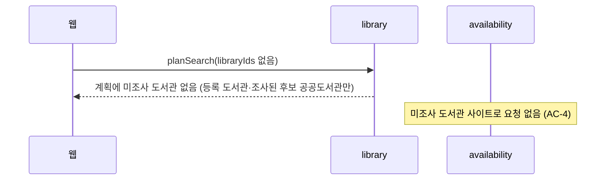

- 가입 조사 상태가 `MEMBERS_ONLY`·`NOT_SURVEYED`이고 직접 추가가 아니면 계획에서 뺍니다("전체 도서관"이어도) [확정] (ADR-0053). dev 확인값: 직접 추가 없이 `scope=all` 계획 385곳(`SURVEYED` 368 + `NOT_FOUND` 17, 278 + 조사된 후보 107), 구성원용·종류 모름 0곳, 그 사이트 요청 0건(AC-4). 3곳을 끈 뒤의 수는 다시 세지 않음
- AC-15 문장 (회고에서 바꿈) [확정] (사용자 제안, 2026-10-05: "이렇게 해줘"): "로그인하지 않고 직접 추가한 도서관도 없는 사람의 검색은 가입 조사를 한 공공도서관(지금 385곳)만 찾는다. 학교·대학·회사·기관처럼 구성원만 쓰는 도서관과 종류를 모르는 도서관은 찾지 않고, 그 사이트에 요청도 보내지 않는다." 처음 문장("이 사이클 전과 같다")은 ADR-0053과 함께 지킬 수 없었음
- 사이클 07 전부터 있던 도서관(278곳)만 쓰는 이용자: 검색 대상(278·114·31곳, 순서 같음)과 소장 (도서관, 책 코드) 집합은 같고(새로 뺀 교보 "동영상" 391줄만 차이), 책 목록은 사이클 07에 넣은 도서관의 책이 같은 책 묶기에 함께 들어가 묶음이 합쳐져 57개 응답 중 38개가 다름(권수 0~2.5% 감소, 대표 제목·순서 바뀜) — 받아들임 [확정] (사용자 승인, 2026-10-05, 회고 질문 #5. Q1 "책 순서는 같음"을 바꿈)

## 흐름 19: 로그인 직후 옮기기 (S11) — 구현됨 (사이클 07)

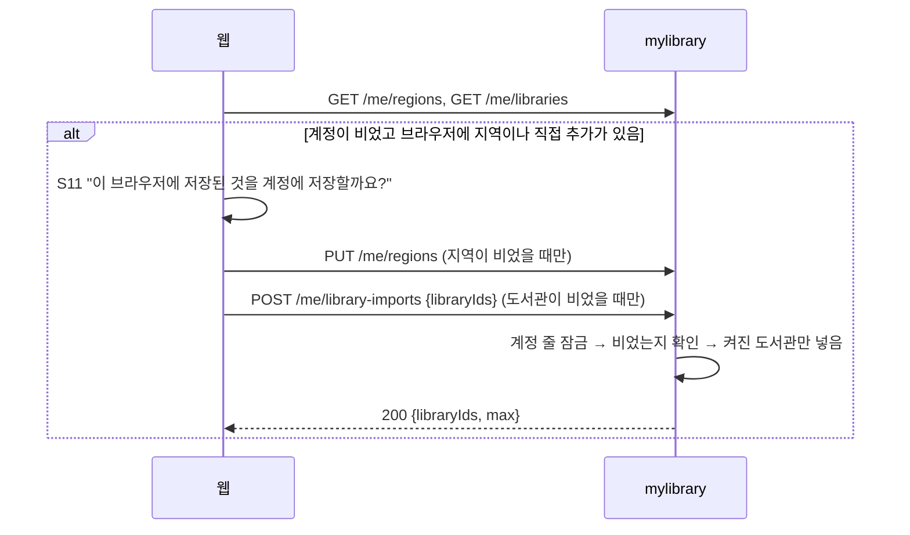

- 흐름 13의 S11(지역만)을 넓힙니다(ADR-0057). 한 번 누르면 지역·도서관을 함께 옮기고, 계정에 이미 있는 쪽은 옮기지 않으며 창에도 보이지 않습니다. 브라우저 값은 지우지 않습니다. 계정 직접 추가가 20곳을 넘게 되면 넘는 것은 옮기지 않고 "20곳까지만 저장했어요" [확정] (사용자 승인, 2026-10-05). 응답 수가 보낸 수보다 적은 그 밖의 경우(그 사이 꺼지거나 지워진 도서관)는 "지금 쓸 수 없는 도서관 N곳은 빼고 저장했어요" [안 문구] (dev 결정)
- 계정에 이미 직접 추가가 있으면 409 `library_import_not_empty` [확정] (dev 구현 확인, 2026-10-05) → 웹은 계정 값을 다시 읽음. 형식 오류는 400 `validation_error` (`api.md` "내 도서관")
- 답한 기록 키는 `chaekcheck.regionImport.v1` 하나를 지역·도서관이 함께 씀 [이유 미확인: dev가 정함] (한 질문으로 둘을 묻기 때문), 회고에서 그대로 둠 [확정] (사용자 승인, 2026-10-05). 한 번 답한 계정은 그 브라우저에서 다시 묻지 않음(나중에 브라우저에 추가한 도서관은 계정으로 옮겨지지 않음)

## 흐름 20: 가져오기 — 새 표에 쓰고 바꿔 끼우기 — 설계됨(미구현, 사이클 08)

흐름 16의 쓰기 단계를 바꿉니다(ADR-0065, ADR-0069, ADR-0070). 공개 `CatalogLoad.replaceAll` 모양과 모듈 방향은 그대로입니다.

```mermaid
sequenceDiagram
  participant Op as 운영자 (collection-import 실행)
  participant Col as collection 가져오기
  participant NB as 국가서지 결과 (collection)
  participant Cat as catalog.CatalogLoad
  participant DB as PostgreSQL
  participant Web as 검색 요청
  Op->>Col: 사본 경로로 실행
  Col->>Col: 사본 읽기 (단계별 시간 기록)
  Col->>NB: TTL 파일 지문이 같은가?
  alt 같음
    NB-->>Col: 남긴 원문 (ISBN, 제목, 저자, 출판사)
  else 다름 또는 처음
    Col->>Col: TTL 풀기 (6.5~9분)
    Col->>NB: 원문 저장 (지문 함께)
  end
  Col->>Col: 원문을 지금 정리 규칙으로 다듬어 키 → ISBN (매번)
  Col->>Cat: replaceAll(책·사람·소장 흘려 넘김)
  Cat->>DB: 책 번호 잇기 (좁은 맞대기 표로 옛 holding과 맞대 책 번호·소장 번호 확정, ADR-0062·0070)
  Note over Web,DB: 이 동안 검색은 catalog의 옛 표를 읽음
  Cat->>DB: catalog_next에 색인 없이 확정된 책 번호 순으로 COPY/INSERT
  Cat->>DB: 색인·제약 만들기 (가져오기 세션만 maintenance_work_mem↑)
  Cat->>DB: VACUUM (ANALYZE) catalog_next
  Cat->>DB: 짧은 트랜잭션: 옛 표 DROP, catalog_next 표를 catalog로 SET SCHEMA (lock_timeout 2초, 실패하면 10초 뒤 다시, 최대 5번)
  Note over Web,DB: 이 순간만 검색이 잠깐 기다림
  Cat-->>Col: 결과 (kept/new/dropped, 단계별 시간)
  Col->>DB: collection.catalog_import 한 줄 (수집 시작·끝 포함)
  alt 바꿔 끼우기 전에 실패 (잠금 5번 다 못 얻음 포함)
    Cat->>DB: catalog_next 지움, 옛 표 그대로
    Col->>DB: 가져오기 기록에 실패
  end
```

- 국가서지 원문 표와 지문 표: `data-model.md` `collection` 절. 지문이 다르면 ① 지문 줄 지우기 → ② 원문 표 비우고 다시 쓰기 → ③ 맨 마지막에 지문 줄 쓰기 [확정] (사용자 승인, 2026-10-11, 설계 검토)
- `lock_timeout` 2초·10초 뒤 다시·최대 5번 [확정] (사용자 승인, 2026-10-11, 설계 검토)(값은 측정 뒤 바꿀 수 있음). "TTL 풀기 6.5~9분"은 추정 [안] (`docs/cycles/08-polish-swap-memory/research.md` 10절)
- 바꿔 끼운 뒤 옛 화면의 요청: 같은 소장은 옛 번호 그대로라 정상, 빠진 소장은 `holding_not_found`, 빠진 책은 `book_not_found` (ADR-0070)
- 정리 규칙을 바꿀 때 서비스를 다시 켤지는 `data-model.md` "정리 규칙을 바꿀 때" (ADR-0069)

## 흐름 21: 검색 계획과 책 화면 소장 읽기 — 설계됨(미구현, 사이클 08)

ADR-0066. 계획에 들어갈 도서관만, 그 도서관의 소장 줄만 DB에서 읽습니다. 켜짐 여부는 요청마다 읽습니다(ADR-0004 그대로).

```mermaid
sequenceDiagram
  participant W as web
  participant A as availability 스트림
  participant L as library.planSearch
  participant C as catalog.CatalogHoldings
  participant DB as PostgreSQL
  W->>A: 책 대출 현황 스트림 (bookIds, 지역, libraryIds)
  A->>L: planSearch
  L->>DB: 켜진 도서관 중 join_survey IN (SURVEYED, NOT_FOUND) OR id = ANY(직접 추가)
  DB-->>L: 약 385곳 + 직접 추가 (지금은 2,674곳 전부)
  L-->>A: 계획
  A->>C: holdingsOf(bookIds, 계획 도서관 번호)
  C->>DB: book_id = ANY AND library_id = ANY
  DB-->>C: 계획에 든 소장 줄만 (지금은 모든 도서관 줄)
  A-->>W: targets + 줄별 결과
```

- 두 캐시는 통계(`recordStats()`)를 켜고 캐시마다 상한 설정을 나눔, 상한 값은 측정 뒤(ADR-0006 그대로, ADR-0066)

## 흐름 22: 막혔을 때 (429·503) — 설계됨(미구현, 사이클 08)

```mermaid
sequenceDiagram
  participant W as web
  participant N as nginx
  participant A as availability
  W->>N: 검색 스트림 요청
  alt IP 한도 넘음
    N-->>W: 429 too_many_requests, Retry-After 2 (이미 있음)
    W->>W: "검색을 너무 자주 했어요…" 안내 줄, 받은 결과는 남김
  else 동시 검색 20개 넘음
    N->>A: 전달
    A-->>W: 503 server_busy, Retry-After 5 (새)
    W->>W: "지금 찾는 사람이 많아요…" 안내 줄
  end
```

- 문구 전체와 태그는 `api.md` "요청 수·응답 크기 제한"·오류 코드 표. `Retry-After: 5` [확정] (사용자 승인, 2026-10-11)

## 화면 공통: 안내 줄과 검색 결과 머리 — 구현됨 (사이클 06 마무리, 2026-10-05)

- 머리말 아래 안내 줄(`NoticeBar`)은 한 번 보이고 닫을 수 있으며, **다른 페이지(경로가 다른 곳)로 가면 사라집니다**. 안내가 지나가기만 하는 `/auth/complete`, `/signup`은 세지 않고 안내가 처음 보인 페이지를 기준으로 하며, 같은 페이지에서 주소의 검색 조건만 바뀌면 그대로 둡니다. "가입했어요"뿐 아니라 모든 안내(탈퇴했습니다, 로그인 실패, S11 저장 안내)에 같습니다 [확정] (사용자, 2026-10-05: "바로 가입햇어요가 뜨긴 하는데 이거 한 번만 보여주고 페이지 바꾸면 사라졌으면 해", AC-17 후속)
- `signup_success`("가입했어요")는 서버 결과 코드가 아니라 웹 상태입니다: `SignupPage`가 201 뒤에 안내 줄을 한 번 띄움 [확정] (사용자 선택, 2026-10-04)
- S1 검색 결과 머리: "N월 N일 기준 수집 목록 · 책 N권" 줄을 없앴습니다(사이클 04 S1 결과 머리 줄을 바꿈). 정렬은 결과 판의 탭 줄("지금 빌릴 수 있는 책만 | 전체") 오른쪽 끝으로 옮기고, 옆의 "?"를 누르면 "기본 순서" 기준 설명이 열립니다. "도서관에서 직접 찾기"에서는 같은 자리에 흐린 정렬 + 이유 글이고 "?"는 없습니다. 찾은 책이 없을 때의 "(N월 N일 기준)" 안내와 책 화면(S3)의 "… 수집 목록 · 보유 도서관 N곳" 줄은 그대로입니다 [확정] (사용자, 2026-10-05: "… 이거 정보 필요 없다고 생각해 빼고 정렬을 좀 … 위치로 올려줘", "? 기본 순서의 우측에 뒀으면 해")
- 결과 거르기 탭의 기본값은 "지금 빌릴 수 있는 책만"(왼쪽)이고 "전체"는 `filter=all`입니다. 첫 검색 요청도 `filter=available`입니다(사이클 04 "기본 전체" [안]을 바꿈) [확정] (사용자, 2026-10-05: "정렬이 지금 빌릴 수 있는 책만이 기본으로 하고 / 왼쪽에 나오도록 해줘", 해석 확인 "응")
- 결과 줄의 가입 정보는 모든 폭에서 도서관 이름을 누르면 열리는 팝오버에 있고, "가입 자격 확인 필요"도 그 안 맨 위에 있습니다. 직접 추가 도서관도 같은 정보를 보이며 차이는 이름 옆 "직접 추가" 표시와 정렬뿐입니다(자세한 것은 `module-map.md`) [확정] (사용자 요청, 2026-10-05)
- 사이클 07 (구현됨 (사이클 07), ADR-0059): S1·S3 결과 카드(약 20px)와 S10 도서관 줄(약 24px)의 **이름 위 줄**에 로고, 누르면 그 도서관 메인 페이지 새 창(결과 카드에서도 카드 링크와 따로), **로고가 없으면 아무것도 그리지 않음**(로고로 홈페이지를 열 수 없고, 카드의 "홈페이지 (새 창)" 링크는 있음) [확정] (사용자: "실제로 확인해보고 디자인 측면의 안정감때문에", 2026-10-05, AC-20의 "이름 앞, 빈 상자"를 바꿈). 모든 화면 바닥글에 "서비스 안내" 링크 → 새 화면 S12 `/about`(소개, "각 도서관의 로고와 이름은 그 기관의 것이며 책첵은 제휴·후원 관계가 없습니다", 로고 내림 요청 이메일 — 주소는 사용자가 알려 줌 [확인 필요], S8·S9와 같은 흰 카드) [확정]
- 사이클 07 (구현됨 (사이클 07)): 로그인 전 S1의 [내 지역 ▾]/[내 지역 설정]을 로그인 후와 같은 [내 도서관 관리 ▾](폰은 [내 도서관 관리], 지역도 직접 추가도 없으면 "내 도서관 설정" → S10)로 바꾸고 S10을 로그인 전에도 엽니다 [확정] (사용자 승인, 2026-10-05). 결과 카드의 북큐브·알라딘은 보유·대출 중·예약 칸, 북큐브 대여형은 "구독형 · 바로 대출 ⓘ", 교보 구독형 화면은 줄에 숫자가 있으면 숫자 칸(책 화면은 `lending_model = OWNED`일 때) [확정] (spec R5, 판정 방식은 dev 사이트 시험 2026-10-05). 알라딘 수가 없는 줄은 "확인 필요"
- 사이클 07 (구현됨 (사이클 07)): 검색 범위 스위치 기본값은 가입할 수 있는 쪽, 그 버튼이 왼쪽(로그인 전 지역 없음 "누구나 가입", 지역 있음 "가입 가능한 곳", 로그인 후 "내 도서관", 비어 있어도) [확정] (사용자: "이 프로젝트의 편의성을 생각했을 때 가입할 수 있는 곳으로 가는 것이 사용자 측면에서 좋다고 봐서", 2026-10-05)
- 사이클 07 (구현됨 (사이클 07)): 브라우저 `chaekcheck.searchSettings.v1`에 기억하는 것은 범위(로그인 전 `guestScope`, 로그인 후 `myScope`), 방문 없이 가입, 지금 빌릴 수 있는 책만, 보기 방식(`view`), 직접 찾기(`direct`) [확정]. 주소 값이 이기고 검색어는 저장 안 함. 지금 코드는 정렬·완전 일치·옮긴이·그림·엮은이(`sort`·`exact`·`roles`)도 저장하지만 사용자가 "정렬, 상세검색의 완전 일치·옮긴이·그림·엮은이 … 이건 기억하지 마"(2026-10-05, 회고 질문 #2)라고 정해 다음 dev 인계서에서 뺌(backlog)
- 동시 검색이 다 차거나(503 `server_busy`) IP별 한도를 넘으면(429 `too_many_requests`) 화면은 따로 안내 줄: 429 "검색을 너무 자주 했어요. 1분쯤 뒤에 다시 해 주세요.", 503 "지금 찾는 사람이 많아요. 잠시 뒤에 다시 해 주세요." 받은 결과는 남김 [확정] (사이클 08 spec R2) — 설계됨(미구현, 사이클 08), 흐름 22. (지금 코드, 사이클 07: 두 경우 모두 일반 문구 "검색하지 못했어요. 잠시 뒤 다시 시도해 주세요.")
- 사이클 08 (설계됨(미구현, 사이클 08)): `mobileSiteDiffers`인 도서관은 폭 640px 이하에서 결과 카드 이름 아래·책 화면 줄·직접 찾기 결과·가입 정보 창 첫 화면 링크 옆에 YES24 폰 안내 [확정] 자리(문구 [안]). 빠진 책은 "책을 찾을 수 없어요" 아래 "도서관 목록을 새로 받으면서 빠진 책일 수 있어요. 다시 검색해 주세요.", 빠진 소장은 책 화면 그 도서관 줄에 "이 도서관 목록에서 빠졌어요" [확정] (ADR-0070). 브라우저 `chaekcheck.searchSettings.v1`에서 정렬·완전 일치·역할을 쓰지 않고 남아 있으면 지움 [확정] (spec R1)
