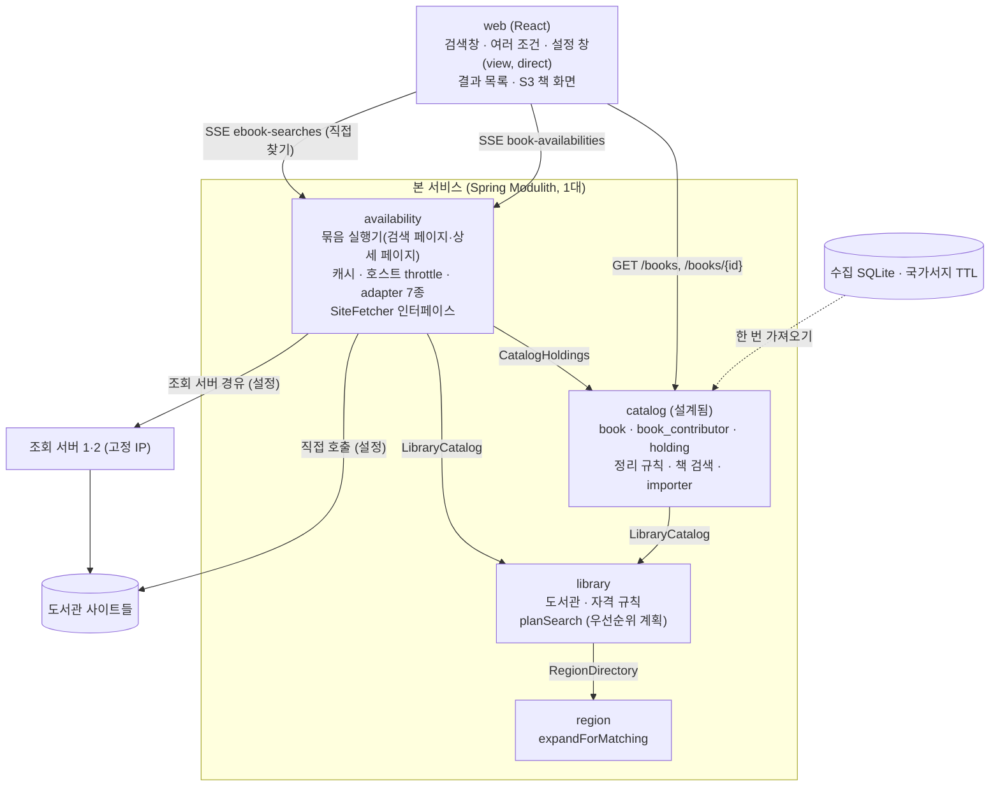
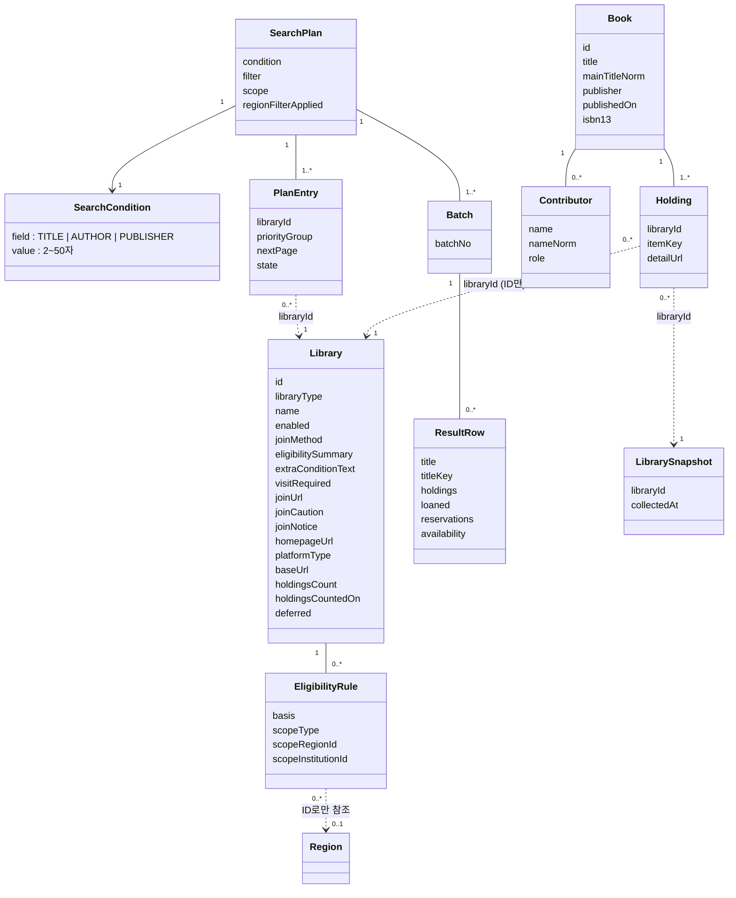

# 모듈 맵 (현재)

현재 설계 전체를 적은 문서입니다. 변경 기록이 아닙니다.

마지막 반영: 사이클 04 cycle-close (2026-09-30). 사이클 03까지는 dev 코드와 `Documenter` 출력으로 대조했습니다(구현됨). **사이클 04 변경(새 모듈 `catalog`, `library.planSearch(PlanOptions)`, `availability`의 상세 페이지 조회·소장 스트림)은 설계됨(미구현)** 입니다 (ADR-0028~0034, `docs/cycles/04-and-search/design-delta.md`).

| 모듈 | 책임 | 공개 API | 발행/구독 이벤트 | 소유 테이블 | 상태 |
|---|---|---|---|---|---|
| `region` | 시도·시군구 목록, 법정동 코드 속성, 폐지·대체 연결, 옛 지역 ID 해석 | Java `RegionDirectory` (`expandForMatching`, `resolve`), 예외 `RegionNotUsableException`(ID별 이유 `ABOLISHED`/`NOT_FOUND`/`NOT_SIGUNGU`) / REST `GET /api/v1/regions`, `GET /api/v1/regions/resolutions` | 없음 | `region.region`, `region.region_replacement` | 구현됨 |
| `catalog` | 수집한 전자책 목록(책·사람·역할·소장·도서관별 기준일, ADR-0028, ADR-0034), 정리 규칙(검색어와 저장값이 같은 코드, ADR-0031), 책 검색(칸별 단어 AND·완전 일치·역할·가입 단계 순서, ADR-0032), 한 번 가져오기(importer) | Java `CatalogHoldings` (`holdingsOf(bookIds)`, `holdings(holdingIds)` → `HoldingRef`) / REST `GET /api/v1/books`, `GET /api/v1/books/{bookId}` | 없음 | `catalog.book`, `catalog.book_contributor`, `catalog.holding`, `catalog.catalog_library_snapshot`, `catalog.catalog_import` | 설계됨(미구현, 사이클 04) |
| `library` | 도서관 목록(전자도서관 사이트 하나 = 한 줄, `library_type`으로 전자·실물 구분, ADR-0017), 가입 방법·안내 링크·주의·안내 문구, 자격 문구, 자격 규칙(규칙 없음 = 자격 미확인, 누구나 = 전국 규칙, ADR-0013), 사용 여부, 순위 값, **우선순위 조회 계획**(가입 가능 무리의 방문 가입은 그 무리들 모두 뒤, 무리 안 순서: 후순위 포털 → 주의 → 보유 수 → id, ADR-0027. 방문 가입 순서는 dev 반영 전) | Java `LibraryCatalog` (`planSearch(residenceIds, workIds)` → 정렬된 `SearchTarget` 목록, `findEnabledTarget(libraryId)`. 사이클 04 설계됨(미구현): `planSearch(…, PlanOptions(scope, visit))`, `enabledLibraryRefs()`), 공개 타입 `SearchTarget`(`joinable()` = `OPEN`/`ELIGIBLE`, 추가 문구는 보지 않음, `visitRequired` 포함), `PriorityGroup`, `LibraryType`, `PlatformType`(7개, ADR-0023), `Eligibility`(`UNVERIFIED` 포함), 예외 `InvalidRegionException` | 없음 | `library.library`, `library.eligibility_rule` | 구현됨. `PlanOptions`는 설계됨(미구현) |
| `availability` | 묶음 단위 검색(ADR-0014), 바쁜 호스트 건너뛰기(ADR-0020), 조회할 도서관 범위 `scope`, "방문 없이 가입" `visit`(ADR-0027), adapter 7종(ADR-0016, 0023), 판정 방식 `AvailabilityResolver`·SSE 전달 `SiteResultDelivery`(ADR-0019), 도서관 호출 `SiteFetcher`(직접 / 조회 서버 경유, ADR-0015), 도서관 TLS(ADR-0022), 제목 비교 키(ADR-0018), 캐시(ADR-0006), 호스트 이름 단위 호출 간격(ADR-0010), 검색 조건 제목/저자/출판사 중 하나(ADR-0009 내부 필드, ADR-0025 API, ADR-0026 포털 거르기, 사이클 04부터 "도서관에서 직접 찾기"). 사이클 04: 책을 가진 도서관의 상세 페이지 조회(adapter `parseDetail`, 실행기 `LookupTask`, ADR-0029), 소장 단위 스트림(ADR-0030) | REST `GET /api/v1/ebook-searches/stream`, `GET /api/v1/ebook-searches/batches/stream`, `GET /api/v1/availability/libraries/{libraryId}/ebooks` (세 API 모두 `title`/`author`/`publisher` 중 하나). 사이클 04: `GET /api/v1/book-availabilities/stream`, `…/batches/stream` | 없음 | 없음 (메모리 캐시) | 구현됨. 상세 페이지 조회·소장 스트림은 설계됨(미구현) |
| 조회 서비스 (Modulith 모듈 아님, 별도 배포 단위) | 받은 URL을 GET으로 가져와 상태 코드와 원본을 돌려줌. 여러 대, 고정 IP (ADR-0011, 0015) | 내부 REST `POST /v1/fetches` | 없음 | 없음 | 구현됨. dev 폴더 `fetch-service/`, 패키지 `com.chaekcheck.fetch`, 독립 Gradle 빌드 [확정] |

base package `com.chaekcheck` [확정].

- 본 서비스는 이번 운영에서 1대입니다. 여러 대가 되면 틀려지는 부분(`HostThrottle`, `SearchPageCache`, `DetailVerdictCache`)은 인터페이스 뒤에 있고 구현은 메모리입니다 (ADR-0021). Spring 기본 예외를 ProblemDetail로 바꾸는 `ApiExceptionHandler`는 base package 루트에 있고, 모듈 예외는 `availability/internal/web/AvailabilityErrors`가 처리합니다.

## 모듈 구성도

- 의존 방향: `catalog → library → region`, `availability → catalog, library`. 순환 없음. `catalog`와 `availability → catalog`는 사이클 04 설계됨(미구현)
- 조회 서버는 연결 실패·503일 때만 다음 서버로 넘깁니다 (ADR-0015, 흐름 4)
- 모듈끼리는 루트 패키지의 공개 API로만 호출합니다. 거꾸로 부르지 않습니다 (ADR-0001). `availability`는 `region`에 직접 의존하지 않습니다.
- 이벤트는 쓰지 않습니다.
- 칸 안의 정렬(제목끼리 모은 뒤, 같은 책 안에서는 가입 가능 → 가입 가능(주의) → 가입 가능(방문) → 가입 자격 확인 필요 [확정] (사용자, 2026-09-30), 그다음 기존 순서)과 "지금 빌릴 수 있는 책만" 필터는 프론트가 합니다. `availability`는 줄마다 판정(`availability`), 정렬에 쓰는 값, 제목 비교 키(`titleKey`)를 계산해 보냅니다.
- 조회 계획과 묶음 진행 상태는 브라우저가 가지고, 서버는 저장하지 않습니다 (ADR-0014). 사이클 04부터 계획의 단위가 도서관에서 소장(`holdingId`)이 됩니다(설계됨).
- 책 목록 기본 순서(사이클 04): 가입 단계(`joinTier`, 지역 있음: 내 시군구 → 내 시도 → 누구나 → 방문 가입만 → 확인 필요 / 지역 없음: 누구나 → 방문 가입만 → 확인 필요) → 완전 일치 → 보유 도서관 수 → 출판일 최신. 한 책 안 도서관 순서는 `planSearch`(ADR-0027)

## 도메인 모델

- `Library`, `EligibilityRule`은 `library` 모듈이, `Book`·`Contributor`·`Holding`·`LibrarySnapshot`은 `catalog` 모듈이 DB에 저장합니다(사이클 04 설계됨). `SearchPlan`, `SearchCondition`, `PlanEntry`, `Batch`, `ResultRow`는 브라우저 상태입니다.
- `SearchCondition`은 설계 용어이고 서버 코드에서는 기존 `SearchQuery(value, field)`입니다. 조건이 바뀌면 계획을 새로 만듭니다. 서버 캐시는 조건별로 따로입니다(ADR-0009).
- 주요 흐름(시퀀스·상태 그림)은 `flows.md`에 있습니다.

## 관련 ADR

ADR-0001 모듈 경계, ADR-0006 캐시, ADR-0009 검색 필드, ADR-0010 호출 간격, ADR-0011 조회 서비스, ADR-0013 자격 모델, ADR-0014 묶음 검색 API, ADR-0015 조회 계약, ADR-0016 adapter, ADR-0017 도서관 한 줄 = 이용 단위, ADR-0018 제목 비교 키, ADR-0019 판정·전달 인터페이스, ADR-0020 바쁜 호스트 건너뛰기, ADR-0021 본 서비스 여러 대 대비, ADR-0022 도서관 TLS 호환, ADR-0023 화면 종류 세대 번호, ADR-0025 검색 조건 이름 있는 파라미터, ADR-0026 포털 저자·출판사 거르기, ADR-0027 방문 가입 필터와 순서, ADR-0028 catalog 모듈, ADR-0029 상세 페이지 조회, ADR-0030 책 검색 API와 소장 스트림, ADR-0031 가져오기와 정리 코드, ADR-0032 PostgreSQL + pg_bigm·사람별 표, ADR-0033 웹 주소 여러 조건, ADR-0034 전자책 목록 저장
