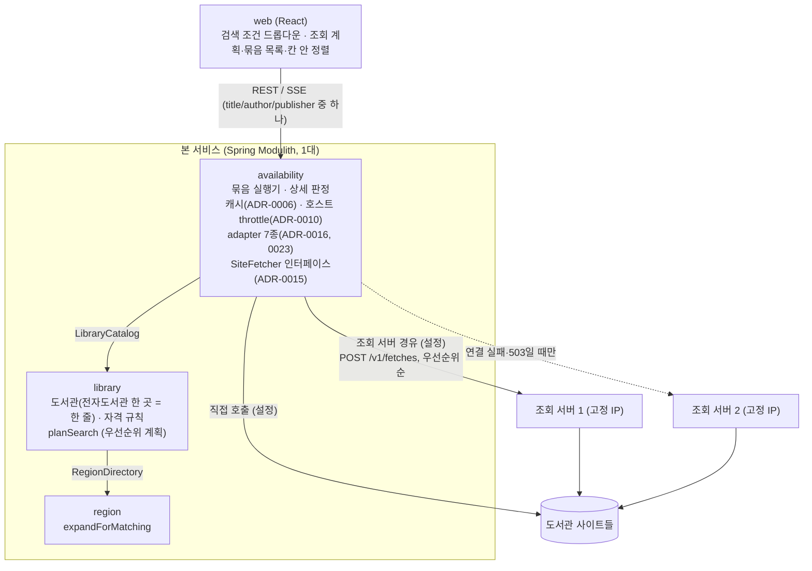
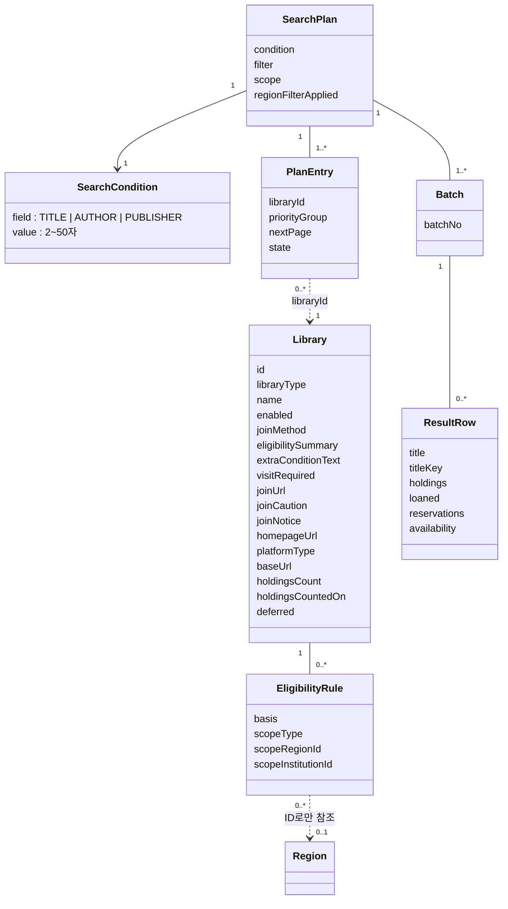

# 모듈 맵 (현재)

현재 설계 전체를 적은 문서입니다. 변경 기록이 아닙니다.

마지막 반영: 사이클 03 cycle-close (2026-09-29). 사이클 02까지는 dev 코드와 `Documenter` 출력(`backend/build/spring-modulith-docs/`)으로 대조했습니다(구현됨). 사이클 03 변경(검색 조건 제목/저자/출판사)은 **설계됨(미구현)** 이며, 모듈·테이블 구성은 바뀌지 않습니다.

| 모듈 | 책임 | 공개 API | 발행/구독 이벤트 | 소유 테이블 | 상태 |
|---|---|---|---|---|---|
| `region` | 시도·시군구 목록, 법정동 코드 속성, 폐지·대체 연결, 옛 지역 ID 해석 | Java `RegionDirectory` (`expandForMatching`, `resolve`), 예외 `RegionNotUsableException`(ID별 이유 `ABOLISHED`/`NOT_FOUND`/`NOT_SIGUNGU`) / REST `GET /api/v1/regions`, `GET /api/v1/regions/resolutions` | 없음 | `region.region`, `region.region_replacement` | 구현됨 |
| `library` | 도서관 목록(전자도서관 사이트 하나 = 한 줄, `library_type`으로 전자·실물 구분, ADR-0017), 가입 방법·안내 링크·주의·안내 문구, 자격 문구, 자격 규칙(규칙 없음 = 자격 미확인, 누구나 = 전국 규칙, ADR-0013), 사용 여부, 순위 값, **우선순위 조회 계획** | Java `LibraryCatalog` (`planSearch(residenceIds, workIds)` → 정렬된 `SearchTarget` 목록, `findEnabledTarget(libraryId)`), 공개 타입 `SearchTarget`(`joinable()` 포함), `PriorityGroup`, `LibraryType`, `PlatformType`(7개, ADR-0023), `Eligibility`(`UNVERIFIED` 포함), 예외 `InvalidRegionException` | 없음 | `library.library`, `library.eligibility_rule` | 구현됨 |
| `availability` | 묶음 단위 검색(ADR-0014), 바쁜 호스트 건너뛰기(ADR-0020), 조회할 도서관 범위 `scope`, adapter 7종(ADR-0016, 0023), 판정 방식 `AvailabilityResolver`·SSE 전달 `SiteResultDelivery`(ADR-0019), 도서관 호출 `SiteFetcher`(직접 / 조회 서버 경유, ADR-0015), 도서관 TLS(ADR-0022), 제목 비교 키(ADR-0018), 캐시(ADR-0006), 호스트 이름 단위 호출 간격(ADR-0010), 검색 조건 제목/저자/출판사 중 하나(ADR-0009 내부 필드, ADR-0025 API, ADR-0026 포털 거르기) | REST `GET /api/v1/ebook-searches/stream`, `GET /api/v1/ebook-searches/batches/stream`, `GET /api/v1/availability/libraries/{libraryId}/ebooks` (세 API 모두 `title`/`author`/`publisher` 중 하나) | 없음 | 없음 (메모리 캐시) | 구현됨. 검색 조건 API·포털 저자/출판사는 설계됨(미구현, 사이클 03) |
| 조회 서비스 (Modulith 모듈 아님, 별도 배포 단위) | 받은 URL을 GET으로 가져와 상태 코드와 원본을 돌려줌. 여러 대, 고정 IP (ADR-0011, 0015) | 내부 REST `POST /v1/fetches` | 없음 | 없음 | 구현됨. dev 폴더 `fetch-service/`, 패키지 `com.chaekcheck.fetch`, 독립 Gradle 빌드 [확정] |

base package `com.chaekcheck` [확정].

- 본 서비스는 이번 운영에서 1대입니다. 여러 대가 되면 틀려지는 부분(`HostThrottle`, `SearchPageCache`, `DetailVerdictCache`)은 인터페이스 뒤에 있고 구현은 메모리입니다 (ADR-0021). Spring 기본 예외를 ProblemDetail로 바꾸는 `ApiExceptionHandler`는 base package 루트에 있고, 모듈 예외는 `availability/internal/web/AvailabilityErrors`가 처리합니다.

## 모듈 구성도

- 모듈끼리는 루트 패키지의 공개 API로만 호출합니다. 거꾸로 부르지 않습니다 (ADR-0001). `availability`는 `region`에 직접 의존하지 않습니다.
- 이벤트는 쓰지 않습니다.
- 칸 안의 정렬(제목끼리 모은 뒤 기존 순서)과 "지금 빌릴 수 있는 책만" 필터는 프론트가 합니다. `availability`는 줄마다 판정(`availability`), 정렬에 쓰는 값, 제목 비교 키(`titleKey`)를 계산해 보냅니다.
- 조회 계획과 묶음 진행 상태는 브라우저가 가지고, 서버는 저장하지 않습니다 (ADR-0014).

## 도메인 모델

- `Library`, `EligibilityRule`은 `library` 모듈이 DB에 저장합니다. `SearchPlan`, `SearchCondition`, `PlanEntry`, `Batch`, `ResultRow`는 브라우저 상태입니다.
- `SearchCondition`은 설계 용어이고 서버 코드에서는 기존 `SearchQuery(value, field)`입니다. 조건이 바뀌면 계획을 새로 만듭니다. 서버 캐시는 조건별로 따로입니다(ADR-0009) [사이클 03, 설계됨(미구현)].
- 주요 흐름(시퀀스·상태 그림)은 `flows.md`에 있습니다.

## 관련 ADR

ADR-0001 모듈 경계, ADR-0006 캐시, ADR-0009 검색 필드, ADR-0010 호출 간격, ADR-0011 조회 서비스, ADR-0013 자격 모델, ADR-0014 묶음 검색 API, ADR-0015 조회 계약, ADR-0016 adapter, ADR-0017 도서관 한 줄 = 이용 단위, ADR-0018 제목 비교 키, ADR-0019 판정·전달 인터페이스, ADR-0020 바쁜 호스트 건너뛰기, ADR-0021 본 서비스 여러 대 대비, ADR-0022 도서관 TLS 호환, ADR-0023 화면 종류 세대 번호, ADR-0025 검색 조건 이름 있는 파라미터, ADR-0026 포털 저자·출판사 거르기
