# 모듈 맵 (현재)

현재 설계 전체를 적은 문서입니다. 변경 기록이 아닙니다.

사이클 09 cycle-close (2026-10-11): 도서관 이름은 기관 이름만, 업체·대출 방식·순번은 분류로 — `library`(공개 enum `Vendor`, `LibraryEligibility`·`SearchTarget`에 `vendor`·`lendingModel`·`orderNo`, 이름·분류 changeset), `availability`(세 값을 스트림 `targets.libraries[]`에 실어 보내기만), 웹(결과 카드 이름 다음 줄 분류, S10 "이름 · 업체 · 대출 방식", "· N번째 사이트", S10 이름 찾기가 분류 글자도 찾음), dev seed 생성 스크립트 — 구현됨 (사이클 09). 새 모듈·새 표·새 이벤트 없음, 모듈 의존 방향 그대로. 근거 `docs/cycles/09-library-naming/design-delta.md`, ADR-0071·0076.
사이클 09 회고 (2026-10-12): dev 보고(`plan-feedback.md` "# 사이클 09", AC-1~9 통과)와 dev 코드로 대조해 사이클 09 변경을 구현됨으로 바꿈. Modulith `components.puml`(2026-10-12) 대조 결과 모듈 관계는 이 문서와 같고 바뀌지 않음(새 모듈·새 이벤트 없음). 달라진 점: changeset `library/014-library-classification.yaml` [확정], 웹 분류 글자 `libraryClassification.ts`, S10 폰 기준 `width <= 640px`, [추가]·[빼기] `aria-label`에 분류, S10 이름 찾기 정렬(검색어 전체 열쇠 앞부분 일치 → 이름순 → 같은 이름은 업체 글자 한글 가나다순 → 순번). 근거 `docs/cycles/09-library-naming/retro.md`.
사이클 10 cycle-close (2026-10-12): 인기 도서 — 새 모듈 `popular`(출판유통통합전산망 순위·판매 부수·표지를 매달 받아 저장, 공용 캐시, `GET /api/v1/popular-books`·`…/covers/{coverId}`), `catalog`(+`BookLookup.byIsbn13`), `availability`(소장 스트림 `holdingLimit`), 웹(S13 `/popular`, S14 가운데 창, S15 신청 안내, 머리 "인기 도서" 링크, 설명 글 지움) — 구현됨 (사이클 10). 새 이벤트 없음. 새 의존 `popular → catalog, library`. 근거 `docs/cycles/10-popular-books/design-delta.md`, spec.md, flow.md, ADR-0072~0075·0077, ADR-0080·ADR-0081.
사이클 10 회고 (2026-10-12): 구현 대조, 분류 14개·표지 200px JPEG·User-Agent·문구 반영 (`docs/cycles/10-popular-books/retro.md`). 모듈 관계는 설계 그대로(`popular` → `catalog`·`library`, 이벤트 없음; dev `popular/package-info.java`, `module-popular.puml`).
사이클 11 cycle-close (2026-10-12): 가져오기 따로 하기(export·apply·finish·discard, load_manifest, db-ops) + 묶는 방식 compact(기본)·objects(옛 이름 current)·sql — 구현됨 (사이클 11, 회고 2026-10-14). `catalog`(`CatalogLoad` 단계 메서드 7개, `Manifest`·`Baseline`, reason `mismatch`, 안쪽 `PgTools`), `collection`(모드·묶는 방식 설정, 두 DB 비교, 기록 이음). 새 모듈·새 이벤트·새 REST 없음, 모듈 의존 방향 그대로(`collection → catalog, library`). 근거 `docs/cycles/11-separate-import/design-delta.md`, spec.md, ADR-0078·0079. 이름은 따로 적지 않으면 [안].
사이클 12 (2026-10-12, 사이클 11 dev 진행 중에 미리 한 plan): 책 묶기 네 번째 단계 규칙 — 구현됨 (사이클 12, 회고 2026-10-14). 근거 `docs/cycles/12-grouping-rules/design-delta.md`, ADR-0082, ADR-0106(④ 보완).
사이클 11 최종·사이클 12 회고 (2026-10-14): dev 보고(`plan-feedback.md` "# 사이클 11" 3018~3148행, "# 사이클 12" 3150~3489행)와 dev 코드(`SameTextKey`, `SubtitleParts`, `CatalogImportRunner`), Modulith `module-collection.puml`로 대조 — 모듈 관계 변화 없음(`collection → catalog, library`). 달라진 점: 묶는 방식 셋 모두 남김·기본 `compact`·옛 이름 `current` → `objects`(ADR-0105), ④에 작가 이름 제목·같은 도서관 기준 부제 나누기·권 숫자 규칙 보완(ADR-0106). 회고 `docs/cycles/11-separate-import/retro.md` "최종 회고", `docs/cycles/12-grouping-rules/retro.md`.
사이클 14 cycle-close (2026-10-12): 인기 도서 → 사서추천도서 — 모듈 `popular`(출판유통통합전산망 순위, 사이클 10 구현됨·배포 전)을 지우고 새 모듈 `picks`(국립중앙도서관 사서추천도서 Open API를 주 1회 받아 최근 6번 추천 저장, 국립중앙도서관 표지를 200px JPEG로 줄여 저장, 공용 캐시, `GET /api/v1/picks`·`…/covers/{coverId}`), `catalog`(+`BookLookup.byTitleAndAuthor`), 웹(S13 `/picks`, 머리 "사서추천도서", 순위 칩 없음, "? 추천 기준 보기", S14 추천 줄, S12 `/about` 문구) — 설계됨(미구현, 사이클 14). 새 이벤트 없음. 의존 `picks → catalog, catalog :: normalize, library`. 근거 `docs/cycles/14-librarian-picks/design-delta.md`, spec.md, flow.md, ADR-0089·0090·0091 (ADR-0072·0073·0074·0080·0081 대체).
사이클 14 회고 (2026-10-14): 구현 대조 — `picks` 구현됨, `popular`는 코드·changeset·로컬 DB에서 지움, 남기는 범위 최근 12번(2년)·요청 3년, 도움말 문구, 폰 표지·제목 글자 카드, 제목+저자 후보 좁히기·첫 저자 규칙 반영 (`docs/cycles/14-librarian-picks/retro.md`). 모듈 관계는 설계 그대로(dev `picks/package-info.java` 20행, Documenter 그림은 회고 때 없음).
사이클 13 회고 반영 (2026-10-14): 새 도서관 넣기 명령·`LibraryRegistry`·반영 파일 판 2·기준일 API·`/about` 한 줄 — 구현됨 (사이클 13, 회고 2026-10-14). 모듈 관계 그대로(`collection → catalog, library`). 달라진 것: `listAll()`에 화면 종류, 종료 코드 5, 넣기 때 `nextId` 다시 확인, 규칙 파일 `final_origins.tsv`(새 곳 필수)·`gone_known.tsv`, 운영 반영에서 같은 번호가 다른 도서관이면 멈춤, 수집기 첫 시험(여주대 빈 곳 채우기)은 뺌. 넣기 명령의 달라진 것은 ADR-0107 [확정] (사용자 승인, 2026-10-14). 근거 `docs/cycles/13-crawler-to-dev/retro.md`, dev `plan-feedback.md` "# 사이클 13". Modulith `Documenter` 출력은 사이클 13 뒤 것이 없어 대조 못 함 [확인 필요: dev main 빌드 뒤].
사이클 15 cycle-close (2026-10-14, 12·13·14 회고 뒤): 사용자 행동 기록 — 새 모듈 `usagelog`(검색·책 상세·더 보기·도서관 클릭·화면 행동·도서관 응답 하루 요약을 스키마 `usagelog` 표 여덟에 5초 묶음으로 넣음), `catalog`·`availability`가 공개 창구 `UsageLog`를 직접 부름, `auth`(액세스 쿠키 경로 `/api/v1`, 공개 `LoginStatusReader` [안: 이름], `POST /api/v1/usage-events` CSRF) — 설계됨(미구현, 사이클 15). 근거 `docs/cycles/15-usage-log/design-delta.md`, ADR-0096·0097·0102.
사이클 16 cycle-close (2026-10-14, 12·13·14·15 회고·인계 뒤): 공지사항과 안내·약관 페이지를 DB로 — 새 모듈 `sitecontent`(공지와 서비스 안내·이용약관·처리방침·동의문의 모든 판을 스키마 `sitecontent` 표 셋에 두고 로그인 없이 읽게 함, `GET /api/v1/notices`·`…/{noticeId}`·`/api/v1/documents/{documentKey}`, Java `SiteDocuments`), `auth`(가입 문서 버전을 서버 설정 대신 `SiteDocuments`에서 받음, 동의 기록 = 판 순번), 새 의존 `auth → sitecontent`, 웹(S16 `/notices`·S17 `/notices/{번호}`, S6·S8·S9·S12가 API를 읽음, 바닥글 링크) — 설계됨(미구현, 사이클 16). 새 이벤트 없음. 근거 `docs/cycles/16-notices-and-policies/design-delta.md`, spec.md, flow.md, ADR-0098~0101.
사이클 18 cycle-close (2026-10-14, 사이클 12~16 인계 뒤, 미리 인계): 소장이 비었거나 덜 모인 도서관 — 켜져 있는데 책이 0권인 22곳을 `library` Liquibase 변경 파일로 끔(ADR-0109), 새 도서관 넣기 명령에 빠진 이유 "전자책 0권"(ADR-0110), 호스트에 밑줄이 있는 도서관 주소를 `collection`은 따로 읽고 `availability`·`fetch-service`는 따로 만든 요청 길로 보냄(ADR-0111). 새 표·칸·API·화면 없음. 모두 설계됨(미구현, 사이클 18). 근거 `docs/cycles/18-empty-library-holdings/design-delta.md`

사이클 13 cycle-close (2026-10-12, 사이클 12와 나란히 미리 한 plan, 사이클 12 뒤에 개발): 수집기 dev로 갈아타기 + 새 도서관 넣기 명령 — `library`(새 공개 `LibraryRegistry`: `add`·`nextId`·`listAll`, Java가 도서관을 처음 씀), `collection`(명령 프로필 `library-insert` 미리 보기·넣기, 보고서 파일, 넣기 실행 기록 `library_insert_run`, `GET /api/v1/join-surveys/latest`, 반영 파일에 `notes.libraryPart`, 반영 때 도서관 부분 먼저, 칸 이름 `other_library_count`), `catalog`(반영 파일 판 2), 웹(S12 `/about` 공지 한 줄) — 구현됨 (사이클 13, 회고 2026-10-14). 새 모듈·새 이벤트 없음, 모듈 의존 방향 그대로(`collection → catalog, library`). 근거 `docs/cycles/13-crawler-to-dev/design-delta.md`, spec.md, flow.md, ADR-0083~0088·0093. 이름(프로필·설정·표·칸·명령)은 따로 적지 않으면 [안]이고 dev가 바꿀 수 있음 [확정] (사용자 선택, 2026-10-12).
사이클 08 cycle-close (2026-10-11): 다듬기 + 가져오기 바꿔 끼우기 + 메모리 줄이기 — `catalog`(새 표에 쓰고 바꿔 끼우기, 소장 번호 잇기, 계획 도서관 소장만 읽기), `collection`(국가서지 원문 남기기, 수집 기간·단계별 시간), `library`(`mobileSiteDiffers`, 계획에 들어갈 도서관만 읽기, `updated_at` 트리거, 교보 대여·혼합 11곳 뺌, 이름 고침), `region`(`updated_at` 트리거), `availability`(캐시 통계·상한, 503 `Retry-After`, 응답 본문 복사 줄임, `holding_not_found`), 웹 — 구현됨 (사이클 08). 모듈 의존 방향·이벤트는 그대로. 근거 `docs/cycles/08-polish-swap-memory/design-delta.md`, ADR-0065~0070. 이름·숫자는 따로 적지 않으면 [안].
사이클 08 회고 (2026-10-11): dev 보고(`plan-feedback.md` "# 사이클 08")와 Modulith `components.puml`로 대조함 — 모듈 관계는 이 문서와 같고 바뀌지 않음. 달라진 점: 가져오기 기록에 상태·실패 칸, `step_seconds` 키가 늘어남, 캐시 상한은 두 캐시 모두 1,000 그대로(ADR-0006 값 변경 없음), S2는 바꾸지 않고 돌아가기·ⓘ는 S8·S9·S10만, 폰 직접 찾기 "정렬 없음 ⓘ"은 검색 줄, S10 이름 찾기는 가운뎃점(·)도 무시. 메모리 값은 로컬 PC 기준(운영 서버에서 다시 잼). 가져오기 힙(AC-12)·색인 단계 중단(AC-9 둘째)·국가서지 재사용 시간(AC-15)은 측정 중 [확인 필요]. 근거 `docs/cycles/08-polish-swap-memory/retro.md`.

사이클 07 회고 반영 (2026-10-05): 수집 목록에서 찾은 도서관 2,394곳 넣기 — 새 모듈 `collection`, `library`·`catalog`·`availability`·`mylibrary`·웹 변경 — 구현됨 (사이클 07). dev 코드와 Modulith `components.puml`(2026-10-05)로 대조함. 근거 docs/cycles/07-candidate-libraries/retro.md, dev plan-feedback.md '# 사이클 07'. 설계 근거 `docs/cycles/07-candidate-libraries/design-delta.md`, ADR-0052~0060. dev가 쓴 이름은 [확정] (dev 구현 확인, 2026-10-05).

사이클 06 회고 반영 (2026-10-05): 내 도서관(`mylibrary`)을 더함 — 구현됨 (사이클 06). dev 보고 `chaekcheck-dev/docs/plan-feedback.md` "# 사이클 06"~"plan에 넘길 요약"과 코드로 대조함. 근거 `docs/cycles/06-my-libraries/design-delta.md`, ADR-0048~0051 (ADR-0048이 ADR-0036을 대체).

사이클 05 cycle-close (2026-10-04): `auth` 모듈과 이벤트 발행 저장소를 더함 — 구현됨(사이클 05, 2026-10-04 retro 반영). 근거 `docs/cycles/05-login-account/design-delta.md`, ADR-0036(ADR-0048로 대체됨), 0038~0046.

마지막 반영: 사이클 04 회고 (2026-10-01, `docs/cycles/04-and-search/retro.md`). dev 커밋 `c6028c9`의 코드와 `Documenter` 출력(`components.puml`, 모듈 canvas)으로 대조했습니다(구현됨). 실제 데이터 적재·AC 확인은 미룸(backlog "미뤄 둔 사이클 04 마무리 작업"). ADR-0028~0035, `docs/cycles/04-and-search/design-delta.md`.

| 모듈 | 책임 | 공개 API | 발행/구독 이벤트 | 소유 테이블 | 상태 |
|---|---|---|---|---|---|
| `region` | 시도·시군구 목록, 법정동 코드 속성, 폐지·대체 연결, 옛 지역 ID 해석. 사이클 08 (구현됨 (사이클 08)): `region.region.updated_at`을 `BEFORE UPDATE FOR EACH ROW` 트리거로 DB가 적음, 함수는 자기 스키마(`region.set_updated_at()`, `region/003-updated-at-trigger.sql`) [확정] (ADR-0068; 이름 dev 구현 확인, 2026-10-11) | Java `RegionDirectory` (`expandForMatching`, `resolve`), 예외 `RegionNotUsableException`(ID별 이유 `ABOLISHED`/`NOT_FOUND`/`NOT_SIGUNGU`) / REST `GET /api/v1/regions`, `GET /api/v1/regions/resolutions` | 없음 | `region.region`, `region.region_replacement` | 구현됨. 사이클 08 트리거도 구현됨 (사이클 08) |
| `catalog` | 수집한 전자책 목록(책·사람·역할·소장·도서관별 기준일, ADR-0028, ADR-0034), 정리 규칙(검색어와 저장값이 같은 코드, ADR-0031), 책 검색(칸별 단어 AND·완전 일치·역할·가입 단계 순서, ADR-0032), 표 통째로 바꾸기(`CatalogLoad`, 가져오기 코드는 사이클 07부터 `collection`, 구현됨 (사이클 07), ADR-0060), 책 번호 잇기(구현됨 (사이클 07)) | Java `CatalogHoldings` (`holdingsOf(bookIds)`, `holdings(holdingIds)` → `HoldingRef(holdingId, bookId, libraryId, platformType, detailUrl, title, author, publisher)`. 원문 제목·저자·출판사는 개발 중 추가) / REST `GET /api/v1/books`, `GET /api/v1/books/{bookId}`. 사이클 06: `/api/v1/books`, `/api/v1/books/{bookId}`가 `libraryIds`를 받고 직접 추가 도서관을 맨 앞으로 정렬, `JoinTier.CHOSEN`(첫 값) [확정] (dev 구현 확인, 2026-10-05) (ADR-0050) — 구현됨 (사이클 06). 사이클 07 (구현됨 (사이클 07), ADR-0055·0060): 새 공개 Java `CatalogLoad.replaceAll(source, loader)` [확정] (dev 구현 확인, 2026-10-05) — 콜백 세션(`Session.addBook` → `addHolding` → `addLibrarySnapshot`, 책을 다 넣은 뒤 소장), PostgreSQL COPY, 결과 `Result`(책·사람·소장·기준일 수와 `keptBookIds`·`newBookIds`·`droppedBookIds`). **바꿔 끼우기** (구현됨 (사이클 08), ADR-0065·0070, 공개 모양 그대로, 결과 `Result`에 단계별 시간 `Map<String, Duration> steps`를 더함, 바꿔 끼우지 못하면 공개 예외 `CatalogLoad.NotSwappedException(reason)` [확정] (dev 구현 확인, 2026-10-11)): `replaceAll` 안을 "임시 표에 COPY → 책 번호 잇기(좁은 맞대기 표 `load_match`로 책·소장 번호 확정) → 준비 스키마 `catalog_next`에 색인 없이 확정된 책 번호 순으로 쓰기(넓은 줄은 임시 표와 `catalog_next`에 두 번 씀, `book_id` 순 정렬 때문 [확정] (사용자 승인, 2026-10-11)) → 색인·제약(운영 표에서 `pg_get_indexdef`·`pg_get_constraintdef`로 읽어 같은 이름으로, 가져오기 세션만 `maintenance_work_mem`↑) → `VACUUM (ANALYZE)` → 짧은 트랜잭션에서 옛 표 `DROP`, 새 표를 `SET SCHEMA catalog`"로 바꿈. 바꿔 끼우기는 `lock_timeout` 2초, 실패하면 10초 뒤 다시, 최대 5번 [확정] (사용자 승인, 2026-10-11, 설계 검토)(값은 측정 뒤 바꿀 수 있음). 바꿔 끼우기 전에 실패하면(잠금 5번 다 못 얻음 포함) `catalog_next`를 지우고 옛 표 그대로, 가져오기 기록에 실패(`status = 'FAILED'`, `failure_reason` `lock_not_acquired`·`outside_foreign_key`·`error`) [확정]. 가져오는 동안 검색은 옛 표를 읽고, 바꿔 끼우는 순간만 잠깐 기다림(가져오기 #2: 0.33초, AC-8b). 소장 번호는 (도서관, `item_key`)가 같으면 옛 번호를 그대로 잇고 새 소장만 옛 최대값 다음부터 [확정] (ADR-0070, 책 번호 잇기와 같은 맞대기 결과). (사이클 07 코드: 한 트랜잭션에서 임시 표 → 표 비우고 옮김, 커밋 뒤 `VACUUM (ANALYZE)`, 그동안 검색이 기다리고 소장 번호는 새로 매김 — 사이클 08에서 위 모양으로 바뀜.) **책 번호 잇기**(handoff 밖, 사용자: "이것도 같이 구현해 줘", 모듈 "catalog 해줘", 2026-10-05): `replaceAll` 안에서 SQL로 — 임시 표에 COPY → 옛 `holding`과 `(library_id, item_key)`로 맞대기 → 번호 결정. 규칙은 `docs/research/ebook-catalog/catalog-refresh.md` 5.2절 그대로(겹침 최다, 합쳐지면 가장 작은 번호, 나뉘면 최다 겹침 쪽, 번호 재사용 없음, 안내표 없음) [확정] (dev 구현 확인, 2026-10-05). `addBook`이 돌려주는 번호는 "이번 가져오기 안에서만 쓰는 번호". 제목 다듬기 규칙(`CatalogText`, `Contributors`, `Isbn`, `PublishedDates`)은 패키지 `com.chaekcheck.catalog.normalize`, named interface `"normalize"`(`@NamedInterface("normalize")`)로 공개해 `collection`이 빌려 씀(규칙은 `catalog`에 한 벌, ADR-0031의 "정리 코드 한 벌" 원칙 유지) [확정] (dev 구현 확인, 2026-10-05). 책 검색은 `book.library_ids && :planned`로 거르고 `holding`을 읽지 않음 [확정] (ADR-0055). 단, 계획 도서관이 50곳 [안]을 넘으면 GIN 인덱스 없이 거름(제목·출판사·사람 인덱스가 찾은 줄만), 50곳 이하만 GIN(`PgBigmBookSearch.GIN_PLAN_LIMIT`) — [이유 미확인: dev가 정함] (15단계 측정: 385곳에서 GIN 1.4초 → 393ms), 회고에서 그대로 둠 [확정] (사용자 승인, 2026-10-05). **가져오기(importer) 코드는 `collection`으로 옮김** — ADR-0031의 "가져오기는 `catalog` 안"을 ADR-0060이 바꿈. 사이클 08 (구현됨 (사이클 08), ADR-0066): 새 공개 Java `CatalogHoldings.holdingsOf(bookIds, libraryIds)` [확정] (dev 구현 확인, 2026-10-11) — 책 화면 소장은 `book_id = ANY AND library_id = ANY`로 계획에 든 도서관 줄만 DB에서 읽음(가져오기용 색인과 원문 칸은 남김). 옛 `holdingsOf(bookIds)`는 쓰는 곳이 없어 지움. **사이클 10 — 구현됨 (사이클 10)** (ADR-0074): 새 공개 Java `BookLookup.byIsbn13(Collection<String> isbn13s) → List<IsbnBook(String isbn13, long bookId, long[] libraryIds)>` [확정 이름] (사용자 승인, 2026-10-11, 설계 #12) — `popular`가 순위 책의 ISBN으로 우리 책을 찾음. 맞는 책이 없는 ISBN은 빠짐. SQL `SELECT id, isbn13, library_ids FROM catalog.book WHERE isbn13 = ANY(:isbns)`(UNIQUE `book_isbn13_key` 사용). 표는 그대로. 사이클 14부터 `picks`가 씀. **사이클 14 — 구현됨 (사이클 14, 회고 2026-10-14)** (ADR-0090): 새 공개 Java `BookLookup.byTitleAndAuthor(Collection<TitleAuthor> queries) → List<TitleAuthorBook>`, `record TitleAuthor(String title, String author)`(원문 그대로), `record TitleAuthorBook(TitleAuthor query, long bookId, long[] libraryIds)`(맞는 후보 전부) [확정] (dev 구현 확인, 2026-10-14: `BookLookup.java` 27행, `TitleAuthor.java`, `TitleAuthorBook.java`) — `catalog`가 제목 키 `CatalogText.pickTitleKey`(NFKC → 앞 괄호 `〈…〉`·`<…>`·`[…]`·`(…)`를 여러 개면 모두 뗌 → 처음 `:`·`(`·`[`·`=` 앞 → 소문자 → 글자·숫자 말고 모두 뺌, 비면 찾지 않음; `mainTitleNorm`과 규칙이 다름)와 첫 저자 `Contributors.firstNameExact`(`;` 뒤 버림 → 앞 "지은이:"·"공저:" 같은 꼬리표 뗌 → 뒤 "소설·장편소설·소설집·시집·산문(집)·에세이" 뗌 → `Contributors.parse` 첫 사람의 `nameExact`; `ROLE_WORDS`는 바꾸지 않음)를 만들고, **첫 저자 `book_contributor.name_exact`(색인 `book_contributor_name_exact`)로 후보를 좁힌 뒤 Java에서 제목 키가 같은 책**을 모두 돌려줌 — 설계의 "`title_norm` pg_bigm으로 좁힘"을 dev가 바꿈 [이유 미확인 — dev가 적은 이유: 제목 키는 기호를 빼는데 `title_norm`은 기호를 남겨 놓칠 수 있음] (dev `JdbcBookLookup.java` 57~100행, 52건 73~87ms, `EXPLAIN ANALYZE` 28ms). 읽기 전용, 표·색인 변경 없음. 하나 고르기는 `picks`가 함. **사이클 11 — 구현됨 (사이클 11, 회고 2026-10-14)** (ADR-0078, `docs/cycles/11-separate-import/design-delta.md` "모듈"): `CatalogLoad`에 단계 메서드 `prepare`·`export`·`readManifest`·`baseline`·`apply`·`finishPrepared`·`discardPrepared`, 공개 레코드 `Manifest`(형식 판, `exportId`, `exportedAt`, 기준값 6개, 표 구조 해시, `notes`)·`Baseline`(이 DB `catalog`의 `book`·`holding` 줄 수·가장 큰 번호·시퀀스 값 6개 + 네 표 칸 구조 해시), `NotSwappedException` reason `mismatch` — 모양 [확정] (설계 #5), 이름 [안]. `replaceAll`은 prepare + 색인 + 통계 + 바꿔 끼우기로 나눈 단계를 이어 부름(지금 동작 = 모드 `in-place`). `export`: `catalog_next`에 `load_manifest` 한 줄(기준값 6개는 내 PC `catalog` = 마지막 반영분의 값)을 쓰고 `pg_dump -Fc -n catalog_next -O -x`로 파일 하나(`.part`에 쓴 뒤 이름 바꿈)를 만들고 새 표는 남김. `readManifest`: `pg_restore`로 파일 속 `load_manifest`만 읽음. `apply`: 기준값 다시 확인 → 남은 `catalog_next` 지움 → `pg_restore --single-transaction --exit-on-error -O -x` → `export_id` 확인·`load_manifest` 지움 → 색인·제약(운영 정의, 세션 `maintenance_work_mem` 256MB) → `VACUUM (ANALYZE)` → 바꿔 끼우기(사이클 08 그대로). `finishPrepared`: 기다리는 새 표의 `export_id`·기준값이 파일과 같을 때만 색인·통계 뒤 바꿔 끼우고 `load_manifest`는 그 트랜잭션 안에서 지움(실패하면 기다림 그대로, 다시 돌리면 만들다 만 색인·제약부터 지움) [확정] (사용자 승인, 2026-10-12). `discardPrepared`: `DROP SCHEMA IF EXISTS catalog_next CASCADE`. 기다리는 새 표(`load_manifest`가 있는 `catalog_next`)가 있으면 `prepare`는 멈춤("먼저 finish 또는 discard"), `load_manifest`가 없는 남은 `catalog_next`는 지금처럼 지우고 시작. 기준값·표 구조 해시(네 표의 (표, 칸, 타입) 목록 SHA-256)는 `catalog`가 `information_schema`로 계산하고, `notes`(도서관·연결표 해시, 가져오기 기록)는 해석하지 않는 짐 — `catalog`는 `collection`을 모르고 다른 모듈 표를 읽지 않음. 안쪽 `PgTools`(DB 컨테이너 이미지 안 PostgreSQL 18 `pg_dump`·`pg_restore` 프로세스 실행, `.part` 파일, stderr를 `failure_detail`로), 설정 `chaekcheck.catalog.load.pg-dump-command`·`pg-restore-command`(명령 앞부분 목록), `chaekcheck.catalog.load.maintenance-work-mem`(운영 `apply` 연결 256MB, 내 PC `finish`·`export`·`in-place`는 1GB 그대로) — 이름 [안]. **사이클 13 — 구현됨 (사이클 13, 회고 2026-10-14)** (ADR-0086): 반영 파일 판 2 — `Manifests`의 `FORMAT_VERSION = 2`(판 2만 받고, 판이 2가 아니면 `apply`가 거절), `load_manifest.notes`에 `libraryPart`를 허용(`catalog`는 해석하지 않는 짐, 해석은 `collection`). `CatalogLoad`·`Manifests` 모양은 그대로, 판 번호만 | 없음 | `catalog.book`(사이클 07: `library_ids` 칸 + GIN `book_library_ids_gin`, 구현됨 (사이클 07)), `catalog.book_contributor`, `catalog.holding`, `catalog.catalog_library_snapshot`(사이클 07: `import_id` 칸·FK 지움), `catalog.catalog_import`는 사이클 07에 지움(기록은 `collection.catalog_import`, 옛 줄은 옮기지 않음) [확정] (dev 구현 확인, 2026-10-05). 사이클 08: 가져오는 동안만 `catalog_next.*` (구현됨 (사이클 08)). 사이클 11: 내보낸 뒤 운영 반영·`finish`를 기다리는 동안에도 `catalog_next.*`와 작은 표 `catalog_next.load_manifest`(실행 중에만, Liquibase 아님) — 구현됨 (사이클 11, 회고 2026-10-14) | 구현됨 (JPA 엔티티 없음: `JdbcClient` + JDBC COPY). 데이터 적재됨(사이클 08 가져오기 #2, 2026-10-11: 책 1,615,125·소장 17,714,665, 교보 대여·혼합 11곳 뺀 뒤). `libraryIds`·`CHOSEN`도 구현됨 (사이클 06). 사이클 07 변경도 구현됨 (사이클 07). 사이클 08 바꿔 끼우기·소장 번호 잇기·`holdingsOf(bookIds, libraryIds)`도 구현됨 (사이클 08). 사이클 10 `BookLookup.byIsbn13`도 구현됨 (사이클 10). 사이클 14 `BookLookup.byTitleAndAuthor`도 구현됨 (사이클 14). 사이클 11 단계 메서드·`Manifest`·`Baseline`·`PgTools`는 구현됨 (사이클 11, 회고 2026-10-14). 사이클 13 반영 파일 판 2는 구현됨 (사이클 13, 회고 2026-10-14). 사이클 15: 첫 쪽 검색·다음 쪽·책 상세가 성공한 뒤 `UsageLog` 호출(로그인은 모름) — 설계됨(미구현, 사이클 15) (ADR-0097) |
| `library` | 도서관 목록(전자도서관 사이트 하나 = 한 줄, `library_type`으로 전자·실물 구분, ADR-0017), 가입 방법·안내 링크·주의·안내 문구, 자격 문구, 자격 규칙(규칙 없음 = 자격 미확인, 누구나 = 전국 규칙, ADR-0013), 사용 여부, 순위 값, **우선순위 조회 계획**(가입 가능 무리의 방문 가입은 그 무리들 모두 뒤, 무리 안 순서: 후순위 포털 → 주의 → 보유 수 → id, ADR-0027, 사이클 04에서 구현·확인). 사이클 09 — 구현됨 (사이클 09): 도서관 이름(기관 이름만)·업체·대출 방식·순번을 저장하고 확인(조합 UNIQUE), 목록 API와 `SearchTarget`에 세 값을 실음 [확정] (ADR-0071·0076) | Java `LibraryCatalog` (`planSearch(residenceIds, workIds, PlanOptions(scope, visit))` → 정렬된 `SearchTarget` 목록. 두 인자 `planSearch`는 `PlanOptions.DEFAULT`로 위임하는 default 메서드. `enabledLibraryRefs()` → `LibraryRef`, `findEnabledTarget(libraryId)`), 공개 타입 `PlanOptions`(`Scope.ALL/JOINABLE`, `Visit.ANY/NONE`, `apply(plan)`), `SearchTarget`(`joinable()` = `OPEN`/`ELIGIBLE`, 추가 문구는 보지 않음, `visitRequired` 포함), `PriorityGroup`, `LibraryType`, `PlatformType`(7개, ADR-0023), `Eligibility`(`UNVERIFIED` 포함), 예외 `InvalidRegionException`. 사이클 06: `PlanOptions(scope, visit, libraryIds)`(두 인자 생성자는 남김 = 빈 집합. 켜진 직접 추가 도서관은 자격과 상관없이 계획에 넣음, `scope=joinable`·`visit=none`에서도 남김, 스위치가 "전체"여도 맨 앞), `SearchTarget.chosen`(마지막 칸, `findEnabledTarget`은 늘 `false`), `LibraryCatalog.eligibilityFor(residenceIds, workIds)` → 공개 레코드 `LibraryEligibility`(`id`, `name`, `eligibility`, `matchedBy`, `visitRequired`, `cautioned`, `eligibilitySummary`, 안쪽 enum `RegionBasis { RESIDENCE, WORK }`) [확정] (dev 구현 확인, 2026-10-05), REST `GET /api/v1/libraries`(켜진 도서관 전체 + 지역별 가입 표시, 로그인 없음, ADR-0049) (ADR-0050) — 구현됨 (사이클 06). 사이클 07 (구현됨 (사이클 07)): 사이클 07에서 넣은 도서관 2,394곳(수집 DB에만 있던 웹러브 북스 기관, 서비스 번호 281~2674, ADR-0052), 가입 조사 상태 `join_survey`(`SURVEYED`/`NOT_FOUND`/`MEMBERS_ONLY`/`NOT_SURVEYED`, 공개 enum `JoinSurvey`) [확정] (ADR-0053, 값 이름 dev 구현 확인, 2026-10-05), 교보 구독형 화면 기관의 `lending_model`(`OWNED`/`SUBSCRIPTION`/`MIXED`/`RENTAL`, 공개 enum `LendingModel`, NULL이면 화면 종류로 판정) [확정], 로고 `logo_file`·`logo_visible` [확정] (ADR-0059, dev 구현 확인, 2026-10-05), `PlatformType` 9개(`BOOKCUBE_FX`, `ALADIN_V1` 추가) [확정] (ADR-0056). **계획 규칙**: 조사 상태가 `MEMBERS_ONLY`·`NOT_SURVEYED`이고 직접 추가(`chosen`)가 아니면 `planSearch`에서 뺌("전체 도서관"이어도), 직접 추가면 지금처럼 맨 앞(ADR-0050) [확정] (ADR-0053). `SearchTarget`·`LibraryEligibility`의 등급에 `UNSURVEYED`(묶음은 확인 필요 쪽), `findEnabledTarget`도 돌려줌. `lendingModel`은 `SearchTarget`에만 두고 `LibraryRef`에는 더하지 않음 [확정] (dev 구현 확인, 2026-10-05, 인계서 C14·C15가 dev에 맡김) — 사이클 07·08에는 웹에 보내지 않았고, 사이클 09에서 웹에 보냄(아래). `collection`이 쓰는 것: 기존 `LibraryCatalog.enabledLibraryRefs()`(켜진 도서관과 사이트 루트)로 짝 맞춘 서비스 도서관이 켜졌는지(`library_not_in_service`)와 사이트 안전장치(`library_base_url_mismatch`)를 확인 [확정] (dev 구현 확인, 2026-10-05). 안전장치는 호스트·경로·쿼리만 비교(http/https·포트 차이는 같은 사이트, `CollectedCatalog.sameSite`)하고, 상세 주소는 서비스 도서관 주소의 scheme·포트로 옮겨 씀(`CollectedCatalog.onOrigin`) — 인계서 C10 "base_url이 같은지"를 바꿈 (사용자 요청: 강동대학교 북큐브 "검색해도 안나오고", 2026-10-05). 꺼진 도서관: 사이클 07에 135·2194·2198을 끔(`library/010-library-disabled.yaml`) [확정] (사용자 승인, 2026-10-05). 사이클 08 (구현됨 (사이클 08)): `planSearch`는 켜진 도서관 중 `join_survey IN ('SURVEYED','NOT_FOUND') OR id = ANY(직접 추가)`만 SQL로 읽음(약 385곳 + 직접 추가, 켜짐 여부는 요청마다 읽음 = ADR-0004 그대로) [확정] (ADR-0066). 코드 `LibraryRepository.findPlannable`, 상태 목록은 `JoinSurvey.onlyWhenChosen()`에서 만듦(규칙 한 곳). 계획 결과가 바꾸기 전과 같음(12묶음, AC-17). 폰에서 사이트가 다르게 보이는 도서관 표시 `mobile_site_differs`(13곳) → `LibraryEligibility`·`SearchTarget`·스트림 `targets.libraries[]`에 `mobileSiteDiffers` [확정] (dev 구현 확인, 2026-10-11). `library.library.updated_at` 트리거(`library.set_updated_at()`, `library/011-updated-at-trigger.sql`) [확정] (ADR-0068). 교보 대여·혼합 11곳(2664~2674)을 seed에서 빼고 DB에서 지움, seed 규칙 "교보 대여·혼합은 넣지 않음"(`build_candidate_seed.py` 규칙 `kyobo_rental_mixed`) [확정] (ADR-0067). 이름 고침: "처음 정한 이름은 바꾸지 않음"의 예외(공식 개명·틀린 이름은 고침, 번호 유지)를 dev `scripts/library/name_overrides.tsv` 목록과 seed 생성 스크립트(`build_candidate_seed.py`)에 두고, 이미 적용된 seed는 고치지 않고 changeset `library/013-library-name-overrides.yaml`에서 번호 + 옛 이름 조건으로 UPDATE [확정] (spec R4; 파일 dev 구현 확인, 2026-10-11). 고친 곳 8곳, 434·456은 같은 학교의 다른 사이트와 이름이 겹쳐 "(북큐브)"를 붙임(사이클 09에서 뗌 — 구현됨 (사이클 09) [확정] (ADR-0071)). seed를 다시 만드는 방식: 첫 배포 전까지 번호로 UPDATE하는 changeset → 첫 배포 바로 전에 seed를 한 번 다시 만듦 → 배포 뒤 seed 고정, 바뀐 것은 새 changeset [확정] (사용자 승인, 2026-10-11) (`data-model.md` "이름 고침"). **사이클 09 — 구현됨 (사이클 09)** (ADR-0071·0076, `docs/cycles/09-library-naming/design-delta.md` "모듈"): 새 공개 enum `Vendor`(`KYOBO`, `YES24`, `BOOKCUBE`, `ALADIN`, `PORTAL`, `IN_HOUSE`)를 모듈 루트, `LendingModel`·`PlatformType`과 같은 자리에 둠 [확정]. `LibraryEligibility`·`SearchTarget`에 `vendor`·`lendingModel`·`orderNo` [확정] → `GET /api/v1/libraries` 항목에 세 칸. `LendingModel`·`SearchTarget` Javadoc의 "KYOBO subscription only"를 "통합 포털 말고 모두"로 고침. 업체는 도서관 수집이 정하고 seed 생성 스크립트가 칸에 씀, DB는 허용 값만 확인 [확정] (DB 계산 안은 미승인, 사용자: "역할 분리"). 이름은 기관 이름만, 겹침은 (이름, 업체, 대출 방식, 순번) 조합으로 확인(`library_classification_key`). 이미 있는 이름·분류는 changeset `library/014-library-classification.yaml` [확정] (dev 구현 확인, 2026-10-12, changeSet 하나 `library-014-classification-2026-10-11`)에서 번호와 옛 이름이 맞을 때만 UPDATE (`data-model.md` "도서관 이름과 분류"). 검색·소장 판정 동작은 바뀌지 않음 [확정] (dev 코드 확인, `HoldingTask`의 교보 구독형 && `!= OWNED` 하나뿐; 회고: 검색·소장 판정 그대로, AC-8). 구현 위치(회고, 2026-10-12): `library/Vendor.java`(모듈 루트), 세 값은 `LibraryEligibility`·`SearchTarget` 레코드 끝 칸, Javadoc "통합 포털 말고 모두, 포털만 null"(`LendingModel.java`, `SearchTarget.java`). **사이클 13 — 구현됨 (사이클 13, 회고 2026-10-14)** (ADR-0083·0093, `docs/cycles/13-crawler-to-dev/design-delta.md` "모듈"): 새 공개 `LibraryRegistry` — `add(List<NewLibrary>)`(새 도서관 + 가입 규칙을 넣음, 번호는 부르는 쪽(`collection`)이 정함, `Propagation.MANDATORY`, 같은 번호가 있으면 실패, 값 검사는 DB CHECK·UNIQUE), `nextId()`(= `GREATEST(max(id)+1, IDENTITY 다음 값)`, 시퀀스 값을 쓰지 않음), `listAll()`(모든 도서관(꺼진 곳 포함)의 번호·이름·`base_url`·화면 종류 `platformType`·업체·대출 방식·순번·꺼짐 여부, 번호 순, 넣기 비교용, 레코드 `RegisteredLibrary`) [확정] (ADR-0083·0093), 이름 `LibraryRegistry`·`NewLibrary`·`NewEligibilityRule`·`RegisteredLibrary`·`JdbcLibraryRegistry` [확정] (dev 구현 확인, 2026-10-14). 번호를 직접 넣을 수 있는 것은 `library.library.id`가 `GENERATED BY DEFAULT AS IDENTITY`이기 때문이고, 넣은 뒤 `setval(pg_get_serial_sequence('library.library','id'), GREATEST(max(id), 시퀀스 값))`으로 시퀀스를 올림 [확정] (dev 구현 확인, `JdbcLibraryRegistry.java:81-82`). dev 코드의 "Java never saves a library"(도서관은 Liquibase seed로만) 원칙을 바꿈 — 도서관 쓰기 처음 [확정] (ADR-0083). `LibraryCatalog`는 그대로 | 없음 | `library.library`(사이클 07: 칸 추가; 사이클 08: `mobile_site_differs`, 트리거; 사이클 09: `vendor`·`order_no` 칸, 이름 UNIQUE 대신 조합 UNIQUE — 구현됨 (사이클 09); 사이클 13: 칸 변경 없음, 1215 이름 고침 changeset — 구현됨 (사이클 13, 회고 2026-10-14)), `library.eligibility_rule`(사이클 07: 사이클 07에서 넣은 곳 중 가입 조건을 조사한 공공도서관 줄 추가, 253줄) | 구현됨. 사이클 06 변경도 구현됨 (사이클 06). 사이클 07 변경도 구현됨 (사이클 07). 사이클 08 변경도 구현됨 (사이클 08). 사이클 09 변경도 구현됨 (사이클 09). 사이클 10: 그대로(`popular`가 기존 `LibraryCatalog.planSearch(…, PlanOptions)`를 씀, `BookSearchController`와 같은 방식). 사이클 14: 그대로(`picks`가 같은 방식으로 씀). 사이클 13 `LibraryRegistry`는 구현됨 (사이클 13, 회고 2026-10-14) 사이클 18 설계됨(미구현): 켜진 0권 22곳 `enabled=false` — Liquibase 새 변경 파일(ADR-0109: 이미 켜진 도서관을 끄거나 다시 켤 때는 변경 파일로) |
| `availability` | 묶음 단위 검색(ADR-0014), 바쁜 호스트 건너뛰기(ADR-0020), 조회할 도서관 범위 `scope`, "방문 없이 가입" `visit`(ADR-0027), adapter 7종(ADR-0016, 0023), 판정 방식 `AvailabilityResolver`·SSE 전달 `SiteResultDelivery`(ADR-0019), 도서관 호출 `SiteFetcher`(직접 / 조회 서버 경유, ADR-0015), 도서관 TLS(ADR-0022), 제목 비교 키(ADR-0018), 캐시(ADR-0006), 호스트 이름 단위 호출 간격(ADR-0010), 검색 조건 제목/저자/출판사 중 하나(ADR-0009 내부 필드, ADR-0025 API, ADR-0026 포털 거르기, 사이클 04부터 "도서관에서 직접 찾기"). 사이클 04: 책을 가진 도서관의 상세 페이지 조회(adapter `parseDetail`, `DetailPageFetcher`가 상세 페이지를 읽는 유일한 길이고 포털 목록의 빈칸 판정 `DetailLookupResolver`도 이것을 씀, `DetailVerdictCache`는 `ParsedDetail`과 읽은 시각을 담음, 판정은 `AvailabilityResolvers.decideDetail(platformType, ParsedDetail)`·`subscription()`, ADR-0029), 실행기 `LookupTask`(`sealed permits Candidate, HoldingTask`, `hostKey()` null이면 요청 없는 작업, `BatchRunner.runTasks` 제네릭, 세션 `LaunchSession` = `BatchSession`/`HoldingSession`), 소장 단위 스트림(ADR-0030) | REST `GET /api/v1/ebook-searches/stream`, `GET /api/v1/ebook-searches/batches/stream`, `GET /api/v1/availability/libraries/{libraryId}/ebooks` (세 API 모두 `title`/`author`/`publisher` 중 하나), `GET /api/v1/book-availabilities/stream`, `…/batches/stream`. 사이클 06: 스트림 두 곳(`ebook-searches/stream`, `book-availabilities/stream`)이 `libraryIds`를 받고(파서 `availability/internal/web/LibraryIdsParam`) `targets.libraries[]`에 `chosen` (ADR-0050) — 구현됨 (사이클 06). 사이클 07 (구현됨 (사이클 07), ADR-0056): REST 모양 그대로, `targets.libraries[]`의 `eligibility`에 `UNSURVEYED`, `platformType`에 두 값, 새 칸 `joinSurvey`·`logoUrl` [확정] (dev 구현 확인, 2026-10-05). 안쪽: adapter 9종(`BookcubeFxAdapter` — 상세 XML `/xml/productView/?num=`, 직접 찾기는 다른 사이트처럼 "더 보기"(쪽 크기 10, `itemCount`·`page`) [확정] (사용자 결정, 2026-10-05, 원문 없음); `AladinV1Adapter` — 상세 HTML "보유현황", 직접 찾기 첫 쪽만, 출판사 검색도 씀 [확정] (사용자: "출판사 검색도 씀", 2026-10-05), 목록에 수가 없는 줄은 `UNKNOWN`(도서관 전체 실패 대신) [이유 미확인: dev가 AC-24 확인 중 고침]), `PlatformAdapter`에 기본 메서드 `detailFetchUri(URI detailUri)`(기본 = 그대로, 같은 호스트라 throttle·캐시 키 그대로) [확정] (dev 구현 확인, 2026-10-05), 북큐브 대여형(`volume=0`이고 `nowRentalCount` 있음) → `SiteVerdict.SUBSCRIPTION` "구독형 · 바로 대출" [확정]. 교보 구독형 화면: 목록은 `lending_model`과 상관없이 줄마다 숫자(`p.use` "[ 대출 : 0/1 예약 : 0 ]")가 있으면 숫자, 없으면 구독. 책 화면(소장 스트림)은 `lending_model = OWNED`인 도서관만 상세 쪽(`span.use`)을 읽음. `KYOBO_SUBSCRIPTION_V1`·`BOOKCUBE_FX`는 같은 판정기 [확정] (dev 구현 확인, 2026-10-05; 사이트 시험 결과: 혼합형은 줄마다 다름). 요청·응답 제한(handoff 밖, 사용자가 문제를 줌, 2026-10-05, 원문 없음): 동시 검색(묶음 스트림 + 도서관별 "더 보기") `chaekcheck.availability.max-concurrent-searches=20` [안] → 넘으면 줄 세우지 않고 503 `server_busy`, 도서관 응답 본문 최대 4MB [안](넘으면 `upstream_error`), 본문 포함 요청 전체 15초 [안](넘으면 `upstream_timeout`), 직접 호출과 조회 서버 둘 다. 도서관 TLS: JDK 최상위 기관 + OISTE WISeKey Global Root GB CA(도서관 사이트 연결에만, 3곳) + 중간 인증서 3개, 폴더 `tls/library-roots/` [확정] (사용자: "이거 신뢰해줘", 2026-10-05) — ADR-0022를 바꿈, ADR-0061, ADR-0022 보완. 사이클 08 (구현됨 (사이클 08), ADR-0066): 두 캐시 `recordStats()`, 캐시마다 상한 설정을 나눔(`chaekcheck.availability.caches.{search-page-max-size, detail-verdict-max-size, stats-log-interval}`, 옛 `cache-max-size` 대신) [확정] (dev 구현 확인, 2026-10-11), 통계를 5분마다 로그(자체 데몬 스레드, Actuator 없음). 상한은 두 캐시 모두 1,000 그대로 — ADR-0006 값 변경 없음 [확정] (사용자 승인, 2026-10-11; dev: 캐시 값은 파싱한 결과라 1,000칸이 차도 10MB 안팎). 적중률은 실제 이용 기록으로 봐야 함 (dev). 책 화면 소장은 `holdingsOf(bookIds, 계획 도서관 번호)`로 읽음, 도서관 응답 본문 복사 줄임(`BodyLimit`는 `Content-Length`(4MB 안)로 처음 크기, 없거나 틀리면 두 배씩 키움; 조회 서버 경로 `FetchServiceSiteFetcher`는 `byte[]`로 받음; `fetch-service`는 바꾸지 않음, AC-19), 503 `server_busy`에 `Retry-After: 5` [확정] (사용자 승인, 2026-10-11), 소장 스트림의 도서관별 실패 코드에 `holding_not_found`(소장 번호가 지금 목록에 없음, `MissingHolding`)를 더해 `library_not_found`와 나눔 [확정] (ADR-0070). REST 모양 그대로, `targets.libraries[]`에 `mobileSiteDiffers` [확정] (dev 구현 확인, 2026-10-11). 사이클 09 — 구현됨 (사이클 09) (ADR-0076): `SearchTarget`의 `vendor`·`lendingModel`·`orderNo`를 검색·대출 현황 스트림 `targets.libraries[]`(`StreamEvents.Library`)에 실음. 판정 동작은 그대로 [확정]. 회고: 세 값은 `StreamEvents.Library` 레코드 끝 칸 (dev 구현 확인, 2026-10-12). **사이클 10 — 구현됨 (사이클 10)**: `GET /api/v1/book-availabilities/stream`에 선택 파라미터 `holdingLimit` [확정] (dev 구현 확인, 2026-10-12) (1~20 정수). 있으면 그 책을 가진 계획 도서관 소장 가운데 앞의 N개(계획 순서 → 책 순서 → 원래 자리)만 `targets.holdings[]`에 넣고 그것만 요청(보내는 순서는 원래 순서), 없으면 지금과 같음 [확정 동작] (사용자: "가. 앞의 3곳만 확인 이걸로 해줘 api좀 손봐줘", 2026-10-12, `docs/cycles/10-popular-books/easy/2026-10-12-handoff-review.html` #1). 잘못된 값은 400 `validation_error`(검증 순서는 `api.md`). S14가 `holdingLimit=3`으로 씀 (`api.md`) | 없음 | 없음 (메모리 캐시) | 구현됨. `libraryIds`도 구현됨 (사이클 06). 사이클 07 변경도 구현됨 (사이클 07). 사이클 08 변경도 구현됨 (사이클 08). 사이클 09 변경도 구현됨 (사이클 09). 사이클 10 `holdingLimit`도 구현됨 (사이클 10). 사이클 15: 직접 찾기 첫 묶음 끝·끊김에 세션마다 한 번 `recordSearch`, "더 보기"·도서관별 더 보기에 `recordMore`, 모든 도서관 요청(직접 찾기·대출 수 채우기)마다 `recordLibraryResponse` — 설계됨(미구현, 사이클 15) (ADR-0097) 사이클 18 설계됨(미구현): 사이트 요청 부품이 호스트에 밑줄이 있으면 따로 만든 요청 길(새 요청 라이브러리 하나, SNI 없이, 인증서 이름 검사 켬, 지금 길과 같은 제한·User-Agent·셈)로 보냄, 실패하면 그 도서관 줄만 실패. `HostThrottle.key`·`Candidate.hostKey` NPE 없앰 (ADR-0111). 조회 서버 앱 `fetch-service`도 같은 길(`UrlGuard`는 내부망 막기 유지) |
| `auth` | 네이버·카카오 `oauth2Login`, 가입 대기·동의·가입, JWT 발급·검증(액세스 15분 + DB의 리프레시 토큰 30일, ADR-0038), 로그아웃, 탈퇴 재인증·삭제(ADR-0043), 연결 해제 웹훅·콜백, 카카오 연결 대조와 1년 미로그인 계정 정리(하루 한 번), 앱 전체 `SecurityFilterChain`(보호 경로 `/api/v1/me/**`만, ADR-0044). 설정 `chaekcheck.auth.enabled`로 켜고 끔(기본 꺼짐, ADR-0046). 사이클 15 — 설계됨(미구현, 사이클 15) (ADR-0102): 액세스 쿠키 `access_token` 경로를 `/api/v1/me` → `/api/v1`로 넓힘(옛 경로 쿠키는 따로 지우지 않음) [확정], 로그인 상태 판별 부품 공개(켜짐: 쿠키 서명 확인, 만료돼도 서명이 맞으면 `signed_in` / 꺼짐: 쿠키를 보지 않고 `login_off`) [확정], CSRF 검사 주소에 `POST /api/v1/usage-events`를 더하되 로그인은 요구하지 않음(보호 경로 `/api/v1/me/**`는 그대로) [확정]. 사이클 16 — 설계됨(미구현, 사이클 16) (ADR-0099): 가입 화면의 문서 버전을 서버 설정 대신 `sitecontent`의 `SiteDocuments`에서 받음(`AuthProperties.Documents`·`chaekcheck.auth.documents` 설정·`documentVersions.json` 비교 테스트를 지움, 사이클 05 제약 27 폐기), 동의 기록 = 판 순번 글자, 409 동작 그대로 [확정] | Java `AccountId`, 이벤트 `AccountDeleted(accountId)` / REST `/api/v1/auth/**`, `/api/v1/me`. 사이클 06: `AccountPresence.lockIfExists(AccountId): boolean` [확정] (dev 구현 확인, 2026-10-05) (호출한 트랜잭션 안에서만, `Propagation.MANDATORY`, 계정 줄 잠금 `FOR NO KEY UPDATE`, 구현 `auth/internal/account/AccountLock`, ADR-0051), `AccountId` 인자 해석기 `auth/internal/web/AccountIdArgumentResolver`(앱 전체 등록, 다른 모듈 컨트롤러가 현재 계정을 인자로 받음, `/api/v1/me/**` 밖에서는 늘 401), `ConditionalOnAuthEnabled`를 루트 패키지로 옮겨 공개하고 속성 이름 상수 `ConditionalOnAuthEnabled.PROPERTY`도 루트에 둠(`internal`의 상수가 이것을 가리킴) [확정] (dev 구현 확인, 2026-10-05) — 구현됨 (사이클 06). 사이클 15: `LoginStatusReader` [안: 이름] (`usagelog`가 씀) — 설계됨(미구현, 사이클 15). 사이클 16: 쓰는 것 `sitecontent`의 `SiteDocuments.currentVersion` — 설계됨(미구현, 사이클 16) | 발행 `AccountDeleted`. 구독: 자기 listener 하나(ADR-0041) + `mylibrary` listener(구현됨 (사이클 06)) | `auth.account`, `auth.login_method`, `auth.account_consent`, `auth.refresh_token` (사이클 16: `account_consent.document_version` 값·CHECK만 바뀜) | 구현됨(사이클 05, 2026-10-04 retro 반영). 사이클 06 변경도 구현됨 (사이클 06). 사이클 16 변경은 설계됨(미구현, 사이클 16) |
| `mylibrary` | 로그인한 계정의 거주·직장 지역과 직접 추가 도서관 저장. 관심 책은 맡지 않음 [확정] (ADR-0048, ADR-0036 대체). 저장 전 `auth` 계정 줄 잠금, 직접 추가는 20곳까지 [확정] (사용자, 2026-10-04). 모든 빈은 `chaekcheck.auth.enabled`에 묶음(꺼지면 API 404), 표는 늘 만듦 [확정] (dev 구현 확인, 2026-10-05). 패키지 `com.chaekcheck.mylibrary`(루트에 공개할 것 없음, `allowedDependencies = { "auth", "library", "region" }`), `mylibrary.internal`(`MyLibraryStore`(JdbcClient)·`MyLibraryService`·`AccountDeletedCleanup`, `internal/web/MyLibraryController`·`MyLibraryErrors`), JPA 엔티티 없음 [확정] (dev 구현 확인, 2026-10-05) | Java 공개 타입 없음 / REST `/api/v1/me/regions`, `/api/v1/me/libraries/**` (ADR-0049). 사이클 07 (구현됨 (사이클 07)): 묶음 옮기기 `POST /api/v1/me/library-imports` [확정] (dev 구현 확인, 2026-10-05) — 로그인 전 브라우저에 직접 추가한 도서관을 로그인 직후 한 번에 옮김(계정 줄 잠금 → 비었는지 확인 → 켜진 도서관만 넣음) [확정] (ADR-0057, ADR-0049의 "하나씩 저장"에 요청 하나를 더함) | 구독 `AccountDeleted` → 두 표에서 그 계정 줄 삭제(멱등, ADR-0051) | `mylibrary.account_region`, `mylibrary.account_library` | 구현됨 (사이클 06). 사이클 07 변경도 구현됨 (사이클 07) |
| `collection` | 수집 번호 ↔ 서비스 번호 짝(`collection_link`, ADR-0052)과 **가져오기 전부**(ADR-0060): 수집 DB 사본 나눠 읽기(사본을 같은 SQLite 읽기 트랜잭션에서 두 번 읽음: 첫 번째는 같은 책 코드 묶음마다 값별 줄 수만, 두 번째에 줄마다 소장을 바로 넘김, ADR-0054), 짝 표로 서비스 번호 바꾸기, 빼는 줄 거르기(오디오북·동영상북 + 새 이유 `kind_sound_video`: 북큐브 `book/wma`·`book/vod`·`book/wmv`, 교보 `동영상`), 같은 책 묶기(`catalog`의 제목 다듬기 규칙을 빌려 씀), 대표값·날짜 규칙, `book.library_ids` 계산(ADR-0055), 가져오기 기록. 앞으로 갱신도 여기서. 가져오기 범위는 짝 표에 있는 모든 서비스 도서관(사이클 04의 "서비스 DB에 있던 278곳만"을 ADR-0054가 바꿈). 패키지 `com.chaekcheck.collection`, 가져오기 코드 `collection.internal.importer`. 실행 프로필 `collection-import`(프로필 파일에 `chaekcheck.auth.enabled: false`), 설정 `chaekcheck.collection.import.*`(`sqlite-path`, `ttl-path`, `dry-run`, `placeholder-date-libraries`) [확정] (dev 구현 확인, 2026-10-05). `@ApplicationModule(allowedDependencies = {"catalog", "catalog :: normalize", "library"})` [확정] (dev 구현 확인, 2026-10-05). 사이클 08 (구현됨 (사이클 08)): 국가서지 TTL에서 뽑은 원문(ISBN·제목·저자·출판사)을 파일 지문과 함께 남기고(코드 `collection/internal/importer/NationalBibliographyStore`), 지문이 같으면 다시 씀(다르거나 처음이면 TTL을 풀어 다시 저장). 한 기록에 ISBN이 여럿이면 ISBN마다 한 줄(`isbn13` 13자리 유지, 결과는 같음) [확정] (사용자 승인, 2026-10-11). 다듬기는 가져올 때마다 지금 정리 규칙(`catalog :: normalize`)으로, 정리 규칙 판 번호는 두지 않음 [확정] (ADR-0069, ADR-0065의 국가서지 부분을 바꿈). 가져오기 기록에 수집 시작·끝(`collected_from`·`collected_to`), 단계별 시간(`step_seconds`, 키는 `data-model.md`), 결과 `status`·`failure_reason`·`failure_detail` [확정] (dev 구현 확인, 2026-10-11). 가져오기 힙(끝까지 된 가장 작은 값): `compact` 2GB, `sql` 1GB, `objects` 6GB — 사이클 12 새 규칙 뒤 `objects`는 살아 있는 데이터 약 5,751MB라 `-PbootRunXmx=8g` 권장 [확정] (dev 측정, `plan-feedback.md` 3022~3048·3402행, `3-import.md` 38행). 정리 규칙을 바꿀 때의 순서는 `data-model.md` "정리 규칙을 바꿀 때". **사이클 11 — 구현됨 (사이클 11, 회고 2026-10-14)** (ADR-0078·0079, `docs/cycles/11-separate-import/design-delta.md` "모듈"·"B. 묶는 방식"): 가져오기 모드 `chaekcheck.collection.import.mode` = `in-place`(기본, 지금 동작)·`export`(내 PC: 새 표까지 만들고 파일 하나로 내보냄, 새 표는 남김)·`apply`(운영: 파일을 비교한 뒤 반영)·`finish`(내 PC: 운영 반영 성공 뒤 남겨 둔 새 표로 바꿔 끼움)·`discard`(어느 DB든 남은 `catalog_next` 지움, 기다리는 새 표는 "운영 반영이 실패했을 때만" 안내), 파일 경로 `file`, 묶는 방식 `chaekcheck.collection.import.grouping` = `compact`(기본)·`objects`(옛 방식, 2026-10-12까지 이름 `current`, 설정 값 `current`는 이제 시작 전에 거절)·`sql` [확정] (사용자 결정 2026-10-12, ADR-0105, dev `CatalogImportRunner.java` 51·78행), `dry-run-output`. 사이클 12: dry run 전용 `exclude-candidate-libraries`(기본 `false`, `dry-run`이 아니면 시작하지 않음, 뺀 줄의 건너뜀 이유 `library_excluded_candidate`, 로그 `candidate libraries excluded: N`) [확정] (dev 구현 확인, 2026-10-14). 모드·방식 값과 `grouping` 자리 [확정], 그 밖 이름 [안]. 반영 전 두 DB 비교: `DatabaseFingerprint`가 자기 DB에서 도서관 해시(`enabledLibraryRefs()` id 순 `id\tbaseUrl\tplatformType\n` SHA-256 + 개수)와 연결표 해시(`collection_link` `collection_library_id, library_id` 순 SHA-256 + 개수)를 계산하고, `catalog`의 `baseline()`·파일의 `Manifest`와 비교 — 하나라도 다르면 `mismatch`(무엇이 다른지)로 기록하고 운영 표에 손대지 않음. 항목 [확정], 계산식 [안]. `collection`은 `catalog` 표를 직접 읽지 않음. `ImportTransfer`(파일 `notes`에 실어 보내는 내 PC 기록 JSON), `BookGrouper` 인터페이스(`add`, `groupByCodes`, `bibliographyKeys`, `attachBibliography`, `mergeSameText`, `forEachBook`, `bookOf`) + `BookGrouping`(`objects`)·`CompactGrouping`·`SqlGrouping`, 네 번째 단계 규칙은 패키지 내부 `SameTextKey`(키)·`SubtitleParts`(부제 나누기, 사이클 12)를 셋이 함께 부름, `DryRunDump`(dry run 결과 `books.tsv`·`rows.tsv` gzip, 세 방식 비교용) — 이름 [확정] (dev 구현 확인, 2026-10-14). 세 방식 모두 첫 줄을 읽은 순서로 책을 만들고, 결과가 책·소장 번호까지 같아야 씀 [확정] (ADR-0079). 기록은 운영 반영마다 한 줄, 내 PC `finish` 뒤 한 줄, `export_id`로 이음. **사이클 13 — 구현됨 (사이클 13, 회고 2026-10-14)** (ADR-0084·0085·0086·0087·0093, `docs/cycles/13-crawler-to-dev/design-delta.md` "모듈"): **새 도서관 넣기 명령** — 프로필 `library-insert`, 설정 `chaekcheck.collection.library-insert.mode`(`preview`\|`insert`)·`sqlite-path`·`rules-dir`·`report-dir`·`report-id` [확정] (dev 구현 확인, 2026-10-14). 보고서 위치는 데이터 폴더 `chaekcheck-data\library-insert\`. 앞으로 새 도서관은 Liquibase seed가 아니라 이 명령으로 넣음(미리 보기 → 보고서 → 넣기) [확정] (ADR-0084). 미리 보기(`preview`)는 규칙 폴더(dev `scripts/library/rules/`의 TSV + `join_surveyed_on.txt` + 순번 2 허용 목록, ADR-0085)·수집 DB 사본·`LibraryRegistry.listAll()`(서비스 도서관 전체, 꺼진 곳 포함)·`collection_link`를 읽어 새 곳·바뀐 곳·사라진 곳·의심(같은 호스트, 순번 2 이상)을 담은 보고서 파일을 냄: 정규화 JSON(만든 시각 제외), 번호 = SHA-256 앞 12자리(규칙 파일은 줄 끝을 `\n`으로 맞춰 셈), 파일 `library-insert-<id>.json` [확정] (dev 구현 확인, 2026-10-14). 넣기(`insert`)는 보고서 번호를 받아 다시 계산하고, 보고서와 같을 때만 한 트랜잭션(`pg_advisory_xact_lock`)에서 `LibraryRegistry.add`(새 도서관 + 가입 규칙) → `collection_link` → 넣기 실행 기록 `library_insert_run` SUCCEEDED 줄, 제약 위반이면 ROLLBACK 뒤 FAILED 줄. 잠금 뒤 `nextId()`가 보고서 첫 번호와 다르면 넣지 않음. 넣을 곳이 0이면 실행 기록을 남기지 않음. 종료 코드 0 정상, 1 규칙 오류(보고서 없음, 새 곳에 `final_origins.tsv` 줄이 없을 때 포함), 2 같은 호스트 의심, 3 순번 2 이상, 4 보고서와 다름 또는 번호가 그 사이 쓰임(넣지 않음), 5 DB가 줄을 거절(롤백 뒤 `FAILED` 줄) [확정] (dev 구현 확인, 2026-10-14). "사라진 곳"은 켜진 서비스 도서관만 보고, 확인한 곳은 규칙 파일 `gone_known.tsv`(보고서 `goneKnown`)로 따로 보임 [확정] (사용자: "확인하고 빼줘 파일로 적어줘", 2026-10-12). 클래스 `LibraryInsertRunner`·`LibraryInsertCommand`(잠금 키 `0x63686b4c6962496e`)·`LibraryInsertPlanner`·`RuleSet`·`InsertReport`·`InsertPlan`·`CollectedLibraries`·`LibraryPart` (`collection/internal/libraryinsert/`). 고르기·값 정하기 규칙은 지금 seed 스크립트와 같음(spec R2-5·R2-6), 같은 호스트 의심은 새 곳끼리 + 서비스 전체(R2-7). **반영 파일 판 2** (ADR-0086·0093): `export`가 성공한 넣기 실행 기록의 `payload` 모음을 `load_manifest.notes.libraryPart`(성공한 실행 기록 전부: `reportId`·`ranAt`·`snapshot`·`insertedCount`·`joinSurveyedOn`·`payload`) [확정] (dev 구현 확인, 2026-10-14)에 싣고, `apply`는 한 트랜잭션에서 운영에 없는 도서관만 `LibraryRegistry.add` + `collection_link` + 성공한 넣기 실행 기록 줄(같은 `report_id`가 있으면 건너뜀. 이미 있는 번호가 다른 도서관(이름·주소가 다름)이거나 짝이 다른 도서관을 가리키면 멈춤: 롤백, `FAILED`·`failure_reason` `error`·`failure_detail` `library part: …`, `step_seconds`에 `library part`) → 두 DB 비교 → 다르면 ROLLBACK·`mismatch`, 같으면 커밋 뒤 복원·색인·바꿔 끼우기(사이클 11 그대로). 도서관 부분을 커밋한 뒤 책 바꿔 끼우기가 실패하면 도서관은 들어간 채 남고, 다시 돌리면 같은 줄은 건너뜀(ADR-0086). **가입 조건 조사 기준일 API** `GET /api/v1/join-surveys/latest` [확정] (ADR-0087·0093): 성공한 넣기 실행 기록 중 최신 `join_surveyed_on`, `collection` 컨트롤러, `/libraries`에 싣지 않음(`library → collection` 의존 고리를 피함). `collection`은 `library` 표를 읽지 않고 `LibraryRegistry.listAll()`만 씀 [확정] (ADR-0093), `region`에 의존하지 않음(지역은 규칙 파일에 번호로, ADR-0085). `collection/package-info.java` 설명("No public API, 따로 도는 프로필")을 "명령 프로필 둘(`collection-import`, `library-insert`) + 공개 REST 하나"로 고치고 `ModularityTests`가 통과해야 함. 보안: `SecurityConfiguration`은 `/api/v1/me/**`만 보호하므로 새 GET은 열림, 보안 시험에 로그인 없이 200을 더함. 가져오기 기록 칸 `candidate_library_count` → `other_library_count` [확정] (dev 구현 확인, 2026-10-14) (Java `ImportReport`·`ImportRecords`·`Notes`의 `otherLibraries`) | Java 공개 API 없음(실행 명령·설정만). 쓰는 것: `catalog`의 `CatalogLoad.replaceAll`·named interface `normalize`(제목 다듬기 규칙), `library`의 `LibraryCatalog.enabledLibraryRefs()`. 사이클 11: `CatalogLoad`의 `prepare`·`export`·`readManifest`·`baseline`·`apply`·`finishPrepared`·`discardPrepared`도 씀 — 구현됨 (사이클 11, 회고 2026-10-14). 사이클 13: Java 공개 API는 여전히 없음(명령 `library-insert`와 컨트롤러 `GET /api/v1/join-surveys/latest`만), `library`의 `LibraryRegistry.add`·`nextId`·`listAll`도 씀 — 구현됨 (사이클 13, 회고 2026-10-14) | 없음 | `collection.collection_link`, `collection.catalog_import` [확정] (dev 구현 확인, 2026-10-05). 사이클 08: `collection.catalog_import` 칸 추가, `collection.national_bibliography_record`·`collection.national_bibliography_source` [확정] (dev 구현 확인, 2026-10-11) (구현됨 (사이클 08)). 사이클 11: `collection.catalog_import` 칸 `export_id`·`exported_at` — 구현됨 (사이클 11, 회고 2026-10-14). 사이클 13: 새 표 `collection.library_insert_run`(넣기 실행 기록), `catalog_import.candidate_library_count` → `other_library_count` 이름 바꿈 — 구현됨 (사이클 13, 회고 2026-10-14) | 구현됨 (사이클 07). 사이클 08 변경도 구현됨 (사이클 08). 사이클 11 모드·묶는 방식·비교는 구현됨 (사이클 11, 회고 2026-10-14). 사이클 12 네 번째 묶기 단계 규칙·빼기 설정은 구현됨 (사이클 12, 회고 2026-10-14). 사이클 13 넣기 명령·실행 기록·기준일 API·판 2는 구현됨 (사이클 13, 회고 2026-10-14) 사이클 18 설계됨(미구현): 내부 `SiteHosts`(밑줄을 받는 호스트 읽기, 가져오기·넣기 명령이 같이 씀), `HoldingRowFilter`(가져오기 줄 거르기 한 벌, 넣기 명령도 씀), 넣기 빠진 이유 7번째 `no_ebooks`("전자책 0권", 묻지 않음), 시험용 설정 `exclude-candidate-libraries` 새 이름 (ADR-0110·0111, 이름은 dev가 바꿀 수 있음) |
| `picks` | 사이클 14 새 모듈, `popular`(사이클 10, 구현됨·배포 전)를 대체하고 `popular`와 스키마 `popular`는 지움 [확정] (ADR-0089). 국립중앙도서관 사서추천도서 Open API(`https://nl.go.kr/NL/search/openApi/saseoApi.do`)에서 받는 날부터 거꾸로 3년 범위를 요청 1건(`endRowNumApi=1000`)으로 받아 추천 연월 최근 12개 달(최근 12번, 약 2년)만 저장(목록이 같으면 바꾸지 않음) — 12번 [확정] (사용자 결정, dev 2026-10-14: "12번(2년)으로 늘리기", 처음 6번; ADR-0108), 3년 [확정] (사용자 승인, 2026-10-14, 회고 결정 #21, ADR-0108. 이유: 제안 → 승인 (2026-10-14). dev가 적은 이유(사용자 말 아님): 12번 = 약 24개월이라 2년이면 받는 날에 따라 12번째 추천이 범위 밖으로 빠질 수 있음), 받기 판단(Asia/Seoul, 서버 켜질 때와 매일 05:00: 목록 없음 / 월요일 / 마지막 받기가 실패이고 그 뒤 성공 없음(성공할 때까지 매일, ADR-0092) / 마지막 성공이 7일보다 오래됨 → 받음), 공용 캐시(저장된 목록 + 마지막 성공 받기 시각 + 책별 `(bookId, libraryIds)`, 시작·10분마다·목록 바뀐 직후 새로 고침, 맞추기는 ISBN → 본제목+첫 저자, 후보 여럿이면 `libraryIds` 가장 긴 책 → `bookId` 작은 책, 이용자별 겹침 `available`은 요청마다 계산, ADR-0090), 국립중앙도서관 표지를 새 것만 받아 폭 200px JPEG로 줄여 저장하고 우리 서버가 넘겨줌(지금 목록이 안 쓰는 표지는 지움, ADR-0091), 화면용 REST [확정]. 분류는 코드 상수 enum `PickCategory`(`ALL` 전체, `11` 문학, `6` 인문, `5` 사회, `4` 자연, `425` 테마), 모르는 `drCode`도 받아 "전체"와 맨 뒤 새 분류(API `drCodeName`, 비면 "기타")로 [확정] (ADR-0089). `@ApplicationModule(allowedDependencies = {"catalog", "catalog :: normalize", "library"})` [확정] (`catalog :: normalize`는 `Isbn.toIsbn13`, `collection`과 같은 선례). JPA 엔티티 없음(JdbcClient). 안쪽(dev 구현 확인, 2026-10-14): `internal/fetch`(`NlkTransport`·`HttpNlkTransport`·`NlkClient`·`NlkResponse`·`SaseoXmlParser`(XXE 끔)·`KeptPicks`(`MONTHS` 12)·`PickRow`·`CoverUrls`·`FetchFailure`·`FailureReason`·`BodyLimit`·`RequestPacer`), `schedule`(`FetchDecision`·`FetchJob`(단일 스레드 + `AtomicBoolean`)·`FetchScheduler`·`FetchTrigger`), `store`(`PicksStore`), `cover`(`CoverResizer`), `cache`(`PicksCache`·`BookChoice`), `web`(`PicksController`·`PicksPlanParams`·`PicksErrors`·`CoverNotFoundException`·`InvalidPicksParamException`), 모듈 안 알림 `PicksChanged`, 설정 `PicksProperties`, 분류 `PickCategory`. 지운 것 — 구현됨 (사이클 14): `popular` 패키지 전부(`Kpipa*`, `RankPageParser`, `SalesCountParser`, `CategoryOrder`, `PopularCategory` 등), 시험 `Kpipa*Tests`·`FakeKpipaSite`·`fixtures/kpipa/` (dev `backend/src/main`에 `popular` 코드 없음, 2026-10-14). 새 시험 픽스처 `fixtures/nlk/saseo-2y.xml`(2026-10-12 진짜 응답). 설정 `chaekcheck.picks.fetch.*`(`enabled` 환경 변수 `CHAEKCHECK_PICKS_FETCH_ENABLED` 기본 true·시험과 `collection-import` 프로필 false, `api-key` 환경 변수 `CHAEKCHECK_PICKS_NLK_API_KEY` 기본 빈 값(비면 요청 안 보내고 `key_missing`), `cron` `0 0 5 * * *`, `zone` `Asia/Seoul`, `base-url` `https://nl.go.kr`, `window` 3년(처음 2년, dev 변경 → [확정] (사용자 승인, 2026-10-14, ADR-0108)), `end-row` 1000, `connect-timeout` 5초, `read-timeout` 10초, `max-body-size` 10MB, `cover-max-body-size` 5MB, `cover.width` 200, `jpeg-quality` 0.8, `max-pixels` 16,000,000, `request-interval` 1초, `user-agent` `book search service`(배포 때 서비스 주소를 붙임, dev `application.yml` 214행 `TODO(확인 필요)`)), `chaekcheck.picks.cache.refresh-interval` 10분 [확정] (사용자 승인, 2026-10-12). 키는 로그·예외·`failure_detail`·`toString`에 남기지 않음 [확정]. 지운 설정: `chaekcheck.popular.*`, `CHAEKCHECK_POPULAR_FETCH_ENABLED`(원래 폴더 `.env`도, 사용자 승인 뒤 2026-10-14). 도서관 넣기 프로필 `application-library-insert.yml`은 `chaekcheck.picks.fetch.enabled: false`(인계서 "popular 줄 지움"을 dev가 바꿈 [이유 미확인 — dev가 적은 이유: 지우기만 하면 넣기 명령에서 받기 기본값 true로 진짜 API를 부를 수 있음]; `collection-import` 프로필과 같음). 출판유통통합전산망에는 요청 0건 [확정] | Java 공개 API 없음. REST `GET /api/v1/picks`, `GET /api/v1/picks/covers/{coverId}` (인증 없음). 쓰는 것: `catalog`의 `BookLookup.byIsbn13`·`BookLookup.byTitleAndAuthor`(사이클 14)·`catalog :: normalize`, `library`의 `LibraryCatalog.planSearch` | 없음 (캐시 알림은 모듈 안 인터페이스) | `picks.fetch_run`, `picks.pick`, `picks.cover` (`data-model.md` 스키마 `picks`). 스키마 `popular`는 지움 | 구현됨 (사이클 14, 회고 2026-10-14). 사이클 10 `popular`는 지움 — 구현됨 (사이클 14): 코드·`popular/001` changeset 없음, 14 worktree DB와 원래 `db`·`db-test`의 스키마 `popular`·`databasechangelog` `popular-001-*` 줄도 지움(원래 DB는 사용자 승인 뒤, 2026-10-14) |
| `usagelog` | 사이클 15 새 모듈 (ADR-0096·0097). 사용자 행동 기록 받기·메모리에 모으기·5초마다 한 트랜잭션(비동기 커밋)으로 넣기, 도서관 응답 하루 요약, 매일 04:30 정리, 사용 알림 주소, 기록 설정 꺼짐·로봇 이름 거르기. `@ApplicationModule(allowedDependencies = { "library", "auth" })` [확정]. 기록 설정 `chaekcheck.usagelog.enabled` [확정], 기본 꺼짐·공개일에 켬 [확정] | Java `UsageLog`(`recordSearch`, `recordBookView`, `recordMore`, `recordLibraryResponse`), 공개 record [안: 이름] / REST `POST /api/v1/usage-events`. 쓰는 것: `library`의 `LibraryCatalog.enabledLibraryRefs()`(켜진 도서관만) [확정], `auth`의 `LoginStatusReader` [안: 이름] | 없음 | `usagelog.search_event`, `book_view`, `search_more`, `library_click`, `screen_event`, `library_response_daily`, `rejected_event`, `dropped_batch` (`data-model.md` 스키마 `usagelog`) | 설계됨(미구현, 사이클 15) |
| `sitecontent` | 사이클 16 새 모듈 [확정] (사용자 승인, 2026-10-13, ADR-0098). 공지와 네 문서(서비스 안내, 이용약관, 처리방침, 동의문)의 모든 판을 갖고, 로그인 없이 읽게 함. 쓰기 API 없음(운영자가 SQL로 새 판을 넣음, 흐름 41). 어떤 모듈에도 의존하지 않음 [확정] | REST `GET /api/v1/notices`, `GET /api/v1/notices/{noticeId}`, `GET /api/v1/documents/{documentKey}`(`api.md` "공지·안내·약관 글"). Java `SiteDocuments.currentVersion(ConsentDocument) → int`, 공개 enum `ConsentDocument { TERMS_OF_SERVICE, PRIVACY_COLLECTION }` [안: 이름은 dev가 정해도 됨] (`auth`가 씀) | 없음 | `sitecontent.notice`, `sitecontent.notice_version`, `sitecontent.document_version` (`data-model.md` 스키마 `sitecontent`) | 설계됨(미구현, 사이클 16) |
| (공용 인프라) 이벤트 발행 저장소 | Spring Modulith JDBC 발행 저장소. 완료된 기록은 삭제(`completion-mode=delete`, ADR-0041) | — | — | `modulith.event_publication` (어느 모듈 소유도 아님. ADR-0002의 예외는 이 표 하나) | 구현됨(사이클 05, 2026-10-04 retro 반영) |
| 조회 서비스 (Modulith 모듈 아님, 별도 배포 단위) | 받은 URL을 GET으로 가져와 상태 코드와 원본을 돌려줌. 여러 대, 고정 IP (ADR-0011, 0015) | 내부 REST `POST /v1/fetches` | 없음 | 없음 | 구현됨. dev 폴더 `fetch-service/`, 패키지 `com.chaekcheck.fetch`, 독립 Gradle 빌드 [확정] |

base package `com.chaekcheck` [확정].

- 본 서비스는 이번 운영에서 1대입니다. 여러 대가 되면 틀려지는 부분(`HostThrottle`, `SearchPageCache`, `DetailVerdictCache`)은 인터페이스 뒤에 있고 구현은 메모리입니다 (ADR-0021). Spring 기본 예외를 ProblemDetail로 바꾸는 `ApiExceptionHandler`는 base package 루트에 있고, 모듈 예외는 `availability/internal/web/AvailabilityErrors`가 처리합니다.
- 서버를 여러 대로 늘릴 때 고칠 곳 모음(호출 간격, 캐시, 로그인 도중 값, 새벽 작업, 사용 기록): [docs/research/scaling/in-memory-state.md](../research/scaling/in-memory-state.md) (2026-10-13). 사이클 15 `usagelog`의 메모리 큐와 도서관 응답 하루 요약 셈도 여기에 들어 있습니다 — 설계됨(미구현, 사이클 15)

## 모듈 구성도

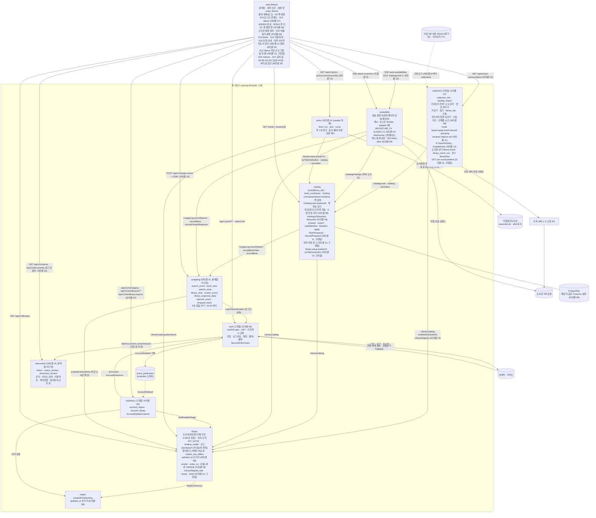

- 사이클 15 — 설계됨(미구현, 사이클 15) (ADR-0097·0102): 새 모듈 `usagelog` → `library`(`LibraryCatalog.enabledLibraryRefs()`), `usagelog` → `auth`(`LoginStatusReader` [안: 이름]). `catalog` → `usagelog`, `availability` → `usagelog`가 새로 생김(공개 창구 직접 호출, 이벤트 안 씀) [확정]. `library`·`auth`는 `usagelog`를 모름, 순환 없음, 새 이벤트 없음. 웹은 `POST /api/v1/usage-events`로 사용 알림을 보내고, 검색·책 상세 요청에는 `access_token` 쿠키가 함께 감(경로 `/api/v1`). 자세한 것은 아래 "사용자 행동 기록"
- 사이클 16 — 설계됨(미구현, 사이클 16) (ADR-0098·0099): 새 모듈 `sitecontent`, 새 의존은 `auth → sitecontent`(`SiteDocuments.currentVersion`) 하나 [확정]. `sitecontent`는 어떤 모듈에도 의존하지 않음(이용약관 REST를 로그인 기능과 상관없이 열어 두는 이유: `sitecontent`가 `auth` 설정을 알면 `sitecontent → auth`가 생겨 서로 의존하게 됨) [확정]. 가입은 동기 읽기가 필요해 이벤트를 쓰지 않음, 새 이벤트 없음. dev `auth/package-info.java`의 "depends on no other module (AC-18)"과 `ModularityTests`(`dependenciesOf("auth")` → `sitecontent`만, `sitecontent`는 의존 없음)가 바뀌고, `auth`의 `@ApplicationModuleTest`는 `BootstrapMode.DIRECT_DEPENDENCIES`가 필요해짐. 사이클 15(`usagelog → auth`)도 같은 시험 파일을 고치므로 나중에 합치는 쪽이 rebase 때 두 줄을 함께 둠 [확정] (2026-10-14 dev main 확인). 자세한 것은 아래 "공지·안내·약관 글"
- 사이클 08 (구현됨 (사이클 08)): 모듈 사이 의존 방향은 바뀌지 않습니다(`collection → catalog, library`, `availability → catalog, library`, `catalog → library → region`). 새 이벤트 없음 [확정] (설계 결정 2026-10-11). Modulith `components.puml`(2026-10-11)과 같음: Collection→Catalog·Library, Catalog→Library, Library→Region, Availability→Library·Catalog, Mylibrary→Auth·Library·Region. `catalog :: normalize`도 그대로이고, 국가서지 원문도 가져올 때마다 이 규칙으로 다듬습니다(ADR-0069). DB 메모리 값(`shared_buffers`·`effective_cache_size`·`work_mem`)은 dev `compose.yaml`의 `db` `command:`에 환경 변수 기본값으로, Java 힙 상한은 실행 설정의 `-Xmx`로 둡니다 [확정] 자리 (ADR-0066). 값(로컬 PC 기준, dev 측정 2026-10-11): DB `shared_buffers` 64MB, `effective_cache_size` 768MB, `work_mem` 4MB, 컨테이너 상한 권장 1GB(compose에는 두지 않음), 서비스 힙 512MB(`bootRun` 기본 `-Xmx512m`), 가져오기 `-PbootRunXmx=6g`(측정 중, AC-12) [확정] (사용자 승인, 2026-10-11). 운영 서버가 정해지면 다시 잼(backlog)
- 사이클 09 — 구현됨 (사이클 09): 모듈 관계 변화 없음(`availability` → `library`는 이미 있음), 새 이벤트 없음. 분류 값은 `library` → (`GET /api/v1/libraries`) → 웹, `library` → `SearchTarget` → `availability` → (스트림 `targets.libraries[]`) → 웹으로 감. 업체·대출 방식은 도서관 수집 결과를 dev seed 생성 스크립트(`build_candidate_seed.py` + `name_overrides.tsv`)가 changeset으로 넣음 (ADR-0071·0076). Modulith `components.puml`(2026-10-12)과 같음: Collection→Catalog·Library, Catalog→Library, Library→Region, Availability→Library·Catalog, Mylibrary→Auth·Library·Region (회고, `docs/cycles/09-library-naming/retro.md`)
- 사이클 10 — 구현됨 (사이클 10), 사이클 14에서 지움 (ADR-0073, ADR-0089가 대체): 새 모듈 `popular` → `catalog`(`BookLookup.byIsbn13`), `popular` → `library`(`LibraryCatalog.planSearch`). `catalog`·`library`는 `popular`를 모름, 고리 없음, 새 이벤트 없음. `@ApplicationModule(allowedDependencies = {"catalog", "library"})` [확정]. dev `module-popular.puml`(2026-10-12)과 같음. 바깥: `popular` → 출판유통통합전산망(`bnk.kpipa.or.kr`, 매달). S14는 새 API 없이 `catalog`(`GET /api/v1/books/{bookId}`)와 `availability`(소장 스트림 `holdingLimit=3`)를 부름 — 사이클 14에서 `popular`는 지우고 `picks`로 바뀜(아래), 구현됨 (사이클 14)
- 사이클 14 — 구현됨 (사이클 14, 회고 2026-10-14) (ADR-0089·0090): 모듈 `popular`를 지우고 새 모듈 `picks` → `catalog`(`BookLookup.byIsbn13`·`BookLookup.byTitleAndAuthor`), `picks` → `catalog :: normalize`(`Isbn.toIsbn13`), `picks` → `library`(`LibraryCatalog.planSearch`). `catalog`·`library`는 `picks`를 모름, 고리 없음, 새 이벤트 없음. `@ApplicationModule(allowedDependencies = {"catalog", "catalog :: normalize", "library"})` [확정] (dev `picks/package-info.java` 20행과 같음, 2026-10-14). 바깥: `picks` → 국립중앙도서관(`nl.go.kr` 목록 주 1건, `www.nl.go.kr/afile/` 새 표지만). 출판유통통합전산망 요청 0건. S14는 지금처럼 새 API 없이 `catalog`(`GET /api/v1/books/{bookId}`)와 `availability`(소장 스트림 `holdingLimit=3`)를 부름
- 사이클 13 — 구현됨 (사이클 13, 회고 2026-10-14) (ADR-0083~0088·0093): 모듈 관계 변화 없음(`collection → catalog, library` 그대로, `collection`이 `library`의 새 공개 `LibraryRegistry`도 씀), 새 모듈·새 이벤트 없음. `library`·`catalog`는 `collection`을 모름, `collection`은 `region`에 의존하지 않음. 새 도서관을 넣는 길이 Liquibase seed에서 `collection` 명령(`library-insert`)으로 바뀜(ADR-0084). 웹 → `collection` REST 하나(`GET /api/v1/join-surveys/latest`)가 처음 생김. 수집기 코드는 dev `scripts/crawl/`로 갈아타고 옛 코드는 데이터 폴더 `_old-scripts-2026-10-12`에 보관(ADR-0088), 사람이 정한 도서관 규칙은 dev `scripts/library/rules/` TSV(ADR-0085). 그림은 아래 "도서관 넣기 명령"
- 사이클 11 — 구현됨 (사이클 11, 회고 2026-10-14) (ADR-0078·0079): 모듈 관계 변화 없음(dev `./gradlew build`의 ModularityTests·DocumentationTests 통과, 모듈 의존 변화 없음)(`collection → catalog, library` 그대로), 새 모듈·새 이벤트·새 REST 없음. 내 PC와 운영 DB 사이는 모듈 호출이 아니라 `pg_dump -Fc` 파일 하나로 이음(아래 "가져오기 따로 하기" 그림). `catalog`는 `collection`을 모르고, `collection`은 `catalog` 표를 읽지 않음 [확정] (설계 결정, 2026-10-12)
- 사이클 12 — 구현됨 (사이클 12, 회고 2026-10-14) (ADR-0082, ADR-0106): 모듈 관계 변화 없음(Modulith `module-collection.puml` 2026-10-14: `collection → catalog, library`, `catalog → library`). 새 클래스는 `collection.internal.importer` 패키지 내부(`SameTextKey`, `SubtitleParts`)뿐, 공개 API·이벤트·표 변경 없음. `./gradlew build` 시험 697 통과(`ModularityTests`·`DocumentationTests` 포함, dev `plan-feedback.md` 3480행)

- 의존 방향: `catalog → library → region`, `availability → catalog, library`. 순환 없음. `Documenter` `components.puml`(2026-09-30)과 같음
- 사이클 07 (구현됨 (사이클 07), ADR-0060): `collection → catalog → library → region`, `collection → library`(`LibraryCatalog`만, `library` 표는 읽지 않음). `catalog`·`library`는 `collection`을 모릅니다. 고리 없음, 새 이벤트 없음. 가져오기는 사이클 04~06의 `catalog` importer에서 `collection`으로 옮겼습니다(ADR-0031의 "가져오기는 `catalog` 안"을 ADR-0060이 바꿈). `catalog`의 제목 다듬기 규칙은 한 벌만 두고 `collection`이 named interface `catalog :: normalize`로 빌려 씁니다. `Documenter` `components.puml`(2026-10-05)과 같음: Collection→Catalog·Library, Catalog→Library, Library→Region, Availability→Library·Catalog, Mylibrary→Auth(uses, listens to)·Library·Region. 새 공개 타입: `JoinSurvey`, `LendingModel`(`library`), `CatalogLoad`(`catalog`) [확정] (dev 구현 확인, 2026-10-05)
- 사이클 06 (구현됨 (사이클 06)): `mylibrary → auth, library, region`. `Documenter` `backend/build/spring-modulith-docs/components.puml`(2026-10-05)과 같음: Catalog→Library, Library→Region, Availability→Library·Catalog, Mylibrary→Auth(uses + listens to), Mylibrary→Library, Mylibrary→Region. `ModularityTests`가 `mylibrary` 의존이 정확히 셋이고 검색 모듈이 auth·mylibrary에 의존하지 않음을 확인함. `catalog`·`availability`는 `mylibrary`·`auth`를 모르고, 웹이 `libraryIds`로 넘깁니다(ADR-0037. 그 ADR의 `member`는 `mylibrary`로 읽음, `libraryIds` 상한은 20 [확정] (사용자, 2026-10-04)). 순환 없음.
- 조회 서버는 연결 실패·503일 때만 다음 서버로 넘깁니다 (ADR-0015, 흐름 4)
- 모듈끼리는 루트 패키지의 공개 API로만 호출합니다. 거꾸로 부르지 않습니다 (ADR-0001). `availability`는 `region`에 직접 의존하지 않습니다.
- 이벤트: `auth`가 `AccountDeleted(accountId)`를 발행합니다(구현됨(사이클 05, 2026-10-04 retro 반영), ADR-0041). 받는 쪽은 `auth` 자신의 listener와 `mylibrary` listener(두 표 삭제, 구현됨 (사이클 06), ADR-0051) 둘입니다. 재시작 때 남은 기록 다시 처리 `spring.modulith.events.republish-outstanding-events-on-restart: true` [확정] (ADR-0051). 실패(`FAILED`) 기록도 다시 처리함 — 확인함 (dev, 2026-10-04): 공식 문서는 상태별 동작을 적지 않아 Spring Modulith 2.1.1 jar를 확인함. `JdbcEventPublicationRepositoryV2`가 `COMPLETION_DATE IS NULL OR STATUS != 'COMPLETED'`인 기록을 다시 처리하고, 시험 `mylibrary/AccountDeletedRepublishTests`(실제 잠금 시간 초과로 `FAILED`를 만든 뒤 재시작 → 두 표·발행 기록 0)로 확인. 그 밖에는 이벤트를 쓰지 않습니다.
- `auth`가 의존하는 모듈은 `sitecontent`(가입 문서 판 순번) 하나뿐입니다 — 설계됨(미구현, 사이클 16) (ADR-0099; 구현된 지금 코드에서는 의존 없음). `mylibrary`만 auth의 공개 타입에 의존 (ADR-0048) — 구현됨 (사이클 06). 사이클 15부터 `usagelog`도 `auth`의 공개 타입에 의존 — 설계됨(미구현, 사이클 15). (ADR-0036은 ADR-0048로 대체됨.) 운영에서는 앞단 웹 서버가 화면 파일을 내려 주고 `/api`를 본 서비스로 넘깁니다(같은 출처, ADR-0042).
- 칸 안의 정렬(제목끼리 모은 뒤, 같은 책 안에서는 가입 가능 → 가입 가능(주의) → 가입 가능(방문) → 가입 자격 확인 필요 [확정] (사용자, 2026-09-30), 그다음 기존 순서)과 "지금 빌릴 수 있는 책만" 필터는 프론트가 합니다. `availability`는 줄마다 판정(`availability`), 정렬에 쓰는 값, 제목 비교 키(`titleKey`)를 계산해 보냅니다.
- 조회 계획과 묶음 진행 상태는 브라우저가 가지고, 서버는 저장하지 않습니다 (ADR-0014). 사이클 04부터 수집 목록 흐름의 계획 단위는 소장(`holdingId`, 웹 `holdingPlan.ts`·`useHoldings`)이고, 직접 찾기 흐름(`useSearch`)은 도서관 단위 그대로입니다. 두 흐름은 상태를 섞지 않습니다.
- `Book`·`Contributor`·`Holding`·`LibrarySnapshot`은 `catalog` 모듈이 DB에 저장합니다(구현됨. 사이클 07 가져오기로 로컬 DB에 적재, 2026-10-05).
- 책 목록 기본 순서(사이클 04): 가입 단계(`joinTier`, 지역 있음: 내 시군구 → 내 시도 → 누구나 → 방문 가입만 → 확인 필요 / 지역 없음: 누구나 → 방문 가입만 → 확인 필요) → 완전 일치 → 보유 도서관 수 → 출판일 최신. 한 책 안 도서관 순서는 `planSearch`(ADR-0027)
- 사이클 06 (구현됨 (사이클 06), ADR-0050): 직접 추가 도서관(`chosen`)은 계획·책 목록(`joinTier` `CHOSEN`이 첫 값)·웹 정렬(`sortBatch`) 모두에서 맨 앞 [확정]. 스위치가 "전체"(`scope=all`)여도 같음, `priorityGroup`은 원래 값 유지 [확정] (사용자 승인, 2026-10-04). 지역 규칙이 안 맞는 `chosen` 도서관은 `priorityGroup=QUALIFIED`, `eligibility=UNKNOWN` [확정] (dev가 정한 값, dev 구현 확인, 2026-10-05)
- 결과 줄의 가입 정보 (2026-10-05 바뀜, 사이클 03 U-12와 사이클 06 "직접 추가면 자격 줄 숨김"을 바꿈): 모든 폭에서 도서관 이름을 누르면 팝오버(데스크톱은 이름 오른쪽, 640px 이하는 아래)가 열리고 그 안에 자격 요약·자격 조건·안내·주의·방문 가입·가입 방법. "가입 자격 확인 필요" 표시도 이름 옆에서 그 팝오버 맨 위로 옮김. `chosen` 도서관도 같은 정보를 보이고, 다른 도서관과의 차이는 이름 옆 "직접 추가" 표시와 정렬(같은 책 안에서 맨 앞)뿐 [확정] (사용자 요청, 2026-10-05: "'직접 추가'도서관도 그 방법에 맞게 보이도록 해줘(자격 조건도 누르면 보이도록)")
- 사이클 07에서 넣은 도서관 2,394곳 (구현됨 (사이클 07)). 2026-10-13 지금 서비스에 켜진 것은 2,381곳: 11곳(서비스 번호 2664~2674, 교보 대여·혼합 기관)은 사이클 08이 seed에서 뺌(ADR-0067, dev 커밋 `2642a28`), 2곳(장안대학교 2194·성균관대학교 2198)은 `library/010`으로 꺼짐 [확정] (dev `plan-feedback.md` 3408~3412행):
  - 웹러브 북스 목록에서 찾은 기관(수집 번호 100001 이상, `crawl_skip` 없음, 전체 수집이 끝난 곳. 체험용·운영 중단 4곳과 시험용 6곳, 사이클 06까지 있던 도서관(번호 1~280)과 책 번호 목록이 같고 상세 주소가 포트만 다른 8곳은 넣지 않음)은 서비스 새 번호로 `library.library`에 seed로 넣고, 짝은 `collection.collection_link`에 넣습니다 [확정] (ADR-0052). 넣은 곳 2,394곳(서비스 번호 281~2674), 짝 2,674줄(번호 1~280은 같은 번호끼리 280줄 + 새로 넣은 2,394줄) [확정] (dev 구현 확인, 2026-10-05). 사이클 13부터 새 도서관은 seed가 아니라 `collection` 넣기 명령으로 넣음 — 구현됨 (사이클 13, 회고 2026-10-14) (ADR-0084). 같은 기관의 다른 북큐브 사이트 6곳은 넣음 [확정] (사용자 결정 "① 8곳만 빼기", 2026-10-05). 이름이 겹치면 "강동대학교 (북큐브)"처럼 [확정] — 사이클 09에서 바뀜: 이름에는 기관 이름만 두고 업체·대출 방식·순번으로 구분 (구현됨 (사이클 09), ADR-0071). 이 2,394곳의 seed 주소는 리다이렉트를 따라간 https 최종 주소(248곳, `scripts/library/CheckFinalOrigins.java`) [확정] (사용자 요청, 2026-10-05)
  - 대구학생전자도서관(100049)은 `MEMBERS_ONLY`(가입 방법·주의·가입 주소는 넣음) [확정] (사용자 결정 "구성원용으로", 2026-10-05). 지역 표에 증평군(4311) 추가 → 증평군립도서관(383)이 규칙을 받음 [확정] (사용자 결정, 2026-10-05)
  - 가입 조사 상태별 검색 규칙 [확정] (ADR-0053, ADR-0013·0050 보완): `SURVEYED` 지금처럼 판정, `NOT_FOUND` "가입 자격 확인 필요"(ADR-0013 자격 미확인과 같음), `MEMBERS_ONLY`·`NOT_SURVEYED`는 직접 추가했을 때만 계획에 들어가고 API 등급은 `UNSURVEYED`. 직접 추가하지 않은 이용자에게는 이 도서관 사이트로 요청이 가지 않음. 가입 정보 창 맨 위에 조사 상태별 안내 문구
  - 로그인 전에도(로그인 기능이 꺼져 있어도) S10(`/my-libraries`)에서 직접 추가(브라우저 키 `chaekcheck.chosenLibraries.v1` [확정] (dev 구현 확인, 2026-10-05), 최대 20)하고 검색 요청에 `libraryIds`로 넘김. 로그인 직후 계정이 비었으면 S11에서 지역과 함께 한 번에 옮김 [확정] (ADR-0057). S10 도서관 찾기는 `GET /api/v1/libraries`를 통째로 받아 화면에서 거름(두 글자 이상, 앞 글자 맞는 것 먼저·가나다순, 20곳씩 "더 보기"), nginx JSON gzip [확정] (ADR-0058, ADR-0049 전환 조건 정리)
  - 로고: 사이클 06까지 있던 도서관(번호 1~280) 중 자체 로고가 있는 공공도서관 198곳(199곳 중 1곳은 원본이 그림이 아님), S1·S3 결과 카드(약 20px)와 S10 도서관 줄(약 24px)의 **이름 위 줄**, 누르면 도서관 메인 페이지 새 창, **로고가 없으면 아무것도 그리지 않음**(로고 없는 도서관은 로고로 홈페이지를 열 수 없고, 카드의 "홈페이지 (새 창)" 링크는 있음), `logo_visible`로 바로 내림 [확정] (사용자: "실제로 확인해보고 디자인 측면의 안정감때문에", 2026-10-05, AC-20·ADR-0059의 "이름 앞, 빈 상자"를 바꿈). 파일은 웹 정적 파일, 주소 `/library-logos/{logo_file}`(`logo_file`이 있고 `logo_visible`일 때만 `logoUrl`), 컴포넌트 `web/src/components/LibraryLogo.tsx` [확정] (dev 구현 확인, 2026-10-05)
  - 검색 범위 기본값은 가입할 수 있는 쪽, 그 버튼이 왼쪽(로그인 전 지역 없음 "누구나 가입", 지역 있음 "가입 가능한 곳", 로그인 후 "내 도서관", 비어 있어도). 로그인 전 첫 요청에 `scope=joinable`이 붙음(사이클 06 AC-14와 달라짐). API 기본값(`scope` 없으면 all)은 그대로 [확정] (사용자: "이 프로젝트의 편의성을 생각했을 때 가입할 수 있는 곳으로 가는 것이 사용자 측면에서 좋다고 봐서", 2026-10-05)
  - 브라우저 `chaekcheck.searchSettings.v1`에 기억하는 것: 범위(로그인 전 `guestScope`, 로그인 후 `myScope`), 방문 없이 가입(`visit`), 지금 빌릴 수 있는 책만(`filter`), 보기 방식(`view`), 직접 찾기(`direct`) [확정]. 주소 값이 이김, 검색어는 저장 안 함. 지금 코드는 정렬·완전 일치·옮긴이·그림·엮은이(`sort`·`exact`·`roles`)도 저장하지만 사용자가 "정렬, 상세검색의 완전 일치·옮긴이·그림·엮은이 … 이건 기억하지 마"(2026-10-05)라고 정함 → 사이클 08: 이 셋을 쓰지 않고, 남아 있으면 읽을 때 지움 [확정] (사이클 08 spec R1) — 구현됨 (사이클 08) (AC-1·2)
- 사이클 08 웹 (구현됨 (사이클 08), `docs/cycles/08-polish-swap-memory/design-delta.md` "웹", dev `plan-feedback.md` "# 사이클 08" 7·12단계): 429 `too_many_requests`·503 `server_busy`를 따로 안내 줄로("검색을 너무 자주 했어요. 1분쯤 뒤에 다시 해 주세요." / "지금 찾는 사람이 많아요. 잠시 뒤에 다시 해 주세요."), 받은 결과는 남김 [확정] (spec R2). `mobileSiteDiffers`이고 폭 640px 이하면 결과 카드 이름 아래(바로 보기·직접 찾기·책 화면 줄이 같은 `ResultRow`)·가입 정보 창의 "도서관 첫 화면"·"전자도서관에서 가입 안내 보기" 링크 옆에 YES24 폰 안내 [확정] 자리, 문구 "폰에서는 사이트가 다른 화면을 보여요. PC에서 열어 주세요" [확정] (사용자: 인계서 안 그대로, dev 세션 2026-10-11). 폰 설정 창은 아래에서 올라오는 바텀 시트(되돌림: `SettingsPanel.tsx`의 `PHONE_SETTINGS_SHEET = false`) — 유지 [확정] (사용자 승인, 2026-10-11, `docs/cycles/08-polish-swap-memory/easy/2026-10-11-final-decisions.html`). 폰 직접 찾기 "정렬 없음 ⓘ"은 **검색 줄 끝**("N곳" 옆)에 둠 — 처음 둔 결과 위 도구줄이 폰에서 숨겨져 옮김 (dev 12단계), 설계(`flow.md` "검색줄 둘째 줄 오른쪽 끝")와 같은 자리 [확정]. 글꼴 서브셋("Chaekcheck Barun", 드문 음절이 있을 때만 원래 나눔바른고딕, woff2 합 2,997,692 → 629,272바이트, AC-13). 돌아가기(`components/BackLink`)와 ⓘ(`components/InfoTip`)는 **S8·S9·S10만**(맨 아래 "← 돌아가기", S10 제목 옆 ⓘ "고르는 즉시 이 브라우저에 저장돼요"/"고르는 즉시 계정에 저장돼요"). **S2(지역 고르기 창)는 바꾸지 않음** [확정] (사용자: "A. 그대로", dev 세션 2026-10-11; S2는 [저장]을 눌러야 저장되어 "즉시 저장" 안내가 맞지 않음 — flow "검토 결과"의 S2 돌아가기를 바꿈). 빠진 책(`book_not_found`)은 "책을 찾을 수 없어요" 아래 "도서관 목록을 새로 받으면서 빠진 책일 수 있어요. 다시 검색해 주세요.", 빠진 소장(`holding_not_found`)은 책 화면 그 도서관 줄에 "이 도서관 목록에서 빠졌어요" [확정] (ADR-0070). 도서관은 고친 이름으로만 찾음(옛 이름 "서라벌"로는 안 찾힘) [확정]. S10 이름 찾기는 공백과 함께 가운뎃점(·)도 무시("한국형사·법무정책연구원"을 "형사법무"로 찾음, `web/src/features/mylibrary/libraryNames.ts`) [확정] (사용자 승인, 2026-10-11)
  - 새 화면 S12 서비스 안내 `/about`(소개, 로고·이름 권리 고지, 로고 내림 요청 이메일 — 주소는 사용자가 알려 줌 [확인 필요], 지금은 자리 글 `TODO(확인 필요)`), 모든 화면 바닥글에 링크 [확정] (ADR-0059). 화면 `web/src/features/about/AboutPage.tsx`
- 사이클 09 웹 — 구현됨 (사이클 09) (`docs/cycles/09-library-naming/design-delta.md` "웹", flow.md, ADR-0071·0076). 새 화면·화면 이동 없음. 웹이 `vendor`·`lendingModel`·`orderNo`를 우리말 글자로 바꿈(`KYOBO` 교보, `YES24` YES24, `BOOKCUBE` 북큐브, `ALADIN` 알라딘, `PORTAL` 통합 포털, `IN_HOUSE` 자체 / `OWNED` 소장, `SUBSCRIPTION` 구독, `MIXED` 혼합, `RENTAL` 대여) [확정]:
  - 분류 글자 6×4와 "· N번째 사이트"는 `web/src/lib/libraryClassification.ts` 한 곳에서 만듦 [확정] (dev 구현 확인, 2026-10-12)
  - S1·S3 결과 카드(`ResultRow.tsx`): 모든 폭에서 이름 **다음 줄**에 "교보 · 소장", 작은 회색 글씨, 이름 버튼 밖, 폰 안내(YES24)보다 앞 [확정] (사용자: "검색 결과 카드에서는 공통으로 도서관 이름 있고 개행 하고 교보 소장 이런거 보이도록 하는 걸 어떻가 해", 2026-10-11)
  - S10 지역 도서관 목록, 직접 추가 이름 찾기 결과, 직접 추가한 도서관(`MyLibrariesPage.tsx`): "이름 · 업체 · 대출 방식", PC·태블릿은 이름 옆, 폰(`width <= 640px`)은 이름 아래 줄 [확정] (사용자 승인, 2026-10-11; 폭 dev 구현 확인, 2026-10-12). [추가]·[빼기] 버튼의 `aria-label`에 분류가 들어감 [확정] (dev 구현 확인, 2026-10-12)
  - 순번 2 이상이면 위 모든 자리에서 분류 뒤에 "· N번째 사이트" [확정] (spec R4-4·R5). 통합 포털은 "부산광역시 전자도서관 · 통합 포털"(대출 방식 없음)
  - 요약 줄(`LibrarySummaryBar.tsx`), 지역 가져오기 창(`RegionImportDialog.tsx`), 직접 찾기 결과 이름 나열(`DirectResults.tsx`), 가입 정보 창은 이름만 [확정]
  - 분류 값이 오지 않으면(배포 순서가 어긋남) 이름만. 꺼진 도서관(직접 추가한 도서관에 남은 것)은 지금처럼 "쓸 수 없는 도서관", 분류 없음 [확정]
  - S10 이름 찾기(`libraryNames.ts` `findByName`): 공백으로 나눈 낱말마다 이름 키 또는 분류 키(업체·대출 방식 글자)에 있으면 맞음(낱말 모두 맞아야 함), 공백·가운뎃점 무시, 소문자. 예: "동대문 yes24" → 동대문구립도서관 · YES24 · 소장. 정렬: 이름 앞부분 일치(낱말이 아니라 공백·가운뎃점을 뺀 검색어 전체 열쇠로 판단) → 이름순 → 같은 이름은 업체 글자순(`Intl.Collator('ko')`, 한글이 라틴 글자보다 앞: 교보 → 북큐브 → 알라딘 → 자체 → 통합 포털 → YES24) → 같은 이름·같은 업체는 순번 순 [확정] (사용자 승인, 2026-10-12, `docs/cycles/09-library-naming/easy/2026-10-12-retro-decisions.html` #1·#3; `libraryNames.ts`). 예: "군산시립" 세 줄은 교보 → 북큐브 → YES24. 목록을 한 번 받아 브라우저에서 찾음(ADR-0058 그대로, 서버 찾기 API 없음) [확정] (ADR-0076)
- 사이클 10·14 웹: 사서추천도서 (지난 이름 인기 도서) — 화면 틀은 구현됨 (사이클 10), 사이클 14에서 바뀐 것도 구현됨 (사이클 14, 회고 2026-10-14; 사용자 폰 확인 "지금 맘에 들어", 2026-10-12) (`docs/cycles/14-librarian-picks/flow.md`, design-delta "웹"; 바탕 `docs/cycles/10-popular-books/flow.md`, 회고 `docs/cycles/10-popular-books/retro.md`). 화면 디자인은 사이클 10 시안 A 그대로(사용자 폰 확인 "폰에서도 잘 돼", dev `plan-feedback.md` "사이클 10 덧붙임: 디자인 확정"). 새 화면 없음, 화면 ID 그대로(S13, S13c, S13i, S14, S15). 아래 줄에 따로 적지 않은 것은 사이클 10 구현 그대로:
  - 머리(`AppLayout`): 로고 바로 옆 글자 링크 **"사서추천도서"**(사이클 10 "인기 도서"를 바꿈) — 구현됨 (사이클 14) [확정] (R7-1). 자리·숨기는 화면(S8·S9, `/terms`·`/privacy`)은 그대로, 폰 320px에서 로그인 버튼과 겹치지 않음 [확정] (사용자 승인, 2026-10-12; dev 확인: 링크 끝 170px, 버튼 시작 227px, 1280·768·375·320 가로 넘침 없음). 로고 옆 설명 글 "전자도서관 대출 가능 확인"은 모든 폭에서 지움(사이클 10 그대로) [확정]. "인기 도서" 글자는 어느 화면에도 없음 (AC-15)
  - S13 **`/picks`**(사이클 10 `/popular`를 바꿈, 옛 경로는 남기지 않음; 폴더 `features/picks`: `PicksPage`, `PicksBookDialog`, `PicksWindow`, `usePicksPlan`, `picksPosition`, `picksText`) — 구현됨 (사이클 14) [확정] (flow; dev `main.tsx` 41~42행). 그대로인 틀(구현됨, 사이클 10): 위 제목 줄 없음(화면 읽기용 h1만). 분류 칸은 **화면 아래 가운데에 떠 있는 [분류 ▾] 버튼**(모든 폭, 지금 보는 분류를 따라감, 폰·태블릿은 바닥에서 76px 위) [확정] (사용자, 2026-10-12). 분류 묶음(`CategorySection`이 표지 격자까지 그림)마다 카드(다른 화면 카드와 같은 모양 [확정] (사용자, 2026-10-12)) 안에 ◀ 3×3 표지 ▶(◀ ▶는 둥근 네모, 9권씩, 마지막 쪽도 3×3 크기, 첫 쪽 ◀·마지막 쪽 ▶ 없음, 전자책 없는 책은 흐림). 분류 묶음 하나가 화면 높이를 채움. 스크롤: PC는 휠 한 칸·PageDown = 한 분류(350ms), 터치 화면(`(pointer: coarse)`)은 위아래로 한 번 밀면 한 분류(두 손가락 확대는 됨), CSS 스냅 안 씀, 넘긴 쪽·스크롤은 히스토리 상태 [확정] (사용자, 2026-10-12, 시안 A). 폰은 좌우로 밀어 넘기기도 됨. 계획은 `BookPage`처럼 `useRegions`·`useLibraryScope`·`readVisit`·`loadPrefs`로 만들어 **`GET /api/v1/picks`**에 보냄(AC-7). 로딩 회색 빈 카드 9개. 바뀐 것(구현됨 (사이클 14)): 분류 묶음 순서 전체 → 문학 → 인문 → 사회 → 자연 → 테마(고정, 모르는 새 분야는 맨 뒤에 응답의 `name`으로), 책 0권인 분류는 묶음도 목록 줄도 없음 [확정] (R2-1~R2-5). 카드 머리 큰 분류 이름 + **"1 - 9 / 18"**("위"를 뺌, 분류마다 18권·테마 36권) + 쪽 표시 점 [확정]. **순위 칩 없음**(사이클 10의 왼쪽 위 둥근 순위 칩을 뺌), "있음/없음"은 흐림 하나로만 [확정] (R4-3). 순서: 추천 연월 최근 → 같은 달은 등록일 늦은 순 → `recomNo` 글자 큰 순 [확정] (R4-2). 맨 아래 출처 줄 "출처: 국립중앙도서관 사서추천도서 (공공누리 제1유형) · 10월 12일 받음"(받은 날 = 마지막으로 성공한 받기) [확정] (R7-2). 상태: 목록 없음 "아직 사서추천도서를 준비하고 있어요", 오류 "사서추천도서를 불러오지 못했어요. 잠시 뒤에 다시 해 주세요." [확정]. 분류마다 18권(테마 36권)이라 2쪽(테마 4쪽)이 꽉 참 [확정] (사용자 결정, dev 2026-10-14). 폰(640px 이하)은 그리드 폭 계산에서 출처 줄 자리를 빼고 판 좌우 안쪽 여백 0.9rem → 0.55rem으로 표지를 키움(카드 폭 375×812 86 → 99px), 3×3 그대로 [확정] (사용자: "폰에서 이미지가 너무 작은 느낌인데 조금 못 키우나?" → "지금 맘에 들어", 2026-10-12). 마지막 분류에서는 출처 줄을 보려면 조금 내려야 할 수 있음
  - 표지 ``, 그림이 안 열리면(`onError`·`coverUrl` null) 그 칸에 제목 글자 [확정] (구현됨, 사이클 10). 그림은 국립중앙도서관 표지를 우리 서버가 폭 200px JPEG로 줄인 것(`/api/v1/picks/covers/{coverId}`) — 구현됨 (사이클 14) [확정] (R4-4·R4-5, ADR-0091). 제목 글자 카드는 본제목만(" : "·" = " 앞, `picksText.ts` `cardTitle`), 5줄(폰 4줄)까지, 폰 글자 0.62rem, 화면 읽기용 이름은 원래 제목 [이유 미확인 — dev가 화면 확인 중 고침: 긴 부제로 잘리고 320px에서 세로로 쌓임, 2026-10-12]. 우리 전자책 표지는 이번에 안 씀(서비스 DB에 표지 없음, backlog)
  - S13c 분류 목록(PC·태블릿 펼침 목록, 폰 아래 창, 지금 분류 진하게, 구현됨 (사이클 10)): 줄은 전체 + 책이 있는 분류(보통 6줄 이하, 새 분야가 오면 맨 뒤) — 구현됨 (사이클 14) [확정] (R2-1·R2-3·R2-5). S13i 도움말은 따로 ⓘ 없이 분류 목록 맨 아래 **"? 추천 기준 보기"**(사이클 10 "? 순위 기준 보기"를 바꿈, PC 목록에서는 스크롤 밖 아래에 늘 보임) — 구현됨 (사이클 14) [확정] (사용자 승인, 2026-10-12)
  - S13i 도움말 문구 — 구현됨 (사이클 14), 이 순서(dev `picksText.ts` 22~28행): "국립중앙도서관 사서가 고른 신간 추천 도서 중 최근 12번(2년) 추천분이에요", "보통 2달에 한 번, 한 번에 8권(문학·인문·사회·자연 각 2권)을 추천해요. 테마 추천 때는 12권이에요", "신간이라 아직 전자책이 없는 책도 있어요"(사이클 10 "종이책 순위라서 …"를 바꿈), "흐린 책은 검색하는 도서관에 전자책이 없어요", "있음/없음은 검색 화면에서 고른 지역·범위 기준이에요", 출처·받은 날 [확정] (R7-2·R7-4; 첫 두 줄은 사용자 결정, dev 2026-10-14: "좀 더 구체적으로 12번(2년)이라고 알려주고 … 이 정보도 알려줘", 처음 "최근 6번"을 바꿈; 테마 문장은 dev가 받은 자료로 덧붙임 [이유 미확인])
  - ⓘ 말풍선(`components/InfoTip`)은 앱 전체에서 밝은 둥근 네모, `text`는 ReactNode를 받음 [확정] (사용자: "이거 왜 박스 까매 다른 것이랑 똑같이 해", 2026-10-12)
  - S14 가운데 창(PC·태블릿 가운데 창, 폰 아래 창): 표지는 격자에서 누른 그 `coverUrl`(없으면 제목 글자), 제목·지은이·출판사는 `fetchBook`(`GET /api/v1/books/{bookId}`), 대출 줄은 `useHoldings` + `holdingLimit=3`(계획 순서 앞 3곳만 확인, 첫 묶음만 씀), 안내 "검색하는 도서관 중 앞의 3곳", 줄 컴포넌트는 S3 것(사이클 09 분류 표시를 따라감). 3곳을 대출 가능·구독형 → 대출 중(예약 적은 순) → 실패 순으로 [확정] (spec R6-3·R6-5). [책 검색 >>] → S3, 도서관 줄 → 사이트 새 창. `fetchBook` 404면 "책을 찾을 수 없어요", 그 밖의 오류·끊김은 S3과 같은 오류 문구 [확정] (사용자 승인, 2026-10-12, 인계 전 결정 #4). 대출 조회 스트림이 통째로 실패하면 "대출 정보를 확인하지 못했어요. 잠시 뒤 다시 시도해 주세요." [확정] (사용자 "이대로", 2026-10-12). 폰 뒤로 가기는 창만 닫음. 사이클 14 — 구현됨 (사이클 14): 제목 바로 아래, 지은이·출판사 위에 한 줄 "2026년 10월 사서추천 · 문학"(응답 `recommendedMonth`·`category`) [확정] (R6-1, 사용자 승인, 2026-10-12). 표지는 격자에서 누른 그 표지(국립중앙도서관 표지, 없으면 제목 글자), 나머지는 그대로 [확정]
  - S15 신청 안내(흐린 책): 제목 한 줄 + 두 줄 "아직 검색하는 도서관에 전자책이 없어요." / "이용하는 전자도서관 사이트에서 희망도서로 신청해 보세요." [확정] (R6-9; "검색하는 도서관"·줄바꿈은 사용자 요청, 2026-10-12) — 사이클 14에도 그대로
  - 폰 아래 창 여섯(검색 설정, 로그인, S13c, S13i, S14, S15)은 같은 부품 — 검색 설정·로그인은 사이클 밖 작업으로 더함(dev 298204f, 2026-10-12, plan 요청 `docs/research/maintenance/settings-sheet-close-dev-message.md`; 폰 로그인 창은 [닫기] 글자 버튼을 빼고 ⓧ, PC·태블릿 로그인 창은 그대로). 공통: 위 손잡이를 끌어내리거나 ⓧ·바깥을 누르면 닫힘. 사이클 08 검색 설정 바텀 시트와 같은 공용 부품 `BottomSheet`(`closeButton`, `closeOnBack`, 끌어내리기 80px)와 `useBackToClose`를 씀 [확정] (사용자, 2026-10-11; 이름 dev 구현 확인, 2026-10-12)
  - 표지 정책 — 구현됨 (사이클 14) [확정] (ADR-0091, ADR-0081 대체): 목록이 바뀔 때 아직 없는 국립중앙도서관 표지만 받아(http → https, 호스트 `www.nl.go.kr`·경로 `/afile/`만, redirect 안 따름, 1초 간격, 원본 상한 5MB, 1,600만 화소 상한) 폭 200px JPEG(품질 0.8)로 줄여 게시하고, 큰 그림·확대 보기는 만들지 않음. 지금 목록이 쓰지 않는 표지는 받기 성공 뒤 지움. S12 `/about` 문구 "사서추천도서 목록과 일부 표지는 국립중앙도서관 자료(공공누리 제1유형)예요. 표지 게시를 원하지 않는 권리자를 위한 연락처는 정해지면 이곳에 안내할게요."(구현 문구, dev `AboutPage.tsx` 45~46행 — 설계 문구 "… 권리자는 [연락처]로"를 연락처가 정해질 때까지 dev가 이렇게 둠 [이유 미확인]; 문단 자리는 사이클 13 가입 조사 기준일 줄 다음·제휴 안내 앞; 사이클 10 "인기 도서 순위·표지는 출판유통통합전산망 자료 …"를 바꿈, 연락처는 배포 때 `TODO(확인 필요)`) [확정] (사용자 승인, 2026-10-12). 요청이 오면 그 표지를 지워 제목 글자로(방법은 운영 메모). 국립중앙도서관 표지 이용 조건·권리자 연락처는 따로 확인하지 않음 [확정] (사용자: "어짜피 api받았으니까 괜찮아....", 2026-10-14, 회고 결정 #23)
  - 배포: CSP 바꾸지 않음(`img-src 'self'`, 표지가 우리 주소) [확정] (ADR-0091)
- 사이클 13 웹 — 구현됨 (사이클 13, 회고 2026-10-14) (`docs/cycles/13-crawler-to-dev/flow.md` S12, ADR-0087·0093): 새 화면 없음. S12 `/about` 첫 문단("책첵은 …") 바로 아래, 제휴 안내 문단 위에 "가입 조건은 {YYYY}년 {M}월에 조사한 내용입니다." 한 줄 [확정] (자리·문구, 사용자 승인 2026-10-12). 날짜는 `GET /api/v1/join-surveys/latest`의 `surveyedOn`. 로딩 중에는 그 줄 자리를 비우고(나머지 글은 바로), `null`·오류면 줄을 보이지 않음 [확정]. 사이클 14와 맞춘 문단 순서 [안]: ① 첫 문단 → ② 가입 조사 기준일 줄(사이클 13) → ③ 사서추천도서 자료 문단(사이클 14) → ④ "각 도서관의 로고와 이름은 … 제휴·후원 관계가 없습니다" → ⑤ 로고 내림 요청 문단. 새로 넣은 도서관은 S10 이름 찾기·검색 결과에 지금 규칙대로 나오고(소속 전용이면 직접 추가한 사람만, ADR-0053), 책은 다음 가져오기 뒤에 보임. 1215는 "한화S&C"로 보임

### 가져오기 따로 하기: 내 PC와 운영 DB — 구현됨 (사이클 11, 회고 2026-10-14). 묶는 방식 셋(`compact` = `CompactGrouping` 기본, `objects` = `BookGrouping`(2026-10-12까지 이름 `current`), `sql` = `SqlGrouping`, 공통 인터페이스 `BookGrouper`)도 구현됨. 기본 `compact` [확정] (사용자: "기본 방식은 compact로 해줘 그리고 sql이나 다른 방법들도 구현에 남겨둬 선택해서 할 수 있게 해줘", 2026-10-12, ADR-0105)

같은 앱을 두 DB에 모드만 바꿔 돌립니다. 내 PC는 `export`로 새 표까지 만들어 파일 하나로 내보내고, 운영 역할 DB(이 사이클은 같은 PC의 compose 서비스 `db-ops`, 포트 5434)는 `apply`로 비교한 뒤 복원·바꿔 끼웁니다. 운영이 성공하면 내 PC는 `finish`, 실패하면 `discard` (ADR-0078). 흐름은 `flows.md` 흐름 27~29.

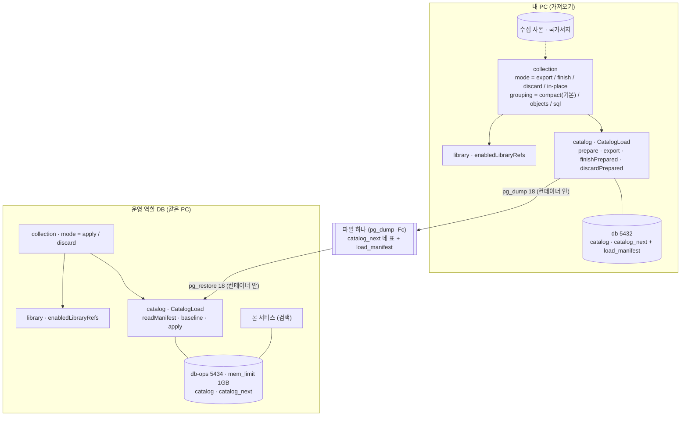

- 이름(모드 값 말고 메서드·설정·서비스 이름)은 [안]. 모드 값·`grouping` 자리 [확정] (설계 #3)
- 인프라: dev `compose.yaml`에 `db-ops`(`db`와 같은 이미지·`command:`, 자기 볼륨, `mem_limit: 1g`, 처음엔 `db`를 통째로 복사해 시작) [확정 값] (설계 #12, 스펙 R-A6). 표는 `data-model.md` "가져오기: 새 표에 쓰고 바꿔 끼우기"

### 도서관 넣기 명령과 수집기 — 구현됨 (사이클 13, 회고 2026-10-14)

사이클 12와 나란히 미리 설계했고, 사이클 11·12 뒤에 dev 로컬 main에 합침(`a21bde5`, 2026-10-14, push 전). 근거 `docs/cycles/13-crawler-to-dev/design-delta.md` "구조 그림", ADR-0083~0088·0093·0107. 흐름은 `flows.md` 흐름 32·33. ★ = 사이클 13에 새로 생기거나 바뀌는 것.

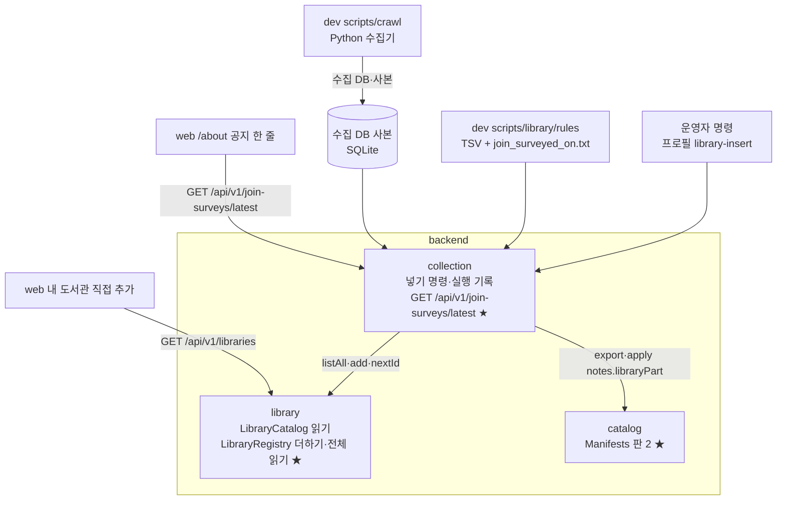

- 수집기: dev `scripts/crawl/crawl_catalog.py`로 갈아탐(`vendor` 칸·`migrate`, 빈 곳 채우기 명령 `crawl_catalog.py refill-pubdt --only ID[,ID]` [확정] (dev 구현 확인, 2026-10-14). 첫 시험 여주대 102084 빈 곳 채우기는 22분 만에 멈추고 이번 사이클에서 뺌(AC-1, 사용자: "여주대는 빼자", 2026-10-12). `*.dkyobobook.co.kr`은 요청 직전에도 막고(`BlockedHost`), 403·재시도 뒤 시간 초과면 그 도서관만 `crawl_skip`(`blocked <날짜>: …`)). 데이터 폴더의 옛 `scripts\`·`resume.cmd`는 `_old-scripts-2026-10-12`로 옮기고 지우지 않음 [확정] (ADR-0088). 호출 규칙(IP마다 한 줄·1건·1초, robots.txt 기록만)은 그대로 [확정] (`docs/research/ebook-catalog/crawl-method.md`). 서비스 백엔드는 바깥 사이트를 새로 부르지 않음
- 도서관 규칙: dev `scripts/library/rules/`에 TSV 규칙 + `join_surveyed_on.txt` + 순번 2 허용 목록(`order_no_allowed.tsv`), 지역은 번호로 미리 풀어 둠(도우미 `resolve_regions.py`, `scope_overrides.tsv`는 이 도우미만 읽음) [확정] (ADR-0085). 사이클 13에서 더한 것 [확정] (dev 구현 확인, 2026-10-14): 최종 주소 `final_origins.tsv`(데이터 폴더에서 옮김, 새 곳은 줄이 꼭 있어야 하고 없으면 종료 1 — 사용자: "빠진 곳은 확인해 채움", 2026-10-12), 이름 고침 `name_overrides.tsv`(옮김), 확인한 사라진 곳 `gone_known.tsv`(44 국회도서관·261 군포시도서관·269 김천시립도서관, 서비스에서는 켜 둠 — 사용자: "확인하고 빼줘 파일로 적어줘", 2026-10-12. 끌지는 사이클 18). 칸 이름 `collection_id`, 꼴은 `scripts/library/rules/README.md`. 서비스에 넣지 않은 곳·문제 있는 곳 목록은 dev `docs/library-left-out.md`(`scripts/library/list_left_out.py`가 만듦)
- "후보" 이름 없애기(AC-11) [확정] (dev 구현 확인, 2026-10-14): `build_candidate_seed.py` → `build_library_seed.py`(`name_candidates()`는 원래 없었음), `scripts/library/candidates/` → `scripts/library/discover/`, Java `FIRST_CANDIDATE_ID`·`candidate()` → `FIRST_COLLECTED_ONLY_ID`·`addedLater()`, 시험 `CandidateSeedTests` → `LibrarySeedTests`, `catalog_import` 칸·Java 칸 이름, dev 절차 문서의 옛 도서관 용어(plan 지금 문서에서도 쓰지 않음 [확정] (사용자 제안, 2026-10-14, 회고 결정 #13)). 그대로 둠: 이미 적용된 Liquibase 파일 이름(`library/008-library-seed-candidates.yaml`, `collection/002-collection-seed-candidates.yaml`, csv)과 changeset id, 지난 기록, 도서관과 무관한 검색 후보(`availability`의 `candidates`, `LookupTask.Candidate`). 남은 예외 하나: 사이클 12의 dry run 설정 `exclude-candidate-libraries`(Java `excludeCandidateLibraries`, 건너뛴 이유 `library_excluded_candidate`) — 다음에 가져오기 코드를 고치는 dev 일(예: 사이클 18)에 함께 `addedLater`에 맞춘 이름으로 바꿈 [확정] (사용자 승인, 2026-10-14, 회고 결정 #14; `docs/backlog.md`)

### 사용자 행동 기록 (`usagelog`) — 설계됨(미구현, 사이클 15)

12·13·14 회고 뒤 dev main 코드(2026-10-14)로 부를 자리를 맞춘 설계입니다. 근거 `docs/cycles/15-usage-log/design-delta.md` "구조 그림"·"모듈"·"부를 자리", ADR-0096·0097·0102. 흐름은 `flows.md` 흐름 34~37, 표는 `data-model.md` 스키마 `usagelog`, 주소는 `api.md` "사용 알림".

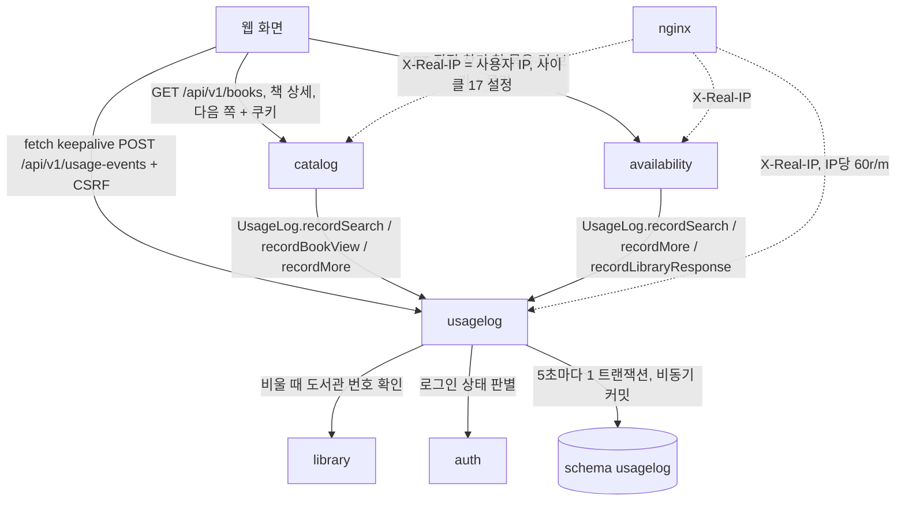

- 기록 설정 `chaekcheck.usagelog.enabled` [확정], 기본 꺼짐, 공개일에 켬 [확정]. 꺼져 있으면 `UsageLog`의 모든 `record…`가 곧바로 돌아가 큐·도서관 응답 요약·사용 알림 모두 남기지 않고, 사용 알림 주소는 그대로 204. 부르는 쪽(`catalog`·`availability`)은 설정을 모름 [안]
- 로그인 상태(`signed_in`·`signed_out`·`login_off`)는 `usagelog`가 요청을 `auth`의 `LoginStatusReader` [안: 이름]에 넘겨 정함 [확정] (ADR-0102). 켜짐: `access_token` 쿠키 서명 확인, 만료돼도 서명이 맞으면 로그인함 / 꺼짐: 쿠키를 보지 않고 `login_off`. 웹은 로그인 여부를 보내지 않음
- 부르는 자리 (dev main 2026-10-14 확인, 줄 번호는 개발 때 다시 봄): `catalog` `BookSearchController` — `GET /api/v1/books`가 `page=1`이면 `recordSearch(kind=catalog, totalCount)`, 2 이상이면 `recordMore(catalog_next_page, seq=page)`, `GET /api/v1/books/{bookId}`는 `recordBookView`. 400·422·404면 기록 없음. `availability` — 직접 찾기 첫 묶음 끝·끊김에 세션마다 한 번 `recordSearch(kind=direct)`(흐름 35), 다음 묶음(`batchNo` ≥ 2) `recordMore(direct_next_batch, seq=batchNo)`, 도서관별 더 보기 `recordMore(library_more, libraryId, seq=page)`, 모든 도서관 요청(직접 찾기·대출 수 채우기)마다 `recordLibraryResponse`
- 도서관 응답 하루 요약의 뜻 [확정] (사이클 15 회고 결정 #1~#3, 사용자 승인 2026-10-14): 건너뜀(`skipped`) = 직접 찾기에서 시작 마감(`LAUNCH_CUTOFF`, 3초)까지 요청을 보내지 못한 후보 도서관 하나마다 1. 조회 서버 바꿔 보내기(`FetchServiceSiteFetcher`)는 한 번으로 셈. 도서관 번호 확인은 켜진 도서관만(`LibraryCatalog.enabledLibraryRefs()`, 꺼진 번호는 `unknown_library`; `LibraryRegistry.listAll()`은 꺼진 도서관도 돌려주므로 쓰지 않음). 대출 수 채우기에서 구독형(요청 없음)과 도서관 주소 밖 상세 주소(요청 없이 실패)는 세지 않음 [안]
- 요청 하나하나의 도서관 응답은 서버 로그로만 [확정] (형식 `library=… source=… result=… ms=…` 한 줄 INFO [안]), 서비스 로그 보관 14일 [확정] (사이클 17, 2026-10-14)
- 매일 04:30 (Asia/Seoul) 정리 [확정]: 30일 지난 `client_ip` 비움, 30일 지난 `rejected_event` 지움, 1년 지난 줄 지움(1만 줄씩 [안]). 설정 이름 `chaekcheck.usagelog.cleanup.cron`·`zone` [안: 이름] (`auth` `DailyAccountCleanup`과 같은 방식). DB 백업 매일 03:00(사이클 17)과 겹치지 않음
- 배포 설정 (nginx, 사이클 17과 맞춤): `X-Real-IP` = 사용자 IP(`real_ip_header CF-Connecting-IP`, `set_real_ip_from` = compose 네트워크 범위 [안: 값은 사이클 17]). `location = /api/v1/usage-events` IP당 60r/m, 넘치면 204 [확정]. 직접 찾기·대출 조회 location에서 User-Agent에 `bot`·`crawler`·`spider`가 있으면 거절 [확정], 거절 코드 403 [안]. `robots.txt`로 `/api/` 금지 [확정], 파일 위치 `web/public/robots.txt` [안]
- 웹: 사용 알림은 공용 함수 한 곳에서 `fetch` keepalive로 보냄(로그인 기능 켜짐일 때만 CSRF 표시, `/api/v1/me` 404 = 꺼짐) [안: 위치]. 클릭 알림 자리: 결과 줄(`ResultRow.tsx`, 어느 화면인지 넘겨받음), 로고(`LibraryLogo.tsx`, 도서관 번호를 넘겨받게), 요약 막대 이름(`LibrarySummaryBar.tsx`). 화면 행동 알림 자리: 사서 추천 목록·책 창(`PicksPage.tsx`), 지역 설정 저장(`RegionContext.tsx`), 내 도서관 넣기·빼기(`MyLibraryContext.tsx`). 링크는 알림과 상관없이 새 탭으로 바로 열림
- 서버를 여러 대로 늘릴 때 메모리 큐·하루 요약 셈을 고칠 곳: [in-memory-state.md](../research/scaling/in-memory-state.md)

### 공지·안내·약관 글 (`sitecontent`) — 설계됨(미구현, 사이클 16)

12·13·14·15 회고·인계 뒤 dev main 코드(2026-10-14)와 맞춰 확정한 설계입니다. 근거 `docs/cycles/16-notices-and-policies/design-delta.md` "구조 그림"·"모듈", ADR-0098~0101. 흐름은 `flows.md` 흐름 38~41, 표는 `data-model.md` 스키마 `sitecontent`, 주소는 `api.md` "공지·안내·약관 글".

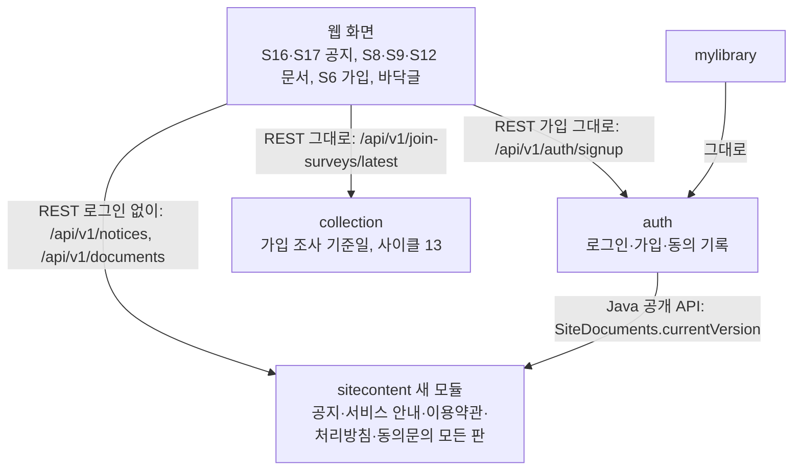

- `sitecontent`: 공지와 네 문서의 모든 판을 갖고 로그인 없이 읽게 함. 로그인 없음, 캐시 없음, 쓰기 API 없음 [확정]. 오늘 = `Asia/Seoul` 날짜, 지금 판 = 시행일 ≤ 오늘인 판 중 순번 최대 [확정]. 새 판은 운영자가 인계서의 예시 SQL로 넣고, 시행일이 되면 배포 없이 보임(흐름 41)
- 공개 Java: `SiteDocuments.currentVersion(ConsentDocument) → int`, 공개 enum `ConsentDocument { TERMS_OF_SERVICE, PRIVACY_COLLECTION }` [안: 이름은 dev가 정해도 됨]. `auth`가 가입 화면을 열 때와 가입할 때(409 판단) 부름
- 오류 처리: 루트 `ApiExceptionHandler`는 그대로, `sitecontent/internal/web`에 모듈 오류 처리(`@RestControllerAdvice(basePackageClasses=…)` + `@Order(HIGHEST_PRECEDENCE)`, `picks/internal/web/PicksErrors.java`와 같은 방식)로 400 `validation_error`, 404 `notice_not_found`·`document_not_found`·`version_not_found` [확정] (dev 방식 따름, 2026-10-14 dev main 확인)
- 이용약관 REST는 로그인 기능이 꺼져도 열어 두고, 웹 경로 `/terms`만 숨김 [확정] (사용자 승인, 2026-10-13). 처리방침(`/privacy`)은 로그인 기능과 상관없이 공개, `LoginOnly`를 지움 [확정] (ADR-0100)
- 약관이 바뀔 때: 가벼우면 공지 + 시행일, 중요하면 다음 로그인 때 다시 동의(화면은 나중) [확정] (ADR-0101). 다시 동의 화면이 생기기 전에는 중요하거나 불리한 변경을 넣지 않음
- 웹: S16 `/notices`·S17 `/notices/{번호}` 새 화면. S8·S9·S12·S6이 API를 읽고 `react-markdown`으로 그림 [확인 필요: `react-markdown@10`과 dev React 판·묶음 크기, dev 설치 시험]. 제목 아래 날짜 고르기 칸. 바닥글 링크 한 줄("공지사항 · 서비스 안내 · 이용약관 · 개인정보 처리방침"), "문의: 준비 중" 지움. `legalText.ts`·`documentVersions.json`·`NOT_REVIEWED` 지움 [확정]. 화면은 `docs/cycles/16-notices-and-policies/flow.md`
- 같이 고칠 웹·시험 파일: `SignupPage.tsx`(`legalText` 대신 API), `LegalPage.tsx`·`LegalPage.test.tsx`·`AuthScreens.test.tsx`(`documentVersions` 사용), `AboutPage.tsx`(본문을 API로, 기준일 줄은 그대로), `Footer.tsx`. 백엔드 `DocumentVersionsMatchWebTests`(지움), `AuthPropertiesTests`(documents 설정 값), `SignupTests`(문서 버전 → DB 판 기준)
- 운영 DB 계정: 사이클 17의 "`sitecontent` schema 쓰기만 있는 DB 계정"은 `sitecontent` 표의 SELECT·INSERT·UPDATE와 `notice.id` 시퀀스 USAGE가 필요함 (사이클 17에 알림)

## 도메인 모델

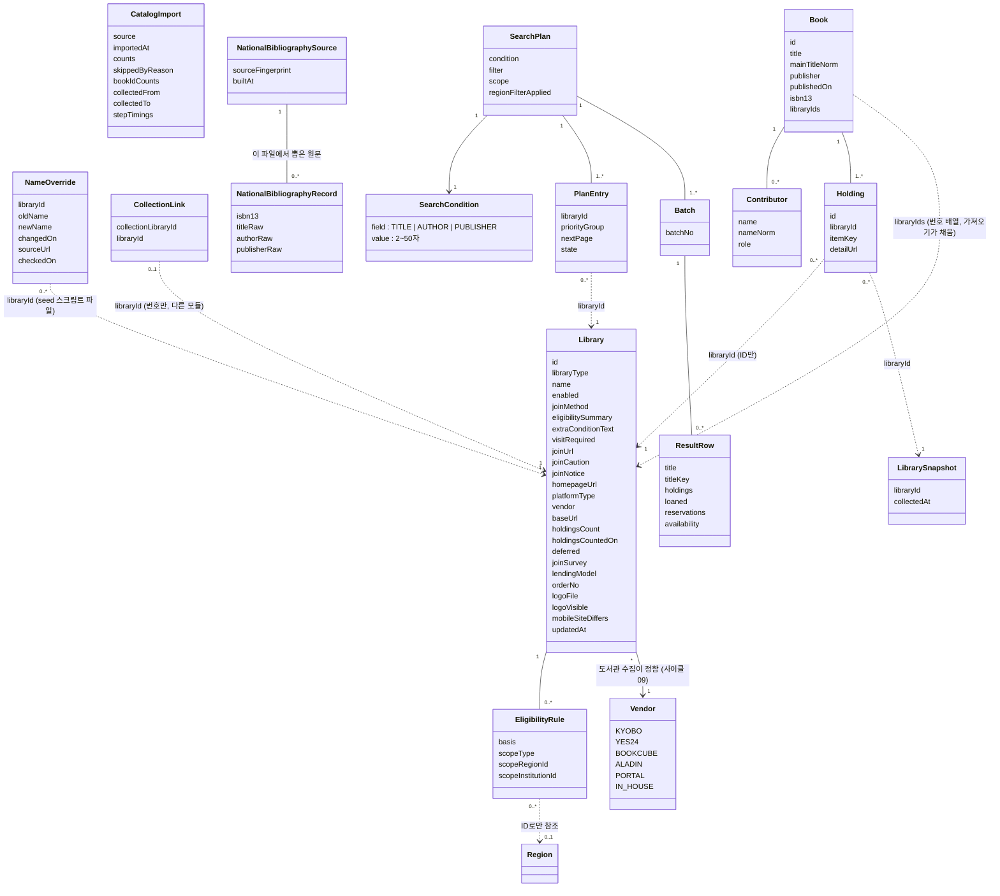

- 사이클 08 (구현됨 (사이클 08)): `Library.mobileSiteDiffers`(폰에서 사이트가 다르게 보임), `Library.updatedAt`(트리거로 DB가 적음, ADR-0068). `NameOverride`는 DB 표가 아니라 seed 스크립트가 읽는 파일(dev `scripts/library/name_overrides.tsv`)입니다. `CatalogImport`의 `collectedFrom`·`collectedTo`·`stepTimings`(표 칸 `step_seconds`), `NationalBibliographyRecord`·`NationalBibliographySource`는 `collection`이 가집니다. `CatalogImport`에는 그림에 없는 결과 칸 `status`·`failure_reason`·`failure_detail`도 있습니다(`data-model.md`). `NationalBibliographyRecord`는 ISBN마다 한 줄입니다. 국가서지는 다듬기 전 원문을 남기고 가져올 때마다 지금 정리 규칙으로 다듬으므로 정리 규칙 판 번호는 두지 않습니다(ADR-0069). `Holding.id`는 바꿔 끼운 뒤에도 같은 소장(`libraryId`, `itemKey`)이면 옛 번호 그대로입니다(ADR-0070).
- 사이클 09 — 구현됨 (사이클 09): `Library.name`은 기관 이름만, `Library.vendor`(enum `Vendor`, 지금은 전자도서관 모두 필수), `Library.lendingModel`(통합 포털만 비어 있음), `Library.orderNo`(같은 이름·업체·대출 방식 묶음 안 순번, 보통 1). (이름, 업체, 대출 방식, 순번) 조합이 겹치지 않음 (ADR-0071). `NameOverride` 목록에 사이클 09 이름 고침(괄호 떼기는 `changed_on` `label-removed`)을 더함.

- `Library`, `EligibilityRule`은 `library` 모듈이, `Book`·`Contributor`·`Holding`·`LibrarySnapshot`은 `catalog` 모듈이 DB에 저장합니다. 사이클 07 (구현됨 (사이클 07)): `CollectionLink`·`CatalogImport`(가져오기 기록, 표 `collection.catalog_import`, 옛 `catalog.catalog_import`는 지움 [확정] (dev 구현 확인, 2026-10-05))는 `collection` 모듈이 저장합니다(ADR-0052, ADR-0060). `bookIdCounts`는 책 번호 잇기 셈(`kept/new/dropped_book_id_count`). `Library`의 `joinSurvey`·`lendingModel`·`logoFile`·`logoVisible`, `Book`의 `libraryIds`도 사이클 07에 더한 속성입니다(ADR-0053·0055·0059, `lendingModel`은 design-delta "데이터"). `SearchPlan`, `SearchCondition`, `PlanEntry`, `Batch`, `ResultRow`는 브라우저 상태입니다.
- `SearchCondition`은 설계 용어이고 서버 코드에서는 기존 `SearchQuery(value, field)`입니다. 조건이 바뀌면 계획을 새로 만듭니다. 서버 캐시는 조건별로 따로입니다(ADR-0009).
- 주요 흐름(시퀀스·상태 그림)은 `flows.md`에 있습니다.

### `auth` 도메인 모델 — 구현됨(사이클 05, 2026-10-04 retro 반영)

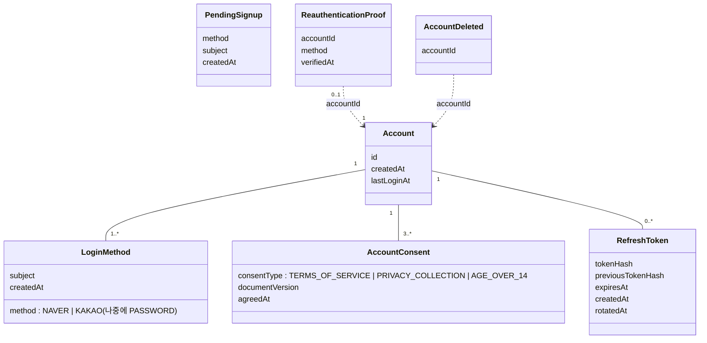

- `PendingSignup`과 `ReauthenticationProof`는 DB가 아니라 `HttpSession`(ADR-0040)에 둡니다. 이번 사이클에는 `LoginMethod`가 계정당 하나뿐입니다(1..*는 구조만).
- 사이클 16 — 설계됨(미구현, 사이클 16) (ADR-0099): `AccountConsent.documentVersion`은 `sitecontent`의 판 순번 글자(`"1"`)이고, 가입 화면의 지금 판은 서버 설정이 아니라 `SiteDocuments.currentVersion`에서 받음(사이클 05 제약 27 폐기) [확정]

### `mylibrary` 도메인 모델 — 구현됨 (사이클 06)

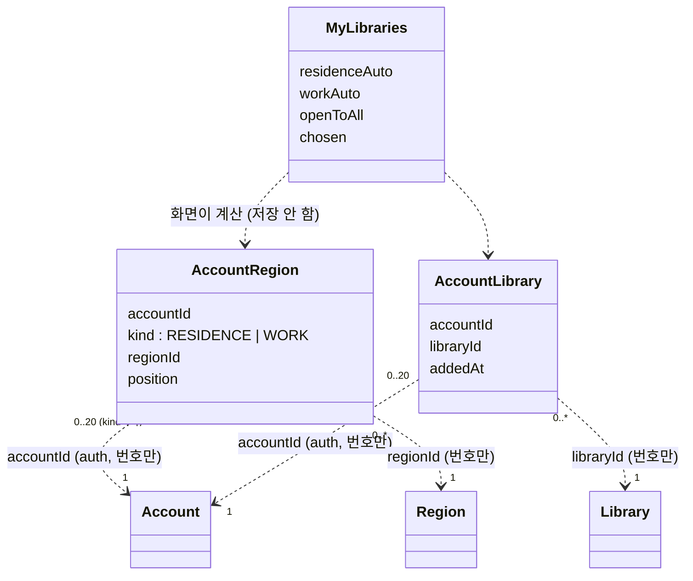

- `AccountRegion`, `AccountLibrary`는 `mylibrary` 모듈이 DB에 저장합니다. `MyLibraries`는 저장하지 않고, 화면이 저장 값과 `GET /api/v1/libraries` 결과로 그때그때 만듭니다(ADR-0049). `AccountRegion`·`AccountLibrary`는 표 이름(`account_region`, `account_library`)과 같고 [확정] (dev 구현 확인, 2026-10-05), 서버에 이 이름의 Java 클래스는 두지 않음(`MyLibraryStore`가 JdbcClient로 읽고 씀). `MyLibraries`는 화면 설계 용어 [안] (웹 타입 이름은 `MyLibraries`, `MyRegions`).
- S10 `/my-libraries` 화면은 구역 셋 (2026-10-05 바뀜, flow S10 "여섯 구역"을 사용자 요청으로 바꿈) [확정] (사용자 요청, 2026-10-05): 맨 위 "누구나 가입하는 도서관 N곳" 줄, ① 지역 선택([변경] 하나. 안에 차례로 "거주 …" / "거주 지역으로 자동 N곳 ▸" / "직장 …" / "직장 지역으로 자동 N곳 ▸") ② 직접 도서관 추가 ③ 직접 추가한 도서관 N/20. [변경]은 S2를 "거주" 탭으로 엶.

### `picks` 도메인 모델 — 구현됨 (사이클 14, 회고 2026-10-14)

사이클 10 `popular` 도메인 모델(`RankingMonth`·`RankingCategory`·`RankingEntry`·`PopularCategory`)을 대체했습니다(ADR-0089, `popular` 코드는 지움). 근거 `docs/cycles/14-librarian-picks/design-delta.md` "도메인 모델".

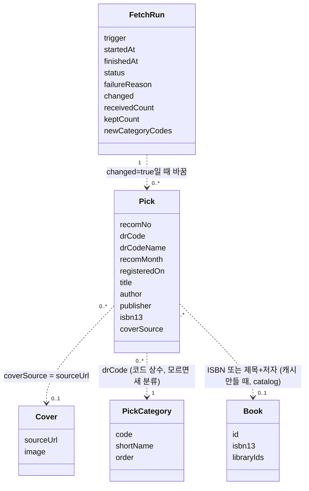

- `FetchRun`·`Pick`·`Cover`는 `picks` 모듈이 스키마 `picks`에 저장합니다(표는 `data-model.md`). `PickCategory`는 DB 표가 아니라 코드 상수 enum: `ALL` 0 "전체", `11` 1 "문학", `6` 2 "인문", `5` 3 "사회", `4` 4 "자연", `425` 5 "테마" [확정] (spec R2-1·R2-2). 모르는 `drCode`는 enum에 없어도 받아 "전체"에 넣고 분류 목록 맨 뒤에 API의 `drCodeName`(비면 "기타")으로, 코드 순 [확정] (ADR-0089). 받기 기록 `newCategoryCodes`에 그 코드를 남김
- `Book`은 `catalog`의 책이고, 추천 책과의 짝은 저장하지 않고 공용 캐시를 만들 때(시작·10분마다·목록 바뀐 직후) 맞춥니다: ① `isbn13`(`BookLookup.byIsbn13`) ② 못 맞으면 본제목 + 첫 저자(`BookLookup.byTitleAndAuthor`). 후보가 여럿이면 `libraryIds`가 가장 긴 책 → `bookId`가 작은 책 [확정] (ADR-0090, spec R3-1·R3-2)
- 같은 달 안 순서: 등록일(`registeredOn`) 늦은 순 → `recomNo` 글자 큰 순. `recomNo`는 옛 추천 1~4자리 수, 최근 추천 20자리 글자라 글자(`text`)로 둠 [확정] (사용자 승인, 2026-10-12). 등록일이 없으면 그 달 맨 뒤 (dev `PicksCache.java` 52~55행). 국립중앙도서관 웹 목록(= API 응답 순서, 같은 달 안은 사서의 배치)과는 거의 거꾸로임 (dev 확인, 2026-10-14) — 지금 순서("나중 등록 먼저") 유지 [확정] (사용자 승인, 2026-10-14, 회고 결정 #22)
- 남기는 범위: 추천 연월이 다른 최근 12개 달(최근 12번, 약 2년, `KeptPicks.MONTHS` 12) [확정] (사용자 결정, dev 2026-10-14: "12번(2년)으로 늘리기"; 처음 6번, ADR-0108). 2026-10-14 받기: 2024.12~2026.10, 108권(문학·인문·사회·자연 각 18, 테마 36). 국립중앙도서관은 2달에 한 번 네 분야 각 2권, 6월·12월은 테마 12권을 추천함 (2024.12~2026.10 응답)
- 받기 판단 (Asia/Seoul, 서버 켜질 때와 매일 05:00): ① 저장된 목록 없음 ② 월요일 ③ 마지막 받기가 실패이고 그 뒤 성공 없음(성공할 때까지 매일, ADR-0092) ④ 마지막 성공이 7일보다 오래됨(따라잡기) → 받음, 그 밖은 쉼 [확정] (spec R1-2·R1-3·R1-5). 구현 세부 — dev 결정 [안] [이유 미확인] (dev `FetchDecision.java` 13~24행): 오늘(Asia/Seoul) 이미 성공했으면 받지 않음, 05:00에 목록이 없으면 trigger `CATCH_UP`(시작 때는 `STARTUP`), 서버 시작 때는 ①·④만 봄(실패 뒤 다시 받기는 05:00에만). 실패하면 앞 목록 그대로, 성공할 때까지 매일 다시(ADR-0092). 흐름은 `flows.md` 흐름 24
- 화면용 값 `available`(그 책의 `libraryIds`가 계획 도서관과 겹침)은 요청마다 계산하고 캐시하지 않습니다 [확정] (ADR-0090, 사이클 10과 같은 뜻)

### `usagelog` 도메인 모델 — 설계됨(미구현, 사이클 15)

근거 `docs/cycles/15-usage-log/design-delta.md` "도메인 모델", ADR-0096·0097.

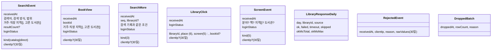

- 모두 `usagelog` 모듈이 스키마 `usagelog`에 저장합니다(표는 `data-model.md`). `libraryId`·`bookId`·지역 번호는 다른 모듈의 번호를 값으로만 남김(FK 없음)
- 기록끼리 잇는 칸은 없음 (spec R2-6). 통계에서 같은 IP로 30일 안에서 이어 보는 것은 허용 [확정] ([검증](../cycles/15-usage-log/easy/2026-10-14-verify-decisions.html) #1)
- 회원 번호·쿠키·User-Agent는 남기지 않음 [확정] (ADR-0096). `loginStatus`는 `auth` 판별 부품이 정함

### `sitecontent` 도메인 모델 — 설계됨(미구현, 사이클 16)

근거 `docs/cycles/16-notices-and-policies/design-delta.md` "도메인 모델", ADR-0098.

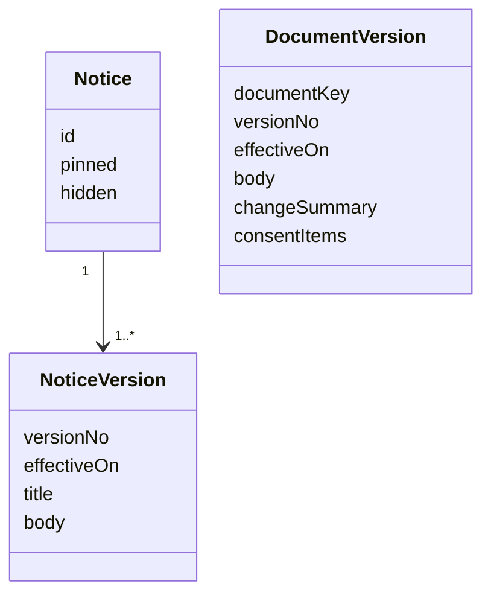

- 모두 `sitecontent` 모듈이 스키마 `sitecontent`에 저장합니다(표는 `data-model.md`). 판은 고치지 않고 새로 넣음, 판 번호 = 마지막 + 1
- `documentKey`: `ABOUT`(서비스 안내), `TERMS_OF_SERVICE`(이용약관), `PRIVACY_POLICY`(처리방침), `PRIVACY_COLLECTION`(동의문) [확정]. REST 주소의 key는 `about`·`terms-of-service`·`privacy-policy`·`privacy-collection`. `changeSummary`(바뀐 점)는 서비스 안내에 없고, `consentItems`(목적·항목·보유 기간·거부할 권리 4항목)는 동의문에만 [확정]
- 공지의 게시일 = 판 1의 `effectiveOn`, 고친 날 = 지금 판의 `effectiveOn`. 숨긴 공지(`hidden`)는 지우지 않고 남김 [확정]
- `auth`의 `AccountConsent.documentVersion`은 이 판 순번을 글자로 기억함(FK 없음) (ADR-0099)

### 가져오기 따로 하기 도메인 모델 — 구현됨 (사이클 11, 회고 2026-10-14). 실제 이름: `catalog.internal.PgTools`·`Manifests`, `collection…importer.ImportTransfer`·`DatabaseFingerprint`·`DryRunDump`, `CatalogLoad`에 `hasWaitingExport()` 추가, `discardPrepared()`는 enum, `Baseline` 안에 `columnsHash`

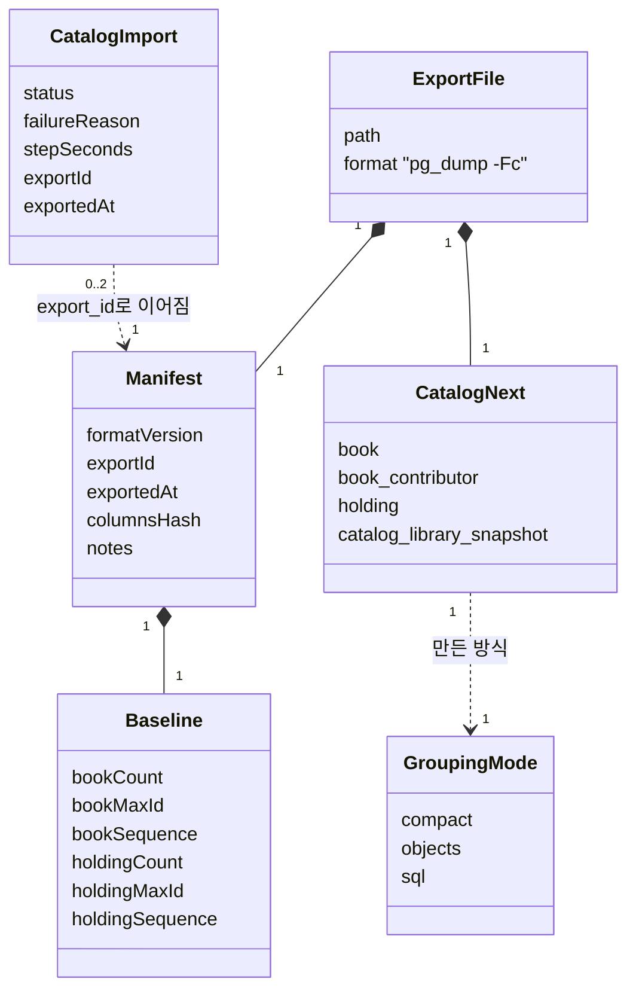

- `ExportFile`은 DB 표가 아니라 `pg_dump -Fc` 파일 하나이고, 그 안에 `catalog_next` 네 표(`CatalogNext`)와 작은 표 `load_manifest`(`Manifest`)가 들어 있습니다 (ADR-0078). `Manifest`·`Baseline`은 `catalog`의 공개 레코드, `Baseline`은 그 DB `catalog`의 기준값 6개(내보낼 때는 내 PC `catalog` = 마지막 반영분, 반영할 때는 운영 `catalog`) [확정] (설계 #1·#2), 이름 [안]
- `CatalogImport`(표 `collection.catalog_import`)는 `collection`이 저장하고, 한 `export_id`에 운영 반영 한 줄 + 내 PC `finish` 한 줄까지 이어짐(0..2). FK가 아니라 값으로만 이어짐 (`data-model.md`)
- `GroupingMode`는 DB 값이 아니라 설정 `chaekcheck.collection.import.grouping` 값(`compact` 기본·`objects`·`sql`, ADR-0105). 세 방식의 결과는 책·소장 번호까지 같아야 함 [확정] (ADR-0079). 사이클 11 측정과 사이클 12 새 규칙 모두 세 방식 차이 0 (dev `plan-feedback.md` 2976~2979·3388~3391행)

### 도서관 넣기 도메인 모델 — 구현됨 (사이클 13, 회고 2026-10-14)

근거 `docs/cycles/13-crawler-to-dev/design-delta.md` "도메인 모델", ADR-0084·0085·0087·0093.

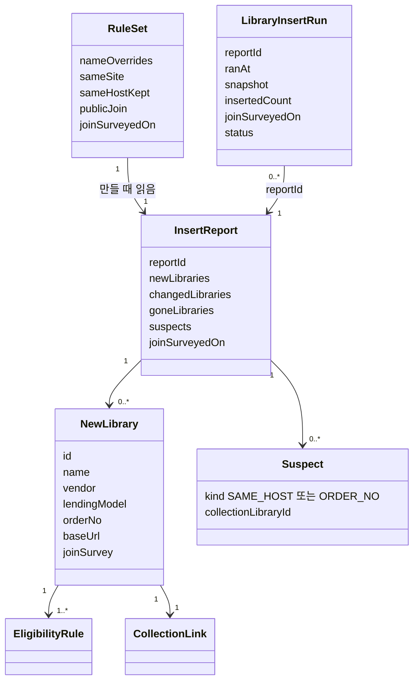

- `InsertReport`는 DB 표가 아니라 보고서 파일(`library-insert-<id>.json`, 정규화 JSON, 번호 = SHA-256 앞 12자리) [확정] (dev 구현 확인, 2026-10-14). `RuleSet`은 dev `scripts/library/rules/` 파일들(ADR-0085). `LibraryInsertRun`은 `collection.library_insert_run` 한 줄(`data-model.md`), `NewLibrary`는 `LibraryRegistry.add`가 받는 값(`library.library` + `eligibility_rule` 줄), `CollectionLink`는 `collection.collection_link` 줄. 코드 이름 `InsertReport`·`RuleSet`·`NewLibrary`는 그대로, 실행 기록 줄은 표 이름 그대로이고 그 밖에 `InsertPlan`·`CollectedLibraries`·`LibraryPart`가 있음 [확정] (dev 구현 확인, 2026-10-14)
- 가입 조건 조사 기준일은 하나만 기록(규칙 폴더의 날짜 파일 → 실행 기록 `join_surveyed_on`), 도서관마다 두지 않음 [확정] (ADR-0087)

## 관련 ADR

ADR-0001 모듈 경계, ADR-0006 캐시, ADR-0009 검색 필드, ADR-0010 호출 간격, ADR-0011 조회 서비스, ADR-0013 자격 모델, ADR-0014 묶음 검색 API, ADR-0015 조회 계약, ADR-0016 adapter, ADR-0017 도서관 한 줄 = 이용 단위, ADR-0018 제목 비교 키, ADR-0019 판정·전달 인터페이스, ADR-0020 바쁜 호스트 건너뛰기, ADR-0021 본 서비스 여러 대 대비, ADR-0022 도서관 TLS 호환, ADR-0023 화면 종류 세대 번호, ADR-0025 검색 조건 이름 있는 파라미터, ADR-0026 포털 저자·출판사 거르기, ADR-0027 방문 가입 필터와 순서, ADR-0028 catalog 모듈, ADR-0029 상세 페이지 조회, ADR-0030 책 검색 API와 소장 스트림, ADR-0031 가져오기와 정리 코드, ADR-0032 PostgreSQL + pg_bigm·사람별 표, ADR-0033 웹 주소 여러 조건, ADR-0034 전자책 목록 저장, ADR-0036 auth·member 모듈(ADR-0048로 대체됨), ADR-0037 검색 모듈은 회원을 모름(`member`는 `mylibrary`로 읽음, `libraryIds` 상한 20 [확정] (사용자, 2026-10-04)), ADR-0038 JWT 로그인 유지, ADR-0039 로그인 수단 표, ADR-0040 로그인 임시 값, ADR-0041 계정 삭제 이벤트, ADR-0042 같은 출처와 인증 주소, ADR-0043 재인증, ADR-0044 보안 설정 소유, ADR-0045 결과 코드, ADR-0046 로그인 기능 켜고 끄기, ADR-0048 `mylibrary` 모듈(ADR-0036 대체), ADR-0049 내 도서관 목록과 저장 API, ADR-0050 직접 추가 도서관은 맨 앞·자격 규칙의 예외, ADR-0051 계정 줄 잠금과 이벤트 다시 처리, ADR-0052 후보 도서관 새 번호와 `collection` 짝 표(ADR-0060으로 넓힘), ADR-0053 미조사 도서관은 직접 추가했을 때만, ADR-0054 모든 서비스 도서관의 책을 나눠 읽어 가져오기, ADR-0055 책마다 도서관 번호 목록 미리 계산, ADR-0056 북큐브·알라딘 adapter와 북큐브 대여형·교보 소장형 판정, ADR-0057 로그인 전 직접 추가와 묶음 옮기기(ADR-0049 보완), ADR-0058 도서관 목록 통째로 + 응답 압축(ADR-0049 전환 조건 정리), ADR-0059 도서관 로고, ADR-0060 가져오기는 `collection`, 제목 다듬기 규칙은 `catalog`에 한 벌(ADR-0031 위치 바꿈), ADR-0065 가져오기는 새 표에 쓰고 바꿔 끼운다(국가서지 부분은 ADR-0069, 소장 번호 부분은 ADR-0070이 바꿈), ADR-0066 메모리를 줄이는 구조, ADR-0067 교보 대여·혼합 도서관은 받지도 넣지도 않는다, ADR-0068 고친 시각은 DB가 적는다, ADR-0069 국가서지는 원문을 남기고 정리 규칙을 바꿀 때는 상황별로 다시 가져온다, ADR-0070 같은 소장은 옛 소장 번호를 잇고 빠진 책·소장은 따로 알린다, ADR-0071 도서관 이름에는 기관 이름만, 업체·대출 방식은 분류로, ADR-0076 도서관 분류 값은 API로 보내고 화면이 글자를 만듦·이름은 번호로 고치는 changeset·이름 찾기는 화면에서, ADR-0072 인기 도서 출처는 출판유통통합전산망 공개 통계 화면, ADR-0073 새 모듈 `popular`, ADR-0074 순위 책과 우리 책은 볼 때 ISBN으로 맞추고 책 정보는 공용 캐시, ADR-0075 표지는 매달 미리 받아 우리 서버가 넘겨줌·최근 두 달 보관, ADR-0077 전자책이 거의 없는 다섯 분류를 받지 않음(전체 + 16분류, 언어·기술·공학도 빼는 ADR-0080이 대체 예정 → 전체 + 14분류), ADR-0081 표지를 폭 200px JPEG로 줄여 저장(ADR-0075를 대체 예정, 받은 그대로 저장하던 것을 바꿈) (ADR-0072·0073·0080은 ADR-0089, ADR-0074는 ADR-0090, ADR-0081은 ADR-0091이 대체, 사이클 14), ADR-0089 인기 도서를 사서추천도서로: 국립중앙도서관 Open API, 새 모듈 `picks`, `popular` 지움, ADR-0090 공용 캐시를 만들 때 ISBN → 제목+첫 저자로 맞춤, ADR-0091 국립중앙도서관 표지를 받아 200px JPEG로·우리 전자책 표지는 이번에 안 씀, ADR-0092 사서추천 받기는 실패하면 성공할 때까지 매일·7일 넘으면 따라잡음, ADR-0108 사서추천 범위 최근 12번(2년)·요청 3년(사이클 14 회고, ADR-0089의 범위 부분을 바꿈), ADR-0078 가져오기는 내 PC에서 하고 운영 DB에는 파일 하나로 옮겨 바꿔 끼운다, ADR-0079 책 묶기는 세 방식(current·compact·sql)을 설정으로 고르고 결과가 번호까지 같아야 쓴다(덧붙임의 "current 지움"은 ADR-0105가 바꿈: 셋 모두 남김·기본 compact·이름 objects), ADR-0082 네 번째 묶기 단계(ADR-0106이 보완), ADR-0083 `library`에 "도서관 더하기" 공개 기능을 두고 번호는 부르는 쪽이 정한다, ADR-0084 새 도서관은 `collection` 명령으로 넣는다(미리 보기 → 보고서 → 넣기)·seed로 번호를 넣지 않는다(ADR-0052의 seed 부분을 바꿈), ADR-0085 사람이 정한 도서관 규칙은 dev git TSV·지역은 번호로, ADR-0086 반영 파일 판 2·도서관 → 비교 → 책 순서, ADR-0087 가입 조건 조사 기준일 하나 + 서비스 안내 공지 한 줄, ADR-0088 수집은 dev `scripts/crawl/`로 갈아타고 옛 코드는 보관, ADR-0093 넣기 명령은 `LibraryRegistry.listAll()`로 보고 운영 반영은 넣기 실행 기록 줄도 옮긴다 (ADR-0083~0088·0093은 사이클 13, 사이클 12 뒤에 개발), ADR-0105 책 묶는 방식 셋을 모두 남기고 기본 compact·옛 이름 objects, ADR-0106 네 번째 묶기 단계 보완(작가 이름 제목·같은 도서관 기준 부제 나누기·권처럼 보이는 숫자), ADR-0107 넣기 명령 보탬(최종 주소 줄 필수·`gone_known.tsv`·`nextId()`·종료 5·같은 번호가 다른 도서관이면 멈춤) (ADR-0105~0108은 사이클 11~14 회고, 2026-10-14), ADR-0096 사용자 행동 기록은 같은 PostgreSQL 새 schema `usagelog`에, IP 30일·나머지 1년, ADR-0097 기록 전용 모듈 `usagelog`·공개 창구 직접 호출·5초 묶음 비동기 커밋·사용 알림 fetch keepalive + CSRF·표 여덟, ADR-0102 액세스 쿠키 경로 `/api/v1`·로그인 상태 판별은 `auth` 부품 하나 (ADR-0096·0097·0102는 사이클 15, 설계됨(미구현, 사이클 15)), ADR-0098 공지·서비스 안내·약관 글을 새 모듈 `sitecontent`가 DB에 판으로 둔다, ADR-0099 가입 문서 버전의 원본을 `sitecontent`로·동의 기록 = 판 순번·`auth → sitecontent`(사이클 05 제약 27 폐기, AC-18 변경), ADR-0100 처리방침은 로그인 기능과 상관없이 공개(사이클 05 제약 35 일부 변경), ADR-0101 약관이 바뀔 때 가벼우면 공지 + 시행일·중요하면 다음 로그인 때 다시 동의(화면은 나중) (ADR-0098~0101은 사이클 16, 설계됨(미구현, 사이클 16))

### 책 묶기 네 번째 단계 — 구현됨 (사이클 12, 회고 2026-10-14)

ADR-0082, ADR-0106, `docs/cycles/12-grouping-rules/retro.md`. 모듈 관계·공개 API·이벤트·표 변경 없음. `collection.internal.importer` 패키지 내부 `SameTextKey`(키)와 `SubtitleParts`(부제 나누기)를 세 방식(`compact`·`objects`·`sql`)이 같은 함수로 부름 [확정] (dev 코드 확인, 2026-10-14). ③이 쓰는 `BookGrouper.key`·`firstAuthor`와 `catalog`의 정리 함수·검색은 그대로. `objects`(`BookGrouping`)는 지우지 않고 같은 규칙을 넣음(ADR-0105).

- 키 = 비교 제목 + 권 표시 + 첫 저자 + 출판사. 하나라도 없으면 키 없음(합치지 않음). `BookGrouper.sameTextKey`는 `SameTextKey.Key(key, placeholderOnly, subtitle)`를 돌려줌
- 비교 제목 = `CatalogText.mainTitleNorm`에서 꼬리 목록 넷을 끝에서 떼고 숫자 앞의 0을 뗀 것. **본제목이 첫 저자 이름과 같으면 전체 제목(앞 시리즈 표시 뗌)** (「김동인 - 감자」)
- 권 표시 `n=…|s=…|e=…`: 본제목과 짧은 부제 조각(공백 빼고 8자 이하)은 모든 숫자, 긴 조각은 권·판처럼 보이는 숫자만, 로마·한자 숫자는 권 자리에서만, 상·중·하, 판 낱말 11개
- 같은 키 안: 서로 다른 ISBN이 둘 이상이면 ISBN마다 한 책(ISBN 없는 묶음끼리 한 책). 부제가 둘 이상이면 `SubtitleParts`: 포함 관계면 같은 부제, 서로 다른 부제를 같은 도서관이 따로 가질 때만 나눔, 부제 없는 묶음은 나뉜 묶음이 둘 이상이면 따로. 두 나누기는 따로 정하고 합치는 키 = key + ISBN 칸 + 부제 칸 (`BookGrouping.java` 277~305행)
- 카운터(로그 전용) 넷: `sameTextMerged`, `sameTextIsbnSplit`, `sameTextSubtitleSplit`, `sameTextPlaceholderNoKey` (`ImportReport.java` 54~73행)
- 목록 값은 코드 상수(바꾸려면 코드·시험·다시 가져오기, ADR-0069): 자리 채움 저자 "기타"·"unknown", 출판사 "기타"·"미상"·"unknown", 판 낱말 11개, 꼬리 `(PC만 열람 가능)`·`(스마트 패드 전용)`·`(잠 못 이루는 밤을 위해)`·`(한국인이 가장 좋아하는 단편소설)` [확정] (사용자 결정 2026-10-12, `SameTextKey.java` 36~51행)

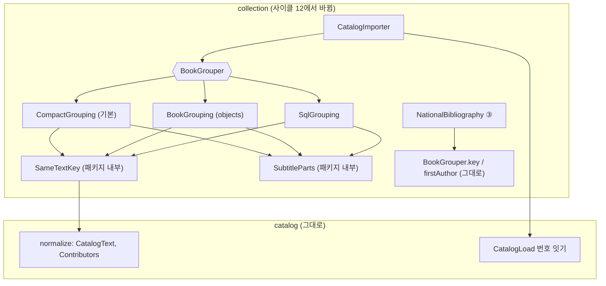

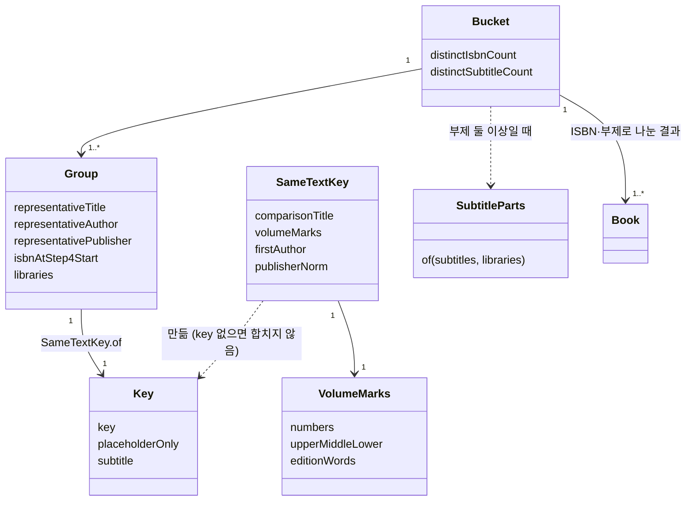

