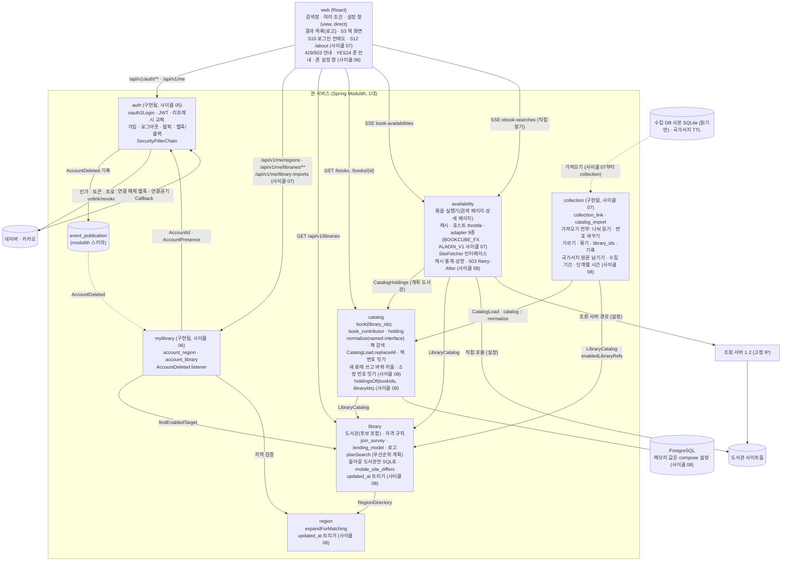
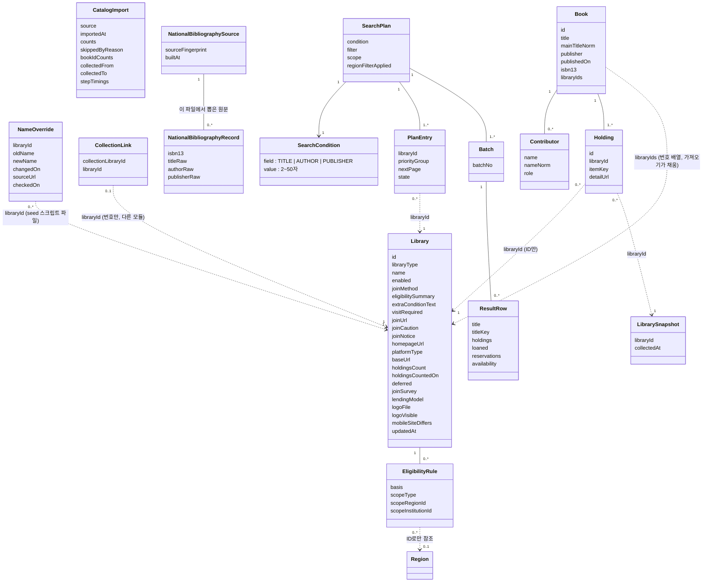
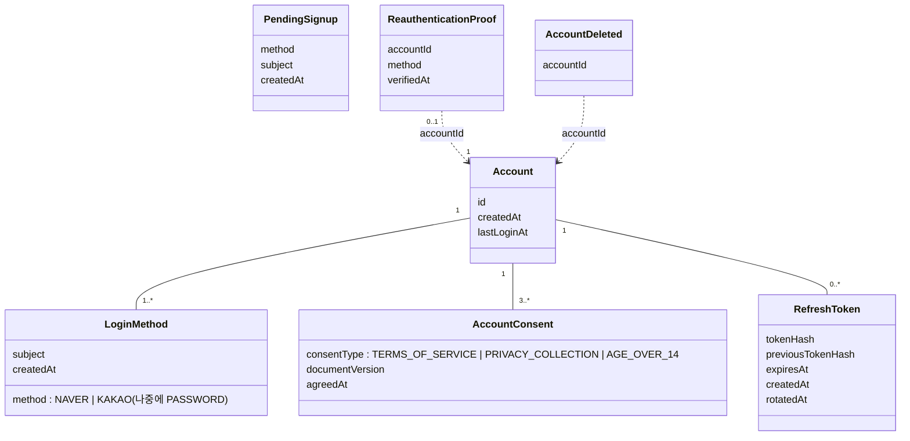
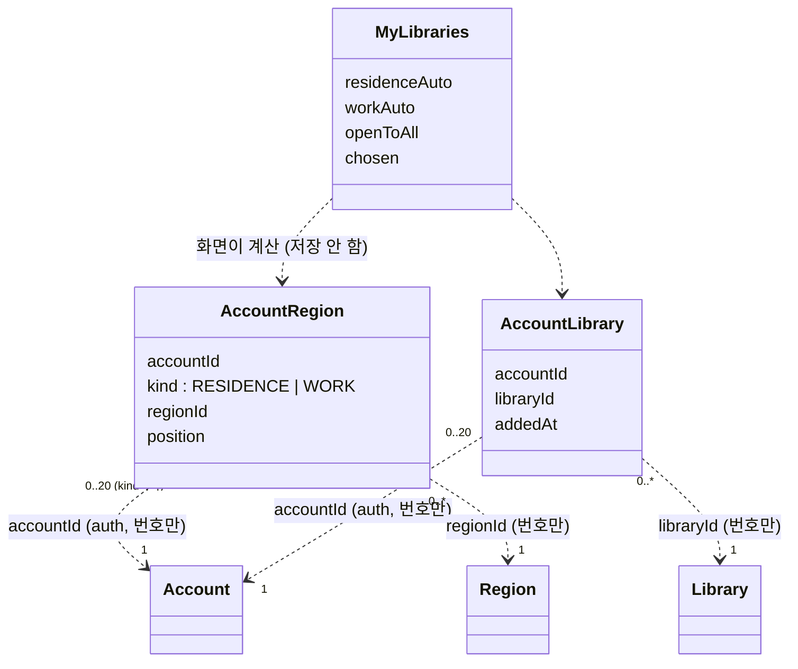

# 모듈 맵 (현재)

현재 설계 전체를 적은 문서입니다. 변경 기록이 아닙니다.

사이클 08 cycle-close (2026-10-11): 다듬기 + 가져오기 바꿔 끼우기 + 메모리 줄이기 — `catalog`(새 표에 쓰고 바꿔 끼우기, 소장 번호 잇기, 계획 도서관 소장만 읽기), `collection`(국가서지 원문 남기기, 수집 기간·단계별 시간), `library`(`mobileSiteDiffers`, 계획에 들어갈 도서관만 읽기, `updated_at` 트리거, 교보 대여·혼합 11곳 뺌, 이름 고침), `region`(`updated_at` 트리거), `availability`(캐시 통계·상한, 503 `Retry-After`, 응답 본문 복사 줄임, `holding_not_found`), 웹 — 설계됨(미구현, 사이클 08). 모듈 의존 방향·이벤트는 그대로. 근거 `docs/cycles/08-polish-swap-memory/design-delta.md`, ADR-0065~0070. 이름·숫자는 따로 적지 않으면 [안].

사이클 07 회고 반영 (2026-10-05): 후보 도서관 넣기 — 새 모듈 `collection`, `library`·`catalog`·`availability`·`mylibrary`·웹 변경 — 구현됨 (사이클 07). dev 코드와 Modulith `components.puml`(2026-10-05)로 대조함. 근거 docs/cycles/07-candidate-libraries/retro.md, dev plan-feedback.md '# 사이클 07'. 설계 근거 `docs/cycles/07-candidate-libraries/design-delta.md`, ADR-0052~0060. dev가 쓴 이름은 [확정] (dev 구현 확인, 2026-10-05).

사이클 06 회고 반영 (2026-10-05): 내 도서관(`mylibrary`)을 더함 — 구현됨 (사이클 06). dev 보고 `chaekcheck-dev/docs/plan-feedback.md` "# 사이클 06"~"plan에 넘길 요약"과 코드로 대조함. 근거 `docs/cycles/06-my-libraries/design-delta.md`, ADR-0048~0051 (ADR-0048이 ADR-0036을 대체).

사이클 05 cycle-close (2026-10-04): `auth` 모듈과 이벤트 발행 저장소를 더함 — 구현됨(사이클 05, 2026-10-04 retro 반영). 근거 `docs/cycles/05-login-account/design-delta.md`, ADR-0036(ADR-0048로 대체됨), 0038~0046.

마지막 반영: 사이클 04 회고 (2026-10-01, `docs/cycles/04-and-search/retro.md`). dev 커밋 `c6028c9`의 코드와 `Documenter` 출력(`components.puml`, 모듈 canvas)으로 대조했습니다(구현됨). 실제 데이터 적재·AC 확인은 미룸(backlog "미뤄 둔 사이클 04 마무리 작업"). ADR-0028~0035, `docs/cycles/04-and-search/design-delta.md`.

| 모듈 | 책임 | 공개 API | 발행/구독 이벤트 | 소유 테이블 | 상태 |
|---|---|---|---|---|---|
| `region` | 시도·시군구 목록, 법정동 코드 속성, 폐지·대체 연결, 옛 지역 ID 해석. 사이클 08 (설계됨(미구현, 사이클 08)): `region.region.updated_at`을 `BEFORE UPDATE FOR EACH ROW` 트리거로 DB가 적음, 함수는 자기 스키마(`region.set_updated_at()` [안 이름]) [확정] (ADR-0068) | Java `RegionDirectory` (`expandForMatching`, `resolve`), 예외 `RegionNotUsableException`(ID별 이유 `ABOLISHED`/`NOT_FOUND`/`NOT_SIGUNGU`) / REST `GET /api/v1/regions`, `GET /api/v1/regions/resolutions` | 없음 | `region.region`, `region.region_replacement` | 구현됨. 사이클 08 트리거는 설계됨(미구현, 사이클 08) |
| `catalog` | 수집한 전자책 목록(책·사람·역할·소장·도서관별 기준일, ADR-0028, ADR-0034), 정리 규칙(검색어와 저장값이 같은 코드, ADR-0031), 책 검색(칸별 단어 AND·완전 일치·역할·가입 단계 순서, ADR-0032), 표 통째로 바꾸기(`CatalogLoad`, 가져오기 코드는 사이클 07부터 `collection`, 구현됨 (사이클 07), ADR-0060), 책 번호 잇기(구현됨 (사이클 07)) | Java `CatalogHoldings` (`holdingsOf(bookIds)`, `holdings(holdingIds)` → `HoldingRef(holdingId, bookId, libraryId, platformType, detailUrl, title, author, publisher)`. 원문 제목·저자·출판사는 개발 중 추가) / REST `GET /api/v1/books`, `GET /api/v1/books/{bookId}`. 사이클 06: `/api/v1/books`, `/api/v1/books/{bookId}`가 `libraryIds`를 받고 직접 추가 도서관을 맨 앞으로 정렬, `JoinTier.CHOSEN`(첫 값) [확정] (dev 구현 확인, 2026-10-05) (ADR-0050) — 구현됨 (사이클 06). 사이클 07 (구현됨 (사이클 07), ADR-0055·0060): 새 공개 Java `CatalogLoad.replaceAll(source, loader)` [확정] (dev 구현 확인, 2026-10-05) — 콜백 세션(`Session.addBook` → `addHolding` → `addLibrarySnapshot`, 책을 다 넣은 뒤 소장), PostgreSQL COPY, 결과 `Result`(책·사람·소장·기준일 수와 `keptBookIds`·`newBookIds`·`droppedBookIds`). **바꿔 끼우기** (설계됨(미구현, 사이클 08), ADR-0065·0070, 공개 모양 그대로, 결과에 단계별 시간을 더함): `replaceAll` 안을 "책 번호 잇기(좁은 맞대기 표로 번호 확정) → 준비 스키마 `catalog_next` [안 이름]에 색인 없이 확정된 책 번호 순으로 쓰기 → 색인·제약(운영 표에서 `pg_get_indexdef`·`pg_get_constraintdef`로 읽어 같은 이름으로, 가져오기 세션만 `maintenance_work_mem`↑) → `VACUUM (ANALYZE)` → 짧은 트랜잭션에서 옛 표 `DROP`, 새 표를 `SET SCHEMA catalog`"로 바꿈. 바꿔 끼우기는 `lock_timeout` 2초, 실패하면 10초 뒤 다시, 최대 5번 [확정] (사용자 승인, 2026-10-11, 설계 검토)(값은 측정 뒤 바꿀 수 있음). 바꿔 끼우기 전에 실패하면(잠금 5번 다 못 얻음 포함) `catalog_next`를 지우고 옛 표 그대로, 가져오기 기록에 실패 [확정]. 가져오는 동안 검색은 옛 표를 읽고, 바꿔 끼우는 순간만 잠깐 기다림. 소장 번호는 (도서관, `item_key`)가 같으면 옛 번호를 그대로 잇고 새 소장만 옛 최대값 다음부터 [확정] (ADR-0070, 책 번호 잇기와 같은 맞대기 결과). (지금 코드, 사이클 07: 한 트랜잭션에서 임시 표 → 표 비우고 옮김, 커밋 뒤 `VACUUM (ANALYZE)`, 그동안 검색이 기다리고 소장 번호는 새로 매김 — 사이클 08에서 위 모양으로 바뀜.) **책 번호 잇기**(handoff 밖, 사용자: "이것도 같이 구현해 줘", 모듈 "catalog 해줘", 2026-10-05): `replaceAll` 안에서 SQL로 — 임시 표에 COPY → 옛 `holding`과 `(library_id, item_key)`로 맞대기 → 번호 결정. 규칙은 `docs/research/ebook-catalog/catalog-refresh.md` 5.2절 그대로(겹침 최다, 합쳐지면 가장 작은 번호, 나뉘면 최다 겹침 쪽, 번호 재사용 없음, 안내표 없음) [확정] (dev 구현 확인, 2026-10-05). `addBook`이 돌려주는 번호는 "이번 가져오기 안에서만 쓰는 번호". 제목 다듬기 규칙(`CatalogText`, `Contributors`, `Isbn`, `PublishedDates`)은 패키지 `com.chaekcheck.catalog.normalize`, named interface `"normalize"`(`@NamedInterface("normalize")`)로 공개해 `collection`이 빌려 씀(규칙은 `catalog`에 한 벌, ADR-0031의 "정리 코드 한 벌" 원칙 유지) [확정] (dev 구현 확인, 2026-10-05). 책 검색은 `book.library_ids && :planned`로 거르고 `holding`을 읽지 않음 [확정] (ADR-0055). 단, 계획 도서관이 50곳 [안]을 넘으면 GIN 인덱스 없이 거름(제목·출판사·사람 인덱스가 찾은 줄만), 50곳 이하만 GIN(`PgBigmBookSearch.GIN_PLAN_LIMIT`) — [이유 미확인: dev가 정함] (15단계 측정: 385곳에서 GIN 1.4초 → 393ms), 회고에서 그대로 둠 [확정] (사용자 승인, 2026-10-05). **가져오기(importer) 코드는 `collection`으로 옮김** — ADR-0031의 "가져오기는 `catalog` 안"을 ADR-0060이 바꿈. 사이클 08 (설계됨(미구현, 사이클 08), ADR-0066): 새 공개 Java `CatalogHoldings.holdingsOf(bookIds, libraryIds)` [안 이름] — 책 화면 소장은 `book_id = ANY AND library_id = ANY`로 계획에 든 도서관 줄만 DB에서 읽음(가져오기용 색인과 원문 칸은 남김) | 없음 | `catalog.book`(사이클 07: `library_ids` 칸 + GIN `book_library_ids_gin`, 구현됨 (사이클 07)), `catalog.book_contributor`, `catalog.holding`, `catalog.catalog_library_snapshot`(사이클 07: `import_id` 칸·FK 지움), `catalog.catalog_import`는 사이클 07에 지움(기록은 `collection.catalog_import`, 옛 줄은 옮기지 않음) [확정] (dev 구현 확인, 2026-10-05). 사이클 08: 가져오는 동안만 `catalog_next.*` [안 이름] (설계됨(미구현, 사이클 08)) | 구현됨 (JPA 엔티티 없음: `JdbcClient` + JDBC COPY). 데이터 적재됨(2026-10-05, 책 1,617,445·소장 20,383,882). `libraryIds`·`CHOSEN`도 구현됨 (사이클 06). 사이클 07 변경도 구현됨 (사이클 07). 사이클 08 바꿔 끼우기·소장 번호 잇기·`holdingsOf(bookIds, libraryIds)`는 설계됨(미구현, 사이클 08) |
| `library` | 도서관 목록(전자도서관 사이트 하나 = 한 줄, `library_type`으로 전자·실물 구분, ADR-0017), 가입 방법·안내 링크·주의·안내 문구, 자격 문구, 자격 규칙(규칙 없음 = 자격 미확인, 누구나 = 전국 규칙, ADR-0013), 사용 여부, 순위 값, **우선순위 조회 계획**(가입 가능 무리의 방문 가입은 그 무리들 모두 뒤, 무리 안 순서: 후순위 포털 → 주의 → 보유 수 → id, ADR-0027, 사이클 04에서 구현·확인) | Java `LibraryCatalog` (`planSearch(residenceIds, workIds, PlanOptions(scope, visit))` → 정렬된 `SearchTarget` 목록. 두 인자 `planSearch`는 `PlanOptions.DEFAULT`로 위임하는 default 메서드. `enabledLibraryRefs()` → `LibraryRef`, `findEnabledTarget(libraryId)`), 공개 타입 `PlanOptions`(`Scope.ALL/JOINABLE`, `Visit.ANY/NONE`, `apply(plan)`), `SearchTarget`(`joinable()` = `OPEN`/`ELIGIBLE`, 추가 문구는 보지 않음, `visitRequired` 포함), `PriorityGroup`, `LibraryType`, `PlatformType`(7개, ADR-0023), `Eligibility`(`UNVERIFIED` 포함), 예외 `InvalidRegionException`. 사이클 06: `PlanOptions(scope, visit, libraryIds)`(두 인자 생성자는 남김 = 빈 집합. 켜진 직접 추가 도서관은 자격과 상관없이 계획에 넣음, `scope=joinable`·`visit=none`에서도 남김, 스위치가 "전체"여도 맨 앞), `SearchTarget.chosen`(마지막 칸, `findEnabledTarget`은 늘 `false`), `LibraryCatalog.eligibilityFor(residenceIds, workIds)` → 공개 레코드 `LibraryEligibility`(`id`, `name`, `eligibility`, `matchedBy`, `visitRequired`, `cautioned`, `eligibilitySummary`, 안쪽 enum `RegionBasis { RESIDENCE, WORK }`) [확정] (dev 구현 확인, 2026-10-05), REST `GET /api/v1/libraries`(켜진 도서관 전체 + 지역별 가입 표시, 로그인 없음, ADR-0049) (ADR-0050) — 구현됨 (사이클 06). 사이클 07 (구현됨 (사이클 07)): 후보 도서관 2,394곳(수집 DB에만 있던 웹러브 북스 기관, 서비스 번호 281~2674, ADR-0052), 가입 조사 상태 `join_survey`(`SURVEYED`/`NOT_FOUND`/`MEMBERS_ONLY`/`NOT_SURVEYED`, 공개 enum `JoinSurvey`) [확정] (ADR-0053, 값 이름 dev 구현 확인, 2026-10-05), 교보 구독형 화면 기관의 `lending_model`(`OWNED`/`SUBSCRIPTION`/`MIXED`/`RENTAL`, 공개 enum `LendingModel`, NULL이면 화면 종류로 판정) [확정], 로고 `logo_file`·`logo_visible` [확정] (ADR-0059, dev 구현 확인, 2026-10-05), `PlatformType` 9개(`BOOKCUBE_FX`, `ALADIN_V1` 추가) [확정] (ADR-0056). **계획 규칙**: 조사 상태가 `MEMBERS_ONLY`·`NOT_SURVEYED`이고 직접 추가(`chosen`)가 아니면 `planSearch`에서 뺌("전체 도서관"이어도), 직접 추가면 지금처럼 맨 앞(ADR-0050) [확정] (ADR-0053). `SearchTarget`·`LibraryEligibility`의 등급에 `UNSURVEYED`(묶음은 확인 필요 쪽), `findEnabledTarget`도 돌려줌. `lendingModel`은 `SearchTarget`에만 두고 `LibraryRef`에는 더하지 않음(웹에 보내지 않음) [확정] (dev 구현 확인, 2026-10-05, 인계서 C14·C15가 dev에 맡김). `collection`이 쓰는 것: 기존 `LibraryCatalog.enabledLibraryRefs()`(켜진 도서관과 사이트 루트)로 짝 맞춘 서비스 도서관이 켜졌는지(`library_not_in_service`)와 사이트 안전장치(`library_base_url_mismatch`)를 확인 [확정] (dev 구현 확인, 2026-10-05). 안전장치는 호스트·경로·쿼리만 비교(http/https·포트 차이는 같은 사이트, `CollectedCatalog.sameSite`)하고, 상세 주소는 서비스 도서관 주소의 scheme·포트로 옮겨 씀(`CollectedCatalog.onOrigin`) — 인계서 C10 "base_url이 같은지"를 바꿈 (사용자 요청: 강동대학교 북큐브 "검색해도 안나오고", 2026-10-05). 꺼진 도서관: 사이클 07에 135·2194·2198을 끔(`library/010-library-disabled.yaml`) [확정] (사용자 승인, 2026-10-05). 사이클 08 (설계됨(미구현, 사이클 08)): `planSearch`는 켜진 도서관 중 `join_survey IN ('SURVEYED','NOT_FOUND') OR id = ANY(직접 추가)`만 SQL로 읽음(약 385곳 + 직접 추가, 켜짐 여부는 요청마다 읽음 = ADR-0004 그대로) [확정] (ADR-0066). 폰에서 사이트가 다르게 보이는 도서관 표시 `mobile_site_differs`(13곳) → `LibraryEligibility`·`SearchTarget`에 `mobileSiteDiffers` [안 이름]. `library.library.updated_at` 트리거(`library.set_updated_at()` [안 이름]) [확정] (ADR-0068). 교보 대여·혼합 11곳(2664~2674)을 seed에서 빼고 DB에서 지움, seed 규칙 "교보 대여·혼합은 넣지 않음" [확정] (ADR-0067). 이름 고침: "처음 정한 이름은 바꾸지 않음"의 예외(공식 개명·틀린 이름은 고침, 번호 유지)를 dev `scripts/library/name_overrides.tsv` [안 경로] 목록과 seed 생성 스크립트에 두고, 이미 적용된 seed는 고치지 않고 새 changeset에서 번호로 UPDATE [확정] (spec R4) | 없음 | `library.library`(사이클 07: 칸 추가; 사이클 08: `mobile_site_differs`, 트리거), `library.eligibility_rule`(사이클 07: 조사된 후보 공공도서관 줄 추가, 253줄) | 구현됨. 사이클 06 변경도 구현됨 (사이클 06). 사이클 07 변경도 구현됨 (사이클 07). 사이클 08 변경은 설계됨(미구현, 사이클 08) |
| `availability` | 묶음 단위 검색(ADR-0014), 바쁜 호스트 건너뛰기(ADR-0020), 조회할 도서관 범위 `scope`, "방문 없이 가입" `visit`(ADR-0027), adapter 7종(ADR-0016, 0023), 판정 방식 `AvailabilityResolver`·SSE 전달 `SiteResultDelivery`(ADR-0019), 도서관 호출 `SiteFetcher`(직접 / 조회 서버 경유, ADR-0015), 도서관 TLS(ADR-0022), 제목 비교 키(ADR-0018), 캐시(ADR-0006), 호스트 이름 단위 호출 간격(ADR-0010), 검색 조건 제목/저자/출판사 중 하나(ADR-0009 내부 필드, ADR-0025 API, ADR-0026 포털 거르기, 사이클 04부터 "도서관에서 직접 찾기"). 사이클 04: 책을 가진 도서관의 상세 페이지 조회(adapter `parseDetail`, `DetailPageFetcher`가 상세 페이지를 읽는 유일한 길이고 포털 목록의 빈칸 판정 `DetailLookupResolver`도 이것을 씀, `DetailVerdictCache`는 `ParsedDetail`과 읽은 시각을 담음, 판정은 `AvailabilityResolvers.decideDetail(platformType, ParsedDetail)`·`subscription()`, ADR-0029), 실행기 `LookupTask`(`sealed permits Candidate, HoldingTask`, `hostKey()` null이면 요청 없는 작업, `BatchRunner.runTasks` 제네릭, 세션 `LaunchSession` = `BatchSession`/`HoldingSession`), 소장 단위 스트림(ADR-0030) | REST `GET /api/v1/ebook-searches/stream`, `GET /api/v1/ebook-searches/batches/stream`, `GET /api/v1/availability/libraries/{libraryId}/ebooks` (세 API 모두 `title`/`author`/`publisher` 중 하나), `GET /api/v1/book-availabilities/stream`, `…/batches/stream`. 사이클 06: 스트림 두 곳(`ebook-searches/stream`, `book-availabilities/stream`)이 `libraryIds`를 받고(파서 `availability/internal/web/LibraryIdsParam`) `targets.libraries[]`에 `chosen` (ADR-0050) — 구현됨 (사이클 06). 사이클 07 (구현됨 (사이클 07), ADR-0056): REST 모양 그대로, `targets.libraries[]`의 `eligibility`에 `UNSURVEYED`, `platformType`에 두 값, 새 칸 `joinSurvey`·`logoUrl` [확정] (dev 구현 확인, 2026-10-05). 안쪽: adapter 9종(`BookcubeFxAdapter` — 상세 XML `/xml/productView/?num=`, 직접 찾기는 다른 사이트처럼 "더 보기"(쪽 크기 10, `itemCount`·`page`) [확정] (사용자 결정, 2026-10-05, 원문 없음); `AladinV1Adapter` — 상세 HTML "보유현황", 직접 찾기 첫 쪽만, 출판사 검색도 씀 [확정] (사용자: "출판사 검색도 씀", 2026-10-05), 목록에 수가 없는 줄은 `UNKNOWN`(도서관 전체 실패 대신) [이유 미확인: dev가 AC-24 확인 중 고침]), `PlatformAdapter`에 기본 메서드 `detailFetchUri(URI detailUri)`(기본 = 그대로, 같은 호스트라 throttle·캐시 키 그대로) [확정] (dev 구현 확인, 2026-10-05), 북큐브 대여형(`volume=0`이고 `nowRentalCount` 있음) → `SiteVerdict.SUBSCRIPTION` "구독형 · 바로 대출" [확정]. 교보 구독형 화면: 목록은 `lending_model`과 상관없이 줄마다 숫자(`p.use` "[ 대출 : 0/1 예약 : 0 ]")가 있으면 숫자, 없으면 구독. 책 화면(소장 스트림)은 `lending_model = OWNED`인 도서관만 상세 쪽(`span.use`)을 읽음. `KYOBO_SUBSCRIPTION_V1`·`BOOKCUBE_FX`는 같은 판정기 [확정] (dev 구현 확인, 2026-10-05; 사이트 시험 결과: 혼합형은 줄마다 다름). 요청·응답 제한(handoff 밖, 사용자가 문제를 줌, 2026-10-05, 원문 없음): 동시 검색(묶음 스트림 + 도서관별 "더 보기") `chaekcheck.availability.max-concurrent-searches=20` [안] → 넘으면 줄 세우지 않고 503 `server_busy`, 도서관 응답 본문 최대 4MB [안](넘으면 `upstream_error`), 본문 포함 요청 전체 15초 [안](넘으면 `upstream_timeout`), 직접 호출과 조회 서버 둘 다. 도서관 TLS: JDK 최상위 기관 + OISTE WISeKey Global Root GB CA(도서관 사이트 연결에만, 3곳) + 중간 인증서 3개, 폴더 `tls/library-roots/` [확정] (사용자: "이거 신뢰해줘", 2026-10-05) — ADR-0022를 바꿈, ADR-0061, ADR-0022 보완. 사이클 08 (설계됨(미구현, 사이클 08), ADR-0066): 두 캐시 `recordStats()`, 캐시마다 상한 설정을 나누고 통계를 몇 분마다 로그(상한 값은 측정 뒤, ADR-0006 그대로), 책 화면 소장은 `holdingsOf(bookIds, 계획 도서관 번호)`로 읽음, 도서관 응답 본문 복사 줄임(`BodyLimit`는 `Content-Length`로 처음 크기, 조회 서버 경로는 `byte[]`로 받음), 503 `server_busy`에 `Retry-After: 5` [확정] (사용자 승인, 2026-10-11), 소장 스트림의 도서관별 실패 코드에 `holding_not_found`(소장 번호가 지금 목록에 없음)를 더해 `library_not_found`와 나눔 [확정] (ADR-0070). REST 모양 그대로, `targets.libraries[]`에 `mobileSiteDiffers` [안 이름] | 없음 | 없음 (메모리 캐시) | 구현됨. `libraryIds`도 구현됨 (사이클 06). 사이클 07 변경도 구현됨 (사이클 07). 사이클 08 변경은 설계됨(미구현, 사이클 08) |
| `auth` | 네이버·카카오 `oauth2Login`, 가입 대기·동의·가입, JWT 발급·검증(액세스 15분 + DB의 리프레시 토큰 30일, ADR-0038), 로그아웃, 탈퇴 재인증·삭제(ADR-0043), 연결 해제 웹훅·콜백, 카카오 연결 대조와 1년 미로그인 계정 정리(하루 한 번), 앱 전체 `SecurityFilterChain`(보호 경로 `/api/v1/me/**`만, ADR-0044). 설정 `chaekcheck.auth.enabled`로 켜고 끔(기본 꺼짐, ADR-0046) | Java `AccountId`, 이벤트 `AccountDeleted(accountId)` / REST `/api/v1/auth/**`, `/api/v1/me`. 사이클 06: `AccountPresence.lockIfExists(AccountId): boolean` [확정] (dev 구현 확인, 2026-10-05) (호출한 트랜잭션 안에서만, `Propagation.MANDATORY`, 계정 줄 잠금 `FOR NO KEY UPDATE`, 구현 `auth/internal/account/AccountLock`, ADR-0051), `AccountId` 인자 해석기 `auth/internal/web/AccountIdArgumentResolver`(앱 전체 등록, 다른 모듈 컨트롤러가 현재 계정을 인자로 받음, `/api/v1/me/**` 밖에서는 늘 401), `ConditionalOnAuthEnabled`를 루트 패키지로 옮겨 공개하고 속성 이름 상수 `ConditionalOnAuthEnabled.PROPERTY`도 루트에 둠(`internal`의 상수가 이것을 가리킴) [확정] (dev 구현 확인, 2026-10-05) — 구현됨 (사이클 06) | 발행 `AccountDeleted`. 구독: 자기 listener 하나(ADR-0041) + `mylibrary` listener(구현됨 (사이클 06)) | `auth.account`, `auth.login_method`, `auth.account_consent`, `auth.refresh_token` | 구현됨(사이클 05, 2026-10-04 retro 반영). 사이클 06 변경도 구현됨 (사이클 06) |
| `mylibrary` | 로그인한 계정의 거주·직장 지역과 직접 추가 도서관 저장. 관심 책은 맡지 않음 [확정] (ADR-0048, ADR-0036 대체). 저장 전 `auth` 계정 줄 잠금, 직접 추가는 20곳까지 [확정] (사용자, 2026-10-04). 모든 빈은 `chaekcheck.auth.enabled`에 묶음(꺼지면 API 404), 표는 늘 만듦 [확정] (dev 구현 확인, 2026-10-05). 패키지 `com.chaekcheck.mylibrary`(루트에 공개할 것 없음, `allowedDependencies = { "auth", "library", "region" }`), `mylibrary.internal`(`MyLibraryStore`(JdbcClient)·`MyLibraryService`·`AccountDeletedCleanup`, `internal/web/MyLibraryController`·`MyLibraryErrors`), JPA 엔티티 없음 [확정] (dev 구현 확인, 2026-10-05) | Java 공개 타입 없음 / REST `/api/v1/me/regions`, `/api/v1/me/libraries/**` (ADR-0049). 사이클 07 (구현됨 (사이클 07)): 묶음 옮기기 `POST /api/v1/me/library-imports` [확정] (dev 구현 확인, 2026-10-05) — 로그인 전 브라우저에 직접 추가한 도서관을 로그인 직후 한 번에 옮김(계정 줄 잠금 → 비었는지 확인 → 켜진 도서관만 넣음) [확정] (ADR-0057, ADR-0049의 "하나씩 저장"에 요청 하나를 더함) | 구독 `AccountDeleted` → 두 표에서 그 계정 줄 삭제(멱등, ADR-0051) | `mylibrary.account_region`, `mylibrary.account_library` | 구현됨 (사이클 06). 사이클 07 변경도 구현됨 (사이클 07) |
| `collection` | 수집 번호 ↔ 서비스 번호 짝(`collection_link`, ADR-0052)과 **가져오기 전부**(ADR-0060): 수집 DB 사본 나눠 읽기(사본을 같은 SQLite 읽기 트랜잭션에서 두 번 읽음: 첫 번째는 같은 책 코드 묶음마다 값별 줄 수만, 두 번째에 줄마다 소장을 바로 넘김, ADR-0054), 짝 표로 서비스 번호 바꾸기, 빼는 줄 거르기(오디오북·동영상북 + 새 이유 `kind_sound_video`: 북큐브 `book/wma`·`book/vod`·`book/wmv`, 교보 `동영상`), 같은 책 묶기(`catalog`의 제목 다듬기 규칙을 빌려 씀), 대표값·날짜 규칙, `book.library_ids` 계산(ADR-0055), 가져오기 기록. 앞으로 갱신도 여기서. 가져오기 범위는 짝 표에 있는 모든 서비스 도서관(사이클 04의 "등록 도서관만"을 ADR-0054가 바꿈). 패키지 `com.chaekcheck.collection`, 가져오기 코드 `collection.internal.importer`. 실행 프로필 `collection-import`(프로필 파일에 `chaekcheck.auth.enabled: false`), 설정 `chaekcheck.collection.import.*`(`sqlite-path`, `ttl-path`, `dry-run`, `placeholder-date-libraries`) [확정] (dev 구현 확인, 2026-10-05). `@ApplicationModule(allowedDependencies = {"catalog", "catalog :: normalize", "library"})` [확정] (dev 구현 확인, 2026-10-05). 사이클 08 (설계됨(미구현, 사이클 08)): 국가서지 TTL에서 뽑은 원문(ISBN·제목·저자·출판사)을 파일 지문과 함께 남기고, 지문이 같으면 다시 씀(다르거나 처음이면 TTL을 풀어 다시 저장). 다듬기는 가져올 때마다 지금 정리 규칙(`catalog :: normalize`)으로, 정리 규칙 판 번호는 두지 않음 [확정] (ADR-0069, ADR-0065의 국가서지 부분을 바꿈). 가져오기 기록에 수집 시작·끝(`collected_from`·`collected_to`)과 단계별 시간(`step_seconds`) [안 이름]. 정리 규칙을 바꿀 때의 순서는 `data-model.md` "정리 규칙을 바꿀 때" | Java 공개 API 없음(실행 명령·설정만). 쓰는 것: `catalog`의 `CatalogLoad.replaceAll`·named interface `normalize`(제목 다듬기 규칙), `library`의 `LibraryCatalog.enabledLibraryRefs()` | 없음 | `collection.collection_link`, `collection.catalog_import` [확정] (dev 구현 확인, 2026-10-05). 사이클 08: `collection.catalog_import` 칸 추가, `collection.national_bibliography_record`·`collection.national_bibliography_source` [안 이름] (설계됨(미구현, 사이클 08)) | 구현됨 (사이클 07). 사이클 08 변경은 설계됨(미구현, 사이클 08) |
| (공용 인프라) 이벤트 발행 저장소 | Spring Modulith JDBC 발행 저장소. 완료된 기록은 삭제(`completion-mode=delete`, ADR-0041) | — | — | `modulith.event_publication` (어느 모듈 소유도 아님. ADR-0002의 예외는 이 표 하나) | 구현됨(사이클 05, 2026-10-04 retro 반영) |
| 조회 서비스 (Modulith 모듈 아님, 별도 배포 단위) | 받은 URL을 GET으로 가져와 상태 코드와 원본을 돌려줌. 여러 대, 고정 IP (ADR-0011, 0015) | 내부 REST `POST /v1/fetches` | 없음 | 없음 | 구현됨. dev 폴더 `fetch-service/`, 패키지 `com.chaekcheck.fetch`, 독립 Gradle 빌드 [확정] |

base package `com.chaekcheck` [확정].

- 본 서비스는 이번 운영에서 1대입니다. 여러 대가 되면 틀려지는 부분(`HostThrottle`, `SearchPageCache`, `DetailVerdictCache`)은 인터페이스 뒤에 있고 구현은 메모리입니다 (ADR-0021). Spring 기본 예외를 ProblemDetail로 바꾸는 `ApiExceptionHandler`는 base package 루트에 있고, 모듈 예외는 `availability/internal/web/AvailabilityErrors`가 처리합니다.

## 모듈 구성도

- 사이클 08 (설계됨(미구현, 사이클 08)): 모듈 사이 의존 방향은 바뀌지 않습니다(`collection → catalog, library`, `availability → catalog, library`, `catalog → library → region`). 새 이벤트 없음 [확정] (설계 결정 2026-10-11). `catalog :: normalize`도 그대로이고, 국가서지 원문도 가져올 때마다 이 규칙으로 다듬습니다(ADR-0069). DB 메모리 값(`shared_buffers`·`effective_cache_size`·`work_mem`)은 dev `compose.yaml`의 `db` `command:`에 환경 변수 기본값으로, Java 힙 상한은 실행 설정의 `-Xmx`로 둡니다(값은 측정으로) [확정] 자리 (ADR-0066)

- 의존 방향: `catalog → library → region`, `availability → catalog, library`. 순환 없음. `Documenter` `components.puml`(2026-09-30)과 같음
- 사이클 07 (구현됨 (사이클 07), ADR-0060): `collection → catalog → library → region`, `collection → library`(`LibraryCatalog`만, `library` 표는 읽지 않음). `catalog`·`library`는 `collection`을 모릅니다. 고리 없음, 새 이벤트 없음. 가져오기는 사이클 04~06의 `catalog` importer에서 `collection`으로 옮겼습니다(ADR-0031의 "가져오기는 `catalog` 안"을 ADR-0060이 바꿈). `catalog`의 제목 다듬기 규칙은 한 벌만 두고 `collection`이 named interface `catalog :: normalize`로 빌려 씁니다. `Documenter` `components.puml`(2026-10-05)과 같음: Collection→Catalog·Library, Catalog→Library, Library→Region, Availability→Library·Catalog, Mylibrary→Auth(uses, listens to)·Library·Region. 새 공개 타입: `JoinSurvey`, `LendingModel`(`library`), `CatalogLoad`(`catalog`) [확정] (dev 구현 확인, 2026-10-05)
- 사이클 06 (구현됨 (사이클 06)): `mylibrary → auth, library, region`. `Documenter` `backend/build/spring-modulith-docs/components.puml`(2026-10-05)과 같음: Catalog→Library, Library→Region, Availability→Library·Catalog, Mylibrary→Auth(uses + listens to), Mylibrary→Library, Mylibrary→Region. `ModularityTests`가 `mylibrary` 의존이 정확히 셋이고 검색 모듈이 auth·mylibrary에 의존하지 않음을 확인함. `catalog`·`availability`는 `mylibrary`·`auth`를 모르고, 웹이 `libraryIds`로 넘깁니다(ADR-0037. 그 ADR의 `member`는 `mylibrary`로 읽음, `libraryIds` 상한은 20 [확정] (사용자, 2026-10-04)). 순환 없음.
- 조회 서버는 연결 실패·503일 때만 다음 서버로 넘깁니다 (ADR-0015, 흐름 4)
- 모듈끼리는 루트 패키지의 공개 API로만 호출합니다. 거꾸로 부르지 않습니다 (ADR-0001). `availability`는 `region`에 직접 의존하지 않습니다.
- 이벤트: `auth`가 `AccountDeleted(accountId)`를 발행합니다(구현됨(사이클 05, 2026-10-04 retro 반영), ADR-0041). 받는 쪽은 `auth` 자신의 listener와 `mylibrary` listener(두 표 삭제, 구현됨 (사이클 06), ADR-0051) 둘입니다. 재시작 때 남은 기록 다시 처리 `spring.modulith.events.republish-outstanding-events-on-restart: true` [확정] (ADR-0051). 실패(`FAILED`) 기록도 다시 처리함 — 확인함 (dev, 2026-10-04): 공식 문서는 상태별 동작을 적지 않아 Spring Modulith 2.1.1 jar를 확인함. `JdbcEventPublicationRepositoryV2`가 `COMPLETION_DATE IS NULL OR STATUS != 'COMPLETED'`인 기록을 다시 처리하고, 시험 `mylibrary/AccountDeletedRepublishTests`(실제 잠금 시간 초과로 `FAILED`를 만든 뒤 재시작 → 두 표·발행 기록 0)로 확인. 그 밖에는 이벤트를 쓰지 않습니다.
- `auth`는 다른 모듈에 의존하지 않습니다. `mylibrary`만 auth의 공개 타입에 의존 (ADR-0048) — 구현됨 (사이클 06). (ADR-0036은 ADR-0048로 대체됨.) 운영에서는 앞단 웹 서버가 화면 파일을 내려 주고 `/api`를 본 서비스로 넘깁니다(같은 출처, ADR-0042).
- 칸 안의 정렬(제목끼리 모은 뒤, 같은 책 안에서는 가입 가능 → 가입 가능(주의) → 가입 가능(방문) → 가입 자격 확인 필요 [확정] (사용자, 2026-09-30), 그다음 기존 순서)과 "지금 빌릴 수 있는 책만" 필터는 프론트가 합니다. `availability`는 줄마다 판정(`availability`), 정렬에 쓰는 값, 제목 비교 키(`titleKey`)를 계산해 보냅니다.
- 조회 계획과 묶음 진행 상태는 브라우저가 가지고, 서버는 저장하지 않습니다 (ADR-0014). 사이클 04부터 수집 목록 흐름의 계획 단위는 소장(`holdingId`, 웹 `holdingPlan.ts`·`useHoldings`)이고, 직접 찾기 흐름(`useSearch`)은 도서관 단위 그대로입니다. 두 흐름은 상태를 섞지 않습니다.
- `Book`·`Contributor`·`Holding`·`LibrarySnapshot`은 `catalog` 모듈이 DB에 저장합니다(구현됨. 사이클 07 가져오기로 로컬 DB에 적재, 2026-10-05).
- 책 목록 기본 순서(사이클 04): 가입 단계(`joinTier`, 지역 있음: 내 시군구 → 내 시도 → 누구나 → 방문 가입만 → 확인 필요 / 지역 없음: 누구나 → 방문 가입만 → 확인 필요) → 완전 일치 → 보유 도서관 수 → 출판일 최신. 한 책 안 도서관 순서는 `planSearch`(ADR-0027)
- 사이클 06 (구현됨 (사이클 06), ADR-0050): 직접 추가 도서관(`chosen`)은 계획·책 목록(`joinTier` `CHOSEN`이 첫 값)·웹 정렬(`sortBatch`) 모두에서 맨 앞 [확정]. 스위치가 "전체"(`scope=all`)여도 같음, `priorityGroup`은 원래 값 유지 [확정] (사용자 승인, 2026-10-04). 지역 규칙이 안 맞는 `chosen` 도서관은 `priorityGroup=QUALIFIED`, `eligibility=UNKNOWN` [확정] (dev가 정한 값, dev 구현 확인, 2026-10-05)
- 결과 줄의 가입 정보 (2026-10-05 바뀜, 사이클 03 U-12와 사이클 06 "직접 추가면 자격 줄 숨김"을 바꿈): 모든 폭에서 도서관 이름을 누르면 팝오버(데스크톱은 이름 오른쪽, 640px 이하는 아래)가 열리고 그 안에 자격 요약·자격 조건·안내·주의·방문 가입·가입 방법. "가입 자격 확인 필요" 표시도 이름 옆에서 그 팝오버 맨 위로 옮김. `chosen` 도서관도 같은 정보를 보이고, 다른 도서관과의 차이는 이름 옆 "직접 추가" 표시와 정렬(같은 책 안에서 맨 앞)뿐 [확정] (사용자 요청, 2026-10-05: "'직접 추가'도서관도 그 방법에 맞게 보이도록 해줘(자격 조건도 누르면 보이도록)")
- 사이클 07 후보 도서관 (구현됨 (사이클 07)):
  - 후보 도서관(수집 번호 100001 이상, `crawl_skip` 없음, 전체 수집이 끝난 곳. 체험용·운영 중단 4곳과 시험용 6곳, 등록 도서관과 책 번호 목록이 같고 상세 주소가 포트만 다른 8곳은 넣지 않음)은 서비스 새 번호로 `library.library`에 seed로 넣고, 짝은 `collection.collection_link`에 넣습니다 [확정] (ADR-0052). 넣은 후보 2,394곳(서비스 번호 281~2674), 짝 2,674줄(등록 280 + 후보) [확정] (dev 구현 확인, 2026-10-05). 같은 기관의 다른 북큐브 사이트 6곳은 넣음 [확정] (사용자 결정 "① 8곳만 빼기", 2026-10-05). 이름이 겹치면 "강동대학교 (북큐브)"처럼 [확정]. 후보 seed 주소는 리다이렉트를 따라간 https 최종 주소(248곳, `scripts/library/CheckFinalOrigins.java`) [확정] (사용자 요청, 2026-10-05)
  - 대구학생전자도서관(100049)은 `MEMBERS_ONLY`(가입 방법·주의·가입 주소는 넣음) [확정] (사용자 결정 "구성원용으로", 2026-10-05). 지역 표에 증평군(4311) 추가 → 증평군립도서관(383)이 규칙을 받음 [확정] (사용자 결정, 2026-10-05)
  - 가입 조사 상태별 검색 규칙 [확정] (ADR-0053, ADR-0013·0050 보완): `SURVEYED` 지금처럼 판정, `NOT_FOUND` "가입 자격 확인 필요"(ADR-0013 자격 미확인과 같음), `MEMBERS_ONLY`·`NOT_SURVEYED`는 직접 추가했을 때만 계획에 들어가고 API 등급은 `UNSURVEYED`. 직접 추가하지 않은 이용자에게는 이 도서관 사이트로 요청이 가지 않음. 가입 정보 창 맨 위에 조사 상태별 안내 문구
  - 로그인 전에도(로그인 기능이 꺼져 있어도) S10(`/my-libraries`)에서 직접 추가(브라우저 키 `chaekcheck.chosenLibraries.v1` [확정] (dev 구현 확인, 2026-10-05), 최대 20)하고 검색 요청에 `libraryIds`로 넘김. 로그인 직후 계정이 비었으면 S11에서 지역과 함께 한 번에 옮김 [확정] (ADR-0057). S10 도서관 찾기는 `GET /api/v1/libraries`를 통째로 받아 화면에서 거름(두 글자 이상, 앞 글자 맞는 것 먼저·가나다순, 20곳씩 "더 보기"), nginx JSON gzip [확정] (ADR-0058, ADR-0049 전환 조건 정리)
  - 로고: 등록 도서관 중 자체 로고가 있는 공공도서관 198곳(199곳 중 1곳은 원본이 그림이 아님), S1·S3 결과 카드(약 20px)와 S10 도서관 줄(약 24px)의 **이름 위 줄**, 누르면 도서관 메인 페이지 새 창, **로고가 없으면 아무것도 그리지 않음**(로고 없는 도서관은 로고로 홈페이지를 열 수 없고, 카드의 "홈페이지 (새 창)" 링크는 있음), `logo_visible`로 바로 내림 [확정] (사용자: "실제로 확인해보고 디자인 측면의 안정감때문에", 2026-10-05, AC-20·ADR-0059의 "이름 앞, 빈 상자"를 바꿈). 파일은 웹 정적 파일, 주소 `/library-logos/{logo_file}`(`logo_file`이 있고 `logo_visible`일 때만 `logoUrl`), 컴포넌트 `web/src/components/LibraryLogo.tsx` [확정] (dev 구현 확인, 2026-10-05)
  - 검색 범위 기본값은 가입할 수 있는 쪽, 그 버튼이 왼쪽(로그인 전 지역 없음 "누구나 가입", 지역 있음 "가입 가능한 곳", 로그인 후 "내 도서관", 비어 있어도). 로그인 전 첫 요청에 `scope=joinable`이 붙음(사이클 06 AC-14와 달라짐). API 기본값(`scope` 없으면 all)은 그대로 [확정] (사용자: "이 프로젝트의 편의성을 생각했을 때 가입할 수 있는 곳으로 가는 것이 사용자 측면에서 좋다고 봐서", 2026-10-05)
  - 브라우저 `chaekcheck.searchSettings.v1`에 기억하는 것: 범위(로그인 전 `guestScope`, 로그인 후 `myScope`), 방문 없이 가입(`visit`), 지금 빌릴 수 있는 책만(`filter`), 보기 방식(`view`), 직접 찾기(`direct`) [확정]. 주소 값이 이김, 검색어는 저장 안 함. 지금 코드는 정렬·완전 일치·옮긴이·그림·엮은이(`sort`·`exact`·`roles`)도 저장하지만 사용자가 "정렬, 상세검색의 완전 일치·옮긴이·그림·엮은이 … 이건 기억하지 마"(2026-10-05)라고 정함 → 사이클 08: 이 셋을 쓰지 않고, 남아 있으면 지움 [확정] (사이클 08 spec R1) — 설계됨(미구현, 사이클 08)
- 사이클 08 웹 (설계됨(미구현, 사이클 08), `docs/cycles/08-polish-swap-memory/design-delta.md` "웹"): 429 `too_many_requests`·503 `server_busy`를 따로 안내 줄로("검색을 너무 자주 했어요. 1분쯤 뒤에 다시 해 주세요." / "지금 찾는 사람이 많아요. 잠시 뒤에 다시 해 주세요."), 받은 결과는 남김 [확정] (spec R2). `mobileSiteDiffers`이고 폭 640px 이하면 결과 카드 이름 아래·책 화면 줄·직접 찾기 결과·가입 정보 창 첫 화면 링크 옆에 YES24 폰 안내 [확정] 자리 (문구는 [안]). 폰 설정 창은 아래에서 올라옴, 폰 직접 찾기 "정렬 없음 ⓘ", 글꼴 서브셋, S8·S9 맨 아래·S10·S2 오른쪽 아래 돌아가기 [확정] (flow "검토 결과"). 빠진 책(`book_not_found`)은 "책을 찾을 수 없어요" 아래 "도서관 목록을 새로 받으면서 빠진 책일 수 있어요. 다시 검색해 주세요.", 빠진 소장(`holding_not_found`)은 책 화면 그 도서관 줄에 "이 도서관 목록에서 빠졌어요" [확정] (ADR-0070). 도서관은 고친 이름으로만 찾음 [확정]
  - 새 화면 S12 서비스 안내 `/about`(소개, 로고·이름 권리 고지, 로고 내림 요청 이메일 — 주소는 사용자가 알려 줌 [확인 필요], 지금은 자리 글 `TODO(확인 필요)`), 모든 화면 바닥글에 링크 [확정] (ADR-0059). 화면 `web/src/features/about/AboutPage.tsx`

## 도메인 모델

- 사이클 08 (설계됨(미구현, 사이클 08)): `Library.mobileSiteDiffers`(폰에서 사이트가 다르게 보임), `Library.updatedAt`(트리거로 DB가 적음, ADR-0068). `NameOverride`는 DB 표가 아니라 seed 스크립트가 읽는 파일(dev `scripts/library/name_overrides.tsv` [안 경로])입니다. `CatalogImport`의 `collectedFrom`·`collectedTo`·`stepTimings`, `NationalBibliographyRecord`·`NationalBibliographySource`는 `collection`이 가집니다. 국가서지는 다듬기 전 원문을 남기고 가져올 때마다 지금 정리 규칙으로 다듬으므로 정리 규칙 판 번호는 두지 않습니다(ADR-0069). `Holding.id`는 바꿔 끼운 뒤에도 같은 소장(`libraryId`, `itemKey`)이면 옛 번호 그대로입니다(ADR-0070).

- `Library`, `EligibilityRule`은 `library` 모듈이, `Book`·`Contributor`·`Holding`·`LibrarySnapshot`은 `catalog` 모듈이 DB에 저장합니다. 사이클 07 (구현됨 (사이클 07)): `CollectionLink`·`CatalogImport`(가져오기 기록, 표 `collection.catalog_import`, 옛 `catalog.catalog_import`는 지움 [확정] (dev 구현 확인, 2026-10-05))는 `collection` 모듈이 저장합니다(ADR-0052, ADR-0060). `bookIdCounts`는 책 번호 잇기 셈(`kept/new/dropped_book_id_count`). `Library`의 `joinSurvey`·`lendingModel`·`logoFile`·`logoVisible`, `Book`의 `libraryIds`도 사이클 07에 더한 속성입니다(ADR-0053·0055·0059, `lendingModel`은 design-delta "데이터"). `SearchPlan`, `SearchCondition`, `PlanEntry`, `Batch`, `ResultRow`는 브라우저 상태입니다.
- `SearchCondition`은 설계 용어이고 서버 코드에서는 기존 `SearchQuery(value, field)`입니다. 조건이 바뀌면 계획을 새로 만듭니다. 서버 캐시는 조건별로 따로입니다(ADR-0009).
- 주요 흐름(시퀀스·상태 그림)은 `flows.md`에 있습니다.

### `auth` 도메인 모델 — 구현됨(사이클 05, 2026-10-04 retro 반영)

- `PendingSignup`과 `ReauthenticationProof`는 DB가 아니라 `HttpSession`(ADR-0040)에 둡니다. 이번 사이클에는 `LoginMethod`가 계정당 하나뿐입니다(1..*는 구조만).

### `mylibrary` 도메인 모델 — 구현됨 (사이클 06)

- `AccountRegion`, `AccountLibrary`는 `mylibrary` 모듈이 DB에 저장합니다. `MyLibraries`는 저장하지 않고, 화면이 저장 값과 `GET /api/v1/libraries` 결과로 그때그때 만듭니다(ADR-0049). `AccountRegion`·`AccountLibrary`는 표 이름(`account_region`, `account_library`)과 같고 [확정] (dev 구현 확인, 2026-10-05), 서버에 이 이름의 Java 클래스는 두지 않음(`MyLibraryStore`가 JdbcClient로 읽고 씀). `MyLibraries`는 화면 설계 용어 [안] (웹 타입 이름은 `MyLibraries`, `MyRegions`).
- S10 `/my-libraries` 화면은 구역 셋 (2026-10-05 바뀜, flow S10 "여섯 구역"을 사용자 요청으로 바꿈) [확정] (사용자 요청, 2026-10-05): 맨 위 "누구나 가입하는 도서관 N곳" 줄, ① 지역 선택([변경] 하나. 안에 차례로 "거주 …" / "거주 지역으로 자동 N곳 ▸" / "직장 …" / "직장 지역으로 자동 N곳 ▸") ② 직접 도서관 추가 ③ 직접 추가한 도서관 N/20. [변경]은 S2를 "거주" 탭으로 엶.

## 관련 ADR

ADR-0001 모듈 경계, ADR-0006 캐시, ADR-0009 검색 필드, ADR-0010 호출 간격, ADR-0011 조회 서비스, ADR-0013 자격 모델, ADR-0014 묶음 검색 API, ADR-0015 조회 계약, ADR-0016 adapter, ADR-0017 도서관 한 줄 = 이용 단위, ADR-0018 제목 비교 키, ADR-0019 판정·전달 인터페이스, ADR-0020 바쁜 호스트 건너뛰기, ADR-0021 본 서비스 여러 대 대비, ADR-0022 도서관 TLS 호환, ADR-0023 화면 종류 세대 번호, ADR-0025 검색 조건 이름 있는 파라미터, ADR-0026 포털 저자·출판사 거르기, ADR-0027 방문 가입 필터와 순서, ADR-0028 catalog 모듈, ADR-0029 상세 페이지 조회, ADR-0030 책 검색 API와 소장 스트림, ADR-0031 가져오기와 정리 코드, ADR-0032 PostgreSQL + pg_bigm·사람별 표, ADR-0033 웹 주소 여러 조건, ADR-0034 전자책 목록 저장, ADR-0036 auth·member 모듈(ADR-0048로 대체됨), ADR-0037 검색 모듈은 회원을 모름(`member`는 `mylibrary`로 읽음, `libraryIds` 상한 20 [확정] (사용자, 2026-10-04)), ADR-0038 JWT 로그인 유지, ADR-0039 로그인 수단 표, ADR-0040 로그인 임시 값, ADR-0041 계정 삭제 이벤트, ADR-0042 같은 출처와 인증 주소, ADR-0043 재인증, ADR-0044 보안 설정 소유, ADR-0045 결과 코드, ADR-0046 로그인 기능 켜고 끄기, ADR-0048 `mylibrary` 모듈(ADR-0036 대체), ADR-0049 내 도서관 목록과 저장 API, ADR-0050 직접 추가 도서관은 맨 앞·자격 규칙의 예외, ADR-0051 계정 줄 잠금과 이벤트 다시 처리, ADR-0052 후보 도서관 새 번호와 `collection` 짝 표(ADR-0060으로 넓힘), ADR-0053 미조사 도서관은 직접 추가했을 때만, ADR-0054 모든 서비스 도서관의 책을 나눠 읽어 가져오기, ADR-0055 책마다 도서관 번호 목록 미리 계산, ADR-0056 북큐브·알라딘 adapter와 북큐브 대여형·교보 소장형 판정, ADR-0057 로그인 전 직접 추가와 묶음 옮기기(ADR-0049 보완), ADR-0058 도서관 목록 통째로 + 응답 압축(ADR-0049 전환 조건 정리), ADR-0059 도서관 로고, ADR-0060 가져오기는 `collection`, 제목 다듬기 규칙은 `catalog`에 한 벌(ADR-0031 위치 바꿈), ADR-0065 가져오기는 새 표에 쓰고 바꿔 끼운다(국가서지 부분은 ADR-0069, 소장 번호 부분은 ADR-0070이 바꿈), ADR-0066 메모리를 줄이는 구조, ADR-0067 교보 대여·혼합 도서관은 받지도 넣지도 않는다, ADR-0068 고친 시각은 DB가 적는다, ADR-0069 국가서지는 원문을 남기고 정리 규칙을 바꿀 때는 상황별로 다시 가져온다, ADR-0070 같은 소장은 옛 소장 번호를 잇고 빠진 책·소장은 따로 알린다
