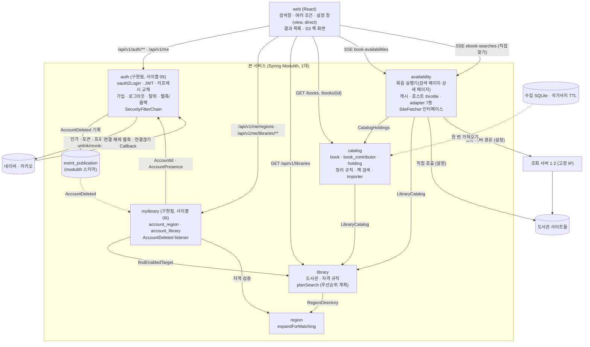
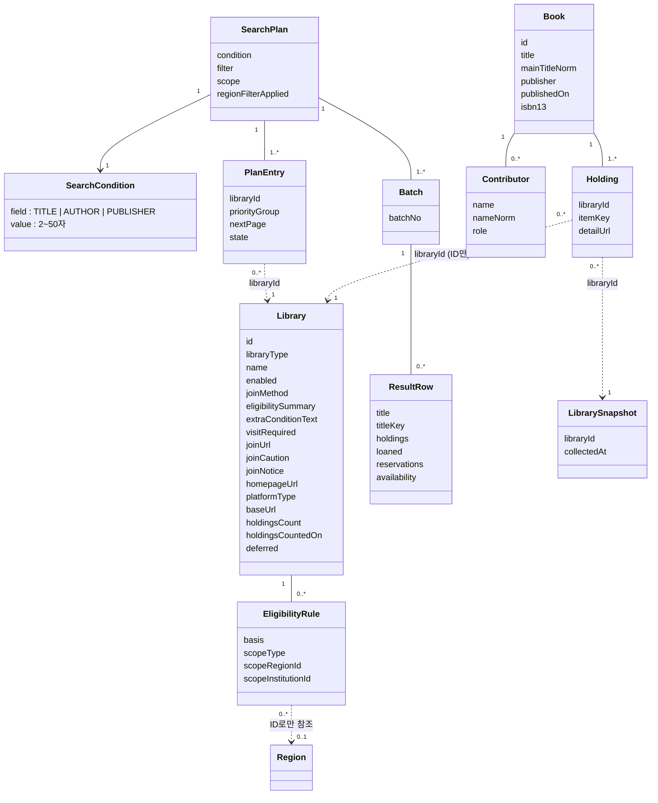
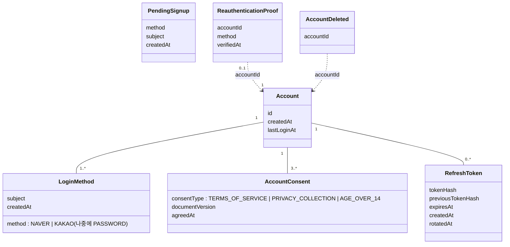
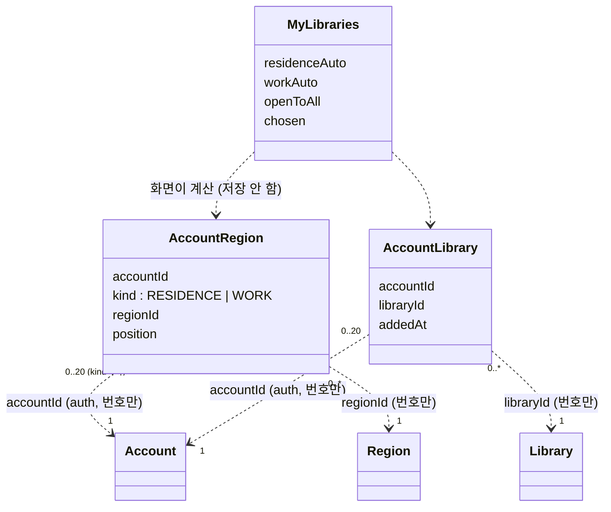

# 모듈 맵 (현재)

현재 설계 전체를 적은 문서입니다. 변경 기록이 아닙니다.

사이클 06 회고 반영 (2026-10-05): 내 도서관(`mylibrary`)을 더함 — 구현됨 (사이클 06). dev 보고 `chaekcheck-dev/docs/plan-feedback.md` "# 사이클 06"~"plan에 넘길 요약"과 코드로 대조함. 근거 `docs/cycles/06-my-libraries/design-delta.md`, ADR-0048~0051 (ADR-0048이 ADR-0036을 대체).

사이클 05 cycle-close (2026-10-04): `auth` 모듈과 이벤트 발행 저장소를 더함 — 구현됨(사이클 05, 2026-10-04 retro 반영). 근거 `docs/cycles/05-login-account/design-delta.md`, ADR-0036(ADR-0048로 대체됨), 0038~0046.

마지막 반영: 사이클 04 회고 (2026-10-01, `docs/cycles/04-and-search/retro.md`). dev 커밋 `c6028c9`의 코드와 `Documenter` 출력(`components.puml`, 모듈 canvas)으로 대조했습니다(구현됨). 실제 데이터 적재·AC 확인은 미룸(backlog "미뤄 둔 사이클 04 마무리 작업"). ADR-0028~0035, `docs/cycles/04-and-search/design-delta.md`.

| 모듈 | 책임 | 공개 API | 발행/구독 이벤트 | 소유 테이블 | 상태 |
|---|---|---|---|---|---|
| `region` | 시도·시군구 목록, 법정동 코드 속성, 폐지·대체 연결, 옛 지역 ID 해석 | Java `RegionDirectory` (`expandForMatching`, `resolve`), 예외 `RegionNotUsableException`(ID별 이유 `ABOLISHED`/`NOT_FOUND`/`NOT_SIGUNGU`) / REST `GET /api/v1/regions`, `GET /api/v1/regions/resolutions` | 없음 | `region.region`, `region.region_replacement` | 구현됨 |
| `catalog` | 수집한 전자책 목록(책·사람·역할·소장·도서관별 기준일, ADR-0028, ADR-0034), 정리 규칙(검색어와 저장값이 같은 코드, ADR-0031), 책 검색(칸별 단어 AND·완전 일치·역할·가입 단계 순서, ADR-0032), 한 번 가져오기(importer) | Java `CatalogHoldings` (`holdingsOf(bookIds)`, `holdings(holdingIds)` → `HoldingRef(holdingId, bookId, libraryId, platformType, detailUrl, title, author, publisher)`. 원문 제목·저자·출판사는 개발 중 추가) / REST `GET /api/v1/books`, `GET /api/v1/books/{bookId}`. 사이클 06: `/api/v1/books`, `/api/v1/books/{bookId}`가 `libraryIds`를 받고 직접 추가 도서관을 맨 앞으로 정렬, `JoinTier.CHOSEN`(첫 값) [확정] (dev 구현 확인, 2026-10-05) (ADR-0050) — 구현됨 (사이클 06) | 없음 | `catalog.book`, `catalog.book_contributor`, `catalog.holding`, `catalog.catalog_library_snapshot`, `catalog.catalog_import` | 구현됨 (JPA 엔티티 없음: `JdbcClient` + JDBC COPY). 데이터 미적재. `libraryIds`·`CHOSEN`도 구현됨 (사이클 06) |
| `library` | 도서관 목록(전자도서관 사이트 하나 = 한 줄, `library_type`으로 전자·실물 구분, ADR-0017), 가입 방법·안내 링크·주의·안내 문구, 자격 문구, 자격 규칙(규칙 없음 = 자격 미확인, 누구나 = 전국 규칙, ADR-0013), 사용 여부, 순위 값, **우선순위 조회 계획**(가입 가능 무리의 방문 가입은 그 무리들 모두 뒤, 무리 안 순서: 후순위 포털 → 주의 → 보유 수 → id, ADR-0027, 사이클 04에서 구현·확인) | Java `LibraryCatalog` (`planSearch(residenceIds, workIds, PlanOptions(scope, visit))` → 정렬된 `SearchTarget` 목록. 두 인자 `planSearch`는 `PlanOptions.DEFAULT`로 위임하는 default 메서드. `enabledLibraryRefs()` → `LibraryRef`, `findEnabledTarget(libraryId)`), 공개 타입 `PlanOptions`(`Scope.ALL/JOINABLE`, `Visit.ANY/NONE`, `apply(plan)`), `SearchTarget`(`joinable()` = `OPEN`/`ELIGIBLE`, 추가 문구는 보지 않음, `visitRequired` 포함), `PriorityGroup`, `LibraryType`, `PlatformType`(7개, ADR-0023), `Eligibility`(`UNVERIFIED` 포함), 예외 `InvalidRegionException`. 사이클 06: `PlanOptions(scope, visit, libraryIds)`(두 인자 생성자는 남김 = 빈 집합. 켜진 직접 추가 도서관은 자격과 상관없이 계획에 넣음, `scope=joinable`·`visit=none`에서도 남김, 스위치가 "전체"여도 맨 앞), `SearchTarget.chosen`(마지막 칸, `findEnabledTarget`은 늘 `false`), `LibraryCatalog.eligibilityFor(residenceIds, workIds)` → 공개 레코드 `LibraryEligibility`(`id`, `name`, `eligibility`, `matchedBy`, `visitRequired`, `cautioned`, `eligibilitySummary`, 안쪽 enum `RegionBasis { RESIDENCE, WORK }`) [확정] (dev 구현 확인, 2026-10-05), REST `GET /api/v1/libraries`(켜진 도서관 전체 + 지역별 가입 표시, 로그인 없음, ADR-0049) (ADR-0050) — 구현됨 (사이클 06) | 없음 | `library.library`, `library.eligibility_rule` | 구현됨. 사이클 06 변경도 구현됨 (사이클 06) |
| `availability` | 묶음 단위 검색(ADR-0014), 바쁜 호스트 건너뛰기(ADR-0020), 조회할 도서관 범위 `scope`, "방문 없이 가입" `visit`(ADR-0027), adapter 7종(ADR-0016, 0023), 판정 방식 `AvailabilityResolver`·SSE 전달 `SiteResultDelivery`(ADR-0019), 도서관 호출 `SiteFetcher`(직접 / 조회 서버 경유, ADR-0015), 도서관 TLS(ADR-0022), 제목 비교 키(ADR-0018), 캐시(ADR-0006), 호스트 이름 단위 호출 간격(ADR-0010), 검색 조건 제목/저자/출판사 중 하나(ADR-0009 내부 필드, ADR-0025 API, ADR-0026 포털 거르기, 사이클 04부터 "도서관에서 직접 찾기"). 사이클 04: 책을 가진 도서관의 상세 페이지 조회(adapter `parseDetail`, `DetailPageFetcher`가 상세 페이지를 읽는 유일한 길이고 포털 목록의 빈칸 판정 `DetailLookupResolver`도 이것을 씀, `DetailVerdictCache`는 `ParsedDetail`과 읽은 시각을 담음, 판정은 `AvailabilityResolvers.decideDetail(platformType, ParsedDetail)`·`subscription()`, ADR-0029), 실행기 `LookupTask`(`sealed permits Candidate, HoldingTask`, `hostKey()` null이면 요청 없는 작업, `BatchRunner.runTasks` 제네릭, 세션 `LaunchSession` = `BatchSession`/`HoldingSession`), 소장 단위 스트림(ADR-0030) | REST `GET /api/v1/ebook-searches/stream`, `GET /api/v1/ebook-searches/batches/stream`, `GET /api/v1/availability/libraries/{libraryId}/ebooks` (세 API 모두 `title`/`author`/`publisher` 중 하나), `GET /api/v1/book-availabilities/stream`, `…/batches/stream`. 사이클 06: 스트림 두 곳(`ebook-searches/stream`, `book-availabilities/stream`)이 `libraryIds`를 받고(파서 `availability/internal/web/LibraryIdsParam`) `targets.libraries[]`에 `chosen` (ADR-0050) — 구현됨 (사이클 06) | 없음 | 없음 (메모리 캐시) | 구현됨. `libraryIds`도 구현됨 (사이클 06) |
| `auth` | 네이버·카카오 `oauth2Login`, 가입 대기·동의·가입, JWT 발급·검증(액세스 15분 + DB의 리프레시 토큰 30일, ADR-0038), 로그아웃, 탈퇴 재인증·삭제(ADR-0043), 연결 해제 웹훅·콜백, 카카오 연결 대조와 1년 미로그인 계정 정리(하루 한 번), 앱 전체 `SecurityFilterChain`(보호 경로 `/api/v1/me/**`만, ADR-0044). 설정 `chaekcheck.auth.enabled`로 켜고 끔(기본 꺼짐, ADR-0046) | Java `AccountId`, 이벤트 `AccountDeleted(accountId)` / REST `/api/v1/auth/**`, `/api/v1/me`. 사이클 06: `AccountPresence.lockIfExists(AccountId): boolean` [확정] (dev 구현 확인, 2026-10-05) (호출한 트랜잭션 안에서만, `Propagation.MANDATORY`, 계정 줄 잠금 `FOR NO KEY UPDATE`, 구현 `auth/internal/account/AccountLock`, ADR-0051), `AccountId` 인자 해석기 `auth/internal/web/AccountIdArgumentResolver`(앱 전체 등록, 다른 모듈 컨트롤러가 현재 계정을 인자로 받음, `/api/v1/me/**` 밖에서는 늘 401), `ConditionalOnAuthEnabled`를 루트 패키지로 옮겨 공개하고 속성 이름 상수 `ConditionalOnAuthEnabled.PROPERTY`도 루트에 둠(`internal`의 상수가 이것을 가리킴) [확정] (dev 구현 확인, 2026-10-05) — 구현됨 (사이클 06) | 발행 `AccountDeleted`. 구독: 자기 listener 하나(ADR-0041) + `mylibrary` listener(구현됨 (사이클 06)) | `auth.account`, `auth.login_method`, `auth.account_consent`, `auth.refresh_token` | 구현됨(사이클 05, 2026-10-04 retro 반영). 사이클 06 변경도 구현됨 (사이클 06) |
| `mylibrary` | 로그인한 계정의 거주·직장 지역과 직접 추가 도서관 저장. 관심 책은 맡지 않음 [확정] (ADR-0048, ADR-0036 대체). 저장 전 `auth` 계정 줄 잠금, 직접 추가는 20곳까지 [확정] (사용자, 2026-10-04). 모든 빈은 `chaekcheck.auth.enabled`에 묶음(꺼지면 API 404), 표는 늘 만듦 [확정] (dev 구현 확인, 2026-10-05). 패키지 `com.chaekcheck.mylibrary`(루트에 공개할 것 없음, `allowedDependencies = { "auth", "library", "region" }`), `mylibrary.internal`(`MyLibraryStore`(JdbcClient)·`MyLibraryService`·`AccountDeletedCleanup`, `internal/web/MyLibraryController`·`MyLibraryErrors`), JPA 엔티티 없음 [확정] (dev 구현 확인, 2026-10-05) | Java 공개 타입 없음 / REST `/api/v1/me/regions`, `/api/v1/me/libraries/**` (ADR-0049) | 구독 `AccountDeleted` → 두 표에서 그 계정 줄 삭제(멱등, ADR-0051) | `mylibrary.account_region`, `mylibrary.account_library` | 구현됨 (사이클 06) |
| (공용 인프라) 이벤트 발행 저장소 | Spring Modulith JDBC 발행 저장소. 완료된 기록은 삭제(`completion-mode=delete`, ADR-0041) | — | — | `modulith.event_publication` (어느 모듈 소유도 아님. ADR-0002의 예외는 이 표 하나) | 구현됨(사이클 05, 2026-10-04 retro 반영) |
| 조회 서비스 (Modulith 모듈 아님, 별도 배포 단위) | 받은 URL을 GET으로 가져와 상태 코드와 원본을 돌려줌. 여러 대, 고정 IP (ADR-0011, 0015) | 내부 REST `POST /v1/fetches` | 없음 | 없음 | 구현됨. dev 폴더 `fetch-service/`, 패키지 `com.chaekcheck.fetch`, 독립 Gradle 빌드 [확정] |

base package `com.chaekcheck` [확정].

- 본 서비스는 이번 운영에서 1대입니다. 여러 대가 되면 틀려지는 부분(`HostThrottle`, `SearchPageCache`, `DetailVerdictCache`)은 인터페이스 뒤에 있고 구현은 메모리입니다 (ADR-0021). Spring 기본 예외를 ProblemDetail로 바꾸는 `ApiExceptionHandler`는 base package 루트에 있고, 모듈 예외는 `availability/internal/web/AvailabilityErrors`가 처리합니다.

## 모듈 구성도

- 의존 방향: `catalog → library → region`, `availability → catalog, library`. 순환 없음. `Documenter` `components.puml`(2026-09-30)과 같음
- 사이클 06 (구현됨 (사이클 06)): `mylibrary → auth, library, region`. `Documenter` `backend/build/spring-modulith-docs/components.puml`(2026-10-05)과 같음: Catalog→Library, Library→Region, Availability→Library·Catalog, Mylibrary→Auth(uses + listens to), Mylibrary→Library, Mylibrary→Region. `ModularityTests`가 `mylibrary` 의존이 정확히 셋이고 검색 모듈이 auth·mylibrary에 의존하지 않음을 확인함. `catalog`·`availability`는 `mylibrary`·`auth`를 모르고, 웹이 `libraryIds`로 넘깁니다(ADR-0037. 그 ADR의 `member`는 `mylibrary`로 읽음, `libraryIds` 상한은 20 [확정] (사용자, 2026-10-04)). 순환 없음.
- 조회 서버는 연결 실패·503일 때만 다음 서버로 넘깁니다 (ADR-0015, 흐름 4)
- 모듈끼리는 루트 패키지의 공개 API로만 호출합니다. 거꾸로 부르지 않습니다 (ADR-0001). `availability`는 `region`에 직접 의존하지 않습니다.
- 이벤트: `auth`가 `AccountDeleted(accountId)`를 발행합니다(구현됨(사이클 05, 2026-10-04 retro 반영), ADR-0041). 받는 쪽은 `auth` 자신의 listener와 `mylibrary` listener(두 표 삭제, 구현됨 (사이클 06), ADR-0051) 둘입니다. 재시작 때 남은 기록 다시 처리 `spring.modulith.events.republish-outstanding-events-on-restart: true` [확정] (ADR-0051). 실패(`FAILED`) 기록도 다시 처리함 — 확인함 (dev, 2026-10-04): 공식 문서는 상태별 동작을 적지 않아 Spring Modulith 2.1.1 jar를 확인함. `JdbcEventPublicationRepositoryV2`가 `COMPLETION_DATE IS NULL OR STATUS != 'COMPLETED'`인 기록을 다시 처리하고, 시험 `mylibrary/AccountDeletedRepublishTests`(실제 잠금 시간 초과로 `FAILED`를 만든 뒤 재시작 → 두 표·발행 기록 0)로 확인. 그 밖에는 이벤트를 쓰지 않습니다.
- `auth`는 다른 모듈에 의존하지 않습니다. `mylibrary`만 auth의 공개 타입에 의존 (ADR-0048) — 구현됨 (사이클 06). (ADR-0036은 ADR-0048로 대체됨.) 운영에서는 앞단 웹 서버가 화면 파일을 내려 주고 `/api`를 본 서비스로 넘깁니다(같은 출처, ADR-0042).
- 칸 안의 정렬(제목끼리 모은 뒤, 같은 책 안에서는 가입 가능 → 가입 가능(주의) → 가입 가능(방문) → 가입 자격 확인 필요 [확정] (사용자, 2026-09-30), 그다음 기존 순서)과 "지금 빌릴 수 있는 책만" 필터는 프론트가 합니다. `availability`는 줄마다 판정(`availability`), 정렬에 쓰는 값, 제목 비교 키(`titleKey`)를 계산해 보냅니다.
- 조회 계획과 묶음 진행 상태는 브라우저가 가지고, 서버는 저장하지 않습니다 (ADR-0014). 사이클 04부터 수집 목록 흐름의 계획 단위는 소장(`holdingId`, 웹 `holdingPlan.ts`·`useHoldings`)이고, 직접 찾기 흐름(`useSearch`)은 도서관 단위 그대로입니다. 두 흐름은 상태를 섞지 않습니다.
- `Book`·`Contributor`·`Holding`·`LibrarySnapshot`은 `catalog` 모듈이 DB에 저장합니다(구현됨, 데이터 미적재).
- 책 목록 기본 순서(사이클 04): 가입 단계(`joinTier`, 지역 있음: 내 시군구 → 내 시도 → 누구나 → 방문 가입만 → 확인 필요 / 지역 없음: 누구나 → 방문 가입만 → 확인 필요) → 완전 일치 → 보유 도서관 수 → 출판일 최신. 한 책 안 도서관 순서는 `planSearch`(ADR-0027)
- 사이클 06 (구현됨 (사이클 06), ADR-0050): 직접 추가 도서관(`chosen`)은 계획·책 목록(`joinTier` `CHOSEN`이 첫 값)·웹 정렬(`sortBatch`) 모두에서 맨 앞 [확정]. 스위치가 "전체"(`scope=all`)여도 같음, `priorityGroup`은 원래 값 유지 [확정] (사용자 승인, 2026-10-04). 지역 규칙이 안 맞는 `chosen` 도서관은 `priorityGroup=QUALIFIED`, `eligibility=UNKNOWN` [확정] (dev가 정한 값, dev 구현 확인, 2026-10-05)
- 결과 줄의 가입 정보 (2026-10-05 바뀜, 사이클 03 U-12와 사이클 06 "직접 추가면 자격 줄 숨김"을 바꿈): 모든 폭에서 도서관 이름을 누르면 팝오버(데스크톱은 이름 오른쪽, 640px 이하는 아래)가 열리고 그 안에 자격 요약·자격 조건·안내·주의·방문 가입·가입 방법. "가입 자격 확인 필요" 표시도 이름 옆에서 그 팝오버 맨 위로 옮김. `chosen` 도서관도 같은 정보를 보이고, 다른 도서관과의 차이는 이름 옆 "직접 추가" 표시와 정렬(같은 책 안에서 맨 앞)뿐 [확정] (사용자 요청, 2026-10-05: "'직접 추가'도서관도 그 방법에 맞게 보이도록 해줘(자격 조건도 누르면 보이도록)")

## 도메인 모델

- `Library`, `EligibilityRule`은 `library` 모듈이, `Book`·`Contributor`·`Holding`·`LibrarySnapshot`은 `catalog` 모듈이 DB에 저장합니다. `SearchPlan`, `SearchCondition`, `PlanEntry`, `Batch`, `ResultRow`는 브라우저 상태입니다.
- `SearchCondition`은 설계 용어이고 서버 코드에서는 기존 `SearchQuery(value, field)`입니다. 조건이 바뀌면 계획을 새로 만듭니다. 서버 캐시는 조건별로 따로입니다(ADR-0009).
- 주요 흐름(시퀀스·상태 그림)은 `flows.md`에 있습니다.

### `auth` 도메인 모델 — 구현됨(사이클 05, 2026-10-04 retro 반영)

- `PendingSignup`과 `ReauthenticationProof`는 DB가 아니라 `HttpSession`(ADR-0040)에 둡니다. 이번 사이클에는 `LoginMethod`가 계정당 하나뿐입니다(1..*는 구조만).

### `mylibrary` 도메인 모델 — 구현됨 (사이클 06)

- `AccountRegion`, `AccountLibrary`는 `mylibrary` 모듈이 DB에 저장합니다. `MyLibraries`는 저장하지 않고, 화면이 저장 값과 `GET /api/v1/libraries` 결과로 그때그때 만듭니다(ADR-0049). `AccountRegion`·`AccountLibrary`는 표 이름(`account_region`, `account_library`)과 같고 [확정] (dev 구현 확인, 2026-10-05), 서버에 이 이름의 Java 클래스는 두지 않음(`MyLibraryStore`가 JdbcClient로 읽고 씀). `MyLibraries`는 화면 설계 용어 [안] (웹 타입 이름은 `MyLibraries`, `MyRegions`).
- S10 `/my-libraries` 화면은 구역 셋 (2026-10-05 바뀜, flow S10 "여섯 구역"을 사용자 요청으로 바꿈) [확정] (사용자 요청, 2026-10-05): 맨 위 "누구나 가입하는 도서관 N곳" 줄, ① 지역 선택([변경] 하나. 안에 차례로 "거주 …" / "거주 지역으로 자동 N곳 ▸" / "직장 …" / "직장 지역으로 자동 N곳 ▸") ② 직접 도서관 추가 ③ 직접 추가한 도서관 N/20. [변경]은 S2를 "거주" 탭으로 엶.

## 관련 ADR

ADR-0001 모듈 경계, ADR-0006 캐시, ADR-0009 검색 필드, ADR-0010 호출 간격, ADR-0011 조회 서비스, ADR-0013 자격 모델, ADR-0014 묶음 검색 API, ADR-0015 조회 계약, ADR-0016 adapter, ADR-0017 도서관 한 줄 = 이용 단위, ADR-0018 제목 비교 키, ADR-0019 판정·전달 인터페이스, ADR-0020 바쁜 호스트 건너뛰기, ADR-0021 본 서비스 여러 대 대비, ADR-0022 도서관 TLS 호환, ADR-0023 화면 종류 세대 번호, ADR-0025 검색 조건 이름 있는 파라미터, ADR-0026 포털 저자·출판사 거르기, ADR-0027 방문 가입 필터와 순서, ADR-0028 catalog 모듈, ADR-0029 상세 페이지 조회, ADR-0030 책 검색 API와 소장 스트림, ADR-0031 가져오기와 정리 코드, ADR-0032 PostgreSQL + pg_bigm·사람별 표, ADR-0033 웹 주소 여러 조건, ADR-0034 전자책 목록 저장, ADR-0036 auth·member 모듈(ADR-0048로 대체됨), ADR-0037 검색 모듈은 회원을 모름(`member`는 `mylibrary`로 읽음, `libraryIds` 상한 20 [확정] (사용자, 2026-10-04)), ADR-0038 JWT 로그인 유지, ADR-0039 로그인 수단 표, ADR-0040 로그인 임시 값, ADR-0041 계정 삭제 이벤트, ADR-0042 같은 출처와 인증 주소, ADR-0043 재인증, ADR-0044 보안 설정 소유, ADR-0045 결과 코드, ADR-0046 로그인 기능 켜고 끄기, ADR-0048 `mylibrary` 모듈(ADR-0036 대체), ADR-0049 내 도서관 목록과 저장 API, ADR-0050 직접 추가 도서관은 맨 앞·자격 규칙의 예외, ADR-0051 계정 줄 잠금과 이벤트 다시 처리
