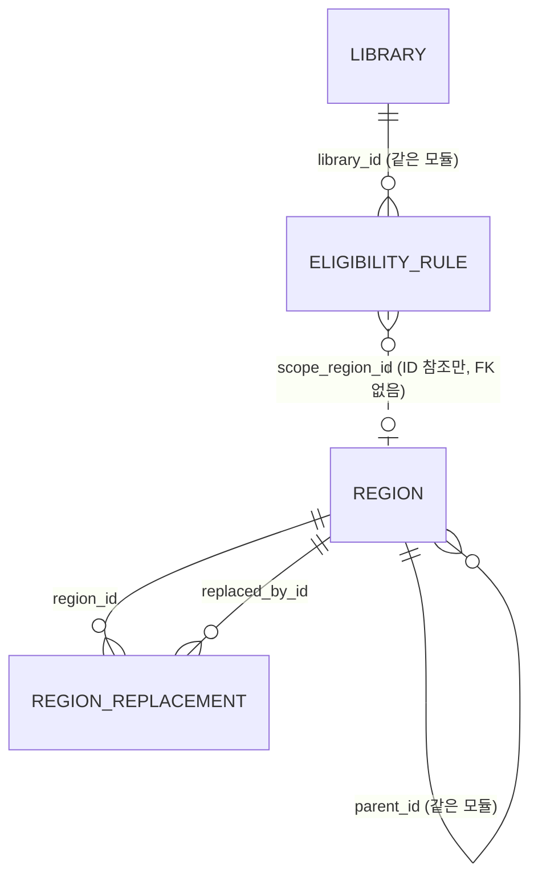

# 설계 제안: 사이클 01 도서 제목 검색 → 전자도서관 대출 가능 여부

- 작성: architect 서브에이전트, 2026-09-27
- 근거 문서: `scope.md`, `spec.md`, `flow.md`, dev `CLAUDE.md`, dev skill 4종 (spring-modulith, postgres-patterns, jpa-patterns, api-design)
- 사용자가 확정하지 않은 이름·경로·한도는 모두 [안]입니다.
- **검토 방법**: 각 결정에서 고를 안에 주석을 달거나, 채팅으로 "결정 1 B, 결정 3 A…"처럼 알려 주세요. 전부 추천안대로 가려면 Approve를 누르시면 됩니다.

## 결정할 것 한눈에 보기

| # | 결정 | 선택지 | 추천 |
|---|---|---|---|
| 1 | 지역 목록을 둘 모듈 | A `library` 안 / B `region` 모듈 따로 | B |
| 2-1 | 스키마 나누기 | A 모듈마다 PostgreSQL 스키마 / B `public` 하나 + 접두어 | A |
| 2-2 | 폐지·대체 연결 | A `replaced_by_id` 컬럼 하나 / B 연결 테이블 | B |
| 2-3 | 기관 범위 자리 | A nullable 컬럼만 / B 빈 `institution` 테이블 / C 다형 참조 컬럼 | A |
| 2-4 | 가입 조건 종류 | 규칙 유무로 계산 / `join_policy` 컬럼 | 계산 |
| 3 | "먼저 응답한 도서관부터" API | A 대상 도서관 + 도서관별 호출 / B SSE 스트리밍 / C 모두 기다림 | A |
| 3' | 정렬 담당 | 백엔드는 정렬용 값 계산, 프론트가 정렬 | (A와 묶임) |
| 4-1 | 캐시 | A Caffeine 메모리 / B DB 테이블 / C Redis | A |
| 4-2 | 호출 간격 제어 | A 직접 구현 / B Resilience4j | A |
| 4-2' | 제어 단위와 간격 기준 | 호스트 단위, "이전 종료 → 다음 시작" 1초 | 호스트, 종료→시작 |
| 5 | 폐지 지역 ID 해석 | A 해석 전용 API / B 목록 API가 이력 포함 / C 도서관 API가 자동 교체 | A |

## 현재 상태

- 모듈, 테이블, 엔드포인트, ADR 모두 아직 없습니다. dev 프로젝트에 `backend/`, `web/` 코드가 없습니다 (2026-09-27 확인).
- base package와 Gradle group ID는 정해지지 않았습니다. 아래에서는 `<base-package>`로 적습니다.

## 이번 슬라이스가 요구하는 것

| 요구/수용 기준 | 설계에서 필요한 것 |
|---|---|
| 5.1, AC-2~5 대상 도서관 고르기 | 자격 규칙(근거 × 범위) 저장, 시군구가 시도에 속하는지 판정, "지역 없음 / 고름" 두 모드를 지원하는 대상 도서관 API |
| 4장 가입 조건·자격 문구·가입 방법 | 도서관 속성으로 저장 |
| AC-6 지역은 브라우저에만 저장 | 서버는 지역을 요청 조건으로만 받음. 저장 테이블 없음 |
| 5.2, AC-13 먼저 응답한 도서관부터 표시 | 도서관별로 따로 받는 API 또는 스트리밍 (결정 3) |
| 5.2, AC-14 타임아웃 3/5/8초, 도서관별 실패 | 도서관별 실패 표현, 8초 제한을 거는 위치 |
| 5.3 수량 읽기 | 플랫폼 adapter 2개 (KYOBO, YES24) |
| 5.4, AC-9·10 순서 | 재고, 도서관 대출률(첫 페이지 기준), 원래 순서(rank) 제공. 정렬 담당 (결정 3) |
| 5.5, AC-15 전체 건수, 더 보기 | 도서관별 totalCount, hasMore, page 파라미터 |
| 5.6, AC-16 캐시 3분, "N분 전 조회" | 캐시 키 = 도서관 + 정규화한 검색어 + 페이지. 조회 시각을 함께 저장 (결정 4) |
| 5.6, AC-17 같은 도서관 동시 1건, 간격 1초 | 호출 간격 제어 (결정 4) |
| 5.6, AC-18 User-Agent | 설정값 (값은 확인 필요) |
| 5.6, AC-11 설명문·표지 없음 | adapter가 제목·저자·출판사·공급 업체·수량만 뽑음. 응답 DTO에도 그 필드가 없음 |
| 5.7, AC-19 도서관 사용 여부 | `enabled` 컬럼. 재시작 없이 반영 |
| 5.8, AC-20 지역 내부 ID, 폐지, 대체 | 지역 테이블 + 대체 연결(나뉨까지 표현) + 옛 ID 해석 API (결정 5) |
| 9장 재학·소속·기관 구조 | 근거에 SCHOOL, AFFILIATION, 범위에 INSTITUTION 참조 자리 (결정 2) |
| AC-12 출처·연락처 | 프론트 고정 문구. 백엔드 변경 없음 |

---

## 결정 1: 모듈 경계와 지역 목록의 위치

`library`와 `availability`는 scope.md의 [안]을 따릅니다. 실제 선택지는 지역 목록을 어디에 두느냐입니다.

### A안: 지역을 `library` 안에 둠 (모듈 2개)
- `library`가 지역 테이블, 지역 목록 API, 폐지 지역 해석 API까지 가짐
- 장점: 모듈이 2개뿐이고, 자격 판정에 모듈 경계를 넘는 호출이 없음
- 단점: 지역은 도서관과 수명 주기가 다름(행정안전부 공지로 반년마다 바뀜). 나중에 회원 모듈 등이 지역을 쓰면 `library`에 의존하게 되어 방향이 어색함
- 되돌리는 비용: 중간 (스키마, 패키지, API 경로 이동. 브라우저에 저장된 ID는 그대로 씀)

### B안: `region` 모듈을 따로 둠 (`region` ← `library` ← `availability`)
- `region`이 지역 테이블, 대체 연결, 지역 목록 API, 해석 API를 가짐. `library`는 `region`의 공개 API로 "시군구 ID들을 {자기, 상위 시도} 집합으로 펼치기"를 호출
- 장점: 참조 데이터와 도서관 도메인이 분리되고 의존 방향이 한쪽으로만 흐름. Liquibase 변경분도 모듈별로 나뉨
- 단점: 모듈이 하나 늘고, 자격 판정에 모듈 경계를 넘는 호출이 한 번 생김 (같은 프로세스 안의 메서드 호출)
- 되돌리는 비용: 낮음 (합치기는 쉬움)
- 주의: `region`은 공통 유틸을 넣는 "common" 모듈이 아니라, 지역이라는 도메인 하나만 가진 모듈로 유지

**추천: B안** — 지역에는 폐지·대체·코드 갱신이라는 자체 규칙과 API가 있고 도서관과 수명 주기가 다릅니다. 지금 나누는 비용이 나중에 떼는 비용보다 작습니다.

### 정렬 담당 (결정 3과 묶임)
- 백엔드(`availability`): 줄마다 재고 `available = holdings − loaned`, 원래 순서 `rank`, 페이지의 도서관 대출률 `loanRate` 계산
- 프론트: 도서관 결과가 도착할 때마다 spec 5.4 규칙으로 다시 정렬. 결정 3에서 A안을 고르면 결과를 브라우저에서 합쳐야 하므로 정렬은 프론트가 맡을 수밖에 없음
- 이 안을 고르면 scope.md의 `availability` 책임 문구 "정렬"을 "정렬에 쓰는 값 계산"으로 고쳐야 함

---

## 결정 2: 테이블 구조

### 2-1. 스키마 나누기
- **A안: 모듈마다 PostgreSQL 스키마** (`region`, `library`). 소유 경계가 DB에서도 보이고 나중에 DB를 나누기 쉬움. 대신 Liquibase·JPA에 스키마 이름을 적어야 함
- B안: `public` 하나 + 테이블 이름 접두어. 설정은 단순하지만 경계가 이름 규칙에만 기대고 실수로 JOIN하기 쉬움
- **추천: A안.** `availability`는 소유 테이블이 없음 (캐시는 메모리)

### 2-2. 폐지·대체 연결
- A안: `region.replaced_by_id` 컬럼 하나. 합쳐짐은 표현되지만 **나뉨은 표현하지 못해** spec 5.8("둘 이상으로 나뉘면 다시 고르라고 안내")과 맞지 않음
- **B안: `region_replacement` 연결 테이블** (여러 대 여러). 합쳐짐과 나뉨 모두 표현
- **추천: B안**

### 2-3. 기관(institution) 범위를 담는 방법 (spec 9장)
- **A안: `eligibility_rule.scope_institution_id` nullable 컬럼과 `scope_type='INSTITUTION'` 값만 지금 만듦.** `institution` 테이블과 소유 모듈은 다음 사이클에서 정함. 모듈 경계를 넘는 참조라 FK는 어차피 없음. 다음 사이클에 규칙 테이블을 바꿀 필요가 없음
- B안: 빈 `institution` 테이블을 지금 만듦. 이번 슬라이스에 필요 없는 테이블이고 소유 모듈을 미리 정해야 함
- C안: `scope_ref_id` 컬럼 하나 + `scope_type`으로 뜻 구분 (다형 참조). 컬럼 뜻이 행마다 달라지고 검증이 약함
- **추천: A안**

### 2-4. 가입 조건 종류(누구나 가입 / 자격 필요)를 저장할지
- **추천: 컬럼 없이 규칙 유무로 계산** (spec 2장 정의 "규칙이 하나 이상이면 자격 필요"와 같음)
- 대안: `join_policy` 컬럼. 규칙을 실수로 지웠을 때 "누구나 가입"으로 바뀌는 사고를 막지만, 같은 사실이 두 곳에 저장됨

---

## 결정 3: "먼저 응답한 도서관부터" API 방식

### A안: 대상 도서관 조회 + 도서관별 검색 호출 (프론트가 병렬 호출)
- ① `GET /api/v1/libraries?residenceRegionIds=&workRegionIds=`로 대상 도서관과 가입 가능 여부를 받음
- ② 도서관마다 `GET /api/v1/availability/libraries/{libraryId}/ebooks?q=&page=`를 동시에 호출. "더 보기"도 ②를 `page`만 바꿔 다시 씀
- 실패 표현: 도서관별 HTTP 상태. 502 `upstream_error`, 504 `upstream_timeout`, 404 `library_not_found`(없거나 꺼짐). 프론트는 400이 아닌 실패를 모두 "조회 실패"로 표시
- 8초 제한: 백엔드가 요청마다 8초 제한을 검 (호출 차례 대기 + 연결 + 응답 읽기 포함). 모든 도서관 호출을 같은 시각에 보내므로 사실상 검색 전체 8초가 됨. 프론트는 네트워크 사고 대비 안전 타임아웃만 둠
- 장점: 단순함. 첫 검색과 더 보기가 같은 엔드포인트. 캐시 키와 엔드포인트 단위가 같음. 한 도서관의 실패가 다른 도서관에 영향 없음
- 단점: 도서관 수만큼 브라우저 요청이 나감. HTTP/1.1은 같은 출처 동시 연결이 약 6개라 도서관이 많아지면 HTTP/2나 다른 방식 필요. 대상 도서관 조회라는 왕복이 하나 더 생김
- 되돌리는 비용: 낮음 (나중에 SSE를 더해도 ②는 더 보기용으로 계속 씀)

### B안: SSE 스트리밍 엔드포인트 하나
- `GET /api/v1/ebook-searches/stream?...`가 `targets` → 도서관마다 `library-result`/`library-failed` → `done` 이벤트를 보냄
- 장점: 요청이 하나. 서버가 동시 호출과 8초를 한곳에서 관리해서 도서관이 많아져도 브라우저 연결 수 제한이 없음
- 단점: 더 보기용 도서관별 엔드포인트가 결국 따로 필요해서 API가 두 형태가 됨. Spring MVC 비동기 처리, 프록시 버퍼링을 챙겨야 함. EventSource 자동 재연결로 도서관 요청이 다시 나갈 위험. 오류 처리와 테스트가 더 복잡함

### C안 (비추천): 모든 도서관을 기다렸다가 한 번에 응답
- AC-13을 만족하지 못함

**추천: A안** — 시범 도서관 2곳이라 연결 수 제한이 문제가 되지 않고, 더 보기와 같은 경로를 써서 API가 한 형태로 끝납니다. 도서관이 크게 늘 때의 SSE 전환은 backlog 후보로 둡니다.

### A안 기준 응답에 담는 값
- `fetchedAt`(원본 조회 시각), `cached`, `cacheAgeSeconds`: 서버가 나이를 계산해서 브라우저 시계가 틀려도 "N분 전"이 맞게 나옴
- `totalCount`, `pageSize`, `hasMore`
- `loanRate`: 그 페이지 결과의 (대출 중 합계 ÷ 보유 합계). 보유 합계가 0이면 null. 프론트는 page 1 값만 도서관 대출률로 고정해서 씀
- `rank`: 도서관 안의 원래 순서 = `(page−1) × pageSize + 순번`

---

## 결정 4: 캐시와 호출 간격 제어

### 4-1. 캐시
- **A안: Caffeine 메모리 캐시.** 쓰기 후 3분 만료(설정값), 최대 항목 수 [안]. 같은 키로 동시에 요청이 오면 한 번만 조회. 실패는 캐시하지 않음. 인프라 추가 없음, 원본을 디스크에 쌓지 않음. 대신 재시작하면 비워지고, 인스턴스가 여러 대면 캐시와 호출 제어가 따로 돎 (지금은 1대 전제 [확인 필요])
- B안: PostgreSQL 캐시 테이블. 재시작 후에도 남고 공유되지만, 쓰기 부하와 만료 청소가 필요하고 **검색 결과를 DB에 쌓게 되어 spec 10장("쌓아 두지 않음", 저작권법 제93조 검토)과 부딪힘**
- C안: Redis. 공유와 TTL은 좋지만 새 인프라가 생기고 이번에는 필요 없음
- **추천: A안.** 캐시 키의 검색어는 앞뒤 공백 제거 + 연속 공백을 하나로 정규화 [안]. 도서관에 보내는 검색어도 같은 값을 씀
- 버전: Caffeine 최신 릴리스 3.3.0 (https://github.com/ben-manes/caffeine/releases, 2026-09-27 확인. 연도 표시가 없어 [확인 필요]). Spring Boot 4.1 연동은 dev에서 Context7로 확인

### 4-2. 호출 간격 제어 (같은 도서관 동시 1건, 간격 1초 이상)
- **A안: 직접 구현 `HostThrottle`.** 호스트마다 공정한 세마포어 1개와 마지막 요청 종료 시각. 차례를 받으면 "이전 종료 + 1초"까지 기다린 뒤 요청하고, 응답을 다 받은 뒤 차례를 돌려줌. 기다리는 시간은 8초 제한 안에서만, 넘으면 504. AC-17을 정확히 지키고 코드가 작음. 직접 테스트해야 함
- B안: Resilience4j RateLimiter + Bulkhead. 이미 있는 라이브러리지만, RateLimiter는 시간을 주기로 나누고 **주기가 시작될 때 허가를 다시 채우므로** 한 주기 끝과 다음 주기 시작에 요청 두 건이 1초 안에 나갈 수 있어 AC-17을 어길 수 있음 (https://resilience4j.readme.io/docs/ratelimiter, 2026-09-27 확인)
- **추천: A안**
- 제어 단위: spec은 "같은 도서관". 두 도서관이 같은 호스트를 쓰는 경우까지 보호하려면 **호스트 단위(host:port)**가 더 엄격함. 시범 2곳은 호스트가 달라 결과는 같음. 호스트 단위 추천 [안]
- 간격 기준: **이전 요청 종료 → 다음 요청 시작**이 1초 이상 (시작 기준보다 엄격함) 추천 [안]

---

## 결정 5: 브라우저에 저장된 폐지 지역 ID 해석

- **A안: 해석 전용 API** `GET /api/v1/regions/resolutions?ids=...`. 서버가 대체 연결을 끝까지 따라가서(여러 번 바뀐 경우 포함, 순환 방지) ID마다 `ACTIVE | REPLACED | SPLIT | UNKNOWN`을 돌려줌. 프론트는 앱을 열 때 저장된 지역이 있으면 먼저 호출. 규칙이 서버 한곳에 있음. 요청이 하나 늘어남 (저장된 지역이 있을 때만)
- B안: 목록 API가 폐지 지역과 대체 정보까지 돌려주고 프론트가 해석. 모달에 필요 없는 데이터가 오고, 연결을 따라가는 규칙이 프론트에 생김
- C안: 대상 도서관 API가 폐지 ID를 알아서 바꾸고 안내를 붙임. 도서관 API에 지역 이력 책임이 섞이고 브라우저 값을 바꾸는 시점이 불분명함
- **추천: A안.** 대상 도서관 API는 폐지·없음·시도 ID를 받으면 422 `invalid_region`을 돌려주고, 프론트는 이때 해석 API를 다시 부름 (지역 데이터 배포 직후 대비)

---

## 추천안 기준 초안

### 모듈 [안]

| 모듈 | 책임 | 공개 API | 이벤트 | 소유 테이블 |
|---|---|---|---|---|
| `region` | 시도·시군구 목록, 법정동 코드, 폐지·대체 연결, 옛 ID 해석 | Java: `RegionDirectory` (`expandForMatching`, `resolve`) / REST: `/api/v1/regions`, `/api/v1/regions/resolutions` | 없음 | `region.region`, `region.region_replacement` |
| `library` | 전자도서관 목록, 플랫폼, 조회 기본 주소, 가입 방법, 자격 문구, 자격 규칙, 사용 여부, 대상 도서관 판정 | Java: `LibraryCatalog` (`findTargets`, `findEnabledSearchTarget`) / REST: `/api/v1/libraries` | 없음 | `library.library`, `library.eligibility_rule` |
| `availability` | 플랫폼 adapter(KYOBO, YES24), 실시간 조회, 캐시, 호출 간격 제어, 정렬용 값 계산 | REST: `/api/v1/availability/libraries/{libraryId}/ebooks` | 없음 | 없음 (메모리 캐시) |

- 의존 방향: `availability → library → region` (순환 없음, `ApplicationModules.verify()`로 확인)
- 이벤트는 이번에 필요 없음 → event publication registry도 도입하지 않음
- `enabled`는 요청마다 DB에서 읽음 (2행). 메모리에 두면 AC-19가 재시작 전까지 반영되지 않음
- 설정 키 (값은 spec 5.6 [확정], 접두어는 [안]): `cache-ttl=3m`, `host-max-concurrency=1`, `host-min-interval=1s`, `connect-timeout=3s`, `read-timeout=5s`, `request-deadline=8s`, `user-agent=<확인 필요>`, `kyobo.record-count=50`. YES24 페이지 크기 10은 사이트가 고정한 값

### 데이터



**`region.region`** [안]

| 컬럼 | 타입 | 제약 |
|---|---|---|
| id | bigint | PK. 자동 증가 없이 seed에서 직접 부여 (브라우저에 저장되므로 모든 환경에서 같아야 함) |
| parent_id | bigint | NULL, FK → region.region(id) |
| level | text | NOT NULL, CHECK IN ('SIDO','SIGUNGU') |
| name | text | NOT NULL (예: "서울특별시", "마포구") |
| short_name | text | NULL (시도 표시용, 예: "서울") |
| legal_dong_code | text | NOT NULL, 10자리 숫자 CHECK |
| status | text | NOT NULL, CHECK IN ('ACTIVE','ABOLISHED') |
| abolished_on | date | NULL |
| created_at, updated_at | timestamptz | NOT NULL DEFAULT now() |

- CHECK: 시도면 parent_id가 없고, 시군구면 있음 / 폐지면 abolished_on이 있음
- UNIQUE `(legal_dong_code) WHERE status='ACTIVE'` (폐지된 코드가 다시 쓰일 수 있어 사용 중인 지역만 유일)
- INDEX `(parent_id) WHERE status='ACTIVE'`

**`region.region_replacement`** [안]

| 컬럼 | 타입 | 제약 |
|---|---|---|
| region_id | bigint | NOT NULL, FK → region.region(id) |
| replaced_by_id | bigint | NOT NULL, FK → region.region(id) |
| effective_on | date | NOT NULL |

- PK `(region_id, replaced_by_id)`, CHECK `region_id <> replaced_by_id`, INDEX `(replaced_by_id)`
- 대체하는 쪽이 둘 이상이면 나뉨(SPLIT)

**`library.library`** [안]

| 컬럼 | 타입 | 제약 |
|---|---|---|
| id | bigint | PK, GENERATED BY DEFAULT AS IDENTITY (seed는 ID를 직접 넣음) |
| name | text | NOT NULL, UNIQUE |
| platform | text | NOT NULL, CHECK IN ('KYOBO','YES24') |
| base_url | text | NOT NULL (origin만. 경로와 파라미터는 adapter가 붙임) |
| eligibility_summary | text | NULL (예: "서울 거주·재직·재학") |
| join_method | text | NOT NULL |
| enabled | boolean | NOT NULL DEFAULT true |
| created_at, updated_at | timestamptz | NOT NULL DEFAULT now() |

- 자격 문구는 규칙에서 자동으로 만들지 않고 텍스트로 저장 (조합 규칙이 필요 없어 단순함. 규칙과 문구가 어긋날 수 있으므로 같은 Liquibase changeset에서 함께 고침)

**`library.eligibility_rule`** [안]

| 컬럼 | 타입 | 제약 |
|---|---|---|
| id | bigint | PK, GENERATED BY DEFAULT AS IDENTITY |
| library_id | bigint | NOT NULL, FK → library.library(id) ON DELETE CASCADE |
| basis | text | NOT NULL, CHECK IN ('RESIDENCE','WORK','SCHOOL','AFFILIATION') |
| scope_type | text | NOT NULL, CHECK IN ('REGION','INSTITUTION') |
| scope_region_id | bigint | NULL (`region` 모듈 ID라서 FK 없음) |
| scope_institution_id | bigint | NULL (다음 사이클용, FK 없음) |
| created_at | timestamptz | NOT NULL DEFAULT now() |

- CHECK: scope_type이 REGION이면 scope_region_id만, INSTITUTION이면 scope_institution_id만 있음
- UNIQUE NULLS NOT DISTINCT `(library_id, basis, scope_type, scope_region_id, scope_institution_id)` (PostgreSQL 15 이상)
- seed: 강서구 = RESIDENCE/WORK/SCHOOL × 서울특별시 3행, 고흥군 = 0행 (누구나 가입)
- 판정: 규칙 없음 → `OPEN`. 지역을 안 보냄 → 자격 필요 도서관은 `UNKNOWN`. 지역을 보냄 → RESIDENCE는 거주 ID를, WORK는 직장 ID를 펼친 집합과 비교해 맞으면 `ELIGIBLE`, 아니면 제외. SCHOOL·AFFILIATION은 이번에 비교하지 않음
- `library`는 `region` 테이블을 JOIN하지 않고 `RegionDirectory`를 호출함

### API [안]

공통: 성공 `{ "data": ..., "meta": ... }`, 오류 `{ "error": { "code", "message", "details" } }` (api-design skill 형식), JSON 필드 camelCase, 모두 인증 없는 GET

**1) `GET /api/v1/regions`** — 사용 중인 지역 트리 (S2 모달)
```json
{ "data": [
  { "id": 11, "name": "서울특별시", "shortName": "서울",
    "children": [ { "id": 1101, "name": "강서구" }, { "id": 1102, "name": "마포구" } ] }
] }
```

**2) `GET /api/v1/regions/resolutions?ids=1101,9001,9002`** — 저장된 ID 해석
```json
{ "data": [
  { "id": 1101, "status": "ACTIVE", "label": "서울 강서구", "replacements": [] },
  { "id": 9001, "status": "REPLACED", "label": "OO시 △△구",
    "replacements": [ { "id": 9101, "label": "OO특별시 △△구" } ] },
  { "id": 9002, "status": "SPLIT", "label": "OO군",
    "replacements": [ { "id": 9201, "label": "..." }, { "id": 9202, "label": "..." } ] },
  { "id": 12345, "status": "UNKNOWN", "label": null, "replacements": [] }
] }
```
- 오류: 400 `validation_error` (ids 없음, 숫자 아님, 개수 초과 — 최대 개수 [안])

**3) `GET /api/v1/libraries?residenceRegionIds=1102&workRegionIds=`** — 대상 도서관
```json
{ "data": [
  { "id": 1, "name": "서울 강서구 전자도서관", "joinPolicy": "QUALIFIED",
    "eligibilitySummary": "서울 거주·재직·재학", "eligibility": "ELIGIBLE",
    "joinMethod": "도서관 방문 회원증 발급 또는 서울시민카드 간편가입" },
  { "id": 2, "name": "고흥군립도서관 전자도서관", "joinPolicy": "OPEN",
    "eligibilitySummary": null, "eligibility": "OPEN",
    "joinMethod": "도서관 홈페이지 가입 후 로그인" }
],
  "meta": { "regionFilterApplied": true } }
```
- 꺼진 도서관은 넣지 않음 (AC-19). `eligibility`: `OPEN | ELIGIBLE | UNKNOWN`
- AC-4 안내는 프론트가 판단: `regionFilterApplied=true`이고 `QUALIFIED`가 하나도 없을 때
- 오류: 422 `invalid_region`, 400 `validation_error`

**4) `GET /api/v1/availability/libraries/{libraryId}/ebooks?q=사랑&page=1`** — 도서관 하나의 한 페이지
```json
{ "data": {
  "libraryId": 2, "query": "사랑", "page": 1, "pageSize": 50,
  "totalCount": 103, "hasMore": true,
  "fetchedAt": "2026-09-27T05:12:00Z", "cached": true, "cacheAgeSeconds": 140,
  "loanRate": 0.41,
  "librarySearchUrl": "https://www.ghlib.go.kr:446/elibrary-front/search/searchList.ink?...",
  "items": [
    { "rank": 1, "title": "...", "author": "...", "publisher": "...", "supplier": "교보문고",
      "holdings": 10, "loaned": 0, "reservations": 0, "available": 10 }
  ]
} }
```
- 설명문·표지 필드 없음 (AC-11)
- 오류: 400 `invalid_query` (2글자 미만 [확정], 최대 길이 [안]), 400 `invalid_page`, 404 `library_not_found`, 502 `upstream_error` (원본 오류나 파싱 실패), 504 `upstream_timeout` (차례 대기 포함 8초 초과)
- 프론트가 요청을 끊어도 백엔드는 조회를 끝까지 하고 캐시에 넣음

**프론트 흐름**: 앱 시작 → (저장된 지역이 있으면) 2) → 검색하면 3) → 도서관마다 4) 동시 호출 → 도착할 때마다 spec 5.4로 다시 정렬. "더 보기"는 4)를 `page+1`로 호출

---

## 확인 필요 / 사용자 결정 필요 (결정 1~5 외)

| 항목 | 종류 | 확인 방법 |
|---|---|---|
| 모듈 이름, 스키마 이름, API 경로 (특히 `/api/v1/availability/...` 접두어) | 사용자 결정 | 질문 |
| User-Agent 문자열 (형식 예: `chaekcheck/<version> (+<service-url>; <contact>)` [안]) | 사용자에게 질문 | spec 12장 연락처와 함께 |
| 검색어 최대 길이, 해석 API ids 최대 개수, Caffeine 최대 항목 수, 프론트 안전 타임아웃 여유 | 사용자 결정 ([안] 값만) | 질문 |
| "N분 전 조회"를 1분 미만일 때 표시 (예: "방금 조회") | 사용자 결정 | 질문 |
| 교보 `recordCount=50` + `pageIndex=2`가 51~100번째를 빠짐없이 주는지, YES24 `page_num` + `sort=now`에서 페이지가 겹치지 않는지 | 확인 필요 | API 호출 시험 |
| 일반구가 있는 시(예: 고양시 4128000000, 덕양구 4128100000)를 시만 넣을지 구까지 넣을지 | 확인 필요 | 사용자에게 질문 + 법정동 코드 파일 |
| 서울 시군구·고흥군의 2026-07-01 이후 법정동 코드 | 확인 필요 | 행정안전부 jscode20260701 파일 |
| 운영 인스턴스 수 (메모리 캐시와 호출 제어는 1대 전제) | 확인 필요 | 사용자에게 질문 |
| HTTP 클라이언트에서 "연결 3초 / 읽기 5초"를 정확히 거는 방법 | 확인 필요 | dev에서 공식 문서 + 프로토타입 |
| Spring Boot 4.1에 맞는 Spring Modulith 버전 | 확인 불가 (https://docs.spring.io/spring-modulith/reference/appendix.html, 2026-09-27에 4.1 행 미확인) | dev에서 공식 문서 확인 |
| HTML 파서(예: jsoup) 선택과 버전 | 확인 필요 | dev에서 공식 문서 확인 |
| 도서관 사용 여부 변경 방법: 운영자가 SQL 직접 실행 [안] (인증이 없어 관리 API는 만들지 않음) | 사용자 결정 | 질문 |
| 응답·오류 형식: skill 형식(envelope) vs Spring ProblemDetail(RFC 9457) | 사용자 결정 | 질문 |

## ADR 후보

1. 모듈 경계 `region` / `library` / `availability`와 의존 방향 (결정 1)
2. 모듈별 PostgreSQL 스키마 (2-1)
3. 지역 내부 ID(직접 부여, 환경 간 고정)와 폐지·대체 연결 테이블 (2-2)
4. 자격 규칙 모델 basis × scope, institution은 nullable 참조만 (2-3), 가입 조건 종류 계산 (2-4)
5. 조회 API: 대상 도서관 + 도서관별 호출, 정렬은 프론트 (결정 3)
6. 검색 캐시: Caffeine 메모리, 동시 요청 한 번만 조회, 실패는 캐시 안 함 (4-1)
7. 호출 간격 제어: 직접 구현, 8초 제한에 차례 대기 포함 (4-2)
8. 폐지 지역 해석 API와 422 `invalid_region` (결정 5)
9. 도서관 사용 여부: DB 컬럼, 요청마다 조회, 수동 SQL로 변경
10. API 응답·오류 형식

## backlog 후보

- 도서관이 늘어날 때 SSE 스트리밍 (브라우저 연결 수 제한 대응)
- 들어오는 요청의 IP별 rate limit (무작위 검색어로 캐시를 우회하면 호출 대기열이 차서 정상 사용자가 504를 받을 수 있음)
- 인증이 붙은 운영자용 도서관 사용 여부 관리 API
- 여러 인스턴스 운영 시 캐시·호출 제어 공유 (Redis 등)
- `institution` 테이블과 소유 모듈 (다음 사이클의 재학·소속 입력과 함께)
- 지역 목록 API의 HTTP 캐시 헤더
