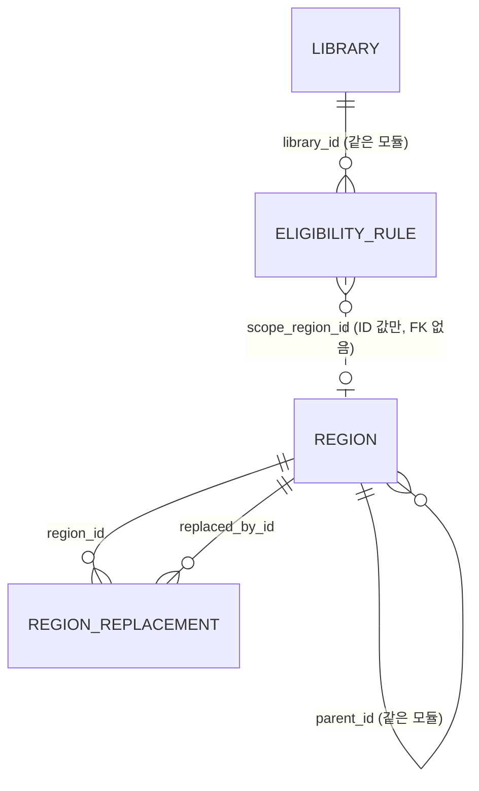

# 설계 변경: 사이클 01 도서 제목 검색 → 전자도서관 대출 가능 여부

- 기준: `docs/current/` (비어 있음. 첫 사이클이라 모든 항목이 신규)
- 근거 문서: `scope.md`, `spec.md`, `flow.md`, `architect-proposal.md`, ADR-0001~0008
- 확인한 dev 규칙: dev `CLAUDE.md`, skill `spring-modulith`, `postgres-patterns`, `jpa-patterns`, `api-design` (응답·오류 형식은 ADR-0008이 skill보다 우선)
- 작성일: 2026-09-27
- 태그: 사용자가 고른 안이나 추천안 채택은 [확정], 사용자가 정하지 않은 세부 값은 [안], 미확인은 [확인 필요]

## 모듈

| 모듈 | 신규/변경 | 책임 | 공개 API | 발행/구독 이벤트 | 소유 테이블 |
|---|---|---|---|---|---|
| `region` | 신규 | 시도·시군구 목록, 법정동 코드 속성, 폐지·대체 연결, 옛 ID 해석 | Java `RegionDirectory`: `expandForMatching(Set<Long> sigunguIds)` → ID마다 {자기, 상위 시도} 집합 (사용 중인 시군구가 아니면 예외), `resolve(Set<Long> ids)` / REST `GET /api/v1/regions`, `GET /api/v1/regions/resolutions` | 없음 | `region.region`, `region.region_replacement` |
| `library` | 신규 | 전자도서관 목록, 플랫폼, 조회 기본 주소, 가입 방법, 자격 문구, 자격 규칙, 사용 여부, 대상 도서관 판정 | Java `LibraryCatalog`: `findTargets(residenceIds, workIds)` → 대상 도서관과 가입 가능 여부, `findEnabledSearchTarget(libraryId)` → (id, platform, baseUrl) | 없음 | `library.library`, `library.eligibility_rule` |
| `availability` | 신규 | 플랫폼 adapter(KYOBO, YES24), 검색 스트림, 더 보기, 캐시, 호출 간격 제어, 정렬용 값 계산 | REST `GET /api/v1/ebook-searches/stream`, `GET /api/v1/availability/libraries/{libraryId}/ebooks`. 다른 모듈에 공개하는 Java API 없음 | 없음 | 없음 (메모리 캐시) |

- 의존 방향: `availability → library → region`. 순환 없음. `ApplicationModules.verify()` 테스트로 확인 [확정] (ADR-0001)
- 공개 API 타입은 각 모듈 루트 패키지에 두고, 구현은 `internal` 패키지에 둡니다 (spring-modulith skill).
- 이벤트는 이번 사이클에 필요 없어서 event publication registry도 도입하지 않습니다.
- 여러 도서관 결과의 **정렬은 프론트**가 spec 5.4 규칙으로 합니다. 백엔드는 정렬에 쓰는 값만 계산합니다 [확정] (ADR-0005).
- base package와 Gradle group ID는 아직 정하지 않았습니다. dev에서 처음 필요할 때 사용자에게 묻습니다 (dev `CLAUDE.md`).

## 데이터

- 스키마: `region`, `library` (모듈별 스키마) [확정] (ADR-0002)
- 모듈 사이에는 FK도 JOIN도 없습니다. `library.eligibility_rule.scope_region_id`는 `region` 모듈의 ID 값만 가집니다.



### `region.region` — 시도·시군구 [확정] (ADR-0003)

| 테이블.컬럼 | 타입 | 제약 | 설명 | 상태 태그 |
|---|---|---|---|---|
| region.id | bigint | PK. 자동 증가 없음 | seed에서 직접 부여. 브라우저에 저장되므로 모든 환경에서 같아야 함 | [확정] |
| region.parent_id | bigint | NULL, FK → region.region(id) | 시군구의 상위 시도 | [확정] |
| region.level | text | NOT NULL, CHECK IN ('SIDO','SIGUNGU') | 일반구는 넣지 않음 | [확정] |
| region.name | text | NOT NULL | 예: "서울특별시", "마포구" | [확정] |
| region.short_name | text | NULL | 시도 표시용 짧은 이름 (예: "서울") | [안] |
| region.legal_dong_code | text | NOT NULL, CHECK (legal_dong_code ~ '^[0-9]{10}$') | 법정동 코드 (속성일 뿐 키가 아님) | [확정] |
| region.status | text | NOT NULL, CHECK IN ('ACTIVE','ABOLISHED') | 폐지된 지역은 지우지 않음 | [확정] |
| region.abolished_on | date | NULL | 폐지일 | [확정] |
| region.created_at / updated_at | timestamptz | NOT NULL DEFAULT now() | | [확정] |

- CHECK `((level = 'SIDO') = (parent_id IS NULL))`
- CHECK `((status = 'ABOLISHED') = (abolished_on IS NOT NULL))`
- UNIQUE INDEX `(legal_dong_code) WHERE status = 'ACTIVE'` (폐지된 코드가 다시 쓰일 수 있어 사용 중인 지역만 유일)
- INDEX `(parent_id) WHERE status = 'ACTIVE'`
- ID 번호 매기는 규칙 (예: 시도 2자리, 시군구 4자리) [안]

### `region.region_replacement` — 폐지·대체 연결 [확정] (ADR-0003)

| 테이블.컬럼 | 타입 | 제약 | 설명 | 상태 태그 |
|---|---|---|---|---|
| region_replacement.region_id | bigint | NOT NULL, FK → region.region(id) | 폐지된 지역 | [확정] |
| region_replacement.replaced_by_id | bigint | NOT NULL, FK → region.region(id) | 대체한 지역 | [확정] |
| region_replacement.effective_on | date | NOT NULL | 변경 시행일 | [확정] |

- PK `(region_id, replaced_by_id)`, CHECK `(region_id <> replaced_by_id)`, INDEX `(replaced_by_id)`
- 대체한 지역이 둘 이상이면 나뉨(SPLIT)입니다.
- 지역 목록을 갱신하는 Liquibase 변경분을 만들 때, 대체 기록이 순환하지 않는지(A→B와 B→A가 함께 있지 않은지) 확인하는 테스트를 함께 둡니다 [안].

### `library.library` — 전자도서관 [확정] (ADR-0004)

| 테이블.컬럼 | 타입 | 제약 | 설명 | 상태 태그 |
|---|---|---|---|---|
| library.id | bigint | PK, GENERATED BY DEFAULT AS IDENTITY | seed는 ID를 직접 넣음 | [확정] |
| library.name | text | NOT NULL, UNIQUE | 예: "서울 강서구 전자도서관" | [확정] |
| library.platform | text | NOT NULL, CHECK IN ('KYOBO','YES24') | adapter 선택 | [확정] |
| library.base_url | text | NOT NULL | origin만. 경로와 파라미터는 adapter가 붙임 | [확정] |
| library.eligibility_summary | text | NULL | 자격 필요 도서관의 표시 문구 (예: "서울 거주·재직·재학") | [확정] |
| library.join_method | text | NOT NULL | 가입 방법 한 줄 | [확정] |
| library.enabled | boolean | NOT NULL DEFAULT true | 사용 여부. 요청마다 읽음. 운영자가 SQL로 변경 | [확정] |
| library.created_at / updated_at | timestamptz | NOT NULL DEFAULT now() | | [확정] |

- 자격 문구는 규칙에서 자동으로 만들지 않고 텍스트로 저장합니다. 규칙과 문구는 같은 Liquibase changeset에서 함께 고칩니다 [확정] (architect 추천안 채택, 이유 미확인).

### `library.eligibility_rule` — 자격 규칙 [확정] (ADR-0004)

| 테이블.컬럼 | 타입 | 제약 | 설명 | 상태 태그 |
|---|---|---|---|---|
| eligibility_rule.id | bigint | PK, GENERATED BY DEFAULT AS IDENTITY | | [확정] |
| eligibility_rule.library_id | bigint | NOT NULL, FK → library.library(id) ON DELETE CASCADE | | [확정] |
| eligibility_rule.basis | text | NOT NULL, CHECK IN ('RESIDENCE','WORK','SCHOOL','AFFILIATION') | 근거 | [확정] |
| eligibility_rule.scope_type | text | NOT NULL, CHECK IN ('REGION','INSTITUTION') | 범위 종류 | [확정] |
| eligibility_rule.scope_region_id | bigint | NULL | `region` 모듈 ID (FK 없음) | [확정] |
| eligibility_rule.scope_institution_id | bigint | NULL | 다음 사이클용 기관 ID (FK 없음, 이번에는 행 없음) | [확정] |
| eligibility_rule.created_at | timestamptz | NOT NULL DEFAULT now() | | [확정] |

- CHECK `((scope_type = 'REGION' AND scope_region_id IS NOT NULL AND scope_institution_id IS NULL) OR (scope_type = 'INSTITUTION' AND scope_institution_id IS NOT NULL AND scope_region_id IS NULL))`
- UNIQUE NULLS NOT DISTINCT `(library_id, basis, scope_type, scope_region_id, scope_institution_id)` (PostgreSQL 15 이상 문법, PG 18 사용)
- INDEX `(library_id)`
- 규칙이 없는 도서관 = 누구나 가입. 가입 조건 종류는 저장하지 않고 계산합니다.

**대상 도서관 판정** (`library.findTargets`) [확정]

| 조건 | 결과 |
|---|---|
| `enabled = false` | 제외 |
| 규칙 없음 | `OPEN` |
| 지역을 하나도 보내지 않음 + 규칙 있음 | `UNKNOWN` |
| 지역을 보냄 + RESIDENCE 규칙 범위가 거주 지역을 펼친 집합에 있음, 또는 WORK 규칙 범위가 직장 지역을 펼친 집합에 있음 | `ELIGIBLE` |
| 지역을 보냄 + 맞는 규칙 없음 | 제외 |

- 펼친 집합 = 사용자가 고른 시군구 ID와 그 상위 시도 ID (`RegionDirectory.expandForMatching`)
- SCHOOL, AFFILIATION 규칙은 이번 사이클에 비교하지 않습니다.

### seed 데이터 [확정] (spec 3장)

| 도서관 | platform | base_url | 규칙 |
|---|---|---|---|
| 서울 강서구 전자도서관 | YES24 | `https://ebook.gangseo.seoul.kr` | RESIDENCE / WORK / SCHOOL × REGION(서울특별시) 3행 |
| 고흥군립도서관 전자도서관 | KYOBO | `https://www.ghlib.go.kr:446` | 없음 |

- 지역 seed: 전국 시도·시군구 (일반구 제외). 2026-07-01 이후 법정동 코드 파일 기준 [확인 필요]

### Liquibase

- 새 changelog 파일로 추가합니다. 기존 changeset 수정은 없습니다 (첫 사이클).
- 파일 나누기 [안]: `region` 스키마·테이블 → `region` seed → `library` 스키마·테이블 → `library` seed. 모듈별로 파일을 나눕니다.
- 스키마 생성(`CREATE SCHEMA`)도 changeset으로 둡니다.
- Hibernate가 스키마를 만들거나 바꾸지 않습니다 (dev 규칙).

## API

공통 규칙 [확정] (ADR-0008)
- 성공 응답은 감싸지 않습니다. 필드 이름은 camelCase입니다.
- 오류는 RFC 9457 Problem Details (`application/problem+json`)이고, 확장 멤버 `code`(snake_case)와 필요하면 `errors`를 둡니다.
- 모두 인증 없는 GET입니다.

| 메서드 | 경로 | 설명 | 요청 | 응답 | 에러 |
|---|---|---|---|---|---|
| GET | `/api/v1/regions` | 사용 중인 지역 트리 (S2 모달) | 없음 | 시도 배열, 시도마다 시군구 배열 | 없음 |
| GET | `/api/v1/regions/resolutions` | 브라우저에 저장된 지역 ID 해석 | `ids` (쉼표 구분, 최대 20개 [확정], 사용자 확인 2026-09-27) | ID마다 `ACTIVE / REPLACED / SPLIT / UNKNOWN` | 400 `validation_error` |
| GET | `/api/v1/ebook-searches/stream` | 검색 스트림 (SSE) | `q`, `residenceRegionIds`, `workRegionIds` | `text/event-stream`: `targets` → `library-result` / `library-failed` → `done` | 스트림 시작 전: 400 `invalid_query`, 422 `invalid_region` |
| GET | `/api/v1/availability/libraries/{libraryId}/ebooks` | 도서관 하나의 한 페이지 (더 보기) | `q`, `page` (2 이상을 주로 사용) | 페이지 객체 | 400 `invalid_query` / `invalid_page`, 404 `library_not_found`, 502 `upstream_error`, 504 `upstream_timeout` |

- 경로 이름은 architect 추천안을 채택했습니다 [확정]. 스트림 경로 `/api/v1/ebook-searches/stream`은 SSE 선택에 따라 추가했습니다 [확정].

### 1) `GET /api/v1/regions`

```json
[
  { "id": 11, "name": "서울특별시", "shortName": "서울",
    "children": [ { "id": 1101, "name": "강서구" }, { "id": 1102, "name": "마포구" } ] }
]
```
- ID 값은 예시입니다. 법정동 코드는 응답에 넣지 않습니다.

### 2) `GET /api/v1/regions/resolutions?ids=1101,9001,9002,12345`

```json
[
  { "id": 1101, "status": "ACTIVE", "label": "서울 강서구", "replacements": [] },
  { "id": 9001, "status": "REPLACED", "label": "OO시 △△구",
    "replacements": [ { "id": 9101, "label": "OO특별시 △△구" } ] },
  { "id": 9002, "status": "SPLIT", "label": "OO군",
    "replacements": [ { "id": 9201, "label": "..." }, { "id": 9202, "label": "..." } ] },
  { "id": 12345, "status": "UNKNOWN", "label": null, "replacements": [] }
]
```
- 대체 연결을 끝까지 따라갑니다 (A → B → C). 순환은 막습니다.
- 프론트는 앱을 열 때 저장된 지역이 있으면 먼저 부릅니다. REPLACED면 저장값을 바꾸고 안내하고, SPLIT이면 다시 고르라고 안내합니다 (spec 5.8).

### 3) `GET /api/v1/ebook-searches/stream?q=사랑&residenceRegionIds=1102&workRegionIds=` [확정] (ADR-0005)

요청 검증에 실패하면 스트림을 열지 않고 일반 오류로 응답합니다.
```json
{ "type": "about:blank", "title": "Unprocessable Entity", "status": 422,
  "detail": "Region 9001 is abolished", "code": "invalid_region",
  "errors": [ { "field": "residenceRegionIds", "message": "abolished", "code": "abolished", "value": 9001 } ] }
```
- `invalid_region`을 받으면 프론트는 해석 API를 다시 부릅니다 (지역 데이터가 배포된 직후 대비).

검증을 통과하면 `text/event-stream`으로 아래 이벤트를 보냅니다.

```
event: targets
data: {"query":"사랑","regionFilterApplied":true,"libraries":[
  {"id":1,"name":"서울 강서구 전자도서관","joinPolicy":"QUALIFIED","eligibility":"ELIGIBLE",
   "eligibilitySummary":"서울 거주·재직·재학","joinMethod":"도서관 방문 회원증 발급 또는 서울시민카드 간편가입"},
  {"id":2,"name":"고흥군립도서관 전자도서관","joinPolicy":"OPEN","eligibility":"OPEN",
   "eligibilitySummary":null,"joinMethod":"도서관 홈페이지 가입 후 로그인"}]}

event: library-result
data: { ...4) 더 보기 API의 페이지 객체와 같은 모양 (page = 1)... }

event: library-failed
data: {"libraryId":1,"problem":{"type":"about:blank","title":"Gateway Timeout","status":504,
  "detail":"No response within 8 seconds","code":"upstream_timeout"}}

event: done
data: {"succeeded":1,"failed":1}
```

- `targets`는 항상 첫 이벤트입니다. 꺼진 도서관은 넣지 않습니다 (AC-19). `eligibility`는 `OPEN | ELIGIBLE | UNKNOWN`입니다.
- AC-4 안내는 프론트가 판단합니다: `regionFilterApplied = true`이고 `joinPolicy = QUALIFIED`인 도서관이 하나도 없을 때.
- 도서관마다 `library-result` 또는 `library-failed`가 정확히 한 번 옵니다. 응답이 온 순서대로 보냅니다 (AC-13).
- 실패 이벤트의 `problem`은 ProblemDetail과 같은 모양입니다 (ADR-0008). 프론트는 모두 "조회 실패"로 표시합니다.
- 서버는 스트림을 연 시각부터 8초가 지나면, 아직 응답이 없는 도서관마다 `upstream_timeout` 실패를 보내고 `done`을 보냅니다 (AC-14).
- `done`을 보낸 뒤 서버는 스트림을 닫습니다.
- **브라우저는 `EventSource`가 아니라 `fetch`로 스트림을 받습니다** [확정] (사용자 선택, 2026-09-27, 이유 미확인).
  - 이유가 된 문제: 브라우저 기본 `EventSource`는 스트림을 열 때 온 400/422 응답의 본문을 읽지 못하고, 연결이 끊기면 스스로 다시 연결합니다.
  - 요청 헤더 `Accept: text/event-stream, application/problem+json`. 응답 상태가 200이 아니면 본문을 ProblemDetail로 읽어 `code`로 처리합니다 (`invalid_region`이면 해석 API를 다시 부름).
  - 200이면 본문을 읽으며 `event:` / `data:` 줄을 직접 나눠 이벤트로 처리합니다.
  - 자동 재연결이 없으므로 도서관 요청이 반복되지 않습니다. `done`을 받았을 때, 새 검색을 시작할 때, 화면을 떠날 때 `AbortController`로 요청을 끊습니다.
  - 검토했지만 고르지 않은 안: `EventSource` + 우회(오류 종류를 알 수 없음), 검증 오류도 200 스트림의 이벤트로 보내기(HTTP 상태가 오류를 나타내지 않음).
- 이벤트 `id`와 재연결 이어받기(`Last-Event-ID`)는 쓰지 않습니다 [안].
- 프록시 버퍼링 방지 헤더와 Spring MVC에서 SSE를 보내는 방식(예: `SseEmitter`)은 dev에서 공식 문서로 확인합니다 [확인 필요].

### 4) `GET /api/v1/availability/libraries/{libraryId}/ebooks?q=사랑&page=2`

```json
{
  "libraryId": 2, "query": "사랑", "page": 2, "pageSize": 50,
  "totalCount": 103, "hasMore": true,
  "fetchedAt": "2026-09-27T05:12:00Z", "cached": true, "cacheAgeSeconds": 140,
  "loanRate": 0.41,
  "librarySearchUrl": "https://www.ghlib.go.kr:446/elibrary-front/search/searchList.ink?schClst=all&schDvsn=000&schTxt=...",
  "items": [
    { "rank": 51, "title": "...", "author": "...", "publisher": "...", "supplier": "교보문고",
      "holdings": 10, "loaned": 0, "reservations": 0, "available": 10 }
  ]
}
```

| 필드 | 뜻 | 상태 태그 |
|---|---|---|
| pageSize | 교보 50, YES24 10 (사이트 고정) | [확정] |
| totalCount, hasMore | 도서관 전체 건수, 다음 페이지가 있는지 (AC-15) | [확정] |
| fetchedAt, cached, cacheAgeSeconds | 원본 조회 시각, 캐시에서 줬는지, 서버가 계산한 나이 (브라우저 시계와 무관). 1분 미만이면 프론트가 "방금 조회" | [확정] |
| loanRate | 이 페이지 결과의 (대출 중 합계 ÷ 보유 합계). 보유 합계가 0이면 null. 프론트는 page 1 값만 도서관 대출률로 고정해서 씀 | [확정] |
| rank | 도서관 검색 결과의 원래 순서 = (page − 1) × pageSize + 순번 | [확정] |
| available | 재고 = holdings − loaned | [확정] |
| librarySearchUrl | "도서관에서 보기" 링크 | [확정] |

- 설명문과 표지 필드는 없습니다 (AC-11).
- `q`는 앞뒤 공백 제거 + 연속 공백 하나로 정규화한 뒤 2글자 이상, 50자 이하 [확정] (2글자: spec 4장, 50자: 사용자 확인 2026-09-27)
- 프론트가 요청을 끊어도 백엔드는 조회를 끝까지 하고 결과를 캐시에 넣습니다 [확정].

## 외부 연동

| 대상 | 방식 | 제한·키 관리 | 실패 시 동작 | 상태 태그 |
|---|---|---|---|---|
| 강서구 전자도서관 (YES24 플랫폼) | HTTPS GET `/search/?src_key=<q>&page_num=<N>&sort=now`, 서버 HTML 파싱 (`div.stat`의 보유·대출·예약) | 키 없음. 호스트별 동시 1건, 이전 종료 → 다음 시작 1초 (ADR-0007). 인증서 루트 Sectigo R46은 JDK 25에 포함 | 연결 3초 / 응답 5초 / 요청당 8초(대기 포함) 초과 → 504 `upstream_timeout`. 오류 응답·파싱 실패 → 502 `upstream_error`. 실패는 캐시하지 않음 | [확정] |
| 고흥군립도서관 전자도서관 (교보 플랫폼) | HTTPS GET `/elibrary-front/search/searchList.ink?schClst=all&schDvsn=000&schTxt=<q>&recordCount=50&pageIndex=<N>`, 서버 HTML 파싱 (`p.use`의 `대출 : X/Y  예약 : Z`) | 위와 같음 | 위와 같음 | [확정] |

- 캐시: Caffeine, 도서관 + 정규화한 검색어 + 페이지 키, 쓰기 후 3분 만료, 최대 1,000건, 같은 키 동시 요청은 한 번만 조회 [확정] (ADR-0006). 서버가 여러 대가 되면 Redis로 옮깁니다.
- 설정 키 (값은 [확정], 접두어는 [안] `<app-prefix>.availability.*`): `cache-ttl=3m`, `cache-max-size=1000`, `host-max-concurrency=1`, `host-min-interval=1s`, `connect-timeout=3s`, `read-timeout=5s`, `request-deadline=8s`, `search-deadline=8s`, `kyobo.record-count=50`, `user-agent=<TODO>`
- User-Agent 형식: `chaekcheck/<버전> (+<서비스 URL>; <연락처>)` [안]. 서비스 URL과 연락처는 나중에 정하고 공개 전까지 채웁니다 [확정] (자리만 둠).
- HTML 파서(예: jsoup)와 HTTP 클라이언트 선택, "연결 3초 / 읽기 5초"를 정확히 거는 방법은 dev에서 공식 문서로 확인합니다 [확인 필요].

## 프론트 흐름 요약

1. 앱을 열 때 저장된 지역이 있으면 2)를 호출해서 폐지 지역을 처리합니다.
2. 검색하면 3) 스트림을 `fetch`로 엽니다 (200이 아니면 ProblemDetail 처리). `targets`로 도서관 요약 줄을 그리고, `library-result` / `library-failed`가 올 때마다 요약 줄과 결과 목록을 갱신하고 spec 5.4 규칙으로 다시 정렬합니다. `done`에서 요청을 끊습니다.
   - 결과 줄에는 가입 가능 여부가 없습니다. 결과 줄의 `libraryId`로 `targets`의 `eligibility`를 찾아, `UNKNOWN`이면 "가입 자격 확인 필요" 배지를 붙이고 그룹 안에서 뒤로 보냅니다 (spec 5.4 2단계).
3. "더 보기"는 4)를 `page + 1`로 호출하고, 받은 줄을 정렬 규칙에 맞춰 합칩니다.
4. S2 모달은 1)로 목록을 받습니다.

## 결정 기록

- [ADR-0001 모듈 경계: region, library, availability](../../adr/0001-module-boundaries.md)
- [ADR-0002 모듈별 PostgreSQL 스키마](../../adr/0002-schema-per-module.md)
- [ADR-0003 지역 식별과 행정구역 변경 처리](../../adr/0003-region-identity-and-changes.md)
- [ADR-0004 자격 규칙 모델과 도서관 사용 여부](../../adr/0004-eligibility-rule-model.md)
- [ADR-0005 검색 조회 API: SSE 스트림 + 더 보기 API](../../adr/0005-search-streaming-api.md)
- [ADR-0006 검색 캐시: Caffeine 메모리 캐시, 나중에 Redis](../../adr/0006-search-cache.md)
- [ADR-0007 도서관 호출 간격 제어: 직접 구현](../../adr/0007-host-throttle.md)
- [ADR-0008 API 응답·오류 형식](../../adr/0008-response-and-error-format.md)
- [ADR-0009 검색 필드와 캐시 키](../../adr/0009-search-field.md) — 개발 중 결정, 사이클 02 시작 때 기록 (retro.md 참고)

## dev에 전달할 부수 작업

- dev `api-design` skill을 ProblemDetail 형식에 맞게 고침 (변경안: `skill-change-api-design.md`). 고치기 전까지 ADR-0008이 skill보다 우선합니다.

## 확인 필요

| 항목 | 왜 필요한가 | 확인 방법 | 막는 단계 |
|---|---|---|---|
| 전국 시도·시군구와 고흥군의 2026-07-01 이후 법정동 코드 | 지역 seed | 행정안전부 2026.7.1. 변경내역 첨부 파일(jscode20260701) | 개발 (seed) |
| 교보 `recordCount=50` + `pageIndex=2`가 51~100번째를 빠짐없이 주는지, YES24 `page_num` + `sort=now`에서 페이지가 겹치지 않는지 | 더 보기 (AC-15) | API 호출 시험 | 개발 |
| Spring Boot 4.1에서 ProblemDetail을 켜는 설정 이름과 기본값 | ADR-0008 | dev에서 Context7로 공식 문서 확인 | 개발 |
| Spring MVC SSE 구현 방식, `Accept: text/event-stream, application/problem+json` 요청에 검증 실패 시 ProblemDetail을 돌려줄 수 있는지 | ADR-0005 | dev에서 공식 문서 확인 + 프로토타입 | 개발 |
| 배포 구조(웹과 API를 같은 주소로 둘지), CORS 허용 설정, SSE 프록시 버퍼링 방지 | ADR-0005, dev `docs/frontend-minimum.md` (주소가 다르면 CORS 필요) | 배포 방식을 정할 때 사용자에게 질문 + 공식 문서 확인 | 배포 전 |
| HTTP 클라이언트와 타임아웃 설정 방식, HTML 파서와 버전 | 외부 연동 | dev에서 공식 문서 확인 | 개발 |
| Caffeine 버전 (최신 3.3.0, 릴리스 연도 미표시)과 Spring Boot 4.1 연동 | ADR-0006 | https://github.com/ben-manes/caffeine/releases + dev에서 Context7 | 개발 |
| Spring Boot 4.1에 맞는 Spring Modulith 버전 | 모듈 검증 | https://docs.spring.io/spring-modulith/reference/appendix.html (2026-09-27에 4.1 행 미확인) | 개발 |
| User-Agent의 서비스 URL과 연락처, 페이지 바닥 연락처 | spec 5.6, 10장 | 사용자에게 질문 | 공개 전 |
| base package, Gradle group ID | 프로젝트 생성 | dev에서 사용자에게 질문 | 개발 |
