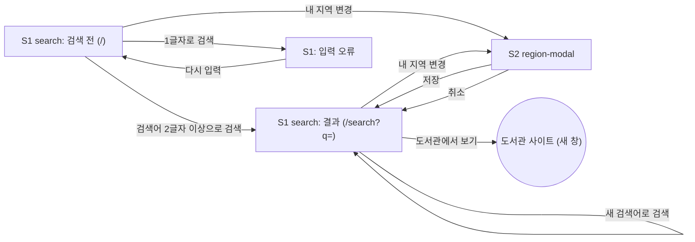

# 화면 흐름: 도서 제목 검색 → 전자도서관 대출 가능 여부

- 사이클: 01 (`scope.md`, `spec.md`)
- 이 문서는 화면 구조와 상태만 다룹니다. 시각 디자인은 다루지 않습니다.
- 작성일: 2026-09-27



- 검색과 결과는 한 화면입니다. 검색하면 주소가 `/search?q=<검색어>`로 바뀌어서 새로고침, 뒤로가기, 링크 공유가 됩니다. [확정]
- S2에서 저장하면, 검색 전 상태에서 열었으면 S1a로, 결과 상태에서 열었으면 같은 검색어로 다시 검색한 S1b로 돌아갑니다. 위 그림은 결과 상태 기준입니다. [확정]

## 화면별 내용

### S1 search

**목적**: 제목을 검색하고, 도서관별 보유·대출·예약 현황을 본다.

**보이는 요소** [확정]

| 영역 | 내용 |
|---|---|
| 검색창 | 제목 입력 + 검색 버튼. 주소에 `q`가 있으면 그 값으로 채움 |
| 내 지역 요약 | 지역이 있으면 "내 지역: 거주 서울 마포구 · 직장 서울 중구 · 변경". 없으면 "내 지역을 고르면 빌릴 수 있는 도서관만 보여 드려요 · 설정" |
| 알림 줄 | 행정구역 변경 안내, 자격 필요 도서관 없음 안내 (필요할 때만) |
| 도서관 요약 줄 | 조회한 도서관마다 한 칸: 도서관명 + 상태 (조회 중 / 가져온 건수/전체 건수 / 결과 없음 / 조회 실패) + "N분 전 조회"(캐시일 때) + "더 보기"(더 있을 때) |
| 결과 목록 | 그룹 제목 두 개: **지금 빌릴 수 있어요 (N)**, **예약하고 기다려요 (N)**. 각 그룹 안에서는 가입할 수 있는 도서관의 줄이 먼저 오고, "가입 자격 확인 필요" 배지가 붙은 줄이 뒤에 옴 (순서는 spec 5.4) |
| 결과 한 줄 | 제목 / 저자·출판사 / 공급 업체 / 도서관명 + 가입 조건 ("누구나 가입" 또는 "서울 거주·재직·재학") / 보유·대출 중·예약 / 가입 방법 한 줄 / "도서관에서 보기" 링크 (새 창) |
| 페이지 바닥 | 데이터 출처("각 도서관의 공개 검색 결과 기준")와 연락처 |

- 검색 전 첫 화면에는 검색창과 내 지역 요약만 보여 줍니다. [확정]

**결과 목록 예시** (같은 책을 묶지 않음. 지역을 고르지 않고 `작별하지 않는다`를 검색한 경우. 고흥 수량은 2026-09-27 실제 조회값이고, 강서구 수량은 설명을 위한 가정)

```
[ 작별하지 않는다                     ] [검색]
내 지역을 고르면 빌릴 수 있는 도서관만 보여 드려요 · 설정

도서관:  고흥군 · 1/1건  |  강서구 · 2/2건 · 3분 전 조회

■ 지금 빌릴 수 있어요 (2)
 ┌ 작별하지 않는다 — 한강 · 문학동네 · 교보문고
 │ 고흥군립도서관 · 누구나 가입
 │ 보유 10 · 대출 중 0 · 예약 0         가입: 홈페이지 가입 후 로그인  [도서관에서 보기]
 ├ 작별하지 않는다 — 한강 · 문학동네 · 교보문고          [가입 자격 확인 필요]
 │ 강서구 전자도서관 · 서울 거주·재직·재학
 │ 보유 3 · 대출 중 2 · 예약 0          가입: 방문 또는 서울시민카드  [도서관에서 보기]

■ 예약하고 기다려요 (1)
 └ 작별하지 않는다 — 한강 · 문학동네 · YES24             [가입 자격 확인 필요]
   강서구 전자도서관 · 서울 거주·재직·재학
   보유 5 · 대출 중 5 · 예약 1          가입: 방문 또는 서울시민카드  [도서관에서 보기]
```

- 같은 책이 다른 도서관에 있거나, 같은 도서관 안에서 공급 업체가 다르면 줄이 따로 생깁니다 (성남시에서 교보본·YES24본이 따로 나오는 것을 확인함).
- 같은 책의 줄이 재고 여부에 따라 다른 그룹으로 흩어질 수 있습니다.
- 사용자가 이 모습을 보고 묶지 않는 방식을 유지하기로 했습니다. [확정] (사용자, 2026-09-27)

**사용자 동작**
- 검색어를 입력하고 검색한다.
- "변경"이나 "설정"을 눌러 S2를 연다.
- 도서관 요약 줄의 "더 보기"를 눌러 그 도서관의 다음 페이지를 받는다. 받은 줄은 순서 규칙에 맞춰 목록에 섞인다.
- "도서관에서 보기"를 눌러 도서관 사이트를 새 창으로 연다.

**호출하는 API** (이름만. 상세는 `design-delta.md`)
- 대상 도서관 조회: 내 지역을 보내면 조회할 도서관과 도서관별 가입 가능 여부를 받음
- 도서관별 검색: 도서관 하나, 검색어, 페이지를 보내면 결과 줄, 전체 건수, 조회 시각을 받음. 첫 검색과 "더 보기"에 같이 씀
- 먼저 응답한 도서관부터 보여 주는 방식(도서관별 호출 또는 스트리밍)은 설계에서 정함

**상태**

| 상태 | 화면 | 상태 태그 |
|---|---|---|
| 검색 전 | 검색창 + 내 지역 요약만 | [확정] |
| 입력 오류 | 검색창 아래 "2글자 이상 입력하세요". 요청하지 않음 | [확정] |
| 로딩 | 도서관 요약 줄에서 응답 전인 도서관은 "조회 중". 응답한 도서관의 결과부터 목록에 나오고, 새 결과가 오면 다시 정렬 | [확정] |
| 결과 있음 | 그룹 제목과 결과 줄 | [확정] |
| 도서관 하나 결과 없음 | 그 도서관 요약 칸에 "결과 없음" | [확정] |
| 전체 결과 없음 | 목록 자리에 "조회한 도서관 N곳에 이 제목의 전자책이 없습니다" + 조회한 도서관 이름 | [확정] |
| 도서관 오류·지연 | 그 도서관 요약 칸에 "조회 실패". 나머지는 정상 | [확정] |
| 자격 필요 도서관 없음 | 알림 줄에 "선택한 지역에서 자격이 되는 시범 도서관이 없습니다". 누구나 가입 도서관 결과만 표시 | [확정] |
| 캐시된 결과 | 그 도서관 요약 칸에 "N분 전 조회" | [확정] |
| 저장된 지역이 폐지됨 | 알림 줄에 "행정구역 변경으로 OO이 △△로 바뀌었습니다" (자동 변경), 또는 "OO이 여러 지역으로 나뉘었습니다. 내 지역을 다시 골라 주세요 · 설정" | [확정] |

- 세 가지 문구(결과 없음, 전체 결과 없음, 자격 필요 도서관 없음)는 일단 이대로 쓰고, 이상하면 나중에 고칩니다. (사용자, 2026-09-27)

**배치 메모**
- 데스크톱: 위에서 아래로 검색창 → 내 지역 요약 → 알림 줄 → 도서관 요약 줄 → 결과 목록 → 페이지 바닥 [안]
- 태블릿·모바일: 도서관 요약 줄은 가로로 스크롤되는 칩으로, 결과 한 줄은 세로로 쌓음 [안]

### S2 region-modal

**목적**: 거주 지역과 직장 지역을 고른다.

**보이는 요소** [확정]
- 탭 두 개: 거주 / 직장
- 시도 목록 → 시도를 고르면 그 시도의 시군구 목록 (여러 개 체크 가능)
- 고른 지역을 칩으로 표시하고, 칩마다 개별 삭제
- 버튼: 저장 / 취소 / 모두 지우기

**사용자 동작**
- 탭을 바꿔 가며 거주·직장 지역을 고른다.
- 저장하면 브라우저에 저장하고 모달을 닫는다. 검색어가 있으면 같은 검색어로 다시 검색한다.
- 취소하면 바꾼 내용을 버리고 닫는다.
- 모두 지우기 후 저장하면 "지역 없음" 상태가 된다.

**호출하는 API**: 지역 목록 조회 (사용 중인 시도·시군구. 폐지된 지역은 목록에 나오지 않음)

**상태**

| 상태 | 화면 | 상태 태그 |
|---|---|---|
| 기본 | 저장된 지역이 칩으로 채워진 채 열림 | [확정] |
| 목록 로딩 | 시도·시군구 목록 자리에 로딩 | [안] |
| 목록 오류 | "지역 목록을 불러오지 못했습니다 · 다시 시도" | [안] |

**배치 메모**
- 데스크톱: 화면 가운데 모달 [안]
- 모바일: 전체 화면 [안]

## 수용 기준 대응

| AC | 화면 |
|---|---|
| AC-1 입력 오류 | S1 입력 오류 |
| AC-2 지역 없이 검색, 가입 조건 종류 표시 | S1 결과 있음 (결과 한 줄의 가입 조건) |
| AC-3 서울 마포구 거주 → 강서구 + 고흥군 | S2 저장 → S1 결과 있음 |
| AC-4 부산 해운대구 거주 → 고흥군만 + 안내 | S1 자격 필요 도서관 없음 |
| AC-5 고양시 거주 + 서울 중구 직장 | S2 (거주·직장 탭) → S1 결과 있음 |
| AC-6 새로고침 후 지역 유지 | S1 내 지역 요약 |
| AC-7 결과 줄 항목 | S1 결과 한 줄 |
| AC-8 같은 책 두 줄 | S1 결과 목록 |
| AC-9 그룹 순서 | S1 결과 목록의 그룹 제목 |
| AC-10 그룹 안 순서 | S1 결과 목록 |
| AC-11 설명문·표지 없음 | S1 결과 한 줄 |
| AC-12 출처·연락처 | S1 페이지 바닥 |
| AC-13 먼저 응답한 도서관부터 | S1 로딩 |
| AC-14 조회 실패 | S1 도서관 오류·지연 |
| AC-15 전체 건수, 더 보기 | S1 도서관 요약 줄 |
| AC-16 캐시, N분 전 조회 | S1 캐시된 결과 (+ 서버 로그) |
| AC-17 요청 간격 | 서버 로그 (화면 없음) |
| AC-18 User-Agent | 서버 로그 (화면 없음) |
| AC-19 도서관 사용 여부 | S1 도서관 요약 줄과 결과 목록에서 빠짐 |
| AC-20 폐지 지역 자동 변경 | S1 저장된 지역이 폐지됨 |

**spec 6장 상태별 동작 대응**: 입력 오류, 로딩, 도서관 하나 결과 없음, 전체 결과 없음, 도서관 오류·지연, 자격 필요 도서관 없음, 저장된 지역이 폐지됨 → 모두 S1 상태 표에 있음.
