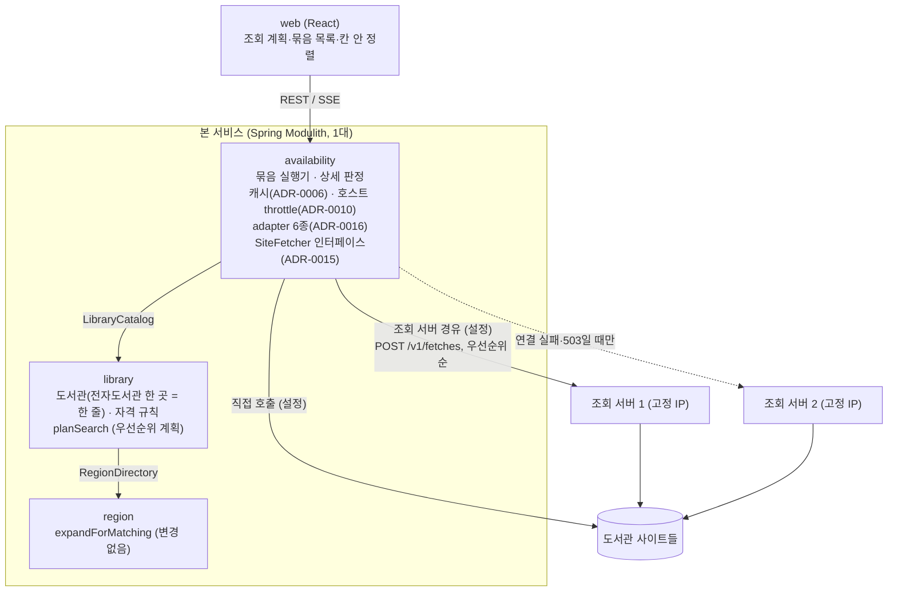
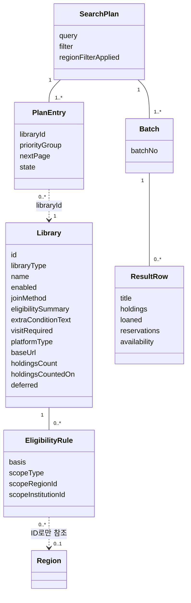
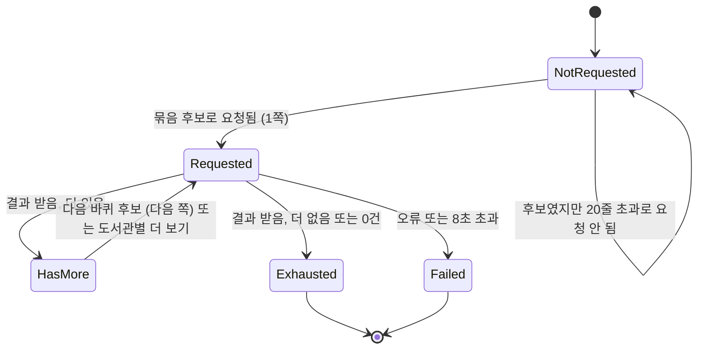
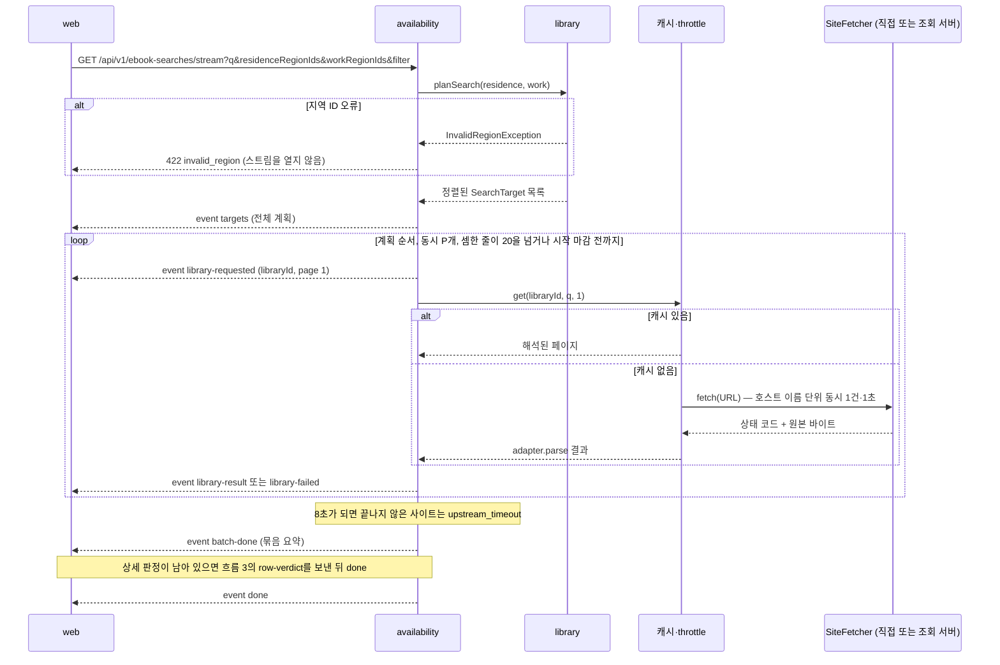
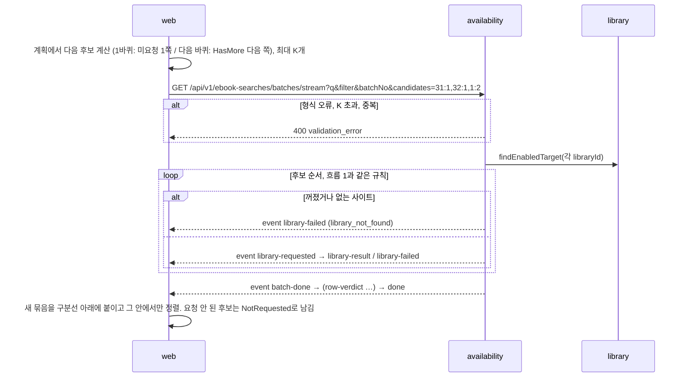
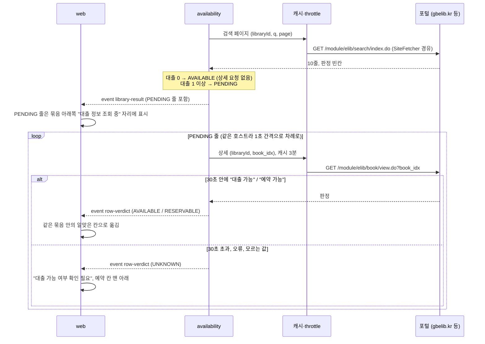
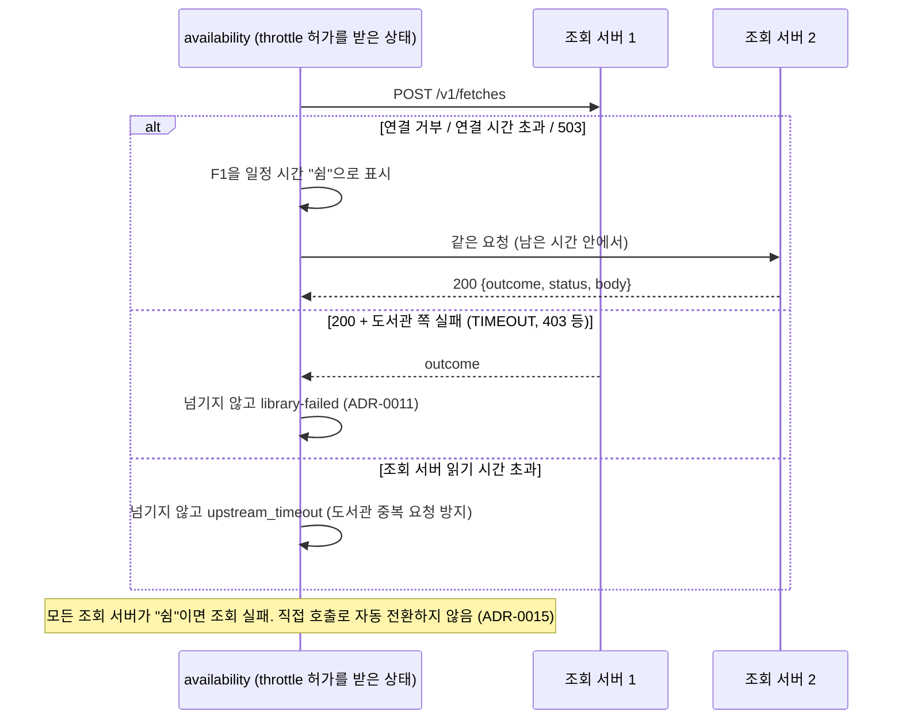
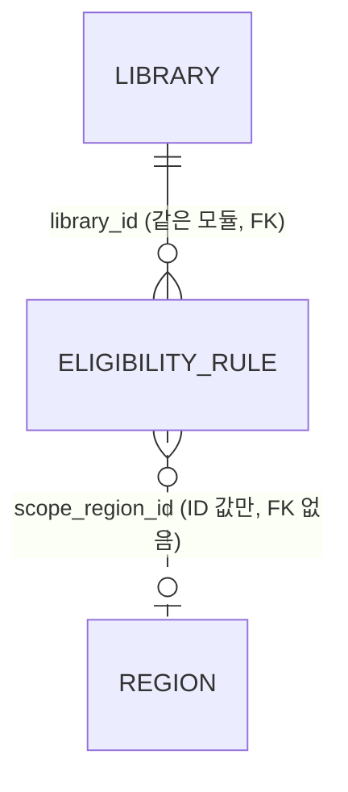

# 설계 변경: 사이클 02 도서관 확장

- 기준: `docs/current/`(사이클 01 구현 상태)에서 이번 슬라이스에 필요한 변경만 적습니다.
- 근거: `scope.md`, `spec.md`, `flow.md`, architect 제안(2026-09-28), 사용자 선택(2026-09-28), ADR-0010, 0011, 0013~0017 (ADR-0012는 0017로 대체됨).
- 태그: 사용자가 고른 결정은 [확정], 이름·세부 값처럼 사용자가 정하지 않은 것은 [안], 미확인은 [확인 필요].
- 새 이름(테이블, 컬럼, enum 값, 경로, 이벤트 이름)은 모두 [안]입니다. 바꾸고 싶으면 `/cycle-close` 전에 알려 주시면 됩니다.

---

## 구조 그림

### 모듈 구성도



- 이벤트는 쓰지 않습니다 (사이클 01과 같음).
- 조회 서버는 Modulith 모듈이 아니라 별도 배포 단위입니다. dev 저장소 안의 새 폴더에 둡니다 [확정] (ADR-0015). 폴더 이름은 [안] `fetch-service/`.

### 도메인 모델



- `Library`, `EligibilityRule`은 `library` 모듈이 DB에 저장합니다. 전자도서관 사이트 하나가 `Library` 하나이고(ADR-0017), `libraryType`이 `EBOOK`이면 `platformType`·`baseUrl`이 필수입니다. 실물 도서관은 나중에 `PHYSICAL`로 같은 곳에 들어갑니다.
- `SearchPlan`, `PlanEntry`, `Batch`, `ResultRow`는 **브라우저 상태**입니다. 서버는 저장하지 않습니다 (ADR-0014).

### 도서관 하나의 조회 상태 (브라우저)



- 1바퀴: `NotRequested`가 남아 있으면 계획 순서대로 후보로 보냅니다.
- 다음 바퀴: `HasMore`인 사이트를 계획 순서대로 다음 쪽으로 보냅니다.
- 모두 `Exhausted`나 `Failed`이면 목록 맨 아래 "더 보기"를 없앱니다.
- `Failed`는 같은 검색에서 다시 조회하지 않습니다 [확정] (ADR-0014).
- 필터나 지역이 바뀌면 상태를 버리고 첫 묶음부터 다시 검색합니다 [확정].

### 흐름 1: 첫 묶음 검색



### 흐름 2: 목록 맨 아래 "더 보기"



- 도서관별 "더 보기"는 `GET /api/v1/availability/libraries/{libraryId}/ebooks?q&page`(사이클 01 경로 그대로)를 부르고, 결과를 목록 맨 아래 새 묶음으로 붙입니다. 이 API는 JSON 한 번에 응답하므로, 상세 판정이 필요한 줄은 판정을 읽은 뒤(최대 30초) 함께 돌려줍니다 [안].

### 흐름 3: 경북·전북 포털 상세 판정



- 30초는 **묶음을 시작한 시각부터**입니다 [안]. 묶음의 8초 마감은 검색 페이지 요청에만 적용합니다.
- 30초 동안 한 호스트에서 읽을 수 있는 상세는 대략 25건입니다 (1초 간격). 첫 요청이 10줄이라 대부분 끝날 것으로 봅니다 [확인 필요: 프로토타입].

### 흐름 4: 조회 서버 경유 모드에서 서버 넘기기



---

## 모듈

| 모듈 | 신규/변경 | 책임 | 공개 API [안] | 발행/구독 이벤트 | 소유 테이블 |
|---|---|---|---|---|---|
| `region` | 변경 없음 | — | `RegionDirectory` 그대로 | 없음 | 그대로 |
| `library` | 변경 | 도서관(전자도서관 한 곳 = 한 줄, ADR-0017)·자격 규칙, **우선순위 계획 계산** | `LibraryCatalog.planSearch(residenceIds, workIds) → List<SearchTarget>`(정렬됨), `findEnabledTarget(libraryId) → Optional<SearchTarget>`. 공개 타입 `SearchTarget`(바꿈), `PriorityGroup`, `LibraryType`, `PlatformType`(6개), `Eligibility`에 `UNVERIFIED` 추가. `findTargets`, `findEnabledSearchTarget`, `Platform`은 이것으로 바꿈 | 없음 | `library.library`(변경), `library.eligibility_rule`(변경) |
| `availability` | 변경 | 묶음 실행기, 포털 상세 판정, 캐시, 호스트 이름 throttle, adapter 6종, `SiteFetcher` 인터페이스(직접 / 조회 서버 경유) | REST (아래 API) | 없음 | 없음 (메모리 캐시) |
| 조회 서비스 | 새 배포 단위 | 받은 URL을 GET으로 가져와 상태 코드와 원본을 돌려줌 | `POST /v1/fetches` (내부용) | 없음 | 없음 |

### `library`: 우선순위 그룹 계산 [확정] 규칙 (spec 5.1·5.2) / [안] 구현

- 사용자가 고른 시군구 ID 집합 `S`와, `expandForMatching` 결과에서 `S`를 뺀 시도 ID 집합 `D`로 판정합니다. `region` 공개 API는 바꾸지 않습니다.

| 지역 입력 | 조건 (거주는 RESIDENCE, 직장은 WORK 규칙과 비교) | 그룹 | 표시 |
|---|---|---|---|
| 있음 | 규칙 지역 ∈ S | `MY_SIGUNGU` | `ELIGIBLE` |
| 있음 | 규칙 지역 ∈ D | `MY_SIDO` | `ELIGIBLE` |
| 있음 | NATIONWIDE 규칙 | `OPEN` | `OPEN` |
| 있음 | 규칙 없음, 또는 판정 불가 문구가 있고 지역 규칙이 안 맞음 | `NEEDS_CHECK` | `UNVERIFIED` + 문구 |
| 있음 | 지역 규칙만 있고 안 맞음 | 대상에서 뺌 | — |
| 없음 | NATIONWIDE 규칙 | `OPEN` | `OPEN` |
| 없음 | 지역 규칙 있음 | `QUALIFIED` | `UNKNOWN` (사이클 01 뜻) |
| 없음 | 규칙 없음 / 판정 불가 문구만 | `NEEDS_CHECK` | `UNVERIFIED` |

- 그룹 순서: 지역 있음 `MY_SIGUNGU → MY_SIDO → OPEN → NEEDS_CHECK`, 지역 없음 `OPEN → QUALIFIED → NEEDS_CHECK` [확정].
- 규칙이 여러 개 맞으면 가장 앞선 그룹을 씁니다 (시군구 > 시도 > 누구나) [안].
- 그룹 안: `deferred=false` 먼저 → `holdings_count` 내림차순(값 없음은 뒤) → `id` [안]. `deferred`가 뒤로 가는 것은 [확정] (spec 5.2).

### `availability`: 묶음 실행 규칙

| 항목 | 규칙 | 태그 |
|---|---|---|
| 첫 요청 크기 | 도서관마다 10줄 (교보 `recordCount=10`) | [확정] |
| 요청 순서 | 후보 목록 순서대로 요청을 시작함 | [확정] |
| 병렬 수 P | 동시에 요청 중인 도서관 최대 5개 | [안] (프로토타입으로 확인) |
| 중단 조건 | 셈한 줄이 20개를 넘으면 새 요청을 시작하지 않음. 이미 시작한 요청은 받음 | [확정] |
| 셈하는 줄 | 필터 `all`: 모든 줄. `available`: `AVAILABLE`인 줄 (`PENDING`은 세지 않음) | [확정] 필터 / [안] PENDING |
| 묶음 마감 | 검색 페이지 요청은 묶음 시작부터 8초. 넘으면 `upstream_timeout` | [확정] |
| 상세 판정 마감 | 묶음 시작부터 30초 | [확정] 30초 / [안] 기준 시각 |
| 새 요청 시작 마감 | 남은 시간이 3초보다 적으면 새 도서관 요청을 시작하지 않고 다음 묶음으로 넘김 | [안] |
| 후보 수 상한 K | 요청 한 번에 50개 | [안] |
| 실패한 도서관 | 같은 검색에서 다시 조회하지 않음 (브라우저가 후보에서 뺌) | [확정] |
| 같은 호스트 | throttle(ADR-0010)이 차례로 보냄. 순서를 바꿔 피하지 않음 | [안] |

### `availability`: 대출 가능 여부 판정 (서버가 줄마다 계산)

| 플랫폼 유형 | `availability` | `availabilityBasis` [안] |
|---|---|---|
| `KYOBO`, `YES24`, `YES24_LEGACY`, `GANGNAM` | 보유 − 대출 ≥ 1 → `AVAILABLE`, 아니면 `RESERVABLE` | `COUNT` |
| `ELIB_PORTAL` 목록 판정 있음 | "대출 가능" → `AVAILABLE`, "예약 가능" → `RESERVABLE` | `SITE_LIST` |
| `ELIB_PORTAL` 목록 판정 빈칸, 대출 0 | `AVAILABLE` | `LOANED_ZERO` |
| `ELIB_PORTAL` 목록 판정 빈칸, 대출 ≥ 1 | `PENDING` → 상세 판정 뒤 `AVAILABLE` / `RESERVABLE` / `UNKNOWN` | `SITE_DETAIL` |
| `KYOBO_SUBSCRIPTION` | `AVAILABLE` | `SUBSCRIPTION` |

- 빈칸 처리는 `deferred`와 상관없이 줄 단위로 합니다 (인천처럼 일부만 빈 포털도 같은 규칙) [안].

### `availability`: 판정 방식 인터페이스 [확정] (사용자, 2026-09-28)

- 사용자: "특정 종류의 도서관을 대기시간 로직을 다르게한게 좀 걸리긴 해 이것도 좀 인터페이스인데 구현을 다르게 하는 식으로 분리되게 개발하도록"
- 묶음 실행기는 특정 도서관 종류(경북·전북 포털)의 추가 조회나 대기 시간을 알지 못하게 합니다. 줄의 대출 가능 여부를 정하는 일을 **인터페이스 하나**로 두고, 플랫폼 유형마다 구현을 고릅니다.
- 인터페이스 [안 이름] `AvailabilityResolver`
  - 입력: adapter가 해석한 검색 결과 줄들
  - 출력: 줄마다 바로 정해진 판정(`AVAILABLE`/`RESERVABLE`), 또는 "나중에 정해짐"(`PENDING`)과 그 판정을 나중에 알려 주는 비동기 결과
  - 구현이 스스로 가진 것: 추가 요청(상세 페이지), 대기 시간(예: 30초), 실패 때의 값(`UNKNOWN`)
- 구현 [안 이름]

| 구현 | 쓰는 플랫폼 유형 | 동작 |
|---|---|---|
| `CountResolver` | `KYOBO`, `YES24`, `YES24_LEGACY`, `GANGNAM` | 보유 − 대출로 바로 판정 |
| `SiteListResolver` | `ELIB_PORTAL` | 목록 판정이 있으면 그대로. 빈칸이면 대출 0은 `AVAILABLE`, 대출 1 이상은 아래 상세 조회 구현에 넘김 |
| `DetailLookupResolver` | `ELIB_PORTAL`의 빈칸 줄 | 상세 페이지를 캐시·throttle·`SiteFetcher`를 거쳐 조회. 자기 마감(30초)을 가지고, 넘으면 `UNKNOWN` |
| `SubscriptionResolver` | `KYOBO_SUBSCRIPTION` | 항상 `AVAILABLE` |

- 묶음 실행기가 아는 것은 "`PENDING` 줄이 있으면 판정이 올 때까지 스트림을 열어 두고 `row-verdict`를 보낸다" 하나뿐입니다. 30초 같은 값은 해당 구현의 설정입니다 [안: 설정 키 이름].
- 새 화면 종류가 추가 조회를 필요로 하면 구현만 더합니다. 묶음 실행기는 고치지 않습니다.
- 제목 비교 키 [확정] (spec 5.8): adapter가 해석한 줄에 서버가 `titleKey`를 붙입니다. 정리 규칙은 한 컴포넌트 [안 이름 `BookKeyNormalizer`]에 두고, 화면 종류별 표기 차이는 이 컴포넌트와 adapter 고정 파일 테스트로 확인합니다. 나중에 저자·출판사를 더해도 이 컴포넌트와 응답 필드만 바뀌고 프론트 정렬은 그대로입니다. 사용자 선택: 서버 (프론트에 두는 안과 비교한 뒤, 2026-09-28)
- adapter(화면 해석, ADR-0016)와 판정 방식은 나눕니다. adapter는 "화면에 무엇이 적혀 있나"만 돌려주고, 판정 방식이 "그래서 빌릴 수 있나"를 정합니다.

### `availability`: 결과 전달 인터페이스 (SSE) [확정] (사용자, 2026-09-28)

- 사용자: "나는 프론트에 sse로 정보주고 보여주는거말했는뎅" → 서버 전달과 프론트 처리를 둘 다 분리하는 안을 선택
- 묶음 실행기는 도서관 한 곳의 결과를 인터페이스 [안 이름] `SiteResultDelivery`에 넘기기만 하고, SSE로 언제 무엇을 보낼지는 구현이 정합니다. 묶음 실행기는 "이 도서관의 전달이 끝났는가"만 기다립니다. 대기 시간이나 도서관 종류는 알지 못합니다.

| 구현 [안 이름] | 쓰는 곳 | SSE로 보내는 것 |
|---|---|---|
| `OneShotDelivery` | 판정이 바로 정해지는 도서관 (교보, YES24, 강남, 목록 판정이 있는 포털, 구독형) | `library-result` 한 번 |
| `ProgressiveDelivery` | 판정이 나중에 정해지는 줄이 있는 도서관 (경북·전북 빈칸 줄) | `library-result`(PENDING 줄 포함) → 판정마다 `row-verdict` → 끝. 대기 마감(30초)과 마감 뒤 `UNKNOWN` 처리를 이 구현이 가짐 |

- 어떤 전달을 쓸지는 판정 방식(`AvailabilityResolver`)의 결과로 정합니다: `PENDING` 줄이 없으면 `OneShotDelivery`, 있으면 `ProgressiveDelivery` [안].
- 역할 나누기: `AvailabilityResolver` = 판정을 무엇으로 하나, `SiteResultDelivery` = 화면에 언제 어떻게 보내나.
- SSE 이벤트 계약은 도서관 종류와 상관없이 일반적으로 둡니다: **어떤 도서관이든** `PENDING` 줄을 보낸 뒤 `row-verdict`를 보낼 수 있습니다.

### web: 줄 갱신 처리 분리 [확정] (사용자, 2026-09-28)

- 화면은 도서관 종류나 플랫폼 유형을 보지 않습니다. 결과 줄의 상태(`PENDING` 여부)와 이벤트 종류만 봅니다.
- "PENDING 줄을 묶음 아래쪽 '대출 정보 조회 중' 자리에 둔다", "`row-verdict`가 오면 같은 묶음 안에서만 칸을 옮긴다", "마감 뒤 `UNKNOWN`은 예약 칸 맨 아래"를 목록 코드와 떨어진 한곳(예: 묶음 상태를 바꾸는 reducer의 줄 갱신 함수, 조회 중 자리 컴포넌트)에 둡니다 [안: 파일·함수 이름은 dev가 정함].
- 다른 도서관이 나중에 `ProgressiveDelivery`를 쓰게 돼도 프론트는 고치지 않습니다.

### `availability`: `SiteFetcher` 인터페이스 [확정] (ADR-0015)

- 구현 두 개: `DirectSiteFetcher`(본 서버가 도서관을 바로 부름, 사이클 01의 `UpstreamClient`), `FetchServiceSiteFetcher`(조회 서버 경유). 이름은 [안].
- 설정 `chaekcheck.availability.fetch.mode = direct | fetch-service` [안]. 자동 전환 없음 [확정].
- 캐시와 throttle은 인터페이스 **앞**(본 서비스)에 있습니다. 어느 구현이든 같은 규칙을 지킵니다.

---

## 데이터

- 스키마: `library` (변경). `availability`, `region`은 테이블 변경 없음.
- 구조: 전자도서관 사이트 하나 = `library.library` 한 줄. 자격 규칙은 그 줄에 겁니다. `library_type`으로 전자·실물을 나누고, 지금은 `EBOOK`만 씁니다 [확정] (ADR-0017).



**`library.library` 변경** — 이름·세부는 [안]

| 테이블.컬럼 | 변경 | 타입·제약 | 설명 | 상태 태그 |
|---|---|---|---|---|
| library.id, name, enabled, join_method, eligibility_summary, created_at, updated_at | 유지 | — | | |
| library.library_type | 추가 | text NOT NULL DEFAULT 'EBOOK', CHECK IN ('EBOOK') | 종류. 실물 도서관 사이클에 `PHYSICAL`을 CHECK에 더함 | [확정] 종류 칸 / [안] 이름·값 |
| library.platform → library.platform_type | 이름·값 변경 | text NULL, CHECK IN ('KYOBO','KYOBO_SUBSCRIPTION','YES24','YES24_LEGACY','ELIB_PORTAL','GANGNAM') | 화면 종류 (ADR-0016) | [안] |
| library.base_url | 뜻 넓힘, NULL 허용 | text NULL, UNIQUE | 사이트 루트 URL(경로 포함, 리다이렉트 뒤 최종 주소). 구독형은 `/elibrary-front` 없음, 포털은 `/elib` 붙음 | [안] |
| (CHECK) | 추가 | `library_type <> 'EBOOK' OR (platform_type IS NOT NULL AND base_url IS NOT NULL)` | 전자도서관이면 화면 종류와 주소 필수 | [안] |
| library.extra_condition_text | 추가 | text NULL | 판정 불가 자격 문구 (예: "책이음 회원 가입 가능") | [확정] 문구 표시 / [안] 이름 |
| library.visit_required | 추가 | boolean NOT NULL DEFAULT false | 방문 가입만 가능 | [확정] 표시 / [안] 이름 |
| library.holdings_count | 추가 | integer NULL, CHECK (holdings_count >= 0) | 순위 값 (보유 전자책 수) | [확정] 순위 값 / [안] 이름 |
| library.holdings_counted_on | 추가 | date NULL, CHECK (holdings_count와 둘 다 있거나 둘 다 없음) | 조사일 | [안] |
| library.deferred | 추가 | boolean NOT NULL DEFAULT false | 판정 없는 포털 후순위 | [확정] 후순위 / [안] 이름 |
| library.name | 유지 (UNIQUE) | — | 같은 기관의 여러 사이트는 "(구독)" 등으로 구분. 수백 곳에서 지켜지는지 | [확인 필요] |

- 같은 기관의 일반·구독형은 두 줄이고, 자격이 같아도 규칙을 두 번 적습니다 [확정] (ADR-0017).
- 계획 정렬은 켜진 도서관 수백 행을 메모리에서 하므로 정렬용 인덱스는 두지 않습니다 [안].
- 운영 기관으로 묶는 테이블은 두지 않습니다 (backlog, 실물 도서관 사이클에서 검토).

**`library.eligibility_rule` 변경** [확정] (ADR-0013)

| 테이블.컬럼 | 변경 | 설명 |
|---|---|---|
| eligibility_rule.library_id | 유지 | 전자도서관 한 곳(한 줄)을 가리킴 |
| eligibility_rule.scope_type | CHECK에 `NATIONWIDE` 추가 | 누구나 가입 |
| (CHECK) | NATIONWIDE이면 `scope_region_id`, `scope_institution_id` 모두 NULL | |

- 기존 UNIQUE(NULLS NOT DISTINCT)와 인덱스는 그대로 동작합니다.

**Liquibase**: 새 changelog 파일로만 추가합니다. 이미 적용된 changeset은 고치지 않습니다.
1. `library` 칸 추가·변경: `library_type`, `platform` → `platform_type`(값 목록 넓힘), `base_url` NULL 허용과 UNIQUE, 종류별 CHECK, 새 칸들
2. 고흥에 `RESIDENCE × NATIONWIDE` 규칙 추가 — **코드 변경과 같은 배포에 들어가야 함**. 빠지면 고흥이 "확인 필요"로 바뀜
3. 수백 곳 seed: CSV `loadData` 2개(library, eligibility_rule). ID를 직접 넣고 IDENTITY 시작값을 seed 최댓값 다음으로 맞춤
4. 순위 값 재조사 때는 새 changeset(`loadUpdateData` 등)으로 갱신 [안]

---

## API

공통: ADR-0008 형식(감싸지 않은 성공 응답 + ProblemDetail). 스트림은 사이클 01처럼 `fetch`로 읽고, 검증 오류는 스트림을 열기 전에 ProblemDetail로 돌려줍니다.

| 메서드 | 경로 | 설명 | 요청 | 응답 | 에러 |
|---|---|---|---|---|---|
| GET | `/api/v1/ebook-searches/stream` (변경) | 계획 + 첫 묶음 (SSE) | `q`, `residenceRegionIds`, `workRegionIds`, `filter=all\|available` (없으면 all) | `targets` → `library-requested` / `library-result` / `library-failed` … → `batch-done` → `row-verdict` … → `done` | 400 `invalid_query`, 400 `validation_error`, 422 `invalid_region` |
| GET | `/api/v1/ebook-searches/batches/stream` (새) | 다음 묶음 (SSE) | `q`, `filter`, `batchNo`, `candidates=libraryId:page,…`(최대 K개) | 위에서 `targets`를 뺀 것 | 400 `validation_error` (`required`/`invalid_format`/`too_many`/`duplicate`). 꺼졌거나 없는 도서관은 그 도서관만 `library-failed`(`library_not_found`) |
| GET | `/api/v1/availability/libraries/{libraryId}/ebooks` (사이클 01 경로 유지, 응답 변경) | 도서관 한 곳의 다음 쪽 | `q`, `page` | 페이지 객체 (아래) | 400 `invalid_query`/`invalid_page`, 404 `library_not_found`, 502 `upstream_error`, 504 `upstream_timeout` |
| POST | 조회 서비스 `/v1/fetches` (내부) | URL 한 개 가져오기 | `{ "url", "requestId" }` | `{ "outcome", "status", "contentType", "location", "body"(base64), "startedAt", "endedAt" }` | 401 인증, 400 잘못된 URL, 503 과부하·종료 중 |

- 경로와 이벤트 이름은 모두 [안]입니다. 경로는 복수형·kebab-case 규칙(dev `api-design`)을 따릅니다.

**이벤트 예시** [안]

```
event: targets
data: {"query":"사랑","filter":"all","regionFilterApplied":true,
  "libraries":[{"id":1,"name":"서울 강서구 전자도서관","libraryType":"EBOOK","platformType":"YES24",
     "priorityGroup":"MY_SIDO","deferred":false,"eligibility":"ELIGIBLE",
     "eligibilitySummary":"서울 거주·재직·재학","extraConditionText":null,"visitRequired":false,"joinMethod":"…"}]}

event: library-requested
data: {"batchNo":1,"libraryId":1,"page":1}

event: library-failed
data: {"batchNo":1,"libraryId":7,"page":1,"problem":{"title":"Gateway Timeout","status":504,"code":"upstream_timeout","detail":"No response within 8 seconds"}}

event: batch-done
data: {"batchNo":1,"requested":14,"succeeded":13,"failed":1,"countedRows":23,"pendingRows":3,"stopReason":"ROW_LIMIT"}

event: row-verdict
data: {"batchNo":1,"libraryId":12,"page":1,"rank":4,"availability":"RESERVABLE","availabilityBasis":"SITE_DETAIL"}

event: done
data: {"batchNo":1}
```

- `libraries`는 계획 순서입니다. 첫 응답에 수백 개가 실립니다 [확인 필요: 크기].
- `stopReason`: `ROW_LIMIT | CANDIDATES_EXHAUSTED | LAUNCH_CUTOFF` [안].

**페이지 객체** (`library-result`의 data와 `libraries/{libraryId}/ebooks` 응답)

```json
{
  "libraryId": 12, "query": "사랑", "page": 1, "pageSize": 10,
  "totalCount": 1420, "hasMore": true,
  "fetchedAt": "2026-09-28T05:00:00Z", "cached": false, "cacheAgeSeconds": 0,
  "loanRate": null,
  "librarySearchUrl": "https://lib.jbe.go.kr/elib/module/elib/search/index.do?…",
  "items": [
    { "rank": 4, "title": "…", "author": "…", "publisher": "…", "supplier": "교보문고",
      "holdings": null, "loaned": 3, "reservations": 0, "available": null,
      "titleKey": "채식주의자",
      "availability": "PENDING", "availabilityBasis": "SITE_DETAIL",
      "detailUrl": "https://lib.jbe.go.kr/elib/module/elib/book/view.do?…" }
  ]
}
```

- `availability`: `AVAILABLE | RESERVABLE | PENDING | UNKNOWN`. `PENDING`은 스트림에서만 나오고, `libraries/{libraryId}/ebooks`는 판정을 읽은 뒤 응답합니다 [안].
- 수량이 없는 플랫폼(포털, 구독형)은 `holdings`, `available`, `loanRate`가 null입니다.
- 칸 나누기: `AVAILABLE` → "지금 빌릴 수 있어요", `RESERVABLE`·`UNKNOWN` → "예약하고 기다려요"(UNKNOWN은 맨 아래), `PENDING` → "대출 정보 조회 중". 칸 안의 순서(spec 5.6)는 프론트가 정합니다: `titleKey`로 제목끼리 모은 뒤 제목 안에서 기존 순서. "도서관 순위 순"은 `targets.libraries` 순서를 씁니다. `titleKey` 값의 모양은 [안]이며 프론트는 같은지만 비교합니다.

---

## 외부 연동

| 대상 | 방식 | 제한·키 관리 | 실패 시 동작 | 상태 태그 |
|---|---|---|---|---|
| 도서관 사이트 (6종) | `SiteFetcher`로 HTTP GET, 공개 검색 페이지·포털 상세 페이지. EUC-KR 사이트는 검색어를 EUC-KR로 인코딩하고 응답을 바이트로 받아 adapter가 해석 | 캐시 3분(ADR-0006, 키는 libraryId 기준 그대로 + 상세 페이지 키 추가), 호스트 이름 단위 동시 1건·1초(ADR-0010), User-Agent 고정 | 그 도서관만 `library-failed`. 포털 상세 실패는 그 줄만 `UNKNOWN` | [확정] |
| 조회 서비스 | 본 서비스 → `POST /v1/fetches`, 사설망 + 공유 토큰 헤더(환경 변수) | 서버 목록은 본 서비스 설정의 고정 목록, 우선순위 순. 조회 서버가 도서관에 거는 시간 제한은 연결 3초·읽기 5초(사이클 01 값). User-Agent는 조회 서버 설정에 고정. 리다이렉트는 따라가지 않음. 사설·루프백 주소 요청은 거부 | 연결 실패·503이면 다음 서버, 그 서버를 일정 시간 "쉼". 모두 쉼이면 조회 실패 (자동 직접 호출 없음) | [확정] 규칙 (ADR-0015) / [안] 헤더·시간 값 |

- 로그 [안]: 본 서비스는 libraryId, batchNo, host, page, 조회 방식(직접/서버 ID), 시작·끝, outcome. 조회 서버는 host, path, 시작·끝, status, User-Agent. AC-2·5·8·9·18은 본 서비스 로그로 확인합니다.

---

## dev 인계에 넣을 것 (`/cycle-close`의 handoff용 메모)

- dev `CLAUDE.md`의 "`backend/` — single Spring Boot application" 규칙을 바꿔야 합니다. 조회 서비스를 새 폴더에 둡니다 (ADR-0015).
- `HostThrottle` 키를 `host:port` → 호스트 이름으로 (ADR-0010).
- 캐시 키 `PageKey`는 `libraryId` 그대로, 포털 상세 페이지 캐시 키 추가.
- `UpstreamClient`를 `SiteFetcher` 인터페이스 + 두 구현으로.
- 대출 가능 판정을 `AvailabilityResolver` 인터페이스 + 플랫폼 유형별 구현으로. 경북·전북 상세 조회와 30초 대기는 그 구현 안에만 둠. 묶음 실행기에 특정 도서관 종류의 분기를 넣지 않음.
- SSE 전달을 `SiteResultDelivery` 인터페이스 + 두 구현(한 번에 / 나눠서)으로. 웹은 도서관 종류를 보지 않고 `PENDING` 줄과 `row-verdict` 처리를 목록 코드와 떨어진 한곳에 둠.
- adapter 인터페이스: 검색어 문자셋, 바이트 해석, 줄마다 사이트 판정(`AVAILABLE | RESERVABLE | BLANK | OTHER`), 상세 페이지 주소와 상세 판정 해석. `ParsedItem` 수량을 nullable로.
- 줄마다 `titleKey`(제목 비교 키)를 서버가 만들어 응답에 넣음. 웹은 칸 안에서 `titleKey`로 제목끼리 모으고 제목 안에서 기존 순서 (spec 5.6·5.8).
- 웹 `useSearch`: 계획 상태, 묶음 목록, `row-verdict` 반영(같은 묶음 안에서만 칸 이동), 필터·지역 변경 시 초기화.
- Spring Modulith `Documenter` 테스트 추가 (scope.md).

---

## 결정 기록

- [ADR-0010 도서관 호출 간격 제어 단위를 호스트 이름으로](../../adr/0010-hostname-throttle.md)
- [ADR-0011 도서관 조회 전용 서비스를 분리하고 여러 대로 운영](../../adr/0011-fetch-service.md)
- [ADR-0013 자격 모델 확장: 규칙이 없으면 자격 미확인](../../adr/0013-eligibility-unverified.md) (ADR-0004 대체)
- [ADR-0014 묶음 단위 검색 API, 도서관 순서 목록은 브라우저가 가짐](../../adr/0014-batched-search-api.md) (ADR-0005 대체)
- [ADR-0015 도서관 호출 인터페이스와 조회 서비스 계약](../../adr/0015-fetch-client-contract.md)
- [ADR-0016 화면 종류마다 adapter 하나](../../adr/0016-adapter-per-platform-type.md)
- [ADR-0017 도서관 한 줄 = 이용 단위 하나, 종류 칸으로 전자·실물 구분](../../adr/0017-library-row-per-unit.md) (ADR-0012 대체)
- [ADR-0018 같은 제목 판단 키를 서버가 만들어 응답에 넣음](../../adr/0018-server-title-key.md)
- [ADR-0019 판정 방식과 SSE 전달을 인터페이스로 분리](../../adr/0019-resolver-delivery-interfaces.md) (ADR-0014·0015의 `siteId`는 `libraryId`로 읽음)

## 확인 필요

| 항목 | 확인 방법 | 막는 단계 |
|---|---|---|
| 새 이름 전부 (테이블·컬럼·enum·경로·이벤트·설정 키·조회 서비스 폴더) | 사용자에게 질문 (`/cycle-close` 전) | 인계 |
| 병렬 수 P=5, 새 요청 시작 마감 3초, 후보 상한 K=50 | 프로토타입 (실제 사이트 여러 곳으로 묶음 시간 측정) | 개발 |
| 상세 판정 30초의 기준 시각(묶음 시작), 30초에 읽는 건수 | 프로토타입 | 개발 |
| 첫 응답 `targets` 크기 (사이트 수백 개) | 프로토타입 | 개발 |
| 포털 상세 URL의 `menu_idx`가 포털마다 다름(10, 13, 15). 결과 줄 링크에서 바로 얻을 수 있는지. 안 되면 `library` 칸 하나 추가 | API 호출 시험 | 개발 |
| 순위 값을 포털·구독형·EUC-KR·강남구에서도 얻을 수 있는지, 오디오북 포함 여부 (경북은 목록 화면 "43,666 종" 후보) | API 호출 시험 | seed 작성 |
| 한 사이트 주소를 여러 줄이 함께 쓰는 경우 (`base_url` UNIQUE 유지 여부) | seed 작성 때 목록 확인 | seed 작성 |
| `library.name` UNIQUE가 수백 곳에서 지켜지는지 | seed 작성 때 확인 | seed 작성 |
| 조회 서버 대수, 배치 위치, 고정 IP, 공유 토큰 보관, "쉼" 표시 시간, 인증 헤더 이름 | 사용자에게 질문 | 배포 |
| 인증서 오류 도서관이 조회 서버·본 서버 JDK에서 연결되는지 | 개발 때 연결 시험 | 개발 |
| 제목 비교 키 정리 규칙: 괄호 부제·"큰글자책"·권차를 같게 볼지 | 화면 종류별 실제 제목 표기를 모아 비교 | 개발 |
| 화면 종류마다 저자·출판사가 있는지, 표기("지음", "저", 옮긴이) | API 호출 시험 | 다음에 키를 넓힐 때 |
| 인천처럼 판정이 일부만 빈 포털을 후순위(`deferred`)로 둘지 | 빈 줄 비율을 호출로 확인한 뒤 사용자에게 질문 | seed 작성 |
| scope 제외 "서버 여러 대"는 본 서비스 1대라는 뜻으로 읽음 (조회 서버 여러 대는 ADR-0011) | 사용자에게 확인 | 인계 |

backlog 후보 (architect 제안): 판정 불가 자격의 구조화, 같은 호스트 안 리다이렉트 한 번 따라가기, 조회 서버 능동 상태 확인, 한 묶음에서 같은 호스트 사이트가 몰리지 않게 순서 조정, 순위 값 자동 재측정.
