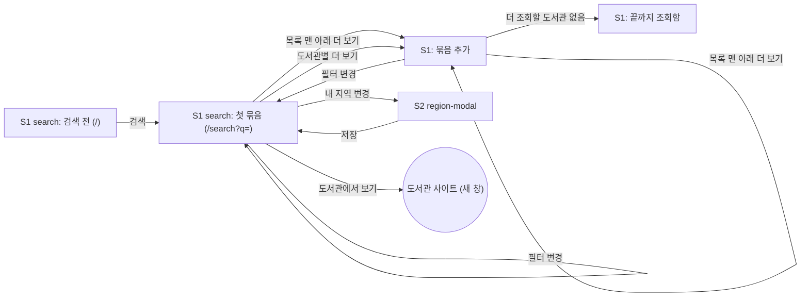

# 화면 흐름: 도서관 확장 (교보·YES24 전국 + 많은 도서관을 위한 검색 구조)

- 사이클: 02 (`scope.md`, `spec.md`)
- 이 문서는 화면 구조와 상태만 다룹니다. 시각 디자인은 다루지 않습니다.
- 작성일: 2026-09-28
- 사이클 01 화면(`../01-ebook-availability-search/flow.md`)과 실제 구현(사이클 01 `retro.md`의 U-3 필터, U-7 책 상세 링크, U-8 요약 줄, U-12 모바일 가입 정보)에서 **바뀌거나 늘어나는 것만** 적습니다. 새 화면은 없습니다. S2 region-modal은 바뀌지 않습니다.



- 필터("전체 / 지금 빌릴 수 있는 책만")를 바꾸면 이미 붙인 묶음을 모두 지우고 **첫 묶음부터 다시 검색**합니다. [확정] (사용자, 2026-09-28)
- 내 지역을 바꿔 저장해도 첫 묶음부터 다시 검색합니다 (사이클 01과 같음). [확정]

## 화면별 내용

### S1 search

**목적**: 제목을 검색하고, 전국 전자도서관 가운데 빌릴 수 있는 곳을 묶음 단위로 이어 본다.

**보이는 요소** (사이클 01에서 바뀌는 것)

| 영역 | 내용 | 상태 태그 |
|---|---|---|
| 필터 | "전체 / 지금 빌릴 수 있는 책만" (U-3 그대로). 바꾸면 검색을 처음부터 다시 함 | [확정] |
| 도서관 요약 줄 | U-8 그대로: 5곳까지 보이고 나머지는 "… 외 N곳" 팝오버. **결과가 있는 도서관을 앞 5곳에 둠**. 칸마다 도서관명 + 상태(조회 중 / 가져온 건수/전체 건수 / 결과 없음 / 조회 실패) + "N분 전 조회" + 도서관별 "더 보기" | [확정] (사용자, 2026-09-28) |
| 묶음 | 첫 묶음 아래에 "더 보기"로 받은 묶음이 차례로 붙음. 묶음마다 **지금 빌릴 수 있어요 (N)**, **예약하고 기다려요 (N)** 두 칸 | [확정] |
| 묶음 구분선 | 두 번째 묶음부터 위에 구분선과 "더 찾은 결과 · 도서관 N곳" | [확정] (사용자, 2026-09-28) |
| 목록 맨 아래 "더 보기" | "더 보기 (남은 도서관 N곳)". 더 조회할 도서관과 페이지가 없으면 없어짐 | [안] 문구 |
| 결과 한 줄 | 사이클 01 + 아래 표시 추가 | |

**결과 한 줄에 더해지는 표시**

| 경우 | 수량 자리 | 가입 조건 자리 | 상태 태그 |
|---|---|---|---|
| 교보 일반, YES24 두 방식, 강남구 | 보유 · 대출 중 · 예약 (사이클 01) | 사이클 01 | [확정] |
| 통합 포털 | 대출 중 · 예약 (보유 없음) | 사이클 01 | [확정] |
| 교보 구독형 | "구독형 · 바로 대출". 도서관명 옆에 "구독형" | 사이클 01 | [안] 문구 |
| 판정을 못 읽은 포털 줄 | "대출 가능 여부 확인 필요" | 사이클 01 | [안] |
| 자격 미확인 | 사이클 01 | "가입 자격 확인 필요" 배지 | [확정] |
| 방문 가입만 가능 | 사이클 01 | 자격 표시 옆에 "방문 가입" | [확정] |
| 판정 불가 자격 (책이음 등) | 사이클 01 | "가입 자격 확인 필요" 배지 + 자격 문구 (예: "책이음 회원 가입 가능") | [확정] |

- 모바일(640px 이하)에서는 가입 정보가 "ⓘ 가입 정보" 팝오버로 들어가는 U-12를 그대로 따릅니다. 자격 문구도 팝오버 안에 둡니다. 배지는 줄에 보입니다. [안]

**화면 예시** (지역: 거주 서울 마포구, 검색어 `채식주의자`. 도서관과 수량은 설명을 위한 가정)

```
[ 채식주의자                  ] [검색]
내 지역: 거주 서울 마포구 · 변경
(전체 | 지금 빌릴 수 있는 책만)

도서관: 마포구 3/3 · 강서구 2/2 · 성남 1/1 · 부산 1/1 · 세종(구독) 1/1 · … 외 8곳

■ 지금 빌릴 수 있어요 (5)
  채식주의자 · 마포구 재고 3               (같은 제목끼리, 재고 합계 많은 제목 먼저)
  채식주의자 · 강서구 재고 1
  소년이 온다 · 성남 재고 1
  부산광역시 전자도서관 · 대출 중 2 · 예약 0   (수량 없는 줄은 재고 줄 다음)
  세종시립도서관 · 구독형 · 바로 대출
■ 예약하고 기다려요 (3)
  …
  [가입 자격 확인 필요] 금정도서관 · 책이음 회원 가입 가능
─── 더 찾은 결과 · 도서관 12곳 ───
■ 지금 빌릴 수 있어요 (7)
  …
■ 예약하고 기다려요 (9)
  …

        [ 더 보기 (남은 도서관 300곳) ]
출처 · 연락처
```

**사용자 동작**
- 검색한다 → 첫 묶음이 나온다.
- 목록 맨 아래 "더 보기"를 누른다 → 다음 순위 도서관 묶음이 구분선 아래에 붙는다. 이미 보던 줄은 움직이지 않는다.
- 도서관 요약 줄(또는 "외 N곳" 팝오버)에서 도서관별 "더 보기"를 누른다 → 그 도서관의 다음 페이지가 목록 맨 아래 새 묶음으로 붙는다 [안] (spec 5.3).
- 필터를 바꾼다 → 첫 묶음부터 다시 검색한다.
- "도서관에서 보기"를 눌러 그 책의 도서관 페이지를 새 창으로 연다 (U-7).

**호출하는 API** (이름만. 상세는 `design-delta.md`)
- 첫 묶음 검색: 검색어, 내 지역, 필터를 보내면 조회한 도서관 목록과 결과 줄을 먼저 응답한 도서관부터 받음
- 다음 묶음 검색: 어디까지 조회했는지(라운드 로빈 상태)를 이어서 다음 묶음을 받음. 상태를 서버와 브라우저 중 어디에 둘지는 설계에서 정함
- 도서관별 다음 페이지: 사이클 01과 같음

**상태**

| 상태 | 화면 | 상태 태그 |
|---|---|---|
| 검색 전, 입력 오류 | 사이클 01과 같음 | [확정] |
| 첫 묶음 로딩 | 요약 줄에 조회 중인 도서관이 "조회 중". 응답한 도서관 결과부터 목록에 나오고, 새 결과가 오면 첫 묶음 안에서 다시 정렬 | [확정] |
| 다음 묶음 로딩 | 목록 맨 아래 "더 보기" 자리에 "도서관 N곳 조회 중". 새 묶음은 구분선 아래에서만 다시 정렬되고, 위의 줄은 움직이지 않음 | [확정] 정렬 / [안] 문구 |
| 판정 없는 포털 조회 중 | 대출 중인 책의 줄은 묶음 아래쪽 "대출 정보 조회 중" 자리에 먼저 보임. 판정이 오면(최대 30초) **같은 묶음 안에서** 알맞은 칸으로 옮김. 다른 묶음의 줄은 움직이지 않음 | [확정] (사용자, 2026-09-28. 처음에는 "판정이 오면 함께 표시"를 골랐다가 design-delta에서 바꿈, ADR-0014) |
| 결과 있음 | 묶음별 두 칸과 결과 줄 | [확정] |
| 한 묶음 결과 0줄, 남은 도서관 있음 | 그 묶음 자리에 "지금까지 N곳에서 찾지 못했습니다" + 목록 맨 아래 "더 보기" | [안] |
| 필터 켬, 한 묶음에 대출 가능 줄 0 | 위와 같은 문구에 "지금 빌릴 수 있는" 을 붙임 | [안] |
| 모든 도서관 조회 후 결과 0줄 | "조회한 도서관 N곳에 이 제목의 전자책이 없습니다" | [확정] |
| 끝까지 조회함 | 목록 맨 아래 "더 보기"가 없어지고 "모든 도서관을 조회했습니다" | [안] |
| 도서관 오류·지연 (8초) | 그 도서관 요약 칸에 "조회 실패". 나머지는 정상 | [확정] |
| 판정을 못 읽은 포털 줄 (30초) | 줄에 "대출 가능 여부 확인 필요". "예약하고 기다려요" 칸 맨 아래 | [안] |
| 지역을 골랐는데 맞는 도서관 없음 | 알림 줄에 "선택한 지역에서 자격이 확인된 도서관이 없습니다". 누구나 가입·자격 미확인 결과만 표시 | [안] |
| 캐시된 결과, 저장된 지역이 폐지됨 | 사이클 01과 같음 | [확정] |

**배치 메모**
- 데스크톱: 검색창 → 내 지역 요약 → 필터 → 알림 줄 → 도서관 요약 줄 → 묶음들 → 목록 맨 아래 "더 보기" → 페이지 바닥 [안]
- 모바일: 요약 줄은 가로 스크롤 칩(사이클 01), 구분선과 "더 보기"는 화면 폭 전체 [안]

## 수용 기준 대응

| AC (spec.md 7장) | 화면 |
|---|---|
| AC-1 첫 화면 약 20줄, 누구나 가입 먼저 | S1 첫 묶음 (+ 서버 로그) |
| AC-2 모든 도서관에 요청하지 않음 | 서버 로그 (요약 줄의 "외 N곳"과 "남은 도서관 N곳"으로도 보임) |
| AC-3 첫 요청 10줄 | 서버 로그 (화면 없음) |
| AC-4 목록 맨 아래 더 보기, 위치 유지 | S1 묶음 추가, 묶음 구분선 |
| AC-5 한 바퀴 뒤 2쪽 | S1 묶음 추가 (+ 서버 로그) |
| AC-6 도서관별 더 보기 | S1 도서관 요약 줄 → 묶음 추가 |
| AC-7 8초 조회 실패 | S1 도서관 오류·지연 |
| AC-8 경북·전북 후순위 | 서버 로그 (화면에서는 늦은 묶음에 나옴) |
| AC-9 지역 고른 순서 | 서버 로그 + S1 묶음 순서 |
| AC-10 맞지 않는 도서관 숨김, 자격 미확인 배지 | S1 결과 한 줄 |
| AC-11 세종 거주 → 천안 가입 가능 | S2 저장 → S1 결과 한 줄 |
| AC-12 책이음 자격 문구 | S1 결과 한 줄 (모바일은 가입 정보 팝오버) |
| AC-13 수량 일치 | S1 결과 한 줄 |
| AC-14 포털 사이트 판정 | S1 묶음의 두 칸 |
| AC-15 경북·전북 상세 판정 | S1 판정 없는 포털 조회 중 → 결과 있음 |
| AC-16 구독형 표시와 자리 | S1 결과 한 줄 |
| AC-17 포털 줄 자리 | S1 묶음의 "지금 빌릴 수 있어요" 칸 |
| AC-18 호스트 이름 간격 | 서버 로그 (화면 없음) |
| AC-19 EUC-KR | S1 결과 한 줄 (+ 서버 로그) |
| AC-20 캐시·User-Agent | S1 캐시된 결과 (+ 서버 로그) |
| AC-21 칸 안에서 같은 제목끼리, 제목 묶음 순서 | S1 묶음의 두 칸 (화면 예시의 "채식주의자" 줄들) |
| AC-22 같은 제목 안의 순서 | S1 묶음의 두 칸, 결과 한 줄의 가입 조건·수량 |
| AC-23 표기만 다른 제목이 같은 키 | API 응답의 `titleKey` (화면에서는 두 줄이 붙어 보임) |
| AC-24 새 묶음이 붙어도 이전 묶음 순서 유지 | S1 묶음 추가, 묶음 구분선 |

**spec 6장 상태별 동작 대응**: 입력 오류, 로딩, 한 묶음 결과 0줄, 모든 도서관 조회 후 결과 0줄, 도서관 오류·지연, 판정 없는 포털 상세 페이지 실패, 지역을 골랐는데 맞는 도서관 없음 → 모두 S1 상태 표에 있음.
