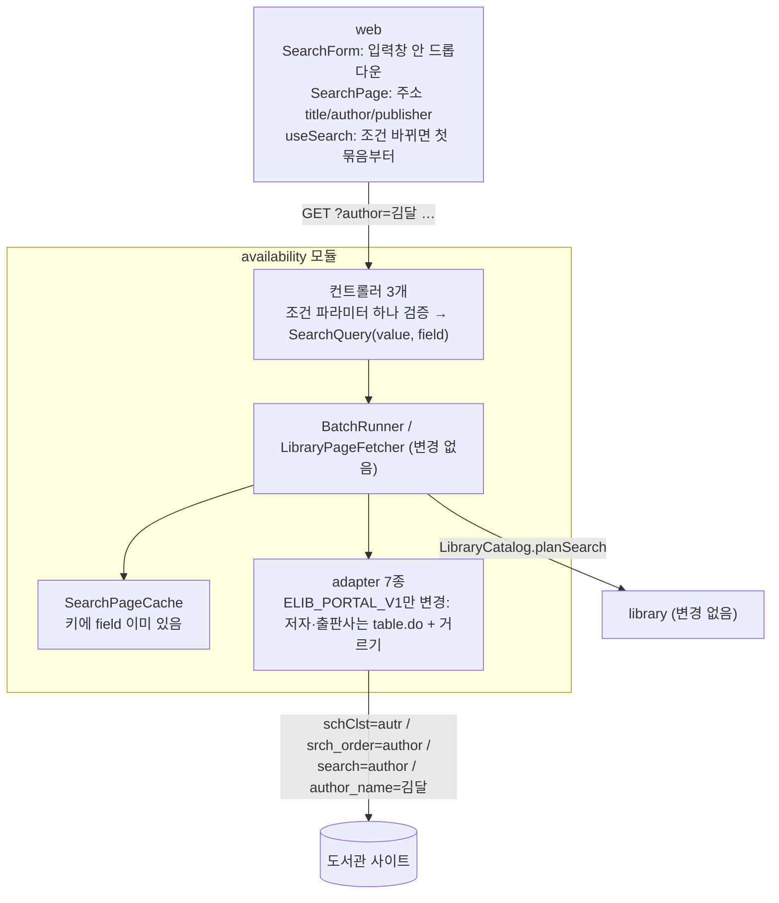
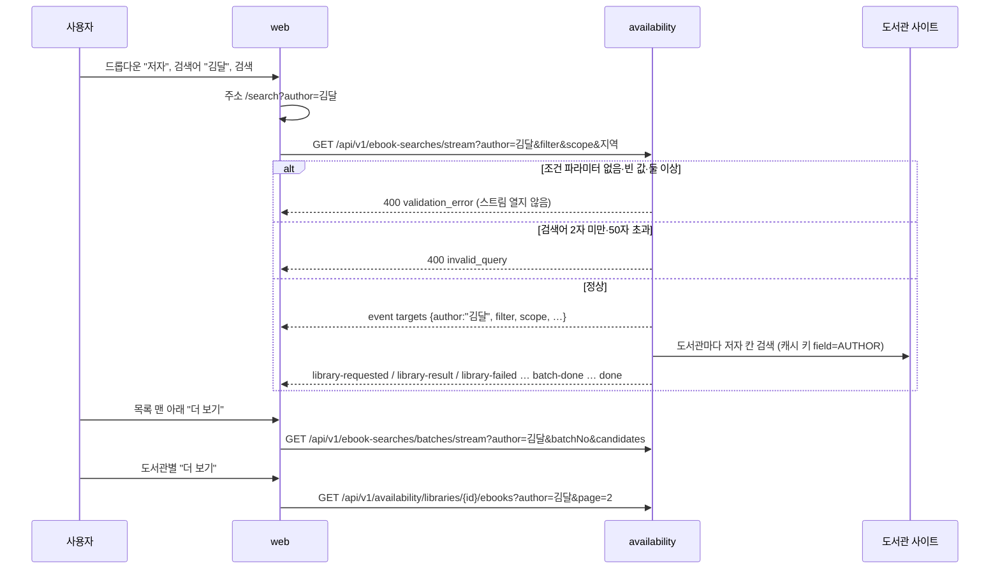
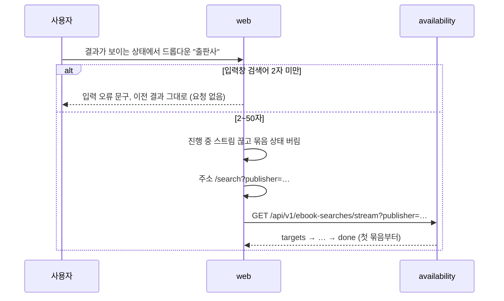
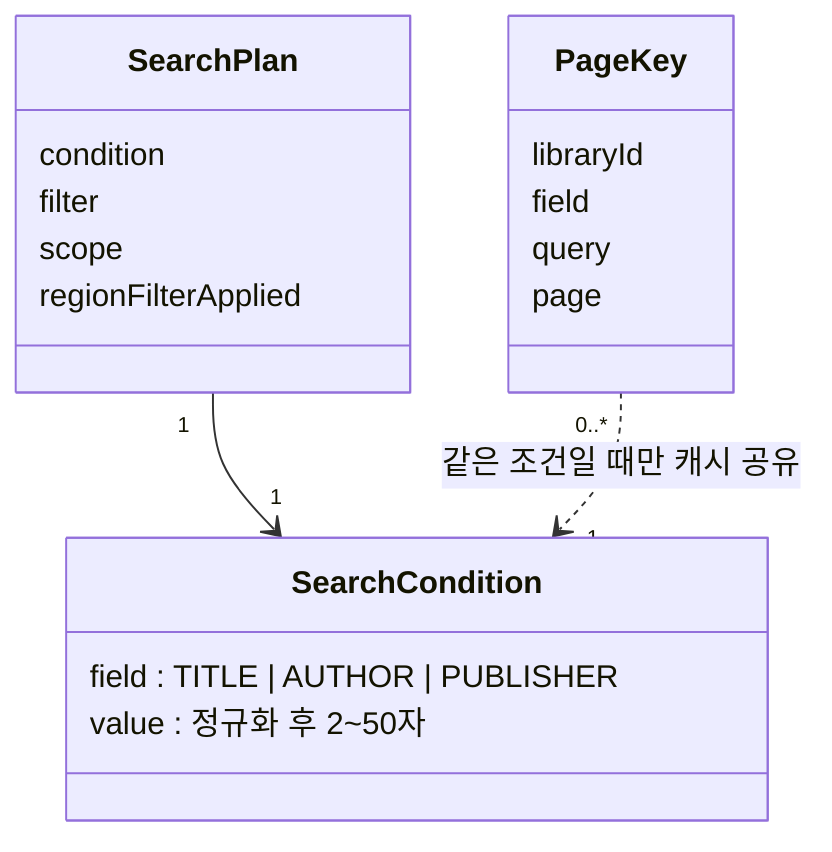

# 설계 변경: 사이클 03 검색 조건 강화 (제목 / 저자 / 출판사 중 하나)

- 작성일: 2026-09-29. 입력: `scope.md`, `spec.md`, `flow.md`, `docs/current/`, architect 제안(대화), dev 코드 대조(2026-09-29)
- 바뀌는 곳은 `availability` 모듈과 웹뿐입니다. **새 모듈, 새 테이블, Liquibase 변경은 없습니다.** `library`, `region`, 조회 서비스는 바뀌지 않습니다.
- 이미 있는 것(dev 코드 확인): 내부 `SearchField`(TITLE, AUTHOR, PUBLISHER), `SearchQuery(value, field)`, 캐시 키 `PageKey(libraryId, field, query, page)`(ADR-0009), 교보·YES24·강남구 adapter의 필드별 URL. 컨트롤러 3개가 지금은 항상 TITLE로 부릅니다.

## 구조 그림

### 모듈 구성도

바뀌는 부분만 그렸습니다. 굵은 설명이 이번 변경입니다.



### 주요 흐름 1: 조건을 골라 검색하고 이어 보기



### 주요 흐름 2: 결과가 보일 때 드롭다운만 바꾸기



### 도메인 모델



- `SearchCondition`은 설계 용어이고, 코드에서는 기존 `SearchQuery(value, field)`입니다. 새 클래스를 만들 필요는 없습니다.
- `SearchPlan`(브라우저 상태, 사이클 02)에 조건이 들어가고, 조건이 바뀌면 계획을 새로 만듭니다.

## 모듈

| 모듈 | 신규/변경 | 책임 | 공개 API | 발행/구독 이벤트 | 소유 테이블 |
|---|---|---|---|---|---|
| `availability` | 변경 | 조건 파라미터 하나를 받아 검증하고 그 필드로 검색. 포털 adapter는 저자·출판사일 때 `table.do` + 거르기 | REST 3개의 요청 파라미터 변경(아래 API). Modulith 공개 Java API는 바뀌지 않음 | 없음 | 없음 |
| `library`, `region`, 조회 서비스 | 변경 없음 | | | | |

- `SearchField`는 지금처럼 `availability/internal`에 둡니다. 쓰는 곳이 같은 모듈 안(`internal.web`, adapter, 캐시)뿐입니다 (spring-modulith 스킬: 모듈 밖으로 드러낼 필요가 없는 타입은 `internal`).
- 조건 파라미터 읽기는 세 컨트롤러가 함께 쓰는 도우미 하나로 둡니다 [안 이름: `SearchConditionParam`, `internal.web`]. 기존 `RegionIdsParam`, `CandidatesParam`과 같은 자리입니다.

## 데이터

- 변경 없음. 테이블, 컬럼, Liquibase changeset 모두 그대로입니다.
- 메모리 캐시 키는 이미 `field`를 포함합니다(ADR-0009). 제목 "김달"과 저자 "김달"은 서로 다른 캐시 항목입니다.

## API

공통 (ADR-0025) [확정]: 세 API는 `q`를 받지 않고, `title` / `author` / `publisher` 중 **정확히 하나**를 받습니다.

| 메서드 | 경로 | 설명 | 요청 | 응답 | 에러 |
|---|---|---|---|---|---|
| GET | `/api/v1/ebook-searches/stream` | 첫 묶음 (SSE) | 조건 하나 + `residenceRegionIds`, `workRegionIds`, `filter`, `scope` (사이클 02 그대로) | `targets`에 조건(요청과 같은 이름), 그 밖의 이벤트는 그대로 | 400 `validation_error`, 400 `invalid_query`, 422 `invalid_region` (모두 스트림 열기 전) |
| GET | `/api/v1/ebook-searches/batches/stream` | 다음 묶음 (SSE) | 조건 하나 + `filter`, `batchNo`, `candidates` | 이벤트 그대로 | 400 `validation_error`, 400 `invalid_query` |
| GET | `/api/v1/availability/libraries/{libraryId}/ebooks` | 도서관별 더 보기 | 조건 하나 + `page` | 페이지 객체 그대로 (`query`는 검색어) | 400 `validation_error`(이 API에서는 처음), 400 `invalid_query`, 400 `invalid_page`, 404 `library_not_found`, 502/504 |

조건 파라미터 규칙

| 경우 | 응답 | 상태 태그 |
|---|---|---|
| `title`/`author`/`publisher` 중 하나, 값 2~50자(정규화 후) | 정상. 그 필드로 검색 | [확정] |
| 셋 다 없음, 또는 값이 비어 있음(`?author=`) | 400 `validation_error`, `errors: [{"field":"title","code":"required","message":"one of title, author, publisher is required"}]` | [안] (`field` 값·문구) |
| 둘 이상 (`?title=a&author=b`) | 400 `validation_error`, `errors[].code: "too_many"` (들어온 파라미터마다 한 줄) | [안] |
| 같은 이름 두 번 (`?author=a&author=b`) | 400 `validation_error`, `errors[].code: "duplicate"` | [안] |
| 값 1자, 51자 이상 | 400 `invalid_query` (지금과 같음) | [확정] |
| `q`만 옴 | 모르는 파라미터는 무시하므로 조건 없음 → 400 `validation_error`(`required`) | [확정] |

- 검증 순서 [안]: 조건 파라미터 → `filter` → `scope` → 지역 (지금 `q` 자리에 조건이 들어감). 여러 개가 틀려도 첫 오류 하나만 돌려줍니다(지금 방식).

요청·응답 예시

```http
GET /api/v1/ebook-searches/stream?author=%EA%B9%80%EB%8B%AC&filter=all
Accept: text/event-stream, application/problem+json
```

```text
event: targets
data: {"author":"김달","filter":"all","scope":"all","regionFilterApplied":false,"libraries":[{"id":2,"name":"고흥군립도서관 전자도서관", …}]}
```

- 조건이 제목이면 `"title":"사랑"`, 출판사면 `"publisher":"빅피시"`. 조건 칸은 셋 중 하나만 들어 있습니다 [확정] (ADR-0025). 지금의 `query` 칸은 없어집니다.

```json
{
  "status": 400,
  "title": "Bad Request",
  "detail": "Only one search condition can be used.",
  "code": "validation_error",
  "errors": [
    {"field": "title", "code": "too_many", "message": "use only one of title, author, publisher"},
    {"field": "author", "code": "too_many", "message": "use only one of title, author, publisher"}
  ]
}
```

- 페이지 객체(`library-result`, 도서관별 더 보기 응답)는 바뀌지 않습니다. `librarySearchUrl`("도서관에서 보기")은 1쪽 검색 주소로 만들어지므로 조건이 저절로 들어갑니다.

## 외부 연동

도서관 사이트에 보내는 요청만 바뀝니다. 호출 예의(캐시 3분, 같은 호스트 동시 1건·1초, User-Agent, 8초)는 그대로입니다. 파라미터 값은 spec 3장 호출 시험(2026-09-29) 결과입니다.

| 대상 | 방식 | TITLE (지금 그대로) | AUTHOR | PUBLISHER | 코드 변경 | 상태 태그 |
|---|---|---|---|---|---|---|
| `KYOBO_V1` | GET `…/elibrary-front/search/searchList.ink` | `schClst=ctts` | `schClst=autr` | `schClst=pbcm` | 없음 (이미 됨) | [확정] |
| `KYOBO_SUBSCRIPTION_V1` | GET `…/search/searchList.ink` | `ctts` | `autr` | `pbcm` | 없음 | [확정] |
| `YES24_V1` (EUC-KR) | GET `…/search/` | `srch_order=title` | `author` | `publisher` | 없음 | [확정] |
| `YES24_V2` | GET `…/search/` | `title` | `author` | `publisher` | 없음 | [확정] |
| `YES24_V3` (EUC-KR) | GET `…/search/` | `title` | `author` | `publisher` | 없음 | [확정] (김천 출판사 50건, 2026-09-29) |
| `GANGNAM_V1` (EUC-KR) | GET `…/elibbook/book_info.asp` | `search=title` | `search=author` | `search=publisher` | 없음 | [확정] |
| `ELIB_PORTAL_V1` 제목 | 1쪽 `…/index.do?menu_idx=M&search_text=…`, 2쪽부터 `…/table.do?…&search_type=&author_name=&book_pubname=&…` | 지금 그대로 (기본 검색) | — | — | 없음 | [확정] |
| `ELIB_PORTAL_V1` 저자 | **1쪽부터** `…/module/elib/search/table.do?menu_idx=M&type=&search_type=&author_name={q}&book_pubname=&book_year=&device=&search_text={q}&rowCount=10&viewPage=N` | — | `search_text`와 `author_name`에 같은 검색어 | — | **있음** | [확정] (부산·대구·경기교육청 호출 시험, 사용자 결정 "검색어 + 걸러내기, 이름 정확히 일치") |
| `ELIB_PORTAL_V1` 출판사 | 1쪽부터 `…/table.do?…&author_name=&book_pubname={q}&…&search_text={q}&…` | — | — | `search_text`와 `book_pubname`에 같은 검색어 | **있음** | [확정] (전북 1·2쪽 호출 시험) |

포털 adapter 주의 (2026-09-29 7곳 재조사, spec 3장 "포털 재조사")
- **`search_type`에 `AUTHOR`·`TITLE`·`PUBLER`를 넣지 않습니다.** 이 값은 자료 종류(소장자료/구독자료/학술원문)이고, 필드 검색이 되지 않습니다. 경기교육청은 `search_type=AUTHOR`에 0건을 돌려줍니다. 지금처럼 빈 값으로 둡니다.
- 저자·출판사 거르기는 `index.do`에서 무시되므로 **1쪽부터 `table.do`**로 부릅니다. `search_text`를 비우면 0건입니다.
- 거르기는 값과 **정확히 같은** 저자·출판사만 남깁니다(부산 "김달" 11→3). 다른 사이트는 부분 일치라 결과 범위가 다릅니다. 사용자가 이 방식을 골랐습니다.
- 사이클 02에서 `table.do`는 부산·대구·경기교육청의 목록 판정 칸이 비어 있었습니다(dev plan-feedback). 그래서 저자·출판사 검색에서는 이 포털들의 1쪽도 빈칸 규칙(대출 0 → 대출 가능, 아니면 상세 판정)으로 갑니다. 상세 요청이 늘 수 있습니다 (확인 필요).
- `librarySearchUrl`("도서관에서 보기")은 저자·출판사일 때 `table.do` 주소가 됩니다. `table.do`는 화면 조각이라 새 창에서 모양이 깨질 수 있습니다. 포털은 제목 검색 주소(`index.do?search_text=`)로 대신 여는 것을 권합니다 [안].
- 실패 시 동작: 사이클 02와 같습니다(그 도서관만 `library-failed`).

## 웹 변경

| 파일 | 변경 |
|---|---|
| `api/types.ts` | `SearchField = 'title' \| 'author' \| 'publisher'`. `targets` 타입: `query` 대신 조건 칸 하나(`title?`/`author?`/`publisher?`) |
| `api/searchStream.ts`, `api/client.ts` | 세 요청 모두 `q=` 대신 `{field}=값` |
| `features/search/SearchPage.tsx` | 주소에서 `title`/`author`/`publisher`를 읽음(`q`는 읽지 않음). 둘 이상이면 title → author → publisher 순서로 하나 [확정] (사용자 "1로 하되 나중에 and검색에 저 여러개있는거 쓸꺼 생각중": 나중 AND 검색에서는 여러 조건 주소를 그대로 쓸 예정). 아직 배포 전이라 옛 `?q=` 주소를 바꿔 주는 처리는 두지 않음 [확정] (사용자: "배포 안 되었는데 불필요해", 2026-09-29) |
| `features/search/SearchForm.tsx` | 입력창 안 왼쪽 드롭다운, 조건별 안내 문구·숨긴 label (flow.md). 결과가 있을 때 조건이 바뀌면 입력창 글자를 검사해 바로 검색, 2자 미만이면 오류 문구만. 검색 전이면 문구만 바뀜 |
| `features/search/useSearch.ts` | 검색 옵션과 다시 검색하는 기준에 조건 추가. 다음 묶음·도서관별 더 보기 요청에 조건 전달 |
| `BatchSection.tsx`, `SearchPage.tsx` 결과 없음 문구 | 조건별 문구 (flow.md [안] 문구) |
| `features/search/searchPlan.ts`, `rowVerdict.ts`, `sortBatch.ts` | 변경 없음 |

## 바꾸거나 더할 테스트

- 서버
  - 조건 파라미터 도우미: 하나 → 그 필드, 없음·빈 값 → `required`, 둘 이상 → `too_many`, 같은 이름 두 번 → `duplicate`, `q`만 → `required`
  - `EbookSearchStreamControllerTests`: `?author=` → AUTHOR로 `BatchRunner` 호출, `targets`에 `"author"`와 `query` 없음, 오류 400들이 스트림 열기 전
  - 다음 묶음 컨트롤러: 조건 전달, 오류 400 (지금 별도 테스트 파일이 없으면 새로)
  - `LibraryEbookControllerTests`: `?publisher=` 전달, `validation_error`
  - `ElibPortalV1AdapterTests`: AUTHOR·PUBLISHER는 1쪽·2쪽 모두 `table.do` + `search_text`와 거르기 값이 같음, `search_type`은 빈 값. TITLE URL은 지금과 같음(회귀). 거르기 결과 fixture(부산 "김달" 3건)로 파싱
  - `KyoboSubscriptionV1AdapterTests`, `Yes24V1AdapterTests`, `Yes24V3AdapterTests`, `GangnamV1AdapterTests`: AUTHOR·PUBLISHER URL(EUC-KR 인코딩 포함)
  - `LibraryPageFetcherTests`: 같은 검색어에 필드만 다르면 캐시를 함께 쓰지 않음 (AC-6)
  - 사이클 02 테스트 중 `q=`를 쓰는 곳은 모두 `title=`로 고침
- 웹 (Vitest)
  - 주소: 조건 없음·여럿일 때 규칙, 제목 검색 주소
  - `useSearch`: 조건이 바뀌면 모든 묶음을 버리고 첫 묶음부터. 다음 묶음·도서관별 더 보기 요청에 조건
  - `SearchForm`: 결과 있을 때 조건 변경 → 바로 검색, 2자 미만 → 요청 없음, 검색 전 → 문구만

## 수용 기준 대응

| AC | 설계 |
|---|---|
| AC-1, AC-2 저자·출판사 요청 URL | 외부 연동 표, 포털 adapter 변경 |
| AC-3 제목 그대로 | TITLE URL 변경 없음 |
| AC-4 두 종류 "더 보기" | 다음 묶음·도서관별 더 보기 API의 조건 파라미터, 포털 2쪽 `table.do` |
| AC-5 조건 바꾸면 바로 다시 검색, 새로고침 유지 | 흐름 2, 웹 주소 |
| AC-6 조건별 캐시 | 캐시 키 `field` (변경 없음, 테스트 추가) |
| AC-7 잘못된 조건·글자 수 400 | 조건 파라미터 규칙 표 (AC-7의 "조건 값이 제목·저자·출판사가 아님"은 ADR-0025에서 "조건 파라미터가 없거나 둘 이상"으로 바뀜) |
| AC-8 호출 예의 | 변경 없음 |

## 결정 기록

- [ADR-0025 검색 조건은 이름 있는 파라미터 하나로 받음 (옛 주소 변환 없음)](../../adr/0025-named-search-condition-params-no-legacy-url.md) — B안 (사용자: "나중에 and조건에 그게 나아보임"). `q`는 API와 웹에서 없앰, 옛 주소 변환 없음 (사용자: "배포 안 되었는데 불필요해"). `targets`는 요청과 같은 이름으로 조건을 돌려줌. [ADR-0024](../../adr/0024-named-search-condition-params.md)(옛 주소 변환 포함)를 대체
- [ADR-0026 포털 저자·출판사 검색은 검색어 + 정확히 일치하는 거르기](../../adr/0026-portal-author-publisher-facet.md) (사용자 결정, 2026-09-29)
- 새 모듈·테이블이 없음, 포털 제목은 기본 검색 유지: 선택지 없음 (spec 3장·5.2에서 이미 정함)

## 확인 필요

| 항목 | 확인 방법 | 막는 단계 |
|---|---|---|
| 포털 저자·출판사 검색에서 1쪽부터 `table.do`를 쓰면 판정 칸이 비는 포털(부산·대구·경기교육청)의 상세 요청이 얼마나 늘어나는지, 30초 안에 끝나는지 | 프로토타입 (dev 실측, 사이클 02 방식) | 개발 |
| 포털 저자 표기("김달 저", 공저)가 거르기 값과 달라 빠지는 책이 얼마나 되는지 | 호출 시험 (저자 몇 명) | 없음 (정확히 일치는 사용자 결정) |
| 포털 "도서관에서 보기" 링크를 제목 검색 주소로 대신 열지 | dev가 `table.do` 주소를 새 창으로 열어 보고 판단 | 개발 |
| `validation_error`의 `errors[].field` 값과 문구, 검증 순서 | dev가 정하고 보고 | 개발 |
| (확인됨) 전주(`YES24_V1`)는 화면에 저자 이름을 표시하지 않아 결과 줄의 저자 칸이 비어 보임. 저자 검색은 됨(저자 "김" 329건) | 확인 완료 2026-09-29 | 없음 |
