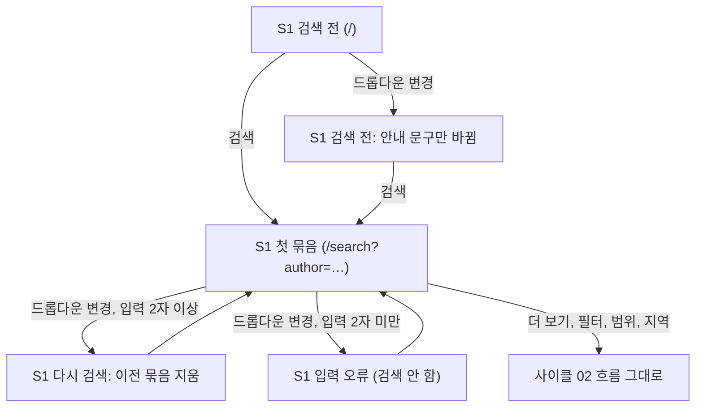

# 화면 흐름: 검색 조건 강화 (제목 / 저자 / 출판사 중 하나 고르기)

- 사이클: 03 (`scope.md`, `spec.md`)
- 이 문서는 화면 구조와 상태만 다룹니다. 시각 디자인은 다루지 않습니다.
- 작성일: 2026-09-29
- 사이클 02 화면(`../02-library-expansion/flow.md`)과 실제 구현(dev 웹 `SearchForm.tsx`: 알약 모양 입력창 + "검색" 버튼, 안내 문구 "책 제목을 입력하세요")에서 **바뀌는 것만** 적습니다. 새 화면은 없습니다. S1 search만 바뀌고, S2 region-modal은 그대로입니다.



- 결과가 보이는 상태에서 드롭다운 조건만 바꾸면 검색 버튼 없이 입력창의 검색어로 **첫 묶음부터 다시 검색**합니다 [확정] (사용자, 2026-09-29, spec 5.3).
- 검색 전(첫 화면)에서 드롭다운을 바꾸면 안내 문구만 바뀌고 검색하지 않습니다 [안].
- 드롭다운 기본값은 **항상 제목**입니다. 주소에 조건이 있으면(새로고침·공유) 그 조건으로 엽니다. 마지막에 쓴 조건을 브라우저에 기억하지 않습니다 [확정] (사용자, 2026-09-29).

## 화면별 내용

### S1 search

**목적**: 제목·저자·출판사 중 하나를 골라 검색하고, 전국 전자도서관 가운데 빌릴 수 있는 곳을 묶음 단위로 이어 본다.

**보이는 요소** (사이클 02에서 바뀌는 것)

| 영역 | 내용 | 상태 태그 |
|---|---|---|
| 검색창 | `[ 제목 ▾ │ 책 제목을 입력하세요 ] [검색]`. 드롭다운은 알약 모양 입력창 **안 왼쪽** | 드롭다운 [확정] (사용자), 입력창 안 왼쪽 [확정] (사용자, 2026-09-29) |
| 드롭다운 항목 | 제목 / 저자 / 출판사. 기본 제목 | [확정] |
| 입력창 안내 문구 | 제목 "책 제목을 입력하세요"(지금 그대로) / 저자 "저자 이름을 입력하세요" / 출판사 "출판사 이름을 입력하세요" | [안] 문구 |
| 입력창 이름(화면 낭독용) | 지금 "책 제목" → 고른 조건 이름("저자", "출판사") | [안] |
| 그 밖의 영역 | 내 지역 줄, 조회 범위 토글, 필터, 도서관 요약 줄, 묶음, "더 보기", 결과 한 줄 — 사이클 02 그대로 | [확정] |

**화면 예시** (조건 저자, 검색어 `김달`. 도서관과 수량은 설명을 위한 가정)

```
[ 저자 ▾ │ 김달                         ] [검색]
내 지역: 설정 안 함 · 설정
(전체 도서관 | 누구나 가입)   (전체 | 지금 빌릴 수 있는 책만)

도서관: 고흥 3/3 · 강남구 2/10 · 세종(구독) 2/37 · … 외 12곳

■ 지금 빌릴 수 있어요 (4)
  사랑에 관한 거의 모든 기술 · 김달 · 고흥 재고 1
  사랑에 관한 거의 모든 기술 · 김달 · 세종(구독) 구독형 · 바로 대출
  …
■ 예약하고 기다려요 (2)
  …

        [ 더 보기 (남은 도서관 N곳) ]
```

- 저자 "김달"은 일부만 맞아도 찾으므로 "김달우", "김달국"의 책도 섞여 나옵니다 (spec 3장, 사이트 동작 그대로).

**사용자 동작**
- 드롭다운에서 조건을 고르고 검색한다 → 첫 묶음이 나온다.
- 결과가 보이는 상태에서 드롭다운만 바꾼다 → 같은 검색어로 바로 첫 묶음부터 다시 검색한다.
- 그 밖의 동작(목록 맨 아래 "더 보기", 도서관별 "더 보기", 필터·범위·지역 변경, "도서관에서 보기")은 사이클 02 그대로이고, 모두 고른 조건을 그대로 씁니다.

**호출하는 API** (이름만. 상세는 `design-delta.md`)
- 첫 묶음 검색, 다음 묶음 검색, 도서관별 다음 페이지: 사이클 02와 같은 API에 **검색 조건**을 더해 보냄

**상태**

| 상태 | 화면 | 상태 태그 |
|---|---|---|
| 검색 전 | 드롭다운 제목, 안내 문구 "책 제목을 입력하세요" | [확정] 기본값 |
| 검색 전, 드롭다운 변경 | 안내 문구만 바뀜. 검색하지 않음 | [안] |
| 입력 오류 | 사이클 01과 같은 문구("2글자 이상 입력하세요", "50자 이하로 입력하세요"). 조건과 상관없이 같음 | [확정] 규칙 (spec 4장) |
| 결과 있음, 드롭다운 변경, 입력 2자 이상 | 이전 묶음을 모두 지우고 첫 묶음부터 다시 검색. 주소의 조건도 바뀜 | [확정] |
| 결과 있음, 드롭다운 변경, 입력 2자 미만 | 검색하지 않고 입력 오류 문구. 이전 결과는 그대로 둠 | [안] |
| 로딩, 결과 있음, 더 보기, 도서관 오류·지연, 판정 없는 포털 | 사이클 02와 같음 | [확정] |
| 한 묶음 결과 0줄, 남은 도서관 있음 | 사이클 02와 같음 ("지금까지 N곳에서 찾지 못했습니다") | [확정] |
| 모든 도서관 조회 후 결과 0줄 | 제목: "조회한 도서관 N곳에 이 제목의 전자책이 없습니다"(지금 그대로) / 저자: "조회한 도서관 N곳에 저자 '김달'의 전자책이 없습니다" / 출판사: "… 출판사 '빅피시'의 전자책이 없습니다" | [안] 문구 |
| 새로고침·공유 주소로 열기 | 주소의 조건과 검색어로 드롭다운과 입력창을 채우고 검색 | [확정] (spec AC-5) |
| 주소에 조건이 둘 이상 | title → author → publisher 순서로 하나만 쓰고 검색 (design-delta). 배포 전이라 옛 `?q=` 주소 처리는 없음 | [확정] (사용자 "1로 하되 나중에 and검색에 저 여러개있는거 쓸꺼 생각중", 2026-09-29) |

**배치 메모**
- 데스크톱: 검색창 한 줄 안에 드롭다운 + 입력 + 검색 버튼. 나머지 배치는 사이클 02 그대로 [안]
- 태블릿·모바일(1024px·640px 이하): 같은 한 줄. 드롭다운은 짧은 이름(제목/저자/출판사)만 보이게 해 입력 칸 폭을 지킴 [안]

## 수용 기준 대응

| AC (spec.md 7장) | 화면 |
|---|---|
| AC-1 저자 검색 결과와 요청 URL | S1 드롭다운 "저자" → 첫 묶음 (+ 서버 로그) |
| AC-2 출판사 검색 결과와 요청 URL | S1 드롭다운 "출판사" → 첫 묶음 (+ 서버 로그) |
| AC-3 제목 검색은 사이클 02 그대로 | S1 검색 전 기본값 제목, 새로고침·공유 주소로 열기 (+ 서버 로그) |
| AC-4 저자 검색에서도 두 종류 "더 보기" | S1 목록 맨 아래·도서관별 "더 보기" (사이클 02 흐름, + 서버 로그) |
| AC-5 드롭다운 변경 시 바로 다시 검색, 새로고침 유지 | S1 결과 있음 → 드롭다운 변경, 새로고침·공유 주소로 열기 |
| AC-6 조건별 캐시 | API 응답·서버 로그 (화면에서는 같은 검색을 다시 했을 때 빠르게 나옴) |
| AC-7 조건 파라미터 없음·둘 이상 400, 1자·51자 입력 오류 | S1 입력 오류, 주소에 조건이 둘 이상 (+ API 호출) |
| AC-8 호출 예의 | 서버 로그 (화면 없음) |

**spec 6장 상태별 동작 대응**: 입력 오류, 로딩, 결과 없음, 외부 오류·지연 → 모두 S1 상태 표에 있음.
