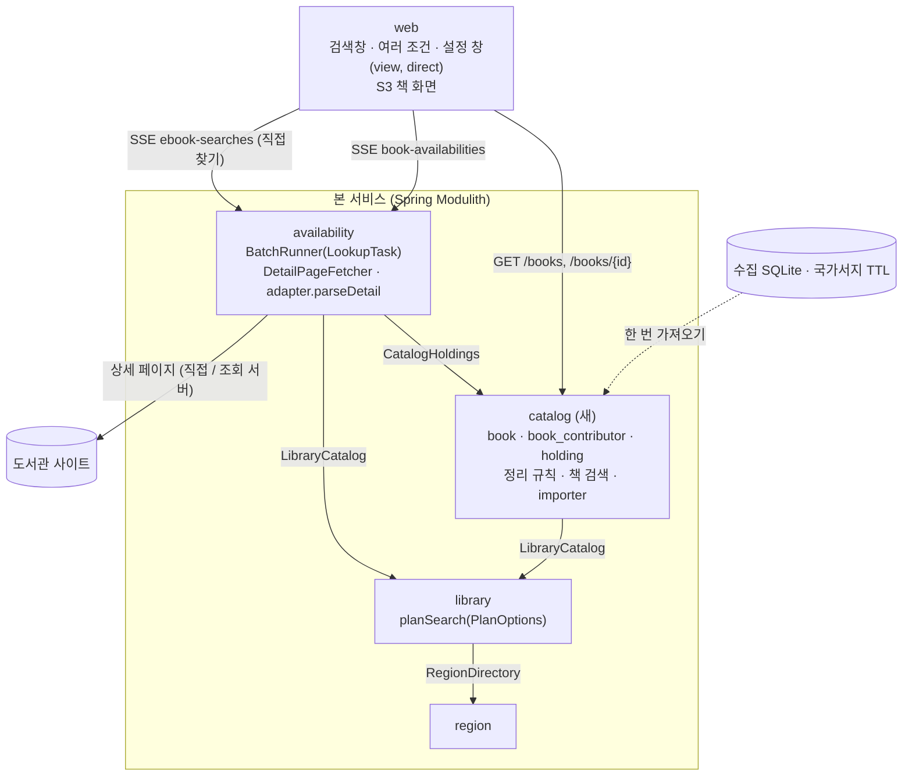
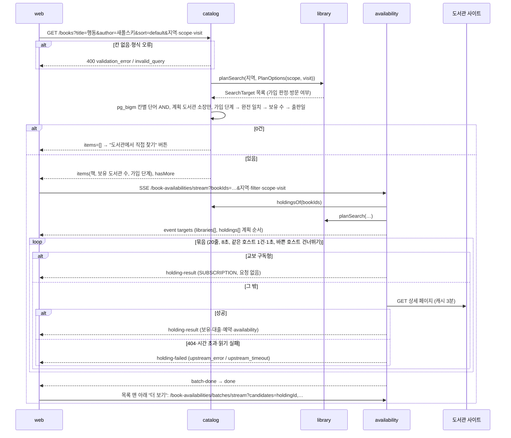
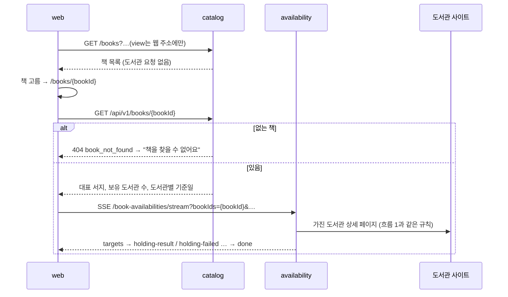
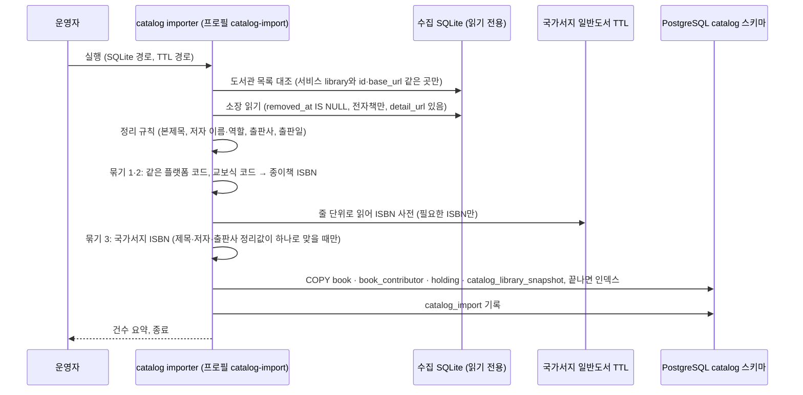
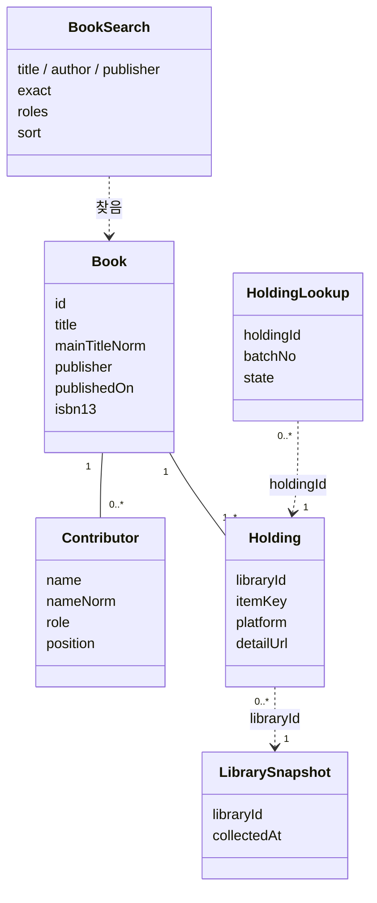
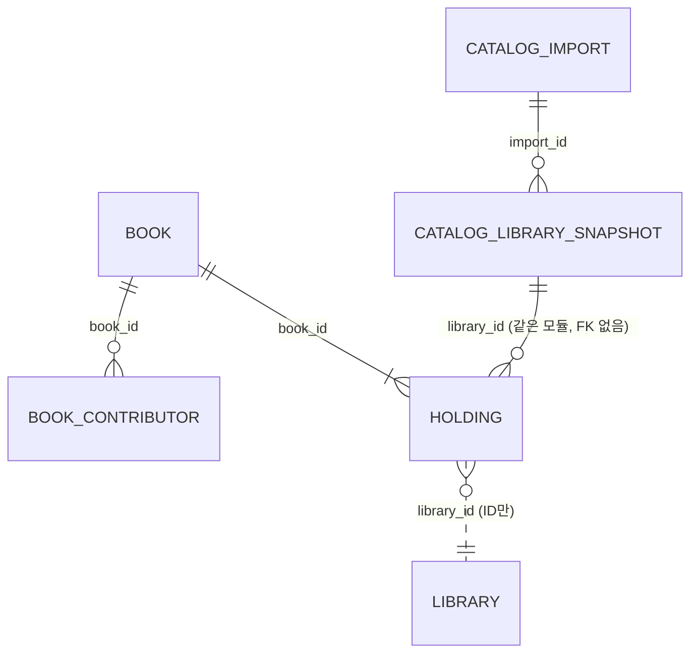

# 설계 변경: 사이클 04 AND 검색 (제목·저자·출판사 여러 조건)

- 작성: 2026-09-30. 입력: `scope.md`, `spec.md`, `flow.md`, `docs/current/`, architect 제안(`architect-proposal.md`), dev 코드 대조, 사전 조사 `docs/research/ebook-catalog/`
- 새 모듈 `catalog`가 생기고, `availability`·`library`·웹이 바뀝니다. 조회 서비스와 `region`은 바뀌지 않습니다.
- 이름은 사용자 승인 (2026-09-30: "이대로"). 여기서 새로 붙인 이름은 [안]으로 표시합니다.

## 구조 그림

### 모듈 구성도



- 의존 방향: `catalog → library → region`, `availability → catalog, library`. 순환 없음 (ADR-0001)

### 주요 흐름 1: 바로 보기 (기본)



### 주요 흐름 2: 책 먼저 고르기 → S3 책 화면



### 주요 흐름 3: 한 번 가져오기 (운영자가 실행)



### 도메인 모델



- `Book`·`Contributor`·`Holding`·`LibrarySnapshot`은 `catalog`가 DB에 저장합니다. `BookSearch`는 요청, `HoldingLookup`은 브라우저 상태(사이클 02의 `PlanEntry`가 도서관 대신 소장 단위가 됨)입니다.
- `Holding.libraryId`는 `library` 모듈 ID 값만 가집니다 (FK 없음).

## 모듈

| 모듈 | 신규/변경 | 책임 | 공개 API | 발행/구독 이벤트 | 소유 테이블 |
|---|---|---|---|---|---|
| `catalog` | 신규 | 수집한 책 목록 보관(책·사람·소장·도서관별 기준일), 정리 규칙, 책 검색, 한 번 가져오기(importer) | Java `CatalogHoldings` (`holdingsOf(bookIds)`, `holdings(holdingIds)` → `HoldingRef(holdingId, bookId, libraryId, platformType, detailUrl)`) / REST `GET /api/v1/books`, `GET /api/v1/books/{bookId}` | 없음 | `catalog.book`, `catalog.book_contributor`, `catalog.holding`, `catalog.catalog_library_snapshot` [안], `catalog.catalog_import` |
| `availability` | 변경 | 소장 단위 실시간 조회 추가: 상세 페이지 읽기(adapter `parseDetail`), 묶음 실행기가 검색 페이지·상세 페이지를 모두 처리(`LookupTask` [안]), 소장 스트림 API. 직접 찾기(사이클 03 API)는 그대로 | REST `GET /api/v1/book-availabilities/stream`, `GET /api/v1/book-availabilities/batches/stream` (기존 3개 그대로) | 없음 | 없음 (메모리 캐시) |
| `library` | 변경 | `planSearch`가 조회 범위·방문 필터를 받음(지금 `availability` 안의 `LibraryScope`·`VisitFilter` 뜻을 옮김). 가져오기 대조용 도서관 목록 조회 | Java `LibraryCatalog.planSearch(residenceIds, workIds, PlanOptions(scope, visit))` [안], `enabledLibraryRefs()` → `(id, baseUrl, platformType)` [안] | 없음 | 그대로 |
| `region`, 조회 서비스 | 변경 없음 | | | | |

- `catalog`의 구현은 `catalog/internal/{normalize, search, importer, web}` [안]. 정리 규칙 코드는 importer와 검색어 정리가 **같은 클래스**를 씁니다 (ADR-0031).
- 가입 단계는 `catalog`가 `SearchTarget`(`eligibility`, `visitRequired`)으로 계산하고, 소장은 `library_id = ANY(:planIds)` 매개변수로만 거릅니다. 모듈 간 JOIN 없음.

## 데이터

- 스키마: `catalog` (소유: `catalog` 모듈)



| 테이블.컬럼 | 타입 | 제약 | 설명 | 상태 태그 |
|---|---|---|---|---|
| `book.id` | bigint | PK, GENERATED BY DEFAULT AS IDENTITY | | [확정] 이름 |
| `book.title` | text | NOT NULL | 표시용 대표 제목(묶인 소장 원문 중 가장 많이 나온 것) | [안] 규칙 |
| `book.author_display` | text | NULL | 표시용 대표 저자 원문 | [안] |
| `book.publisher` | text | NULL | 표시용 대표 출판사 원문 | [안] |
| `book.title_norm` | text | NOT NULL | 전체 제목 정리값(NFKC·소문자·공백 제거) | [안] |
| `book.main_title_norm` | text | NOT NULL | 본제목(첫 ` : `·` - ` 앞, 앞 `〈…〉`·`[…]` 시리즈 뗌) 정리값 | [안] |
| `book.publisher_norm` | text | NULL | 출판사 정리값(`(주)`·`주식회사`·`도서출판`·Inc 등 제거) | [안] |
| `book.published_on` | date | NULL | 대표 출판일: 소장들의 날짜 중 가장 많이 나온 것, 같으면 이른 것. 미래 날짜는 빼고 계산 | [확정] 미래 날짜 규칙, 나머지 [안] |
| `book.isbn13` | text | NULL, UNIQUE | 종이책 ISBN (교보식 코드 계산 또는 국가서지) | [확정] 종이책 ISBN |
| `book.content_type` | text | NOT NULL, CHECK IN ('EBOOK') | 이번에는 전자책만 가져옴 | [안] |
| `book.created_at` | timestamptz | NOT NULL DEFAULT now() | | |
| `book_contributor.id` | bigint | PK, IDENTITY | | |
| `book_contributor.book_id` | bigint | NOT NULL, FK → book(id) ON DELETE CASCADE | | |
| `book_contributor.name` | text | NOT NULL | 원문에서 나눈 이름 (별명 괄호 뗌) | [안] |
| `book_contributor.alias` | text | NULL | 괄호 속 별명 | [안] |
| `book_contributor.name_norm` | text | NOT NULL | 이름(+별명) 정리값, 부분 일치용 | [안] |
| `book_contributor.name_exact` | text | NOT NULL | 공백·마침표 제거, 완전 일치용 | [안] |
| `book_contributor.role` | text | NOT NULL, CHECK IN ('AUTHOR','TRANSLATOR','ILLUSTRATOR','EDITOR','OTHER','UNKNOWN') | 역할. 글그림은 AUTHOR와 ILLUSTRATOR 두 줄 | [안] 값 |
| `book_contributor.position` | smallint | NOT NULL | 원문 순서 | |
| `holding.id` | bigint | PK, IDENTITY | 스트림 키 `holdingId` | |
| `holding.book_id` | bigint | NOT NULL, FK → book(id) | | |
| `holding.library_id` | bigint | NOT NULL | `library` 모듈 ID (FK 없음) | |
| `holding.platform` | text | NOT NULL | 수집 원천의 플랫폼 | |
| `holding.item_key` | text | NOT NULL | 도서관 안 책 코드 | |
| `holding.detail_url` | text | NOT NULL | 상세 페이지 주소 (http(s), 호스트가 그 도서관 `base_url` 호스트와 같은 것만 가져옴) | [확정] 상세 페이지 읽기, 검사 [안] |
| `holding.title_raw`, `author_raw`, `publisher_raw`, `published_raw`, `supplier`, `alt_code` | text | NULL | 원문 보관 | [확정] 원문 보존 |
| `holding.first_seen_at` | timestamptz | NOT NULL | 수집 원천 값 | |
| `catalog_library_snapshot.library_id` | bigint | PK | 도서관 (ID만) | [안] 테이블 이름 |
| `catalog_library_snapshot.collected_at` | timestamptz | NOT NULL | 그 도서관 목록을 마지막으로 성공 수집한 시각 → 화면 "○월 ○일 기준" | [확정] 도서관별 기준일 (사용자, 2026-09-30) |
| `catalog_library_snapshot.import_id` | bigint | NOT NULL, FK → catalog_import(id) | | |
| `catalog_import.id` | bigint | PK, IDENTITY | | |
| `catalog_import.source` | text | NOT NULL | 예: `chaekcheck-data/ebook-catalog.sqlite` | |
| `catalog_import.imported_at` | timestamptz | NOT NULL | | |
| `catalog_import.book_count`, `holding_count`, `skipped_count` | integer | NOT NULL | 요약 | |

인덱스 [안] (측정: `docs/research/ebook-catalog/search-and-normalization.md` 3.2.1)
- `book`: GIN `gin_bigm_ops` (`title_norm`), (`publisher_norm`) / B-tree `COLLATE "C"` (`main_title_norm`), (`title_norm`), (`publisher_norm`) — 완전 일치 / B-tree `(published_on DESC NULLS LAST, id)`, `(published_on ASC NULLS LAST, id)` — 역방향 스캔으로는 NULLS LAST를 지킬 수 없어 둘 다 / UNIQUE `(isbn13)`
- `book_contributor`: GIN `gin_bigm_ops` (`name_norm`) / B-tree `(name_exact COLLATE "C")` / `(book_id)`
- `holding`: UNIQUE `(library_id, item_key)`, `(book_id, library_id)`
- 파티션 없음 (research 3.3)

- Liquibase: 새 파일 `catalog/001-catalog-schema.yaml`. `CREATE EXTENSION IF NOT EXISTS pg_bigm`은 sql changeset. **데이터는 Liquibase로 넣지 않음** (importer, ADR-0031)
- 가져오기 범위 [확정]: `removed_at IS NULL`, 전자책(오디오북·동영상북 제외), 서비스 `library`와 id·`base_url`이 같은 도서관. 꺼진 59·131번은 대조에서 빠짐
- 묶기 [확정 범위]: ① 같은 플랫폼 코드 ② 교보식 코드 → 종이책 ISBN ③ 국가서지 ISBN (정리한 본제목·대표 저자·출판사로 하나만 맞을 때). 정리한 글자만으로 묶는 단계는 이번에 하지 않음 [안]

## API

공통: ADR-0008 (성공은 감싸지 않음, 오류는 ProblemDetail + `code`)

| 메서드 | 경로 | 설명 | 요청 | 응답 | 에러 |
|---|---|---|---|---|---|
| GET | `/api/v1/books` | 수집 목록에서 책 검색 (도서관 요청 없음) | `title`, `author`, `publisher` (하나 이상, 칸마다 2~50자), `exact` (`title,author,publisher` 중), `roles` (`translator,illustrator,editor` 중), `sort` (`default` \| `newest` \| `oldest`, 없으면 default), `residenceRegionIds`, `workRegionIds`, `scope`, `visit`, `page` (1부터), `pageSize` (기본 20, 최대 50 [안]) | 페이지 객체: `items[]`, `page`, `pageSize`, `totalCount`, `hasMore` | 400 `validation_error` (`required`, `invalid_format`, `duplicate`), 400 `invalid_query`, 422 `invalid_region` |
| GET | `/api/v1/books/{bookId}` | 책 하나 (S3) | `residenceRegionIds`, `workRegionIds`, `scope`, `visit` (보유 수 계산용) | 대표 서지, `holdingLibraryCount`, `libraries[]{libraryId, collectedAt}` | 404 `book_not_found`, 422 `invalid_region` |
| GET | `/api/v1/book-availabilities/stream` | 첫 묶음 (SSE) | `bookIds` (쉼표, 최대 20 [안]), `residenceRegionIds`, `workRegionIds`, `filter`, `scope`, `visit` | 이벤트 `targets` → `holding-requested` / `holding-result` / `holding-failed` … → `batch-done` → `done` | 400 `validation_error` (`required`, `too_many`, `invalid_format`), 422 `invalid_region` (모두 스트림 열기 전) |
| GET | `/api/v1/book-availabilities/batches/stream` | 다음 묶음 (SSE) | `filter`, `batchNo` (2 이상), `candidates` (`holdingId` 쉼표, 최대 K=50) | `targets`를 뺀 같은 이벤트 | 400 `validation_error`. 없는 소장·꺼진 도서관은 그 줄만 `holding-failed` (`library_not_found`) |

- 기존 `ebook-searches/stream`, `…/batches/stream`, `availability/libraries/{id}/ebooks`는 그대로입니다 (도서관에서 직접 찾기, ADR-0025 조건 하나).
- 쪽 넘김: 책 검색은 offset (`page`) — 검색 결과는 쪽 번호를 쓰는 dev api-design 기준
- 검증 순서 [안]: 조건 칸 → `exact`·`roles`·`sort` → `scope`·`visit` → `page`·`pageSize` → 지역
- `bookIds`가 모두 없는 책이면 `targets`에 소장이 0개 → 곧바로 `done`

`GET /api/v1/books` 응답 예시 (값은 설명용)

```json
{
  "items": [
    {
      "id": 1024,
      "title": "행동",
      "authorDisplay": "로버트 M. 새폴스키",
      "publisher": "문학동네",
      "publishedOn": "2023-04-18",
      "holdingLibraryCount": 10,
      "joinTier": "OPEN",
      "exactTitle": true
    }
  ],
  "page": 1,
  "pageSize": 20,
  "totalCount": 1,
  "hasMore": false
}
```

- `joinTier` [안 값]: `OPEN`(누구나, 방문 없음) → `ELIGIBLE`(내 지역, 방문 없음) → `VISIT_ONLY`(누구나·내 지역 중 방문 가입만) → `NEEDS_CHECK`(가입 자격 확인 필요만). 기본 순서의 첫 기준 [확정] (사용자 "이대로", 2026-09-30)
- 조회 범위·방문 필터를 적용한 뒤 계획 도서관이 하나도 없는 책은 목록에서 뺌 [확정] (사용자, 2026-09-30). `holdingLibraryCount`도 계획 도서관만 셈

`targets` 이벤트 예시

```text
event: targets
data: {"filter":"all","scope":"all","visit":"any","regionFilterApplied":false,
       "libraries":[{"id":81,"name":"선경도서관", …사이클 02 항목…}],
       "holdings":[{"holdingId":5501,"bookId":1024,"libraryId":81}, …]}
```

`holding-result` 이벤트 예시

```text
event: holding-result
data: {"batchNo":1,"holdingId":5501,"bookId":1024,"libraryId":81,
       "item":{"title":"행동","author":"로버트 M. 새폴스키","publisher":"문학동네","holdings":5,"loaned":0,
               "reservations":0,"available":5,"availability":"AVAILABLE","availabilityBasis":"SITE_DETAIL",
               "detailUrl":"https://…/contentView.ink?…"},
       "fetchedAt":"…","cached":false}
```

- `item`은 기존 페이지 객체의 `items[]` 한 줄 모양을 씁니다. 판정은 기존 `AvailabilityResolver`(ADR-0019)가 합니다. 상세 페이지라 `PENDING`과 `row-verdict`는 없습니다.

## 외부 연동

도서관 상세 페이지를 읽습니다. 호출 예의(캐시 3분, 같은 호스트 동시 1건·1초, User-Agent, 8초, 바쁜 호스트 건너뛰기)는 사이클 01·02 그대로 [확정].

| 대상 | 방식 | 읽는 것 | 실패 시 동작 | 상태 태그 |
|---|---|---|---|---|
| `KYOBO_V1` | GET `holding.detail_url` (`…/contentView.ink?…brcd=…`) | "대출 : a/b 예약 : c" → 보유 b, 대출 a, 예약 c | 그 줄만 `holding-failed` | [확정] (호출 시험 2026-09-30) |
| `KYOBO_SUBSCRIPTION_V1` | **요청하지 않음** | 구독형 판정 `SUBSCRIPTION` (사이클 02와 같음) | — | [확정] (사용자: "열지 않고 구독형으로 표시") |
| `YES24_V1`·`V2`·`V3` | GET `…/ebook/detail/?goods_id=…` (EUC-KR 사이트는 그대로) | "보유 n 대출 n 예약 n" | 그 줄만 실패 | [확정] (호출 시험) |
| `GANGNAM_V1` | GET `…/book_detail.asp?book_num=…` | 본 책의 "보유 n 대출 n 예약 n". 같은 화면의 연관 도서 수량은 읽지 않음 | 본 책 블록을 못 찾으면 실패 | 규칙 [확인 필요: 호출 시험] |
| `ELIB_PORTAL_V1` | GET `…/book/view.do?book_idx=…` (사이클 02 상세 판정과 같은 화면) | "대출 가능" / "예약 가능" (수량 없음) | 사이클 02 규칙 그대로 | [확정] |

- 요청 전에 `detail_url`이 http(s)이고 호스트가 그 도서관 `base_url` 호스트와 같은지 확인 [안]. 다르면 요청하지 않고 실패
- TLS·조회 서버 경유·호스트 이름 단위 간격은 기존 설정 그대로 (ADR-0010, 0015, 0022)
- 상세 페이지 캐시 키: `holdingId` 또는 `(libraryId, detailUrl)` [안]. `DetailVerdictCache`를 수량까지 담게 넓힘

## 웹 변경

| 파일·영역 | 변경 |
|---|---|
| 검색 영역 | 사이클 03 조건 드롭다운 제거. 제목 칸 + "여러 조건"(저자·출판사 칸, 칸마다 완전 일치, 저자 역할 체크) + 정렬 + ⚙ |
| S4 설정 창 | 보기 방식(`view=books`), 도서관에서 직접 찾기(`direct=on`). **브라우저 저장 + 주소**. 두 값은 웹에만 있고 서버는 모름 [확정] |
| 결과 (바로 보기) | `GET /books` → `book-availabilities/stream`. 계획 상태 `PlanState`의 키를 `libraryId`에서 `holdingId`로. 목록 맨 아래 "더 보기"는 다음 묶음, 책 쪽이 끝나면 `/books?page=n+1` 후 스트림 다시 열기 [안] |
| 결과 (책 먼저 고르기) | `GET /books`만. 책 줄 → `/books/{bookId}` |
| S3 `/books/{bookId}` | `GET /api/v1/books/{bookId}` + 같은 스트림(`bookIds` 하나) |
| 도서관에서 직접 찾기 | 사이클 03 흐름 그대로. 켜면 쓸 수 없는 입력을 흐리게 |
| 주소 | `/search?title=…&author=…&exact=…&roles=…&sort=…&view=…&direct=…`. **여러 조건 허용** → ADR-0025의 "웹 주소에 조건이 둘 이상이면 하나만 씀"을 바꿈 (ADR-0033). 직접 찾기일 때만 첫 칸(title → author → publisher) 하나 |
| 기준일 | 줄마다 그 도서관의 `collectedAt`, 결과 위에는 범위 ("9월 28일~30일 기준") [안] |

## 바꾸거나 더할 테스트

- `catalog`: 정리 규칙 테스트 벡터(원문 → 정리값: 저자 역할, 본제목, 출판사, 출판일), 검색(칸별 단어 AND, 완전 일치, 역할, 가입 단계 순서, 필터로 도서관 0곳인 책 제외), importer(작은 SQLite·TTL 고정 파일로 묶기 ①~③)
- `availability`: adapter 7종 `parseDetail` 고정 파일(교보, YES24 3종, 강남구 연관 도서 섞인 화면, 포털), `LookupTask` 섞인 묶음의 20줄·8초·바쁜 호스트, 교보 구독형 요청 없음, 호스트가 다른 `detail_url` 거절, 소장 스트림 이벤트 순서
- `library`: `planSearch(PlanOptions)`가 기존 `scope`·`visit` 결과와 같음
- `ModularityTests`: 새 의존 `catalog → library`, `availability → catalog` 통과, 순환 없음
- 웹: 여러 조건 주소, 설정 저장, 소장 단위 계획, S3, 직접 찾기 모드 흐리게

## 수용 기준 대응

| AC | 설계 |
|---|---|
| AC-1 입력 | 웹 검색 영역 |
| AC-2 AND + 대출 상황 | `GET /books` + 소장 스트림 |
| AC-3 띄어쓰기 | 칸별 단어 AND on 정리값. **AC-3을 "붙여 쓴 검색어의 결과는 띄어 쓴 검색어의 결과에 모두 들어 있다"로 고침** (사용자 선택 "단어별 AND", 2026-09-30) |
| AC-4 완전 일치 | `exact`, `COLLATE "C"` B-tree |
| AC-5 역할 | `roles`, `book_contributor.role` |
| AC-6 순서 | `joinTier` → 완전 일치 → 보유 수 → 출판일, 출판일 인덱스 NULLS LAST |
| AC-7 가진 도서관 상세 페이지만 | 소장 스트림, `detail_url` 호스트 검사 |
| AC-8 화면 종류 7개 | 외부 연동 표 |
| AC-9 직접 찾기 | 기존 API + 웹 |
| AC-10 빠진 책·오디오북 제외 | importer 가져오기 범위 |
| AC-11 주소 | 웹 주소 (ADR-0033) |
| AC-12 필터 | `planSearch(PlanOptions)`, 도서관 0곳인 책 제외 |
| AC-13 호출 예의 | `LookupTask`가 기존 실행기 규칙 그대로 |
| AC-14 책 먼저 고르기 | `view=books`, S3 |

## 결정 기록

모두 사용자가 선택지 중 고름(2026-09-30). 이유를 따로 말하지 않은 것은 ADR에 [이유 미확인]으로 적음.

- ADR-0028 수집한 책 목록은 새 모듈 `catalog`가 가짐 — 추천안 선택
- ADR-0029 책별 대출 상황은 상세 페이지로 읽고, adapter와 묶음 실행기를 넓혀 처리 — "나. 상세 페이지 읽기 이걸로해줘" + 추천안 선택
- ADR-0030 책 검색 API와 소장 단위 스트림을 나눔 — 맥락 설명 후 "가. 둘로 나눔" 선택
- ADR-0031 한 번 가져오기는 서비스 백엔드 Java, 정리 규칙 코드 한 벌 — 추천안 선택
- ADR-0032 책 목록 검색은 PostgreSQL + pg_bigm, 저자는 사람별 표 — 측정(research 3.2.1) + "사람별 표" 선택
- ADR-0033 웹 주소는 여러 검색 조건을 담음 (ADR-0025의 웹 주소 규칙 변경) — AND 검색 결정에 따름
- ADR-0034 전자책 목록(사실 정보)을 서비스 DB에 저장함 (사이클 01의 "쌓아 두지 않음" 변경) — 사용자 요청 "크롤링한 데이터베이스를 미리 가지고 있는게 어떨까 해"

## 확인 필요

| 항목 | 확인 방법 | 막는 단계 |
|---|---|---|
| dev `compose.yaml`의 `postgres:18` 이미지에 pg_bigm이 없음 → 개발·테스트 DB 이미지 만들기(정식 `libicu-dev` 포함 빌드), 운영 호스팅 지원 | dev 확인, 공식 문서 확인 | 개발 1단계 |
| `book_contributor` 구조와 기본 순서(가입 단계·보유 수 집계)의 2배 규모 응답 시간, `totalCount` 비용("사랑" 약 165ms) | 프로토타입 (dev) | 개발 |
| 강남구 상세 페이지에서 본 책 블록만 읽는 방법 | 호출 시험 | 개발 |
| 저장된 `detail_url` 호스트가 서비스 `base_url` 호스트와 같은지 (도서관별 표본) | 데이터 대조 | 개발 |
| 저자 이름·역할 나누기 규칙 (영문 "성, 이름" 쉼표, 단체 이름) | 표본 조사 | 개발 |
| 국가서지 대조에서 제목이 다른 약 5% 처리, TTL 읽기 방식(스트리밍) | 표본 조사, 프로토타입 | 개발 |
| 여러 단어 중 1글자 단어("행동 의")의 pg_bigm 동작 | 공식 문서, 프로토타입 | 개발 |
| `sqlite-jdbc` 버전·라이선스 | 공식 문서 확인 | 개발 1단계 |
| 운영 DB로 옮기는 방법 (운영에서 importer 실행 또는 `catalog` 스키마 dump/restore) | 사용자에게 질문 | 배포 |
| YES24 재수집 뒤 가져오기 (`removed_at IS NULL`) | 데이터 대조 | 개발 |
| 저작권법 제93조·부정경쟁방지법 위험 | 출시 전 전문가 확인 | 출시 |
