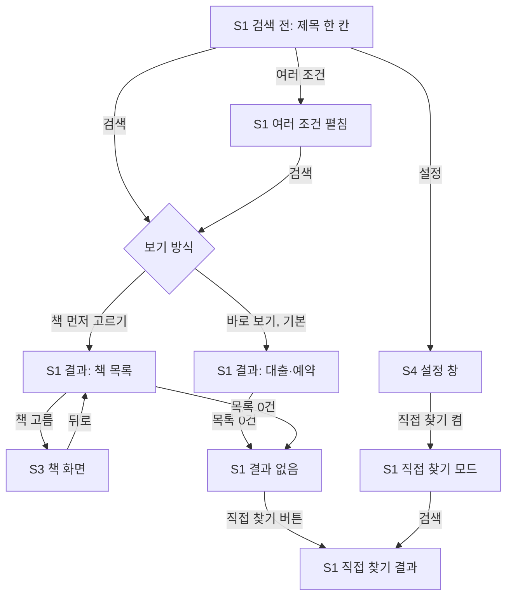

# 화면 흐름: 사이클 04 AND 검색 (제목·저자·출판사 여러 조건)

- 사이클: 04 (`scope.md`, `spec.md`)
- 이 문서는 화면 구조와 상태만 다룹니다. 시각 디자인은 다루지 않습니다.
- 작성일: 2026-09-30
- 사이클 03 화면(`../03-search-conditions/flow.md`)에서 **바뀌는 것만** 적습니다. S1 search가 바뀌고, 새 화면 S3 book과 설정 창 S4 settings가 생깁니다. S2 region-modal(내 지역 설정)은 그대로입니다.



- 그림 읽는 법: "S1 결과: 책 목록" 단계에서는 도서관에 요청하지 않고, "S3 책 화면"(`/books/…`)에서 도서관별 대출·예약을 묻습니다. "S1 직접 찾기 결과"는 사이클 03 방식(도서관 사이트 검색)이고, "S1 직접 찾기 모드"는 쓸 수 없는 입력을 흐리게 한 상태입니다.

- 검색 조건·정렬·필터·지역이 바뀌면 지금처럼 첫 묶음부터 다시 검색합니다 [확정] (사이클 02·03 규칙).
- 설정(보기 방식, 도서관에서 직접 찾기)은 **설정 창**에서 바꾸고 **브라우저에 저장**해 다음 방문에도 유지합니다. 주소에도 남겨 공유할 수 있습니다 [확정] (사용자 선택, 2026-09-30). 검색 조건 자체는 사이클 03처럼 브라우저에 기억하지 않습니다 [확정].

## 화면별 내용

### S1 search

**목적**: 제목(필요하면 저자·출판사도)으로 수집한 책 목록에서 조건에 맞는 책을 찾고, 가진 도서관의 대출·예약 상황을 본다.

**보이는 요소** (사이클 03에서 바뀌는 것)

| 영역 | 내용 | 상태 태그 |
|---|---|---|
| 검색창 | `[ 책 제목을 입력하세요 ] [검색]  여러 조건 ▾  ⚙`. 사이클 03의 조건 드롭다운은 없음 | 드롭다운 없앰 [확정] (사용자), 버튼 이름·위치 [안] |
| 여러 조건 펼침 | 제목·저자·출판사 세 칸. 빈 칸은 조건에서 뺌. 칸마다 "완전 일치" 체크 | [확정] 기능, 모양 [안] |
| 저자 칸 역할 | 저자 칸 아래 체크: 옮긴이 / 그림 / 엮은이 (기본은 모두 꺼짐 = 지은이 + 역할 모름) | [확정] (사용자) |
| 정렬 | 기본 순서 / 출판일 최신순 / 출판일 오래된순. 결과 위 오른쪽 | [확정] 항목, 위치 [안] |
| 목록 기준일 | 결과 위: "○월 ○일 기준 수집 목록" | [안] |
| ⚙ 설정 | S4 설정 창을 엶 | [확정] (사용자 선택) |
| 그 밖의 영역 | 내 지역 줄, "전체 도서관 / 가입 가능한 곳", "방문 없이 가입", 결과 필터, 도서관 요약 줄, 묶음, "더 보기" — 사이클 02·03 그대로 | [확정] |

**화면 예시 1: 바로 보기** (제목 "행동" + 저자 "새폴스키". 도서관과 수량은 설명을 위한 가정)

```
[ 행동                        ] [검색]  여러 조건 ▴  ⚙
  저자 [ 새폴스키     ] □완전 일치   □옮긴이 □그림 □엮은이
  출판사 [            ] □완전 일치
내 지역: 설정 안 함 · 설정
(전체 도서관 | 누구나 가입)  (방문 없이 가입)  (전체 | 지금 빌릴 수 있는 책만)
9월 30일 기준 수집 목록 · 책 1권                         정렬: 기본 순서 ▾

■ 지금 빌릴 수 있어요 (6)
  행동 · 로버트 M. 새폴스키 · 문학동네 · 선경 재고 1
  …
■ 예약하고 기다려요 (2)
  …
```

**화면 예시 2: 책 먼저 고르기** (제목 "행동")

```
9월 30일 기준 수집 목록 · 책 1,442권                     정렬: 기본 순서 ▾
  행동 · 로버트 M. 새폴스키 · 문학동네 · 2023 · 보유 도서관 10곳   >
  행동경제학 · … · 보유 도서관 36곳                               >
  …
        [ 더 보기 ]
```

**사용자 동작**
- 제목만 넣고 검색한다 → 보기 방식에 따라 결과가 나온다.
- "여러 조건"을 눌러 저자·출판사를 채우고 검색한다 → 모든 칸을 만족하는 책만 나온다.
- 칸마다 "완전 일치"를 켜고 끈다, 저자 역할을 켜고 끈다, 정렬을 바꾼다 → 첫 묶음부터 다시 검색한다 [안] (사이클 03의 "바꾸면 바로 다시 검색"과 같은 규칙).
- 책 먼저 고르기에서 책을 누른다 → S3로 간다.
- 결과 0건에서 "도서관에서 직접 찾기"를 누른다 → 채운 칸 중 첫 칸(제목 → 저자 → 출판사) 하나로 사이클 03 방식 검색.

**호출하는 API** (이름만. 상세는 `design-delta.md`)
- 수집 목록 검색 (책 목록, 조건·정렬·필터)
- 바로 보기: 찾은 책을 가진 도서관의 실시간 대출·예약 (묶음, 스트림)
- 도서관에서 직접 찾기: 사이클 03 API 그대로

**상태**

| 상태 | 화면 | 상태 태그 |
|---|---|---|
| 검색 전 | 제목 한 칸, 안내 문구 "책 제목을 입력하세요" | [확정] |
| 여러 조건 펼침 | 세 칸. 검색 전에는 펼쳐도 검색하지 않음 | [안] |
| 입력 오류 | 채운 칸이 하나도 없음: "검색어를 입력하세요" / 칸이 2자 미만·50자 초과: 그 칸 아래 사이클 01 문구 | [안] 문구, 규칙 [확정] |
| 로딩 | 책 목록은 바로 나오고, 바로 보기에서는 대출 상황이 도서관마다 도착하는 대로 채워짐 | [안] |
| 결과 있음 (바로 보기) | 사이클 02·03의 묶음·칸 구성 그대로. 책은 spec 3.5 기본 순서(가입 가능 도서관 책 → 완전 일치 → 보유 도서관 수 → 출판일)로 조회 | [확정] |
| 결과 있음 (책 먼저 고르기) | 책 목록. 책마다 제목·저자·출판사·출판일·보유 도서관 수. 도서관 요청 없음 | [확정] 요청 없음, 표시 항목 [안] |
| 수집 목록 0건 | "조건에 맞는 책이 수집 목록에 없어요 (9월 30일 기준)" + [도서관에서 직접 찾기] | [안] 문구 |
| 도서관 오류·지연 | 그 도서관 줄만 "확인 실패" (사이클 02 그대로). 상세 페이지가 없어진 책도 그 줄만 실패 | [확정] 규칙 |
| 직접 찾기 모드 (설정 켬) | 여러 조건 칸, 완전 일치, 역할, 출판일 정렬, 책 먼저 고르기를 **흐리게** 하고 짧은 이유(예: "도서관 사이트 검색에서는 쓸 수 없어요")를 붙임. 결과 위 안내 줄은 두지 않음 | [확정] (사용자: "흐리게 이것만"), 이유 문구 [안] |
| 직접 찾기 결과 | 사이클 03 화면 그대로 (묶음, 더 보기, 결과 없음 문구) | [확정] |
| 새로고침·공유 주소 | 주소의 조건·설정으로 칸과 체크를 채우고 검색 | [확정] (spec AC-11) |

**배치 메모**
- 데스크톱: 검색창 한 줄 + 오른쪽에 "여러 조건"과 ⚙. 펼치면 검색창 아래에 저자·출판사 줄 [안]
- 태블릿·모바일(1024px·640px 이하): "여러 조건"과 ⚙는 아이콘만. 펼친 칸은 한 줄에 하나씩, 역할 체크는 저자 칸 아래 줄바꿈 [안]

### S3 book (새 화면)

**목적**: 책 먼저 고르기에서 고른 책 한 권의 도서관별 대출·예약 상황을 본다.

- 주소: `/books/{책 식별자}` + 지금 필터·지역 (주소 모양은 design-delta) [안]
- **보이는 요소**: 대표 서지(본제목·저자·출판사·출판일, 목록 기준일) / 도서관별 줄(도서관 이름, 가입 표시, 대출·예약 상황, "도서관에서 보기") / 뒤로 가기 [안]
- **도서관 순서**: 지금 계획 순서(ADR-0027)와 필터(가입 가능한 곳, 방문 없이 가입, 결과 필터) 그대로 [안]
- **호출하는 API**: 그 책을 가진 도서관의 상세 페이지 실시간 조회 (스트림)
- **상태**: 로딩(도서관 줄이 도착하는 대로) / 결과 있음 / 도서관 오류·지연(그 줄만 "확인 실패") / 필터 때문에 도서관 0곳("조건에 맞는 도서관이 없어요") / 없는 책 주소("책을 찾을 수 없어요", 목록으로) [안 문구]
- 배치: 데스크톱은 서지 위, 도서관 줄 아래. 모바일도 같은 순서 [안]

### S4 settings (새 설정 창)

**목적**: 검색 방식을 바꾼다.

| 설정 | 선택지 | 기본 | 상태 태그 |
|---|---|---|---|
| 보기 방식 | 바로 보기 / 책 먼저 고르기 | 바로 보기 | [확정] (사용자 선택) |
| 도서관에서 직접 찾기 | 끔 / 켬 | 끔 | [확정] 기능, 기본 [안] |

- ⚙를 누르면 검색창 아래 작은 창으로 열림. 바꾸면 곧바로 적용되고 결과가 있으면 다시 검색 [안]
- 브라우저에 저장, 주소에도 남김 [확정]. 브라우저 저장을 쓸 수 없으면 기본값으로 동작 [안]

## 수용 기준 대응

| AC (spec.md 5장) | 화면 |
|---|---|
| AC-1 제목 한 칸, 여러 조건, 드롭다운 없음 | S1 검색 전, 여러 조건 펼침 |
| AC-2 제목+저자 AND와 대출 상황 | S1 결과 있음 (바로 보기), 화면 예시 1 |
| AC-3 띄어쓰기 무관 | S1 결과 (API 대조) |
| AC-4 제목 완전 일치 | S1 여러 조건 펼침 → 완전 일치 |
| AC-5 옮긴이·그림·엮은이 선택 | S1 저자 칸 역할 체크 |
| AC-6 기본 순서, 출판일 정렬, 날짜 모름 맨 뒤 | S1 정렬 |
| AC-7 가진 도서관 상세 페이지로만 요청 | 서버 로그 (S1 바로 보기, S3) |
| AC-8 화면 종류 7개 상세 페이지 대조 | S1 바로 보기, S3 도서관 줄 |
| AC-9 0건 버튼, 설정으로 직접 찾기, 흐리게 | S1 수집 목록 0건, S4 → S1 직접 찾기 모드 |
| AC-10 빠진 책·오디오북 제외 | S1 결과 (API) |
| AC-11 주소 유지 | S1 새로고침·공유 주소 |
| AC-12 필터·범위·방문·지역 반영 | S1 그 밖의 영역, S3 도서관 순서 |
| AC-13 호출 예의 | 서버 로그 |
| AC-14 책 먼저 고르기 | S4 보기 방식 → S1 책 목록 → S3 |

**spec 4장 상태별 동작 대응**: 로딩, 결과 없음, 도서관 오류·지연, 입력 오류, 목록 기준일 → S1 상태 표와 S3 상태에 있음.
