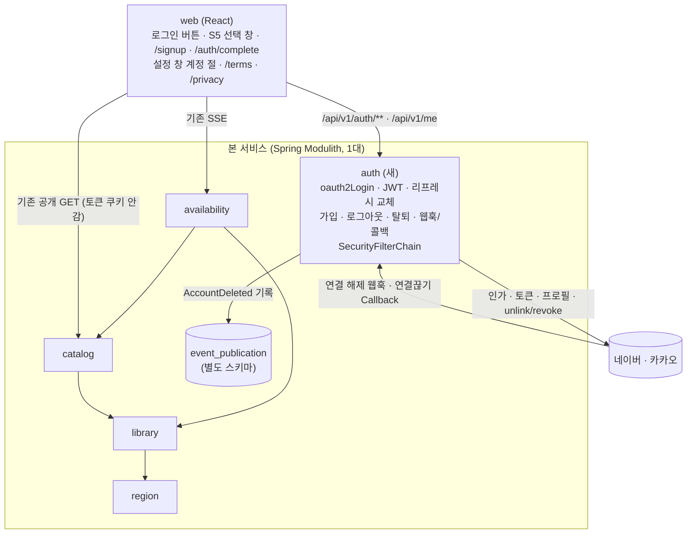
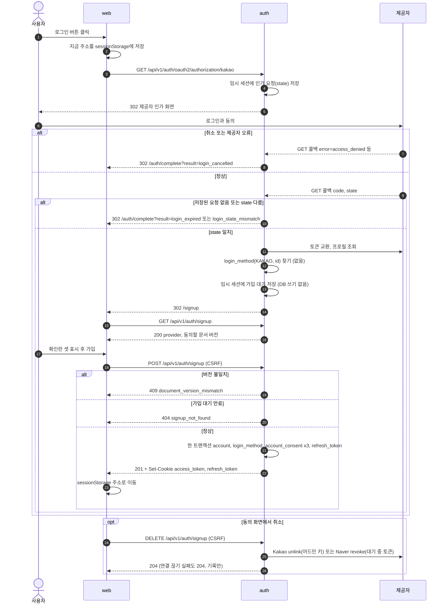
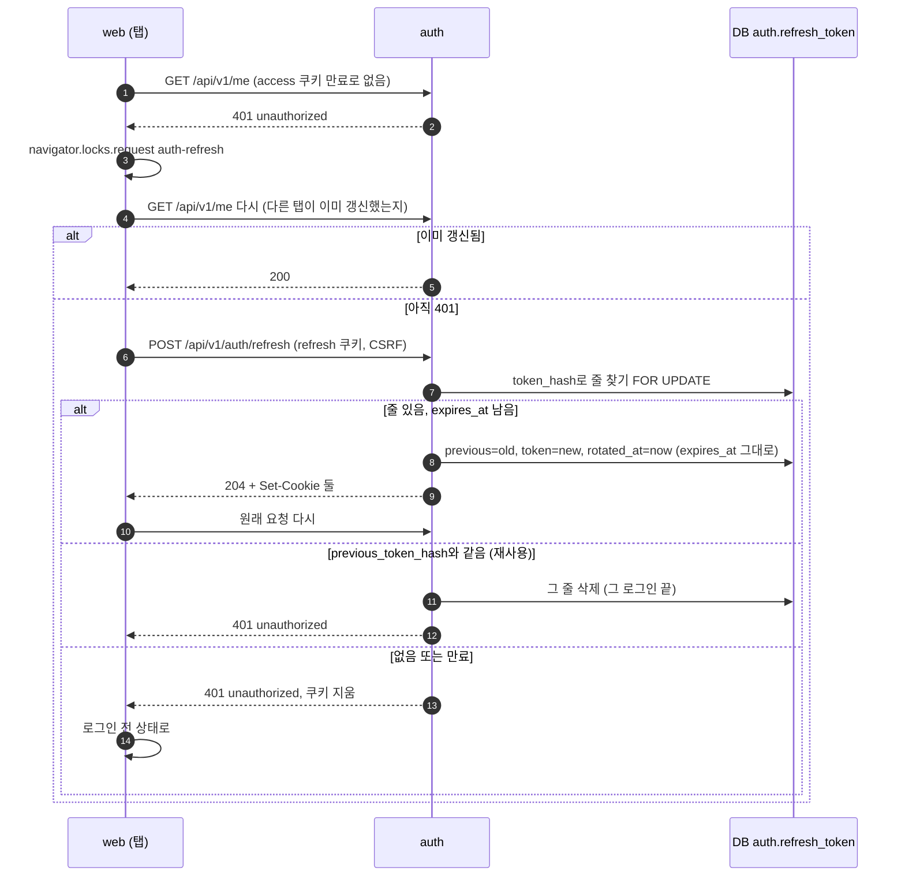
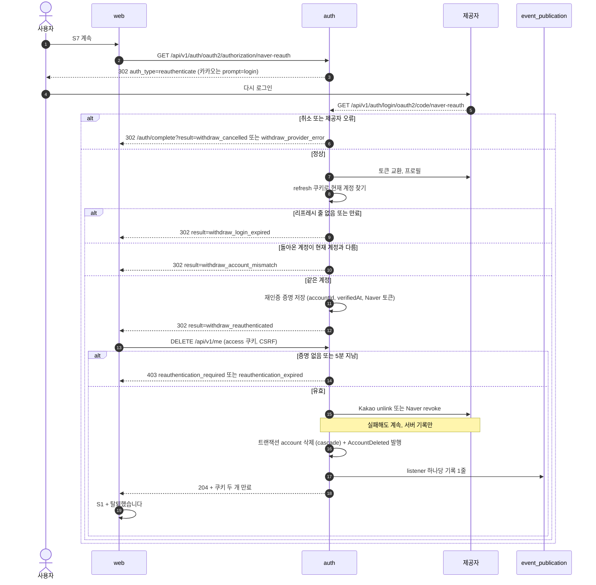
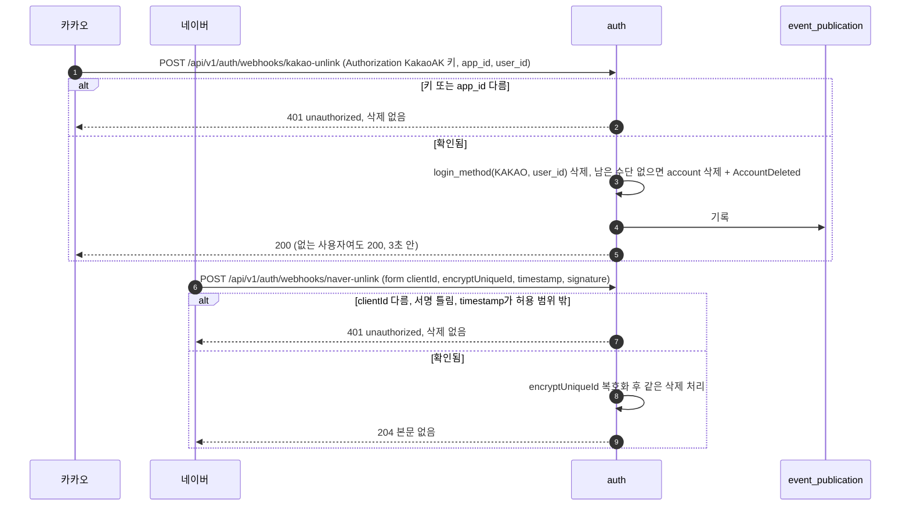
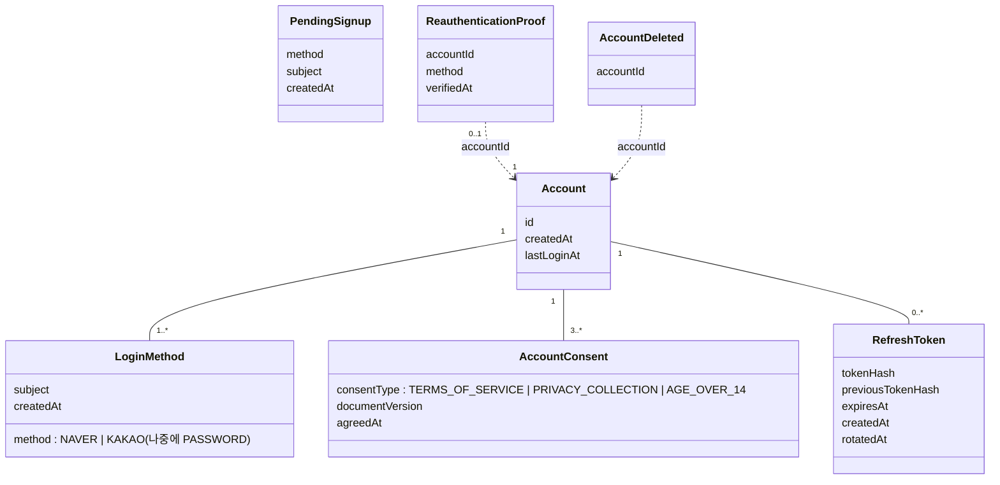
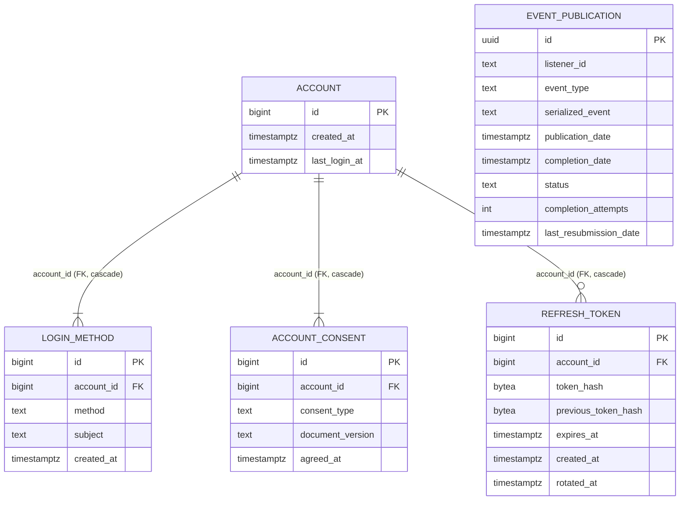

# 설계 제안: 사이클 05 로그인·계정 (`auth` 모듈)

- 작성: 2026-10-04, architect 서브에이전트(읽기 전용). 외부 사실의 확인일은 따로 적지 않으면 모두 2026-10-04입니다.
- 태그: `[확정]` 사용자 결정 또는 공식 문서 확인 / `[안]` 제안 / `[확인 필요]`
- 지난 단계에서 정해진 것(사용자 결정 목록)은 다시 열지 않고 그 결정에 맞춰 설계했습니다. 이 제안에서 **scope 문구와 달라지는 곳이 두 군데**(`POST /logout`, `POST /api/v1/me/consents`의 경로) 있습니다. 결정 9에 표시했고, 사용자 승인이 필요합니다.

---

## 현재 상태 (dev 코드에서 확인, 2026-10-04)

| 항목 | 지금 상태 |
|---|---|
| 모듈 | `region`, `library`, `catalog`, `availability`. `auth`는 아직 없음. 이벤트를 쓰는 곳 없음 |
| 빌드 | `backend/build.gradle`: Spring Boot `4.1.1`, Spring Modulith BOM `2.1.1`(주석 "2.1.x is built against Spring Boot 4.1.x"), Java 25, group `com.chaekcheck`. 의존성: `spring-boot-starter-data-jpa`, `-liquibase`, `-validation`, `-webmvc`, `spring-modulith-starter-core`, caffeine, jsoup, postgresql. 테스트: `spring-modulith-starter-test` 등. **Security, OAuth2, Modulith JDBC 이벤트 저장소는 없음** |
| Liquibase | `db/changelog/db.changelog-master.yaml`은 include만 하고, 모듈별 폴더 `region/`, `library/`, `catalog/`에 `NNN-*.yaml` 파일이 있음. `PRE_DEPLOYMENT` 표지 파일이 있음 |
| 설정 | `application.yml`: `spring.mvc.problemdetails.enabled: true`, `ddl-auto: validate`, `open-in-view: false` |
| 오류 처리 | 루트 패키지에 `ApiExceptionHandler`가 있음(모듈이 `code`를 붙이지 않은 오류에 `code`를 붙임). 다만 Spring Security 필터에서 나는 401/403은 MVC 밖에서 나므로 이 처리기에 오지 않음 |
| 테이블·엔드포인트 | `auth` 쪽은 없음. 기존 공개 API는 모두 인증 없는 GET |
| 웹: API 호출 | `web/src/api/client.ts`의 `getJson()`(`fetch`, `Accept: application/json, application/problem+json`, 실패하면 `readProblem()`이 `ApiError(status, problem.code)`를 던짐). 스트림은 `searchStream.ts`가 `fetch`로 읽음. 모두 GET이고 상대 경로 `/api/v1/...`를 씀. `credentials`를 따로 주지 않으므로 기본값 `same-origin`(같은 출처면 쿠키가 감). CSRF 처리 없음. TanStack Query, react-router 8 `BrowserRouter`(라우트 `/`, `/search`, `/books/:bookId`, 공통 `AppLayout` + `Footer`) |
| 웹: 개발 프록시 | `vite.config.ts`: **`/api`만** `http://localhost:8080`으로 넘기고 `changeOrigin: true`. Spring 기본 OAuth 경로(`/oauth2/...`, `/login/oauth2/...`, `/logout`)는 넘기지 않음. `changeOrigin` 때문에 Spring은 Host를 `localhost:8080`으로 보게 되고, 기본 `{baseUrl}`로 redirect URI를 만들면 5173이 아니라 8080이 들어감 |
| 웹: 설정 창(S4) | `features/search/SettingsPanel.tsx`는 Radix **`Popover`**(⚙ 아래, `side="bottom" align="end"`). 폭 `min(20rem, 100vw - 2rem)`이고 모바일용 미디어 쿼리가 없음 → **폰에서도 버튼 아래로 펼쳐지는 작은 팝오버이고, 가운데 모달도 아래에서 올라오는 창도 아님.** 같은 앱의 `RegionModal`은 Radix `Dialog`이며 데스크톱은 가운데, 640px 이하는 전체 화면(CSS 주석 "mobile: full screen [안]"). **아래에서 올라오는 창(bottom sheet)은 아직 하나도 없음** → S5 모바일 형태는 새 CSS가 필요함 |
| 정적 파일·보안 헤더 | 백엔드에 `static/` 폴더가 없음. 개발 중에는 Vite가 화면을 내려 줌. 운영 배포 구성은 정해지지 않음 → 지금은 보안 헤더를 붙이는 곳이 없음 |

---

## 이번 슬라이스가 요구하는 것

| 요구/수용 기준 | 설계에서 필요한 것 |
|---|---|
| R1, AC-1, AC-4 로그인 시작, 보던 주소로 돌아감 | 제공자별 로그인 시작 주소(`oauth2Login`), `returnTo` 처리(결정 8), 결과를 알려 주는 웹 경로 |
| R2, AC-2, AC-3 동의 전에는 DB에 아무것도 없음, 취소하면 제공자 연결 끊기 | 동의 전 임시 값을 둘 곳(결정 3), 가입 대기 조회·가입·취소 API, 취소할 때 Kakao `unlink` / Naver revoke |
| R3 다시 로그인 | 로그인 수단 표 `(method, subject)` UNIQUE, `last_login_at` 갱신 |
| R4, AC-6, AC-8 JWT 15분 + 리프레시 30일(절대), 교체, 재사용 감지, 쿠키 속성 | 서명 방식·키(결정 1), 검증 위치와 "계정이 아직 있는지" 확인, 리프레시 표 모양, 여러 탭 동시 갱신(결정 2), 쿠키 경로(결정 9) |
| R5, AC-7 로그아웃 | `POST` 로그아웃: 그 브라우저의 리프레시 줄 삭제, 쿠키 두 개 만료, CSRF |
| R6, AC-9, AC-10, AC-12 탈퇴 재인증 5분 | 재인증 요청을 따로 구분(결정 5), 같은 계정인지 확인, 5분 확인, Naver 토큰 보관(결정 3), unlink, 삭제, 이벤트 |
| R7, AC-13, AC-14 웹훅·콜백 | Kakao `KakaoAK` 헤더 확인, Naver HmacSHA256 서명과 AES 복호화, CSRF 제외, 같은 요청이 다시 와도 결과가 같게(멱등) |
| R8, AC-15 `AccountDeleted` 저장소 기록 | JDBC 발행 저장소와 Liquibase 표. **받는 쪽이 없으면 기록이 생기지 않는 문제가 있음**(결정 7) |
| R9, AC-17 기존 API 그대로 | Security를 넣어도 기존 경로는 `permitAll`, 공개 API에는 토큰이 아예 가지 않게(결정 9), 기본 헤더가 바꾸는 점 확인 |
| R10, AC-16 약관·처리방침 버전 | 동의 기록에 문서 버전을 남김, 서버가 현재 버전을 가지고 맞는지 검사 |
| 실패 이유 구분(로그인 4가지, 탈퇴 7가지) | 이유 코드 목록과 웹에 전하는 방법(결정 8) |
| AC-18 `auth`는 아무 모듈에도 의존하지 않고, 아무 모듈도 `auth`에 의존하지 않음 | 보안 설정을 `auth` 안에 두되 다른 모듈의 경로는 문자열 규칙으로만 다룸 |

---

## 결정 1: JWT 서명 방식, 키 보관, 검증 방법

### A안: HS256, 키는 환경 변수 하나 [안]
- 변경 내용: 비밀 키 하나(32바이트 이상 무작위 값을 base64로, 환경 변수 `<AUTH_JWT_SECRET>` [안 이름])로 `NimbusJwtEncoder.withSecretKey`(발급)와 `NimbusJwtDecoder.withSecretKey`(검증)를 만듦
- 장점: 발급하는 곳과 검증하는 곳이 같은 앱 하나뿐이므로 공개키가 필요 없음. 설정이 가장 적음
- 단점: 나중에 다른 서비스가 토큰을 검증하려면 비밀 키를 나눠 가져야 함
- 되돌리는 비용: 작음. 액세스 토큰이 15분짜리라 키나 알고리즘을 바꿔도 길어야 15분 동안 401 → 자동 갱신으로 새 토큰을 받음. 리프레시 토큰은 DB 값이라 영향 없음
- 나중에 서비스로 분리할 때: `auth` 서비스만 발급하고 다른 서비스가 검증하게 되면 ES256으로 바꾸고 JWKS를 공개
### B안: ES256 또는 RS256, 키 쌍(PEM 파일이나 환경 변수)
- 장점: 검증하는 쪽에 공개키만 주면 됨. 분리할 때 그대로 씀
- 단점: 키 쌍 생성·보관·형식 처리가 늘어남. 이번 사이클에는 검증하는 쪽이 하나뿐이라 얻는 것이 없음
- 되돌리는 비용: A와 같음(15분)
### 추천: A안 [안]
- 이유: 발급과 검증이 한 앱에서만 일어나고, 키 교체 비용이 15분이라 나중에 바꿔도 거의 손해가 없습니다. 사용자 메모 "단순한 안을 먼저"에 맞습니다.
- 근거: RFC 7518 §3.2 "A key of the same size as the hash output (for instance, 256 bits for "HS256") or larger MUST be used" [확정] (https://www.rfc-editor.org/rfc/rfc7518.html). `NimbusJwtEncoder.withSecretKey`는 Spring Security 7.0부터 있음 [확정, `research.md` 8절].
- **키 교체 절차(R4 "설계에서 정함")** [안]: 환경 변수를 바꾸고 재시작합니다. 옛 키로 서명된 액세스 토큰은 401 → 웹이 갱신 → 새 키로 발급됩니다. 키를 두 개 동시에 받는 구성(`kid`)은 넣지 않습니다(자동 교체는 비목표).
- **액세스 토큰 내용** [안]: `sub` = 계정 번호(문자열), `iat`, `exp`(발급 + 15분 [확정]). `iss`·`aud`·로그인 번호는 넣지 않습니다. 계정 번호와 만료 말고 개인정보는 없습니다(AC-8).

### 검증 방법: Resource Server인가, 직접 만든 필터인가
- **A안 [안, 추천]**: `oauth2ResourceServer().jwt()`를 쓰고, 쿠키에서 토큰을 읽는 `BearerTokenResolver`를 직접 구현합니다. Spring에 쿠키용 resolver는 없습니다. 공식 문서에 있는 것은 `DefaultBearerTokenResolver`와 `HeaderBearerTokenResolver`뿐입니다 [확정] (https://docs.spring.io/spring-security/reference/servlet/oauth2/resource-server/bearer-tokens.html, 7.1.1). "계정이 아직 있는지" 확인은 `jwtAuthenticationConverter`(`Converter<Jwt, AbstractAuthenticationToken>`)에서 `auth.account`를 PK로 조회하고, 없으면 `InvalidBearerTokenException` → 401로 합니다. 서명, `exp`, 시계 오차(기본 60초)는 Spring이 검증합니다 [확정, `research.md` 12절 11번].
- B안: `OncePerRequestFilter`를 직접 만들어 파싱·검증. 코드는 늘고 얻는 것이 없습니다.
- Expo 앱(나중): resolver가 "쿠키가 없으면 `Authorization` 헤더"를 읽게 넓히면 됩니다. 지금 고르는 것이 앱을 막지 않습니다.
- 주의 [확인 필요: 프로토타입]: 토큰이 붙어 있으면 `permitAll` 경로에서도 잘못된 토큰 때문에 401이 나는지 공식 문서에 적혀 있지 않습니다. 그래서 결정 9처럼 **공개 API에는 토큰 쿠키가 아예 가지 않게** 설계합니다(AC-17 보호).
- 시계 오차 60초 때문에 로그아웃 뒤 남는 틈은 최대 약 16분입니다. 알고 받아들인 한계(15분)에 이 1분을 덧붙여 적습니다 [안].

---

## 결정 2: 리프레시 토큰 저장과 여러 탭 동시 갱신

### 저장 모양: 정할 것이 없음
- "브라우저 하나에 한 줄" [확정]이므로 줄 모양은 하나로 정해집니다. 한 줄 = 한 브라우저 로그인이고, **지금 값의 해시와 바로 앞 값의 해시**를 함께 둡니다.
  - 갱신: `token_hash`로 줄을 찾음(`FOR UPDATE`) → `expires_at`이 지나지 않았으면 새 값을 만들고 `previous_token_hash ← token_hash`, `token_hash ← 새 해시`, `rotated_at ← now`. **`expires_at`은 바꾸지 않음**(로그인한 때부터 30일 절대 만료 [확정])
  - 재사용 감지: `token_hash`에는 없고 `previous_token_hash`와 같으면 → 그 줄 삭제(그 로그인 끝) → 401 [확정 규칙]
  - 두 번 이상 전의 값은 어느 줄과도 맞지 않아 그냥 401이 됩니다(감지는 바로 앞 값까지) [안: 알고 받아들이는 한계]
- **원문 대신 해시를 저장** [안]: 256비트 무작위 값(CSPRNG)의 SHA-256 해시를 `bytea`로 둡니다. 엔트로피가 높아 salt나 느린 해시는 필요 없습니다. DB가 새어도 그 값으로 갱신할 수 없습니다. 원문 저장보다 코드가 한 줄 늘 뿐이라 따로 비교하지 않습니다. 근거: ASVS 7.2.3, reference token은 CSPRNG 128비트 이상 [확정, `research.md` 8절].

### 동시 갱신 처리: 정할 것이 있음
### A안: 웹이 한 번에 한 탭만 갱신 (Web Locks) [안]
- 변경 내용: 401을 받으면 `navigator.locks.request('auth-refresh', …)` 안에서 ① 원래 요청을 한 번 다시 보내 봄(다른 탭이 방금 갱신했으면 쿠키가 이미 새것) ② 그래도 401이면 `POST …/refresh` ③ 원래 요청을 다시 보냄. 같은 탭 안에서도 같은 잠금을 씀
- 장점: 서버 규칙("재사용하면 끊음")이 엄격한 그대로 유지됨. 서버 코드가 늘지 않음
- 단점: 갱신 응답이 네트워크에서 사라지면(서버는 교체했는데 브라우저는 못 받음) 다음 갱신이 재사용으로 판정돼 그 브라우저가 로그아웃됨(드묾)
- 근거: Web Locks는 "no other script executing in the same origin can acquire the same lock"이고, 보안 컨텍스트에서만 쓸 수 있으며 Baseline Widely available(2022-03부터) [확정] (https://developer.mozilla.org/en-US/docs/Web/API/Web_Locks_API). `http://localhost`도 보안 컨텍스트임 [확인 필요: 개발 환경에서 시험]
- 되돌리는 비용: 웹 코드 한 곳
### B안: 서버가 짧은 유예 시간을 줌 (바로 앞 값을 N초 동안 받음)
- 변경 내용: `previous_token_hash`로 온 요청이 `rotated_at`으로부터 N초 안이면 재사용으로 보지 않고 새 값을 한 번 더 발급
- 장점: 응답이 사라진 경우까지 구해 냄. Auth0의 "Reuse Interval(leeway)"이 같은 생각이며 기본값은 꺼짐 [확정] (https://auth0.com/docs/secure/tokens/refresh-tokens/configure-refresh-token-rotation)
- 단점: "재사용하면 끊음" 규칙 [확정]에 N초짜리 예외가 생기므로 **사용자 승인이 필요함**. N값 [확인 필요]
### C안: DB 줄 잠금만
- 줄 잠금은 요청을 순서대로 처리할 뿐이라, 뒤에 온 탭의 옛 값은 결국 재사용으로 판정됩니다. 혼자서는 문제를 풀지 못합니다(A나 B와 함께 쓸 때만 의미가 있음)
### 추천: A안 [안] (서버의 `FOR UPDATE`는 같은 줄을 두 번 교체하지 않게 하는 용도로 함께 둠)
- 이유: 사용자가 정한 재사용 규칙을 바꾸지 않고 웹에서만 해결합니다. 응답 유실로 로그아웃되는 드문 경우를 받아들일지는 사용자 결정입니다.

---

## 결정 3: 로그인 도중 임시 값을 둘 곳

여기서 말하는 임시 값은 세 가지입니다. ① OAuth 인가 요청(`state`, PKCE를 켜면 `code_verifier`) ② 동의 전 가입 대기 값(method, subject, Naver면 취소할 때 연결을 끊을 Naver 액세스 토큰, 시각) ③ 탈퇴 재인증 증명(accountId, method, 확인 시각, Naver면 연결 끊기용 액세스 토큰).

### A안: 로그인 도중에만 쓰는 짧은 서버 세션 (메모리 `HttpSession`) [안]
- 변경 내용: Spring 기본 `HttpSessionOAuth2AuthorizationRequestRepository`를 그대로 쓰고, ②③도 세션 속성에 둠. 로그인 상태(SecurityContext)는 세션에 저장하지 않음(`RequestAttributeSecurityContextRepository`). 완료·취소 때 세션 무효화. 세션 수명은 짧게 `<10분>` [안]. ADR-0021과 같은 방식으로 `PendingAuthStore` 같은 인터페이스 뒤에 두고 구현은 메모리
- 장점: 인가 요청을 직렬화하는 코드가 없음. Naver 토큰이 브라우저로 나가지 않음. 세션 만료 때(`HttpSessionListener`) 버려진 가입 대기의 제공자 연결을 끊을 수 있음(spec 확인 필요 항목 "동의 화면을 떠난 사용자의 연결 끊기 시점"의 답이 됨). "로그인 기록 없음(만료)"과 "`state` 불일치"를 감싸는 repository에서 구분할 수 있음
- 단점: 서버를 재시작하면 진행 중이던 로그인은 "로그인 시간이 지났어요"로 끝남. **여러 대가 되면 sticky session(로드밸런서 설정)이 필요하거나 B안으로 바꿔야 함**
- 되돌리는 비용: 작음(인터페이스 구현 교체. 값의 수명이 몇 분이라 옮길 자료가 없음)
- 나중에 서비스로 분리할 때: `auth` 서비스 안의 일이라 다른 서비스와 상관없음
### B안: 암호화하고 서명한 짧은 쿠키 (JWE `dir`+`A256GCM` 등, 키는 환경 변수)
- 변경 내용: 쿠키 기반 `AuthorizationRequestRepository`를 직접 구현(Spring이 주는 것 없음: "To use a custom implementation… `CustomOAuth2AuthorizationRequestRepository`" [확정] https://docs.spring.io/spring-security/reference/servlet/oauth2/client/authorization-grants.html, 7.1.1). ②③도 암호화 쿠키에 둠
- 장점: 서버가 상태를 갖지 않음. 여러 대여도 그대로 동작함. 사용자가 JWT를 고른 이유와 맞음 — 사용자: "세션을 쓰더라도 나중에 확장될 멀티 서버 환경에서 redis등이 필요해지는데 음 가능하면 줄이고 싶어" (2026-10-03)
- 단점: 직렬화·암호화 코드를 직접 책임짐(`code_verifier`와 Naver 토큰이 들어가므로 암호화가 필수). 버려진 가입 대기를 서버가 알 수 없어 그때 제공자 연결을 끊을 수 없음. 쿠키 크기를 관리해야 함
- 되돌리는 비용: 작음
### C안: DB 표에 TTL을 두고 저장
- "가입 전에는 DB에 아무것도 없음" [확정]과 충돌합니다(②). ①③만 DB에 두는 혼합안도 있으나 표가 늘어나므로 추천하지 않습니다
### 추천: A안 [안]
- 이유: 본 서비스는 지금 1대이고(ADR-0021), 몇 분짜리 값이라 나중에 바꾸는 비용이 작습니다. 버려진 가입 대기의 연결 끊기도 A에서만 됩니다. **다만 사용자가 말한 "여러 대에서 Redis 줄이기"와 정면으로 맞는 것은 B입니다.** 어느 쪽이 더 중요한지는 사용자가 정할 일입니다.

---

## 결정 4: OAuth 2.0 + 프로필 API인가, OIDC인가

| | A안: 두 제공자 모두 OAuth 2.0 + 프로필 API [안] | B안: 두 제공자 모두 OIDC | C안: 카카오만 OIDC |
|---|---|---|---|
| 식별자 | Naver `/v1/nid/me`의 `response.id`, Kakao `/v2/user/me`의 `id` | ID 토큰 `sub` | 섞임 |
| 확인된 사실 | 프로필 `id`는 항상 옴 [확정, `research.md` 2절] | Kakao `sub` = "ID 토큰에 해당하는 사용자의 회원번호" [확정] (https://developers.kakao.com/docs/ko/kakaologin/rest-api). **Naver `sub`가 프로필 `id`와 같은지는 문서에 없음** [확인 필요] (https://github.com/naver/naver-openapi-guide/blob/master/ko/login/devguide/devguide.md 3.5절) | — |
| 장점 | 두 제공자가 같은 방식. Naver 응답이 `response`로 중첩된 것만 맞추면 됨 [확정, A3-1]. 이미 검증된 식별자를 씀 | 재인증 시각(`auth_time`)을 받을 수 있음(카카오) | 카카오만 재인증 확인이 강해짐 |
| 단점 | 재인증이 실제로 일어났는지 서버가 확인할 근거가 없음(`prompt=login`, `auth_type=reauthenticate`를 믿음) | Naver `sub`가 `id`와 다르면, 다른 방식으로 바꿀 때 이미 가입한 사람과 연결이 끊김 | 두 갈래 코드 |
| 되돌리는 비용 | 나중에 OIDC로 갈 때 `sub`와 `id`가 같다는 것만 확인하면 됨 | **큼**(식별자가 다르면 기존 계정과 연결이 끊김) | 중간 |

### 추천: A안 [안]
- 이유: 저장하는 식별자 자체가 확인된 값이어야 합니다. Naver `sub`는 확인하지 못했습니다.
- PKCE: Spring 7.1.1 문서는 "To disable PKCE for Confidential Clients… `requireProofKey(false)`"라고 안내합니다. 7.x에서 confidential client의 기본값이 켜짐인지는 확인하지 못했습니다 [확인 필요: 프로토타입]. 설계: Naver는 호출 시험에서 받으면 켜고, Kakao는 문서에 파라미터가 없으니 끕니다 [안, `research.md` 1절].
- 한계 [안: 알고 받아들임]: 재인증 강제는 제공자 파라미터를 믿는 수준입니다. 브라우저를 쥔 공격자가 파라미터를 지우는 경우는 막지 못합니다.

---

## 결정 5: 탈퇴 재인증을 Spring Security로 하는 방법

### A안: 재인증 전용 client registration을 따로 둠 (`naver-reauth`, `kakao-reauth`) [안]
- 변경 내용: client id·secret은 같고, `authorization-uri`에 고정 파라미터를 붙임(Naver `auth_type=reauthenticate`, Kakao `prompt=login`). Spring 문서도 고정 파라미터는 authorization-uri에 붙이는 방법을 안내함 [확정] (authorization-grants.html "Customizing the Authorization Request"). 목적은 `OAuth2AuthenticationToken.getAuthorizedClientRegistrationId()`나 콜백 경로 `/…/code/{registrationId}`로 구분함. **취소(`error=access_denied`)로 돌아올 때도 경로로 목적을 알 수 있음**
- 장점: 성공·실패 처리기에서 목적 구분이 간단함. 사용자 지정 resolver가 필요 없음
- 단점: 제공자 콘솔에 redirect URI를 두 개 더 등록해야 함(Naver Callback URL을 여러 개 등록할 수 있는지 [확인 필요: 콘솔])
### B안: registration 하나 + 사용자 지정 `OAuth2AuthorizationRequestResolver` (`?purpose=withdraw` → `additionalParameters` + attribute)
- 장점: redirect URI가 늘지 않음
- 단점: 인증이 끝난 뒤의 성공 처리기에서 인가 요청 attribute를 읽기 어려움. repository를 감싸 따로 넘겨야 하고, 취소로 돌아온 경우에도 목적을 알아내는 코드가 따로 필요함
### 추천: A안 [안]

### 흐름 (A안 기준)
1. S7 "계속" → 웹이 `GET /api/v1/me`의 `loginMethods`로 제공자를 알아 `location.assign('/api/v1/auth/oauth2/authorization/{provider}-reauth')`로 이동
2. 돌아온 콜백(성공 처리기, `*-reauth`):
   - **같은 계정 확인**: 이 브라우저의 리프레시 쿠키(Path가 `/api/v1/auth`이고 `Lax`라 최상위 GET 이동이면 붙음)로 유효한 리프레시 줄을 찾아 현재 accountId를 얻음 → 돌아온 `(method, subject)`의 accountId와 같아야 함
   - 줄이 없거나 만료됐으면 `withdraw_login_expired`, 다르면(또는 연결된 계정이 없으면) `withdraw_account_mismatch`
   - 같으면 **재인증 증명** `{accountId, method, verifiedAt, naverAccessToken?}`을 임시 저장소(결정 3)에 두고 `/auth/complete?result=withdraw_reauthenticated`로 보냄
3. 웹은 "탈퇴 처리 중"을 보이며 `DELETE /api/v1/me`(액세스 토큰 + CSRF)
4. 서버: JWT `sub` == 증명의 accountId, `now - verifiedAt ≤ 5분` [확정 5분] → 아니면 403 `reauthentication_required` / `reauthentication_expired`
5. 제공자 연결 끊기(트랜잭션 밖, 실패하면 로그만 남김 [확정]): Kakao는 `POST /v1/user/unlink`, `Authorization: KakaoAK <서비스 앱 어드민 키>`, `target_id_type=user_id`, `target_id` [확정] / Naver는 **2단계에서 받은 액세스 토큰**으로 `/oauth2.0/revoke` [확정, `research.md` 데이터 출처]
6. 한 트랜잭션: `auth.account` 삭제(같은 스키마 FK cascade로 로그인 수단·동의·리프레시 줄이 모두 지워짐) + `AccountDeleted` 발행 → 커밋
7. 쿠키 두 개 만료, 증명 삭제 → 204

- 재인증 콜백도 Spring의 oauth2Login 성공 처리라서 **새 로그인을 만들지 않게** 처리기에서 분기해야 합니다(토큰 발급 없음).

---

## 결정 6: 로그인 수단 표 (소셜 전용이 되지 않게)

### A안: 공통 칸 `method` + `subject`. 나중에 비밀번호는 세부 표를 1:1로 더함 [안]
- `auth.login_method(method, subject)`. 소셜은 `subject` = 제공자 쪽 번호. 나중의 이메일·비밀번호는 `method='PASSWORD'`, `subject` = 정규화한 로그인 이메일, 비밀번호 해시는 새 표 `auth.password_credential(login_method_id PK/FK, password_hash, …)`
- 장점: 지금 표에 소셜 전용 이름(`provider`, `provider_user_id`)이 없음. 나중에 고칠 것은 CHECK 값 하나 추가와 새 표뿐. 비밀은 따로 둠
- 단점: `subject`라는 이름이 덜 직관적임
### B안: 같은 공통 칸 + 나중에 `secret_hash` 같은 nullable 칸을 이 표에 더함
- 장점: 표가 하나. 단점: 종류별 nullable 칸과 CHECK가 늘어남
### C안: `social_login` 표 + 나중에 `password_login` 표
- 결정(소셜 전용 금지 [확정])에 어긋나므로 뺌
### 추천: A안 [안]
- 지금 만드는 것은 공통 표 하나뿐이고, A와 B 중 무엇으로 할지는 직접 가입 사이클에서 정해도 됩니다. **이번에 정할 것은 칸 이름을 공통으로 짓는 것**입니다.

---

## 결정 7: `AccountDeleted` 저장소 기록(AC-15)과 저장소 표의 위치

### 받는 쪽이 없으면 기록이 생기지 않음 (중요)
- 공식 문서: "On event publication, it finds out about the transactional event listeners that will get the event delivered and writes entries for each of them" [확정] (https://docs.spring.io/spring-modulith/reference/events.html, 2.1.1). 기록은 **listener 하나마다** 하나씩 생깁니다. listener가 0개면 기록도 0개입니다(문서가 직접 말하지는 않으나 위 문장에서 나오는 결론. [확인 필요: 테스트로 확인]).
- 그래서 지금 AC-15("계정이 지워질 때마다 저장소에 `AccountDeleted` 기록이 생긴다")는 그대로는 통과할 수 없습니다.

| | A안: `auth` 안에 최소 listener 하나 [안] | B안: AC-15를 바꿈 | C안: 제공자 연결 끊기를 listener로 |
|---|---|---|---|
| 내용 | `@ApplicationModuleListener`로 "계정 삭제됨(accountId)"을 서버 기록에 남기는 처리기 | 저장소 표는 만들되, 이번에는 테스트에서 `PublishedEvents`/`Scenario`로 발행만 확인. 표 기록은 사이클 06부터 | 커밋 뒤에 unlink를 비동기로 하고, 실패하면 저장소가 다시 보냄 |
| 장점 | AC-15가 그대로 통과함. 영속 경로(쓰기→완료)를 지금 실제로 시험함 | 하는 일 없는 코드가 없음 | 재시도가 생김 |
| 단점 | 하는 일이 거의 없는 listener | AC 변경에 사용자 승인 필요. 영속 경로는 06에서 처음 돌아감 | 이벤트에 제공자 번호와 Naver 토큰이 들어가 **DB에 제공자 토큰이 저장됨**(결정과 충돌). R6 순서와도 달라짐 |
### 추천: A안 [안]

### 표 위치
- 공식 DDL(PostgreSQL, 2.1.1) [확정] (https://docs.spring.io/spring-modulith/reference/appendix.html "schemas"): `event_publication(id UUID PK, listener_id TEXT NOT NULL, event_type TEXT NOT NULL, serialized_event TEXT NOT NULL, publication_date TIMESTAMPTZ NOT NULL, completion_date TIMESTAMPTZ, status TEXT, completion_attempts INT, last_resubmission_date TIMESTAMPTZ)`, 인덱스 `event_publication_serialized_event_hash_idx … USING hash(serialized_event)`, `event_publication_by_completion_date_idx (completion_date)`. archive 모드면 같은 모양의 `event_publication_archive`
- 속성 [확정, 같은 appendix]: `spring.modulith.events.jdbc.schema`("If not specified, the table will not be schema-qualified"), `spring.modulith.events.jdbc.schema-initialization.enabled`(기본 true → **false로 두고 Liquibase로 만듦**), `completion-mode`(update 기본 / delete / archive), `republish-outstanding-events-on-restart`(기본 false, "Usually not recommended in multi-instance deployments")
- A안 [안]: 어느 모듈에도 속하지 않는 별도 스키마 `<modulith>` [안 이름]에 두고 `spring.modulith.events.jdbc.schema`로 지정. Liquibase `db/changelog/modulith/001-event-publication.yaml`(hash 인덱스는 YAML이 지원하지 않으므로 `sql` changeset). `member`의 이벤트도 같은 표를 씀
- B안: `auth` 스키마에 둠 → 사이클 06부터 다른 모듈 이벤트까지 `auth` 스키마에 쌓여 "모듈이 자기 표만 가짐"과 어긋남
- C안: `public` 스키마(속성 미지정) → 가장 단순하지만 모듈 스키마 규칙에 예외가 생김
- 추천: A안 [안]. 완료 모드는 기본값 `update` [안] (AC-15 확인용으로 완료된 줄이 남아야 함). 완료된 줄의 보관 기간과 정리 방법은 [확인 필요] — 지워진 계정 번호가 남기 때문에 처리방침 문구와 같이 정합니다(backlog 후보)
- 의존성: `spring-modulith-starter-jdbc` [확정 이름, events.html], 버전은 BOM `2.1.1`이 관리

---

## 결정 8: 실패 이유를 웹에 전하는 방법과 돌아올 주소

### A안: 고정 웹 경로 + 쿼리 코드 `/auth/complete?result=<code>` [안]
- 서버는 항상 이 경로로 보냄(가입 대기면 `/signup`). 웹은 문구를 보이고 `history.replace`로 쿼리를 지움
- **돌아올 주소**: 웹이 로그인 버튼을 누를 때 지금 주소를 `sessionStorage`에 넣고, `/auth/complete`에서 꺼내 이동. 서버는 `returnTo`를 받지 않음 → 서버 쪽 open redirect 위험이 없음. 꺼낸 값은 `/`로 시작하고 `//`로 시작하지 않는 경로만 씀
- 장점: 가장 단순함. 코드에는 비밀이 없음. 단점: 주소창과 기록에 코드가 잠깐 보임
### B안: 짧은 쿠키(HttpOnly 아님)에 코드를 넣고 JS가 읽은 뒤 지움
- 단점: 웹이 쿠키를 읽게 되어 research 10절의 "웹은 쿠키를 읽지 않음" 원칙이 깨짐
### C안: 서버 임시 저장소에 두고 웹이 `GET`으로 가져옴
- 단점: 요청이 하나 늘고 임시 저장소가 필요함
### 추천: A안 [안]

### 이유 코드 [안] (snake_case, 문구는 spec·flow의 [확정] 문구에 대응)
| 코드 | 어디서 | 화면 문구 |
|---|---|---|
| `login_success` | 콜백 | 없음(보던 주소로) |
| `login_cancelled` | 콜백 `error=access_denied` | 로그인을 취소했어요 |
| `login_provider_error` | 콜백: 제공자 `error`(취소 말고), 토큰 교환·프로필 실패 | 네이버(카카오) 쪽 문제로… (제공자 이름은 경로의 registrationId로 정함: `&provider=naver`) |
| `login_expired` | 저장된 인가 요청이 없음 | 로그인 시간이 지났어요… |
| `login_state_mismatch` | 저장된 요청은 있는데 `state`가 다름 | 안전하지 않은 로그인 요청이라… |
| `withdraw_reauthenticated` | 재인증 콜백 성공 → 웹이 DELETE 호출 | 탈퇴 처리 중 |
| `withdraw_account_mismatch` | 재인증 콜백 | 가입한 계정으로 확인해 주세요 |
| `withdraw_cancelled` | 재인증 콜백 `access_denied` | 탈퇴를 취소했어요 |
| `withdraw_provider_error` | 재인증 콜백 | 네이버(카카오) 쪽 문제로 본인 확인을… |
| `withdraw_login_expired` | 재인증 콜백: 리프레시 줄 없음 / DELETE 401 뒤 갱신 실패 | 로그인이 풀렸어요… |
| (API) `reauthentication_expired` 403 | `DELETE /api/v1/me` | 본인 확인 시간이 지났어요… |
| (API) `internal_error` 500 | `DELETE /api/v1/me` | chaekcheck 서버 문제로… |
| (웹) 네트워크 | `fetch` 예외 | 인터넷 연결을 확인하고… |

- `login_expired`와 `login_state_mismatch` 구분 [안]: Spring 기본 세션 repository는 `state`로 찾지 못하면 둘 다 "요청 없음"(`authorization_request_not_found`)으로 처리하는 것으로 압니다 [확인 필요: Spring Security 소스 확인]. 그래서 repository를 감싸서 "세션에 저장된 요청이 아예 없음" → expired, "있는데 `state`가 다름" → mismatch로 나눕니다.
- 실패 처리기는 Spring 오류 코드(`access_denied` 등)를 위 코드로 바꾸고, 원래 내용은 서버 기록에만 남깁니다. Naver가 취소했을 때 정확히 어떤 `error` 값을 보내는지는 [확인 필요: 호출 시험].

---

## 결정 9: 인증 경로의 접두어와 쿠키 경로 (scope 문구가 바뀜)

### A안: 인증 흐름 전부를 `/api/v1/auth/**` 아래에 둠. 토큰 쿠키는 경로를 좁힘 [안]
- Spring 기본 경로를 바꿈: `authorizationEndpoint.baseUri("/api/v1/auth/oauth2/authorization")`, `redirectionEndpoint.baseUri("/api/v1/auth/login/oauth2/code/*")`. 로그아웃은 `POST /api/v1/auth/logout`(scope의 `POST /logout`을 바꿈), 가입은 `POST /api/v1/auth/signup`(scope의 `POST /api/v1/me/consents`를 바꿈. 동의하는 순간에는 계정이 없어 "me"가 아니기 때문)
- 쿠키 [안 이름]:
  - 액세스 `access_token`: `Path=/api/v1/me`, `Max-Age=900`
  - 리프레시 `refresh_token`: `Path=/api/v1/auth`, `Max-Age=남은 로그인 기간`
  - 둘 다 `Secure; HttpOnly; SameSite=Lax`, `Domain` 없음 [확정]
  - MDN: `Path=/docs`면 `/docs/Web/`은 맞고 `/docsets`는 맞지 않음 [확정] (https://developer.mozilla.org/en-US/docs/Web/HTTP/Reference/Headers/Set-Cookie)
- 장점: **공개 검색 API에는 토큰이 아예 가지 않음** → 잘못되거나 만료된 토큰으로 검색이 401이 될 일이 없음(AC-17). 리프레시 토큰이 가는 곳은 갱신·로그아웃·가입·콜백뿐. Vite 프록시 `/api` 규칙 하나로 끝나고 운영 역방향 프록시도 같음. 사이클 06 `member`의 `/api/v1/me/...`도 자동으로 보호됨
- 단점: `__Host-` 접두어를 쓸 수 없음(`Path=/`가 필수 [확정, 같은 MDN]). 하위 도메인이 없으면 손해가 작음 [확인 필요: 배포 도메인]. 제공자 콘솔에 등록할 redirect URI에 `v1`이 들어감
- 되돌리는 비용: 제공자 콘솔의 redirect URI를 다시 등록해야 함
### B안: Spring 기본 경로(`/oauth2/authorization/*`, `/login/oauth2/code/*`, `/logout`) + 쿠키 `Path=/`
- 장점: 설정이 적고 scope 문구 그대로. `__Host-`를 쓸 수 있음
- 단점: Vite·운영 프록시에 경로 규칙 3개를 더해야 함. 모든 요청에 토큰이 붙으므로 resolver가 보호 경로에서만 읽게 하는 규칙이 필요함
### 추천: A안 [안] — scope의 두 경로 이름이 바뀌므로 사용자 승인이 필요합니다.

---

## 결정 10: 보안 헤더·CSP와 정적 파일을 내려 주는 곳

- 지금: 백엔드는 정적 파일을 내려 주지 않고, 운영 배포는 정해지지 않았습니다. Spring Security 기본 헤더(`Cache-Control: no-cache, no-store, max-age=0, must-revalidate`, `X-Content-Type-Options: nosniff`, `X-Frame-Options: DENY`, HSTS)는 **Spring이 보내는 응답에만** 붙습니다 [확정, `research.md` 11절].
- A안: 운영에서 React 빌드 결과를 Spring Boot가 내려 줌 → 헤더와 CSP를 한 곳(Spring Security `headers`)에서 관리하고, 같은 출처라 CORS가 필요 없음
- B안: 정적 파일은 웹 서버나 CDN, API는 Spring → 헤더를 두 곳에서 관리
- 추천: **이번 사이클에는 정하지 않음** [안]. 배포 사이클에서 정하고(backlog), 이번에는 아래만 합니다.
  - API 응답: Spring 기본 헤더 + `Referrer-Policy: same-origin` [안]
  - CSP 초안 [안, 운영 HTML 응답용]: `default-src 'self'; script-src 'self'; connect-src 'self'; img-src 'self' data:; style-src 'self'; frame-ancestors 'none'; base-uri 'self'; form-action 'self'`. Radix가 `<style>` 요소를 넣는지(스크롤 잠금 등)에 따라 `style-src`를 조정해야 함 [확인 필요: dev가 빌드 결과로 시험]. 제공자 버튼 이미지는 직접 내려 줌
- 기존 API에 주는 영향(AC-17): Security를 넣으면 기존 GET 응답에도 `Cache-Control: no-store` 등이 붙습니다. 지금 캐시 헤더가 없으므로 응답 내용은 같지만 헤더는 늘어납니다 [안: 받아들임. dev가 SSE 스트림이 그대로 동작하는지 확인].

---

## 모듈·데이터·API 초안 (추천안 기준)

### 모듈 표

| 모듈 | 새/변경 | 책임 | 공개 API | 이벤트 | 소유 테이블 |
|---|---|---|---|---|---|
| `auth` | 새 | Naver·Kakao `oauth2Login`, 가입 대기·동의·가입, JWT 발급·검증, 리프레시 교체, 로그아웃, 탈퇴 재인증·삭제, 웹훅·콜백, 앱 전체 `SecurityFilterChain`(보호 경로 `/api/v1/me/**`, 나머지 `permitAll`), 401/403 ProblemDetail | Java: `AccountId`(record, 루트 패키지) [안], `AccountDeleted(accountId)` [확정 이름]. REST: 아래 API 표 | 발행 `AccountDeleted`. 구독: 자기 listener 하나(결정 7 A안) | `auth.account`, `auth.login_method`, `auth.account_consent`, `auth.refresh_token` |
| (공용 인프라) | 새 | Spring Modulith 이벤트 발행 저장소 | — | — | `<modulith>.event_publication` (어느 모듈 소유도 아님) |
| 루트 `ApiExceptionHandler` | 변경 없음 [안] | Security 필터의 401/403은 `auth`의 `AuthenticationEntryPoint`·`AccessDeniedHandler`가 ProblemDetail로 직접 씀 | — | — | — |
| `region`, `library`, `catalog`, `availability` | 변경 없음 | — | — | — | — |

- 패키지 [안]: `com.chaekcheck.auth`(공개 타입) / `auth.internal.web`(컨트롤러, 처리기) / `auth.internal.security`(필터 체인, JWT, resolver, repository 감싸기) / `auth.internal.account`(엔티티·저장소) / `auth.internal.provider`(Naver·Kakao 프로필·unlink·revoke·웹훅 검증)
- 새 의존성(사용자 승인 필요): `spring-boot-starter-security`, `spring-boot-starter-security-oauth2-client`, `spring-boot-starter-security-oauth2-resource-server`(Boot 4에서 옛 `spring-boot-starter-oauth2-*`가 이 이름으로 바뀜 [확인 필요: Boot 4.1 공식 Starters 표. 근거: https://github.com/spring-projects/spring-boot/issues/50294 제목, 제3자 글]), `spring-modulith-starter-jdbc`

### 모듈 구성도

- `auth`에서 다른 모듈로 가는 화살표도, 다른 모듈에서 `auth`로 오는 화살표도 없습니다(AC-18).

### 첫 로그인과 동의

### 토큰 갱신과 교체

### 탈퇴 (재인증)

### 제공자 쪽에서 연결을 끊음

### 도메인 모델

- `PendingSignup`과 `ReauthenticationProof`는 DB가 아니라 임시 저장소(결정 3)에 둡니다. 이번 사이클에는 `LoginMethod`가 계정당 하나뿐입니다(1..*는 구조만).

### 데이터 (스키마 `auth` [안])

**`auth.account`**
| 컬럼 | 타입 | 제약 | 설명 |
|---|---|---|---|
| id | bigint | PK, GENERATED BY DEFAULT AS IDENTITY | JWT `sub` |
| created_at | timestamptz | NOT NULL DEFAULT now() | |
| last_login_at | timestamptz | NOT NULL | 가입·다시 로그인 때 갱신 (R3) |

**`auth.login_method`** [안 이름]
| 컬럼 | 타입 | 제약 | 설명 |
|---|---|---|---|
| id | bigint | PK, IDENTITY | |
| account_id | bigint | NOT NULL, FK → auth.account(id) ON DELETE CASCADE | |
| method | text | NOT NULL, CHECK IN ('NAVER','KAKAO') | 나중에 `PASSWORD` 추가 |
| subject | text | NOT NULL | 그 수단 안의 식별자. 소셜은 제공자 쪽 번호(Kakao 숫자도 문자열로) |
| created_at | timestamptz | NOT NULL DEFAULT now() | |
- UNIQUE `(method, subject)`, INDEX `(account_id)`. 이번에는 계정당 한 줄이고 이것은 앱 코드가 지킵니다(DB에 UNIQUE(account_id)를 걸지 않음. 나중의 연결 기능을 막지 않기 위해) [안]

**`auth.account_consent`**
| 컬럼 | 타입 | 제약 | 설명 |
|---|---|---|---|
| id | bigint | PK, IDENTITY | |
| account_id | bigint | NOT NULL, FK → auth.account(id) ON DELETE CASCADE | |
| consent_type | text | NOT NULL, CHECK IN ('TERMS_OF_SERVICE','PRIVACY_COLLECTION','AGE_OVER_14') [안 값] | 확인란 셋 [확정] |
| document_version | text | NULL | 이용약관·수집 이용 고지 버전. 형식 `<YYYY-MM-DD>` [안] |
| agreed_at | timestamptz | NOT NULL | |
- CHECK: `AGE_OVER_14`가 아니면 `document_version IS NOT NULL` [안]. UNIQUE `(account_id, consent_type, document_version)` NULLS NOT DISTINCT(sql changeset) [안]. INDEX `(account_id)`
- 현재 버전은 서버 설정이 원본 [안]: 웹은 화면에 보인 버전을 보내고, 서버의 현재 버전과 다르면 409

**`auth.refresh_token`** [안 이름]
| 컬럼 | 타입 | 제약 | 설명 |
|---|---|---|---|
| id | bigint | PK, IDENTITY | 브라우저 로그인 하나 |
| account_id | bigint | NOT NULL, FK → auth.account(id) ON DELETE CASCADE | |
| token_hash | bytea | NOT NULL, UNIQUE | SHA-256(현재 값) |
| previous_token_hash | bytea | NULL | 바로 앞 값. 재사용 감지 |
| expires_at | timestamptz | NOT NULL | 로그인 + 30일 [확정], 교체해도 그대로 |
| created_at | timestamptz | NOT NULL DEFAULT now() | 로그인한 때 |
| rotated_at | timestamptz | NULL | |
- INDEX `(previous_token_hash)`, `(account_id)`, `(expires_at)`. 만료된 줄은 하루 한 번 정리 [안: 주기는 확인 필요]

**`<modulith>.event_publication`**: 결정 7의 공식 DDL 그대로(Liquibase 별도 파일).

- Liquibase [안]: `db/changelog/auth/001-auth-schema.yaml`(CHECK, NULLS NOT DISTINCT는 `sql` changeset), `db/changelog/modulith/001-event-publication.yaml`, master에 include 두 줄. 새 파일만 더합니다 [확정].
- JPA 매핑 참고: cascade는 DB FK에 맡기고 JPA 연관 cascade는 쓰지 않습니다. 삭제는 `account` 한 줄 삭제 쿼리로 합니다. 엔티티를 쓸지 `JdbcClient`를 쓸지는 dev가 정합니다.

### API (경로는 결정 9 A안 기준)

| 메서드 | 경로 | 인증 | CSRF | 성공 | 오류 |
|---|---|---|---|---|---|
| GET | `/api/v1/auth/oauth2/authorization/{naver\|kakao\|naver-reauth\|kakao-reauth}` | 없음 | 해당 없음 (GET, 상태 변경 없음) | 302 제공자 | — |
| GET | `/api/v1/auth/login/oauth2/code/{registrationId}` | 없음(`state`로 확인) | 해당 없음 | 302 `/auth/complete?result=…` 또는 `/signup` | 결정 8의 이유 코드 |
| GET | `/api/v1/auth/csrf-token` [안] | 없음 | — | 204 + `XSRF-TOKEN` 쿠키 | — |
| GET | `/api/v1/auth/signup` | 가입 대기(임시 세션) | — | 200 | 404 `signup_not_found` |
| POST | `/api/v1/auth/signup` | 가입 대기 | 필요 | 201 + 쿠키 둘 | 400 `validation_error`(`errors[].code: required`), 404 `signup_not_found`, 409 `document_version_mismatch` |
| DELETE | `/api/v1/auth/signup` | 가입 대기 | 필요 | 204 | 404 `signup_not_found` |
| POST | `/api/v1/auth/refresh` | refresh 쿠키 | 필요 | 204 + 쿠키 둘 | 401 `unauthorized` |
| POST | `/api/v1/auth/logout` | refresh 쿠키(없어도 됨) | 필요 | 204 + 쿠키 만료 | — (멱등) |
| GET | `/api/v1/me` | access 쿠키 + 계정 존재 | — | 200 | 401 `unauthorized` |
| DELETE | `/api/v1/me` | access 쿠키 + 재인증 증명 | 필요 | 204 + 쿠키 만료 | 401 `unauthorized`, 403 `reauthentication_required` / `reauthentication_expired`, 500 `internal_error` |
| POST | `/api/v1/auth/webhooks/kakao-unlink` [안 경로] | `KakaoAK` 헤더 | **제외** | 200 | 401 `unauthorized` |
| POST | `/api/v1/auth/webhooks/naver-unlink` [안 경로] | 서명 | **제외** | 204 | 401 `unauthorized` |

- 모든 CSRF 403: `code: csrf_invalid` [안]. 재인증 403과 구분해 웹이 "새 토큰 → 한 번 다시"를 할 수 있게 함
- 예시:
  - `GET /api/v1/auth/signup` → `{"provider":"KAKAO","documents":[{"type":"TERMS_OF_SERVICE","version":"<v>"},{"type":"PRIVACY_COLLECTION","version":"<v>"}]}`
  - `POST /api/v1/auth/signup` 요청 → `{"consents":[{"type":"TERMS_OF_SERVICE","version":"<v>"},{"type":"PRIVACY_COLLECTION","version":"<v>"},{"type":"AGE_OVER_14"}]}`
  - `GET /api/v1/me` → `{"id":123,"loginMethods":["KAKAO"],"consents":[{"type":"TERMS_OF_SERVICE","version":"<v>","agreedAt":"2026-10-04T10:00:00Z"}]}`. `loginMethods`는 재인증 시작 주소를 고르는 데만 쓰고 화면에 보이지 않음 [안]
  - 401 → `{"title":"Unauthorized","status":401,"detail":"Login required","code":"unauthorized"}`
- 기존 API는 경로·응답 본문·인증이 모두 그대로입니다(AC-17).

---

## 인계서에 넣을 제약 [안]

1. 상태를 바꾸는 요청은 GET으로 만들지 않음. 변경 메서드는 모두 CSRF(`X-XSRF-TOKEN`) — 예외는 웹훅 두 곳뿐(`ignoringRequestMatchers`)
2. 내 자료 API는 `/api/v1/me/...`이고, 주소에 계정 번호를 넣지 않음. 계정은 토큰의 `sub`로만 정함
3. React에서 `dangerouslySetInnerHTML` 금지(도서관에서 읽어 온 글자, 약관 본문 포함)
4. 웹은 쿠키 이름이나 내용을 읽지 않음. 로그인 여부는 `/api/v1/me`로만 앎. 토큰을 `localStorage`·`sessionStorage`에 두지 않음(`sessionStorage`에는 돌아올 주소만)
5. 제공자 토큰은 DB에도 서버 기록에도 남기지 않음. Spring 기본 `InMemoryOAuth2AuthorizedClientService`가 제공자 토큰을 메모리에 계속 쌓지 않게 설정 [확인 필요: 구현 때 Spring 문서]. oauth2Login 성공이 세션 로그인을 만들지 않게 함(SecurityContext 저장소 교체)
6. Security를 넣어도 기존 경로는 모두 `permitAll`. 기본 form login, HTTP Basic, 자동 생성 사용자 비밀번호는 끔. 보호 경로는 `/api/v1/me/**`만
7. redirect URI는 설정 값으로 명시함(`<PUBLIC_BASE_URL>` [안 이름]). Vite `changeOrigin: true`인 채로 `{baseUrl}`을 쓰지 않음
8. 어드민 키, client secret, JWT 키는 환경 변수로만 둠. 값을 코드나 설정 파일에 쓰지 않음
9. 웹훅·콜백은 멱등. 서명 비교는 시간이 일정한 비교(`MessageDigest.isEqual`)로. Kakao 웹훅은 3초 안에 응답
10. `AccountDeleted` 안에는 accountId만 넣음(엔티티나 제공자 번호를 넣지 않음)
11. 401/403은 필터 단계에서 ProblemDetail(`code`)로 응답함(MVC advice에 오지 않으므로)
12. 테스트: `ModularityTests`, 리프레시 교체·재사용·만료, 동시 갱신, 웹훅·콜백 검증 실패, 저장소 기록(AC-15), 비로그인 요청과 토큰이 붙은 요청의 기존 SSE

---

## 확인 필요 / 사용자 결정 필요

| 항목 | 방법 |
|---|---|
| 결정 1~10의 [안]: 특히 결정 3(세션 vs 쿠키 — 사용자가 말한 여러 대 선호와 직결), 결정 7(AC-15를 지키는 listener), 결정 9(scope 경로 두 곳 변경) | 사용자에게 질문 |
| 결정 2 B안을 고르면 유예 N초(재사용 규칙의 예외) | 사용자에게 질문 |
| 동의 화면을 떠난 가입 대기의 제공자 연결을 세션 만료 때 끊을지(결정 3 A안이면 가능) | 사용자에게 질문 |
| 임시 세션 수명 `<10분>`, 리프레시 만료 줄 정리 주기, 문서 버전 형식, 쿠키·환경 변수·스키마 이름 | 사용자에게 질문 |
| Naver 콜백 `timestamp` 허용 범위(옛 콜백을 다시 보내 재가입한 계정을 지우는 공격을 막음. Naver는 재시도하지 않음) | 사용자에게 질문, 호출 시험 |
| Naver OIDC `sub` == 프로필 `id`인지 | 공식 문서 확인(devguide 3.5에 없음), 호출 시험 |
| Spring Security 7.1에서 confidential client의 PKCE 기본값, Naver 일반 흐름이 PKCE를 받는지 | 공식 문서 확인, 프로토타입 |
| 토큰이 붙은 `permitAll` 요청이 잘못된 토큰으로 401이 되는지 | 프로토타입(결정 9가 이를 피하는 설계) |
| Spring 기본 repository가 "요청 없음"과 "state 다름"을 같은 오류로 처리하는지(`authorization_request_not_found`) | Spring Security 소스 확인 |
| `csrf.spa()`가 토큰을 불러올 때 쿠키를 쓰는지, 새 토큰을 주려면 따로 무엇이 필요한지(문서: "additional work is required to return a fresh cookie") | 공식 문서 확인, 프로토타입 |
| listener가 없으면 저장소 기록이 0줄인지 | 테스트 |
| 완료된 `event_publication` 줄(지워진 계정 번호)의 보관 기간과 처리방침 문구 | 사용자에게 질문 |
| Boot 4.1 starter 이름 `spring-boot-starter-security-oauth2-client` / `-resource-server` | 공식 문서 확인(Boot 4.1 Starters) |
| Kakao 웹훅 헤더의 "대표 어드민 키"와 unlink의 "서비스 앱 어드민 키"가 같은 키인지 | 공식 문서 확인, 카카오 콘솔 |
| Naver revoke를 부르면 우리 연결끊기 Callback이 오는지 | 호출 시험 |
| Naver 취소 때의 `error` 값, Naver Callback URL을 여러 개 등록할 수 있는지(결정 5 A안) | 호출 시험, 콘솔 확인 |
| 개발 환경 `http://localhost`에서 `Secure` 쿠키와 Web Locks가 동작하는지(MDN: "The https: requirements are ignored when the Secure attribute is set by localhost") | 프로토타입 |
| Radix가 넣는 `<style>`과 CSP `style-src` | dev 빌드 결과로 시험 |
| 운영 정적 파일 위치와 도메인(하위 도메인 유무 → `__Host-`) | 사용자에게 질문(배포 사이클) |

## backlog 후보

- 운영 배포 구성: 정적 파일을 어디서 내려 줄지, CSP와 보안 헤더를 어디서 붙일지(결정 10)
- `event_publication` 완료 줄의 정기 정리(보관 기간)
- 여러 대가 될 때 임시 저장소를 쿠키 구현으로 바꾸기 또는 sticky session(결정 3 A안을 고른 경우)
- JWT 키를 두 개 동시에 받기(`kid`)와 자동 교체
- Expo 앱: resolver가 `Authorization` 헤더도 읽게 넓히기
- 재인증 확인을 강하게: 카카오 OIDC `auth_time` 확인

## 참고한 파일

- 플랜: `C:\Users\yujun\Documents\Claude\Projects\chaekcheck-plan\docs\cycles\05-login-account\{scope,spec,flow,research}.md`, `docs\current\{module-map,data-model,api}.md`, `docs\adr\0036-auth-and-member-modules.md`, `docs\research\member-and-alerts\integration-plan.md`
- dev: `C:\Users\yujun\Documents\Claude\Projects\chaekcheck-dev\backend\build.gradle`, `backend\src\main\resources\application.yml`, `backend\src\main\resources\db\changelog\db.changelog-master.yaml`, `backend\src\main\java\com\chaekcheck\ApiExceptionHandler.java`, `web\vite.config.ts`, `web\src\api\client.ts`, `web\src\api\searchStream.ts`, `web\src\main.tsx`, `web\src\components\AppLayout.tsx`, `web\src\features\search\SettingsPanel.tsx`(+`.module.css`), `web\src\features\region\RegionModal.module.css`

## Sources

- [Spring Modulith Events (2.1.1)](https://docs.spring.io/spring-modulith/reference/events.html)
- [Spring Modulith Appendix: schemas, properties](https://docs.spring.io/spring-modulith/reference/appendix.html)
- [Spring Security OAuth2 Authorization Grants (7.1.1)](https://docs.spring.io/spring-security/reference/servlet/oauth2/client/authorization-grants.html)
- [Spring Security Bearer Tokens (7.1.1)](https://docs.spring.io/spring-security/reference/servlet/oauth2/resource-server/bearer-tokens.html)
- [Spring Security CSRF](https://docs.spring.io/spring-security/reference/servlet/exploits/csrf.html)
- [Kakao Login REST API](https://developers.kakao.com/docs/ko/kakaologin/rest-api)
- [Kakao Login common (OIDC)](https://developers.kakao.com/docs/ko/kakaologin/common)
- [Naver devguide](https://github.com/naver/naver-openapi-guide/blob/master/ko/login/devguide/devguide.md)
- [RFC 7518](https://www.rfc-editor.org/rfc/rfc7518.html)
- [MDN Set-Cookie](https://developer.mozilla.org/en-US/docs/Web/HTTP/Reference/Headers/Set-Cookie)
- [MDN Web Locks API](https://developer.mozilla.org/en-US/docs/Web/API/Web_Locks_API)
- [Auth0 Refresh Token Rotation](https://auth0.com/docs/secure/tokens/refresh-tokens/configure-refresh-token-rotation)
- [spring-boot issue #50294 (starter name)](https://github.com/spring-projects/spring-boot/issues/50294)

---

## 검토 결과 (2026-10-04, 캔버스. 쉬운 설명의 번호 기준)

| 번호 | 대응하는 결정 | 결과 |
|---|---|---|
| 1 서명 방식 | 결정 1 | [확정] (사용자 승인: "우리 서비스만 토큰을 확인하면 되니까 '가'로 가자"): HS256, 무작위 키를 서버 환경 변수에. 장단점 비교는 `easy/2026-10-04-design-questions.html` |
| 2 여러 탭 동시 갱신 | 결정 2 | [확정] (사용자 승인): 웹이 Web Locks로 한 번에 한 탭만 갱신(차례를 받은 탭은 원래 요청을 먼저 다시 보내고, 또 401이면 갱신). 서버의 재사용 규칙은 예외 없이 그대로. 알고 받아들인 약점: 갱신 응답이 유실되면 그 브라우저는 다음 갱신 때 로그아웃됨. 질문 넷의 답과 다른 서비스 비교는 `easy/2026-10-04-design-questions-3.html` |
| 3 임시 값 | 결정 3 | [확정] (사용자 제안: "일단 (가)로 가되 여러 백엔드 서버가 동시에 존재하더라도 잘 되도록 redis가 차후 도입되었을 때를 대비해서 설계되었으면 해", "선택으로 멀티서버/원 서버 환경에서 각각 돌아가도록"). 임시 값은 `HttpSession`으로만 다루고, 이번에는 메모리 구현만 만듦. 여러 대가 되면 Spring Session(Redis)을 설정으로 켬. Redis 도입 자체는 이번 범위 밖 |
| 4 동의 화면을 떠난 사람 | 결정 3 A안의 부속 | [확정] (사용자 승인): 10분 뒤 제공자 연결을 끊음 |
| 5 회원번호 받는 방식 | 결정 4 | [확정] (사용자 승인): 두 제공자 모두 OAuth 2.0 + 프로필 API |
| 6 결과를 화면에 알리는 방법 | 결정 8 | [확정] (사용자: "이렇게 해도 보안 상 안전한거니? 안전하면 이렇게 해줘"). 안전하다고 판단한 근거와 규칙 넷(코드에 민감한 값 없음, 목록에 있는 코드만 문구로, 서버는 코드로 판단하지 않음, 돌아갈 주소는 사이트 안 경로만)을 인계서 제약에 넣음 |
| 7 탈퇴 본인 확인용 설정 | 결정 5 | [확정] (사용자 승인): 재인증 전용 등록(`naver-reauth`, `kakao-reauth`)과 전용 돌아올 주소. 조건: 제공자 콘솔이 돌아올 주소를 둘 이상 받지 않으면 그 제공자는 B안(등록 하나 + 목적 표시)으로 바꿈 [확인 필요: 콘솔에서 등록해 봄, 사용자] |
| 8 계정 삭제 기록 | 결정 7 | [확정] (사용자 승인: "db에 기록하고 delete 로그 파일은 좀 불안정해서.. 근데 로그 파일도 안전하게 할 수 있으면 나쁘지 않은데 흠 재기동이런거 생각하면"): `auth` 안에 `AccountDeleted`를 받는 listener 하나(서버 로그 한 줄), 발행 저장소 표는 별도 스키마, **완료된 줄은 바로 삭제**(`completion-mode: delete`, 사용자 제안). 그에 따라 AC-15의 확인 방법을 테스트로 바꿈. 구간 나누기(partition)는 쓰지 않음. 탈퇴 기록을 오래 남기는 표는 두지 않음 |
| 9 주소와 쿠키 경로 | 결정 9 | [확정] (사용자 승인): 인증 흐름은 `/api/v1/auth/**`, 액세스 쿠키 `Path=/api/v1/me`, 리프레시 쿠키 `Path=/api/v1/auth`. scope의 `POST /logout` → `POST /api/v1/auth/logout`, `POST /api/v1/me/consents` → `POST /api/v1/auth/signup` |
| 10 표·칸 이름과 작은 값 | 결정 6, 2(해시 저장) 등 | [확정] (사용자 승인. 덧붙인 질문 "리프레시 토큰을 db에 넣을 때 어떻게 보안적으로 안전하게 하지?"에는 같은 페이지에서 답함): `auth.account`·`login_method(method, subject)`·`account_consent`·`refresh_token`, 리프레시 토큰은 SHA-256 해시로, 쿠키 `access_token`·`refresh_token`, 임시 값 10분, 만료 줄 정리 하루 한 번, 문서 버전은 시행 날짜, 네이버 콜백 `timestamp` 허용 5분 |
| 11 새 의존성 넷 | 모듈 표 아래 | [확정] (사용자 승인). starter 이름은 dev가 Boot 4.1 공식 문서로 확인 [확인 필요] |
| 12 보안 헤더·배포 구성 | 결정 10 | [확정] (사용자 승인, 12-가·12-나): 화면 파일은 앞단 웹 서버가 내려 주고 화면과 API는 같은 출처. 보안 헤더는 화면 파일에 웹 서버가, API 응답에 Spring이 붙임. dev가 웹 서버 설정 예시 파일을 저장소에 둠. Spring이 화면 파일을 내려 주는 안은 버림(사용자: "운영에서 spring이 파일 화면을 내려주고 싶지는 않아"). CDN은 같은 주소 앞에 나중에 붙일 수 있음. CSP 문장은 dev 빌드로 확정 [확인 필요] |

- 2026-10-04: 쉬운 설명의 12가지(12는 둘로 나뉨)가 모두 정해짐. 다음: ADR 초안, `design-delta.md`
- 2026-10-04: 별명·프로필 사진 표시는 이번 사이클에 넣지 않고 backlog에 둠(사용자: "백로그에 넣어놔 이 기능을 염두하고만 있다고 해줘"). 설계가 이것을 막지 않게 함: `auth.account`에 나중에 칸을 더할 수 있고 액세스 토큰에는 계속 계정 번호만 넣음
- [확인 필요] Spring Session을 Redis로 바꿨을 때 세션 만료 알림(4번의 "10분 뒤 연결 끊기"에 필요)을 받는 설정: 공식 문서 확인 (전환할 때)
