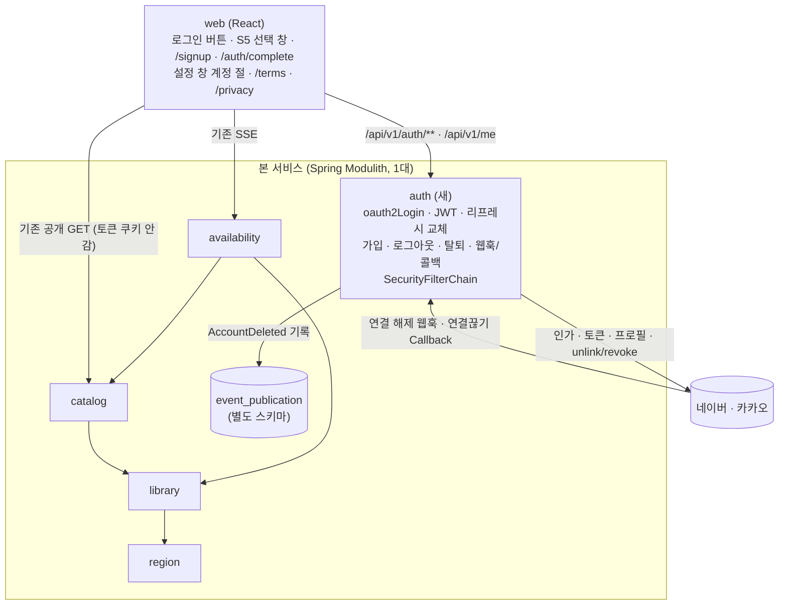
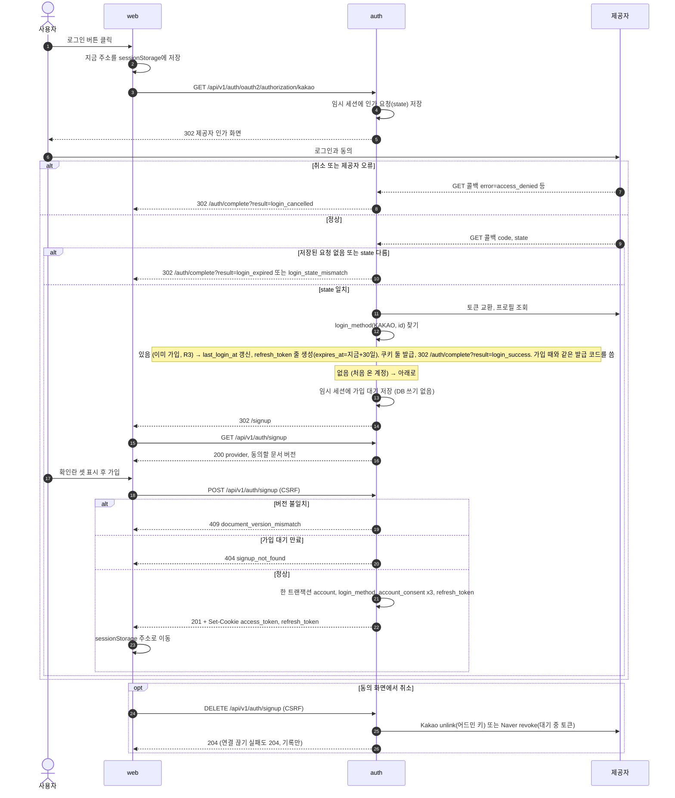
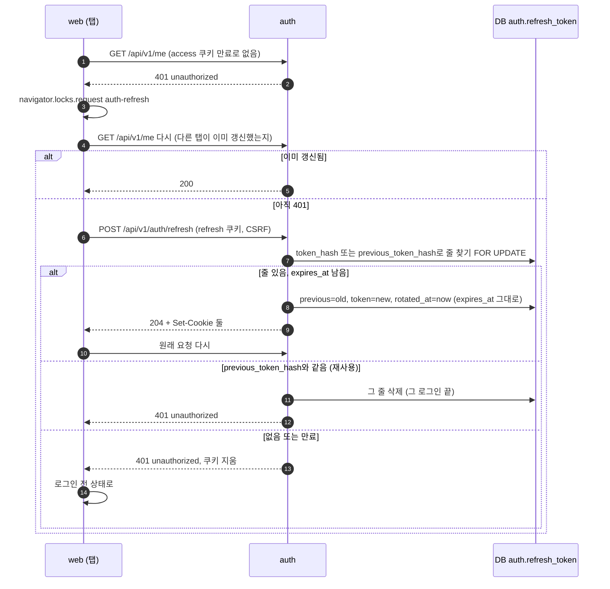
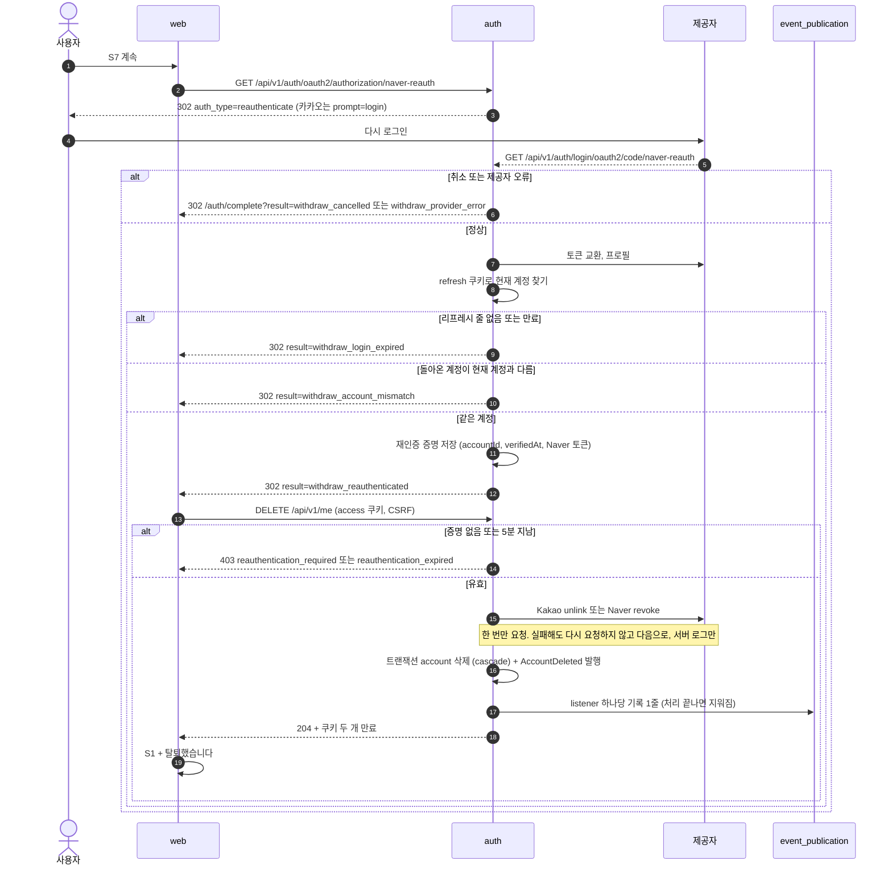
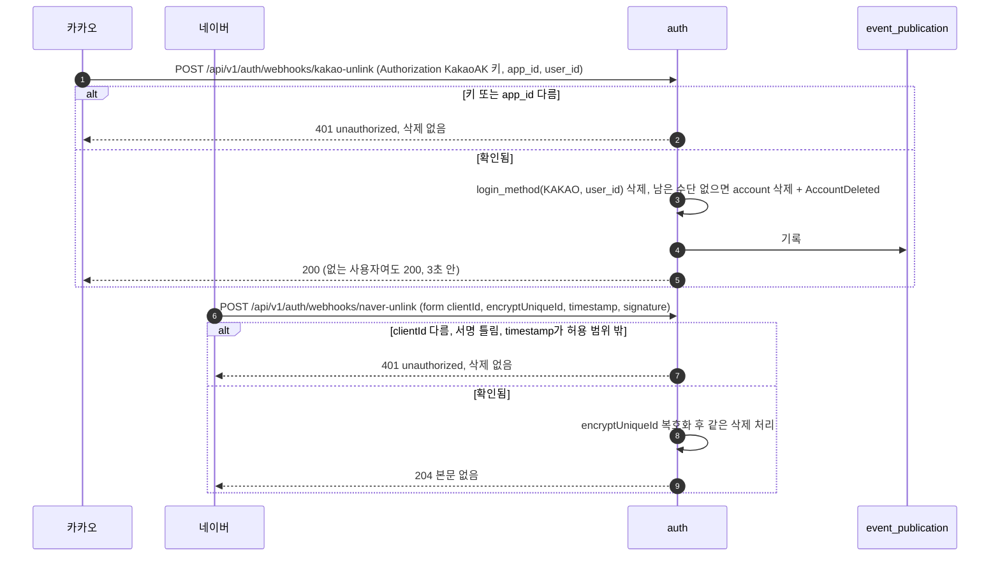
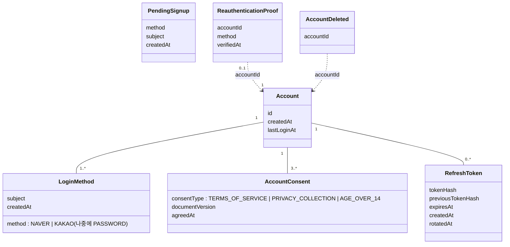
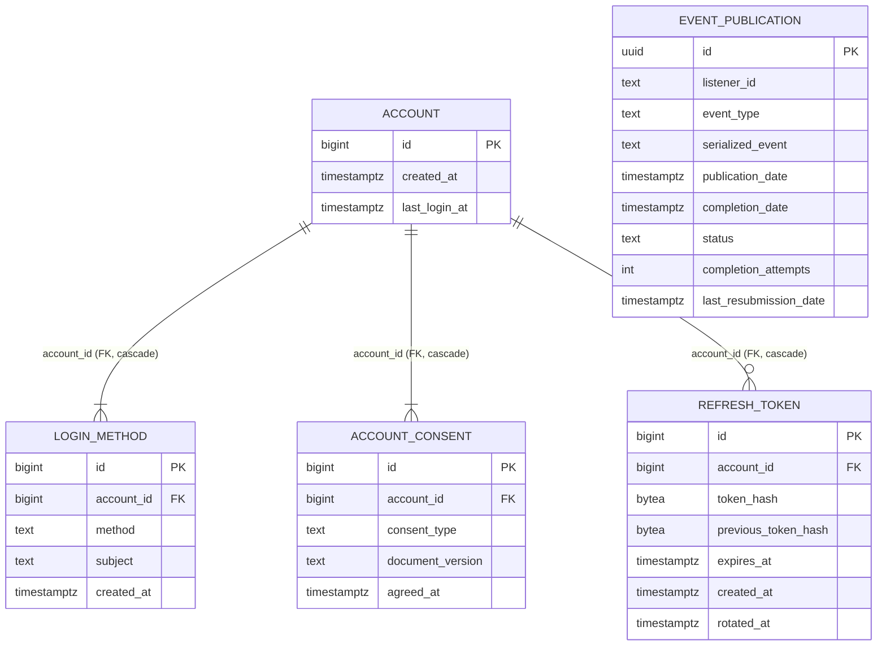

# 설계 변경: 사이클 05 로그인·계정 (네이버·카카오 소셜 로그인)

- 2026-10-04: 사이클 닫기 검토(검토 에이전트의 지적 반영, 사용자 결정 9가지, 저장소 분리 요청과 취소, 켜고 끄는 설정)를 마쳐 확정함
- 작성: 2026-10-04. 범위 `scope.md`, 규칙 `spec.md`(R1~R10, AC-1~AC-21), 화면 `flow.md`, 설계 안과 검토 결과 `architect-proposal.md`, 근거 `research.md`
- 이 문서는 `docs/current/`에서 **달라지는 것만** 적습니다. 기존 모듈 넷(`region`, `library`, `catalog`, `availability`)과 기존 API·표는 바뀌지 않습니다.
- 태그: `[확정]` 사용자가 정했거나 공식 문서 확인 / `[안]` 제안 / `[확인 필요]`. 이 문서의 값은 따로 표시가 없으면 아래 "정해진 것" 표의 승인에 포함된 것입니다.

## 정해진 것 (요약)

| 무엇 | 결정 | 기록 |
|---|---|---|
| 로그인 유지 | JWT 액세스 토큰 15분(HS256, `sub`=계정 번호와 `exp`만. `iat`는 넣지 않음) + DB의 리프레시 토큰(SHA-256 해시 저장, 쓸 때마다 교체, 재사용이면 그 로그인을 끊음). 로그인한 때부터 30일. 쿠키 `Secure`·`HttpOnly`·`SameSite=Lax`. 로그인이 필요한 API는 계정이 있는지만 확인 | ADR-0038 |
| 알고 받아들인 한계 | 로그아웃 전에 빼낸 액세스 토큰은 만료까지 최대 15분(시계 오차 60초를 더하면 약 16분) 통과. 갱신 응답이 유실되면 그 브라우저는 다음 갱신 때 로그아웃. 재사용 감지는 바로 앞 값까지 | ADR-0038 |
| 여러 탭의 동시 갱신 | 웹이 Web Locks(`auth-refresh`)로 한 번에 한 탭만. 차례를 받은 탭은 원래 요청을 먼저 다시 보내고, 또 401이면 갱신 | ADR-0038 |
| 표 구조 | `auth.account` + `auth.login_method(method, subject)`. 소셜 전용 이름을 쓰지 않음. 제공자 번호는 OAuth 2.0 + 프로필 API로 | ADR-0039 |
| 로그인 도중의 임시 값 | `HttpSession`으로만 다룸(10분). 이번에는 메모리 구현. 여러 대면 Spring Session(Redis)을 설정으로 켬. 동의 화면을 떠난 사람은 만료 때 제공자 연결을 끊음 | ADR-0040 |
| 계정 삭제 알림 | `AccountDeleted(accountId)`, 발행 저장소는 `modulith` 스키마, `auth` 안에 listener 하나, 완료 기록은 삭제 | ADR-0041 |
| 주소와 배포 모양 | 인증 흐름은 `/api/v1/auth/**`. 액세스 쿠키 `Path=/api/v1/me`, 리프레시 쿠키 `Path=/api/v1/auth`. 운영은 앞단 웹 서버 + 같은 출처. 보안 헤더는 화면 파일에 웹 서버, API에 Spring | ADR-0042 |
| 재인증 | 기준 셋(되돌릴 수 없는 일, 로그인 수단 변경, 연락처 변경). 탈퇴는 전용 등록 `naver-reauth`·`kakao-reauth`, 5분 | ADR-0043 |
| 결과를 화면에 알리기 | `/auth/complete?result=<code>`. 돌아갈 주소는 웹이 `sessionStorage`에 둠 | ADR-0045 |
| 새 의존성 | `spring-boot-starter-security`, `-security-oauth2-client`, `-security-oauth2-resource-server`, `spring-modulith-starter-jdbc` | `architect-proposal.md` 검토 결과 11 |

## 구조 그림

### 모듈 구성도

- `auth`에서 다른 모듈로 가는 화살표도, 다른 모듈에서 `auth`로 오는 화살표도 없습니다(AC-18).

### 주요 흐름

#### 첫 로그인과 동의

#### 토큰 갱신과 교체

#### 탈퇴 (재인증)

#### 제공자 쪽에서 연결을 끊음

### 도메인 모델

- `PendingSignup`과 `ReauthenticationProof`는 DB가 아니라 `HttpSession`(ADR-0040)에 둡니다. 이번 사이클에는 `LoginMethod`가 계정당 하나뿐입니다(1..*는 구조만).

## 모듈

| 모듈 | 새/변경 | 책임 | 공개 API | 이벤트 | 소유 테이블 |
|---|---|---|---|---|---|
| `auth` | 새 | Naver·Kakao `oauth2Login`, 가입 대기·동의·가입, JWT 발급·검증, 리프레시 교체, 로그아웃, 탈퇴 재인증·삭제, 웹훅·콜백, 앱 전체 `SecurityFilterChain`(보호 경로 `/api/v1/me/**`, 나머지 `permitAll`), 401/403 ProblemDetail | Java: `AccountId`(record, 루트 패키지), `AccountDeleted(accountId)` [확정 이름]. REST: 아래 API 표 | 발행 `AccountDeleted`. 구독: 자기 listener 하나(서버 로그 한 줄. ADR-0041) | `auth.account`, `auth.login_method`, `auth.account_consent`, `auth.refresh_token` |
| (공용 인프라) | 새 | Spring Modulith 이벤트 발행 저장소 | — | — | `modulith.event_publication` (어느 모듈 소유도 아님) |
| 루트 `ApiExceptionHandler` | 변경 없음 | Security 필터의 401/403은 `auth`의 `AuthenticationEntryPoint`·`AccessDeniedHandler`가 ProblemDetail로 직접 씀 | — | — | — |
| `region`, `library`, `catalog`, `availability` | 변경 없음 | — | — | — | — |

- 패키지(참고안. 실제 배치는 dev가 정함): `com.chaekcheck.auth`(공개 타입) / `auth.internal.web`(컨트롤러, 처리기) / `auth.internal.security`(필터 체인, JWT, resolver, repository 감싸기) / `auth.internal.account`(엔티티·저장소) / `auth.internal.provider`(Naver·Kakao 프로필·unlink·revoke·웹훅 검증)
- 새 의존성 [확정] (사용자 승인, 2026-10-04, 설계 검토 11): `spring-boot-starter-security`, `spring-boot-starter-security-oauth2-client`, `spring-boot-starter-security-oauth2-resource-server`(Boot 4에서 옛 `spring-boot-starter-oauth2-*`가 이 이름으로 바뀜 [확인 필요: Boot 4.1 공식 Starters 표. 근거: https://github.com/spring-projects/spring-boot/issues/50294 제목, 제3자 글]), `spring-modulith-starter-jdbc`

- `auth`의 보안 설정이 앱 전체의 `SecurityFilterChain`을 가집니다. 보호하는 경로는 `/api/v1/me/**`뿐이고 나머지는 `permitAll`입니다. 다른 모듈의 경로는 문자열 규칙으로만 다루므로 모듈 의존이 생기지 않습니다(AC-18).
- JWT 검증: `oauth2ResourceServer().jwt()` + 쿠키에서 토큰을 읽는 `BearerTokenResolver`(직접 구현. Spring에 쿠키용은 없음). "계정이 아직 있는지"는 `jwtAuthenticationConverter`에서 `auth.account`를 PK로 조회하고, 없으면 401. 키는 환경 변수의 무작위 32바이트 이상 값(base64)이고 알고리즘은 HS256 하나로 고정합니다.
- 임시 값(가입 대기, 재인증 증명)은 `HttpSession` 속성으로만 다룹니다. 로그인 상태(SecurityContext)는 세션에 저장하지 않습니다.

## 데이터

- 스키마: `auth`(새), `modulith`(새, 발행 저장소)

**`auth.account`**
| 컬럼 | 타입 | 제약 | 설명 |
|---|---|---|---|
| id | bigint | PK, GENERATED BY DEFAULT AS IDENTITY | JWT `sub` |
| created_at | timestamptz | NOT NULL DEFAULT now() | |
| last_login_at | timestamptz | NOT NULL | 가입·다시 로그인 때 갱신 (R3) |

**`auth.login_method`**
| 컬럼 | 타입 | 제약 | 설명 |
|---|---|---|---|
| id | bigint | PK, IDENTITY | |
| account_id | bigint | NOT NULL, FK → auth.account(id) ON DELETE CASCADE | |
| method | text | NOT NULL, CHECK IN ('NAVER','KAKAO') | 나중에 `PASSWORD` 추가 |
| subject | text | NOT NULL | 그 수단 안의 식별자. 소셜은 제공자 쪽 번호(Kakao 숫자도 문자열로) |
| created_at | timestamptz | NOT NULL DEFAULT now() | |
- UNIQUE `(method, subject)`, INDEX `(account_id)`. 이번에는 계정당 한 줄이고 이것은 앱 코드가 지킵니다(DB에 UNIQUE(account_id)를 걸지 않음. 나중의 연결 기능을 막지 않기 위해. ADR-0039)

**`auth.account_consent`**
| 컬럼 | 타입 | 제약 | 설명 |
|---|---|---|---|
| id | bigint | PK, IDENTITY | |
| account_id | bigint | NOT NULL, FK → auth.account(id) ON DELETE CASCADE | |
| consent_type | text | NOT NULL, CHECK IN ('TERMS_OF_SERVICE','PRIVACY_COLLECTION','AGE_OVER_14') | 확인란 셋 [확정] |
| document_version | text | NULL | 이용약관·수집 이용 고지 버전. 형식 `YYYY-MM-DD`(시행 날짜) [확정] (사용자 승인, 2026-10-04, 설계 검토 10) |
| agreed_at | timestamptz | NOT NULL | |
- CHECK: `AGE_OVER_14`가 아니면 `document_version IS NOT NULL`. UNIQUE `(account_id, consent_type, document_version)` NULLS NOT DISTINCT(sql changeset). INDEX `(account_id)`
- 현재 버전은 서버 설정이 원본: 웹은 화면에 보인 버전을 보내고, 서버의 현재 버전과 다르면 409

**`auth.refresh_token`**
| 컬럼 | 타입 | 제약 | 설명 |
|---|---|---|---|
| id | bigint | PK, IDENTITY | 브라우저 로그인 하나 |
| account_id | bigint | NOT NULL, FK → auth.account(id) ON DELETE CASCADE | |
| token_hash | bytea | NOT NULL, UNIQUE | SHA-256(현재 값) |
| previous_token_hash | bytea | NULL | 바로 앞 값. 재사용 감지 |
| expires_at | timestamptz | NOT NULL | 로그인 + 30일 [확정], 교체해도 그대로 |
| created_at | timestamptz | NOT NULL DEFAULT now() | 로그인한 때 |
| rotated_at | timestamptz | NULL | |
- INDEX `(previous_token_hash)`, `(account_id)`, `(expires_at)`. 만료된 줄은 하루 한 번 정리 [확정] (사용자 승인, 2026-10-04, 설계 검토 10)

**`modulith.event_publication`**: Spring Modulith 2.1.1 공식 DDL 그대로(Liquibase 별도 파일. https://docs.spring.io/spring-modulith/reference/appendix.html). 설정: `spring.modulith.events.jdbc.schema=modulith`, `spring.modulith.events.jdbc.schema-initialization.enabled=false`, `spring.modulith.events.completion-mode=delete` [확정] (사용자 승인, 2026-10-04, 설계 검토 8).

- Liquibase: `db/changelog/auth/001-auth-schema.yaml`(CHECK, NULLS NOT DISTINCT는 `sql` changeset), `db/changelog/modulith/001-event-publication.yaml`, master에 include 두 줄. 새 파일만 더합니다 [확정].
- JPA 매핑 참고: cascade는 DB FK에 맡기고 JPA 연관 cascade는 쓰지 않습니다. 삭제는 `account` 한 줄 삭제 쿼리로 합니다. 엔티티를 쓸지 `JdbcClient`를 쓸지는 dev가 정합니다.

## API

- 기존 API는 경로·응답 본문·인증이 모두 그대로입니다(AC-17). 아래는 새로 생기는 것입니다.

| 메서드 | 경로 | 인증 | CSRF | 성공 | 오류 |
|---|---|---|---|---|---|
| GET | `/api/v1/auth/oauth2/authorization/{naver\|kakao\|naver-reauth\|kakao-reauth}` | 없음 | 해당 없음 (GET, 상태 변경 없음) | 302 제공자 | — |
| GET | `/api/v1/auth/login/oauth2/code/{registrationId}` | 없음(`state`로 확인) | 해당 없음 | 302 `/auth/complete?result=…` 또는 `/signup` | 아래 "결과 코드" |
| GET | `/api/v1/auth/csrf-token` | 없음 | — | 204 + `XSRF-TOKEN` 쿠키 | — |
| GET | `/api/v1/auth/signup` | 가입 대기(임시 세션) | — | 200 | 404 `signup_not_found` |
| POST | `/api/v1/auth/signup` | 가입 대기 | 필요 | 201 + 쿠키 둘 | 400 `validation_error`(`errors[].code: required`), 404 `signup_not_found`, 409 `document_version_mismatch` |
| DELETE | `/api/v1/auth/signup` | 가입 대기 | 필요 | 204 | 404 `signup_not_found` |
| POST | `/api/v1/auth/refresh` | refresh 쿠키 | 필요 | 204 + 쿠키 둘 | 401 `unauthorized` |
| POST | `/api/v1/auth/logout` | refresh 쿠키(없어도 됨) | 필요 | 204. 그 브라우저의 `refresh_token` 줄을 DB에서 삭제하고 쿠키 둘을 만료시킴 | — (멱등) |
| GET | `/api/v1/me` | access 쿠키 + 계정 존재 | — | 200 | 401 `unauthorized` |
| DELETE | `/api/v1/me` | access 쿠키 + 재인증 증명 | 필요 | 204 + 쿠키 만료 | 401 `unauthorized`, 403 `reauthentication_required` / `reauthentication_expired`, 500 `internal_error` |
| POST | `/api/v1/auth/webhooks/kakao-unlink` | `KakaoAK` 헤더 | **제외** | 200 | 401 `unauthorized` |
| POST | `/api/v1/auth/webhooks/naver-unlink` | 서명 | **제외** | 204 | 401 `unauthorized` |

- 모든 CSRF 403: `code: csrf_invalid`. 재인증 403과 구분해 웹이 "새 토큰 → 한 번 다시"를 할 수 있게 함
- 예시:
  - `GET /api/v1/auth/signup` → `{"provider":"KAKAO","documents":[{"type":"TERMS_OF_SERVICE","version":"<v>"},{"type":"PRIVACY_COLLECTION","version":"<v>"}]}`
  - `POST /api/v1/auth/signup` 요청 → `{"consents":[{"type":"TERMS_OF_SERVICE","version":"<v>"},{"type":"PRIVACY_COLLECTION","version":"<v>"},{"type":"AGE_OVER_14"}]}`
  - `GET /api/v1/me` → `{"id":123,"loginMethods":["KAKAO"],"consents":[{"type":"TERMS_OF_SERVICE","version":"<v>","agreedAt":"2026-10-04T10:00:00Z"}]}`. `loginMethods`는 재인증 시작 주소를 고르는 데만 쓰고 화면에 보이지 않음
  - 401 → `{"title":"Unauthorized","status":401,"detail":"Login required","code":"unauthorized"}`

### 결과 코드 (`/auth/complete?result=`와 API 오류의 `code`)

| 코드 | 어디서 | 화면 문구 |
|---|---|---|
| `login_success` | 콜백 | 없음(보던 주소로) |
| `login_cancelled` | 콜백 `error=access_denied` | 로그인을 취소했어요 |
| `login_provider_error` | 콜백: 제공자 `error`(취소 말고), 토큰 교환·프로필 실패. 제공자 이름을 `&provider=naver` 또는 `kakao`로 함께 줌(경로의 registrationId에서 정함) | 네이버(카카오) 쪽 문제로 로그인하지 못했어요. 잠시 뒤 다시 해 주세요 |
| `login_expired` | 저장된 인가 요청이 없음 | 로그인 시간이 지났어요. 다시 해 주세요 |
| `login_state_mismatch` | 저장된 요청은 있는데 `state`가 다름 | 안전하지 않은 로그인 요청이라 멈췄어요. 로그인 버튼을 눌러 다시 해 주세요 |
| `withdraw_reauthenticated` | 재인증 콜백 성공 → 웹이 DELETE 호출 | 탈퇴 처리 중 |
| `withdraw_account_mismatch` | 재인증 콜백 | 가입한 계정으로 확인해 주세요 |
| `withdraw_cancelled` | 재인증 콜백 `access_denied` | 탈퇴를 취소했어요 |
| `withdraw_provider_error` | 재인증 콜백. `&provider=`를 함께 줌 | 네이버(카카오) 쪽 문제로 본인 확인을 하지 못했어요. 잠시 뒤 다시 해 주세요 |
| `withdraw_login_expired` | 재인증 콜백: 리프레시 줄 없음 / DELETE 401 뒤 갱신 실패 | 로그인이 풀렸어요. 다시 로그인한 뒤 탈퇴해 주세요 |
| (API) `reauthentication_expired` 403 | `DELETE /api/v1/me` | 본인 확인 시간이 지났어요. 탈퇴를 다시 눌러 주세요 |
| (API) `internal_error` 500 | `DELETE /api/v1/me` | chaekcheck 서버 문제로 탈퇴하지 못했어요. 잠시 뒤 다시 해 주세요 |
| (웹) 네트워크 | `fetch` 예외 | 인터넷 연결을 확인하고 다시 해 주세요 |

- 문구의 원본은 `spec.md` "상태별 동작"과 `flow.md` S1·S7입니다. `provider` 값은 `naver`, `kakao` 둘만 받고 그 밖의 값은 웹이 무시합니다.
- `login_expired`와 `login_state_mismatch`는 인가 요청 저장소를 감싸서 구분합니다: 세션에 저장된 요청이 없으면 expired, 있는데 `state`가 다르면 mismatch [확인 필요: Spring Security 소스에서 기본 동작 확인].
- 탈퇴가 멈춘 문구 일곱(`flow.md` S7)과의 대응: 다른 계정 `withdraw_account_mismatch`, 5분 초과 `reauthentication_expired`(403), 취소 `withdraw_cancelled`, 제공자 오류 `withdraw_provider_error`, 우리 서버 오류 `internal_error`(500), 로그인이 풀림 `withdraw_login_expired`, 인터넷 끊김은 웹이 `fetch` 예외로 판단.

## 로그인 기능 켜고 끄기

- 사용자 요청(2026-10-04): "application파일에 넣든 뭐든 선택해서 할 수 있게". 만드는 것은 dev가 함.
- 서버 설정 값 하나(`chaekcheck.auth.enabled`, 이름은 제안. 기본값 꺼짐)로 로그인 기능 전체를 켜고 끔 [확정] (사용자 승인, 2026-10-04).

| | 켜짐 | 꺼짐 |
|---|---|---|
| 서버 | `/api/v1/auth/**`, `/api/v1/me`가 동작 | 그 주소들이 없음(404). Spring Security가 끼어들지 않아 사이클 04와 같은 응답 |
| 웹 | "로그인" 버튼, 설정 창 "계정" 절, `/signup`, `/terms`, `/privacy`와 화면 아래 링크 | 보이지 않음. 웹이 켜져 있는지 아는 방법은 dev가 제안 |
| 설정 | 네이버·카카오 키와 JWT 키가 있어야 켜짐 | 없어도 서버가 켜짐 |
| DB | `auth`, `modulith` 스키마를 씀 | 쓰지 않음(표를 만들지 말지는 dev가 제안) |

- **저장소는 나누지 않음.** `auth` 코드를 다른 저장소에 두는 안을 2026-10-04에 승인했다가 같은 날 취소함(사용자: "아니다 취소해줘 너 설명 들으니까 저장소 분리 안 하는 것이 나은 것 같아"). `auth`는 지금 저장소(`chaekcheck-dev`) 안의 모듈로 둠. 비밀 값(JWT 키, client secret, 어드민 키)은 저장소에 넣지 않음.

## 외부 연동

| 대상 | 방식 | 제한·키 관리 | 실패 시 동작 | 상태 태그 |
|---|---|---|---|---|
| 네이버 로그인 | OAuth 2.0 authorization code + 프로필 API `/v1/nid/me`의 `response.id`. 등록 둘: `naver`, `naver-reauth`(`auth_type=reauthenticate`) | client id·secret은 환경 변수. 검수 전에는 등록한 테스터만 로그인. 돌아올 주소를 둘 등록(여러 개 등록 가능 여부 [확인 필요: 콘솔]) | `login_provider_error` / `withdraw_provider_error` | [확정] |
| 카카오 로그인 | OAuth 2.0 authorization code + `/v2/user/me`의 `id`. 등록 둘: `kakao`, `kakao-reauth`(`prompt=login`). 동의항목은 켜지 않음 | REST API 키·client secret은 환경 변수 | 같음 | [확정] |
| 카카오 연결 끊기 | `POST /v1/user/unlink`, `Authorization: KakaoAK <서비스 앱 어드민 키>`, `target_id_type=user_id` | 어드민 키는 환경 변수 | 실패해도 우리 쪽 삭제는 진행, 서버 로그에 남김 | [확정] |
| 네이버 연결 끊기 | 재인증(또는 가입 대기) 때 받은 접근 토큰으로 `/oauth2.0/revoke` | 접근 토큰은 `HttpSession`에 최대 10분만 둠. DB·로그에 남기지 않음 | 같음 | [확정] |
| 카카오 연결 대조 | 하루 한 번 `GET /v1/user/ids`(어드민 키)로 연결된 사용자 목록을 받아 우리 쪽과 대조 | 한 번에 100명, 분당 100회. 어드민 키는 환경 변수 | 실패한 날은 삭제하지 않고 다음 날 다시 | [확정] (사용자 제안, 2026-10-04. https://developers.kakao.com/docs/ko/kakaologin/rest-api) |
| 카카오 연결 해제 웹훅 | 우리 `POST /api/v1/auth/webhooks/kakao-unlink`가 받음. `Authorization: KakaoAK` 헤더와 `app_id` 확인 | 3초 안에 200 | 검증 실패 401, 삭제 없음 | [확정] |
| 네이버 연결끊기 Callback | 우리 `POST /api/v1/auth/webhooks/naver-unlink`가 받음. HmacSHA256 서명 확인, AES128/CBC 복호화(`research.md` 3절), `timestamp`가 지금과 5분 넘게 다르면 거절 | 204. 네이버는 다시 보내지 않음 | 검증 실패 401, 삭제 없음 | [확정] (5분은 사용자 승인, 설계 검토 10) |
| 운영 웹 서버 | 화면 파일을 내려 주고 `/api`를 Spring으로 넘김(같은 출처). 화면 파일 응답에 `Content-Security-Policy`, `X-Frame-Options: DENY`, `Strict-Transport-Security`, `X-Content-Type-Options: nosniff`, `Referrer-Policy: same-origin` | dev가 설정 예시 파일을 저장소에 둠. 제품과 위치는 배포할 때 정함 | — | [확정] 모양 / CSP 문장 [확인 필요: dev 빌드 결과로 시험] |

## 인계서에 넣을 제약

1. 상태를 바꾸는 요청은 GET으로 만들지 않음. 변경 메서드는 모두 CSRF(`X-XSRF-TOKEN`) — 예외는 웹훅 두 곳뿐(`ignoringRequestMatchers`)
2. 내 자료 API는 `/api/v1/me/...`이고, 주소에 계정 번호를 넣지 않음. 계정은 토큰의 `sub`로만 정함
3. React에서 `dangerouslySetInnerHTML` 금지(도서관에서 읽어 온 글자, 약관 본문 포함)
4. 웹은 토큰 쿠키(`access_token`, `refresh_token`)와 세션 쿠키를 읽지 않음(`HttpOnly`라 읽을 수도 없음). 웹이 읽는 쿠키는 CSRF용 `XSRF-TOKEN` 하나뿐이고, 그 값을 `X-XSRF-TOKEN` 헤더에 넣음(이 쿠키는 `HttpOnly`가 아니고 `Secure`, `SameSite=Lax`). 로그인 여부는 `/api/v1/me`로만 앎. 토큰을 `localStorage`·`sessionStorage`에 두지 않음(`sessionStorage`에는 돌아올 주소만)
5. 제공자 토큰은 DB에도 서버 기록에도 남기지 않음. Spring 기본 `InMemoryOAuth2AuthorizedClientService`가 제공자 토큰을 메모리에 계속 쌓지 않게 설정 [확인 필요: 구현 때 Spring 문서]. oauth2Login 성공이 세션 로그인을 만들지 않게 함(SecurityContext 저장소 교체)
6. Security를 넣어도 기존 경로는 모두 `permitAll`. 기본 form login, HTTP Basic, 자동 생성 사용자 비밀번호는 끔. 보호 경로는 `/api/v1/me/**`만
7. redirect URI는 설정 값으로 명시함(환경 변수. 이름은 dev가 정함). Vite `changeOrigin: true`인 채로 `{baseUrl}`을 쓰지 않음
8. 어드민 키, client secret, JWT 키는 환경 변수로만 둠. 값을 코드나 설정 파일에 쓰지 않음
9. 웹훅·콜백은 멱등. 서명 비교는 시간이 일정한 비교(`MessageDigest.isEqual`)로. Kakao 웹훅은 3초 안에 응답
10. `AccountDeleted` 안에는 accountId만 넣음(엔티티나 제공자 번호를 넣지 않음)
11. 401/403은 필터 단계에서 ProblemDetail(`code`)로 응답함(MVC advice에 오지 않으므로)
12. 테스트: `ModularityTests`, 리프레시 교체·재사용·만료, 동시 갱신, 웹훅·콜백 검증 실패, 저장소 기록(AC-15), 비로그인 요청과 토큰이 붙은 요청의 기존 SSE. 다시 로그인(R3), 세션 만료 때 가입 대기의 제공자 연결 끊기, 로그아웃이 리프레시 줄을 지우는지, 쿠키 만료 응답의 `Path`. AC-15의 "실패하면 기록이 남음"은 테스트 전용 실패 listener로 확인

13. 결과 코드: 주소에는 정해진 코드만 넣고 토큰·회원번호 같은 값은 넣지 않음. 웹은 목록에 있는 코드만 정해진 문구로 바꿔 보이고 코드 글자를 화면에 그대로 찍지 않음. 서버는 코드로 판단하지 않음. 돌아갈 주소는 `/`로 시작하고 `//`로 시작하지 않는 경로만 씀
14. 임시 값은 `HttpSession`으로만 다루고, 한 서버에서만 통하는 방식(정적 변수, 직접 만든 메모리 맵)으로 들고 있지 않음. 나중에 Spring Session(Redis)을 설정으로 켰을 때 코드가 그대로 동작해야 함
15. 리프레시 토큰은 CSPRNG 256비트, DB에는 SHA-256 해시만. JWT는 HS256 하나로 고정하고 키는 사람이 지은 문자열을 쓰지 않음
16. 발행 저장소는 `completion-mode=delete`. AC-15는 테스트로 확인(발행 → 기록 생김 → listener 완료 뒤 기록 없음, listener 실패 때 기록 남음)
17. 별명·프로필 사진은 이번에 받지 않음. 다만 나중에 `auth.account`에 칸을 더할 수 있게, 계정 조회 응답과 화면 위쪽 배치를 이 확장을 막는 모양으로 굳히지 않음(backlog)
18. 세션이 만료될 때(10분) 가입 대기가 남아 있으면 제공자 연결을 끊음(카카오 `unlink`, 네이버 `revoke`). 실패는 서버 로그에만 남김. 서버를 다시 켜면 메모리 세션이 사라져 그 연결은 끊기지 않음(알고 있는 한계. 사용자가 네이버·카카오의 "연결된 서비스"에서 직접 끊을 수 있고, 우리 DB에는 아무것도 없음)
19. 쿠키를 지우는 응답(로그아웃, 갱신 실패, 탈퇴)은 발급할 때와 같은 이름·`Path`·속성으로 만료시킴. 액세스 쿠키는 `Path=/api/v1/me`, 리프레시 쿠키는 `Path=/api/v1/auth`. 쿠키 수명(`Max-Age`)은 액세스 15분, 리프레시는 남은 로그인 기간
20. 리프레시 갱신은 `token_hash`와 `previous_token_hash` 둘 다로 줄을 찾음. 지금 값이면 교체, 바로 앞 값이면 그 줄 삭제(재사용), 어느 쪽도 아니면 줄을 지우지 않고 401(ADR-0038의 한계)
21. JWT 서명 키를 바꾸는 절차: 환경 변수를 바꾸고 재시작. 옛 키의 액세스 토큰은 401이 되어 웹이 갱신으로 새 토큰을 받음. 리프레시 토큰에는 영향 없음. 자동 교체는 하지 않음(비목표)
22. `/api/v1/me` 응답의 `loginMethods`는 화면에 보이지 않음(AC-5)
23. `POST /api/v1/auth/signup`은 201이지만 `Location` 헤더를 주지 않음(만들어진 것을 조회할 주소가 따로 없음). `auth.refresh_token.rotated_at`과 루트 패키지의 `AccountId`는 이번 사이클에 쓰는 곳이 적고 사이클 06을 위한 준비임
24. 가입 동의 화면을 열어 둔 사이 문서 버전이 바뀌어 `409 document_version_mismatch`가 오면, 웹은 "약관이 바뀌었어요. 다시 확인해 주세요"를 보이고 `GET /api/v1/auth/signup`으로 새 버전을 받아 확인란을 모두 비운 상태로 다시 보임 [확정] (사용자 승인, 2026-10-04, 사이클 닫기 검토)
25. `DELETE /api/v1/me`의 `403 reauthentication_required`(본인 확인 기록 없음)는 웹에서 `reauthentication_expired`와 같은 문구("본인 확인 시간이 지났어요. 탈퇴를 다시 눌러 주세요")로 보임 [확정] (사용자 승인, 2026-10-04, 사이클 닫기 검토)
26. `POST /api/v1/auth/signup`이 같은 `(method, subject)`로 두 번 와서 UNIQUE에 걸리면, 오류로 답하지 않고 먼저 만들어진 계정으로 로그인 처리함(같은 201과 쿠키) [확정] (사용자 승인, 2026-10-04, 사이클 닫기 검토)
27. 문서 버전의 원본은 서버 설정. 웹의 약관·처리방침 파일에 적힌 버전·시행일이 서버 설정과 같은지 확인하는 테스트를 둠 [확정] (사용자 승인, 2026-10-04, 사이클 닫기 검토)
28. 카카오 연결 대조: 하루 한 번 카카오 "사용자 목록 가져오기"(`GET /v1/user/ids`, 어드민 키, 한 번에 100명)로 연결된 회원번호를 모두 받아, 우리 `login_method(KAKAO, …)`에는 있는데 그 목록에 없는 계정을 탈퇴와 같은 순서(삭제 + `AccountDeleted`)로 지움. 목록을 끝까지 받지 못한 날(호출 실패, 한도 초과)은 아무도 지우지 않음. 놓친 연결 해제 웹훅을 메우기 위한 것 [확정] (사용자 제안: "카카오는 이렇게 해줘", 2026-10-04)
29. 오래 로그인하지 않은 계정 정리: 하루 한 번 `auth.account.last_login_at`이 1년을 넘은 계정을 찾아 탈퇴와 같은 순서(제공자 연결 끊기 시도는 카카오만 가능: 어드민 키. 네이버는 토큰이 없어 건너뜀 → 삭제 + `AccountDeleted`)로 지움. 놓친 네이버 연결끊기 Callback을 메우고, 쓰지 않는 계정의 자료를 오래 두지 않기 위한 것 [확정] (사용자 승인, 2026-10-04, 사이클 닫기 검토). 1년은 근거 문서가 있는 값이 아니라 제안을 승인한 값. 가입 동의 화면의 "보유·이용 기간"과 처리방침에 "탈퇴할 때까지, 또는 마지막 로그인 뒤 1년"을 적음
30. `chaekcheck.auth.enabled`가 꺼져 있으면 사이클 04와 같은 동작(로그인 주소 없음, 보안 필터 없음, 웹에 로그인 관련 요소 없음). 기본값 꺼짐
31. 세션 쿠키(로그인 도중의 임시 값용): `Secure`, `HttpOnly`, `SameSite=Lax`, `Path=/api/v1`, 수명 10분 [확정] (사용자 승인, 2026-10-04, 사이클 닫기 검토 4). 로그인 상태를 담지 않으며 공개 API는 이 쿠키를 보지 않음. 여러 서버 대비는 ADR-0040과 backlog
32. 탈퇴 안내 창(S7)에 "네이버와 chaekcheck의 연결도 끊어요"(카카오로 로그인한 사람에게는 "카카오와…") 한 줄을 보임 [확정] (사용자 제안: "탈퇴할 때 네이버/카카오에 연결된 계정이 탈퇴될거다라는 설명 정도는 보여줘도 되지 않을까?", 2026-10-04). 어느 쪽인지는 그 사람이 로그인한 제공자로 정해지며 사용자에게 묻지 않음. 화면이 이를 알 수 있게 `GET /api/v1/me` 응답에 `loginMethods`를 둠. 제공자 이름이 보이는 곳은 이 창 한 곳뿐(AC-5는 그대로)
33. 카카오 연결 대조는 목록을 받기 시작한 시각 이후에 만들어진 `login_method`를 그 날 비교에서 뺌(방금 가입한 계정이 지워지지 않게) [확정] (사용자 승인, 2026-10-04, 인계서 검토)
34. 하루 한 번 작업 셋(만료 리프레시 정리, 카카오 대조, 1년 정리)은 04:00(Asia/Seoul)에 돎. 값은 서버 설정으로 둠 [확정] (사용자 승인, 2026-10-04, 인계서 검토). 근거 자료가 있는 값은 아님
35. 로그인 기능이 꺼져 있으면 `/terms`, `/privacy`와 화면 아래 두 링크도 보이지 않음 [확정] (사용자 승인, 2026-10-04, 인계서 검토)
36. "로그인" 버튼은 공통 머리(`AppLayout`)의 오른쪽 끝에 둠. 설정 버튼 ⚙는 지금처럼 검색 줄에 둠 [확정] (사용자 승인, 2026-10-04, 인계서 검토). 버튼 글자는 "네이버 로그인", "카카오 로그인"
37. 가입 동의 화면: 빠진 확인란 옆 "필수 항목이에요", 저장 실패 "가입하지 못했어요. 잠시 뒤 다시 해 주세요" [확정] (사용자 승인, 2026-10-04, 인계서 검토)

### 값의 근거

- HS256 키 32바이트 이상: RFC 7518 3.2절 [확정] (https://www.rfc-editor.org/rfc/rfc7518.html, 2026-10-04)
- 리프레시 토큰 256비트: OWASP ASVS 5.0 7.2.3의 "128비트 이상"보다 크게 잡은 값 [확정: 하한] (`research.md` 8절, 2026-10-03)
- 시계 오차 60초: Spring Security Resource Server 기본값 [확정] (https://docs.spring.io/spring-security/reference/servlet/oauth2/resource-server/jwt.html, 2026-10-04)
- 외부 연동 표의 [확정]: 출처는 `spec.md` "데이터 출처"(2026-10-01)와 `research.md` 3·12·13절
- `modulith.event_publication` 공식 DDL: 확인일 2026-10-04 (설계 담당 에이전트). 이 표는 ADR-0002(스키마는 모듈별)의 예외이고, 예외는 이 표 하나뿐이며 어느 모듈의 코드도 이 표를 직접 읽지 않음(ADR-0041)

## 결정 기록

- ADR-0036 계정(`auth`)과 회원 자료(`member`)를 다른 모듈로 둠 (결정 문장의 "provider + provider_user_id", "세션"은 ADR-0038·0039로 구체화됨)
- ADR-0037 검색 모듈은 회원을 모르고, 웹이 "내 도서관"을 파라미터로 넘김 (이번 사이클에는 구현 없음. 사이클 06)
- ADR-0038 로그인 유지는 JWT (짧은 액세스 토큰 + DB의 리프레시 토큰)
- ADR-0039 로그인 수단 표를 소셜 전용으로 만들지 않고, 제공자 번호는 프로필 API로 받음
- ADR-0040 로그인 도중의 임시 값은 HttpSession에 두고, 서버 수에 따라 저장소를 설정으로 고름
- ADR-0041 계정 삭제는 AccountDeleted 이벤트로 알리고, 발행 저장소의 완료 기록은 지움
- ADR-0042 화면 파일은 앞단 웹 서버가 내려 주고 API와 같은 주소를 쓰며, 인증 주소는 /api/v1/auth 아래에 모음
- ADR-0043 중요한 기능에만 다시 본인 확인을 받고, 탈퇴는 제공자 재인증 전용 등록으로 처리
- ADR-0044 앱 전체의 보안 설정은 `auth` 모듈이 가지고, 보호하는 주소는 `/api/v1/me` 아래뿐
- ADR-0045 로그인·탈퇴 결과는 주소 뒤의 코드로 화면에 알리고, 돌아갈 주소는 화면이 기억함
- ADR-0046 로그인 기능은 서버 설정으로 켜고 끔 (저장소는 나누지 않음)

## 확인 필요

| 항목 | 확인 방법 | 막는 단계 |
|---|---|---|
| 네이버·카카오 콘솔이 돌아올 주소를 둘 이상 받는지 | 사용자가 앱 등록 때 두 줄을 넣어 봄. 한 줄만 받는 제공자는 등록 하나 + 목적 표시 방식으로 바꿈(ADR-0043) | 구현 |
| Boot 4.1의 starter 이름(`spring-boot-starter-security-oauth2-client`, `-resource-server`) | 공식 문서 확인 (dev) | 구현 |
| Spring Security 7.1에서 confidential client의 PKCE 기본값, 네이버 일반 흐름이 PKCE를 받는지 | 공식 문서 확인, 프로토타입. 네이버는 받으면 켜고 카카오는 끔 | 구현 |
| `csrf.spa()`가 새 토큰을 주려면 따로 필요한 것(`GET /api/v1/auth/csrf-token`의 역할) | 공식 문서 확인, 프로토타입 | 구현 |
| Spring 기본 인가 요청 저장소가 "요청 없음"과 "`state` 다름"을 같은 오류로 처리하는지 | Spring Security 소스 확인 | 구현 |
| 네이버가 취소 때 보내는 `error` 값, 네이버 revoke를 부르면 우리 Callback이 오는지 | 호출 시험 | 구현 |
| 카카오 웹훅 헤더의 "대표 어드민 키"와 unlink의 "서비스 앱 어드민 키"가 같은 키인지 | 공식 문서 확인, 카카오 콘솔 | 구현 |
| 개발 환경 `http://localhost`에서 `Secure` 쿠키와 Web Locks가 동작하는지 | 프로토타입 | 구현 |
| 제공자 호출의 대기 시간(연결 3초, 응답 5초 [확정] (사용자 승인, 2026-10-04, 사이클 닫기 검토). 근거 문서가 있는 값은 아님)이 실제 호출에 맞는지 | dev가 호출해 보고 조정 | 구현 |
| CSP 문장(Radix가 넣는 `<style>`과 `style-src`) | dev 빌드 결과로 시험 | 배포 |
| 네이버 앱 등록 화면에서 아무 항목도 고르지 않으면 식별자만 오는지 | 사용자가 등록 화면에서 확인 | 동의 문구 |
| 이용약관·처리방침 문구, 보호책임자 기재 | 사용자 검토 | 배포 |
| 카카오 연결 해제 웹훅을 POST로만 받을 수 있는지(문서는 "GET 또는 POST") | 공식 문서와 카카오 콘솔 확인. GET만 되면 그 주소 하나에 한해 GET을 받는 예외를 제약에 더함 | 구현 |
| Spring Modulith 2.1.1과 Boot 4.1.1의 호환, 발행 저장소 표를 Liquibase로 만드는 방법 | dev BOM, 공식 문서 | 구현 |
| Spring 기본 `InMemoryOAuth2AuthorizedClientService`가 제공자 토큰을 메모리에 쌓지 않게 하는 설정 | 공식 문서 (dev) | 구현 |
| Spring Session을 Redis로 바꿨을 때 세션 만료 알림 설정, Redis에 넣을 값의 암호화 | 공식 문서 확인 (전환할 때. backlog) | 없음 |
