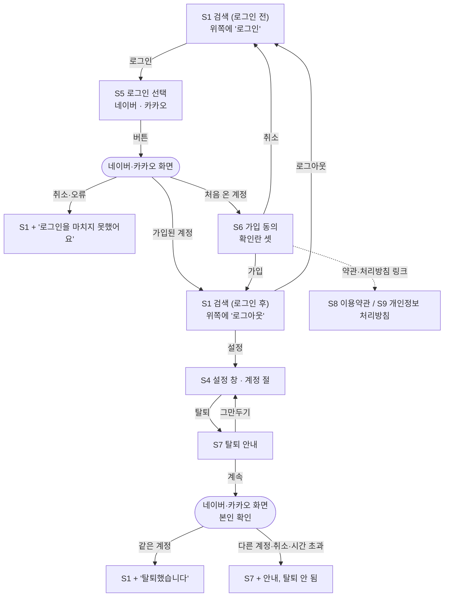

# 화면 흐름: 사이클 05 로그인·계정

- 작성: 2026-10-01. 범위 `scope.md`, 규칙 `spec.md`(R1~R10, AC-1~AC-18), 버튼 지침 `research.md` 4절
- 기존 화면(S1 검색, S3 책, S4 설정 창)은 사이클 04 `../04-and-search/flow.md` 그대로이고, 여기에는 **더해지는 것만** 적습니다. 구조와 상태이지 시각 디자인이 아닙니다.
- 태그: `[확정]`은 spec에서 사용자가 정한 것, `[안]`은 이 문서의 제안입니다.

- 둥근 상자는 우리 화면이 아니라 제공자(네이버·카카오) 화면입니다.
- S1·S3·S4·S8·S9 어디서든 화면 아래에 이용약관·개인정보 처리방침 링크가 있습니다 [안].

## 화면별 내용

### S1 search (변경: 위쪽 로그인 영역)

- 목적: 로그인 상태를 보이고 로그인·로그아웃으로 들어가는 곳. 검색 기능은 사이클 04 그대로입니다.
- 보이는 요소
  - 로그인 전: 화면 위 오른쪽, 설정 버튼 옆에 "로그인" 버튼 [안]
  - 로그인 후: 같은 자리에 "로그아웃" 버튼. 제공자 이름·닉네임 없음 [확정]
  - 안내 줄(한 번 보이고 닫을 수 있음) [안]: "로그인을 마치지 못했어요", "탈퇴했습니다"
- 사용자 동작: 로그인 → S5. 로그아웃 → 바로 로그아웃되고 보던 화면에 머묾(확인 창 없음) [안].
- 호출하는 API: 내 계정 조회(화면이 열릴 때 한 번), 로그아웃
- 상태
  - 확인 중: 내 계정 조회가 끝나기 전에는 로그인·로그아웃 버튼 자리를 비워 둠(깜빡임 방지) [안]
  - 로그인 전 / 로그인 후
  - 세션 만료: 다음 조회에서 로그인 전 상태로 바뀜. 안내 없음 [안]
  - 로그인 실패 안내 / 탈퇴 완료 안내
- S3 책 화면에도 같은 위쪽 영역이 있습니다(공통 머리 부분) [안].
- 배치: 데스크톱은 위 오른쪽. 태블릿·모바일도 같은 자리, 글자 버튼 그대로 [안].

### S5 login-choice (새, 작은 창)

- 목적: 로그인할 제공자를 고름.
- 보이는 요소: "네이버 로그인" 버튼, "카카오 로그인" 버튼(같은 크기로 세로로 나란히, 제공자 지침의 색·로고) [확정: 지침], 한 줄 안내 "처음이면 가입 동의 화면이 나와요" [안], 닫기
- 형태: S1 위에 뜨는 작은 창(모달) [안]. 별도 주소 없음.
- 사용자 동작: 버튼 → 제공자 화면으로 이동(지금 보던 주소를 기억해 둠). 닫기 → S1.
- 호출하는 API: 로그인 시작 주소(제공자별)
- 상태: 기본 / 버튼을 누른 뒤 이동 중(버튼 비활성)
- 배치: 모바일은 화면 아래에서 올라오는 창 [안].

### S6 signup-consent (새 화면)

- 목적: 처음 온 소셜 계정에 가입 동의를 받음. 동의 전에는 계정을 만들지 않음 (R2).
- 주소: `/signup` [안]. 제공자에서 돌아온 직후에만 열림. 직접 주소로 들어오면 S1으로 보냄 [안].
- 보이는 요소
  - 개인정보 수집·이용 고지 표: 목적, 항목, 보유·이용 기간, 거부할 권리와 불이익 [확정: 법 제15조②]
  - 확인란 셋(모두 필수): 이용약관 동의(전문 보기 → S8), 개인정보 수집·이용 동의(전문 보기 → S9), 만 14세 이상입니다 [확정]
  - "모두 동의" 확인란 [안]
  - "가입" 버튼(셋 다 표시해야 눌림), "취소" 버튼
- 사용자 동작: 가입 → 계정이 만들어지고, 로그인을 누르기 전에 보던 주소로 감. 취소 → 계정 없이 S1(로그인 전).
- 호출하는 API: 가입 동의 저장, 가입 취소
- 상태: 기본 / 확인란 미표시(어느 항목이 빠졌는지 표시) / 저장 중 / 저장 실패(다시 시도 안내) / 시간이 지나 가입 정보가 사라짐(처음부터 다시 로그인 안내) [안]
- 배치: 가운데 한 단, 폭 좁게. 모바일도 같은 순서.

### S4 settings (변경: "계정" 절 추가)

- 보이는 요소(로그인 후에만) [안]: "계정" 절에 "로그아웃", "탈퇴". 로그인 전에는 "계정" 절에 "로그인" 버튼 하나 [안].
- 사용자 동작: 탈퇴 → S7.
- 기존 절(보기 방식, 직접 찾기)은 그대로.

### S7 withdraw (새, 확인 창)

- 목적: 탈퇴 전에 지워지는 것을 알리고 본인 확인으로 보냄 (R6).
- 보이는 요소: 지워지는 것(계정, 동의 기록. 사이클 06부터 지역·내 도서관), "되돌릴 수 없어요", "가입한 계정으로 한 번 더 로그인해 확인합니다" 안내, "계속" 버튼, "그만두기" 버튼
- 사용자 동작: 계속 → 가입한 제공자 화면(본인 확인) → 같은 계정이면 탈퇴 처리 후 S1에 "탈퇴했습니다". 그만두기 → S4.
- 호출하는 API: 탈퇴 본인 확인 시작, 탈퇴
- 상태: 기본 / 본인 확인에서 다른 계정("가입한 계정으로 확인해 주세요") / 본인 확인 취소 / 시간 초과("다시 확인해 주세요") / 처리 중 / 처리 실패(다시 시도 안내)
- 형태: S4 위의 확인 창 [안]. 본인 확인에서 돌아온 뒤에는 탈퇴 처리 중 화면을 잠깐 보이고 S1으로 감 [안].

### S8 terms, S9 privacy (새 화면)

- 목적: 이용약관과 개인정보 처리방침 전문. 로그인 없이 열림 (R10).
- 주소: `/terms`, `/privacy` [안]
- 보이는 요소: 제목, 버전·시행일, 본문. 본문 글은 배포 전 사용자 검토 [확인 필요: `research.md` 5절].
- 들어오는 곳: 모든 화면 아래 링크, S6의 "전문 보기"(새 탭으로 열어 동의 화면이 닫히지 않게) [안].
- 상태: 기본뿐.

## 수용 기준 대응

| AC | 화면 |
|---|---|
| AC-1 로그인 버튼과 제공자 선택 | S1, S5 |
| AC-2 처음이면 동의, 셋 다 표시해야 가입 | S6 |
| AC-3 취소하면 계정 없음 | S6 → S1 |
| AC-4 가입된 계정은 바로 로그인, 보던 주소로 복귀 | S5 → 제공자 → S1(로그인 후) |
| AC-5 로그인 후 "로그아웃"만 보임 | S1, S3 |
| AC-6 새로고침·재시작 뒤 유지 | S1 (확인 중 → 로그인 후) |
| AC-7 로그아웃 | S1, S4 |
| AC-8 쿠키 속성·세션 번호 | 화면 없음 (개발자 도구) |
| AC-9 탈퇴 | S4 → S7 → 제공자 → S1("탈퇴했습니다") |
| AC-10 다른 계정으로 본인 확인 | S7 (안내) |
| AC-11 탈퇴 뒤 다시 로그인하면 동의부터 | S5 → S6 |
| AC-12 제공자 쪽 연결 끊김 | 화면 없음 (제공자 화면에서 확인) |
| AC-13·14 웹훅·콜백 | 화면 없음 (요청으로 확인). 그 뒤 S1은 로그인 전 상태 |
| AC-15 이벤트 기록 | 화면 없음 |
| AC-16 약관·처리방침 페이지 | S8, S9, S6 링크, 화면 아래 링크 |
| AC-17 비회원·기존 기능 그대로 | S1, S3, S4 |
| AC-18 빌드·테스트 | 화면 없음 |

## 상태별 동작 대응 (spec "상태별 동작")

| spec 상태 | 화면 상태 |
|---|---|
| 제공자 화면에서 취소·거부, 제공자 오류·지연, `state` 불일치 | S1 로그인 실패 안내 |
| 동의 화면 확인란 미표시 | S6 확인란 미표시 |
| 세션 만료 | S1 로그인 전으로 바뀜 |
| CSRF 토큰 없음·틀림 | 화면이 새 토큰으로 한 번 다시 시도, 그래도 실패면 S6·S7의 "실패" 상태 또는 S1 그대로 |
| 탈퇴 본인 확인에서 다른 계정 / 시간 초과 | S7 안내 |
| 탈퇴 중 제공자 연결 끊기 실패 | S1 "탈퇴했습니다"(이용자에게는 완료) |
| 웹훅·콜백 검증 실패 | 화면 없음 |
