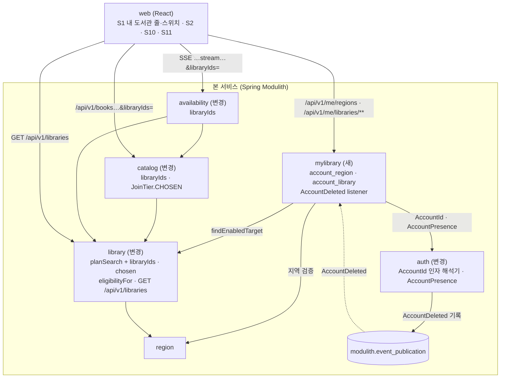
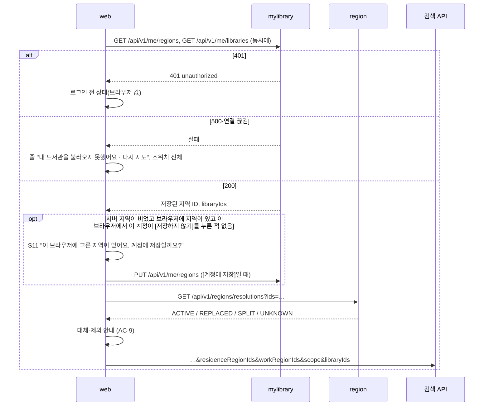
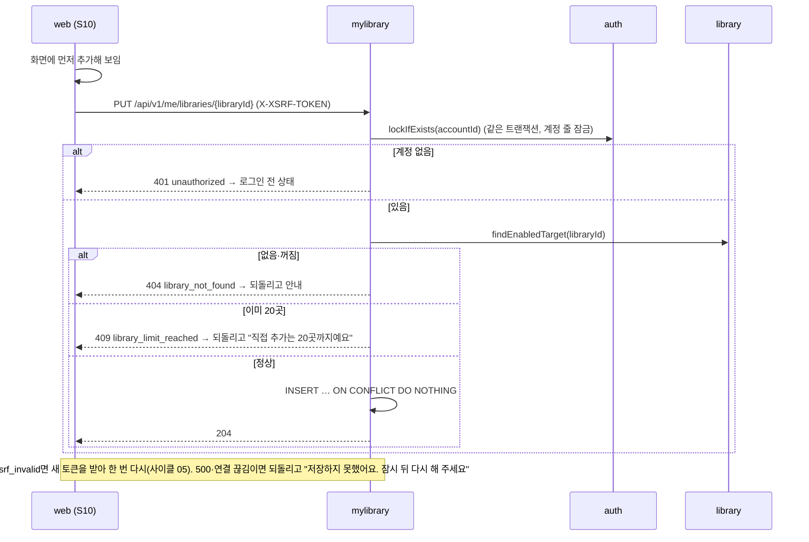
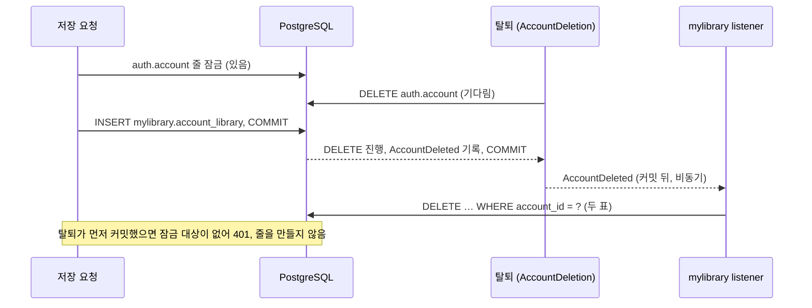
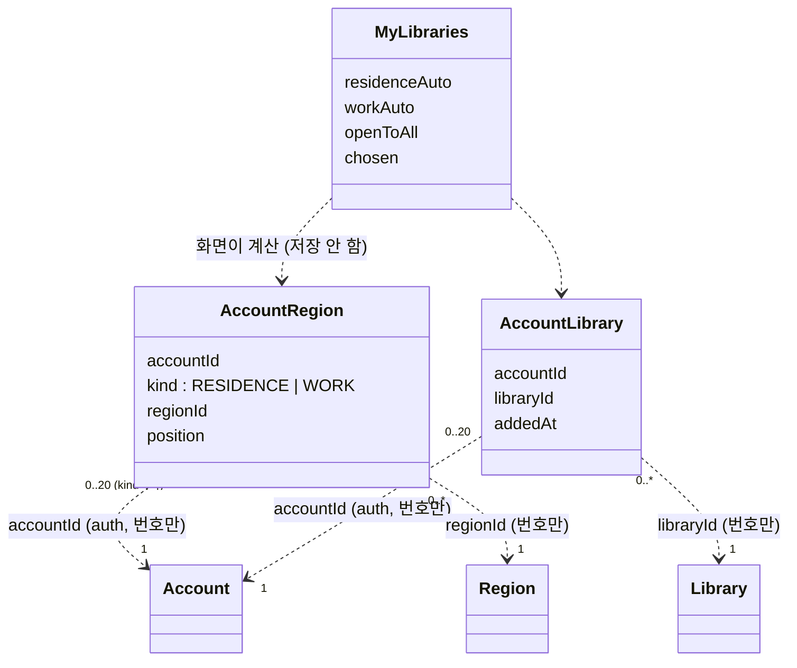
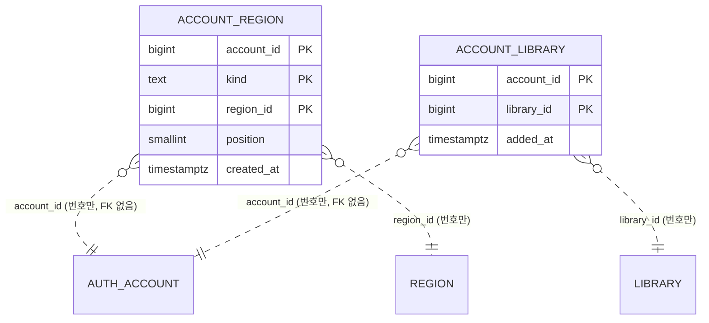

# 설계 변경: 사이클 06 내 도서관

- 작성: 2026-10-04. 근거: `spec.md`(R1~R9, R8-1, AC-1~AC-16), `flow.md`(S1, S2, S10, S11), `architect-proposal.md`(결정 1~7), 결정 페이지 `easy/2026-10-04-design-decisions.html`(11개 모두 정해짐: 승인 9, 사용자 제안 2)
- 2026-10-04 검토(`easy/2026-10-04-design-delta.html`): 세부 이름과 작은 규칙(`AccountPresence.lockIfExists`, `library_limit_reached`, `matchedBy`, `cautioned`, `JoinTier.CHOSEN`, `chosen`, `libraryIds` 검사, `chaekcheck.regionImport.v1`, 표·changelog 이름)은 이 문서대로 쓰고 dev가 코드에 맞춰 바꾸면 plan에 알려 주기만 함 [확정] (사용자 승인). 이 문서대로 `/cycle-close`로 감 [확정] (사용자 승인)
- `docs/current/`에서 **바뀌는 것만** 적습니다. `docs/current/`는 `/cycle-close`에서 고칩니다.
- 태그: 사용자가 정한 것 [확정], 제안 [안], 모르는 것 [확인 필요]. 이름·경로는 결정 페이지에서 승인된 것은 [확정], 세부 이름(클래스, 칸 이름)은 dev가 바꿀 수 있는 [안]입니다.

## 구조 그림

### 모듈 구성도



- 의존 방향: `mylibrary → auth, library, region`. `catalog`·`availability`는 `mylibrary`·`auth`를 모름(ADR-0037). 순환 없음.

### 주요 흐름

로그인 직후 읽기와 S11(지역 옮기기 창):



S10 직접 추가 (누르면 바로 저장):



저장과 탈퇴가 겹칠 때(ADR-0051):



### 도메인 모델



- `MyLibraries`는 저장하지 않습니다. 화면이 저장 값과 `GET /api/v1/libraries` 결과로 그때그때 만듭니다(ADR-0049).

## 모듈

| 모듈 | 신규/변경 | 책임 | 공개 API | 발행/구독 이벤트 | 소유 테이블 |
|---|---|---|---|---|---|
| `mylibrary` | 신규 [확정] (ADR-0048) | 로그인한 계정의 거주·직장 지역과 직접 추가 도서관 저장. 관심 책은 맡지 않음 | Java 공개 타입 없음. REST `/api/v1/me/regions`, `/api/v1/me/libraries/**` | 구독 `AccountDeleted` → 두 표 삭제(멱등) | `mylibrary.account_region`, `mylibrary.account_library` |
| `auth` | 변경 | 다른 모듈 컨트롤러가 현재 계정을 인자로 받게 함, 계정 줄 잠금 제공 | `AccountPresence.lockIfExists(AccountId): boolean` [안 이름] (호출한 트랜잭션 안에서만, `Propagation.MANDATORY`), `AccountId` 인자 해석기(앱 전체 등록), `ConditionalOnAuthEnabled`를 루트 패키지로 옮겨 공개 [안] | 그대로 | 그대로 |
| `library` | 변경 | 직접 추가 도서관을 계획에 넣음, 지역별 가입 표시가 붙은 공개 목록 | `PlanOptions`에 `libraryIds`, `SearchTarget.chosen`, `LibraryCatalog.eligibilityFor(residenceIds, workIds)` [안 이름], REST `GET /api/v1/libraries` | 없음 | 그대로 |
| `catalog` | 변경 | `/api/v1/books`, `/api/v1/books/{bookId}`가 `libraryIds`를 받고 직접 추가를 맨 앞으로 정렬 | `JoinTier.CHOSEN`(첫 값) | 없음 | 그대로 |
| `availability` | 변경 | 스트림 두 곳이 `libraryIds`를 받음, `targets`에 `chosen` | 그대로 | 없음 | 그대로 |
| `region` | 그대로 | 저장할 때 지역 검증에 씀(기존 `expandForMatching`) | 그대로 | — | 그대로 |

- `mylibrary` 패키지: `com.chaekcheck.mylibrary`(루트에 공개할 것 없음), `mylibrary.internal`(JdbcClient 저장소, 컨트롤러, listener). JPA 엔티티 없음(사이클 05 `auth`와 같은 방식) [안]
- 켜고 끄기: `mylibrary`의 모든 빈은 `chaekcheck.auth.enabled`에 묶음. 로그인이 꺼져 있으면 매핑 API는 404. 표는 늘 만듦(사이클 05와 같음) [안]
- `module-map.md`의 "다른 모듈은 auth에 의존하지 않습니다"는 "`mylibrary`만 auth의 공개 타입에 의존"으로 바뀜(ADR-0048)

### 검색 계획 규칙 (ADR-0050)

| 규칙 | 내용 | 상태 태그 |
|---|---|---|
| 넣기 | `libraryIds`의 켜진 도서관은 자격과 상관없이 계획에 넣음(지역 규칙이 안 맞아 빠지던 도서관도). 꺼졌거나 없는 번호는 오류 없이 무시(AC-10) | [확정] (ADR-0037, spec R3) |
| `scope=joinable` | `joinable() || chosen`을 남김 | [확정] (spec R5) |
| `visit=none` | 방문 가입이라도 `chosen`이면 남김 | [확정] (사용자 제안, 2026-10-04) |
| 순서 | `chosen` 묶음이 맨 앞(묶음 안은 지금 `IN_GROUP` 규칙), 그 뒤는 ADR-0027 순서. 스위치가 "전체"여도 같음. `priorityGroup`은 원래 값 유지 | [확정] (사용자 승인, 2026-10-04) |
| `/api/v1/books` 정렬 | `JoinTier.CHOSEN`이 첫 키. 응답 `joinTier`에 값 `CHOSEN` | [확정] 규칙, [안] 이름 |
| 웹 정렬 | `sortBatch`가 `chosen`을 가장 먼저 | [확정] 규칙 |
| 배지 | `chosen`이면 가입 자격 배지·주의 문구 대신 "직접 추가" 표시 하나. `chosen`인데 지역 규칙이 안 맞는 도서관의 `eligibility` 값은 `UNKNOWN`으로 두되 화면은 보이지 않음 | [확정] 배지 규칙 (사용자 제안, 2026-10-04), [안] 내부 값 |
| `libraryIds` 검증 | 순서: 조건 → `filter` → `scope` → `visit` → `libraryIds` → 지역. 쉼표 구분 양의 정수, 최대 20, 중복 합침. 400 `validation_error`, `errors[].field: libraryIds`, `code` `invalid_format`/`too_many` | [안] (지역 ID 규칙과 같게) |
| 받는 API | `GET /api/v1/books`, `GET /api/v1/books/{bookId}`, `GET /api/v1/ebook-searches/stream`, `GET /api/v1/book-availabilities/stream`. 다음 묶음 두 API와 도서관별 더 보기는 그대로(계획에서 나온 후보만 받음) | [안] |

## 데이터

- 스키마: `mylibrary` (새). Liquibase 새 파일 `db/changelog/mylibrary/001-mylibrary-schema.yaml` [안]. 기존 changeset 수정 없음. CHECK는 `sql` changeset(사이클 01 기록: Liquibase OSS YAML은 `addCheckConstraint` 없음)
- `auth` 스키마는 바뀌지 않음. 동의 항목 추가는 문서 문구뿐이고 버전은 그대로 [확정] (spec R7)



| 테이블.컬럼 | 타입 | 제약 | 설명 | 상태 태그 |
|---|---|---|---|---|
| `account_region.account_id` | bigint | NOT NULL | `auth.account.id`. 모듈 경계라 FK 없음, 탈퇴는 이벤트로 지움 | [확정] (ADR-0036·0048) |
| `account_region.kind` | text | NOT NULL, CHECK (`kind IN ('RESIDENCE','WORK')`) | 거주·직장 | [안] |
| `account_region.region_id` | bigint | NOT NULL, CHECK (`region_id > 0`) | `region` ID(FK 없음). 저장할 때는 사용 중인 시군구만 받고, 나중에 폐지되면 그대로 남음(읽을 때 웹이 해석) | [확정] 규칙 (spec R6) |
| `account_region.position` | smallint | NOT NULL, CHECK (`position BETWEEN 0 AND 19`) | 고른 순서 | [확정] (사용자 승인, 2026-10-04) |
| `account_region.created_at` | timestamptz | NOT NULL DEFAULT now() | | [안] |
| PK `(account_id, kind, region_id)` | | | 읽기·지우기는 `WHERE account_id = ?`를 PK 앞부분이 맡음. 칸마다 20곳은 앱에서 검사 | [안] |
| `account_library.account_id` | bigint | NOT NULL | `auth.account.id`(FK 없음) | [확정] |
| `account_library.library_id` | bigint | NOT NULL, CHECK (`library_id > 0`) | `library.library.id`(FK 없음). 꺼져도 남고 읽는 쪽이 거름 | [확정] 규칙 (spec R3) |
| `account_library.added_at` | timestamptz | NOT NULL DEFAULT now() | 목록 순서 `added_at, library_id` | [안] |
| PK `(account_id, library_id)` | | | 추가는 `INSERT … ON CONFLICT DO NOTHING`(멱등). 20곳은 계정 줄 잠금 뒤 `count(*)`로 검사. 꺼진 도서관도 지울 때까지 20곳에 셈 | [확정] 상한·셈 (사용자, 2026-10-04) |

- 지역 저장은 같은 트랜잭션에서 `DELETE … WHERE account_id = ?` 뒤 INSERT. 두 칸 모두 비면 행 없음(AC-13)
- 다른 인덱스 없음(질의는 모두 `account_id` 같음 조건)
- 넣지 않는 것: 이메일·이름 등. 탈퇴하면 계정 번호도 남지 않음(ADR-0041)

## API

공통: 성공은 감싸지 않음, 오류는 RFC 9457 + `code`(ADR-0008). `/api/v1/me/**`는 액세스 쿠키(`Path=/api/v1/me`)와 요청마다의 계정 확인이 이미 적용되고, 변경 메서드는 `X-XSRF-TOKEN`이 필요(ADR-0044). 로그인이 꺼져 있으면 404. 저장 API는 로그인 정보 `GET /api/v1/me`와 따로 [확정] (spec R8-1).

| 메서드 | 경로 | 설명 | 요청 | 응답 | 에러 |
|---|---|---|---|---|---|
| GET | `/api/v1/me/regions` | 저장된 지역(폐지된 ID도 그대로) | — | 200 `{"residenceRegionIds":[1114],"workRegionIds":[1101]}` | 401 `unauthorized`, 500 `internal_error` |
| PUT | `/api/v1/me/regions` | 거주·직장 지역을 통째로 바꿈 | `{"residenceRegionIds":[1114],"workRegionIds":[]}` 두 칸 필수(빈 배열 가능), 중복 합침, 칸마다 최대 20, 순서 유지 | 200 저장한 값 | 400 `validation_error`(`required`/`invalid_format`/`too_many`), 422 `invalid_region`(`abolished`/`not_found`/`not_sigungu`), 401, 403 `csrf_invalid`, 500 |
| GET | `/api/v1/me/libraries` | 직접 추가 도서관 번호(꺼진 것 포함) | — | 200 `{"libraryIds":[12,207],"max":20}` | 401, 500 |
| PUT | `/api/v1/me/libraries/{libraryId}` | 하나 추가(이미 있으면 그대로) | — | 204 | 404 `library_not_found`(없음·꺼짐·숫자 아님), 409 `library_limit_reached` [안 이름], 401, 403, 500 |
| DELETE | `/api/v1/me/libraries/{libraryId}` | 하나 빼기(없어도 204) | — | 204 | 401, 403, 500 |
| GET | `/api/v1/libraries?residenceRegionIds=&workRegionIds=` | 켜진 서비스 도서관 전체 + 지역별 가입 표시. 로그인 없음, 회원을 모름(ADR-0049) | 지역 ID 쉼표 구분, 칸마다 최대 20 | 200 아래 예시. id 순서, 페이지 없음 | 400 `validation_error`, 422 `invalid_region` |
| GET | 기존 4곳 | `libraryIds` 한 칸 추가 | `&libraryIds=12,207` | `targets.libraries[].chosen`, `/api/v1/books` 항목 `joinTier: "CHOSEN"` | 400 `validation_error` `field: libraryIds` |

예시:

```json
// GET /api/v1/libraries?residenceRegionIds=1114&workRegionIds=1101
{"libraries":[
  {"id":12,"name":"서울도서관 전자도서관","eligibility":"ELIGIBLE","matchedBy":["WORK"],
   "visitRequired":false,"cautioned":false,"eligibilitySummary":"서울 거주·재직·재학"},
  {"id":2,"name":"고흥군립도서관 전자도서관","eligibility":"OPEN","matchedBy":[],
   "visitRequired":false,"cautioned":false,"eligibilitySummary":"누구나"}
]}
```

```json
// 409
{"title":"Conflict","status":409,"detail":"At most 20 libraries can be added","code":"library_limit_reached"}
```

```json
// 422 (지금 스트림의 422와 같은 모양)
{"title":"Unprocessable Content","status":422,"detail":"Region ids cannot be used","code":"invalid_region",
 "errors":[{"field":"workRegionIds","regionId":9001,"code":"abolished"}]}
```

- 화면이 `GET /api/v1/libraries`로 만드는 것: 거주 자동(`matchedBy`에 RESIDENCE), 직장 자동(WORK, 둘 다면 두 목록 모두), 맨 위 "누구나 가입" 줄(`eligibility=OPEN`), 직접 추가 줄의 이름, 꺼진 도서관(목록에 없는 번호), 이름 검색(화면 안에서 거름: NFC + 공백 제거 + 부분 일치 [안]) [확정] (ADR-0049). 칸 이름 `matchedBy`·`cautioned`는 [안]
- 첫 가입 직후 안내 결과 코드 `signup_success` [확정] (사용자 승인, 2026-10-04). 서버 결과 코드로 둘지 웹 상태로 둘지는 [확인 필요: dev]

## 브라우저 저장 (웹)

| 키 [안] | 값 | 규칙 | 상태 태그 |
|---|---|---|---|
| `chaekcheck.regionImport.v1` | [저장하지 않기]를 누른 계정 번호 목록 | 이 브라우저에서 이 계정에는 S11을 다시 띄우지 않음 | [확정] 동작 (사용자 승인, 2026-10-04, ADR-0049) |
| 기존 검색 설정 저장소 | "내 도서관 / 전체" 스위치 값 | 로그인 후 내 도서관이 있으면 기본 "내 도서관", 바꾼 값은 이 브라우저에서 유지 | [확정] 동작 |
| `chaekcheck.regions.v1` | 그대로 | 로그인한 동안 읽지도 쓰지도 않음, 로그아웃하면 다시 씀 | [확정] (spec R1) |

## 외부 연동

| 대상 | 방식 | 제한·키 관리 | 실패 시 동작 | 상태 태그 |
|---|---|---|---|---|
| (없음) | 이 사이클은 외부 사이트를 새로 부르지 않음 | — | — | [확정] |

## 그 밖의 변경

| 대상 | 내용 | 상태 태그 |
|---|---|---|
| 동의 문서 `PRIVACY_COLLECTION`, S6 고지 표, S9 처리방침 | 수집 항목 "거주지 지역(시군구), 직장 지역(시군구), 직접 추가한 도서관(고른 경우)", 목적 "내 지역에서 가입할 수 있는 도서관을 찾아 검색에 쓰기". 버전 그대로 | [확정] 방식 (spec R7), [안] 문구 (사용자 검토) |
| S7 탈퇴 안내 | 지워지는 것에 "저장한 지역과 내 도서관" | [확정] |
| 이벤트 다시 처리 | `spring.modulith.events.republish-outstanding-events-on-restart: true` | [확정] (사용자 승인, ADR-0051) |
| 사이클 05 보완 | 탈퇴 전용 코드 `withdraw_request_expired`, `withdraw_state_mismatch`(문구는 `scope.md`), 첫 가입 안내 `signup_success` | [확정] |

## 결정 기록

- [ADR-0048](../../adr/0048-mylibrary-mapping-module.md) 둘째 회원 모듈은 "내 도서관" 전용 `mylibrary` (ADR-0036 대체)
- [ADR-0049](../../adr/0049-my-library-list-and-save-api.md) 내 도서관 화면이 쓰는 목록과 저장 방법
- [ADR-0050](../../adr/0050-chosen-libraries-first-and-exempt.md) 직접 추가한 도서관은 검색에서 맨 앞, 자격 규칙의 예외
- [ADR-0051](../../adr/0051-account-lock-and-republish.md) 저장과 탈퇴가 겹쳐도 지워진 계정의 자료가 남지 않게
- 그대로 따르는 것: ADR-0001, 0003, 0008, 0013, 0027, 0037, 0038, 0041, 0044

## 확인 필요

| 항목 | 확인 방법 | 막는 단계 |
|---|---|---|
| `GET /api/v1/libraries` 응답 크기(278곳) | dev 측정 | 구현 |
| `ConditionalOnAuthEnabled`를 `auth` 루트로 옮겨도 `ModularityTests` 통과 | dev 프로토타입 | 구현 |
| `republish-outstanding-events-on-restart`가 Modulith 2.1.1에서 실패(`FAILED`) 기록도 다시 처리하는지 | 공식 문서 확인 + 테스트(listener를 일부러 실패시킨 뒤 재시작) | 구현 |
| 서버가 여러 대일 때 재시작 다시 처리의 동작 | 확인 불가(문서에 없음). 여러 대로 늘릴 때 다시 확인 | 나중 |
| 동의 목적 문구를 얼마나 구체적으로 써야 하는지 | 공식 문서 확인(개인정보보호위원회 안내서) | 배포 전 |
| `signup_success`를 서버 결과 코드로 둘지 웹 상태로 둘지 | dev 확인 | 구현 |
| retro "15분 동안 다른 모듈 API에서 통과"는 `/api/v1/me/**` 밖 경로만 뜻함(코드는 `/api/v1/me/**`마다 계정 확인) | dev 확인 후 retro 문장 고침 | cycle-close |
