# 설계 그림 모음: 사이클 06 내 도서관

- 작성: 2026-10-04. 사용자 요청: "클래스다이어그램, 시퀀스 다이어그램, 흐름도, erd 뭐든 다 자세히 알려줘. 예상되는 디자인 패턴도 따로 보여주면 좋아"
- 근거: `design-delta.md`(설계 기준), `spec.md`, `flow.md`, ADR-0048~0051. 이 문서는 그 내용을 그림으로 펼친 것이고 새 결정은 없습니다.
- **클래스·메서드 이름은 설계 수준의 예시 [안]입니다.** 실제 이름은 dev가 코드에 맞춰 정하고 plan에 알려 줍니다(`design-delta.md` 머리말, 사용자 승인). 공개 API·표·주소·결과 코드처럼 `design-delta.md`에서 [확정]인 것은 그대로 씁니다.
- 실제 클래스 그림은 구현 뒤 dev의 Spring Modulith `Documenter` 출력으로 다시 확인합니다.

## 1. 모듈 구성도 (누가 누구를 부르나)

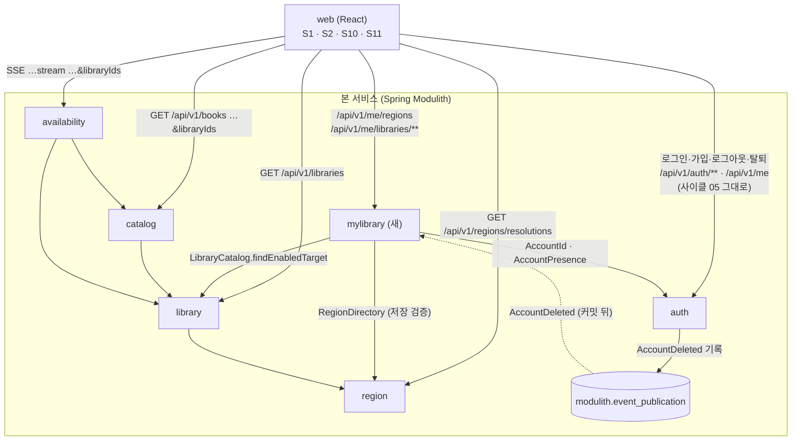

- 화살표 방향 = 의존 방향. `mylibrary → auth, library, region`만 새로 생기고 순환은 없습니다. `catalog`·`availability`는 회원을 모릅니다(ADR-0037).
- 로그인·가입·로그아웃·탈퇴는 사이클 05 그대로 화면이 `auth`와 직접 주고받습니다. `mylibrary`는 로그인을 하지 않고, 로그인된 뒤 "지금 누구인지"(`AccountId`)를 `auth`에게서 받아 그 사람의 지역·도서관만 저장합니다.

## 2. 클래스 그림 (설계 수준, 이름은 예시)

### 2.1 `mylibrary` 모듈 안

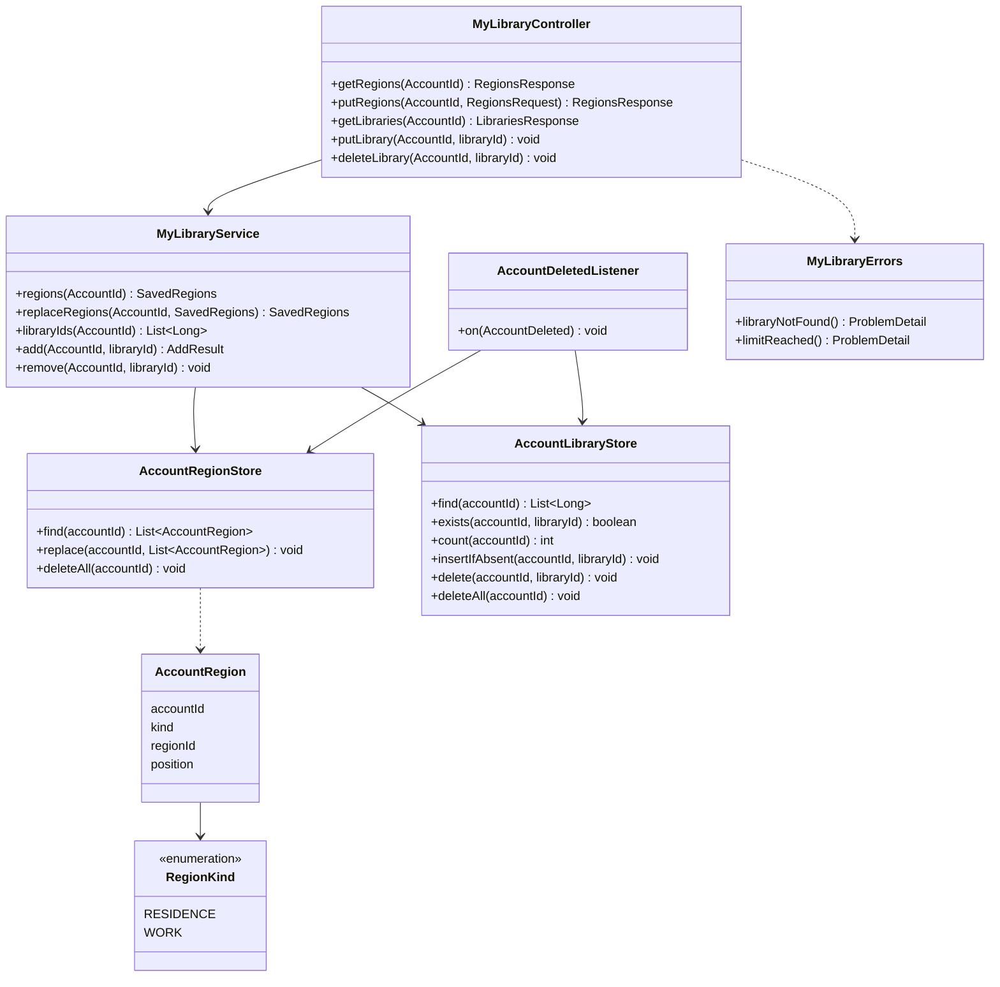

- 저장소(`…Store`)는 사이클 05 `auth`처럼 `JdbcClient`로 SQL을 씁니다. JPA 엔티티는 없습니다.
- `MyLibraryService`의 모든 쓰기는 `@Transactional`이고, 처음에 `AccountPresence.lockIfExists`를 부릅니다(2.2).

### 2.2 다른 모듈과 맞닿는 공개 타입

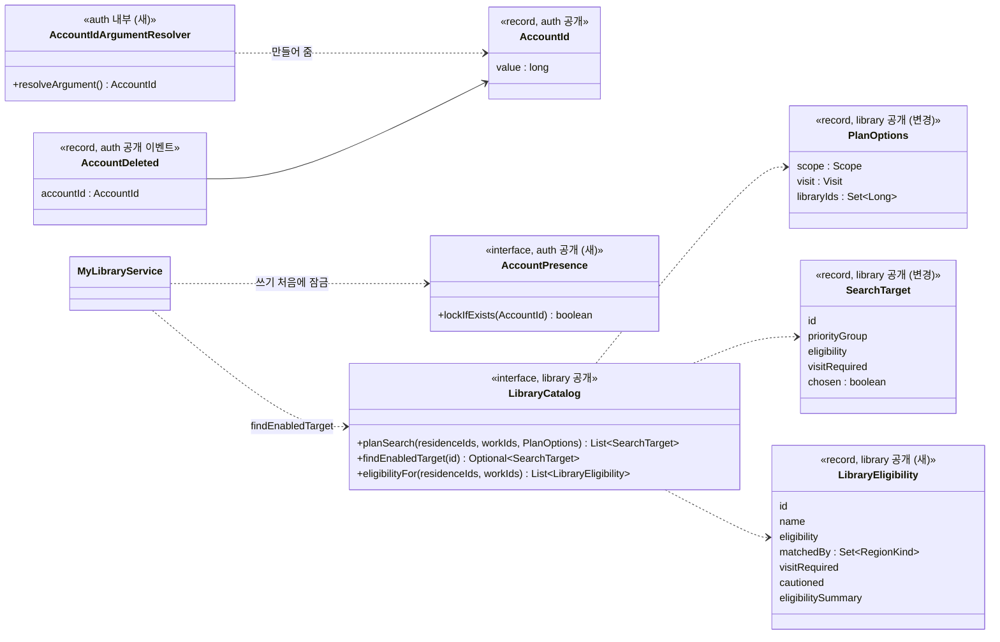

- `AccountIdArgumentResolver`는 `auth` 안에 있고 앱 전체에 등록됩니다. 그래서 `mylibrary` 컨트롤러는 JWT를 몰라도 `AccountId`를 인자로 받습니다.
- `catalog`의 `JoinTier`에 첫 값 `CHOSEN`이 더해지고, `availability`의 스트림 두 곳이 `libraryIds`를 받아 `PlanOptions`에 넣습니다.

## 3. 표 관계 (ERD)

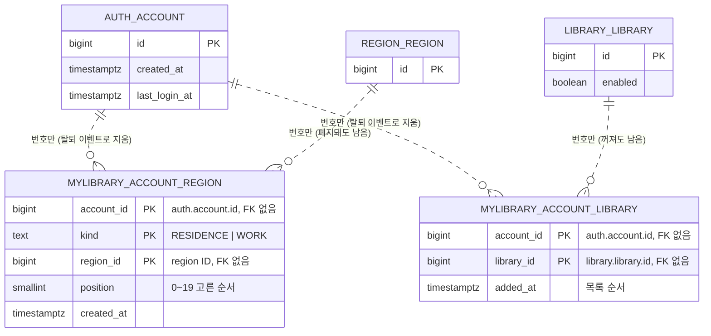

- 점선 = 다른 모듈의 표를 번호로만 가리킴(외래 키 없음, ADR-0001). 모듈끼리 JOIN하지 않습니다.
- 한 계정: 거주 0~20줄, 직장 0~20줄, 직접 추가 0~20줄.

## 4. 시퀀스 그림

### 4.1 로그인 직후 읽기와 검색

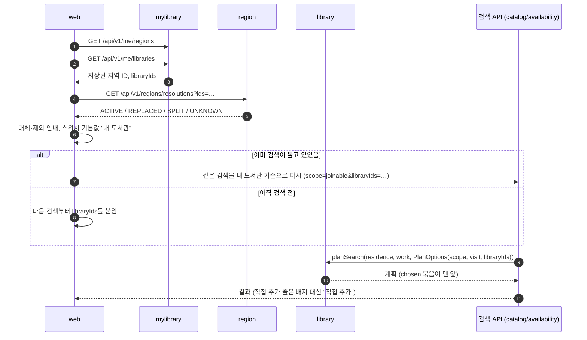

### 4.2 처음 로그인했을 때 지역 옮기기 (S11)

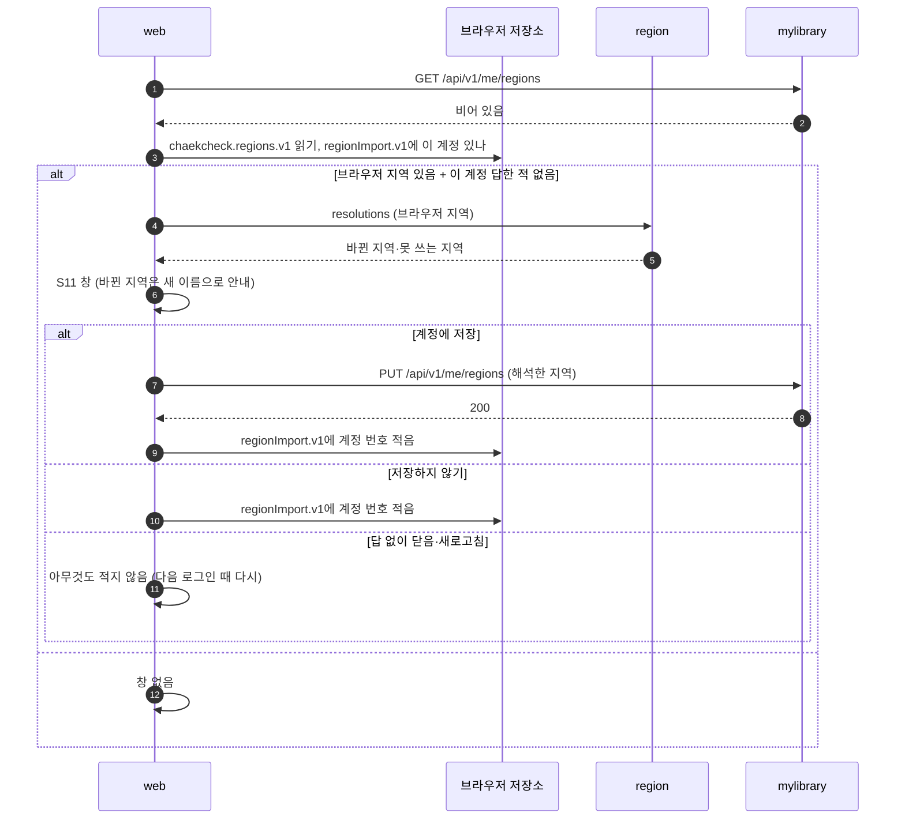

### 4.3 도서관 하나 추가 (S10, 누르면 바로 저장)

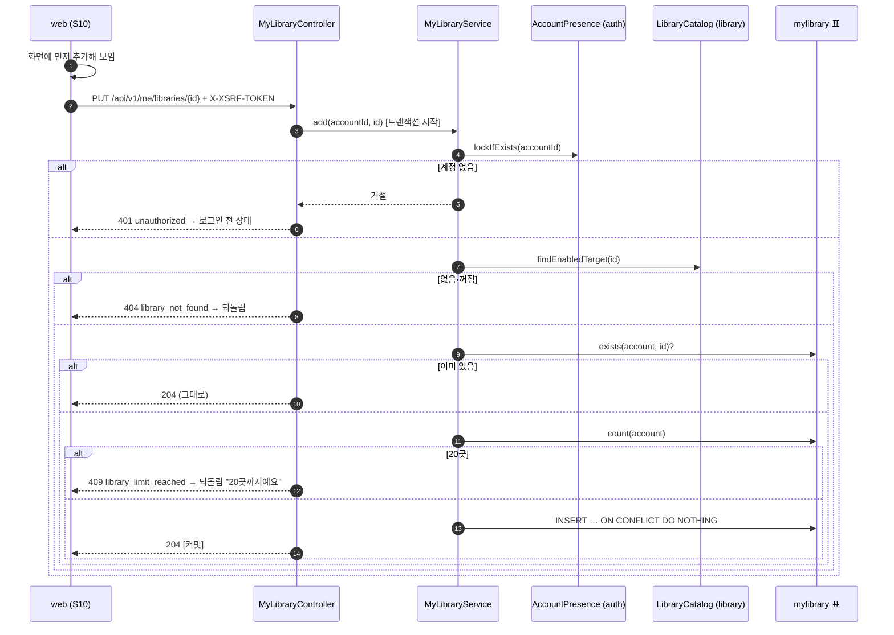

### 4.4 지역 통째로 저장 (S2)

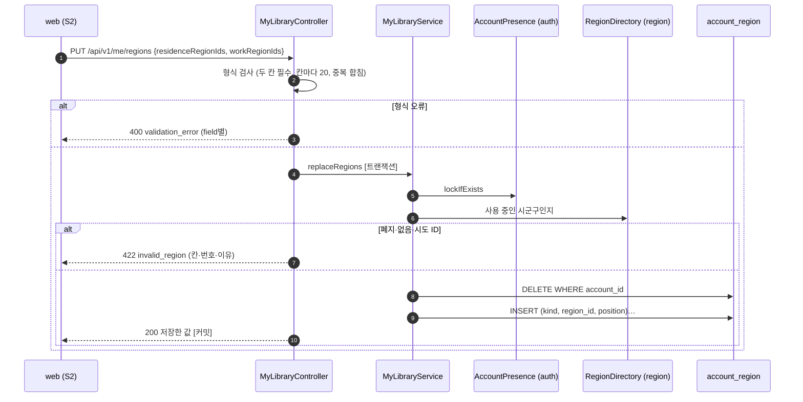

### 4.5 저장과 탈퇴가 겹칠 때 (ADR-0051)

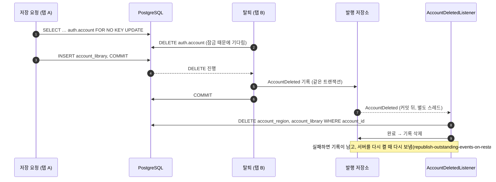

## 5. 흐름도 (규칙이 갈리는 곳)

### 5.1 검색 계획에 도서관을 넣을지 (library, ADR-0050)

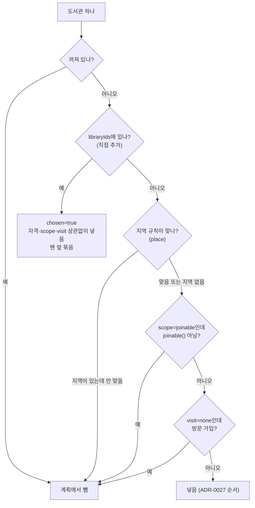

### 5.2 S11 창을 띄울지

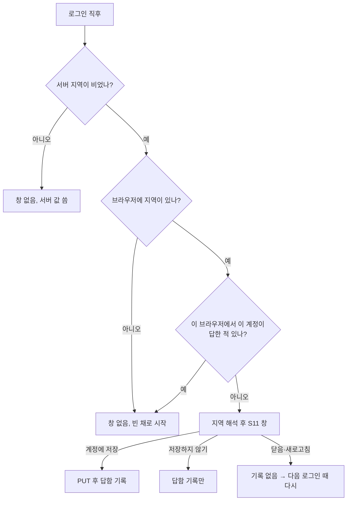

### 5.3 S10 이름 검색 줄의 버튼

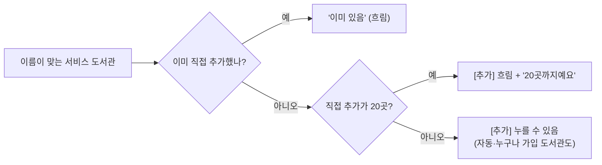

## 6. 화면 상태 (S1 내 도서관 줄)

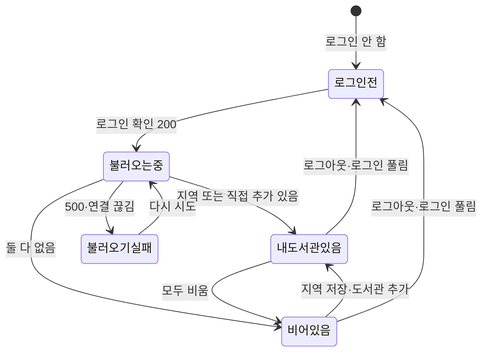

## 7. 예상되는 설계 패턴

| 패턴 | 어디에 | 왜 | 근거 |
|---|---|---|---|
| 모듈러 모놀리스 + 공개 API (Published Interface) | `LibraryCatalog`, `AccountPresence`, `AccountId` | 다른 모듈은 공개 타입만 부르고 `internal` 패키지는 못 봄 | ADR-0001, dev `spring-modulith` 스킬 |
| 도메인 이벤트 + 트랜잭셔널 아웃박스 | `AccountDeleted` → 발행 저장소 → `mylibrary` listener | 탈퇴와 "지워라" 기록을 같은 트랜잭션에 묶고, 커밋 뒤 따로 처리. 실패해도 기록이 남아 다시 처리 | ADR-0041, ADR-0051 |
| 멱등 수신자 (Idempotent Receiver) | listener의 DELETE, `PUT …/libraries/{id}`, `DELETE …/libraries/{id}` | 같은 이벤트·요청이 두 번 와도 결과가 같아 다시 보내기가 안전 | design-delta API 표 |
| 비관적 잠금 (Pessimistic Lock) | `lockIfExists`의 `FOR NO KEY UPDATE` | 저장·탈퇴 겹침과 20곳 동시 추가를 한 줄로 세움 | ADR-0051, PostgreSQL 13.3 |
| 저장소 (Repository) | `AccountRegionStore`, `AccountLibraryStore` (JdbcClient) | SQL을 한곳에 모음 | 사이클 05 `auth`와 같은 방식 |
| 번호로만 참조 (ID reference, 집합 경계) | `account_id`, `region_id`, `library_id`에 FK 없음 | 모듈 표끼리 엮지 않아 나중에 서비스로 나눌 수 있음 | ADR-0001, ADR-0048 |
| 인자 해석기 (Spring `HandlerMethodArgumentResolver`) | `AccountIdArgumentResolver` | 다른 모듈 컨트롤러가 JWT를 몰라도 현재 계정을 받음 | design-delta 모듈 표 |
| 기능 토글 (Feature Toggle) | `chaekcheck.auth.enabled`, `ConditionalOnAuthEnabled` | 로그인을 끄면 `mylibrary` 빈과 API도 없음(404) | ADR-0046 |
| 매개변수 객체 + 필터 규칙 | `PlanOptions(scope, visit, libraryIds)` | 계획 규칙(5.1)을 한 객체가 들고 다님 | design-delta 검색 계획 규칙 |
| 낙관적 화면 갱신 + 되돌리기 (Optimistic UI) | S10 [추가]·[빼기] | 누르면 먼저 바뀌고, 실패하면 되돌리고 안내 | flow S10 |
| BFF 없이 화면이 조합 (Client-side composition) | S10이 `GET /api/v1/libraries` + 저장 값으로 여섯 구역을 만듦 | 서버는 회원을 모르는 목록만, 조합은 화면이 | ADR-0049 |

- 이 표의 패턴 이름은 설명을 위한 분류입니다. dev가 이 이름의 클래스를 만들어야 한다는 뜻은 아닙니다.
