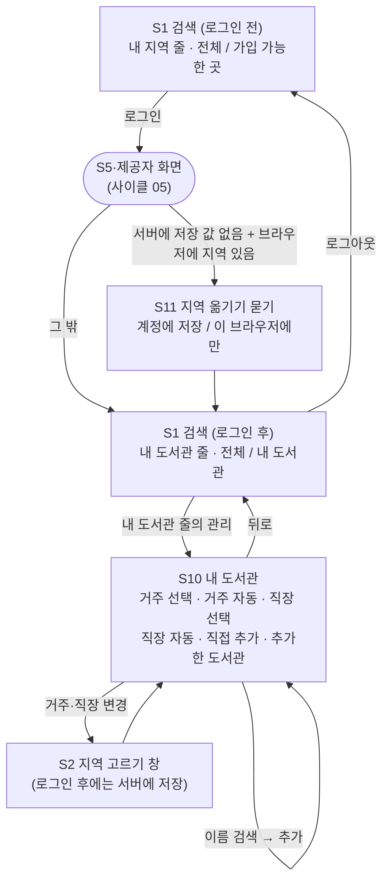

# 화면 흐름: 사이클 06 내 도서관

- 2026-10-04: 결정 페이지 두 장에서 제안이 모두 정해짐(승인 8, 사용자 제안 1: S10 여섯 구역). 남은 [안]은 S10 [변경]이 S2를 어느 칸으로 여는지, 화면 문구의 세부(설계 검토에서 함께 봄). 다음 단계 `/design-delta`
- 작성: 2026-10-04. 범위 `scope.md`, 규칙 `spec.md`(R1~R9, AC-1~AC-16)
- 기존 화면(S1 검색, S2 지역 고르기 창, S3 책, S4 설정 창, S5~S9 로그인·계정)은 사이클 04·05 `flow.md` 그대로이고, 여기에는 **바뀌거나 더해지는 것만** 적습니다. 구조와 상태이지 시각 디자인이 아닙니다.
- 지금 화면은 dev 코드에서 확인함(2026-10-04, 읽기만): S1의 "내 지역" 줄(`RegionSummary`), "전체 도서관 / 가입 가능한 곳(지역 없으면 누구나 가입)" 스위치(`LibraryScopeToggle`), ⚙ 설정 창(`SettingsPanel`: 보기 방식, 직접 찾기, 로그인 후 계정 절)
- 태그: `[확정]`은 spec에서 사용자가 정한 것, `[안]`은 이 문서의 제안(결정 페이지 `easy/2026-10-04-flow-decisions.html`)

- 둥근 상자는 사이클 05의 로그인 흐름입니다.
- 로그인 전의 화면은 바뀌지 않습니다 [확정] (spec R9, AC-14).

## 화면별 내용

### S1 search (변경: 로그인 후 "내 도서관" 줄과 스위치)

- 목적: 로그인한 사람이 내 도서관 기준으로 검색함. 검색 기능 자체는 사이클 04 그대로.
- 보이는 요소 (로그인 후에만 바뀜)
  - "내 지역" 줄 → **"내 도서관" 줄**: `내 도서관 · 거주 서울 마포구 · 직장 서울 중구 · 직접 추가 3곳 · 관리` [확정] (사용자 승인, 2026-10-04). 아무것도 없으면 `내 도서관이 비어 있어요. 지역을 고르거나 도서관을 추가하세요 · 관리` [확정] (사용자 승인, 2026-10-04)
  - 스위치: `전체 도서관 | 내 도서관` [확정] (사용자 승인, 2026-10-04) (로그인 전 `전체 도서관 | 가입 가능한 곳` 그대로)
  - 내 도서관이 있으면 처음부터 "내 도서관"이 켜져 있음, 바꾼 값은 새로고침해도 유지 [확정] (spec R5)
- 사용자 동작: 관리 → S10(들어가는 곳은 이것 하나). 스위치 → 첫 묶음부터 다시 검색(지금 규칙).
- 호출하는 API: 내 도서관 읽기(지역·직접 추가, 로그인 직후 한 번), 검색 API는 `libraryIds` 한 칸이 더해짐
- 상태
  - 불러오는 중: 줄에 "불러오는 중", 검색은 막지 않음(읽기 전에는 전체 기준) [확정] (사용자 승인, 2026-10-04)
  - 불러오기 실패: 줄에 "내 도서관을 불러오지 못했어요 · 다시 시도", 스위치는 전체로 [확정] (사용자 승인, 2026-10-04)
  - 저장 값의 지역이 바뀜: 지금 안내 줄 규칙 그대로("행정구역 변경으로 …", "다시 골라 주세요") [확정] (spec R6)
- 배치: 지금 "내 지역" 줄 자리 그대로. 모바일에서는 줄이 길면 지역 이름을 줄이고 "외"를 붙임 [확정] (사용자 승인, 2026-10-04)

### S2 region-modal (변경: 로그인 후 저장 위치)

- 보이는 요소와 동작은 그대로. 로그인 후에는 "저장"을 누르면 서버에 저장 [확정] (spec R1)
- 상태 추가: 저장 중(버튼 비활성) / 저장 실패("저장하지 못했어요. 잠시 뒤 다시 해 주세요", 창은 열린 채 값 유지) [확정 문구: spec 상태별 동작] / 로그인이 풀림(로그인이 풀렸다는 안내 후 로그인 전 상태) [확정]

### S10 my-libraries (새 화면)

- 목적: 내 도서관(지역·자동 목록·직접 추가)을 보고 고침.
- 형태와 주소: 별도 화면 `/my-libraries` [확정] (사용자 승인, 2026-10-04) (로그인 후에만. 로그인 전에 주소로 들어오면 S1으로)
- 들어가는 길: **한 곳만** [확정] (사용자, 2026-10-04: "들어가는 곳이 하나면 좋겠는데"). S1 "내 도서관" 줄 끝의 [관리] 버튼 [확정] (사용자 승인, 2026-10-04). 이 줄은 메인 화면(검색 전)과 검색 결과 화면에서 같은 자리(검색창 바로 아래, 로그인 전의 "내 지역" 줄 자리)에 있음 (사용자: "메인 화면에서도 현재 거주지 설정 하는 곳에 있었으면" → 같은 자리임을 그림으로 확인 후 승인)
- 보이는 요소 (위에서 아래로 여섯 구역) [확정] (사용자 제안, 2026-10-04: "거주 지역 선택 / 거주 지역으로 자동 / 직장 지역 선택 / 직장 지역으로 자동 / 직접 도서관 추가 / 직접 추가한 도서관 3/20 이런 식으로 6개 항목좀", 처음 제안 "지역 → 자동 → 직접 추가 → 추가 검색"은 미승인: "직장은 왜 없어? 직장도 넣어")
  1. 거주 지역 선택: 고른 시군구 + [변경] → S2
  2. 거주 지역으로 자동: 거주 지역으로 가입 가능한 도서관. 빼기 버튼 없음 [확정] (spec R4)
  3. 직장 지역 선택: 고른 시군구 + [변경] → S2
  4. 직장 지역으로 자동: 직장 지역으로 가입 가능한 도서관. 빼기 버튼 없음
  5. 직접 도서관 추가: 이름 검색 칸 → 이름이 맞는 서비스 도서관 → [추가]. 이미 내 도서관인 곳은 "이미 있음"으로 흐리게 (추가는 여기서만 [확정] (사용자 승인, 2026-10-04))
  6. 직접 추가한 도서관 N/20: 줄마다 도서관 이름 · 가입 자격 배지 · [빼기]
  - 맨 위 한 줄 안내 "누구나 가입하는 도서관 N곳도 늘 내 도서관에 들어 있어요 ▸"(눌러서 펼침). 거주·직장 둘 다로 가입 가능한 곳은 두 자동 목록에 모두 보임. 자동 목록은 "N곳 ▸"로 접어 둠 [확정] (사용자 승인, 2026-10-04)
  - 각 "지역 선택"의 [변경]은 S2를 거주(또는 직장) 칸이 열린 채로 엶 [안]
- 사용자 동작: 추가·빼기는 누르는 즉시 서버에 저장(따로 "저장" 버튼 없음) [확정] (사용자 승인, 2026-10-04). 뒤로 → 보던 S1.
- 호출하는 API: 내 도서관 읽기·바꾸기, 서비스 도서관 목록(이름 검색), 가입 가능 판정(자동 목록)
- 상태 [안 문구, 규칙 확정]
  - 불러오는 중 / 불러오기 실패("다시 시도")
  - 비어 있음: "지역을 고르거나 도서관을 추가하세요" (spec 상태별 동작)
  - 20곳 찼음: 추가 버튼이 흐려지고 "직접 추가는 20곳까지예요. 하나를 빼면 추가할 수 있어요" (AC-8)
  - 저장 실패: 바꾸기 전 목록으로 돌아가고 "저장하지 못했어요. 잠시 뒤 다시 해 주세요"
  - 꺼진 도서관이 저장돼 있음: 그 줄에 "지금은 쓸 수 없는 도서관이에요" + [빼기] (spec R3)
  - 검색 결과 없음: "이름이 맞는 도서관이 없어요"
- 배치: 데스크톱·태블릿·모바일 모두 가운데 한 단, 위 여섯 구역 순서. 줄의 [빼기]는 오른쪽 끝 [안]

### S11 region-import (새, 작은 창)

- 목적: 처음 로그인했을 때 이 브라우저의 지역을 계정으로 옮길지 한 번 물음 [확정] (spec R2)
- 열리는 때: 로그인 직후, 서버에 저장 값이 없고 이 브라우저에 지역이 있을 때 한 번 [확정]
- 보이는 요소: "이 브라우저에 고른 지역이 있어요. 계정에 저장할까요?", 지역 이름(거주·직장), [계정에 저장] [저장하지 않기] [확정] (사용자 승인, 2026-10-04)
- 사용자 동작: 계정에 저장 → 서버에 저장하고 S1(로그인 후, 그 지역 기준). 저장하지 않기 → 서버 값이 빈 채로 S1. 같은 계정·같은 브라우저에서 다시 묻지 않음 [확정] (사용자 승인, 2026-10-04)
- 상태: 저장 중 / 저장 실패(창 안에 실패 문구, 다시 누를 수 있음)
- 배치: S5처럼 가운데 작은 창, 모바일은 아래에서 올라오는 창 [확정] (사용자 승인, 2026-10-04)

### S4 settings

- 바뀌지 않음. 내 도서관으로 들어가는 길은 S1 줄의 [관리] 하나 [확정] (사용자 승인, 2026-10-04)

### S6 signup-consent, S9 privacy (변경: 문구만)

- 수집·이용 고지 표와 처리방침의 항목에 "거주지·직장 지역(시군구), 직접 추가한 도서관"을 더함 [확정] (spec R7, AC-15). 화면 구조는 그대로.

### S7 withdraw (변경: 문구만)

- 지워지는 것 목록에 "저장한 지역과 내 도서관"을 더함 [확정] (사이클 05 flow S7이 "사이클 06부터 지역·내 도서관을 더함"이라고 적어 둠)

## 수용 기준 대응

| AC | 화면 |
|---|---|
| AC-1 다른 브라우저에서도 같은 지역 | S2(저장), S1(로그인 후 줄) |
| AC-2 로그인 전 서버로 안 보냄 | S1(로그인 전), S2 |
| AC-3 처음 로그인 때 옮기기 | S11 |
| AC-4 직장 지역 → 자동 목록 | S10 2번 |
| AC-5 직접 추가·빼기 | S10 3·4번 |
| AC-6 스위치 = 내 도서관 | S1 스위치 |
| AC-7 비어 있으면 누구나 가입만 | S1 스위치, S10 비어 있음 |
| AC-8 21번째 막기 | S10 20곳 찼음 |
| AC-9 바뀐 지역 | S1 안내 줄, S10 지역 |
| AC-10 꺼진 도서관 | S10 꺼진 도서관 줄 |
| AC-11 탈퇴하면 지움 | S7(문구), 화면 밖(DB) |
| AC-12 지워진 계정의 토큰 | 화면 밖(API) |
| AC-13 모두 비우면 행 없음 | S10, S2 |
| AC-14 로그인 전 그대로 | S1(로그인 전) |
| AC-15 동의 고지·처리방침 항목 | S6, S9 |
| AC-16 기본 스위치 | S1 |

## 상태별 동작 대응 (spec "상태별 동작")

| 상태 | 화면 |
|---|---|
| 로딩 | S1 줄 "불러오는 중", S10 불러오는 중 |
| 저장 실패 | S2, S10, S11 저장 실패 |
| 로그인이 풀린 채 저장(401) | S2·S10: 안내 후 로그인 전 S1 |
| 20곳 초과 | S10 20곳 찼음 |
| 내 도서관 비어 있음 | S1 빈 줄, S10 비어 있음 |
| "저장하지 않기" | S11 → S1(서버 값 없음) |
