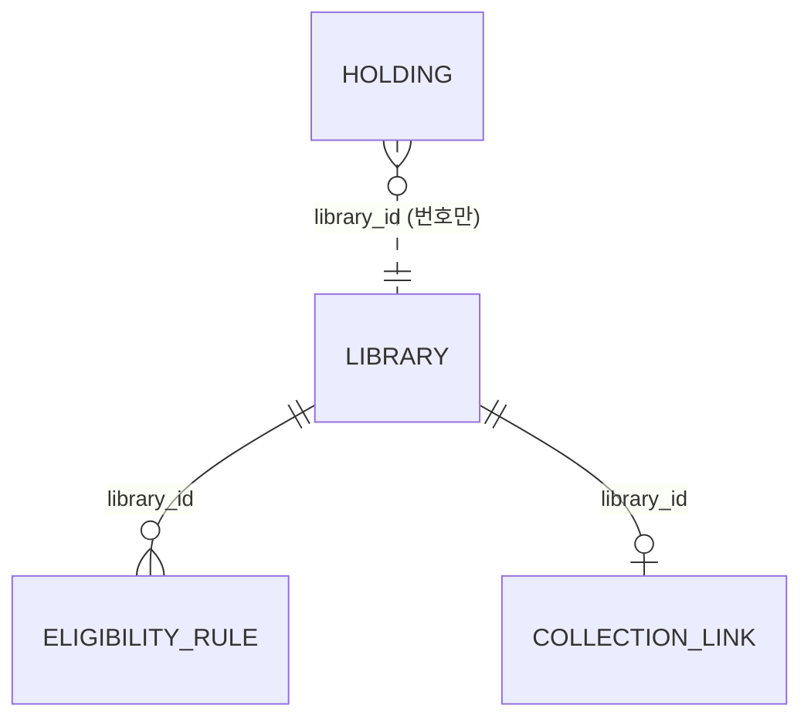

# 설계 제안: 사이클 07 후보 도서관 넣기

> 이 문서는 제안 이력입니다. 결정은 `design-delta.md`와 ADR-0052~0060이 우선입니다 (2026-10-05).

- 작성: 2026-10-05, `architect` 서브에이전트 제안을 정리. 읽은 것: 이 사이클 `scope.md`·`spec.md`·`flow.md`·`research.md`, `docs/current/`, `docs/research/library-join/candidates.md`, `snapshot-2026-10-05.md`, dev `CLAUDE.md`와 코드(`LibraryService`, `PlanOptions`, `LibraryCatalog`, `CollectedCatalog`, `CatalogImporter`, `CatalogWriter`, `PgBigmBookSearch`, `catalog/001-catalog-schema.yaml`, `PlatformAdapter`, `ParsedDetail`, `HoldingTask`, `AvailabilityResolvers`, 웹 `MyLibrariesPage.tsx`·`libraryNames.ts`)
- 결정 페이지: `easy/2026-10-05-design-decisions.html`

## 0. 코드를 읽다 찾은 것 (설계에 영향)

1. 가입 규칙이 0개인 등록 도서관도 지금 `scope=all` 계획에 들어감(`LibraryService.place()` → `NEEDS_CHECK`/`UNVERIFIED`). "가입 조건 줄이 없으면 직접 추가일 때만"을 그대로 옮기면 등록 도서관 동작이 바뀌어 AC-6이 깨짐 → 따로 표시 칸이 필요(D4)
2. spec R4-2의 전제가 틀림: 가져오기 제외는 `AUDIOBOOK`·`VIDEO_BOOK`뿐이고 `UNKNOWN`은 들어감(사용자 결정 2026-09-30). 북큐브 `book/wma`·`book/vod`·`book/wmv`, 교보 `동영상`(약 5.7천 줄)이 `UNKNOWN` 책으로 들어옴(Q2)
3. AC-6(등록 도서관 결과·순서 그대로)은 설계만으로 보장 못 함: 대표 제목·저자·출판일은 "묶인 소장 중 가장 많은 값"이고 묶기 ①·④는 도서관을 가리지 않아, 후보 소장이 들어오면 등록 도서관 책의 대표값·정렬 키·묶음이 바뀔 수 있음(Q1)
4. importer는 모든 줄을 메모리에 둠(`List<CollectedRow>`). 2,150만 줄이면 힙 약 11~15GB(추정)
5. `KYOBO_SUBSCRIPTION_V1`에 교보 "소장형" 기관이 섞여 있음(후보 1,182곳, 등록 5곳). 지금 이 화면 종류는 모두 요청 없이 "구독형 · 바로 대출"로 보임 → 직접 추가한 후보 소장형도 그렇게 잘못 보임(Q3)
6. dev `CLAUDE.md` "Library Research Record (required)": 도서관을 넣으면 같은 작업에서 자격을 조사해야 함 → 이번 범위 제외와 충돌, 인계서에서 예외를 요청해야 함(Q4)
7. (확인함, 2026-10-05 사본 조회) 사본에도 같은 사이트 표시가 99곳이고 102576(광주 서구)도 "same site as registered library 131"로 표시돼 있음 → 별도 처리 필요 없음. 데이터 모양 조사의 98곳은 셈 방식 차이

## 1. 구조 개요 (바뀌는 것만)

- `library`: 짝 표 `collection_link` 소유, 도서관 표에 `join_surveyed`, 화면 종류 2개 추가, `planSearch`에 "미조사이고 직접 추가가 아니면 뺌" 한 줄. 공개 타입 `LibraryRef`에 `collectionLibraryId`, `SearchTarget`·`LibraryEligibility`에 `joinSurveyed`
- `catalog`: importer가 `LibraryRef.collectionLibraryId`로 수집 번호 → 서비스 번호(library 표를 직접 읽지 않음), 날짜 규칙 2개, 가져온 뒤 `VACUUM (ANALYZE)`
- `availability`: `BookcubeFxAdapter`, `AladinV1Adapter`, 상세 요청 주소 훅, 구독 판정
- `mylibrary`·`auth`·`region`·fetch-service: 바뀌지 않음(fetch-service는 호스트 허용 목록 없이 `UrlGuard`만)
- 의존 방향 그대로(`catalog → library → region`, `availability → catalog, library`), 새 이벤트 없음

## 2. 결정

### D1. 짝 표는 새 모듈(수집 연결)이 가짐 [확정] (사용자 제안: "따로 모듈로 가고 나중에 수집 연결 모듈이 고치라고 해", 2026-10-05; 처음 제안 "`library` 모듈이 가짐"은 미승인)

- (2026-10-05 바뀜, ADR-0060) 가져오기 전부도 `collection`이 맡음. 제목 다듬기 규칙은 `catalog`에 두고 빌려 씀. 아래 문장은 바뀌기 전: 새 모듈 이름 `collection` [안], 스키마 `collection`, 표 `collection.collection_link`. 공개 API: 수집 번호 → 서비스 번호 조회. `catalog` importer는 이 API로 짝을 받음. 후보 도서관 줄 자체(`library.library`)는 `library` 소유 그대로
- 앞으로 가져오기 기록·갱신 순서 같은 수집 연결 일은 이 모듈이 맡아 고침(사용자 말 "나중에 수집 연결 모듈이 고치라고 해")
- 아래는 처음 제안(미승인):

도서관 번호를 가진 모듈이 짝도 가짐. `catalog`는 공개 API(`LibraryRef`)로 받기만. 나중에 분리할 때 짝 표는 도서관 서비스에 남음.

### D2. 후보 도서관 줄은 사본에서 만든 Liquibase seed(CSV, 번호 명시)로 넣음 [확정] (사용자 승인, 2026-10-05)

- A안(추천): dev 스크립트(`scripts/library/`)가 사본을 읽어 `library` 줄과 짝 줄 CSV를 만들고 `loadData`로 넣음(seed 002~006과 같은 방식). 번호가 모든 환경에서 같고(브라우저 저장·`account_library` 안전, AC-12 자연히 충족), 나중에 조사된 후보 공공도서관의 자격 규칙 seed가 번호를 미리 알 수 있음, 모듈 사이 쓰기 API 없음. 단점: 다음 가져오기 전에 새 도서관마다 seed 파일 하나 더 → spec R8 "가져올 때 짝 표로 이어짐"이 "가져오기 전 seed에서 이어짐"으로 바뀜
- B안: 가져오기 때 `catalog` → `library` 공개 API `registerCollected(...)`로 등록. 한 번에 끝나지만 번호가 실행 순서에 따라 정해져 자격 규칙 seed가 번호를 모름, 두 모듈 쓰기 트랜잭션이 나뉨
- C안: `library`의 별도 가져오기 명령. B와 같은 단점 + `library`가 SQLite를 알아야 함

### D3. seed 만드는 규칙 [확정] (사용자 승인, 2026-10-05)

- 넣는 곳: 수집 번호 ≥ 100001, `crawl_skip` 없음, `last_full_success_at` 있음(약 2,412곳). 체험용·운영 중단으로 보이는 4곳(삼각산 북라이브, 대구동구안심 북큐브, 순창 북라이브, 양평 북큐브)은 뺌 [확정] (사용자, 2026-10-05). 가입 조사가 된 후보 공공도서관은 `public-join-2026-10-05.tsv`의 `decision`대로 가입 규칙 줄을 함께 넣고 미조사가 아님(원문 못 찾은 곳은 규칙 없는 "자격 미확인")
- 새 번호: 지금 최대(280) 다음부터, 끝에 IDENTITY 맞춤. 등록 도서관 짝은 `INSERT … SELECT id, id`(꺼진 59·131 포함)
- 이름(spec R2): 등록 도서관 이름은 그대로. 겹치는 후보는 모두 `이름 (라벨)`, 그래도 겹치면 `이름 (라벨, 호스트)`. 라벨: `BOOKCUBE_FX` 북큐브, `KYOBO_V1`·`KYOBO_SUBSCRIPTION_V1` 교보, `YES24_V1~V3` YES24, `ALADIN_V1` 알라딘. 이름은 처음 넣을 때 한 번 정하고 다음 seed에서 바꾸지 않음
- 다른 칸: `homepage_url = base_url`, `join_method = NULL`, `join_surveyed = false`, `holdings_count = NULL`, `enabled = true`

### D4. 가입 정보 미조사 표시 칸 `library.join_surveyed` [확정] (사용자 승인, 2026-10-05)

- A안(추천): `join_surveyed boolean NOT NULL DEFAULT true`(false = 미조사). 계획에서 `!joinSurveyed && !chosen`이면 뺌. `true`인 등록 278곳은 지금과 똑같음(AC-6·AC-15). 같은 칸으로 팝오버 안내(R6)와 `join_method` NULL 허용(CHECK `NOT join_surveyed OR join_method IS NOT NULL`)을 정함. 후보 공공도서관 조사가 끝나면 데이터만 고침(`true`, `join_method`, 규칙 줄)
- B안: `origin` ('REGISTERED'/'CANDIDATE') + "후보이고 규칙 0개면 직접 추가일 때만". 규칙만 넣으면 보이지만, "등록/후보 구분은 사라지고 가입 조건 유무로"와 어긋나고 학교·회사(규칙이 계속 없음)와 미조사를 가르지 못함
- 직접 추가된 미조사 도서관의 배치는 지금 `place()` 결과 그대로 + `chosen` 맨 앞(ADR-0050, 코드 변경 없음). `GET /libraries`는 미조사 도서관도 포함(이름 찾기용)

### D5. 가져오기가 짝을 찾는 방법 [확정] (사용자 승인, 2026-10-05)

`CollectedCatalog.libraries()`가 "id·base_url 같음" 대신 `LibraryRef.collectionLibraryId`로 짝을 찾음. `base_url` 같음 검사는 안전장치로 남겨 다르면 `library_base_url_mismatch`로 셈. 짝이 없거나 꺼진 도서관은 지금처럼 `library_not_in_service`. 사본의 받는 중·아직·실패·같은 사이트 곳은 seed에 짝이 없어 자동으로 빠짐.

### D6. 날짜 규칙 [확정] (사용자 승인, 2026-10-05)

`PublishedDates.parse`에 8자리 `YYYYMMDD`(실제 날짜만)를 더함. 1950년 이전 날짜는 설정 `chaekcheck.catalog.import.placeholder-date-libraries`(값 `100555`, 수집 번호)에 든 도서관만 NULL. 전체를 일괄로 지우면 등록 도서관 10줄이 바뀌어 AC-6에 영향.

### D7. 가져온 뒤 `VACUUM (ANALYZE)` [확정] (사용자 승인, 2026-10-05)

TRUNCATE·COPY 그대로, 커밋 뒤 `ANALYZE` 대신 `VACUUM (ANALYZE)`(visibility map을 채워 `holding (book_id, library_id)` index-only scan). 쓰기 약 10~12분 + VACUUM 수 분(추정). 기다림은 수용됨 [확정].

### D8. 메모리가 모자라면 큰 메모리 PC에서 운영 DB로 가져옴 [확정] → 아래로 바뀜
- **바뀜** [확정] (사용자 제안: "적당한 크기로 나눠 읽도록 바꿔줘", 2026-10-05, 처음 제안 "큰 메모리 PC에서"는 미승인): importer가 수집 DB를 적당한 크기로 나눠 읽도록 고침(묶기 키만 메모리에 두고 소장 줄은 나눠 읽어 바로 COPY하는 2단계 등, 방법·크기는 dev). 큰 메모리 PC 없이 운영 서버에서 돌 수 있게

dry run에서 힙을 잼. 모자라면 (a) 큰 메모리 PC에서 운영 DB로 실행(추천, 코드 변경 없음) (b) 2단계 스트리밍으로 고침(묶기 키만 메모리, 소장은 두 번째 읽기에서 바로 COPY).

### D9. catalog 표 형식은 그대로 [확정] (사용자 승인, 2026-10-05)

서비스 `holding`에는 `cover_url`이 없음(research 2절의 "70%가 URL"은 수집 DB 기준). 원문 보존·URL 통째로는 [확정]. 크기 추정: `holding` 약 6GB, 인덱스 3개 약 2GB, `book`·사람·GIN 약 1~1.5GB, 합계 약 9~10GB(추정, dev 측정). `UNIQUE (library_id, item_key)`(약 0.9GB, 조회에 안 쓰임) 빼기는 backlog.

### D10. `GET /books` 1초: 처음부터 책별 도서관 번호 배열을 미리 계산 [확정] (사용자 미승인 뒤 다른 선택 "처음부터 미리 계산", 2026-10-05)

- 비용은 "맞은 책 수 × 책당 소장 수"에 비례. 후보에만 있는 책도 bigm에서 맞은 뒤 버려지고(약 2배), 책당 소장이 약 4배 → "사랑" 224ms가 수백 ms~1초대(추정)
- A안: 쿼리 그대로 + VACUUM + 정해진 검색어 묶음 `EXPLAIN (ANALYZE, BUFFERS)` 관문. 코드 변경 0
- B안: `book.library_ids bigint[]`(importer가 채움)로 `b.library_ids && :libraryIds` 거름, `/books`가 `holding`을 안 읽음. 약 0.2GB(추정), 같은 사실을 두 곳에 둠
- 추천: A, 관문 실패(묶음 중 하나라도 첫 쪽 1초 초과) 시 같은 사이클에서 B. 파티션·캐시·CQRS는 넣지 않음

### D11. S10 도서관 이름 찾기는 목록 통째로 + 응답 압축 [확정] (사용자 승인, 2026-10-05, 서버 부담 질문에 답한 뒤)

| | A안(추천): 목록 통째로 + gzip | B안: 서버 이름 검색 |
|---|---|---|
| 크기 | 278곳 48,123B → 약 2,690곳 약 460KB, gzip 약 40KB(추정, 비율 8.7%) | 한 쪽 20곳 약 2KB |
| 변경 | 응답에 `joinSurveyed`, nginx `gzip on; gzip_types application/json`(지금 없음), 웹 정렬(앞 일치 먼저 → 가나다), 2글자, 20 + 더 보기 | 새 `GET /api/v1/libraries/search?name=&page=`, 이름 인덱스, 직접 추가 목록·S11 이름 표시용 `?ids=` 조회도 필요 |
| 부르는 곳 | S10·S11만(S1은 안 부름, 코드 확인) | 칠 때마다 |

A안이면 ADR-0049의 "수천 곳이면 서버 검색으로"를 측정으로 정리하는 것. dev 실측으로 확정.

### D12. 북큐브·알라딘은 상세(`detail_url`)로 읽고, 직접 찾기용 검색도 만듦 [확정] (사용자 승인, 2026-10-05)

- `PlatformAdapter`에 기본 메서드 `detailFetchUri(URI)`(기본 = 그대로). 북큐브는 `/product/view/?num=` → `/xml/productView/?num=`(같은 호스트라 throttle·캐시 키 그대로, 카드 링크는 HTML 상세 그대로). `<Product>` 바로 아래 `volume`·`nowLendCount`·`nowReserveCount`, XML 파서는 DTD·외부 엔티티 끔. 알라딘은 "보유현황" 칸 라벨 보유/대출/예약
- 모양이 틀리면 `UpstreamException(ERROR)` → 실패 칸, 카드 링크 남음 [확정 동작]
- 직접 찾기(`searchUri`/`parse`)도 만듦(직접 추가한 후보는 "도서관에서 직접 찾기" 계획에도 들어가므로): 북큐브 `xml/productSearch?keyword=&keyoption2=`, 알라딘 `sub.htm?code=search&search_item=`. 쪽 나누기 확인 전에는 첫 쪽만(`hasMore=false`), 알라딘 출판사 검색은 그 도서관 실패로
- `PlatformType`·`library_platform_type_check`에 `BOOKCUBE_FX`, `ALADIN_V1`. `AvailabilityResolvers`에서 둘 다 count

### D13. 북큐브 대여형은 응답마다 판정 [확정] (사용자 승인, 2026-10-05)

- A안(추천): `volume=0`이고 `nowRentalCount` 요소가 있으면 새 `SiteVerdict.SUBSCRIPTION` → `subscription()`(바로 대출), 보유 칸 null. 한 사이트 안에 섞여도 맞음, 데이터 칸 없음
- B안: 도서관별 칸으로 요청 없이 판정. 요청이 줄지만 섞인 사이트에서 틀리고 조사로 채워야 함

### D14. S11 옮기기는 한 번에 옮기는 새 요청 [확정] (사용자: "한 번에 옮기는 새 요청을 만들어줘", 2026-10-05; 처음 제안 "하나씩"은 미승인). 경로·검증·오류는 design-delta에서 [안]

- A안(추천): 브라우저 순서대로 하나씩, 409면 멈추고 "20곳까지만 저장했어요", 404(꺼짐)는 건너뜀. 새 API 없음, 최대 20번
- B안: 새 묶음 API `PUT /me/libraries`. 원자적이지만 새 검증·오류 규칙과 ADR 필요
- 로그인 전 직접 추가는 브라우저 저장(키 이름 dev, 최대 20) + `libraryIds`. 서버 변경 없음(ADR-0037), `GET /api/v1/libraries`는 이미 공개

### D15. 팝오버는 가입 등급 `eligibility`에 새 값 `UNSURVEYED`를 더해 정함 [확정] (사용자 미승인 뒤 다른 선택 "가입 등급에 '미조사' 값을 새로 더함 … 이걸로 해줘", 2026-10-05). 아래 처음 제안(`joinSurveyed` 칸)은 채택하지 않음. DB 칸 `join_surveyed`(D4)는 그대로이고, API는 그 값을 `eligibility: UNSURVEYED`로 내보냄. 등급을 쓰는 웹 분기를 모두 고침

`targets.libraries[]`와 `GET /libraries` 항목에 `joinSurveyed`(boolean). 웹은 false면 R6 문구와 `homepageUrl` 링크. `eligibility`에 새 값을 더하지 않아 기존 웹 분기를 건드리지 않음.

### D16. Liquibase는 새 파일로 더함 [확정] (사용자 승인, 2026-10-05). 사용자 덧붙임: "DB를 고치는 걸 생각했는데 대조할 게 많아서 새 파일을 가지고 비교/대조한 다음에 고치는게 어떨까 해" → 새 파일로 넣고 비교·대조한 뒤 기존 파일에 합칠지 고침 [확정] (사용자 제안, 2026-10-05). 합치는 때는 배포 전(`PRE_DEPLOYMENT` 동안) [안]

`PRE_DEPLOYMENT`가 있어 기존 changeset을 고칠 수 있지만, 사이클 06처럼 새 파일만 더해 DB 초기화가 필요 없게. `library/007-library-candidates-schema.yaml`(`join_surveyed`, `join_method` NULL 허용 + CHECK, 화면 종류 CHECK 9개), `library/008-collection-link.yaml`(표 + 등록 짝), `library/009-library-seed-candidates.yaml` + CSV 둘(끝에 IDENTITY 맞춤). D10 B안이면 `catalog/002-book-library-ids.yaml`.

### D17. 수집 두 갈래(B): 서비스 변경 없음

인계서에 dev 요청: `docs/maintenance/` 두 갈래 정리, seed 생성 스크립트를 ① 도서관 수집 갈래의 "넣기" 단계로, `--per-host`/`--host-slots` 우선순위 정리, Q4 예외.

## 3. 사용자에게 물을 것

- Q1. AC-6 비교 기준을 "등록 도서관 소장 (도서관, 책 코드) 집합과 정렬 순서가 같음"으로 바꿀지(대표 제목·묶음은 바뀔 수 있음 인정) [확정] (사용자 승인, 2026-10-05)
- Q2. 북큐브 `book/wma`·`vod`·`wmv`, 교보 `동영상`(약 5.7천 줄, `UNKNOWN`)을 가져오기에서 뺌 [확정] (사용자 승인, 2026-10-05)
- Q3. 교보 소장형(`KYOBO_SUBSCRIPTION_V1` 중 소장형, 후보 1,182곳)이 "구독형 · 바로 대출"로 잘못 보이는 문제 → 이번에 고침 [확정] (사용자 승인, 2026-10-05)
- Q4. dev 규칙 "자격 조사 없이 도서관 추가 금지"의 예외 요청은 하지 않고 기다림 (사용자: "기다려 이번에 넣을게 지금 선택 중", 2026-10-05, 미승인). 사용자가 가입 조사 결과를 이번에 넣음 → 그 결과를 받은 뒤 미조사로 남는 곳이 있는지 다시 봄 [확인 필요]

## 4. 데이터

| 표.칼럼 | 타입 | 제약 | 설명 |
|---|---|---|---|
| `library.join_surveyed` | boolean | NOT NULL DEFAULT true | false = 가입 정보 미조사 |
| `library.join_method` | text | NULL 허용, CHECK `library_join_method_check`: `NOT join_surveyed OR join_method IS NOT NULL` | |
| `library.platform_type` | text | CHECK 9개 값 (`BOOKCUBE_FX`, `ALADIN_V1` 추가) | |
| `collection_link.collection_library_id` | bigint | PK, CHECK > 0 | 수집 DB 번호 |
| `collection_link.library_id` | bigint | NOT NULL, UNIQUE, FK → library.library(id) | 서비스 번호 |
| `collection_link.created_at` | timestamptz | NOT NULL DEFAULT now() | |

## 5. API 변경

- `GET /api/v1/libraries`: 항목에 `joinSurveyed`, 미조사 도서관도 포함. 예: `{"id":412,"name":"강동대학교 (북큐브)","eligibility":"UNVERIFIED","matchedBy":[],"visitRequired":false,"cautioned":false,"eligibilitySummary":null,"joinSurveyed":false}`
- 스트림 `targets.libraries[]`: `joinSurveyed`, `platformType` 값 2개 추가
- `/books`·`/books/{id}`·`book-availabilities`: 모양 그대로, 미조사 도서관은 `libraryIds`에 있을 때만 계획에
- 새 엔드포인트 없음(D11·D14 A안일 때)

## 6. 외부 연동

- 북큐브 XML·알라딘 HTML 상세와 검색: 로그인 없음, 같은 호스트 1건·1초, 캐시 3분, 시간 초과 5초 [확정] (`research.md` 1절, 2026-10-05 호출 시험)
- robots.txt·이용 조건: [확인 필요] (`crawl-method.md` 1절과 같음)

## 7. 확인 필요

| 항목 | 방법 |
|---|---|
| 새 도서관을 넣을 때 seed 명시 번호와 후보 번호 겹침 → "마지막 번호 다음" 규칙 | dev 확인 |
| importer 힙, 가져오기 시간, DB 크기 9~10GB(추정) | dev dry run |
| `/books` 묶음 응답 시간(D10 관문) | dev `EXPLAIN` |
| `GET /libraries` 크기 약 460KB / gzip 약 40KB(추정) | dev 측정 |
| 규칙 0개 등록 도서관 수(지금 `NEEDS_CHECK`) | dev 조회 |
| 북큐브 검색 쪽 나누기·`keyoption2` 값·없는 `num` 응답·http/포트 사이트, 알라딘 검색 쪽 나누기·출판사 검색, 북큐브 `/FxLibrary` 첫 화면 | API 호출 시험 |

## 8. backlog 후보

- `holding UNIQUE (library_id, item_key)` 빼기(약 0.9GB, 추정)
- 같은 기관의 여러 사이트 묶기
- `alt_code`로 같은 책 묶기
