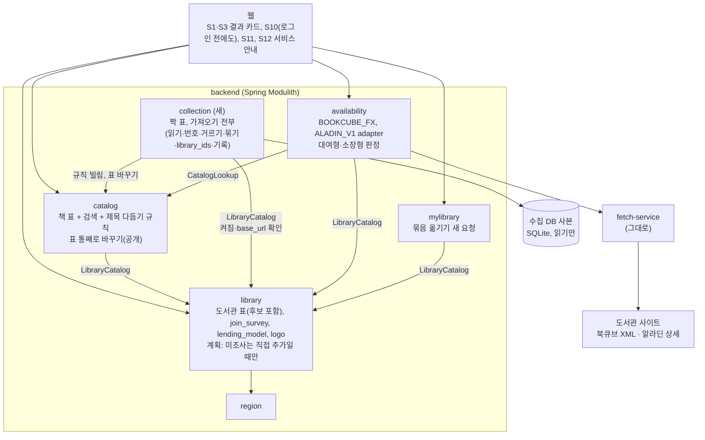
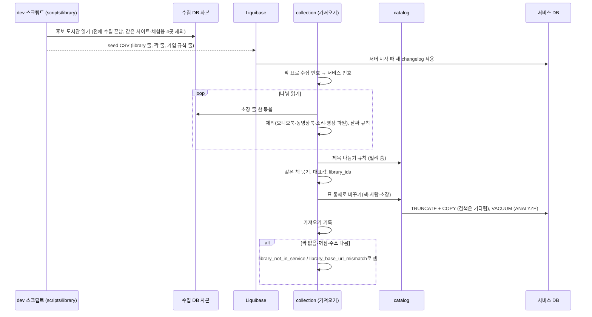
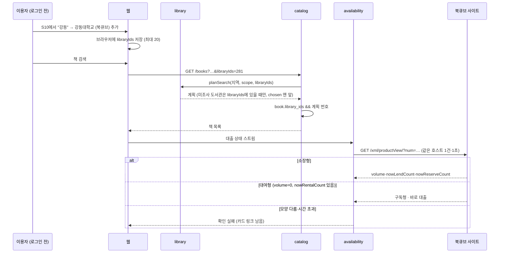
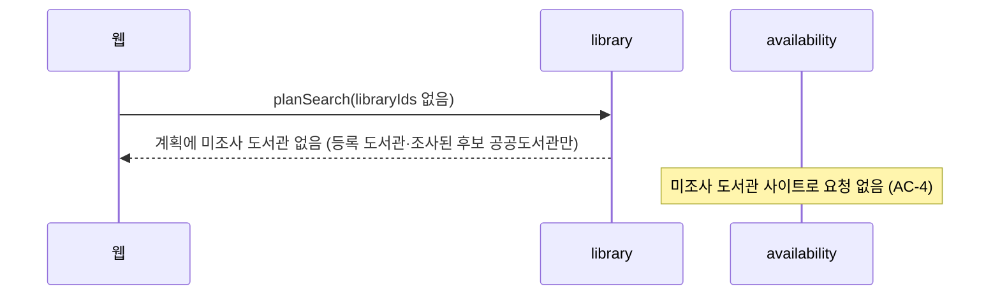
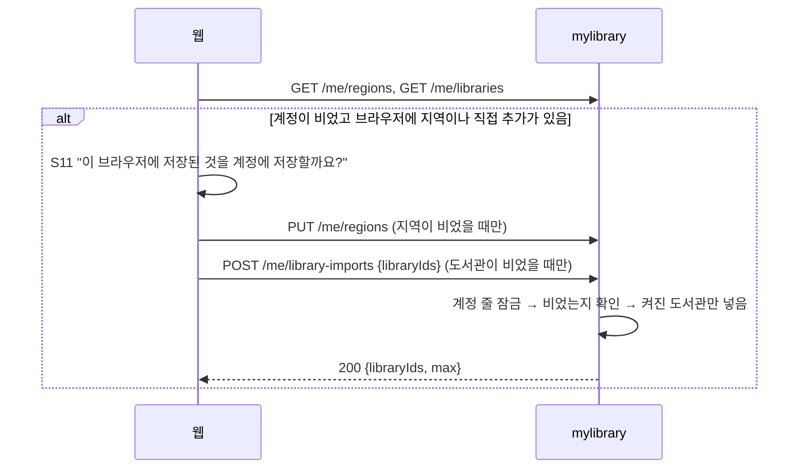
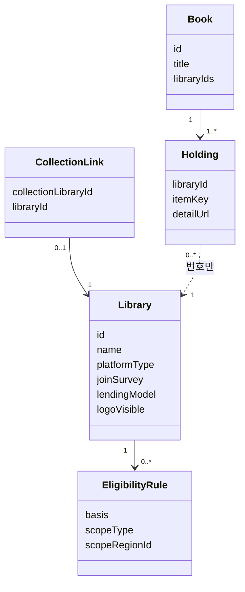
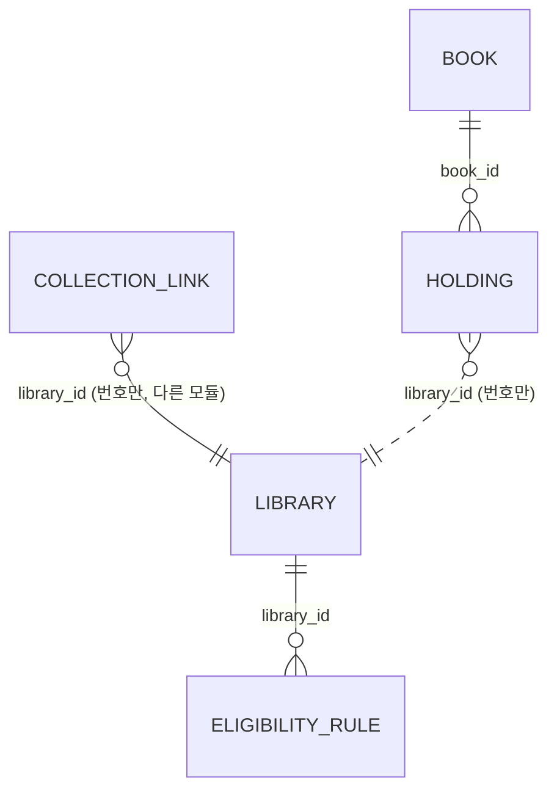

# 설계 변경: 사이클 07 후보 도서관 넣기

- 작성: 2026-10-05. 근거: `architect-proposal.md`(D1~D17, Q1~Q4, 사용자 결정 2026-10-05), `spec.md`(R1~R9, AC-1~AC-24), `flow.md`, `research.md`
- `docs/current/`에 대한 변경만 적습니다. `docs/current/`는 `/cycle-close`에서 합칩니다.
- 이름 중 `[안]`·`[안 이름]`·`[안 경로]`는 dev가 코드에 맞춰 바꿀 수 있는 세부 이름입니다. 바꾸면 dev `plan-feedback.md` `# 사이클 07`에 알리기만 합니다 [확정] (사용자 승인, 2026-10-05, 설계 검토). 규칙·뜻은 아래 태그대로입니다.

## 구조 그림

### 모듈 구성도



### 주요 흐름

흐름 A: 넣기와 가져오기 (배포 전 한 번)



흐름 B: 로그인 전 직접 추가한 후보 도서관으로 검색



흐름 C: 직접 추가하지 않은 이용자



흐름 D: 로그인 직후 옮기기 (S11)



### 도메인 모델



## 모듈

| 모듈 | 신규/변경 | 책임 | 공개 API | 발행/구독 이벤트 | 소유 테이블 |
|---|---|---|---|---|---|
| `collection` [안 이름] | 신규 (ADR-0052, ADR-0060) | 수집 번호 ↔ 서비스 번호 짝, **가져오기 전부**: 사본 나눠 읽기, 번호 바꾸기, 거르기, 같은 책 묶기, 대표값·날짜 규칙, `library_ids` 계산, 가져오기 기록(지금 `catalog_import` 표를 이 모듈로). 앞으로 갱신도 여기서 | 없음(실행 명령·설정만) | 없음 | `collection.collection_link`, `collection.catalog_import` [안] |
| `library` | 변경 | 후보 도서관 줄, `join_survey`, `lending_model`, 로고 표시 값, 화면 종류 2개. 계획: 조사 상태가 `MEMBERS_ONLY`·`NOT_SURVEYED`이고 직접 추가가 아니면 뺌 | `SearchTarget`·`LibraryEligibility`의 등급에 `UNSURVEYED`, `LibraryRef`에 `lendingModel` [안]. `collection`이 쓰는 것: 기존 `LibraryCatalog.enabledLibraryRefs()`로 서비스 도서관(켜짐·`base_url`) 조회 — 짝 맞춘 서비스 도서관이 있고 켜졌는지(`library_not_in_service`), `base_url` 안전장치(`library_base_url_mismatch`) [안] (메서드는 dev 코드에 있음: "Every enabled library with its site root") | 없음 | `library.library`(칸 추가), `library.eligibility_rule`(후보 공공도서관 줄 추가) |
| `catalog` | 변경 | 책·사람·소장 표와 검색(`library_ids && :planned`). 가져오기 코드는 `collection`으로 옮김. 제목 다듬기 규칙(`CatalogText`, `Contributors` 등)은 그대로 두고 공개 | 새 Java `CatalogLoad.replaceAll(...)`(받은 책·사람·소장으로 표를 통째로 바꾸고 VACUUM) [안 이름], 제목 다듬기 규칙 공개 | 없음 | `catalog.book`(칸 추가). `catalog.catalog_import`는 `collection`으로 [안] |
| `availability` | 변경 | `BookcubeFxAdapter`, `AladinV1Adapter`, 상세 요청 주소 훅, 북큐브 대여형 `SUBSCRIPTION`, 교보 소장형은 숫자 | 그대로 | 없음 | 없음 |
| `mylibrary` | 변경 | 묶음 옮기기 `POST /api/v1/me/library-imports` (ADR-0057) | 그대로 | 그대로 (`AccountDeleted` 구독) | 그대로 |
| `auth`, `region`, `fetch-service` | 그대로 | | | | |

- 의존: `collection → catalog → library → region`, `collection → library`(`LibraryCatalog`만, `library` 표는 읽지 않음), `availability → catalog, library`, `mylibrary → auth, library, region`. 고리 없음, 새 이벤트 없음 (ADR-0060)
- `collection`의 `@ApplicationModule(allowedDependencies = {"catalog", "library"})` [안]

## 데이터

- 스키마: `collection`(새), `library`, `catalog` 변경



| 테이블.컬럼 | 타입 | 제약 | 설명 | 상태 태그 |
|---|---|---|---|---|
| `collection.collection_link.collection_library_id` | bigint | PK, CHECK > 0 | 수집 DB 도서관 번호 | [확정] 표 (ADR-0052), 이름 [안] |
| `collection.collection_link.library_id` | bigint | NOT NULL, UNIQUE, CHECK > 0. FK 없음(다른 모듈) | 서비스 도서관 번호 | 같음 |
| `collection.collection_link.created_at` | timestamptz | NOT NULL DEFAULT now() | | [안] |
| `library.library.join_survey` | text | NOT NULL DEFAULT 'SURVEYED', CHECK IN ('SURVEYED','NOT_FOUND','MEMBERS_ONLY','NOT_SURVEYED') | 가입 조사 상태. `MEMBERS_ONLY`·`NOT_SURVEYED`는 직접 추가일 때만 계획에, API 등급 `UNSURVEYED` | [확정] (ADR-0053), 값 이름 [안] |
| `library.library.join_method` | text | NOT NULL → NULL 허용, CHECK `library_join_method_check`: `join_survey <> 'SURVEYED' OR join_method IS NOT NULL` | | [확정] |
| `library.library.platform_type` | text | CHECK에 `BOOKCUBE_FX`, `ALADIN_V1` 추가 (9개) | | [확정] (ADR-0056) |
| `library.library.lending_model` | text | NULL, CHECK IN ('OWNED','SUBSCRIPTION','MIXED','RENTAL') | 교보 구독형 화면 기관의 소장·구독·혼합·대여. NULL이면 지금 규칙(화면 종류로 판정) | [확정] (사용자 승인, 2026-10-05, 설계 검토), 값 출처: 수집 세션 `kyobo-institutions-probe-2026-10-03.tsv` `library_model` |
| `library.library.logo_file` | text | NULL | 로고 파일 이름(웹 정적 파일), NULL = 없음 | [안 이름] |
| `library.library.logo_visible` | boolean | NOT NULL DEFAULT true | 운영자가 끄면 바로 숨김 | [확정] 방법 (spec R9-7), 이름 [안] |
| `catalog.book.library_ids` | bigint[] | NOT NULL | 그 책을 가진 서비스 도서관 번호(가져오기가 채움). GIN 인덱스 `book_library_ids_gin` | [확정] (ADR-0055), 이름 [안] |

- seed 규칙 (ADR-0052, `architect-proposal.md` D3) [확정]
  - 후보: 수집 번호 ≥ 100001, `crawl_skip` 없음, `last_full_success_at` 있음, 체험용·운영 중단 4곳(삼각산 북라이브, 대구동구안심 북큐브, 순창 북라이브, 양평 북큐브) 제외 (사용자, 2026-10-05)
  - 새 번호: 지금 최대(280) 다음부터. 등록 도서관 짝은 같은 번호(59·131 포함)
  - 이름: 겹치면 `이름 (북큐브|교보|YES24|알라딘)`, 그래도 겹치면 `이름 (라벨, 호스트)`. 처음 정한 이름은 다음 seed에서 바꾸지 않음
  - `homepage_url = base_url`, `holdings_count = NULL`, `enabled = true`
  - 가입: 조사된 후보 공공도서관(`public-join-2026-10-05.tsv`, `decision` 칸)은 `SURVEYED` + 가입 규칙 줄 + `join_method`·`visit_required`·`join_caution`·`extra_condition_text`(책이음 9곳). 원문 못 찾은 곳은 `NOT_FOUND` + 규칙 없음(ADR-0013 자격 미확인). 종류 표(`candidate-kinds-2026-10-05.tsv`)의 초·중·고·대학·회사·정부·공공기관·단체·아파트는 `MEMBERS_ONLY`, 모름은 `NOT_SURVEYED`, `join_method = NULL` [확정] (ADR-0053). 시험용 6곳은 넣지 않음 [확정] (사용자 승인, 2026-10-05, 설계 검토)
- Liquibase: 새 파일로 추가 [확정] (사용자 승인, 2026-10-05). 새 파일로 넣고 비교·대조한 뒤 기존 파일에 합칠지 고침 [확정] (사용자 제안) — 합치는 때는 배포 전(`PRE_DEPLOYMENT` 동안) [확정] (사용자 승인, 2026-10-05, 설계 검토). 합칠 때 대조 규칙 [확정] (사용자 제안: "만약에 기존 것에 있고 새거에는 없다면 기존 것이 정말로 활성화된 사이트인가 검사하고 해야 할 거 같은데", 2026-10-05): 둘 다 있으면 합치고 다른 점은 목록으로 보고, 새 파일에만 있으면 넣고, **옛 파일에만 있으면 지우지 않고** dev가 그 사이트 첫 화면을 한 번 열어 확인 → 열리지 않거나 바뀌었으면 `enabled = false` 제안 목록을 사용자에게 보여 주고 사용자가 정함
  - `collection/001-collection-schema.yaml` (스키마, `collection.collection_link`, 가져오기 기록 표 `collection.catalog_import` [안 이름]). 등록 도서관 짝(같은 번호끼리)은 `library.library`를 읽지 않고 seed CSV에 줄로 적어 넣음(`collection/002`와 같은 방식) [안] — 다른 모듈 표를 읽지 않기 위해
  - `library/007-library-candidates-schema.yaml` (`join_survey`, `join_method` NULL + CHECK, 화면 종류 CHECK, `lending_model`)
  - `library/008-library-seed-candidates.yaml` + CSV(도서관, 가입 규칙) — IDENTITY 맞춤
  - `collection/002-collection-seed-candidates.yaml` + CSV(짝: 등록 도서관 같은 번호 짝 + 후보 도서관 짝)
  - `catalog/002-book-library-ids.yaml` (`library_ids` + GIN)
  - `catalog/003-drop-catalog-import.yaml` [안 이름]: `catalog.catalog_import`를 지움. 지우기 전에 있던 줄을 `collection.catalog_import`로 옮기거나, 배포 전이라 남길 줄이 없다고 보고 그냥 지움 — 둘 중 dev가 정함 [안]. `collection/001` 뒤에 둠 [안]
  - 순서: master에서 `library/007` → `library/008` → `collection/001` → `collection/002` → `catalog/002` [확정] (사용자 승인, 2026-10-05, 설계 검토). `catalog/003`은 그 뒤 [안]

## 가져오기 변경 (`catalog` → `collection`으로 옮김, ADR-0060)

| 항목 | 내용 | 태그 |
|---|---|---|
| 도서관 찾기 | 짝 표로 수집 번호 → 서비스 번호. `base_url` 같음 검사는 안전장치(다르면 `library_base_url_mismatch`), 짝 없음·꺼짐은 `library_not_in_service` | [확정] D5 |
| 나눠 읽기 | 수집 DB를 적당한 크기로 나눠 읽음(예: 묶기 키만 메모리, 소장은 두 번째 읽기에서 바로 COPY). 크기·방법은 dev | [확정] 방향 (ADR-0054), 방법 dev |
| 제외 | 지금 규칙 + 북큐브 `content_kind` `book/wma`·`book/vod`·`book/wmv`, 교보 `동영상` | [확정] Q2 |
| 날짜 | 8자리 `YYYYMMDD`(실제 날짜만), 설정 `chaekcheck.catalog.import.placeholder-date-libraries`(값 `100555`, 수집 번호) 도서관의 1950년 이전 날짜는 NULL | [확정] D6, 설정 이름 [안] |
| `book.library_ids` | 묶기 뒤 책마다 소장 도서관 번호 정렬 배열 | [확정] ADR-0055 |
| 쓴 뒤 | `VACUUM (ANALYZE)` | [확정] D7 |
| 원본 | 배포용 사본 `ebook-catalog-2026-10-05-0745.sqlite` | [확정] |
| 실행 | 지금 `catalog-import` 프로필 실행을 `collection`의 실행 명령으로 옮김(이름 [안]), 설정 `chaekcheck.catalog.import.*`도 `collection` 쪽 이름으로 [안] | [확정] 위치 (ADR-0060) |
| 모듈 사이 넘김 | `collection`이 만든 책·사람·소장을 `catalog`의 `CatalogLoad.replaceAll`에 넘김. 양이 커서 한 번에 메모리로 넘기지 않고 묶음으로 흘려 넘기는 모양(스트림·콜백)은 dev가 정함 | [안] |

## 검색 변경

- `library.planSearch`: 조사 상태 `MEMBERS_ONLY`·`NOT_SURVEYED`이고 `!chosen` → 계획에서 뺌. 화면 안내 문구는 조사 상태로 가름(ADR-0053 표). 그 밖은 지금과 같음(직접 추가된 미조사 도서관은 `place()` 결과 + `chosen` 맨 앞, ADR-0050) [확정] (ADR-0053)
- `GET /books`: 계획 도서관 번호 배열 `:planned`로 `b.library_ids && :planned` 거르기, 등급·도서관 수·기준일은 `unnest(b.library_ids)`와 계획을 맞춰 구함. `holding`은 읽지 않음 [확정] (ADR-0055)
- 목표: 정해 둔 검색어 묶음에서 첫 쪽 1초 안 [확정] (spec R7-1). 묶음 [확정] (사용자 승인, 2026-10-05, 설계 검토): "사랑", "소년", "해리", "역사", "김영하", "민음사", 제목+저자 AND 2개, 출판일순 1개
- AC-6 기준: 등록 도서관만 쓰는 이용자의 같은 검색어 결과에서 등록 도서관 소장 (도서관, 책 코드) 집합과 책 순서가 같음. 대표 제목·묶음은 바뀔 수 있음 [확정] (Q1, 사용자 승인 2026-10-05)

## API

| 메서드 | 경로 | 설명 | 요청 | 응답 | 에러 |
|---|---|---|---|---|---|
| GET | `/api/v1/libraries` | 변경: 미조사 도서관 포함, 등급 `UNSURVEYED` | 그대로 | 항목 모양 그대로, `eligibility`에 `UNSURVEYED` | 그대로 |
| GET | `/api/v1/ebook-searches/stream`, `/api/v1/book-availabilities/stream` | 변경: `targets.libraries[].eligibility`에 `UNSURVEYED`, `platformType` 두 값 | 그대로 | 그대로 | 그대로 |
| GET | `/api/v1/books`, `/api/v1/books/{bookId}` | 변경: 계획 거르기 방식 (모양 그대로) | 그대로 | 그대로 | 그대로 |
| POST | `/api/v1/me/library-imports` [안 경로] (동작을 명사 자원으로: dev api-design 스킬 "verbs sparingly") | 새: 브라우저의 직접 추가를 한 번에 옮김 (ADR-0057) | `{"libraryIds":[281,45]}` (1~20개, 중복 합침) | 200 `{"libraryIds":[…],"max":20}` (옮긴 뒤 전체) | 400 `bad_request`(JSON 아님), 401(로그인·계정 없음, 계정 줄 잠금), 409 `library_import_not_empty`(계정에 이미 직접 추가가 있음) [안 이름], 422 `invalid_request`(0개·21개 이상·숫자 아님) |

- `POST /me/library-imports` 규칙 [확정] (사용자 승인, 2026-10-05, 설계 검토): 계정 줄 잠금(ADR-0051) → 계정의 직접 추가가 비었는지 확인(아니면 409) → 켜진 도서관만 요청 순서대로 넣음(없는·꺼진 번호는 건너뜀, 오류 아님) → 결과 목록. `added_at`은 요청 순서대로 1ms씩 차이 [안]. 응답 200
- 웹: 로그인 전 직접 추가 브라우저 키 `chaekcheck.chosenLibraries.v1` [안 이름], 최대 20, 검색 요청에 `libraryIds`
- 응답 예시

```json
GET /api/v1/libraries (한 항목)
{"id":412,"name":"강동대학교 (북큐브)","eligibility":"UNSURVEYED","matchedBy":[],"visitRequired":false,"cautioned":false,"eligibilitySummary":null}
```

- 웹 서버: nginx `gzip on; gzip_types application/json;` (지금 압축 설정 없음) [확정] (ADR-0058)

## 외부 연동

| 대상 | 방식 | 제한·키 관리 | 실패 시 동작 | 상태 태그 |
|---|---|---|---|---|
| 북큐브 사이트 | 상세 XML `{base}/xml/productView/?num={item_key}`(상세 주소 `/product/view/?num=`에서 바꿈), `<Product>` 바로 아래 `volume`·`nowLendCount`·`nowReserveCount`. 직접 찾기 `xml/productSearch?keyword=&keyoption2=` 첫 쪽만. XML 파서 DTD·외부 엔티티 끔 | 로그인 없음, 같은 호스트 1건·1초, 캐시 3분, 시간 초과 5초 | 모양 다름·없는 책·시간 초과 → 확인 실패, 카드 링크 남음 | [확정] (research 1절, ADR-0056) |
| 북큐브 대여형 | 같은 XML에서 `volume=0`이고 `nowRentalCount` 있음 → `SiteVerdict.SUBSCRIPTION` → "구독형 · 바로 대출" | 같음 | 같음 | [확정] (ADR-0056) |
| 알라딘 사이트 | 상세 HTML "보유현황"의 보유/대출/예약 라벨. 직접 찾기 `sub.htm?code=search&search_item=` 첫 쪽만(`base_url`의 `?nav_code` 떼어 씀), 출판사 검색은 그 도서관 실패 | 같음 | 같음 | [확정] |
| 교보 구독형 화면의 소장형 | `lending_model = OWNED`면 요청 없는 "바로 대출" 대신 숫자를 읽음. 읽는 위치는 dev 사이트 시험 | 같음 | 같음 | [확정] 고치기 (Q3), 방법 [확인 필요] |
| robots.txt·이용 조건 | — | — | — | [확인 필요] (`crawl-method.md` 1절과 같음) |

- `PlatformAdapter`에 기본 메서드 `detailFetchUri(URI detailUri)`(기본 = 그대로), 같은 호스트라 throttle·캐시 키 그대로 [안 이름]
- fetch-service: 호스트 허용 목록 없음(`UrlGuard`만) → 그대로

## 로고 (spec R9, 결정 페이지 `easy/2026-10-05-logo-decisions.html`)

| 항목 | 내용 | 태그 |
|---|---|---|
| 대상 | 등록 도서관 중 `registered-logos-2026-10-05.tsv` `status=OWN` 199곳(서비스 번호 기준) | [확정] |
| 파일 | dev 스크립트가 원본을 표시 높이의 2배(약 48px)로 줄여 만듦(형식 그대로, svg 그대로). 웹 정적 파일 `web/public/library-logos/{서비스 번호}.{확장자}` [안 경로]. 원본은 git 밖 `chaekcheck-data\logos\` 그대로 | [확정] 미리 줄임, 경로 [안] |
| DB | `library.library.logo_file text NULL`(파일 이름, NULL = 로고 없음) [안 이름], `library.library.logo_visible boolean NOT NULL DEFAULT true`(운영자가 끄면 바로 숨김) | [확정] 내리는 방법, 이름 [안] |
| API | `GET /api/v1/libraries` 항목과 스트림 `targets.libraries[]`에 `logoUrl`(보일 때만, 아니면 null), `homepageUrl`(이미 있으면 그대로) [안 이름] | [확정] (사용자 승인, 2026-10-05, 설계 검토) |
| 화면 | S1·S3 결과 카드, S10 도서관 줄: 이름 앞 로고(카드 약 20px, S10 약 24px), 누르면 도서관 메인 페이지 새 창(결과 카드에서도 카드 링크와 따로). 로고가 없거나 못 불러오면 빈 상자 | [확정] |
| 캐시 | 로고 파일에 긴 브라우저 캐시 헤더(nginx `location /library-logos/`) | [확정] (사용자 승인, 2026-10-05, 설계 검토) |
| S12 서비스 안내 | 새 화면 `/about`: 소개, "각 도서관의 로고와 이름은 그 기관의 것이며 책첵은 제휴·후원 관계가 없습니다", 로고 내림 요청 이메일(서비스 전용, 주소는 사용자가 알려 줌 — 그 전에는 자리 글). 모든 화면 바닥글에 링크. S8·S9와 같은 흰 카드 | [확정] |
| Liquibase | `library/009-library-logos.yaml`(칸 둘 + 199곳 `logo_file` 값 CSV) [안 파일 이름] | [안] |

## 수집 두 갈래 (B, 서비스 변경 없음)

- plan: `docs/research/collection/1-libraries.md`(도서관 수집), `2-books.md`(책 수집) [확정] (사용자 승인, 2026-10-05, spec 결정 14)
- dev 요청(인계서): `docs/maintenance/` 두 갈래 정리, seed 생성 스크립트를 ① 도서관 수집 갈래의 "넣기" 단계로, 같은 사이트 거르기 규칙(http/https·포트 무시 + 책 목록 겹침), `--per-host`/`--host-slots` 우선순위 정리

## 결정 기록

- ADR-0052 후보 도서관은 서비스 새 번호로, 짝 표는 새 모듈 `collection` (seed로 넣음) (ADR-0060으로 넓힘: 가져오기·짝 조회 모두 collection 안)
- ADR-0053 가입 정보 미조사 도서관은 직접 추가했을 때만 검색에 (ADR-0013·0050 보완)
- ADR-0054 가져오기는 모든 서비스 도서관의 책을, 나눠 읽어서 (사이클 04 범위 변경)
- ADR-0055 책마다 가진 도서관 번호 목록을 미리 계산
- ADR-0056 북큐브·알라딘 상세 기반 adapter, 북큐브 대여형·교보 소장형 판정
- ADR-0057 로그인 전 직접 추가 + 한 번에 옮기는 새 요청 (ADR-0049 보완)
- ADR-0058 도서관 목록은 통째로 + 응답 압축 (ADR-0049 전환 조건 정리)
- ADR-0060 가져오기는 `collection`이 맡고, 제목 다듬기 규칙은 `catalog`에 한 벌 (ADR-0052 넓힘, ADR-0031 위치 바꿈)
- ADR-0059 도서관 로고는 자체 로고가 있는 공공도서관만, 미리 줄인 파일로, 누르면 메인 페이지, 없으면 빈 상자, DB 값으로 바로 내림, 서비스 안내 화면에 고지
- ADR 없음: Liquibase "새 파일로 넣고 비교·대조 뒤 합침" 방침과 합칠 때 대조 규칙은 사용자 결정으로 이 문서 "데이터" 절에만 기록 (따로 ADR을 쓰지 않음)

## 확인 필요

| 항목 | 방법 | 막는 단계 |
|---|---|---|
| 로고 내림 요청 이메일 주소 | 사용자가 만들어 알려 줌 | 배포 |
| dev 규칙 "자격 조사 없이 도서관 추가 금지" 예외: `MEMBERS_ONLY`·`NOT_SURVEYED` 곳(약 2,500곳)은 ADR-0053대로 조사 상태 표시로 넣음 → 인계서에 이 범위의 예외를 적음 [확정] (사용자 승인, 2026-10-05, 설계 검토) | 해결 | — |
| `catalog.catalog_library_snapshot.import_id`가 `catalog_import`를 FK로 가리킴 → `catalog_import`가 `collection`으로 가면 모듈 경계를 넘음. 안: FK를 없애고 번호만 둠(다른 모듈 사이 FK 없음 규칙과 같음) [안] | 사용자에게 질문 (인계서 검토) | 인계 |
| 교보 구독형 화면 소장형의 숫자를 읽는 위치 | dev 사이트 시험 | 구현 |
| importer 나눠 읽기 크기, 가져오기 시간, DB 크기(약 9~10GB 추정) | dev dry run | 구현 |
| `GET /libraries` 크기(약 460KB, gzip 약 40KB 추정) | dev 측정 | 구현 |
| `/books` 묶음 응답 시간 | dev `EXPLAIN (ANALYZE, BUFFERS)` | 구현 |
| 북큐브 검색 쪽 나누기·`keyoption2`·없는 `num` 응답·http/포트 사이트, 알라딘 검색 쪽 나누기·출판사 검색 | API 호출 시험 | 구현 |
| 새 도서관을 넣을 때 seed 번호가 겹치지 않는 규칙("마지막 번호 다음") | dev 확인 | 구현 |
