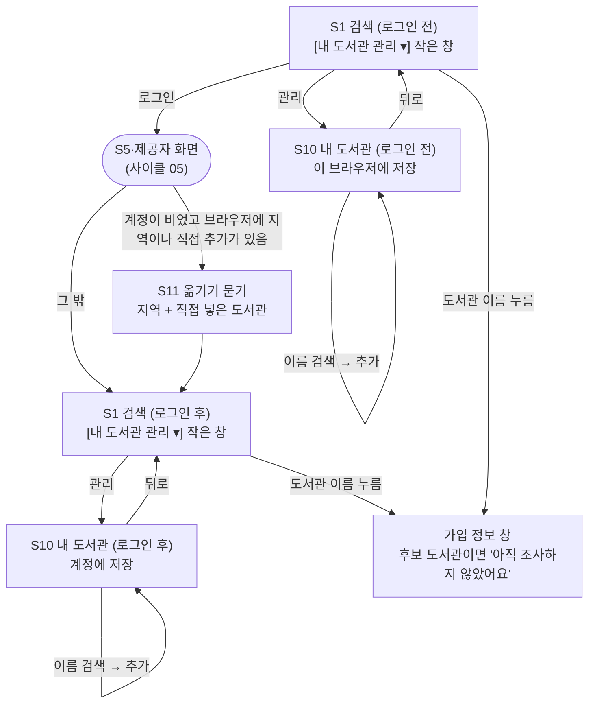

# 화면 흐름: 사이클 07 후보 도서관 넣기

- 2026-10-05: 결정 페이지 v2(`easy/2026-10-05-flow-decisions-v2.html`)에서 14개 모두 정해짐(승인 13, 미승인 1: S10 로그인 전 안내 줄 없앰). 다음 단계 `/design-delta`
- 작성: 2026-10-05. 범위 `scope.md`, 규칙 `spec.md`(R1~R8, AC-1~AC-19)
- 기존 화면(S1 검색, S2 지역 고르기 창, S3 책, S4 설정 창, S5~S9 로그인·계정, S10 내 도서관, S11 지역 옮기기 창)은 사이클 04~06 `flow.md`와 사이클 06 뒤 dev 변경(`../06-my-libraries/retro.md` "달라진 것") 그대로이고, 여기에는 **바뀌거나 더해지는 것만** 적습니다. 구조와 상태이지 시각 디자인이 아닙니다.
- 지금 화면의 기준: dev "화면 변경 알림: 사이클 06 마무리 뒤"(2026-10-05, 웹 커밋 `dbe4566`~`eb11fb9`, 사진 dev `docs/screens/2026-10-05/`). 폭: 폰 ≤640px, 태블릿 641~1024px, PC ≥1025px
  - S1 PC·태블릿: 검색칸 아래 연회색 박스 한 줄에 [전체 도서관 | 내 도서관](로그인 전 [전체 도서관 | 누구나 가입]) 스위치, [방문 없이 가입], [내 도서관 관리 ▾](로그인 후) / [내 지역 ▾]·[내 지역 설정](로그인 전). 버튼을 누르면 작은 창(거주·직장·직접 추가 줄 + [관리]→S10 또는 [변경]→S2). 검색칸 아래 "내 도서관"/"내 지역" 줄은 없어짐
  - S1 폰: 위 세 컨트롤은 설정 버튼 창 맨 위 "찾을 도서관"에 있음([내 도서관 관리]→S10 또는 [내 지역 설정]/[내 지역 변경]→S2). 기본값과 다르면 설정 버튼에 보라 점
  - 결과 카드: 카드 전체가 그 도서관 책 페이지 링크(새 창), "도서관에서 보기" 버튼 없음. "지금 대출 가능", "예약 대기 N명" 글 없음, 보유·대출 중·예약 칸. 도서관 이름 → 가입 정보 창, "구독형 · 바로 대출 ⓘ" → 예산 안내 창. 결과·S3는 가운데 46rem
  - S10은 세 구역(① 지역 선택 안에 거주·거주 자동·직장·직장 자동 ② 직접 도서관 추가 ③ 직접 추가한 도서관 N/20) + 맨 위 "누구나 가입" 줄
  - 탭 제목 "책첵"
- 태그: `[확정]`은 spec에서 사용자가 정한 것, `[안]`은 이 문서의 제안(결정 페이지 `easy/2026-10-05-flow-decisions.html`)

- 둥근 상자는 사이클 05의 로그인 흐름입니다.
- 결과 줄(S1·S3)의 북큐브·알라딘 표시는 화면 이동이 없어 그림에 넣지 않았습니다.

## 화면별 내용

### S1 search (변경: 로그인 전 내 도서관 버튼, 결과 카드)

- PC·태블릿, 로그인 전: 박스의 [내 지역 ▾]/[내 지역 설정]을 로그인 후와 같은 **[내 도서관 관리 ▾]**로 바꿈. 누르면 로그인 후와 같은 작은 창(제목 "내 도서관", 거주·직장·직접 추가 N곳 줄, [관리] → S10(로그인 전)). 지역도 직접 추가도 없으면 버튼 이름 "내 도서관 설정"이고 누르면 S10이 바로 열림 [확정] (사용자 승인, 2026-10-05). 지역 바꾸기는 S10의 [변경] → S2
- 폰, 로그인 전: 설정 창 "찾을 도서관"의 [내 지역 설정]/[내 지역 변경]을 로그인 후와 같은 **[내 도서관 관리]**(→ S10)로 바꿈 [확정] (사용자 승인, 2026-10-05)
- 로그인 전 스위치 `전체 도서관 | 누구나 가입`(지역이 있으면 지금 규칙대로 "가입 가능한 곳")은 그대로. 직접 넣은 도서관은 두 값 모두에서 검색에 들어가고 같은 책 안에서 맨 앞 [확정] (spec R3, ADR-0050)
- 로그인 후: 바뀌지 않음
- 결과 카드
  - 북큐브·알라딘 도서관: 교보 일반·YES24와 같은 보유·대출 중·예약 칸, "지금 빌릴 수 있어요"/"예약하고 기다려요" 묶음 [확정] (spec R5)
  - 북큐브 구독(대여)형: "구독형 · 바로 대출 ⓘ" 칸 [확정] (spec R5)
  - 후보 도서관: 이름 옆 "직접 추가" 표시(지금과 같음). 이름은 겹치면 "강동대학교 (북큐브)"처럼 [확정] (spec R2)
  - 후보 도서관 이름을 누르면 열리는 가입 정보 창: 맨 위 "가입 정보를 아직 조사하지 않았어요. 도서관 사이트에서 확인해 주세요", 그 아래 [도서관 첫 화면] 링크 [확정] (spec R6)
  - 북큐브 읽기 실패: 다른 사이트의 "확인 실패" 칸과 같고, 카드 링크(그 도서관 책 페이지)는 그대로 [확정] (spec 상태별 동작; 지금 화면에 "도서관에서 보기" 버튼이 없어 카드 링크로 바꿔 적음)
- 상태: 로딩·빈 결과·오류는 지금과 같음

### S3 book (변경: 결과 줄만)

- S1 결과 카드와 같은 규칙(북큐브·알라딘 칸, 북큐브 구독형, 후보 도서관 가입 정보 창)

### S10 my-libraries (변경: 로그인 전에도 열림, 후보 도서관 찾기)

- 주소 `/my-libraries` 그대로. **로그인 전에도 열림** [확정] (spec R3-6). 지금 "로그인 전으로 확인되면 S1으로"를 바꿈
- 로그인 전 화면
  - 맨 위 안내 줄은 두지 않음 [확정] (사용자 미승인 "정보가 너무 많이 노출돼", 2026-10-05 → 처음 제안 "이 브라우저에만 저장돼요. 로그인하면 계정에 저장할 수 있어요" + [로그인]을 뺌)
  - ① 지역 선택: 지금 로그인 전 S2(브라우저 저장)와 같은 값. [변경] → S2
  - "지역으로 자동" 목록: 로그인 전 S1 "가입 가능한 곳"과 같은 판정으로 보임 [확정] (사용자 승인, 2026-10-05)
  - ② 직접 도서관 추가, ③ 직접 추가한 도서관 N/20: 로그인 후와 같은 모양, 저장만 이 브라우저 [확정] (spec R3-6)
- 로그인 후 화면: 지금과 같음
- ② 직접 도서관 추가 (로그인 전후 같음)
  - 이름 검색 칸에 친 글자로 등록·후보 도서관 모두에서 찾음 [확정] (spec 입력과 출력)
  - 결과 줄: 이름(겹치면 "(북큐브)" 등) · [추가]. 이미 직접 추가한 곳은 "직접 추가함"으로 흐리게(지금과 같음)
  - 결과 줄 순서: 이름이 친 글자로 시작하는 곳 먼저, 그다음 가나다순 [확정] (사용자 승인, 2026-10-05)
  - 한 번에 보이는 결과 수: 20곳, 더 있으면 "더 보기" [확정] (사용자 승인, 2026-10-05)
  - 결과 없음: "찾는 도서관이 없어요" [확정] (spec 상태별 동작)
  - 두 글자 이상 쳐야 찾기 시작 [확정] (사용자 승인, 2026-10-05)
- 상태: 불러오는 중 / 불러오기 실패("다시 시도") / 20곳 찼음 / 저장 실패 — 지금 문구 그대로 [확정] (사이클 06, dev 확정 문구). 로그인 전 저장 실패(브라우저 저장이 막힘): "이 브라우저에 저장하지 못했어요" [확정] (사용자 승인, 2026-10-05)
- 배치: 데스크톱·태블릿·폰 모두 가운데 한 단, 구역 순서 그대로

### S11 import (변경: 직접 넣은 도서관도 함께)

- 열리는 때: 로그인 직후 한 번. 계정에 저장된 지역이 없고 브라우저에 지역이 있을 때(지금), **또는** 계정에 직접 넣은 도서관이 없고 브라우저에 있을 때 [확정] (spec AC-19)
- 보이는 요소: "이 브라우저에 저장된 것을 계정에 저장할까요?", 지역 줄(있을 때), "직접 넣은 도서관 N곳: 이름, 이름, …"(있을 때), [계정에 저장] [저장하지 않기] [확정] (사용자 승인, 2026-10-05)
- 동작: 한 번 누르면 둘 다 옮김(지역·도서관 따로 고르지 않음) [확정] (사용자 승인, 2026-10-05). 계정에 이미 있는 쪽은 옮기지 않고 창에도 보이지 않음(지금 규칙과 같음) [확정]
- 브라우저 값은 지우지 않음(로그아웃하면 다시 씀, 사이클 06 R1과 같음) [확정]
- 계정 직접 추가가 20곳을 넘게 되면: 넘는 것은 옮기지 않고 "20곳까지만 저장했어요" [확정] (사용자 승인, 2026-10-05)
- 상태: 저장 중 / 저장 실패 — 지금과 같음

### 로고 (spec R9, 2026-10-05 추가)

- S1·S3 결과 카드: 도서관 이름 앞에 로고(높이 약 20px) [확정] (사용자 승인, 2026-10-05). 로고는 이름처럼 카드 위에 떠서, 누르면 그 도서관 메인 페이지 새 창 [확정] (사용자: "일괄적으로 로고 누르면 해당 도서관 메인 페이지로")
- S10: 자동 목록·도서관 찾기 결과·직접 추가한 도서관 줄의 이름 앞에 로고(높이 약 24px), 로고를 누르면 그 도서관 메인 페이지 새 창 [확정] (사용자 승인, 2026-10-05)
- 로고가 없거나 못 불러오면 빈 상자 [확정] (사용자: "빈 상자 보이도록 근데 이건 실제 화면 보고 나서 언제든 수정 가능", 2026-10-05)

### S12 about (새 화면: 서비스 안내)

- 주소 `/about` [확정] (사용자 승인, 2026-10-05). 들어가는 길: 모든 화면 바닥글의 "서비스 안내" 링크 [확정 원칙]
- 보이는 요소: 책첵 소개 한두 줄, "각 도서관의 로고와 이름은 그 기관의 것이며 책첵은 제휴·후원 관계가 없습니다", 로고 내림 요청 연락 방법(서비스 전용 이메일) [확정] (사용자 승인, 2026-10-05)
- 모양: S8·S9와 같은 흰 카드 한 장(폭 44rem) [확정] (사용자 승인, 2026-10-05)

## 수용 기준 대응

| AC | 화면 |
|---|---|
| AC-1 이름으로 찾아 추가 | S10 ② |
| AC-2 같은 이름 구분 | S10 ② 결과 줄, S1·S3 결과 줄 |
| AC-3 직접 추가한 후보 도서관 책이 결과에 | S1·S3 결과 줄 |
| AC-4 넣지 않은 후보 도서관은 계획·결과에 없음 | S1 (스트림 `targets`) |
| AC-5 후보 도서관에만 있는 책은 안 나옴 | S1 책 목록 |
| AC-6 등록 도서관 결과 그대로 | S1 |
| AC-7·8 북큐브·알라딘 숫자 | S1·S3 결과 줄 |
| AC-9 북큐브 구독형 | S1·S3 결과 줄 |
| AC-10 같은 사이트 두 번 안 나옴 | S1, S10 ② |
| AC-11·12 가져오기 도서관 수·번호 유지 | 화면 없음 (가져오기 요약, DB) |
| AC-13 응답 1초 | S1 (dev 측정) |
| AC-14 후보 도서관 가입 정보 창 | S1·S3 가입 정보 창 |
| AC-15 로그인 전·직접 추가 없음이면 그대로 | S1 (로그인 전) |
| AC-16 수집 두 갈래 문서 | 화면 없음 (plan 문서) |
| AC-17 빌드·테스트 | 화면 없음 |
| AC-18 로그인 전 직접 추가 | S10 (로그인 전), S1 (로그인 전) |
| AC-19 로그인 때 옮기기 | S11 |
| AC-20 로고 | S1·S3 결과 카드, S10 |
| AC-21 서비스 안내 | 바닥글 → S12 |
| AC-22 로고 내림 | S1·S3·S10 (운영자가 DB 값 바꿈) |

## 상태별 동작 대응 (spec "상태별 동작")

| spec 상태 | 화면 상태 |
|---|---|
| 로딩 | S1·S10 지금과 같음 |
| 도서관 이름 검색 결과 없음 | S10 ② "찾는 도서관이 없어요" |
| 직접 추가한 후보 도서관에 그 책 없음 | S1 결과 줄 없음(지금과 같음) |
| 외부 사이트 오류·지연 | S1·S3 실패 줄(지금과 같음) |
| 북큐브 XML에 책 없음·모양 다름 | S1·S3 "확인 실패" 칸, 카드 링크 남음 |
| 입력 오류 | 지금과 같음 |

## 이번 사이클에 넣을지 묻는 것 (수집 세션에서 넘어옴, 2026-10-05)

- (2026-10-05 바뀜: 사용자 "이번 사이클에 로고 넣을래 결정 번복이야" → 로고는 이번 사이클에 넣음, 자리와 "서비스 안내" 화면은 spec R9·결정 페이지 `easy/2026-10-05-logo-decisions.html`) ~~**도서관 로고**: 수집 세션이 등록·후보 도서관 로고를 모으는 중(`docs/research/maintenance/library-logos.md`, 쓰는 원칙 [확정] 사용자 2026-10-05: 원본 축소만, 누르면 원 전자도서관으로, 요청 오면 바로 내림, 회사·업체 기본 로고 안 씀, 공공도서관만, 안내 문구는 "서비스 안내" 페이지에). 이번 사이클에 넣지 않고 backlog에 두고, 다음 화면 사이클에서 자리(S10 목록, 결과 줄 등)와 "서비스 안내" 페이지를 함께 정함 [확정] (사용자 승인, 2026-10-05). 수집이 끝나야 업체 기본 로고 기준(몇 곳 이상 같으면)을 정할 수 있음~~
- **후보 공공도서관의 가입 조건**: 수집 세션이 사이클 밖에서 조사 중(`docs/research/library-join/candidates.md`). 조사가 끝나 가입 조건이 확인된 후보 공공도서관은 등록 도서관처럼 지역·직장으로 판정해 보이게 함 [확정] (사용자 승인, 2026-10-05). 지금 구조(도서관마다 가입 규칙 줄, ADR-0013)가 그대로 받으므로 화면은 바뀌지 않고 데이터만 더함. 조사 결과가 이 사이클 인계 전에 오면 이번 가져오기에 넣고, 늦으면 다음 가져오기에

- **dev가 화면 변경 알림에서 plan에 넘긴 것** (3절): 폰 설정 창을 아래에서 올라오는 창으로 바꿀지, 폰에서 "도서관에서 직접 찾기"일 때 정렬 안내, 남은 상태 칸 색, 카드 전체 링크와 글자 선택, 글꼴 서브셋, S8·S9 돌아오는 길 → 후보 도서관과 상관없는 화면 다듬기라 이번에 넣지 않고 backlog "검색 화면 다듬기"로 [확정] (사용자 승인, 2026-10-05)

## 확인 필요

| 항목 | 확인 방법 |
|---|---|
| 지금 S10의 이름 검색이 화면 안에서 거르는 규칙(공백 무시 부분 일치)과 결과 순서 | dev 코드 확인 (설계 때) |
| 로그인 전 S10에서 "지역으로 자동" 목록을 만들 때 `GET /api/v1/libraries`를 그대로 쓸 수 있는지(로그인 없이 쓰는 공개 목록, ADR-0049) | dev 코드 확인 (설계 때) |
