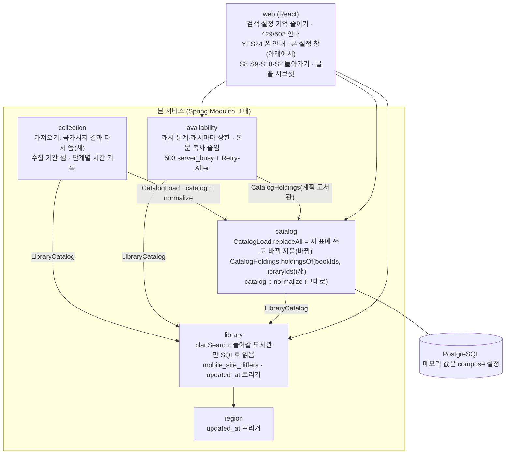
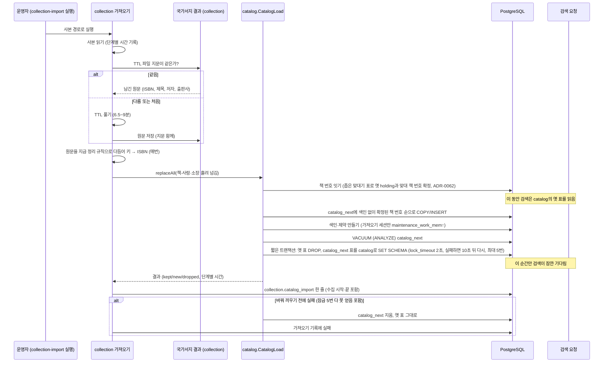
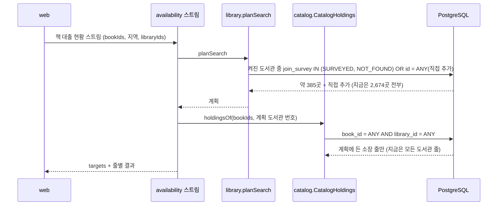
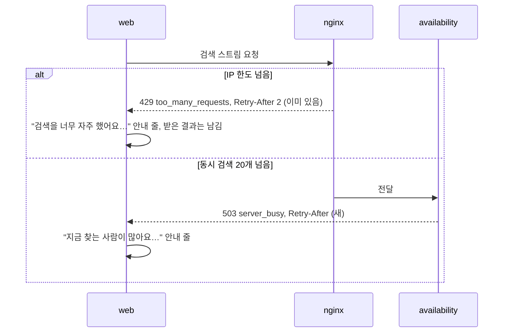
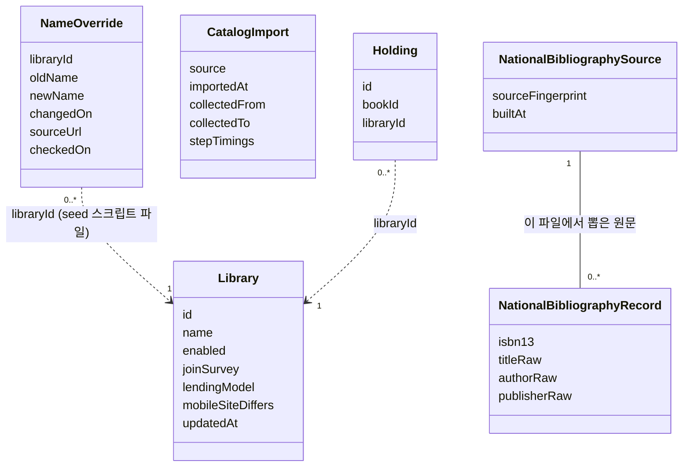
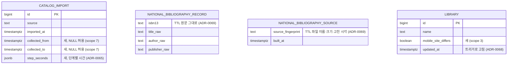

# 설계 변경: 사이클 08 다듬기 + 가져오기 바꿔 끼우기 + 메모리 줄이기

- 작성: 2026-10-11. 근거: `scope.md`, `spec.md`, `flow.md`, `architect-proposal.md`, `research.md`(1~10절), 설계 결정 페이지 `easy/2026-10-06-design-decisions.html`(15개 결정, 2026-10-10~11), 교보 대여·혼합 결정 `easy/2026-10-10-kyobo-rental-exclude.html`
- `docs/current/`에서 바뀌는 것만 적습니다. 코드 위치는 dev `backend/src/main/java/com/chaekcheck/` 기준이고 2026-10-06~11에 읽었습니다.
- 이름·숫자는 따로 적지 않으면 [안]입니다. dev가 코드에 맞춰 바꿀 수 있고, 바꾸면 dev `plan-feedback.md` "# 사이클 08" 절에 알립니다. 규칙과 뜻은 바꾸지 않습니다.

## 구조 그림

### 모듈 구성도

- `catalog :: normalize`는 `collection`이 빌려 쓰는 제목 다듬기 규칙(named interface, ADR-0060, `docs/current/module-map.md`)이고 이번에 바뀌지 않습니다. 국가서지 원문도 가져올 때마다 이 규칙으로 다듬습니다(ADR-0069)
- 모듈 사이 의존 방향은 바뀌지 않습니다(`collection → catalog, library`, `availability → catalog, library`, `catalog → library → region`). 새 이벤트 없음 [확정: 설계 결정 2026-10-11]

### 주요 흐름

흐름 A: 가져오기 (새 표에 쓰고 바꿔 끼우기, ADR-0065·0069)

흐름 B: 검색 계획과 책 화면 소장 읽기 (ADR-0066)

흐름 C: 막혔을 때

### 도메인 모델

- `NameOverride`는 DB 표가 아니라 seed 스크립트가 읽는 파일입니다. `NationalBibliographyRecord`·`NationalBibliographySource`는 `collection`이 가집니다. 국가서지는 다듬기 전 원문을 남기고 가져올 때마다 지금 정리 규칙으로 다듬으므로, 정리 규칙 판 번호는 두지 않습니다(사용자 질문 "규칙을 db에 남겨야 하나?", "테이블만 바꿔끼우는 거면 굳이 … 할 필요가 없지 않나?" 뒤 고침, 2026-10-11).

## 모듈

| 모듈 | 신규/변경 | 책임 | 공개 API | 발행/구독 이벤트 | 소유 테이블 |
|---|---|---|---|---|---|
| `catalog` | 변경 | `CatalogLoad.replaceAll` 안을 "책 번호 잇기(좁은 맞대기 표로 번호 확정) → 새 표(`catalog_next` 스키마 [안 이름])에 색인 없이 확정된 책 번호 순으로 쓰기 → 색인·제약 → `VACUUM (ANALYZE)` → 짧은 트랜잭션에서 옛 표 지우고 `SET SCHEMA`"로 바꿈. 바꿔 끼우기는 `lock_timeout` 2초, 실패하면 10초 쉬고 다시, 최대 5번 [확정] (사용자 승인, 2026-10-11, 설계 검토)(값은 측정 뒤 바꿀 수 있음). 5번 다 실패하면 `catalog_next`를 지우고 옛 표 그대로, 가져오기 기록에 실패(잠금 못 얻음) [확정] (사용자 승인, 2026-10-11, 설계 검토). `lock_timeout` 기본값 0은 한도 없음, https://www.postgresql.org/docs/18/runtime-config-client.html (확인 2026-10-11). 색인·제약 정의는 운영 표에서 `pg_get_indexdef`·`pg_get_constraintdef`로 읽어 같은 이름으로 다시 만듦. 소장 번호는 (도서관, `item_key`)가 같으면 옛 번호를 그대로 잇고, 새 소장만 옛 최대값 다음부터(ADR-0070, 책 번호 잇기와 같은 맞대기 결과). 단계별 시간을 결과에 담음 | `CatalogLoad.replaceAll` 모양 그대로(결과에 단계별 시간 더함). `CatalogHoldings.holdingsOf(bookIds, libraryIds)` 새로 [안 이름] | 없음 | `catalog.*` 그대로 (+ 가져오는 동안만 `catalog_next.*`) |
| `collection` | 변경 | 국가서지 TTL에서 뽑은 원문(ISBN·제목·저자·출판사)을 파일 지문과 함께 남기고, 지문이 같으면 다시 씀. 다듬기는 가져올 때마다 지금 규칙으로. 가져오기 기록에 수집 시작·끝, 단계별 시간 | 없음(실행 명령·설정만) | 없음 | `collection.catalog_import`(칸 추가), `collection.national_bibliography_record`·`collection.national_bibliography_source` [안 이름] |
| `library` | 변경 | `planSearch`가 들어갈 도서관만 SQL로 읽음(켜짐 여부는 요청마다, ADR-0004 그대로). `mobile_site_differs`. `updated_at` 트리거. 교보 대여·혼합 11곳 seed에서 뺌. 이름 고침 changeset | `LibraryEligibility`·`SearchTarget`에 `mobileSiteDiffers` [안 이름] | 없음 | `library.library`(칸 추가) |
| `region` | 변경 | `updated_at` 트리거 | 그대로 | 없음 | `region.region` |
| `availability` | 변경 | 두 캐시 `recordStats()`, 캐시마다 상한 설정, 통계를 몇 분마다 로그. `holdingsOf`에 계획 도서관 번호를 넘김. 본문 복사 줄임(`BodyLimit`는 `Content-Length`로 처음 크기, 조회 서버 경로는 `byte[]`로 받음). 503 `server_busy`에 `Retry-After` | REST 모양 그대로 (`targets.libraries[]`에 `mobileSiteDiffers`) | 없음 | 없음 |
| 웹 | 변경 | `spec.md` R1~R3, R10, `flow.md` "검토 결과" | — | — | — |

## 데이터

- 스키마: `catalog`, `collection`, `library`, `region`

| 테이블.컬럼 | 타입 | 제약 | 설명 | 상태 태그 |
|---|---|---|---|---|
| `collection.catalog_import.collected_from`, `collected_to` | `timestamptz` | NULL 허용(옛 줄) | 그 가져오기에 들어간 도서관 수집 시각(`collected_at`)의 최솟값·최댓값. 건너뛴 도서관은 뺌 | 칸 [확정] (사용자 승인, 2026-10-11), 이름 [안]. 근거: ADR 없음, 사용자 결정 (scope 7, "이거 넣어주는 것으로 해", 2026-10-05) |
| `collection.catalog_import.step_seconds` | `jsonb` | NOT NULL DEFAULT `'{}'` | 읽기·국가서지·쓰기 안 네 조각(두 번째 읽기, 임시 표, 맞대기, 옮겨 쓰기)·색인·바꿔 끼우기 시간. 키 이름 [안] (흐름 A 단계 이름): `read`(사본 읽기), `nb`(국가서지 원문 읽기 또는 TTL 풀기), `normalize`(원문 다듬어 키 → ISBN), `match`(책 번호 잇기 맞대기), `write`(`catalog_next`에 쓰기), `index`(색인·제약), `analyze`(`VACUUM (ANALYZE)`), `swap`(바꿔 끼우기). 쓰기 안 네 조각을 따로 담을 키는 dev가 정해 `plan-feedback.md`에 알림 [안]. 값은 초(숫자) | 칸 [안]. 근거: ADR-0065("먼저 쓰기 단계 안의 시간을 나눠 잰 뒤") |
| `collection.national_bibliography_record` | 표 | 없음(가져오기만 읽음) | 국가서지 TTL(Turtle, Terse RDF Triple Language, https://www.w3.org/TR/turtle/ 확인 2026-10-11)에서 뽑은 원문. 칸: `id` bigint 기본 키(같은 ISBN이 여러 줄일 수 있음), `isbn13` text NOT NULL(13자리), `title_raw` text NOT NULL, `author_raw` text NULL, `publisher_raw` text NULL. 색인 없음(가져오기가 처음부터 끝까지 읽기만 함) [확정] (사용자 승인, 2026-10-11, 설계 검토). 다듬지 않은 값이라 정리 규칙이 바뀌어도 그대로 씀. 가져올 때마다 지금 규칙으로 다듬어 키 → ISBN을 만듦 | 남기기 [확정] (사용자 승인, 2026-10-10), 원문으로 [확정] (아래 "정리 규칙을 바꿀 때"), 이름 [안]. 근거: ADR-0065(결과 남기기) → ADR-0069(원문으로) |
| `collection.national_bibliography_source` | 표 (한 줄) | — | 원문을 뽑은 파일: `source_fingerprint` text NOT NULL(TTL 파일 이름 + 크기(바이트) + 고친 시각을 `|`로 이은 글자), `built_at` timestamptz NOT NULL. 항상 한 줄. 지문이 같으면 원문을 다시 쓰고, 다르면 ① 지문 줄 지우기 → ② 원문 표 비우고 다시 뽑아 쓰기 → ③ 맨 마지막에 지문 줄 쓰기. ②에서 멈추면 지문이 없어 다음 가져오기가 처음부터 다시 풂 [확정] (사용자 승인, 2026-10-11, 설계 검토) | 표로 남김 [확정] (사용자 승인, 2026-10-11), 이름 [안]. 근거: ADR-0069 |
| `library.library.mobile_site_differs` | `boolean` | NOT NULL DEFAULT false | 폰에서 사이트가 다르게 보임. 13곳 true (dev `library-site-issues.md` 10-1) | [확정] (사용자 승인, 2026-10-10), 이름 [안]. 근거: ADR 없음, 사용자 결정 (scope 3, 2026-10-05; 칸으로 둠 2026-10-10) |
| `library.library.updated_at`, `region.region.updated_at` | 그대로 | `BEFORE UPDATE FOR EACH ROW` 트리거, 함수는 모듈 스키마마다(`library.set_updated_at()`, `region.set_updated_at()`) | 값이 그대로여도 고치면 시각이 바뀜 | [확정] (사용자 승인, 2026-10-10), 함수 이름 [안]. 근거: ADR-0068 |
| `catalog.holding.id` | 그대로 | 같은 소장(`library_id`, `item_key`)은 옛 번호를 그대로 넣음. 새 소장만 IDENTITY 시작값 = 옛 최대값 + 1부터 | 바꿔 끼운 뒤에도 열린 책 화면의 소장 번호가 그대로 맞음 | [확정] (사용자 승인, 2026-10-11, ADR-0070) (ADR-0065의 "옛 최대값 다음부터"를 바꿈) |
| `catalog.book.id` | 그대로 | 새 표 IDENTITY = max(옛 최대값, 옛 시퀀스) + 1 | 책 번호 다시 쓰지 않음(ADR-0062 유지) | [확정] |

## 정리 규칙을 바꿀 때 [확정] (사용자 제안, 2026-10-11: "이렇게 해줘")

| 상황 | 할 일 |
|---|---|
| 새 사본으로 갱신 (규칙 그대로) | 가져오기 → 바꿔 끼우기. 서비스는 그대로 |
| 묶기·대표값·날짜 규칙을 고침 | 새 코드로 가져오기 → 바꿔 끼우기. 서비스는 그대로 |
| 검색어 다듬기 규칙을 고침 | 옛 서비스 켜 둔 채 새 코드로 가져오기 → 바꿔 끼우자마자 서비스를 새 코드로 다시 켬 |

- 표 교체는 한 트랜잭션에서 이름 자리만 바꾸므로 켜진 서비스는 다음 검색부터 새 표를 읽음. 준비된 쿼리도 PostgreSQL이 쓰는 표가 바뀌면 다시 분석·계획함 [확정: https://www.postgresql.org/docs/18/sql-prepare.html , 2026-10-11]. 우리 연결 풀에서 실제로 그런지는 [확인 필요: 프로토타입]
- 정리 규칙 판 번호는 두지 않음: 책·사람·소장 표는 다시 가져오면 통째로 새로 만들어지고, 국가서지는 원문을 남기므로 규칙과 상관없음
- dev 가져오기 절차(`docs/maintenance/3-import.md`)에 위 표를 적음
- 근거 페이지: `easy/2026-10-11-normalize-rule-change.html`

- Liquibase: 새 파일로 더함 [안 파일 이름]: `collection/004-import-period-and-timings.yaml`, `collection/005-national-bibliography.yaml`(두 표), `library/011-library-mobile-site-differs.yaml`(칸 + 13곳 UPDATE), `library/012-library-name-overrides.yaml`(이름 고침 UPDATE), `library/013-updated-at-trigger.sql`, `region/00N-updated-at-trigger.sql`. 트리거 파일은 dev `CLAUDE.md` 규칙대로 formatted SQL: 첫 줄 `--liquibase formatted sql`, `splitStatements:false`, `CREATE OR REPLACE`, `runOnChange:true` [확정] (사용자 승인, 2026-10-11, 설계 검토)
- 교보 대여·혼합 11곳(2664~2674): `PRE_DEPLOYMENT`가 남아 있으므로 `library/008-library-candidates.csv`와 `collection/002-collection-link.csv`에서 그 줄을 지우고 로컬 `db`·`db-test`를 초기화해 다시 적용(dev `CLAUDE.md` 규칙) [확정] (사용자: "그냥 DB에서 삭제", 2026-10-10). 이미 적용된 seed CSV를 고치는 이유: 아직 다른 사용자에게 배포되지 않음 (사용자: "이거 다른 사용자들에게 배포 안 되었어. 그냥 DB에서 삭제", 2026-10-10; ADR-0067). 그 도서관을 직접 추가한 계정·브라우저의 번호는 꺼진 도서관처럼 건너뜀(사이클 06 규칙)
- 바꿔 끼우는 표: `catalog.book`, `catalog.book_contributor`, `catalog.holding`, `catalog.catalog_library_snapshot`. 다른 모듈 표가 이 표들을 외래 키로 가리키지 않음(2026-10-06 dev changelog 확인). 앞으로 가리키는 표가 생기면 바꿔 끼우기도 고쳐야 함
- Liquibase 정의와 바꿔 끼운 표가 같은지: 시험에서 새 DB를 Liquibase로 만든 정의와 바꿔 끼운 뒤 `pg_get_indexdef`·`pg_get_constraintdef`·칸 목록을 비교

## API

| 메서드 | 경로 | 설명 | 요청 | 응답 | 에러 |
|---|---|---|---|---|---|
| GET | `/api/v1/libraries` | 항목에 `mobileSiteDiffers` 더함 | 그대로 | `[{..., "mobileSiteDiffers": false}]` | 그대로 |
| GET | `/api/v1/book-availabilities/stream`, `/api/v1/ebook-searches/stream` 등 | `targets.libraries[]`에 `mobileSiteDiffers` | 그대로 | 그대로 + 칸 | 503 `server_busy`에 `Retry-After: 5` [확정] (사용자 승인, 2026-10-11). 대출 현황 스트림의 도서관별 실패 코드에 `holding_not_found`(소장 번호가 지금 목록에 없음)를 더함, 도서관이 없거나 꺼진 `library_not_found`와 나눔 [확정] (사용자 승인, 2026-10-11, ADR-0070) |
| (nginx) | 도서관을 부르는 API | 그대로 | — | — | 429 `too_many_requests`, `Retry-After: 2` (이미 있음, dev `deploy/nginx/chaekcheck-locations.conf`) |

- API 오류표(`docs/current/api.md`)에 429 `too_many_requests`(nginx), 503 `server_busy`(앱)를 더함 [확정] (사용자 승인, 2026-10-06)
- 응답 예시: `{"id": 230, "name": "동대문구립도서관(YES24)", ..., "mobileSiteDiffers": true}`

## 웹

| 무엇 | 내용 | 근거 |
|---|---|---|
| 검색 설정 기억 | `chaekcheck.searchSettings.v1`에서 정렬·완전 일치·역할을 쓰지 않고, 남아 있으면 지움 | spec R1 [확정] |
| 막힘 안내 | 429·503을 따로 안내 줄로, 받은 결과는 남김 | spec R2, flow #1 [확정] |
| YES24 폰 안내 | `mobileSiteDiffers`이고 폭 640px 이하일 때 결과 카드 이름 아래·책 화면 줄·직접 찾기 결과·가입 정보 창 첫 화면 링크 옆 | flow #2 [확정] |
| 화면 질문 | 폰 설정 창(아래에서 올라옴, 지금 작은 창 코드는 되돌릴 수 있게 남김), 폰 직접 찾기 "정렬 없음 ⓘ", 상태 칸 연보라, 카드 링크 그대로, 글꼴 서브셋(다른 글꼴 이름), S8·S9 맨 아래 돌아가기, S10·S2 오른쪽 아래 돌아가기 + "바로 저장돼요" ⓘ | flow "검토 결과" [확정] |
| 이름 | 고친 이름으로만 찾음 | flow #8 [확정] |
| 빠진 책·소장 안내 | `book_not_found`: "책을 찾을 수 없어요" 아래 "도서관 목록을 새로 받으면서 빠진 책일 수 있어요. 다시 검색해 주세요." / `holding_not_found`: 책 화면 그 도서관 줄에 "이 도서관 목록에서 빠졌어요" | [확정] (사용자 승인, 2026-10-11, ADR-0070) |

## 메모리 측정과 설정

| 무엇 | 어디 | 상태 태그 |
|---|---|---|
| PostgreSQL `shared_buffers`·`effective_cache_size`·`work_mem` | dev `compose.yaml`의 `db` `command:`에 `-c 이름=${환경 변수:-기본값}` | [확정] 자리 (사용자 승인, 2026-10-11), 값은 측정으로 |
| 가져오는 동안만 `maintenance_work_mem`·`work_mem` 올림 | 가져오기 세션 `SET` | [확정] |
| 컨테이너 `mem_limit`, `shm_size: 128mb` | 측정 단계에서만 compose에 | [확정] (사용자 승인, 2026-10-11) |
| Java 힙 상한 | bootRun·실행 설정(`.claude/launch.json`)과 가져오기 실행 명령에 `-Xmx` | [확정] 자리, 값은 측정으로 |
| 재는 도구 | `jcmd`(`GC.heap_info`, `GC.class_histogram`, `VM.native_memory`), 캐시 통계 로그, `pg_buffercache`·`pg_statio_user_tables`·`EXPLAIN (ANALYZE, BUFFERS)`. Actuator 넣지 않음 | [확정] (사용자 승인, 2026-10-11) |
| 순서·멈추는 기준 | `research.md` 7절, 첫 쪽 1초 안 + 기준 대비 20% 안 | [확정] (사용자 승인, 2026-10-06) |
| 결과 | 줄이기 전/뒤 측정표, 고른 값을 compose·실행 설정 기본값으로 | — |

## 외부 연동

| 대상 | 방식 | 제한·키 관리 | 실패 시 동작 | 상태 태그 |
|---|---|---|---|---|
| 교보 구독형 플랫폼 서버(대여·혼합 230곳) | 수집하지 않음. 수집 DB에 받지 않음 표시(이유: 교보 대여·혼합 제외), 지우지 않음. seed 규칙에 "교보 대여·혼합은 넣지 않음" | — | — | [확정] (사용자, 2026-10-10) |
| 이름 고칠 곳 사이트 확인 | 같은 사이트 1건·1초로 첫 화면·소개 쪽 | — | 열리지 않으면 "확인 못 함"으로 사용자에게 | [확정] 방법 |
| 흡수된 학교 사이트 6~7곳(428, 429, 769, 2257, 607, 895, 1002) | 사이트가 따로 도는지 확인 → 주소 바꿈·끄기 목록을 사용자에게 | 같은 사이트 1건·1초 | — | [확정] (사용자 승인, 2026-10-11) (`docs/research/library-join/name-changes-2026-10-10.md`) |

## 이름 고치기

- 이름 고침 목록: dev `scripts/library/name_overrides.tsv` [안 경로]. 칸: `library_id`, `old_name`, `new_name`, `changed_on`, `source_url`, `checked_on` (옛 이름·새 이름·바뀐 날·출처를 함께 적음) [확정] (사용자: "나. 이름 고침 목록에 옛 이름·새 이름·바뀐 날·출처를 함께 적음 … 이걸로 해줘", 2026-10-11)
- 예외 규칙("처음 정한 이름은 바꾸지 않음"의 예외: 공식 개명·틀린 이름은 고침, 번호 유지 [확정] (사용자 승인, 2026-10-05; scope 4))은 이 목록 파일과 seed 생성 스크립트(dev `scripts/library/build_candidate_seed.py`, 대상이 모두 후보 번호 281 이상 [확정] (사용자 승인, 2026-10-11, 인계서 검토))의 seed 규칙에 둠. 목록에 없는 이름은 바꾸지 않음. 고친 이름 자체도 출처·사이트 제목으로 다시 검증해 `source_url`·`checked_on`에 남김 [확정] (spec R4-3)
- seed 생성 스크립트가 이 목록을 읽어 다음 seed에서도 새 이름 유지. 이미 적용된 seed 파일은 고치지 않고 새 changeset에서 번호로 UPDATE. `library.name` UNIQUE 위반 확인
- 첫 목록: `docs/research/library-join/name-changes-2026-10-10.md` 2절의 이름만 바뀐 곳(434 경상국립대학교, 456 국립경국대학교, 2264 신경주대학교, 2563 공소청, 2611 서울디지털콘텐츠고등학교, 2161 한국형사·법무정책연구원, 1079 한국농수산식품유통공사)과 오타 1016. 새 이름 문자열·도서관 이름 꼴(예: "경상국립대학교")은 사용자 확인 뒤 [확인 필요]

## 결정 기록

- ADR-0065 가져오기는 새 표에 쓰고 바꿔 끼운다 [확정] (사용자 승인, 2026-10-11)
- ADR-0066 메모리를 줄이는 구조 [확정] (사용자 승인, 2026-10-11)
- ADR-0067 교보 대여·혼합 도서관은 받지도 넣지도 않는다 [확정] (사용자 승인, 2026-10-11)
- ADR-0068 고친 시각은 DB가 적는다 [확정] (사용자 승인, 2026-10-11)
- ADR-0069 국가서지는 원문을 남기고, 정리 규칙을 바꿀 때는 상황별로 다시 가져온다 [확정] (사용자 승인, 2026-10-11)
- ADR-0070 같은 소장은 옛 소장 번호를 잇고, 빠진 책·소장은 따로 알린다 [확정] (사용자 승인, 2026-10-11)
- 수집 기간 칸(`collected_from`/`collected_to`)과 `mobile_site_differs`는 ADR 없이 `scope.md` 3·7번 기록으로 둠 [확정] (사용자 승인, 2026-10-11, 인계서 검토)
- 그대로 따르는 것: ADR-0004(켜짐 여부 요청마다), ADR-0006(캐시, 상한 값은 측정 뒤), ADR-0053(가입 조사 상태별 계획), ADR-0054·0055·0060(가져오기·검색), ADR-0062(책 번호 잇기)

## 확인 필요

| 항목 | 확인 방법 |
|---|---|
| `SET SCHEMA`·`DROP`을 기다리는 동안 뒤에 온 검색도 줄을 서는지, `lock_timeout` 값·다시 시도 횟수 | 공식 문서 확인(PostgreSQL 18 explicit-locking), 프로토타입 |
| 바꿔 끼운 뒤 서비스(Hikari)가 준비해 둔 쿼리가 새 표를 보는지 | 프로토타입 |
| pg_bigm 색인(`gin_bigm_ops`)을 나중에 만들 때 걸리는 시간·병렬 여부 | 프로토타입 |
| 쓰기 단계 네 조각의 시간 → 더 고칠 곳(두 번째 읽기 없애기, 7% 안 읽기, 국가서지 동시에 풀기, 가져오기 전용 색인) | 프로토타입 (단계별 시간 기록 후 같은 사본) |
| 국가서지 결과 크기와 다시 읽는 시간, 표와 파일 중 어디가 나은지 | 프로토타입 |
| 비동기 캐시에서 `recordStats()` 통계 읽기(`synchronous().stats()`) | 공식 문서 확인 (Caffeine javadoc) |
| 503 `Retry-After` 값 | 5초 [확정] (사용자 승인, 2026-10-11) |
| 이름 고칠 새 이름 문자열, 흡수된 학교 6~7곳 처리 | 사이트 확인 뒤 사용자에게 질문 |
| 바꿔 끼우는 동안 디스크 최대 사용량 | 프로토타입 (`pg_database_size` 기록) |
| catalog로 들어오는 외래 키가 없는지 다시 확인 (옛 표 `DROP`·새 표 `SET SCHEMA` 전에, 다른 모듈 표가 `catalog.book`·`book_contributor`·`holding`·`catalog_library_snapshot`을 가리키지 않는지. 2026-10-06 확인 뒤 바뀌었을 수 있음) | 구현 직전 dev changelog와 `pg_constraint`(`confrelid`가 catalog 표인 외래 키) 확인. 인계서에도 적음 |
