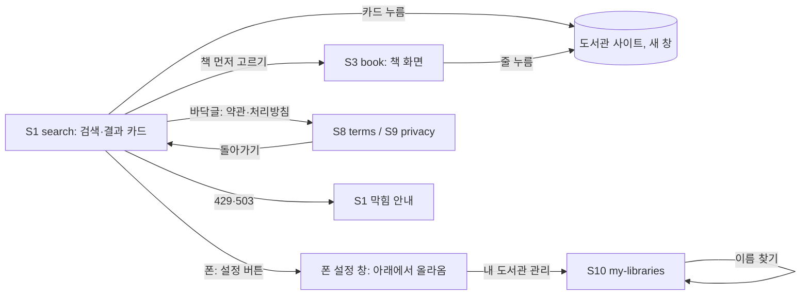

# 화면 흐름: 다듬기 + 가져오기 바꿔 끼우기 + 메모리 줄이기 (사이클 08)

- 작성: 2026-10-06. 사용자가 자는 동안 진행함. 새 화면은 없고, 있는 화면 S1·S3·S8·S9·S10의 일부와 폰 설정 창이 바뀝니다. 모든 바뀜은 [안]이고 돌아오면 canvas에서 PC·태블릿·폰 그림과 함께 묻습니다.
  - 고침(2026-10-11): 아래 [안]은 대부분 화면 흐름 검토(2026-10-06)에서 정했습니다. 줄마다 "→ 검토에서 정함 (#번호)"를 붙였고, 정한 내용은 맨 아래 "검토 결과"가 기준입니다.
- 지금 화면의 기준: dev `docs/screen-changes-2026-10-05.md` 1절(최종 상태), 사이클 07 `flow.md`. 사이클 07 뒤 바뀐 것(로고 이름 위 줄, 검색 범위 기본값)은 사이클 07 `retro.md`.
- 가져오기 바꿔 끼우기와 메모리 줄이기는 화면이 바뀌지 않습니다(가져오는 동안에도 검색이 평소처럼 됨).

## 화면별 내용

### S1 search (변경)
- 검색 설정 기억 (R1): 다시 열면 범위·방문 없이 가입·결과 거르기·보기 방식·직접 찾기는 남고, 정렬은 "기본 순서", 상세검색 체크는 비어 있음. 화면 모양은 그대로
- 막힘 안내 (R2) [안] → 검토에서 정함 (#1, [확정] 사용자 승인 2026-10-06)
  - 429: 결과 자리 위 안내 줄 "검색을 너무 자주 했어요. 1분쯤 뒤에 다시 해 주세요."
  - 503: "지금 찾는 사람이 많아요. 잠시 뒤에 다시 해 주세요."
  - 이미 받은 결과는 지우지 않음. "다시 검색" 버튼은 두지 않음(검색 버튼 그대로) [안] → 검토에서 정함 (#1)
  - 503에는 응답 머리 `Retry-After: 5` [확정] (사용자 승인, 2026-10-11, 설계 검토; `design-delta.md` "API"). 화면은 같음
- 폰 사이트 안내 (R3) [안]: 폭 640px 이하, YES24 모바일판 13곳의 결과 카드 아래쪽에 작은 글 "폰에서는 사이트가 다른 화면을 보여요. PC에서 열어 주세요". 카드 링크는 그대로 열림. 책 상세 링크는 폰에서도 맞지만, 첫 화면·검색 결과로 가는 경우가 있어 결과 카드에도 보임 [안: 결과 카드에도 보일지 사용자에게 물음] → 검토에서 정함 (#2: 결과 카드 이름 아래에도 보임 [확정])
- "도서관에서 직접 찾기" 결과 줄과 가입 정보 창의 "홈페이지 (새 창)" 옆에도 같은 안내 [안] → 검토에서 정함 (#2)
- 상태 칸 색 (R10-3) [안] → 검토에서 정함 (#3): "대출 중 · 예약", "확인 실패", "대출 정보 조회 중", "대출 가능 여부 확인 필요" 칸을 보유 칸과 같은 연보라(`--brand-faint`)로. 예약 묶음의 연주황은 그대로
- 카드 전체 링크 (R10-4) [안] → 검토에서 정함 (#4): 그대로 둠
- 폰 "도서관에서 직접 찾기" 정렬 안내 (R10-2) [안] → 검토에서 정함 (#5, "정렬 없음 ⓘ"): 검색줄 둘째 줄 오른쪽 끝(정렬 상자 자리)에 흐린 글 "정렬 없음". 누르면 "도서관 사이트 검색에서는 정렬을 쓸 수 없어요"
- 바뀐 도서관 이름 (R4): 결과 카드·가입 정보 창에 새 이름

### 폰 설정 창 (변경, R10-1) [안] → 검토에서 정함 (#6, 써 본 뒤 되돌릴 수 있게)
- 지금: 설정 버튼 아래 작은 창(팝오버)
- 바꿈: 화면 아래에서 올라오는 창(바텀 시트). 위에 손잡이, 바깥을 누르거나 아래로 끌면 닫힘. 내용(찾을 도서관, 방문 없이 가입, 내 도서관 관리, 보기 방식, 직접 찾기, 계정)과 순서는 그대로
- PC·태블릿은 그대로

### S3 book (변경)
- 폰 사이트 안내 (R3): 13곳 줄에 S1과 같은 안내 [안] → 검토에서 정함 (#2)
- 상태 칸 색: S1과 같음

### S8 terms / S9 privacy (변경, R10-6) [안] → 검토에서 정함 (#7: 자리는 맨 위가 아니라 맨 아래 오른쪽. S10·S2에도 더함)
- 맨 위에 "← 돌아가기". 누르면 이전 화면(브라우저 뒤로). 이전 화면이 없으면(주소로 바로 들어옴) 첫 화면 S1
- 로그인 화면(S6 가입)에서 연 경우도 같음

### S10 my-libraries (변경)
- 이름 찾기 결과에 바뀐 도서관 이름 (R4). 예전 이름으로 찾으면 안 나옴 [안: 예전 이름도 찾게 할지는 사용자에게 물음] → 검토에서 정함 (#8: 고친 이름으로만 찾음 [확정])

### 글꼴 (R10-5) [안] → 검토에서 정함 (#9, 줄인 파일은 다른 글꼴 이름)
- 모든 화면. 나눔바른고딕을 자주 쓰는 한글 글자만 담은 작은 파일로 바꿈. 화면 모양은 같음. 드문 글자는 시스템 글꼴로 보일 수 있음

## 수용 기준 대응

| AC | 화면 |
|---|---|
| AC-1 검색 설정 기억 | S1 |
| AC-2 옛 저장값 지움 | S1 (브라우저 저장) |
| AC-3 429·503 안내 | S1 막힘 안내 |
| AC-4 폰 사이트 안내 | S1 결과 카드, S3 줄, 가입 정보 창 |
| AC-5 바뀐 이름 | S1, S3, S10 |
| AC-6 고친 시각 | 화면 없음 (DB) |
| AC-7 수집 기간 | 화면 없음 (가져오기 기록) |
| AC-8·9 가져오는 동안 검색 | S1 (평소와 같음) |
| AC-10 책 번호·소장 줄 순서 | 화면 없음 (DB) |
| AC-11·12 메모리 | 화면 없음 (측정표) |
| AC-13 화면 질문 여섯 | 폰 설정 창, S1 정렬 안내, 상태 칸 색, S8·S9, 글꼴 |
| AC-14 회귀 | 모든 화면 |

## 상태별 동작 대응

| spec 상태 | 화면 |
|---|---|
| 가져오는 중 | S1·S3 평소와 같음 |
| 가져오기 실패 | 화면 없음 (옛 표 그대로) |
| 막힘(429·503) | S1 막힘 안내 |
| 폰 안내 도서관이 확인 실패 | 안내 그대로 + "확인 실패" 칸 |

## 확인 필요

| 항목 | 확인 방법 |
|---|---|
| 화면 질문 여섯의 답(바텀 시트, 정렬 안내, 색, 카드 링크, 글꼴, 돌아가기) | 사용자에게 질문 (PC·태블릿·폰 그림) → 검토에서 정함 (#3~#7·#9, 2026-10-06) |
| 429·503·폰 안내 문구와 자리 | 사용자에게 질문 → 429·503 문구·자리 정함 (#1, spec R2-1), 폰 안내 자리 정함 (#2). 폰 안내 문구는 [안] 그대로 |
| 폰 안내를 결과 카드에도 보일지 | 사용자에게 질문 → 검토에서 정함 (#2: 보임) |
| 예전 도서관 이름으로도 찾게 할지 | 사용자에게 질문 → 검토에서 정함 (#8: 고친 이름으로만) |
| 나눔바른고딕 서브셋 허용 | 공식 문서 확인 → 서브셋·다른 글꼴 이름은 정함 (#9). 나눔바른고딕에 OFL 예약 이름이 있는지는 아직 [확인 필요] (spec R10-5) |

## 검토 결과 (2026-10-06, `easy/2026-10-06-flow-decisions.html`)

- 승인 [확정] (사용자 승인, 2026-10-06): 막힘 안내 한 줄·결과 남김·다시 검색 버튼 없음(#1), 상태 칸 연보라(#3), 카드 전체 링크 그대로(#4), 폰 직접 찾기 "정렬 없음 ⓘ"(#5), 고친 이름으로만 찾음(#8), 글꼴 서브셋·다른 글꼴 이름(#9), 설계 단계로(#10)
- 폰 설정 창(#6): 아래에서 올라오는 창으로 [확정] — 사용자: "이거는 내가 직접 해봐야 알 것 같아 일단 만들고 나서 내가 이전으로돌아가라고 하면 돌아가줘". 인계서: 지금 작은 창 코드를 지우지 않고 되돌릴 수 있게 둠
- 돌아가기(#7) [확정] (사용자 제안, 2026-10-06): "돌아가기는 맨 아래 그리고 이거 지역/도서관 설정 하는 거에도 돌아가기 없으니 헷갈리고 따로 저장 버튼 없으니 헷갈리거든? 그냥 돌아가기도 우측 아래에 두고 어디 작게 바로바로 저장된다고 i인가 뭐 이런거에 마우스나 손가락 올리면 보이도록 해줘"
  - S8·S9: 맨 아래 오른쪽 "← 돌아가기"(이전 화면, 없으면 첫 화면)
  - S10 내 도서관, S2 지역 고르기: 오른쪽 아래 "← 돌아가기" + 제목 옆 ⓘ(마우스를 올리거나 누르면 "고르는 즉시 저장돼요"; 로그인 전 "이 브라우저에", 로그인 뒤 "계정에") — 문구 [안]
- YES24 안내 자리(#2) [확정] (사용자 승인, 2026-10-06): 처음 제안대로 결과 카드의 도서관 이름 아래, 책 화면 줄, 직접 찾기 결과, 가입 정보 창의 첫 화면 링크 옆. 사용자: "원래 대로 하고 내가 나중에 많아보이면 줄이자". 줄인 안(이상한 화면으로 가는 두 링크 옆에만)은 많아 보이면 그때

## 바꿔 끼운 뒤 빠진 책·소장 [확정] (사용자 승인, 2026-10-11, ADR-0070)

- 책 화면에서 책 자체가 없을 때(`book_not_found`): "책을 찾을 수 없어요" 아래 "도서관 목록을 새로 받으면서 빠진 책일 수 있어요. 다시 검색해 주세요.", 그 아래 "처음으로" (지금 화면에 한 줄 더함)
- 책 화면 도서관 줄의 소장이 없을 때(`holding_not_found`): 그 줄에 "이 도서관 목록에서 빠졌어요" (PC·태블릿·폰 같은 자리, `easy/2026-10-11-holding-gone-message.html`)
