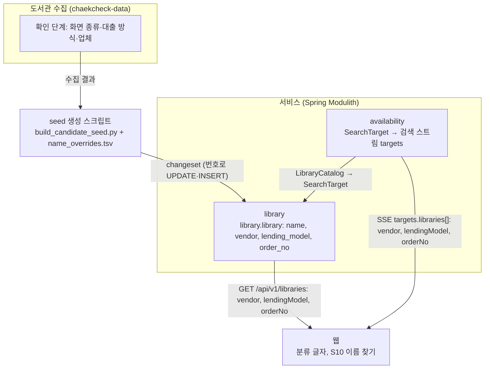
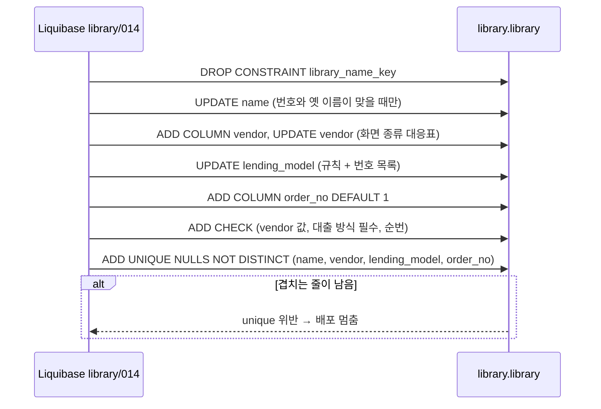
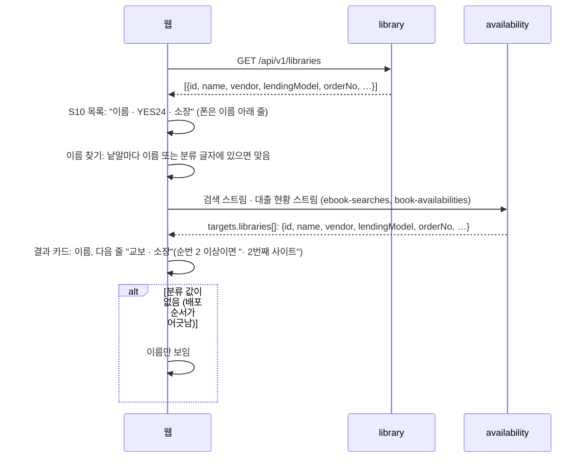
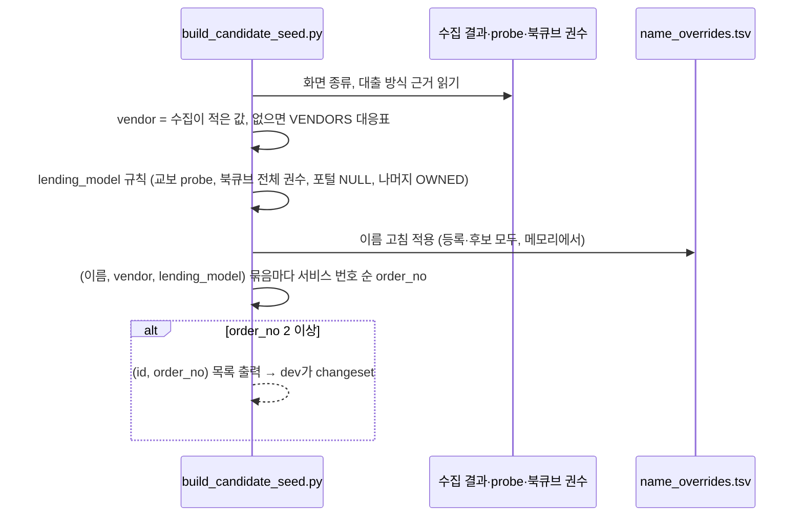
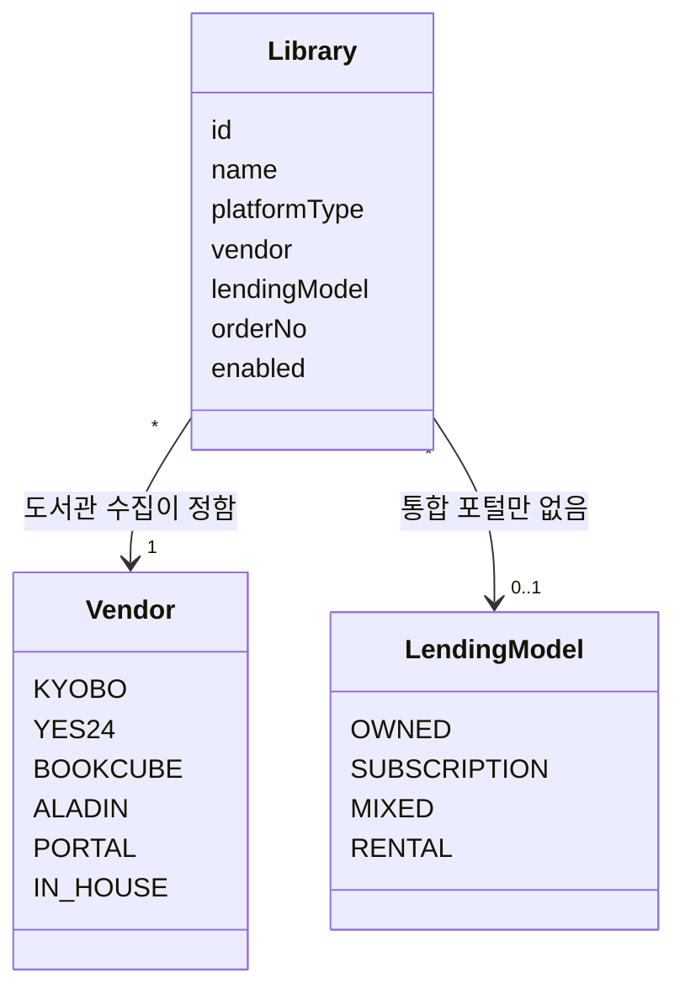
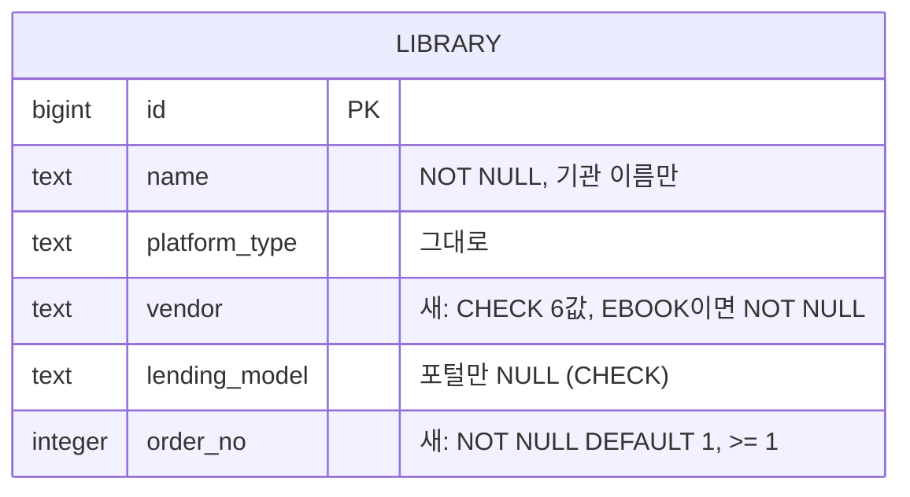

# 설계 변경: 사이클 09 도서관 이름은 기관 이름만, 업체·대출 방식은 분류로

- 작성: 2026-10-11. 근거: `scope.md`, `spec.md`, `flow.md`, `research.md`, `architect-proposal.md`(사용자 결정 절), `../08-polish-swap-memory/retro.md`, ADR-0071
- 결정 페이지: `easy/2026-10-11-design-decisions.html`, `easy/2026-10-11-vendor-followup.html`
- dev 기준: 2026-10-11 작업 폴더(사이클 08 개발 끝, 커밋 전). 마지막 library changeset `library/013-library-name-overrides.yaml`
- 설계 검토: 이 문서대로 인계서로 넘어감 (사용자 승인, 2026-10-11, `easy/2026-10-11-design-delta-review.html`)
- 새 모듈·새 표·새 이벤트 없음. 바뀌는 곳: `library` 모듈(표 칸·제약·공개 값), `availability`(값을 실어 보내기만), 웹, dev 스크립트

## 구조 그림

### 모듈 구성도



### 주요 흐름

이름·분류를 바꾸는 changeset (배포 때 Liquibase가 한 번 실행)



화면에 분류를 보이기



새 후보 도서관을 넣을 때 (seed 생성 스크립트)



### 도메인 모델



## 모듈

| 모듈 | 신규/변경 | 책임 | 공개 API | 발행/구독 이벤트 | 소유 테이블 |
|---|---|---|---|---|---|
| `library` | 변경 | 도서관 이름·업체·대출 방식·순번을 저장하고 확인. 목록 API와 `SearchTarget`에 세 값을 실음 | `Vendor` enum(모듈 루트, `LendingModel`·`PlatformType`과 같은 자리) [확정], `LibraryEligibility`·`SearchTarget`에 `vendor`·`lendingModel`·`orderNo` [확정] | 없음 | `library.library` (칸 추가) |
| `availability` | 변경 | `SearchTarget`의 세 값을 검색 스트림 `targets.libraries[]`(`StreamEvents.Library`)에 실음. 판정 동작은 그대로 | 없음 | 없음 | 없음 |

- 모듈 관계 변화 없음(`availability` → `library`는 이미 있음). `LendingModel`·`SearchTarget` Javadoc의 "KYOBO subscription only"를 "통합 포털 말고 모두"로 고침
- 검색·소장 판정 동작은 바뀌지 않음: 대출 방식으로 갈리는 곳은 `HoldingTask.java:25-26`(교보 구독형 && `!= OWNED`) 하나이고, 이번에 교보 구독형에 `OWNED`를 새로 넣는 곳은 없음 (`research.md` 2절)

## 데이터

- 스키마: `library` (소유: `library` 모듈)



| 테이블.컬럼·제약 | 타입 | 제약 | 설명 | 상태 태그 |
|---|---|---|---|---|
| `library.library.name` | text | NOT NULL (UNIQUE `library_name_key` 지움) | 기관 정식 이름만. 이름 끝 업체·대출 방식 괄호를 뗌 (spec R1) | [확정] (ADR-0071) |
| `library.library.vendor` | text | NULL 허용, CHECK `library_vendor_check` `vendor IN ('KYOBO','YES24','BOOKCUBE','ALADIN','PORTAL','IN_HOUSE')`, 새 CHECK `library_vendor_required_check (library_type <> 'EBOOK' OR vendor IS NOT NULL)` [확정] (사용자 승인, 2026-10-11, `easy/2026-10-11-review-decisions.html`) (지금 `library_type`은 EBOOK뿐이라 늘 필수. 실물 도서관 사이클에서 다시 봄) | 업체. 도서관 수집이 정하고 seed 생성 스크립트가 씀. DB는 허용 값만 확인 | [확정] (사용자 승인, 2026-10-11, `easy/2026-10-11-design-delta-review.html`) |
| `library.library.lending_model` | text | 지금 CHECK 그대로 + `library_lending_model_required_check ((vendor = 'PORTAL') = (lending_model IS NULL))` | 통합 포털만 비움. 업체가 비어 있으면(실물 도서관) 결과가 NULL이라 통과 | [확정] (사용자 승인, 2026-10-11; 업체 기준으로 맞춤 — vendor-followup) |
| `library.library.order_no` | integer | NOT NULL DEFAULT 1, CHECK `library_order_no_check (order_no >= 1)` | 같은 (이름, 업체, 대출 방식) 묶음 안의 순번. 지금은 모두 1 | [확정] (사용자 승인, 2026-10-11) |
| UNIQUE `library_classification_key` | — | `UNIQUE NULLS NOT DISTINCT (name, vendor, lending_model, order_no)`, 꺼진 도서관도 셈 | 이름 UNIQUE를 대신함 | [확정] (ADR-0071, 사용자 승인 2026-10-11) |

- Liquibase: 새 파일 `library/014-library-classification.yaml` [안 번호·이름]. 기존 changeset은 고치지 않음 (seed 고치는 방식 [확정], `../08-polish-swap-memory/dev-midpoint-2026-10-11.md`). 칸·제약은 raw `sql`(이 표를 만든 방식과 같고, `UNIQUE NULLS NOT DISTINCT`는 YAML이 지원하지 않음, `docs/current/data-model.md`)
- changeset 안 순서 [확정] (사용자 승인, 2026-10-11, 설계 결정 4번 그림):
  1. `ALTER TABLE library.library DROP CONSTRAINT library_name_key`
  2. 이름 UPDATE: `(id, old_name, new_name)` VALUES, `WHERE l.id = v.id AND l.name = v.old_name` (013과 같은 꼴). 목록은 `name_overrides.tsv`에서 만듦
  3. `ADD COLUMN vendor text`, 화면 종류 대응표로 UPDATE (`KYOBO_V1`·`KYOBO_SUBSCRIPTION_V1` → `KYOBO`, `YES24_V1~V3` → `YES24`, `BOOKCUBE_FX` → `BOOKCUBE`, `ALADIN_V1` → `ALADIN`, `ELIB_PORTAL_V1` → `PORTAL`, `GANGNAM_V1` → `IN_HOUSE`)
  4. `lending_model` UPDATE (아래 표)
  5. `ADD COLUMN order_no integer NOT NULL DEFAULT 1`
  6. CHECK 셋 추가
  7. UNIQUE `library_classification_key` 추가 (마지막에 둬서 도중 상태에서 위반이 나지 않게)
- 이름 UPDATE 대상 (spec R1)

| 무엇 | 곳 | 근거 |
|---|---|---|
| 이름 끝 업체·대출 방식 괄호 | 277 (dev seed 셈 2026-10-11) | spec R1-1 |
| 434 "경상국립대학교 (북큐브)" → "경상국립대학교", 456 "국립경국대학교 (북큐브)" → "국립경국대학교" (옛 이름은 사이클 08 013 결과) | 2 | `architect-proposal.md` 결정 3 |
| 76 "서대문구립도서관", 64 "경상남도교육청 마산도서관", 93 "양산시립도서관", 943 "경상남도교육청 양산도서관", 1575 "완주동상초등학교", 1149 "메리츠(증권&캐피탈)", 386 "진천군립도서관" | 7 | spec R1-3·4·8·11, R4-3 |
| 977 "국립경국대학교" | 1 | spec R1-9 |
| 895 "한경국립대학교", 1002 "한국공학대학교", 769·2257 "강원대학교 강릉캠퍼스", 428 "국립창원대학교 거창캠퍼스", 429 "국립창원대학교 남해캠퍼스" | 6 | spec R1-10, dev가 공식 출처로 다시 확인 |

- VALUES는 번호당 한 줄이고 새 이름은 최종 이름 하나. 괄호 떼기와 따로 정한 이름이 겹치는 번호(예: 1575 "(교보, 호스트)" → "완주동상초등학교")는 최종 이름만 씀. 위 표의 합(293)은 겹침을 빼지 않은 수라 실제 줄 수는 그보다 적음 [확인 필요: dev가 `name_overrides.tsv`로 셈]
- 대출 방식 UPDATE (spec R3, `WHERE lending_model IS NULL`인 줄만)

| 도서관 | 값 | 태그 |
|---|---|---|
| `KYOBO_V1`, `YES24_V1~V3`, `ALADIN_V1`, `GANGNAM_V1` | `OWNED` | [확정] |
| `BOOKCUBE_FX` 339·380·386·705 | `SUBSCRIPTION` (번호는 이름으로 찾은 것, dev가 `bookcube-volume-2026-10-11.tsv` + `collection_link`로 다시 맞춤) | 규칙 [확정], 번호 [확인 필요] |
| 나머지 `BOOKCUBE_FX` | `OWNED` (응답 없음·책 0종 5곳 포함) | [확정] |
| `KYOBO_SUBSCRIPTION_V1` 59, 131, 140, 275, 276, 277, 278 | `SUBSCRIPTION` | [확정] |
| `ELIB_PORTAL_V1` | NULL 그대로 | [확정] |

- 적용 뒤 확인: 겹침 0(UNIQUE가 걸리면 됨), `order_no`가 모두 1, `vendor` NULL 0, 포털 말고 `lending_model` NULL 0

## API

| 메서드 | 경로 | 설명 | 요청 | 응답 | 에러 |
|---|---|---|---|---|---|
| GET | `/api/v1/libraries` | 항목에 칸 셋 추가. 요청·다른 칸 그대로 | 그대로 | 항목에 `vendor`(string, 6값), `lendingModel`(string 4값 또는 `null`), `orderNo`(number) | 그대로 |
| SSE | 검색 스트림·대출 현황 스트림 `targets.libraries[]` | 같은 칸 셋 추가(`StreamEvents.Library`) | 그대로 | 위와 같음 | 그대로 |

- 칸 이름 [확정] (사용자 승인, 2026-10-11). 웹은 값을 우리말 글자로 바꿈: `KYOBO` 교보, `YES24` YES24, `BOOKCUBE` 북큐브, `ALADIN` 알라딘, `PORTAL` 통합 포털, `IN_HOUSE` 자체 / `OWNED` 소장, `SUBSCRIPTION` 구독, `MIXED` 혼합, `RENTAL` 대여
- `docs/current/api.md`의 "`lendingModel`은 웹에 보내지 않음" 기록이 바뀜
- 응답 크기: 목록 응답이 압축 전 약 130KB 늘 것으로 추정(지금 671,376바이트, gzip 61,152바이트) [확인 필요: dev 측정]
- 예시

```json
{"id":230,"name":"동대문구립도서관","eligibility":"…","vendor":"YES24","lendingModel":"OWNED","orderNo":1}
{"id":339,"name":"부산광역시 전자도서관","vendor":"BOOKCUBE","lendingModel":"SUBSCRIPTION","orderNo":1}
{"id":6,"name":"부산광역시 전자도서관","vendor":"PORTAL","lendingModel":null,"orderNo":1}
```

(번호 6은 예시용 [확인 필요: 실제 부산 통합 포털 번호])

## 웹

| 화면 | 바뀌는 것 | 근거 |
|---|---|---|
| S1·S3 결과 카드 (`ResultRow.tsx`) | 이름 다음 줄에 "교보 · 소장"(모든 폭), 작은 회색 글씨, 이름 버튼 밖. 순번 2 이상이면 "· N번째 사이트" | flow.md [확정] |
| S10 지역 도서관 목록, 직접 추가 찾기 결과, 직접 추가한 도서관 (`MyLibrariesPage.tsx`) | "이름 · 업체 · 대출 방식", 폰은 이름 아래 줄. 순번 2 이상이면 "· N번째 사이트" | flow.md [확정] |
| 요약 줄, 지역 가져오기 창, 직접 찾기 결과 이름 나열 | 이름만 | flow.md [확정] |
| S10 이름 찾기 (`libraryNames.ts` `findByName`) | 낱말마다 이름 키 또는 분류 키(업체·대출 방식 글자)에 있으면 맞음. 공백·가운뎃점 무시, 소문자. 정렬: 이름 앞부분 일치 → 이름순 → 같은 이름은 업체 글자순. 서버 찾기 API 없음 | flow.md, 설계 결정 8번 [확정] |
| 분류 값이 없음 | 이름만 | spec 상태별 동작 [확정] |

- 고칠 테스트: `ResultRow.test.tsx:202`, `regionSource.test.tsx:75,253`(괄호 이름을 적어 둠)

## dev 스크립트와 문서

- `scripts/library/build_candidate_seed.py` [확정] (설계 결정 3번)
  - `LABELS`·`name_candidates()`를 지우고, `VENDORS`(화면 종류 → 업체 대응표, 한 곳)와 `assign_order_no()`를 둠
  - 업체: 수집이 따로 적은 값이 있으면 그 값, 없으면 대응표 [확정] (vendor-followup). 수집이 따로 적는 자리 [확인 필요: 수집 세션과 정함 — 지금은 따로 적은 곳이 없음]
  - 대출 방식: 교보 probe, 북큐브 전체 권수 결과(`docs/cycles/09-library-naming/bookcube-volume-2026-10-11.tsv`를 dev로 옮겨 입력으로), 포털 NULL, 나머지 `OWNED`, 등록 교보 구독형 NULL 7곳 `SUBSCRIPTION`
  - `apply_name_overrides()`가 등록 도서관(번호 280 이하)도 받게(메모리 속 이름에만 적용)
  - 겹침 열쇠를 (이름, 업체, 대출 방식, 순번)으로. 2 이상 순번은 목록 출력
  - 배포 뒤에는 seed 파일을 다시 쓰지 않고 바뀐 것만 changeset으로 출력 [확정] (seed 고치는 방식)
  - 테스트 `test_build_candidate_seed.py:159-166`을 "괄호 없음, 순번" 시험으로
- `scripts/library/name_overrides.tsv`: 434·456 `new_name`에서 괄호를 뗌. 이번 이름 고침을 모두 더함. `changed_on`에 괄호 떼기는 `label-removed` [확정], 사이트 제목·공식 출처로 고친 곳은 그 출처
- `scripts/library/check_front_page_names.py`의 라벨 정규식(괄호 떼기)을 지움 [확정] (사용자 승인, 2026-10-11, `easy/2026-10-11-design-delta-review.html`)
- `scripts/library/eligibility_rules.py`의 이름 열쇠(`'국립세종도서관(구독형)'` 등): 다시 돌리면 새 이름에 맞게 고침 [확인 필요: dev가 다시 돌리는지]
- dev 문서: `docs/library-maintenance.md` 1-1절 `name` 설명, 4-5절 "(구독) 등으로 구분" 문장, 이름 고침 절에 이번 규칙
- Java 테스트: `CandidateSeedTests.java:55`(280 이하 `OWNED` 수), `LibrarySchemaCycle08Tests.java:50`(434·456 괄호 이름)

## 외부 연동

| 대상 | 방식 | 제한·키 관리 | 실패 시 동작 | 상태 태그 |
|---|---|---|---|---|
| 수집 DB(`chaekcheck-data\ebook-catalog.sqlite`) 이름 | 수집 세션이 이름 고침 목록으로 같은 이름으로 바꿈(서비스 번호 ↔ 수집 번호는 `collection_link`) | 서비스 코드는 수집 DB를 쓰지 않음 | — | 이름도 바꿈 [확정] (사용자: "이렇게 가자", 2026-10-11), 방법 [확인 필요: 수집 세션] |
| 도서관 사이트 | 바뀌지 않음 | — | — | — |

## 결정 기록

- ADR-0071 도서관 이름에는 기관 이름만, 업체·대출 방식은 분류로 (Accepted, 2026-10-11)
- ADR-0076 도서관 분류 값을 API로 보내고 화면이 글자를 만듦, 이름은 번호로 고치는 changeset, 이름 찾기는 화면에서 (Accepted, 2026-10-11)

## 확인 필요

| 항목 | 확인 방법 | 막는 단계 |
|---|---|---|
| changeset 번호 014 | dev가 개발 시작 때 마지막 번호 확인 | 없음 |
| 북큐브 구독 서비스 번호 339·380·386·705 | dev가 북큐브 결과 파일 + `collection_link`로 대조 | 개발 |
| 이름 고침 대상 6곳(R1-10)·977·100747·64의 공식 이름 | dev가 공식 출처로 다시 확인, 다르면 사용자에게 | 개발 |
| 목록 응답 크기 증가(gzip) | dev 측정 | 없음 |
| 수집 DB 이름을 바꾸는 방법·때 | 수집 세션 | 없음 |
| 수집이 업체를 따로 적는 자리 | 수집 세션 (지금은 그런 곳 없음) | 없음 |
| `eligibility_rules.py` 다시 돌리는지 | dev | 없음 |
