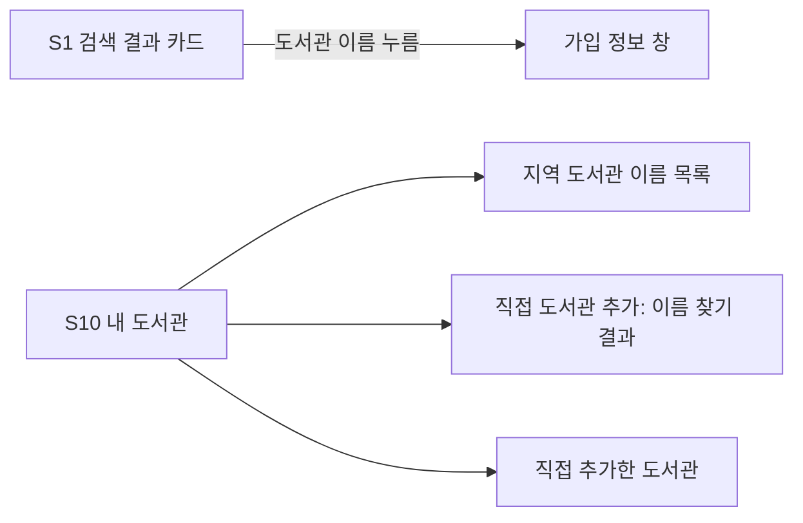

# 화면 흐름: 도서관 이름 옆 분류 표시

- 작성: 2026-10-11 (사이클 08 dev 진행 중에 미리 씀). 근거 `spec.md` R5·R6
- 새 화면이나 화면 사이 이동은 없음. 이미 있는 화면에서 도서관 이름이 보이는 자리에 분류를 붙이고, S10 이름 찾기 규칙만 바꿈
- 지금 화면은 dev 웹 코드 기준(2026-10-11): 결과 카드 `ResultRow.tsx`, 내 도서관 `MyLibrariesPage.tsx`. 사이클 08이 폰 설정 창(바텀 시트) 등을 바꾸는 중이라 회고 때 다시 맞춰 봄

## 분류를 붙이는 자리 [확정] (사용자 승인, 2026-10-11, `easy/2026-10-11-spec-flow-decisions.html`)

| 화면 | 자리 | 지금 | 바뀐 뒤 |
|---|---|---|---|
| S1·S3 결과 카드 (`ResultRow.tsx`) | 로고 아래 도서관 이름 | 동대문구립도서관(YES24) | 동대문구립도서관 YES24 · 소장 (모든 폭에서 이름 다음 줄에 분류, 작은 회색 글씨, 이름 버튼 밖) |
| S1 가입 정보 창 | 창 첫 줄 | 없음 | 바꾸지 않음 (이름 옆에 이미 보임) |
| S1 도서관 요약 줄 (`LibrarySummaryBar.tsx`) | "5곳 + 외 N곳" 이름 나열 | 이름 | 이름만 (한 줄에 여러 곳이라 분류를 붙이면 길어짐) |
| S10 지역 도서관 이름 목록 (`NameList`) | 로고 + 이름 | 이름 | 이름 · 업체 · 대출 방식 |
| S10 직접 추가 이름 찾기 결과 | 로고 + 이름 + [추가] | 이름 | 이름 · 업체 · 대출 방식 |
| S10 직접 추가한 도서관 | 로고 + 이름 + [빼기] | 이름 | 이름 · 업체 · 대출 방식 |
| 지역 가져오기 창 (`RegionImportDialog.tsx`), 직접 찾기 결과(`DirectResults.tsx`) | 이름 나열 | 이름 | 이름만 (요약 줄과 같은 이유) |

- 결과 카드: PC·태블릿·폰 모두 이름 다음 줄에 "교보 · 소장" [확정] (사용자: "검색 결과 카드에서는 공통으로 도서관 이름 있고 개행 하고 교보 소장 이런거 보이도록 하는 걸 어떻가 해", 2026-10-11)
- 내 도서관(S10) 목록: PC·태블릿은 이름 옆, 폰은 이름 아래 줄 [확정] (사용자 승인, 2026-10-11, `easy/2026-10-11-spec-flow-decisions.html`)

## S10 이름 찾기 [확정] (사용자 승인, 2026-10-11, `easy/2026-10-11-spec-flow-decisions.html`)

- 검색어를 이름과 분류 글자 모두에서 찾음: "동대문 yes24" → 동대문구립도서관 · YES24 · 소장
- 낱말마다 이름 또는 분류 중 한 곳에 있으면 맞음(공백으로 나눈 낱말 모두 맞아야 함). 지금처럼 공백 무시·소문자
- 정렬은 지금처럼 이름 앞부분 일치 먼저, 그다음 이름순. 같은 이름끼리는 업체 이름순

## 상태

- 기본: 위 표대로
- 통합 포털: "부산광역시 전자도서관 · 통합 포털" (대출 방식 없음)
- 분류가 오지 않음(배포 순서가 어긋남): 이름만
- 꺼진 도서관(직접 추가한 도서관에 남은 것): 지금처럼 "쓸 수 없는 도서관", 분류 없음

## 수용 기준 대응

| AC | 화면 |
|---|---|
| AC-1, AC-2 | S1·S3 결과 카드, S10 세 목록 |
| AC-3 | S1·S3 결과 카드, S10 세 목록 (PC·태블릿·폰) |
| AC-4 | S10 직접 추가 이름 찾기 결과 |
| AC-5 | S10 직접 추가한 도서관 |
| AC-6 | S10 직접 추가 이름 찾기 |
| AC-7 | 화면 없음 (DB) |
| AC-8 | S1·S3 결과 카드의 상태·권수 |
