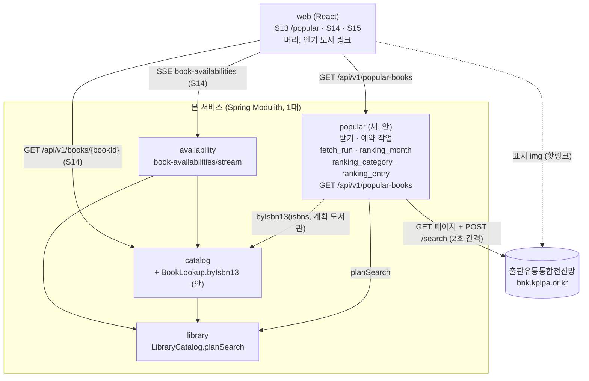
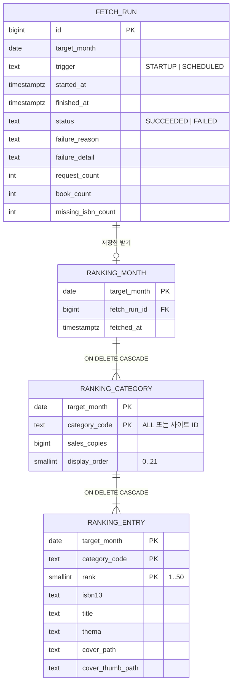

# 설계 제안: 사이클 10 인기 도서 (architect, 2026-10-11)

> 분류 빼기(2026-10-11) 이전 제안이라 22개·21건·`display_order 0..21`·고정 자리·ISBN 1,050개 같은 값이 옛 값입니다. **`design-delta.md`가 우선**입니다.

- `architect` 서브에이전트의 제안을 그대로 옮김. 새 이름·값은 모두 [안]. 결정은 `easy/2026-10-11-design-decisions.html`에서
- 읽은 dev 코드(읽기만): `catalog/CatalogLoad.java`, `CatalogHoldings.java`, `catalog/internal/web/BookSearchController.java`, `collection/package-info.java`, `collection/internal/importer/CatalogImportRunner.java`, `auth/internal/cleanup/DailyAccountCleanup.java`, `auth/internal/token/RefreshTokenCleanup.java`, `availability/internal/config/CacheStatsLog.java`, `application.yml`, `build.gradle`, `catalog/001-catalog-schema.yaml`, `deploy/nginx/security-headers.conf`, `web/src/main.tsx`, `components/AppLayout.tsx`, `features/book/BookPage.tsx`

## 현재 상태 (dev 코드로 확인, 2026-10-11)

| 항목 | 현재 | 이번 슬라이스와의 관계 |
|---|---|---|
| 모듈 | `region`, `library`, `catalog`, `availability`, `auth`, `mylibrary`, `collection`. 인기 도서 모듈 없음 | 새로 필요 |
| 표 | `catalog.book.isbn13` UNIQUE(`book_isbn13_key`) + CHECK `^97[89][0-9]{10}$` | ISBN 맞추기가 색인 한 번 |
| 검색 계획 | `BookSearchController`가 `residenceRegionIds`·`workRegionIds`·`scope`·`visit`·`libraryIds` → `LibraryCatalog.planSearch(…, PlanOptions)`. 거르기 `b.library_ids && CAST(:libraryIds AS bigint[])` | 같은 규칙 |
| 가져오기 | `CatalogImportRunner`는 `collection-import` 프로필로 **따로 뜨는 프로세스**, 끝나면 `System.exit`. `CatalogLoad.Result`에 `keptBookIds`·`newBookIds`·`droppedBookIds`(건수) | 결정 2 |
| 예약 작업 | `@EnableScheduling`은 `RefreshTokenCleanup`에만, `@ConditionalOnAuthEnabled` → 로그인 꺼지면 예약 작업 꺼짐. `CacheStatsLog`는 자기 데몬 스레드 | 자기 스케줄링 필요 |
| HTML 파서 | Jsoup 1.23.2 이미 의존성 | 새 의존성 없음 |
| 조회 서버 | `POST /v1/fetches`는 GET만 | 쿠키+CSRF+POST 받기에 못 씀 |
| CSP | `img-src 'self' data:` | 출처 표지 직접 쓰려면 변경 |
| 웹 | `AppLayout` 설명 글 "전자도서관 대출 가능 확인". `BookPage`는 `useRegions`·`useLibraryScope`·`readVisit`·`loadPrefs`로 계획, `fetchBook`, `useHoldings().open` | S14가 재사용 |

겹침: 사이클 08 바꿔 끼우기·`holdingsOf(bookIds, libraryIds)`는 dev 코드에 이미 있음(추천안은 운영 표만 읽어 부딪치지 않음). 사이클 08 웹도 `AppLayout`을 건드리면 순서 맞춤 필요. 사이클 09의 이름 표시 변경은 S14가 S3 줄 컴포넌트를 쓰므로 따라감.

## 결정 1: 받기·저장·API를 어느 모듈에

- **A안 [추천]: 새 모듈 `popular` [안 이름]** — 받기·예약·`popular` 스키마·REST. `allowedDependencies = {"catalog", "library"}` [안]. `catalog`에 ISBN 찾기 공개 API 하나. 계획은 `popular` 컨트롤러가 `planSearch`로. 장점: 바깥 사이트 받기 코드가 `catalog`·`collection`과 섞이지 않음, 의존 고리 없음. 단점: 계획 파라미터 파서 하나 더(`availability`도 자기 파서가 있어 관례와 같음). 되돌리기 낮음
- B안: `collection` 안 — `collection`은 공개 API·REST 없이 `collection-import` 프로필로만 도는 모듈이라 운영 예약 작업·화면 API를 넣으면 프로필 조건이 섞임
- C안: `catalog` 안 — SQL 조인 한 번이지만 ADR-0060(가져오기를 `catalog` 밖으로)과 거꾸로

## 결정 2: 순위 책과 우리 책의 짝 (R3-2)

전제: 있음/없음은 요청마다 계획이 달라 어느 안이든 요청 때 `catalog`에 한 번 물음.

- **A안 [추천]: 저장하지 않고 읽을 때마다 ISBN으로 찾기** — `catalog` 새 공개 API `BookLookup.byIsbn13(isbn13s, libraryIds) → List<IsbnBook(isbn13, bookId, inLibraries)>` [안 이름], SQL `SELECT id, isbn13, library_ids && :planned FROM catalog.book WHERE isbn13 = ANY(:isbns)`. 짝 표·다시 맞추기·이벤트 없음, 가져오기 다음 요청부터 늘 맞음. 단점: spec R3-2 글을 바꿔야 함(사용자 승인 필요), 요청마다 색인 조회 약 1,050번 [확인 필요: 측정]
- B안: 받을 때 저장 + 가져오기 뒤 이벤트 `CatalogReplaced` [안] — 가져오기 프로세스가 끝나자마자 `System.exit`해 비동기 리스너가 끊길 수 있고, 남은 이벤트는 운영 서버 재시작 때만 다시 처리됨. 복잡
- C안: 저장 + 하루 한 번 다시 맞추기 — 가져오기 뒤 최대 하루 옛 값, 예약 작업 하나 더

## 결정 3: 표 모양

- **A안 [추천]: 받기 기록 / 달 / 분류 / 책 표 4개** — 제약(순위 1~50, 순서 겹침 없음)을 DB가 지킴, 지금 관례(JdbcClient + 정규화)
- B안: 달마다 `jsonb` 한 줄 — 규칙을 DB가 막지 못함

## 결정 4: 분류 사이트 ID·줄인 이름·고정 자리

- **A안 [추천]: 코드 상수 enum `PopularCategory` [안 이름]** (22개). 저장 표에는 사이트 ID·판매 부수·계산한 순서만
- B안: seed 표 `popular.category` — 표·changeset·읽기 코드가 늘고 고정 자리 규칙은 결국 코드

## 결정 5: 표지 보이는 방법 (출처 표지 사용은 [확정])

- **A안 [추천]: 출처 주소 그대로(핫링크)** — `coverUrl = https://bnk.kpipa.or.kr + data-originalsrc 경로`, 웹 `onError` → 제목 글자, 운영 CSP `img-src`에 `https://bnk.kpipa.or.kr` 추가, `referrerPolicy="no-referrer"` [안]. 우리 서버가 그림을 복사하지 않음. 단점: 사이트가 Referer로 막으면 모두 제목 글자 [확인 필요: 시험], 이용자 브라우저가 출처 사이트에 직접 요청
- B안: 우리 서버 프록시·캐시 — 표지를 복사해 보관, 코드·부하 증가

## 결정 6: 순위가 아직 없을 때 응답

- **A안 [추천]: 200 `{"month":null,"fetchedAt":null,"categories":[]}`** — 정상 상태
- B안: 404 `popular_books_not_ready` [안] — 정상 상태를 오류로 다룸

## 단일 설계

### 예약 작업
- Spring `@Scheduled`, `popular` 설정 클래스에 자기 `@EnableScheduling`. 실제 받기는 단일 스레드 실행기 [안](43건 × 2초 ≈ 90초, 서버 시작을 막지 않음)
- 판단 `shouldFetch(today)` [안], Asia/Seoul: ① 서버 켜질 때(`ApplicationReadyEvent`)와 매일 05:00 [안]에 판단 ② 저장된 달이 하나도 없으면 받음(R1-6). 켜질 때 실패하면 다음 날 05:00 다시 [안, spec에 없음] ③ 대상 달은 지난달 ④ 그 달이 이미 저장됐고 다음 달 3일 00:00 KST 뒤에 받은 것이면 받지 않음 ⑤ 3일 이후 그 달 시도가 2번 실패했으면 받지 않음(R1-3) ⑥ 오늘이 3일 이후면 받음
- 처음 배포가 1~2일이면 덜 모인 지난달을 받고, ④ 때문에 3일에 다시 받아 바꿈 [안, spec에 없음]
- 겹침 방지: 운영 서버 1대 [확정](module-map), JVM 안에서 실행기 하나 + `AtomicBoolean` [안]. `collection-import` 프로필·시험에서는 `chaekcheck.popular.fetch.enabled=false` [안 이름]. 여러 대가 되면 advisory lock / ShedLock → backlog

### 받기 순서 (조사 문서 2·2-1절)
- 사이트에 직접 연결(조회 서버는 GET만). `java.net.http.HttpClient` + `CookieManager` [안], 연결 5초·읽기 10초 [안]
1. `GET …/adiStatsCtgSaleRank` → `JSESSIONID` + `m_sCsrf`
2. `POST …/adiStatsCtgSaleRank/search` × 22 (`X-CSRF-TOKEN`, `X-Requested-With`, `Referer`, `txtDate=YYYYMM`), 2초 이상 간격 [확정], 값 2초 [안]
3. `GET …/adiStatsCtgSaleCnt` → 토큰(순위 페이지 토큰이 통하는지 [확인 필요: API 호출 시험])
4. `POST …/adiStatsCtgSaleCnt/search` × 21 (`rdoSearchPeriod=month`, `txtFromDate=txtToDate=YYYYMM`)
5. 검증. 하나라도 걸리면 저장하지 않고 실패 기록. `failure_reason` [안 값]: `session_failed`(토큰 못 읽음), `request_rejected`(200 아님·302 `accessDenied`·403), `format_changed`(`.book-grid-item`·`dataX1` 없음), `too_few_books`(50권 미만), `network_error`. 50권보다 많으면 앞 50권 [안]. ISBN 형식이 틀린 책은 `isbn13 = NULL`로 저장하고 수만 기록 [안]
6. 모두 통과하면 한 트랜잭션에서 그 달 옛 줄 지우고 새로 넣음(지난 달은 그대로)
7. 성공·실패 모두 받기 기록 한 줄, 실패면 `log.error`. 요청 로그에 순번·분류·걸린 시간(AC-12)

### 분류 순서 계산 (R2-2, R2-3)
"전체" 0번 → 고정 아닌 19개를 판매 부수 큰 순(같으면 사이트 ID 순) → 1~21번 중 11번(어린이·청소년)·21번(기타)을 비우고 채움. 202609 값으로 AC-4 예시와 같음. 받을 때 계산해 `display_order`로 저장

## 모듈·데이터·API 초안 (추천안 기준)

- 새 이벤트 없음. `popular` 공개 Java API 없음(REST만). 표는 `popular` 스키마 4개, 다른 모듈과 FK·조인 없음(`isbn13` 값으로만)

API `GET /api/v1/popular-books` [안 경로], 인증 없음(R7-3). 파라미터는 `/api/v1/books`와 같은 이름·규칙(`residenceRegionIds`, `workRegionIds`, `scope`, `visit`, `libraryIds`), 페이지 없음. 200 `{month, fetchedAt, categories[{code, name, books[{rank, title, coverUrl, bookId, available}]}]}`, `categories`는 `display_order` 순서, `bookId`는 ISBN으로 맞은 책이 있을 때만(계획 밖이어도), `available` = 맞은 책 && `library_ids && 계획`. 오류: 400 `validation_error`, 422 `invalid_region`, 500 `internal_error`. 도서관 사이트를 부르지 않아 nginx `limit_req` 대상 아님. 응답 약 200KB(미측정)

웹: `/popular` → `features/popular/PopularPage` [안], `AppLayout` 링크 + `tagline` 지움, 계획은 `BookPage`와 같은 훅, `fetchPopularBooks` [안], `` + `onError` 제목 글자, S14는 `fetchBook` + `useHoldings`(첫 묶음만 [안], [확인 필요: dev]), 쪽·스크롤은 히스토리 상태 [안]. 배포: CSP `img-src`에 `https://bnk.kpipa.or.kr`

## 확인 필요 / 사용자 결정 필요

| 항목 | 확인 방법 |
|---|---|
| 결정 2 A안이면 spec R3-2 글을 "볼 때마다 ISBN으로 찾음"으로 바꿀지 | 사용자에게 질문 |
| 결정 1, 3~6 | 사용자에게 질문 |
| 새 이름(모듈·스키마·표·칸·`BookLookup`·경로·설정·`failure_reason`·`ALL`) | 사용자에게 질문 |
| 매일 판단 시각 05:00 | 사용자에게 질문 |
| 켜질 때 받기 실패 시 매일 다시 | 사용자에게 질문 |
| 처음 배포가 1~2일이면 3일에 다시 받아 바꾸기 | 사용자에게 질문 |
| AC-12 요청 수에 세션 여는 GET 2건 포함(실제 45건) | 사용자에게 질문 |
| 순위 페이지 CSRF 토큰이 판매량 페이지에도 통하는지 | API 호출 시험 |
| 표지 핫링크가 Referer로 막히는지, `no-referrer`로 열리는지 | 프로토타입 |
| 작은 표지(`s_<id>.jpg`) 크기 | 프로토타입 |
| ISBN이 없거나 틀린 책 처리(NULL, "없음") | 사용자에게 질문 |
| 요청마다 ISBN 1,050개 찾는 시간 | 프로토타입 (`EXPLAIN ANALYZE`) |
| 서비스 DB ISBN 일치율 | 프로토타입 |
| User-Agent 문자열 | 사용자에게 질문 |
| 시간 제한 5초·10초 | API 호출 시험 |
| S14가 첫 묶음만 쓰는 것이 `useHoldings`로 되는지 | dev에 확인 |
| 표지·순위 게시 허락 | 공식 문의 |
| 사이클 08 웹과 `AppLayout` 변경 순서 | dev 회고 때 |

## backlog 후보
지난 달 다시 보기, 여러 대일 때 받기 겹침 방지(advisory lock/ShedLock), 받기 실패 알림, 표지 프록시·캐시, 서비스 분리 때 ISBN 짝 저장 전환
