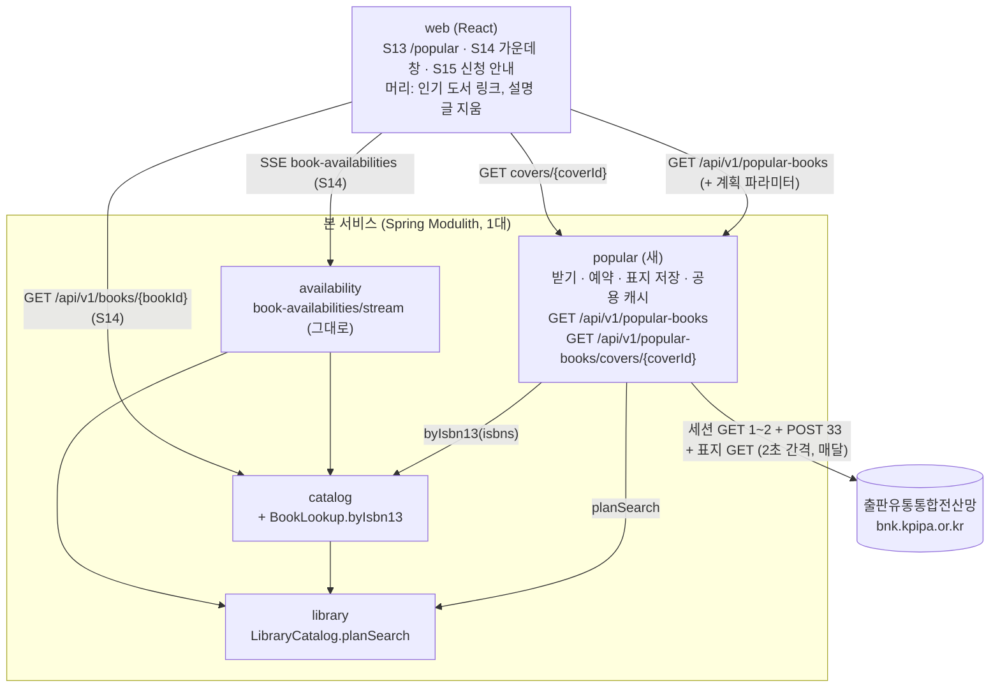
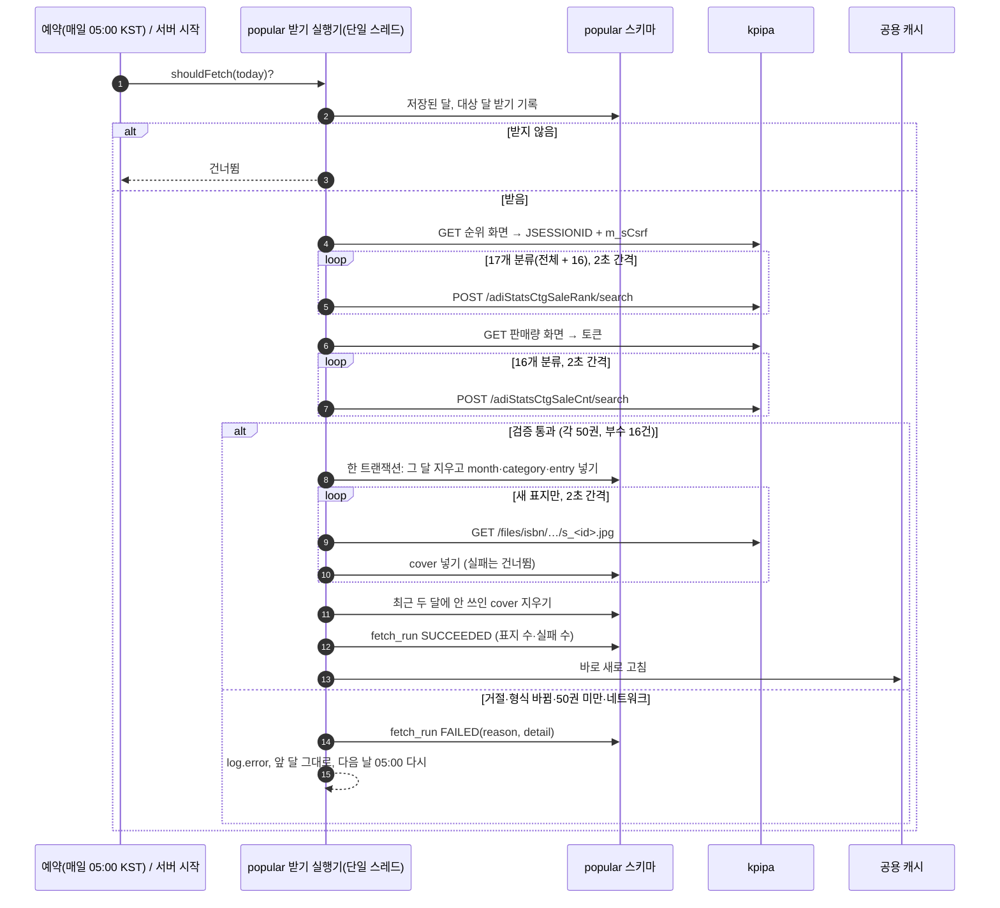
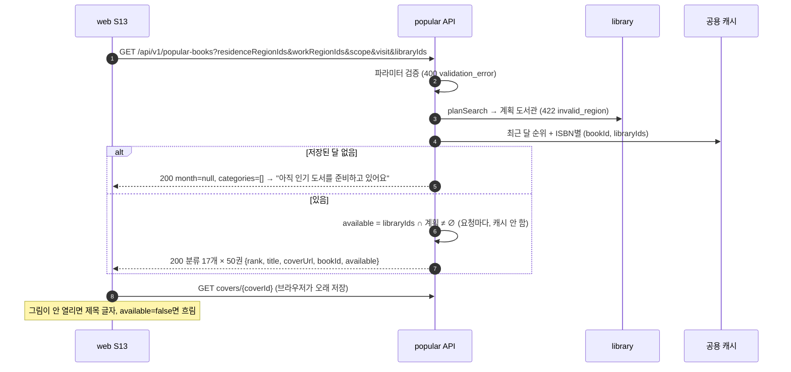
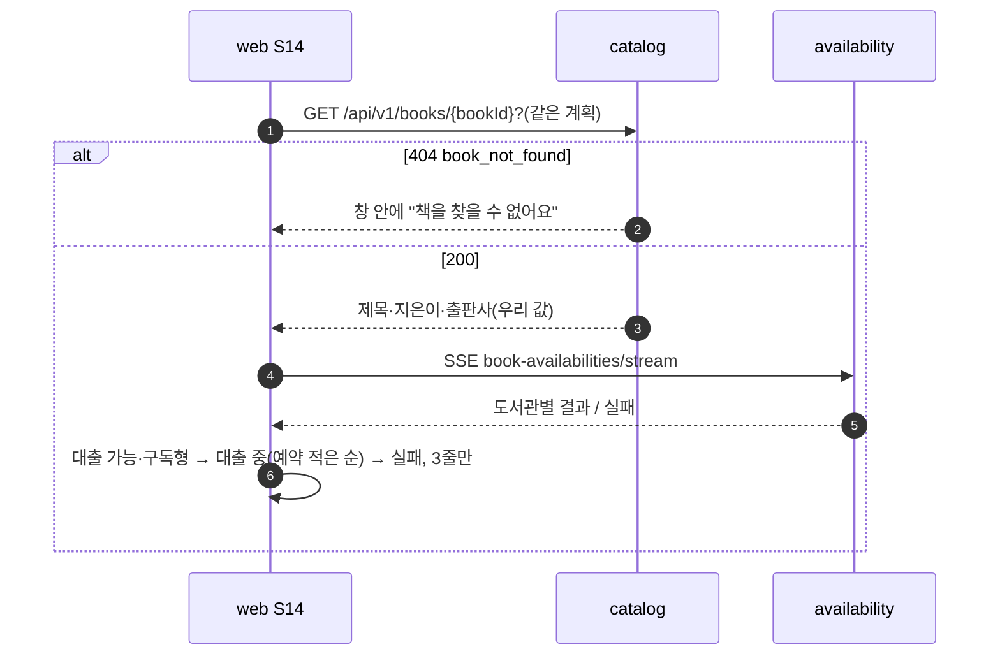
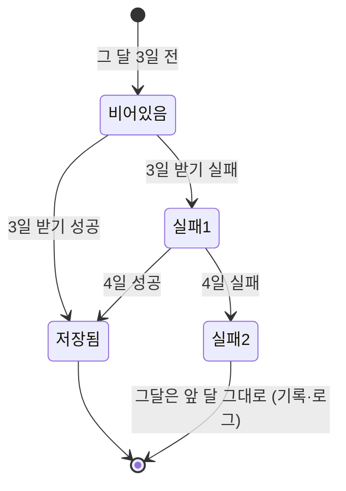
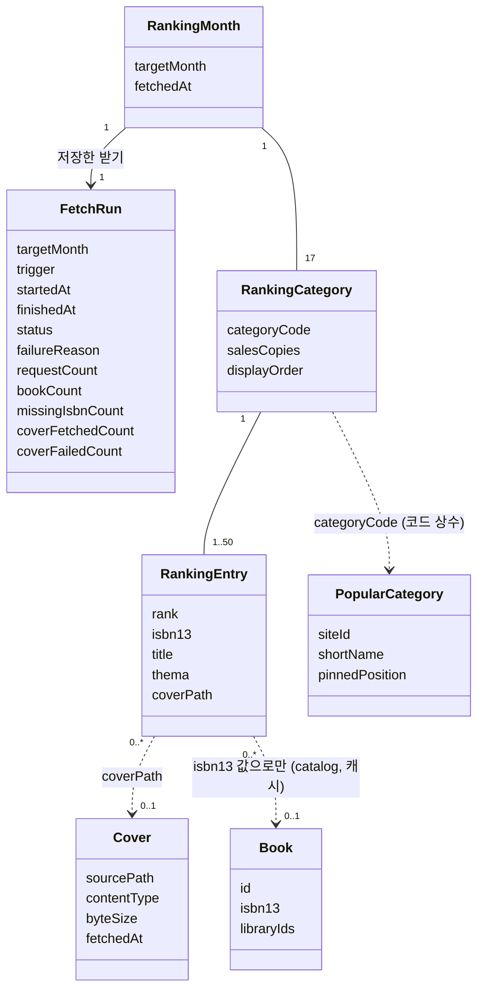
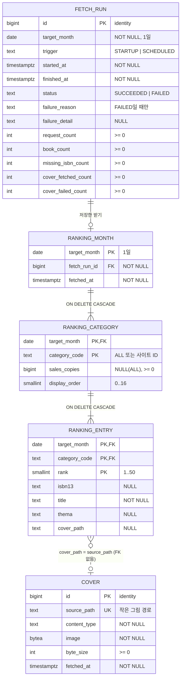

# 설계 변경: 사이클 10 인기 도서

- 근거: `architect-proposal.md`(dev 코드 읽어 확인, 2026-10-11), 결정 페이지 `easy/2026-10-11-design-decisions.html`(13개), `easy/2026-10-11-design-followup-decisions.html`(3개), `spec.md`, `flow.md`, 조사 `../../research/popular-books/kpipa.md`
- 결정 태그: 설계 결정 페이지에서 승인된 것은 [확정] (사용자 승인, 2026-10-11). 사용자가 따로 말한 것은 그 말을 붙임
- 겹침: 사이클 08(바꿔 끼우기·`holdingsOf(bookIds, libraryIds)`는 dev 코드에 있음, 웹 `AppLayout` 변경 순서는 dev가 맞춤), 사이클 09(S14 도서관 줄은 S3 줄 컴포넌트를 써서 이름·분류 표시를 따라감). 이번 설계는 둘에 기대지 않음

- 다음 단계: `/cycle-close`(검토·`docs/current/` 반영·인계서)는 사이클 08·09 결과를 본 뒤에 함 [확정] (사용자: "인계서는 cycle 08, 09 결과 보고 만들어", 2026-10-11)

- 분류 빼기(2026-10-11): 만화·어린이·청소년·기타·의학·스포츠를 받지도 보이지도 않음 (사용자 승인, 2026-10-11, 분류 빼기 #1·#2: 만화·어린이·청소년, 기타·의학·스포츠 — 9월 기준 ISBN으로 맞춘 책이 0~3권). ADR-0072 결정 글의 "1단계 21분류"는 이 결정으로 16분류가 됨(ADR은 고치지 않음, 받는 출처는 그대로)

## 구조 그림

### 모듈 구성도



### 주요 흐름 1: 매달 받기 (실패 포함)



### 주요 흐름 2: S13 열기



### 주요 흐름 3: S14 열기 (지금 API 그대로)



### 받기 상태 (대상 달 하나)



순위가 하나도 없을 때는 이 규칙과 별개로 켜질 때 받고, 실패하면 받을 때까지 매일 05:00에 다시 받는다 [확정]. 첫 배포가 1~2일이면 받은 뒤 3일에 한 번 더 받아 바꾼다 [확정].

### 도메인 모델



## 모듈

| 모듈 | 신규/변경 | 책임 | 공개 API | 발행/구독 이벤트 | 소유 테이블 |
|---|---|---|---|---|---|
| `popular` | 신규 [확정] (ADR-0073) | 출판유통통합전산망 순위·판매 부수·표지 받기, 매일 판단 예약, 저장, 공용 캐시, 화면용 REST | Java 없음. REST `GET /api/v1/popular-books`, `GET /api/v1/popular-books/covers/{coverId}` | 없음 | `popular.fetch_run`, `ranking_month`, `ranking_category`, `ranking_entry`, `cover` |
| `catalog` | 변경 | ISBN으로 책 찾기 공개 API 하나 더함 | `BookLookup.byIsbn13(Collection<String> isbn13s) → List<IsbnBook(String isbn13, long bookId, long[] libraryIds)>` [확정 이름] (사용자 승인, 2026-10-11, 설계 #12). 맞는 책이 없는 ISBN은 빠짐. SQL `SELECT id, isbn13, library_ids FROM catalog.book WHERE isbn13 = ANY(:isbns)`(UNIQUE `book_isbn13_key` 사용) | 없음 | 그대로 |
| `library` | 그대로 | `popular`가 `LibraryCatalog.planSearch(…, PlanOptions)`를 씀(`BookSearchController`와 같은 방식) | 그대로 | 없음 | 그대로 |

- `popular` 패키지 `com.chaekcheck.popular`, 안쪽 `internal/fetch`(세션·파서), `internal/schedule`, `internal/store`(JdbcClient), `internal/cache`, `internal/web`(컨트롤러, 계획 파라미터 파서, 오류) — 예시, 안쪽 위치는 dev가 정함 [확정] (사용자 승인, 2026-10-11, design-delta 확인)
- `@ApplicationModule(allowedDependencies = {"catalog", "library"})` [확정] (설계 #1)
- JPA 엔티티 없음, JdbcClient (지금 관례)
- 분류 사이트 ID·줄인 이름은 코드 상수 enum `PopularCategory` [확정] (설계 #4). 17개(전체 + 소설, 문학·인물, 사회, 언어, 철학·종교, 경제·경영, 자기계발, 예술, 컴퓨터·IT, 생활·취미, 과학, 역사, 기술·공학, 법, 참고·정보, 지리·환경), 고정 자리 없음 (사용자 승인, 2026-10-11, 분류 빼기 #1·#2: 만화·어린이·청소년, 기타·의학·스포츠 — 9월 기준 ISBN으로 맞춘 책이 0~3권). 사이트 ID는 조사 문서 2절 표
- 예약: `popular` 설정 클래스에 자기 `@EnableScheduling`(지금 `RefreshTokenCleanup`의 것은 로그인이 꺼지면 꺼짐). 받기는 단일 스레드 실행기에서, 실행 중 표시(`AtomicBoolean`)로 겹침 막음. 운영 서버 1대 [확정] (module-map) [확정] (설계 #7)
- 판단 `shouldFetch(today)` (Asia/Seoul): 서버 켜질 때(`ApplicationReadyEvent`)와 매일 05:00 → ① 저장된 달 없으면 받음 ② 대상 = 지난달 ③ 그 달이 다음 달 3일 00:00 뒤에 저장됐으면 안 받음 ④ 3일 이후 그 달 실패가 2번이면 안 받음 ⑤ 오늘이 3일 이후면 받음 [확정] (설계 #7~#9, spec R1-2·R1-3·R1-6)
- 분류 순서: "전체" 0, 나머지 16개를 판매 부수 큰 순(같으면 사이트 ID 순)으로 1~16. 받을 때 계산해 `display_order`로 저장 [확정] (spec R2-2)
- 공용 캐시: 최근 달 순위(분류·책)와 ISBN별 `(bookId, libraryIds)` 한 벌. 10분마다, 새 달 저장 직후 바로 새로 고침. 이용자별 계산(계획과 겹치는지)은 캐시하지 않음 [확정] (ADR-0074, 설계 후속 #3)
- 설정 [확정 이름] (설계 #12) / 값: `chaekcheck.popular.fetch.enabled`(기본 true, `collection-import` 프로필·시험 false), `cron` `"0 0 5 * * *"` [확정], `zone` `Asia/Seoul`, `request-interval` 2초 [확정 2초 이상, 값 승인], `connect-timeout` 5초, `read-timeout` 10초 [확정] (사용자 승인, 2026-10-11, design-delta 확인) (개발 때 측정 뒤 바꿀 수 있음), `base-url` `https://bnk.kpipa.or.kr` [확정], `user-agent` `chaekcheck (+<서비스 주소>)` [확정] (설계 #13, 주소는 배포 때)

## 데이터

- 스키마: `popular` [확정] (설계 #12). 다른 모듈과 FK·조인 없음, `catalog`와는 `isbn13` 값으로만



| 테이블.컬럼 | 타입 | 제약 | 설명 | 상태 태그 |
|---|---|---|---|---|
| `fetch_run.id` | bigint | PK, identity | 받기 기록 번호 | [확정] (설계 #3·#12) |
| `fetch_run.target_month` | date | NOT NULL, CHECK 1일 | 대상 달 | [확정] |
| `fetch_run.trigger` | text | CHECK `STARTUP`·`SCHEDULED` | 켜질 때 / 예약 | [확정] |
| `fetch_run.started_at`·`finished_at` | timestamptz | NOT NULL | | [확정] |
| `fetch_run.status` | text | CHECK `SUCCEEDED`·`FAILED` | | [확정] |
| `fetch_run.failure_reason` | text | `FAILED`일 때만 NOT NULL, CHECK `session_failed`·`request_rejected`·`format_changed`·`too_few_books`·`network_error` | | [확정] (설계 #12) |
| `fetch_run.failure_detail` | text | NULL | 어느 분류·응답 코드 등 | [확정] |
| `fetch_run.request_count`·`book_count`·`missing_isbn_count` | int | NOT NULL DEFAULT 0, `>= 0` | 요청 수(AC-12), 저장한 책 수, ISBN 빈·틀린 책 수 | [확정] (설계 #10·#11) |
| `fetch_run.cover_fetched_count`·`cover_failed_count` | int | NOT NULL DEFAULT 0, `>= 0` | 새로 받은 표지 수, 실패 수 | [확정] (사용자 승인, 2026-10-11, design-delta 확인) |
| 색인 `fetch_run (target_month, started_at)` | | | 판단 규칙 | [확정] |
| `ranking_month.target_month` | date | PK | | [확정] |
| `ranking_month.fetch_run_id` | bigint | FK `fetch_run(id)`, NOT NULL | 저장한 받기 | [확정] |
| `ranking_month.fetched_at` | timestamptz | NOT NULL | 출처 줄 "받은 날" | [확정] |
| `ranking_category (target_month, category_code)` | date, text | PK, FK `ranking_month` ON DELETE CASCADE | `ALL` 또는 20자리 사이트 ID | [확정] |
| `ranking_category.sales_copies` | bigint | `ALL`이면 NULL, 아니면 `>= 0` | 판매 부수 | [확정] |
| `ranking_category.display_order` | smallint | 0..16, UNIQUE `(target_month, display_order)` | 계산한 순서 | [확정] |
| `ranking_entry (target_month, category_code, rank)` | | PK, FK `ranking_category` ON DELETE CASCADE, `rank` 1..50 | | [확정] |
| `ranking_entry.isbn13` | text | NULL, CHECK `^97[89][0-9]{10}$` | 비었거나 틀리면 NULL → 흐림 | [확정] (설계 #10) |
| `ranking_entry.title` | text | NOT NULL | | [확정] |
| `ranking_entry.thema` | text | NULL | 공식 세부분류 | [확정] |
| `ranking_entry.cover_path` | text | NULL, `/`로 시작 | 작은 그림 경로(`s_<id>.jpg`) | [확정] (설계 후속 #1) |
| `cover.id` | bigint | PK, identity | 화면 주소에 씀 | [확정] (사용자 승인, 2026-10-11, design-delta 확인) |
| `cover.source_path` | text | NOT NULL, UNIQUE | 같은 경로는 다시 받지 않음 | [확정] (설계 후속 #1) |
| `cover.content_type` | text | NOT NULL | 받은 응답 그대로(예 `image/jpeg`) | [확정] (사용자 승인, 2026-10-11, design-delta 확인) |
| `cover.image` | bytea | NOT NULL | 작은 그림 약 51KB(시험 1건) | [확정] (DB 저장) |
| `cover.byte_size` | int | NOT NULL, `>= 0` | | [확정] (사용자 승인, 2026-10-11, design-delta 확인) |
| `cover.fetched_at` | timestamptz | NOT NULL | | [확정] (사용자 승인, 2026-10-11, design-delta 확인) |

- 지우기: 받기 성공 뒤, 최근 두 달 `ranking_entry.cover_path`에 없는 `cover` 줄을 지움 [확정] (설계 후속 #2). 순위 표는 지우지 않음 [확정] (spec R1-5)
- 크기: 한 달 분류 17줄 + 책 850줄, 표지 최대 850장 × 51KB ≈ 43MB(겹치는 책은 더 적음), 두 달 ≈ 90MB 안쪽(계산값)
- 저자 칸 없음 [확정] (spec 입력과 출력)
- Liquibase: 새 changelog `db/changelog/popular/001-popular-schema.yaml`(예시, 경로는 dev가 정함 [확정] (사용자 승인, 2026-10-11, design-delta 확인)), 기존 changeset 수정 없음. `updated_at` 칸이 없어 트리거 없음(ADR-0068 대상 아님)

## API

| 메서드 | 경로 | 설명 | 요청 | 응답 | 에러 |
|---|---|---|---|---|---|
| GET | `/api/v1/popular-books` | 최근 달 인기 도서. 인증 없음 [확정] (R7-3) | `residenceRegionIds`, `workRegionIds`, `scope`, `visit`, `libraryIds` — `/api/v1/books`와 같은 이름·검증 규칙. 페이지 없음 | 200 아래 | 400 `validation_error`, 422 `invalid_region`, 500 `internal_error` (ProblemDetail, 지금 코드) |
| GET | `/api/v1/popular-books/covers/{coverId}` | 저장한 표지 그림 | 경로 `coverId` | 200 그림(`Content-Type` 저장값), `Cache-Control: public, max-age=2592000, immutable`(30일) [확정] (사용자 승인, 2026-10-11, design-delta 확인) | 404 `cover_not_found` [확정] (사용자 승인, 2026-10-11, design-delta 확인) → 웹은 제목 글자 |

`GET /api/v1/popular-books` 200 (값이 있을 때):

```json
{
  "month": "2026-09",
  "fetchedAt": "2026-10-03T05:01:32+09:00",
  "categories": [
    {
      "code": "ALL",
      "name": "전체",
      "books": [
        { "rank": 1, "title": "…", "coverUrl": "/api/v1/popular-books/covers/812",
          "bookId": 1203344, "available": true },
        { "rank": 2, "title": "…", "coverUrl": null, "bookId": null, "available": false }
      ]
    },
    { "code": "00000000000000000303", "name": "소설", "books": [ "…" ] }
  ]
}
```

- `categories`는 `display_order` 순. `name`은 줄인 이름
- `coverUrl`: 표지를 받아 둔 책만, 아니면 null(웹은 제목 글자)
- `bookId`: ISBN으로 맞은 우리 책이 있으면(계획 밖이어도), 없으면 null
- `available`: `bookId`가 있고 그 책의 `libraryIds`가 계획 도서관과 겹치면 true
- 200 (값이 없을 때): `{"month": null, "fetchedAt": null, "categories": []}` [확정] (설계 #6)
- 두 API 모두 도서관 사이트를 부르지 않으므로 nginx `limit_req`(도서관을 부르는 API) 대상 아님. 응답 크기 약 200KB(미측정)
- S14·S15용 새 API 없음: S14는 `GET /api/v1/books/{bookId}` + `book-availabilities/stream` 그대로

## 웹 (flow 그대로)

- 경로 `/popular` → `features/popular/PopularPage` — 경로 `/popular` [확정] (flow), 컴포넌트 이름은 dev가 정함 [확정] (사용자 승인, 2026-10-11, design-delta 확인)
- `AppLayout`: 로고 오른쪽·로그인 왼쪽에 "인기 도서" 링크(S8·S9에서는 숨김), 설명 글 "전자도서관 대출 가능 확인" 지움(모든 폭) [확정] (flow)
- 계획: `BookPage`처럼 `useRegions`·`useLibraryScope`·`readVisit`·`loadPrefs`로 만듦(브라우저 저장 검색 기준, AC-7)
- 표지 ``, `onError` → 제목 글자
- S14: `fetchBook` + `useHoldings`, 줄 컴포넌트는 S3 것. 3줄 고르는 규칙은 spec R6-3·R6-5. 첫 묶음만 쓸지 [확인 필요: dev `useHoldings`]
- 넘긴 쪽·스크롤은 히스토리 상태에 두어 S3에서 뒤로 와도 남음 [확정] (flow #17)
- 배포: CSP 바꾸지 않음(표지가 우리 주소) [확정] (ADR-0075)

## 외부 연동

| 대상 | 방식 | 제한·키 관리 | 실패 시 동작 | 상태 태그 |
|---|---|---|---|---|
| 출판유통통합전산망 순위·판매량 화면 | `java.net.http.HttpClient` + `CookieManager`, GET 화면 → `m_sCsrf` → POST(`X-CSRF-TOKEN`, `X-Requested-With`, `Referer`), Jsoup 1.23.2(이미 의존성)로 해석. 조회 서버(GET만)는 쓰지 않음 | 키 없음. 한 번에 35건 이하, 2초 이상 간격, 매달 1회(+재시도). User-Agent `chaekcheck (+<서비스 주소>)` | 그달 저장 안 함, `fetch_run` FAILED + `log.error`, 앞 달 그대로, 다음 날 다시 | 방식 [확정] (조사 2026-10-11), 시간 제한 [확정] (사용자 승인, 2026-10-11, design-delta 확인) |
| 같은 사이트 표지 그림 | GET `/files/isbn/…/s_<id>.jpg`, 새 경로만 | 2초 간격, 첫 달 최대 850건(약 28분), 다음 달부터 새 책만 | 그 표지만 건너뜀(그달 순위는 성공), 화면은 제목 글자 | [확정] (ADR-0075) |
| 게시 허락 | 이용 문의 메일 (사용자가 보냄) | | 답에 따라 출처 문구·표지 사용 고침 | [확인 필요] |

## 결정 기록

- [ADR-0072](../../adr/0072-popular-books-source-kpipa.md) 인기 도서 출처는 출판유통통합전산망 공개 통계 화면 (Accepted)
- [ADR-0073](../../adr/0073-popular-module.md) 새 모듈 `popular`가 받기·저장·API를 맡음 (Accepted)
- [ADR-0074](../../adr/0074-popular-isbn-lookup-shared-cache.md) 순위 책과 우리 책은 볼 때 ISBN으로 맞추고 책 정보는 공용 캐시 (spec R3-2 처음 글을 바꿈) (Accepted)
- [ADR-0075](../../adr/0075-popular-cover-prefetch-proxy.md) 표지는 매달 미리 받아 우리 서버가 넘겨줌, 최근 두 달 보관 (Accepted)

## 확인 필요

| 항목 | 왜 | 확인 방법 | 막는 단계 |
|---|---|---|---|
| ~~순위 화면 토큰이 판매량 화면에도 통하는지~~ → 통함 (2026-10-11 시험, 조사 문서 "토큰 하나로 두 화면"). 세션 GET 한 번이면 됨(34건, AC-12 "35건 이하" 안). 두 번 열어도 무방 — dev가 정함 | 요청 수 | 끝남 | 없음 |
| 연결 5초·읽기 10초가 맞는지 | 시간 제한 | API 호출 시험 (개발 때) | 없음 |
| 작은 표지(`s_`)가 3×3에 충분한지 | 화질 | 프로토타입 | 없음 |
| 캐시 새로 고칠 때 ISBN 최대 850개 찾는 시간, 공용 캐시 메모리 | 성능 | 프로토타입 (`EXPLAIN ANALYZE`, 측정) | 없음 |
| 서비스 DB ISBN 일치율(수집 DB 27.8%와 비슷한지) | AC-6 기대값 | 프로토타입 | 없음 |
| S14가 첫 묶음만 쓰는 것이 `useHoldings`로 되는지 | 흐름 3 | dev 확인 (인계서) | 없음 |
| 순위·표지 게시 허락 | 공개 | 공식 문의 (사용자) | 공개(배포) |
| 지난달 값이 들어온 뒤 고쳐지는지 | 3일 받기 | API 호출 시험 (11-03, 11-10) | 운영 |
| 사이클 08 웹과 `AppLayout` 변경 순서 | 같은 파일 | dev 회고 때 | 없음 |
