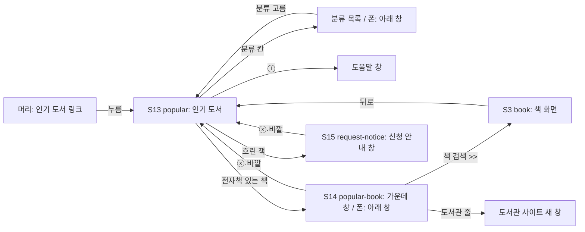

# 화면 흐름: 인기 도서

- 근거: `scope.md`("이미 정한 것"), `spec.md`(R1~R7, AC-1~AC-14). 결정 출처는 그 두 문서에 있어 여기서는 태그만 붙임
- 지금 화면: 웹 `AppLayout` 머리(로고 "책첵" + 로그인 버튼), 경로 `/`·`/search`(S1), `/books/:bookId`(S3), `/my-libraries`(S10), `/about`(S12) — dev `web/src/main.tsx`, `components/AppLayout.tsx` 읽음 (2026-10-11)
- 화면 그림은 자리와 순서만. 모양은 dev가 지금 화면에 맞춤

## 폰 아래 창 공통 (S13c, S13i, S14, S15)

- 폰에서 아래에서 올라오는 창 네 개(분류 목록, 도움말, 가운데 창, 신청 안내)는 모두 위에 손잡이를 두고, 손잡이를 끌어내리거나 ⓧ나 바깥을 누르면 닫힌다 [확정] (사용자: "지금 폰 아래에서 올라오는 창 공통적으로 끌어내리기랑 ⓧ 기능 해줘", 2026-10-11). 사이클 08 검색 설정 창(손잡이 끌어내리기 있음, dev `SettingsPanel.tsx`)과 같은 부품을 씀 [안 — 부품 나누기는 dev가 정함]
- 사이클 08 결과(검색 설정 창을 유지하든 되돌리든)와 상관없이 인기 도서 폰 창은 아래 창 [확정] (사용자: "인기 도서는 이미 정한 것대로 해줘", 2026-10-11)

## 화면별 내용

### 머리 (모든 화면 공통, 바뀜)
- 목적: 인기 도서로 들어가는 곳 [확정] (R7-2)
- 보이는 요소: 로고 오른쪽, 로그인 버튼 왼쪽에 "인기 도서" 글자 링크 [확정] (사용자 승인, 2026-10-11)
- 어디에 보이나: 머리가 있는 모든 화면(S1, S3, S10, S12 …). 약관·개인정보 화면(S8·S9)은 로그인 버튼처럼 빼고 [확정] (사용자 승인, 2026-10-11)
- 폰: 같은 자리, 글자 그대로 [확정] (사용자 승인, 2026-10-11)
- 로고 옆 설명 글 "전자도서관 대출 가능 확인"은 PC·태블릿·폰 모두에서 뺀다 [확정] (사용자: "전자도서관 대출 가능 확인 이거 pc나 태블릿에서도 문구 빼줘", 2026-10-11)

### S13 popular (새 화면)
- 경로: `/popular` [확정] (사용자 승인, 2026-10-11)
- 목적: 지난달 분야별 판매 순위를 3×3 표지로 보고, 내 도서관에 전자책이 있는지 흐림으로 안다
- 보이는 요소 (위에서 아래로)
  1. 제목 줄: "인기 도서 · 2026년 9월 판매 순위", 오른쪽에 분류 칸 [전체 ▾]과 ⓘ [확정] (R5-1, R7-1)
  2. 분류 묶음이 아래로 이어짐 (전체 → 판매 부수 순, 어린이·청소년 11번째, 기타 맨 뒤) [확정] (R2-2, R4-2). 각 묶음:
     - 분류 이름 (예: "소설")
     - ◀ 3×3 표지 ▶ (9권, 표지 왼쪽 위 작은 순위 숫자, 전자책 없는 책은 흐림) [확정] (R4-1, R4-5)
  3. 맨 아래 출처 줄 "출처: 출판유통통합전산망 (… 종이책 판매 합산) · 2026년 9월 · 10월 3일 받음" [확정] (R7-1)
- 한 화면에 3×3 하나: 분류 묶음 하나가 화면 높이를 채움(PC도) [확정] (R4-2). 맨 아래까지 내리면 다음 분류 묶음
- 분류 칸 글씨는 지금 화면 가운데에 있는 분류로 바뀜 [확정] (R4-2)
- 사용자 동작
  - ◀ ▶: 그 분류만 9권씩 넘김. 첫 쪽 ◀ 없음, 마지막 쪽(46~50) ▶ 없음 [확정] (R4-1)
  - 분류 칸: S13c 열림
  - ⓘ: S13i 열림
  - 표지 누름: 전자책 있음 → S14, 없음(흐림) → S15 [확정] (R6-1, R6-9)
- 각 분류에서 넘긴 쪽은 다른 분류로 내려갔다 돌아와도 그대로 [확정] (사용자 승인, 2026-10-11)
- 폰에서 좌우로 밀어(스와이프) 넘기기도 됨 [확정] (사용자 승인, 2026-10-11)
- 호출하는 API: 인기 도서 한 번(22개 분류 × 50권 + 있음/없음, 저장된 검색 기준을 보냄) [안 — 모양은 design-delta]
- 상태
  - 로딩: 첫 분류 자리에 회색 빈 카드 9개 [확정]
  - 순위 없음: 격자 대신 "아직 인기 도서를 준비하고 있어요" [확정]
  - 오류: 지금 S1 안내 줄 자리·꼴로 "인기 도서를 불러오지 못했어요. 잠시 뒤에 다시 해 주세요." [확정]
  - 표지 그림 안 열림: 그 칸에 제목 글자 [확정] (R4-4)
- 화면 크기
  - PC: 가운데 정렬, 3×3이 화면 높이에 맞음. ◀ ▶는 격자 바깥 좌우 [확정] (사용자 승인, 2026-10-11)
  - 태블릿: PC와 같음
  - 폰: 3×3이 폭을 채우고 ◀ ▶는 격자 좌우 끝에 겹쳐 작게 [확정] (사용자 승인, 2026-10-11)

### S13c 분류 목록
- PC·태블릿: 분류 칸 바로 아래로 펼쳐지는 목록, 폰: 아래에서 올라오는 창(ⓧ) [확정] (R5-1)
- 22줄, 지금 분류는 진하게 [확정] (사용자 승인, 2026-10-11). 목록이 길면 목록 안에서 내림
- 고르면 닫히고 그 분류 1~9위로 화면 이동, 분류 칸 글씨 바뀜 [확정] (R5-2)
- 닫기: 바깥 누름, Esc(PC), ⓧ(폰) [확정] (사용자 승인, 2026-10-11)

### S13i 도움말 창
- 내용: 출처와 합산 서점, 기준 달·받은 날, "종이책 순위라서 전자책이 없는 책도 있어요", "흐린 책은 내 도서관에 전자책이 없어요", "있음/없음은 검색 화면에서 고른 지역·범위 기준이에요" [확정] (R7-1, R4-5) / 마지막 문장 [확정] (사용자 승인, 2026-10-11)
- 모양: ⓘ 옆 작은 말풍선, 폰은 아래 창 [확정] (사용자 승인, 2026-10-11)

### S14 popular-book (새 창)
- PC·태블릿: 가운데 창, 뒤 격자 흐리게. 폰: 아래에서 올라오는 창 [확정] (R6-1)
- 보이는 요소: 표지, 제목, [책 검색 >>], 지은이·출판사(우리 전자책 값), 도서관 줄 최대 3개 [확정] (R6-1~R6-3)
- 도서관 줄: 결과 오기 전 "확인 중" → 대출 가능·구독형 먼저, 대출 중(예약 적은 순), 확인 실패는 맨 뒤 [확정] (R6-4, R6-5). 줄 모양·상태 글은 S3 줄과 같음
- 사용자 동작
  - [책 검색 >>] → S3 `/books/{bookId}` [확정] (R6-7)
  - 도서관 줄 → 그 도서관 사이트 책 페이지 새 창 [확정] (R6-6)
  - ⓧ, 바깥, Esc(PC) → 닫힘, 격자 같은 자리 [확정] (R6-8) / Esc [확정] (사용자 승인, 2026-10-11)
  - 폰 뒤로 가기 → 창만 닫힘(화면은 S13 그대로) [확정] (사용자 승인, 2026-10-11)
- 호출하는 API: 지금 S3이 쓰는 책 한 권 + 소장 대출 스트림(같은 검색 기준) [안 — design-delta]
- 상태: 그 책이 목록에서 빠짐 → 창 안에 "책을 찾을 수 없어요" (S3과 같은 문구) [확정]

### S15 request-notice (새 작은 창)
- 문구: "아직 내 도서관에 전자책이 없어요. 이용하는 전자도서관 사이트에서 희망도서로 신청해 보세요." [확정] (R6-9, 문구는 이 단계에서 다시 봄)
- 표지·제목을 함께 보일지 [확정] (사용자 승인, 2026-10-11): 제목만 한 줄 위에
- 닫기: ⓧ, 바깥 / 폰은 아래 창 [확정] (사용자 승인, 2026-10-11)

### S3 book (지금 화면, 바뀜 없음)
- S14의 [책 검색 >>]로 들어옴. 뒤로 가기 → S13, 보던 분류·쪽·스크롤 자리로 [확정] (사용자 승인, 2026-10-11)

## 수용 기준 대응

| AC | 화면 |
|---|---|
| AC-1 3×3, 순위 숫자, 출처 줄 | S13 |
| AC-2 세모, 첫·마지막 쪽 | S13 |
| AC-3 아래로 내리면 다음 분류, 분류 칸 글씨 | S13 |
| AC-4 분류 순서 | S13, S13c |
| AC-5 분류 목록·폰 아래 창 | S13c |
| AC-6 있음/흐림 | S13 |
| AC-7 검색 기준 바꾸면 있음/없음 바뀜 | S1(바꿈) → 머리 → S13 |
| AC-8 도서관 줄 최대 3, 순서 | S14 |
| AC-9 책 검색 >>, 도서관 줄 | S14 → S3, 도서관 사이트 |
| AC-10 신청 안내 | S15 |
| AC-11·12·13 받기 실패·요청 수·처음 받기 | 화면 없음(서버). S13은 앞 달 값 / "준비하고 있어요" |
| AC-14 표지 안 열림 | S13 |

## 상태별 동작 대응

| spec 상태 | 화면 상태 |
|---|---|
| 로딩 | S13 로딩 |
| 순위가 아직 없음 | S13 순위 없음 |
| 이번 달 받기 실패 | S13 기본(출처 줄이 앞 달) |
| 순위 화면 요청 실패 | S13 오류 |
| 가운데 창 대출 조회 실패 | S14 줄 맨 뒤 |
| 가운데 창을 연 사이 책이 빠짐 | S14 "책을 찾을 수 없어요" |
| 표지 못 불러옴 | S13 제목 글자 칸 |
