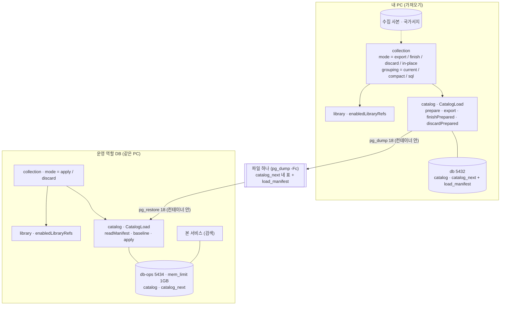
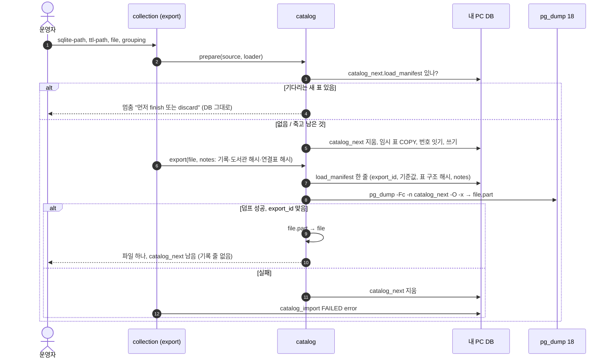
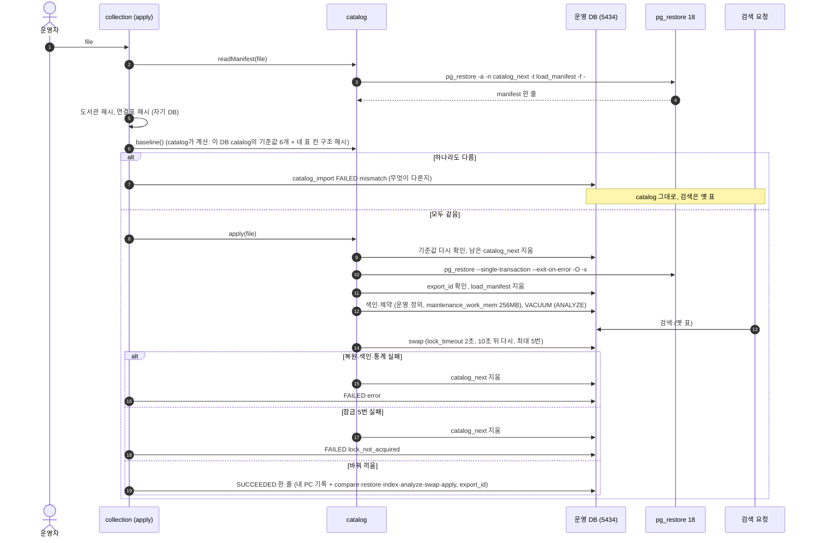
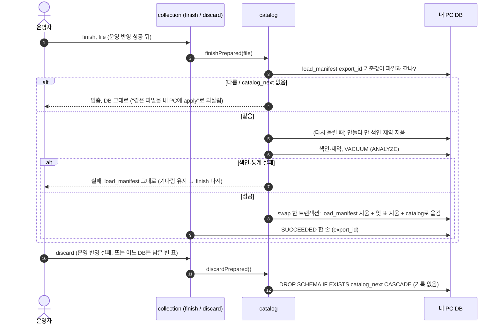
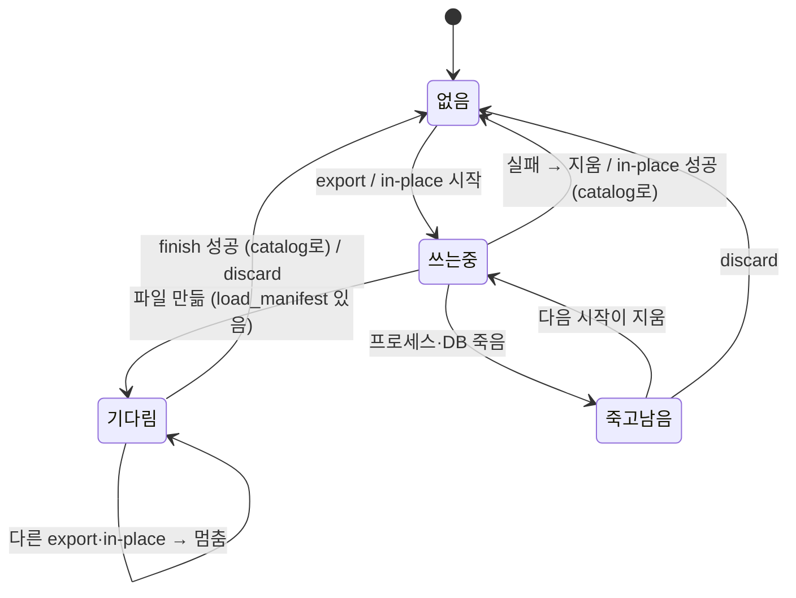
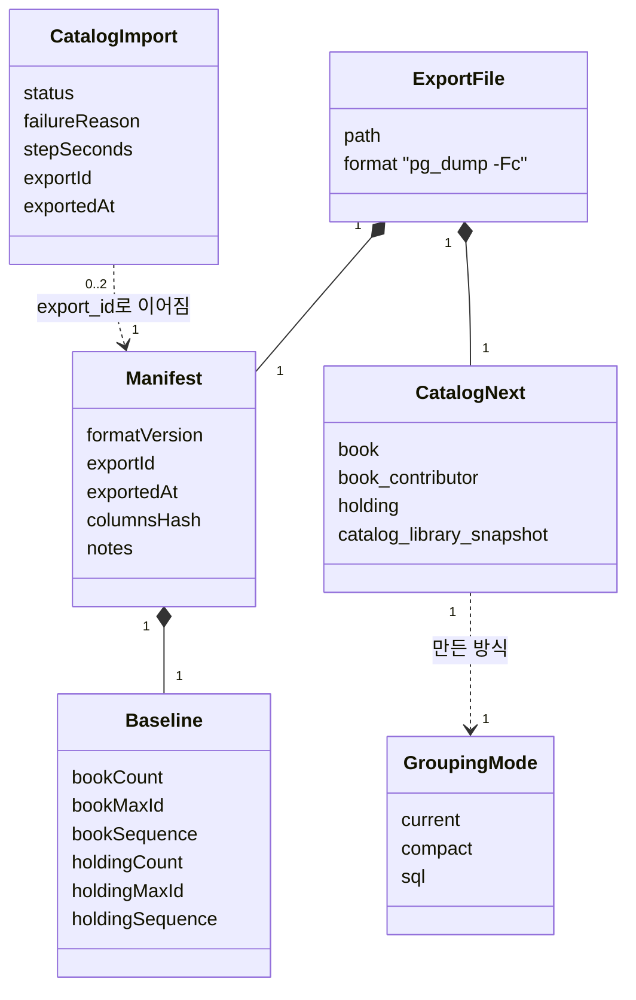
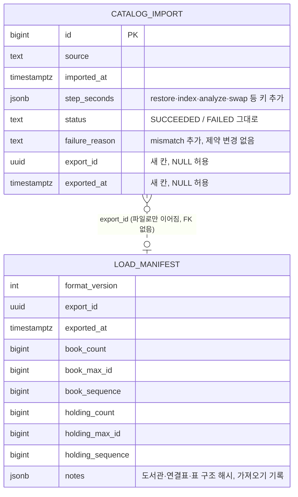

# 설계 변경: 사이클 11 가져오기 따로 하기 + 가져오기 힙 줄이기

- 상태: **확정** (사용자 승인, 2026-10-12, `easy/2026-10-12-design-delta.html` #1). 마무리 순서: 설계 검토와 인계서 초안은 지금 사이클 폴더에, `docs/current/` 반영과 인계서 바꿔 넣기는 사이클 10 개발 결과를 본 뒤 [확정] (같은 페이지 #2)
- 근거: `scope.md`, `spec.md`(R-A1~A9, R-B1~B7, AC-1~AC-14), `flow.md`, `research.md`, `architect-proposal.md`(결정 기록 12개 모두 [확정], 2026-10-12)
- 화면·REST API 변경 없음. 새 모듈·새 이벤트 없음. 모듈 방향(`collection → catalog, library`) 그대로 [확정]
- 이름(설정 키, 모드 값, 표·칸·메서드 이름)은 모두 [안]: dev가 바꾸면 회고에서 맞춤. 아래에서 "모양 [확정], 이름 [안]"처럼 나눠 적음

## 구조 그림

### 모듈 구성도

### 주요 흐름: 내보내기 (내 PC)

### 주요 흐름: 반영 (운영 역할 DB), 다름·실패 포함

### 주요 흐름: 마저 바꿔 끼우기 / 지우기 (내 PC)

### 상태: 내 PC의 `catalog_next`

### 도메인 모델

## 모듈

| 모듈 | 신규/변경 | 책임 | 공개 API | 발행/구독 이벤트 | 소유 테이블 |
|---|---|---|---|---|---|
| `catalog` | 변경 | 책 표 만들기·내보내기·넣기·바꿔 끼우기 | `CatalogLoad`에 `prepare`·`export`·`readManifest`·`baseline`·`apply`·`finishPrepared`·`discardPrepared`, 레코드 `Manifest`·`Baseline`, `NotSwappedException` reason `mismatch`. 모양 [확정] (설계 #5), 이름 [안] | 없음 | 그대로 + 실행 중에만 `catalog_next.load_manifest` |
| `collection` | 변경 | 가져오기 실행(모드), 두 DB 비교, 기록, 묶기 방식 | 없음(실행 명령·설정만) | 없음 | `catalog_import` 칸 2개 |
| `library` | 그대로 | — | `LibraryCatalog.enabledLibraryRefs()`를 그대로 씀 | 없음 | 그대로 |

- `catalog` 안: `JdbcCatalogLoad`를 단계 메서드로 나눔(`replaceAll` = prepare + index + analyze + swap). 내부 `PgTools`(프로세스 실행, `.part` 파일, stderr를 `failure_detail`로). 설정 `chaekcheck.catalog.load.pg-dump-command`·`pg-restore-command`(명령 앞부분 목록), 이름 [안]
- `collection` 안: `CatalogImportRunner` 설정 `chaekcheck.collection.import.mode`(`in-place` 기본·`export`·`apply`·`finish`·`discard`)·`file`·`grouping`(`current` 기본·`compact`·`sql`)·`dry-run-output`. 모드·방식 값과 `grouping` 자리 [확정], 그 밖 이름 [안]. `ImportTransfer`, `DatabaseFingerprint`, 기록 JSON, `BookGrouper` + `CurrentGrouping`·`CompactGrouping`·`SqlGrouping`, `DryRunDump` 이름 [안]
- 인프라·문서: compose `db-ops`, `bootRun` JVM 인자 자리, `scripts/catalog/compare_grouping.py`(세 방식 비교), 반영 결과 확인은 기존 `scripts/catalog/compare_books.py`(검색 응답 비교, 스펙 AC-2)와 SQL 번호 비교, 측정 스크립트 보강, dev `docs/maintenance/3-import.md`에 내보내기·반영·마저·지우기 절차와 `step_seconds` 키 (scope 포함 5)
- `finish`는 `load_manifest`를 swap 트랜잭션 안에서 지움. 그 전에 실패하면 기다림 상태가 남고, 다시 돌리면 만들다 만 색인·제약부터 지움 [확정] (사용자 승인, 2026-10-12, `easy/2026-10-12-review-decisions.html` #1) (스펙 R-A10, AC-15)
- `load_manifest`의 기준값 6개는 내보낼 때 **내 PC `catalog`(마지막 반영분)** 의 값이고, 운영의 `baseline()`도 운영 `catalog`의 값. 표 구조 해시는 `catalog`가 `information_schema`로 계산해 `baseline()`·`Manifest`로 돌려줌. `collection`은 `catalog` 표를 직접 읽지 않음
- 의존: `catalog`는 `collection`을 모름. `notes`는 해석하지 않는 짐. 다른 모듈 표를 읽지 않음

## 데이터

- 스키마: `collection`(칸 추가), `catalog_next`(실행 중에만, Liquibase 아님)

| 대상 | 변경 | 태그 |
|---|---|---|
| `collection.catalog_import` | 칸 `export_id uuid NULL`, `exported_at timestamptz NULL`, CHECK `(export_id IS NULL) = (exported_at IS NULL)`. changeset `collection/005-import-export.yaml` | 칸·뜻 [확정] (설계 #7), 이름·번호 [안]. changeset 번호는 인계 때 dev의 마지막 `collection` 번호를 보고 정함(지금 004까지) |
| `failure_reason` 값 `mismatch` | changeset 없음(값 CHECK 없음, dev `003-import-period-and-timings.yaml` 30-42행 확인 2026-10-12) | [확정] |
| `step_seconds` 키 | 내보내기 `dump`·`export`, 반영 `compare`·`restore`·`index`·`analyze`·`swap`·`apply`, 마저 `index`·`analyze`·`swap`·`finish`, `sql` 방식 `rows_copy` | `restore`·`index`·`analyze`·`swap` [확정], 나머지 [안] |
| `catalog_next.load_manifest` | 위 칸. 내보낼 때 만들고, 반영·마저 때 복원 뒤 지움(`swap`의 `DROP SCHEMA catalog_next`가 CASCADE 없이 돌기 때문) | [확정: 설계 #1], 칸 이름 [안] |
| 해시 | 도서관: `enabledLibraryRefs()`(id 순) `id\tbaseUrl\tplatformType\n` SHA-256 + 개수. 연결표: `collection_library_id, library_id` 순 SHA-256 + 개수. 표 구조: 네 표의 (표, 칸, 타입) 목록 SHA-256 | 항목 [확정], 계산식 [안] |
| 색인 | 더하지 않음 | — |

### compose (dev `compose.yaml`)

- 서비스 `db-ops`(이름 [안]): 이미지 `chaekcheck/postgres-bigm:18`, `db`와 같은 `command:`, 포트 `${OPS_DB_PORT:-5434}:5432`, 볼륨 `db-ops-data`, `mem_limit: 1g` [확정 값: 설계 #12, 스펙 R-A6]
- 처음에는 `db`를 통째로 복사해 기준을 같게 시작 [확정: 설계 #12]

### 반영 세션 메모리

- `chaekcheck.catalog.load.maintenance-work-mem` = 256MB (운영 `apply` 연결에서만, 서버 기본 64MB 그대로). 내 PC `finish`는 1GB [확정] (사용자 승인, 2026-10-12, `easy/2026-10-12-handoff-review.html` #1) [확정: 설계 #12]. 내 PC `export`·`in-place`는 지금(1GB, 병렬 4) 그대로
- 근거: 사이클 08 #3b, 컨테이너 상한 512MB에서 1GB로 `OOMKilled`(`../08-polish-swap-memory/retro.md` 59행). 설명 `docs/research/deploy/easy/2026-10-12-memory-kinds.html`

## B. 묶는 방식

- 인터페이스 `BookGrouper`(지금 `CatalogImporter`가 부르는 모양: `add`, `groupByCodes`, `bibliographyKeys`, `attachBibliography`, `mergeSameText`, `forEachBook`, `bookOf`), 이름 [안]
- `compact` [확정 방향: 스펙 R-B2, 설계 #9]: 제목·저자·출판사·공급자 필드별 같은 글자 합치기, `Votes` 6개 대신 묶음 안의 칸(첫 값 + `int` 개수, ISBN `long`, 날짜 epochDay, 종류 `byte`, 두 번째 값부터만 작은 맵), 도서관 `int[]`, 묶음 열쇠 128비트(64비트 해시 둘) 원시 배열 해시표
- `sql` [확정 방향: 스펙 R-B3·B4·B5, 설계 #10]: Java가 줄마다 정리값(`title_norm`, `main_title_norm`, `publisher_norm`, `first_author`, 교보식 ISBN, 출판일)과 읽은 순번 `seq`를 가져오기 연결의 TEMPORARY 표에 COPY → 묶음 번호 `row_number() OVER (ORDER BY min(seq))` → 사슬 잇기는 바뀐 줄이 0이 될 때까지 `label := min` 반복(상한 둠) → 대표값은 개수 큰 순 + `COLLATE "C"` → ③ 국가서지·④ 같은 글 한 번씩 → 책을 `label` 순으로 흘려 Java가 씀 → 둘째 읽기는 `seq` 순으로 흘려 짝지음(매 줄 (도서관, 책 코드) 확인)
  - `temp_buffers` 기본 8MB [확정] (https://www.postgresql.org/docs/18/runtime-config-resource.html , 확인 2026-10-12, `research.md` 11절)라 임시 표는 대부분 디스크로 감 → `temp_bytes`·`pg_database_size`로 잼
- 결과 비교 [확정] (설계 #11): dry run이 `books.tsv`(책 순번·제목·저자·출판사·출판일·ISBN·종류·도서관 목록)·`rows.tsv`((도서관, 책 코드) → 책 순번) gzip을 남기고 `scripts/catalog/compare_grouping.py`가 비교. 번호는 방식마다 `export` → 앱 밖 `compare_grouping.py`가 psql로 `catalog_next`의 `book`·`holding` 번호를 뽑음(앱 코드에 넣지 않음, `collection`이 `catalog` 표를 읽지 않게) [확정] (사용자 승인, 2026-10-12, 검토 결정 #2) → `discard`
- 측정 [확정: 스펙 R-B6]: `bootRun`에 `-PbootRunJvmArgs`(이름 [안])로 `-XX:+UseStringDeduplication`, `-XX:+UseCompactObjectHeaders`, `-Xlog:gc*:file=…`. 힙 최고(GC 기록 + `noteHeap`), `step_seconds`, `pg_stat_database.temp_bytes` 전후 차이, `pg_database_size` 최대, Java CPU(`getProcessCpuTime`)와 DB 컨테이너 cgroup `cpu.stat`, 가져오는 동안 `probe_during_import.py`. 방식마다 두 번, 힙은 6→4→3→2→1GB로 끝까지 되는 값까지
- 시험 사본 [확정: 점검 #2]: 새 사본(411 새 주소 포함) + 비교용 옛 사본(`ebook-catalog-2026-10-05-0745.sqlite`) 한 번

## API

- REST 변경 없음

## 결정 기록

- [ADR-0078](../../adr/0078-separate-import-export-apply.md) 가져오기는 내 PC에서 하고, 운영 DB에는 파일 하나로 옮겨 바꿔 끼운다 — Accepted (사용자 승인, 2026-10-12)
- [ADR-0079](../../adr/0079-grouping-modes-same-result.md) 책 묶기는 세 방식을 설정으로 고르고, 결과가 번호까지 같아야 쓴다 — Accepted (사용자 승인, 2026-10-12)
- 이어 쓰는 ADR: ADR-0062(책 번호 잇기), ADR-0065(새 표에 쓰고 바꿔 끼우기), ADR-0070(소장 번호 잇기) 그대로

## 확인 필요

| 항목 | 방법 | 막는 단계 |
|---|---|---|
| `pg_dump -n catalog_next`로 IDENTITY 시퀀스 값이 넘어가는지 | 공식 문서로는 들어감(`research.md` 11절). 작은 표로 덤프·복원 후 `last_value` 비교 | dev 1단계 프로토타입 |
| `wsl --exec docker compose exec -T` 파이프로 `-Fc` 바이너리가 깨지지 않는지 | 체크섬 비교. 깨지면 bind mount / `docker cp` | dev 프로토타입 |
| 컨테이너 안 도구가 암호 없이 로컬 소켓으로 붙는지 | 프로토타입 | dev |
| Java가 죽었을 때 컨테이너 안 `pg_restore`가 계속 도는지(AC-13) | `PGAPPNAME` + `pg_stat_activity` | dev |
| 덤프 크기, 복원 시간, 운영 디스크 최대, 상한 1GB에서 색인 시간(AC-14) | 측정 | — |
| `sql` 사슬 반복 수·시간·임시 표 디스크, 43분 안 | dev 측정 | — |
| 비교(`count(*)` 약 1,770만 줄 등) 시간 | 측정 | — |
