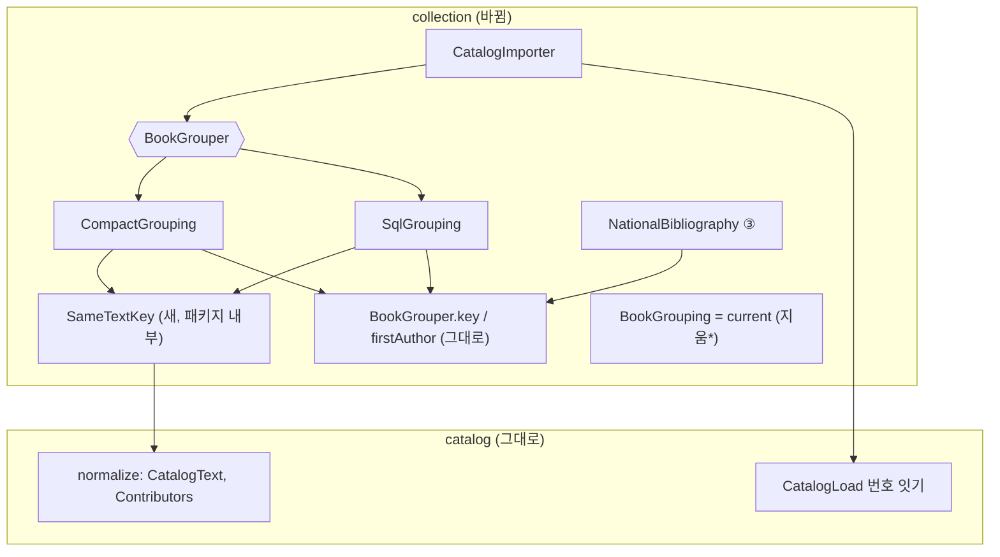
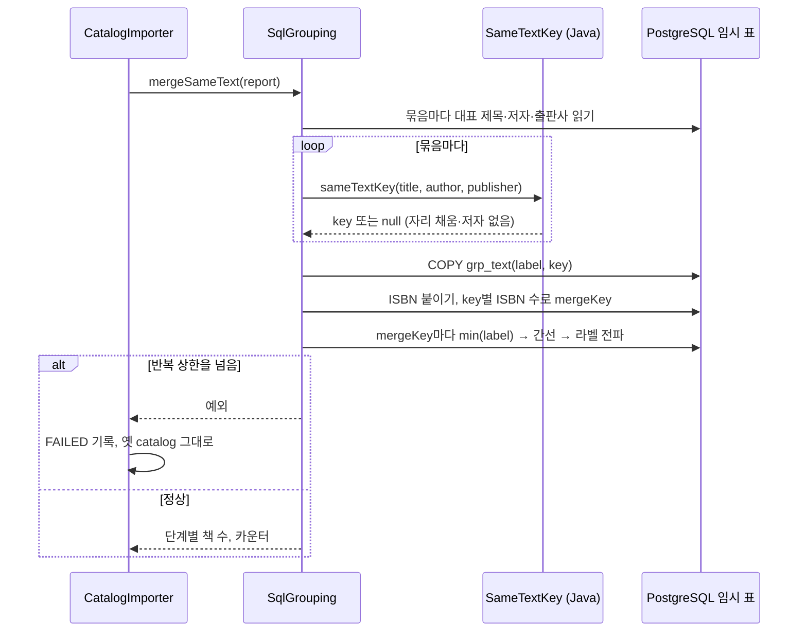
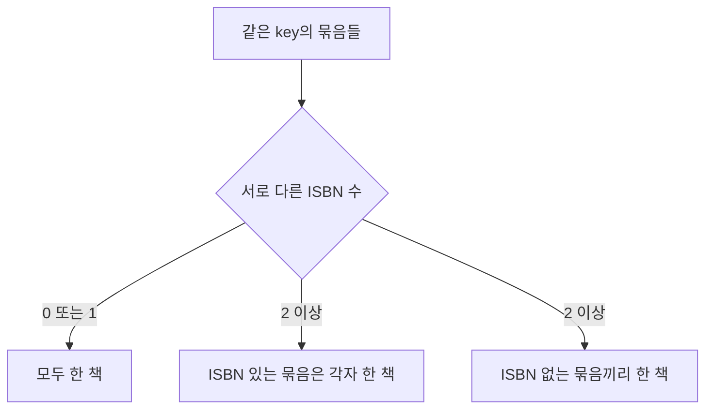
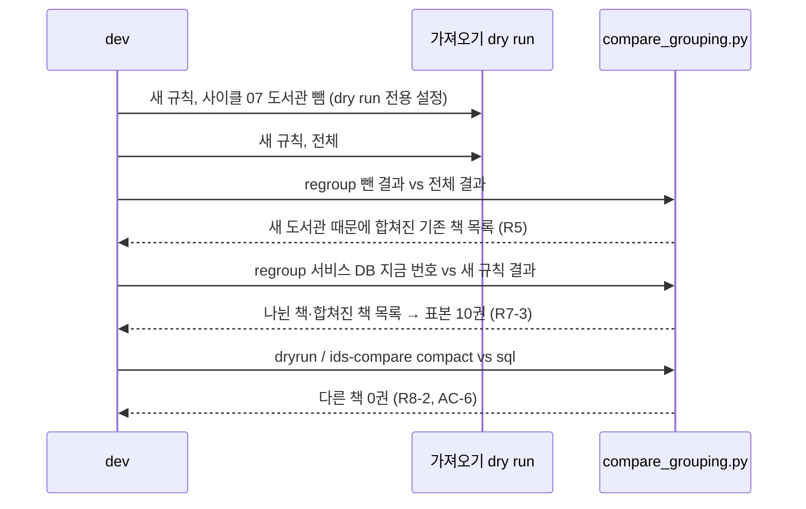
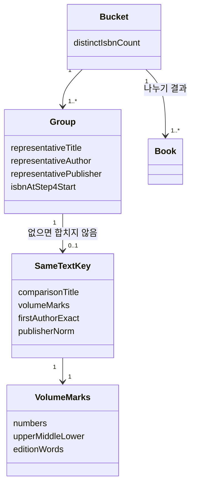
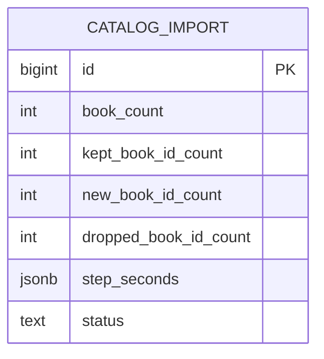

# 설계 변경: 사이클 12 책 묶기 기준 다시 보기

> 2026-10-14 회고에서 바뀐 것이 있습니다 → [retro.md](retro.md), ADR-0105·0106. 지금 규칙은 `docs/research/ebook-catalog/same-book-isbn.md` 5.7절. 도서관 수 2,394곳은 지금 2,381곳(사이클 08에서 11곳 뺌, 2곳 꺼짐).

- 작성: 2026-10-12. 근거 `spec.md`(R1~R8), `flow.md`, `architect-proposal.md`. 결정 1~6과 세부 질문은 모두 추천안 [확정] (사용자 승인 "전부 승인", 2026-10-12, `easy/2026-10-12-design-decisions.html`)
- 바뀌는 곳: `collection` 모듈 가져오기 안의 네 번째 묶기 단계(같은 글자)와 비교 도구. **표·Liquibase·REST·웹·이벤트·모듈 관계 변경 없음** [확정] (architect 확인, dev 코드 읽기 2026-10-12)
- `catalog`(정리 함수 `normalize`, 번호 잇기 `CatalogLoad`, 검색) 변경 없음 → ADR-0069 표의 "묶기·대표값·날짜 규칙을 고침: 새 코드로 가져오기 → 바꿔 끼우기, 서비스는 그대로"
- dev 진행: 코드·테스트·비교 도구는 사이클 11 측정 전에 별도 작업 폴더에서 시작, 실데이터 실행과 `current` 지우기는 측정 뒤 [확정] (spec R8-3)

## 세부 결정 (2026-10-12, 모두 [확정] (사용자 승인 "전부 승인", 2026-10-12, `easy/2026-10-12-design-decisions.html`))

| 번호 | 내용 | 기록 |
|---|---|---|
| 결정 1 | 새 ④ 규칙은 `collection` 안(`SameTextKey`) | ADR-0082 |
| 결정 2 | 같은 키로 모은 뒤 ISBN으로 나눔 | ADR-0082 |
| 결정 3 | 꼬리 목록에 든 이용 안내 꼬리는 비교 제목 끝에서도 뗌 (권 표시에서만 떼는 안은 미채택) | ADR-0082, spec R3-1 |
| 결정 4-1 | dry run에서만 켜는 "사이클 07 도서관 빼기" 설정, 진짜 가져오기에서 켜면 시작 안 함 | 여기 (도구 설정, ADR 대상 아님) |
| 결정 4-2 | `compare_grouping.py regroup` | 여기 |
| 결정 5 | "출판일 2년 차이" 표본 순서를 단순화, `current` 흉내 코드 지움 | 여기 |
| 결정 6 | 로그 전용 카운터 둘 (사용자 승인, 이유 [이유 미확인]; AC에는 필요 없음) | 여기 |
| 세부 7 | ISBN 둘 이상인 키에서 ISBN 없는 묶음끼리는 한 책 | spec R1-3 |
| 세부 8 | 첫 저자가 자리 채움이면 다음 저자 | spec R2-4 |
| 세부 9 | 로마·한자 숫자 권 표시는 dev 표본 뒤 결정 | 확인 필요 |
| 시작 시점 | 코드·테스트는 사이클 11 측정 전 별도 worktree, 실데이터·`current` 지우기는 측정 뒤 | spec R8-3 |

## 구조 그림

### 모듈 구성도

\* `compact`·`sql`이 둘 다 사이클 11 결과 비교를 통과하지 못하면 `current`를 남기고 같은 규칙을 넣음 (ADR-0079 덧붙임)

### 주요 흐름: 네 번째 단계 (sql, 실패 포함)

### 주요 흐름: 같은 키 안에서 ISBN으로 나누기

### 주요 흐름: 비교 (R5·R7-3·R8-2)

### 도메인 모델

## 모듈

| 모듈 | 신규/변경 | 책임 | 공개 API | 발행/구독 이벤트 | 소유 테이블 |
|---|---|---|---|---|---|
| `collection` | 변경 | 네 번째 묶기 단계 규칙, 비교 도구 | 변경 없음 | 없음 | 변경 없음 (`collection.catalog_import` 칸 그대로) |
| `catalog` | 변경 없음 | — | — | — | — |

### `collection` 안 변경 (이름은 모두 [안], dev가 코드에 맞춰 바꿀 수 있음)

- 새 패키지 내부 클래스 `SameTextKey` + `BookGrouper.sameTextKey(title, authorRaw, publisherRaw)` (결정 1). `BookGrouper.key`·`firstAuthor`(③ 공유)는 그대로
  - 키 = 비교 제목 + 권 표시 + 첫 저자 + 출판사. 하나라도 없으면 null(합치지 않음)
  - 비교 제목 = `CatalogText.mainTitleNorm(title)`에서 꼬리 목록(R3-3)에 든 끝 꼬리를 뗀 것 (R3-1 넓힘)
  - 권 표시 = 전체 제목(NFKC, 앞 시리즈 표시와 꼬리 목록 항목을 뗀 뒤)에서 숫자 목록(정수, "01"="1"), 상·중·하·上·中·下(R3-2 위치), 판 표시 낱말 집합(긴 낱말 먼저: "전면개정"이 "개정"으로 한 번 더 잡히지 않게). 정규화 예 `n=1,2018|s=상|e=개정,기념판`
  - 첫 저자 = AUTHOR·UNKNOWN 역할 중 이름이 비어 있지 않고 자리 채움("기타", "unknown")이 아닌 첫 사람 (세부 8: 첫 저자가 "기타"면 다음 저자)
  - 출판사 = `publisherNorm`이 "기타"·"미상"·"unknown"이면 null ("."는 지금도 null)
  - 목록(자리 채움, 판 표시 낱말, 꼬리)은 코드 상수. 바꾸려면 코드·테스트·다시 가져오기
- `CompactGrouping.mergeSameText`·`textKey`, `SqlGrouping.mergeSameText`: 결정 2(버킷 나누기)
  - 같은 키 = 버킷. 버킷 안 서로 다른 ISBN 수가 0~1이면 모두 합침, 2 이상이면 ISBN 있는 묶음은 각자, ISBN 없는 묶음끼리 하나 (세부 7). 합치는 키 `mergeKey` = (ISBN 수 ≤ 1) ? key : key + ISBN(없으면 빈 값)
  - `compact`: 두 번 훑음(키 번호 캐시, 키마다 첫 ISBN과 "둘 이상" 표시). 메모리 증가 계산값 묶음당 약 4바이트, 키당 약 9바이트 [확인 필요: dev 측정]
  - `sql`: Java가 키를 `grp_text`에 COPY(지금처럼), SQL에서 ISBN을 붙이고 `count(DISTINCT isbn) GROUP BY key`로 `mergeKey`, `min(label) GROUP BY mergeKey`로 간선
  - 이제 네 번째 단계가 ISBN 둘을 합치지 않으므로 "합친 책의 ISBN이 여럿이면 하나만 남김"이 생기지 않음
- `BookGrouping`(`current`)과 설정값 `current`를 지움 — 측정 뒤, 조건부 (R8-1)
- "출판일 2년 넘게 차이" 표본 순서를 "합친 책의 첫 묶음 순"으로 바꾸고 `current` 흉내 코드(`MapShape`, `hashMapOrder`)를 지움 (결정 5)
- `ImportReport` 로그 전용 카운터 둘: R1로 합치지 않은 묶음 수, R2로 키가 없어진 묶음 수 (결정 6). 표·`ImportTransfer`에는 넣지 않음
- dry run 전용 설정 "사이클 07 도서관 빼기"(수집 번호 100001 이상 = `CollectedCatalog.Library.candidate()` [확인 필요: 사이클 07의 2,394곳과 같은지], 진짜 가져오기에서 켜면 시작하지 않음) (결정 4-1). 설정 이름은 dev가 `chaekcheck.collection.import.*`에 맞춰 정함
- `scripts/catalog/compare_grouping.py regroup <A> <B>`: (도서관, 책 코드)로 맞대어 합쳐짐·나뉨 수와 목록(제목·저자·출판사·ISBN·A쪽 책 번호). A와 B는 같은 사본으로 만듦 (결정 4-2)

## 데이터

- 스키마 변경 없음. Liquibase changeset 없음
- 기록에 쓰는 칸(이미 있음, `ImportRecords.insert`): `book_count`, `kept_book_id_count`, `new_book_id_count`, `dropped_book_id_count`. AC-5·AC-8은 규칙을 바꾸기 전후 두 기록 줄로 봄 (spec R7-2 확인됨)

## API

- 변경 없음. `GET /api/v1/books`, `GET /api/v1/books/{bookId}` 요청·응답 형식 그대로. 한 줄로 묶이는 책만 달라짐. 합쳐져 사라진 번호는 지금처럼 404 `book_not_found`

## 외부 연동

- 없음. ISBN API는 넣지 않음 (spec R6-1)

## 꼬리 목록(R3-3)을 정하는 절차

1. 꼬리 목록 없이 새 규칙으로 dry run
2. 본제목·첫 저자·출판사가 같은데 권 표시 또는 본제목 끝 괄호만 달라 따로 남은 쌍을 뽑음
3. 차이를 만든 괄호·대괄호 조각을 빈도순으로 셈(숫자·상중하·판 낱말이 든 조각은 표시)
4. 상위 50개 정도를 예시 제목과 함께 dev `plan-feedback.md`에 올림. 이용 안내·형식 표시로 보이는 것을 dev가 초안으로 표시, **값은 사용자가 확정**
5. 목록을 넣고 다시 dry run, `regroup`으로 합쳐짐 표본 20권 확인

## 테스트

- 단위 `SameTextKeyTests`: spec R3-4 예 여섯, 앞 시리즈 숫자(「[100분 고전 013] 논어」 = 「논어」), "전면개정"/"개정", "01"="1", R2 목록(대소문자·공백 무시; "작자미상"·"편집부"·출판사 "북큐브"는 글자 그대로), 첫 저자 "기타" → 다음 저자, 꼬리 목록, "편"만 있으면 키 없음
- 계약 `BookGrouperContractTests`(compact·sql 둘 다): R1 → 2권, R1-3 A(ISBN1)·B(없음)·C(ISBN2) → 3권, A·B1·B2·C → B1·B2 한 권(4권 아닌 3권), ISBN 하나 + 없음 → 1권, "기타" → 따로, 부제만 다름 → 1권, 권 다름 → 따로, 단계별 수와 새 카운터
- `SqlGroupingTests`: 같은 키 안 ISBN 0·1·2개에서 `mergeKey`가 Java 규칙과 같음
- 더 넣을 것(검토 반영): ③ 국가서지에서 붙인 ISBN도 R1의 ISBN으로 셈(계약), 자리 채움 값이 `book_contributor`·검색 표시에는 그대로 남음(R2-3, 가져오기 시험), "사이클 07 도서관 빼기" 설정을 진짜 가져오기에서 켜면 시작하지 않음(단위), 표본 순서 변경(계약), `compare_grouping.py regroup`은 작은 샘플 두 개로 합쳐짐·나뉨이 나오는 스크립트 시험, AC-8은 바꾸기 전후 두 `catalog_import` 줄의 `book_count`를 `plan-feedback`에 적음
- 실데이터(측정 뒤): 같은 사본으로 compact·sql dry run → `compare_grouping.py dryrun` 다른 줄 0, `ids-compare` 0 (AC-6); `regroup`으로 R5·R7-3 목록 (AC-7); 가져온 뒤 AC-1~AC-5 화면

## 결정 기록

- [ADR-0082](../../adr/0082-grouping-step4-main-title-volume-isbn-split.md) 네 번째 묶기 단계: 본제목 + 권 표시로 비교, ISBN이 다르면 나눔, 자리 채움 값은 없음으로 — `collection` 안에 둠 — Accepted (사용자 승인, 2026-10-12)
- ADR-0079 덧붙임(사이클 12에서 `compact`·`sql` 둘 다에 새 규칙, `current` 지움, 조건)

## 확인 필요

| 항목 | 확인 방법 | 막는 단계 |
|---|---|---|
| 꼬리 목록 값(R3-3) | 위 절차 → 사용자 확정 | 개발(실데이터) |
| 로마 숫자(Ⅰ·Ⅱ)·한자 숫자("제일권")를 권 표시에 넣을지 | dev dry run 표본 → 사용자에게 질문 | 개발(실데이터) |
| 부제 안 숫자("7가지 법칙")로 더 갈리는 경우 수 | dev dry run 표본 | 개발(실데이터) |
| 수집 번호 100001 이상 = 사이클 07의 2,394곳인지(사이클 08 뒤 수) | dev 코드·DB 확인 | 개발 |
| compact 메모리 증가가 기준 안인지 | dev 측정 | 개발 |
| 사이클 11 측정 결과와 기본 방식 (`current` 지움 여부) | dev 11단계 | 개발(`current` 지우기) |
