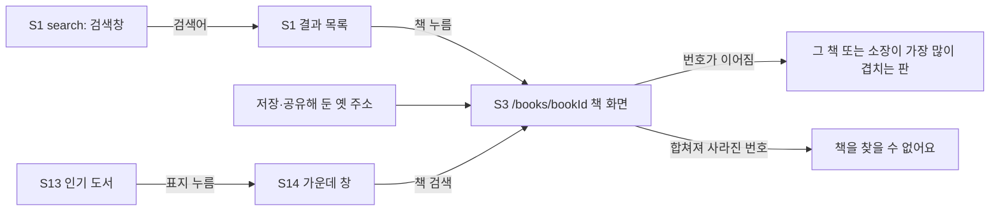

# 화면 흐름: 사이클 12 책 묶기 기준 다시 보기

- 작성: 2026-10-12. 근거 `scope.md`, `spec.md`
- **새 화면·바뀐 화면 없음** [확정] (사용자 승인 "전부 승인", 2026-10-12). 이번 사이클은 가져오기에서 책을 묶는 규칙만 바꾸고, 화면은 지금 것(S1 검색·결과 목록, S3 책 화면, S13·S14 인기 도서)을 그대로 씀. 바뀌는 것은 결과 목록에서 한 줄로 묶이는 책
- 지금 화면의 내용은 `docs/current/module-map.md` 웹 절, `docs/current/flows.md` 흐름 4·25·26을 따름 (여기 다시 쓰지 않음)

## 화면별 내용

### S1 결과 목록 (바뀌는 것만)
- 목적·요소·동작·API(`GET /api/v1/books`)는 그대로
- 바뀌는 것: 판이 다른 책은 판마다 한 줄(spec R1), "기타" 같은 값으로 합쳐졌던 다른 책은 따로(R2), 부제만 다른 같은 책은 한 줄(R3). 줄마다 도서관은 그 책을 가진 곳만
- 판이 나뉜 줄들을 구별하는 표시는 지금 줄 모양 그대로(제목·저자·출판사·출판일). 판을 묶어 보여 주는 새 표시는 없음 [확정] (사용자 승인 "전부 승인", 2026-10-12) (spec 비목표)
- 상태: 기본 / 로딩 / 빈 결과 / 오류 — 지금 그대로

### S3 책 화면 (`/books/{bookId}`)
- 그대로. 옛 주소로 들어오면 번호 잇기 규칙(ADR-0062)에 따라 그 책 또는 소장이 가장 많이 겹치는 판이 열림
- 합쳐져 사라진 번호: 지금 404 문구 "책을 찾을 수 없어요" 그대로. 바뀐 책으로 안내하는 표는 없음 [확정] (ADR-0062 "안내표 없음")
- 규칙이 바뀌었다는 안내 문구는 어느 화면에도 넣지 않음 [확정] (사용자 승인 "전부 승인", 2026-10-12)

### S13·S14 인기 도서
- 그대로. 순위 책을 ISBN으로 우리 책에 맞추므로(`BookLookup.byIsbn13`), 판이 나뉘면 그 ISBN의 판이 열림 — 지금보다 맞는 판을 가리킴

### 태블릿·폰
- 지금 그대로. 이번 사이클은 폰 화면이 바뀌지 않아 인계서에 "실제 폰 확인" 줄은 넣지 않음 (planner 규칙: 폰 화면이 바뀔 때만)

## 수용 기준 대응

| AC | 화면 |
|---|---|
| AC-1 「상법총칙 상행위」 판마다 한 줄 | S1 결과 목록 |
| AC-2 「햄릿」 두 줄 | S1 결과 목록 |
| AC-3 「백만장자 마인드」 한 줄 | S1 결과 목록 |
| AC-4 「수학 1·2」, 「묘왕동주 상·중·하」 따로 | S1 결과 목록 |
| AC-5 옛 주소가 규칙대로 열림 | S3 책 화면 (사라진 번호면 S3 404 상태) |
| AC-6 `compact`·`sql` 결과 같음 | 화면 없음 (dev 비교 도구) |
| AC-7 새 도서관 이어 붙임 비교 | 화면 없음 (dev `plan-feedback.md`) |
| AC-8 바꾸기 전후 책 수 | 화면 없음 (가져오기 기록) |

## 상태별 동작 대응

| spec 상태 | 화면 상태 |
|---|---|
| 로딩·결과 없음·외부 API 오류 | S1·S3 지금 상태 그대로 |
| 가져오기 실패 | 화면 바뀜 없음(바꿔 끼우기 전 실패면 서비스 그대로) |
| 사라진 번호의 주소 | S3 404 "책을 찾을 수 없어요" |
