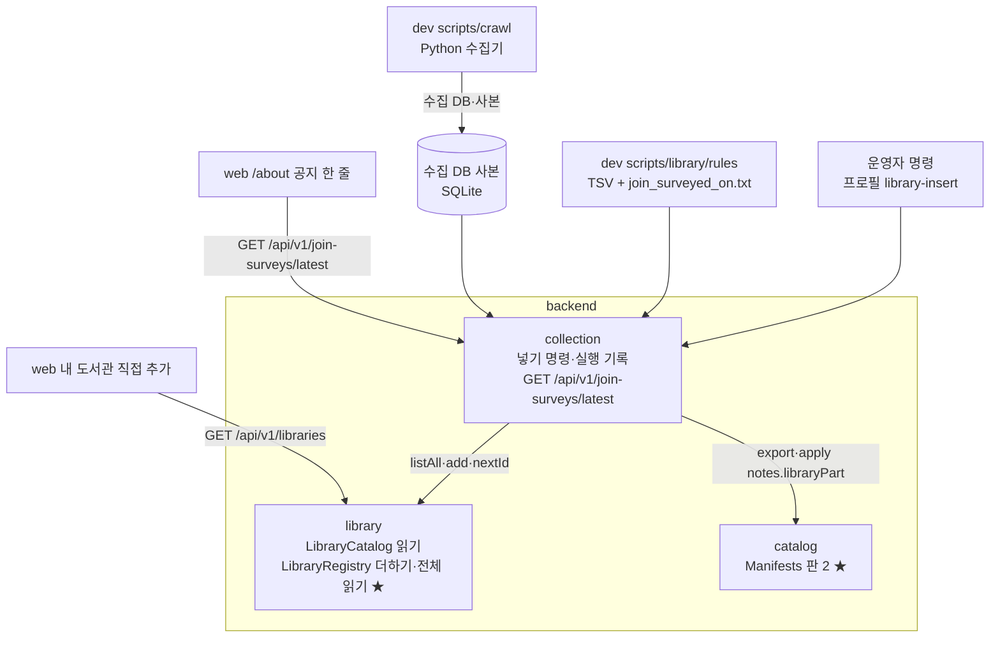
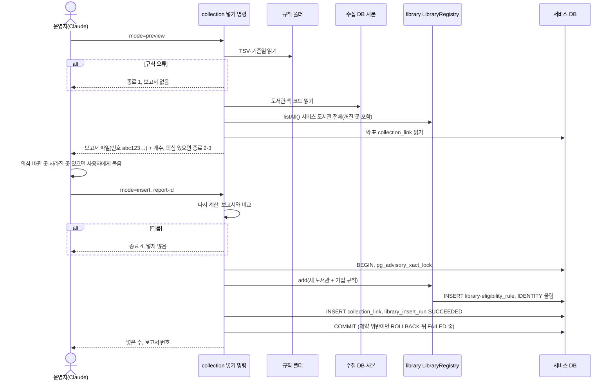
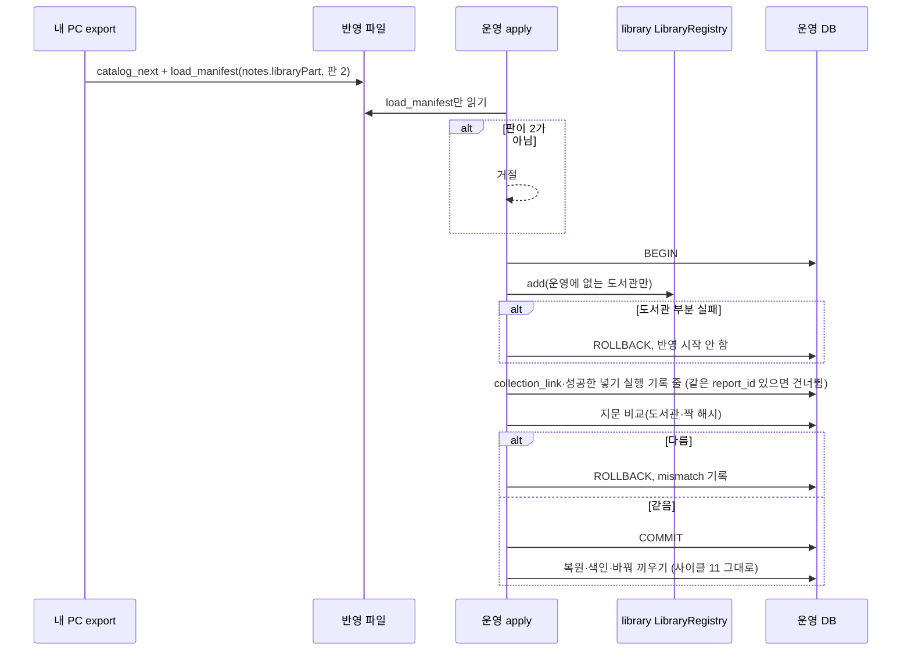
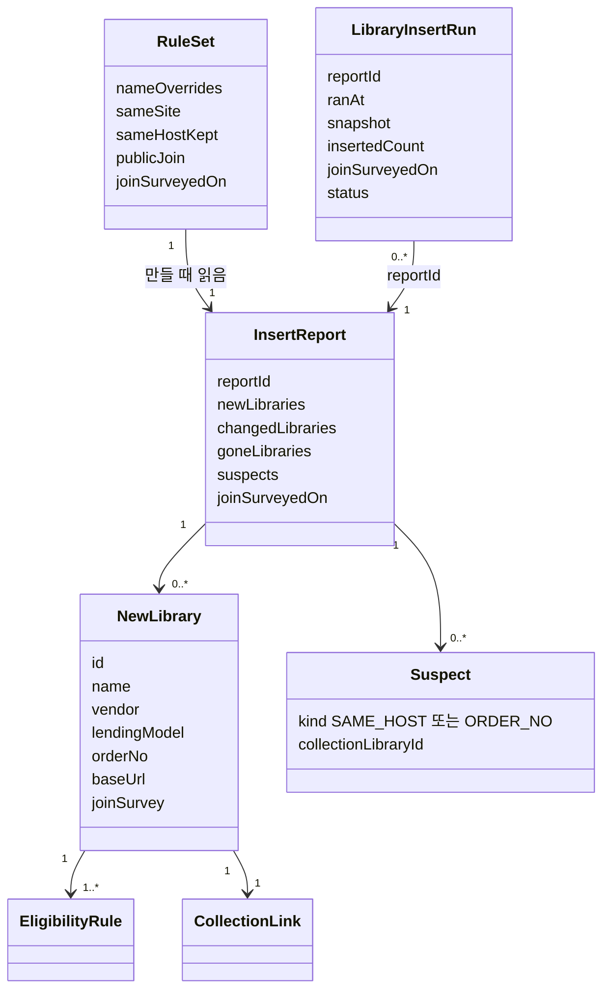
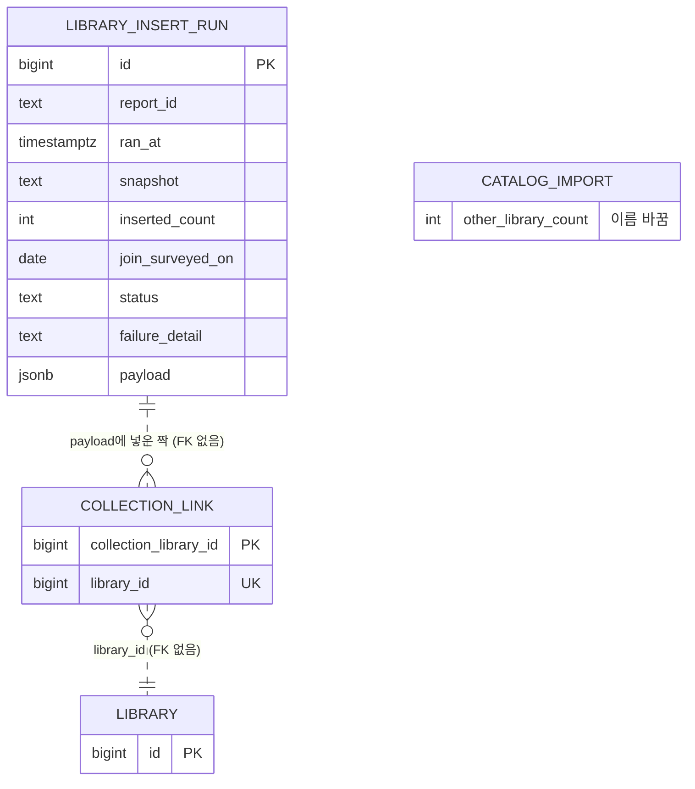

# 설계 변경: 사이클 13 수집기 (dev로 갈아타기 + 도서관 넣기 명령)

- 작성 2026-10-12. 근거: `scope.md`, `spec.md`, `flow.md`, `architect-proposal.md`(dev 코드 2026-10-12 기준)
- 사이클 13은 사이클 12가 끝나기 전에 **나란히 미리** 설계함. dev에는 사이클 12 handoff 뒤에 넘김 (ADR-0083~0088 머리에 같은 표시)
- 결정은 묻기 창으로 받음(폰, 캔버스 안 씀). 이름(프로필, 설정, 표, 칸, 경로, 명령)은 모두 [안]이고 dev가 바꿀 수 있음 [확정] (사용자 선택 "이름은 [안]으로 두고 dev가 바꿔도 됨", 2026-10-12)
- 그림: `easy/2026-10-12-design-delta.html` (아래 Mermaid를 미리 그린 것)

## 구조 그림

### 모듈 구성도



### 주요 흐름 1: 미리 보기 → 넣기 (내 PC)



### 주요 흐름 2: 운영 반영 (판 2)



### 도메인 모델



## 모듈

| 모듈 | 신규/변경 | 책임 | 공개 API | 발행/구독 이벤트 | 소유 테이블 |
|---|---|---|---|---|---|
| `library` | 변경 | 도서관 더하기(쓰기 처음), 넣기 비교용 전체 읽기 | `LibraryRegistry.add(List<NewLibrary>)`, `nextId()` (ADR-0083), `listAll()` → 모든 도서관(꺼진 곳 포함)의 번호·이름·`base_url`·업체·대출 방식·순번·꺼짐 여부 (ADR-0093) + 화면 종류 `platformType` [안] (spec R2-4 "바뀐 곳"이 화면 종류도 비교, 인계서 작성 때 보탬). 이름 [안]. `LibraryCatalog` 그대로 | 없음 | `library.library`, `eligibility_rule` (칸 변경 없음) |
| `collection` | 변경 | 넣기 명령(미리 보기·넣기), 보고서, 실행 기록, 기준일 API, export에 도서관 부분 싣기, apply에서 도서관 부분(실행 기록 줄 포함) 넣기 | 없음(명령·컨트롤러만) | 없음 | `collection.library_insert_run` 새 표, `catalog_import.other_library_count` 이름 바꿈 |
| `catalog` | 변경 | 반영 파일 판 2 (`FORMAT_VERSION = 2`), `load_manifest.notes`에 `libraryPart` 허용 | `CatalogLoad`·`Manifests` 그대로, 판 번호만 | 없음 | 없음 |
| web | 변경 | `/about` 공지 한 줄 | — | — | — |

- 모듈 방향은 그대로: `collection → catalog, library`. `collection`은 `region`에 의존하지 않음(지역은 규칙 파일에 번호로) (ADR-0085)
- `LibraryRegistry.add`는 `Propagation.MANDATORY`, 같은 번호가 있으면 실패, 값 검사는 DB CHECK·UNIQUE (ADR-0083)
  - 번호를 직접 넣을 수 있는 까닭: `library.library.id`가 `GENERATED BY DEFAULT AS IDENTITY`(dev `library/001`). 넣은 뒤 `setval(pg_get_serial_sequence('library.library','id'), GREATEST(max(id), 시퀀스 값))`으로 시퀀스를 올림 [안]
- `collection`은 `library` 표를 읽지 않고 `LibraryRegistry.listAll()`만 씀 (ADR-0093)
- `collection/package-info.java` 설명("No public API, 따로 도는 프로필")을 고침: 명령 프로필 둘(`collection-import`, `library-insert`) + 공개 REST 하나. `ModularityTests`가 통과해야 함
- 보안: `SecurityConfiguration`은 `/api/v1/me/**`만 보호하므로 새 GET은 열림. 보안 시험(`AuthEnabledSecurityTests` 등)에 새 경로가 로그인 없이 200인지 더함
- 넣기 명령: 프로필 `library-insert`, 설정 `chaekcheck.collection.library-insert.mode`(preview|insert)·`sqlite-path`·`rules-dir`·`report-dir`·`report-id` [안]
  - 종료 코드: 0 정상, 1 규칙 오류(보고서 없음), 2 같은 호스트 의심, 3 순번 2 이상, 4 보고서와 다름 [안]
  - 보고서: 정규화 JSON(만든 시각 제외), 번호 = SHA-256 앞 12자리, 파일 `library-insert-<id>.json` [안]
  - 고르기·값 정하기 규칙은 지금 `build_library_seed` 스크립트와 같음 (spec R2-5·R2-6). 같은 호스트 의심은 새 곳끼리 + 서비스 전체 (R2-7)

## 데이터

- 스키마: `collection` (새 표 하나, 칸 이름 하나 바꿈), `library` (이름 고침 changeset만)



| 테이블.컬럼 | 타입 | 제약 | 설명 | 상태 태그 |
|---|---|---|---|---|
| `collection.library_insert_run.id` | bigint | PK, IDENTITY | 넣기 실행마다 한 줄(지우지 않음) | 표 [확정] (scope 도서관 날짜 3), 이름 [안] |
| `.report_id` | text | NOT NULL, CHECK `^[0-9a-f]{12}$` | 보고서 번호 | [안] |
| `.ran_at` | timestamptz | NOT NULL DEFAULT now() | | [안] |
| `.snapshot` | text | NOT NULL | 수집 사본 파일 이름 | [안] |
| `.inserted_count` | integer | NOT NULL, CHECK ≥ 0 | 넣은 도서관 수 | [안] |
| `.join_surveyed_on` | date | NULL 허용 | 가입 조건 조사 기준일(규칙 폴더 날짜 파일) | 뜻 [확정] (ADR-0087), 이름 [안] |
| `.status` | text | NOT NULL, CHECK IN ('SUCCEEDED','FAILED') | | [안] |
| `.failure_detail` | text | NULL. CHECK `(status = 'FAILED') = (failure_detail IS NOT NULL)` | 실패 설명 | [안] |
| `.payload` | jsonb | NOT NULL | 넣은 도서관·가입 규칙·짝 줄 그대로. export가 `notes.libraryPart`로 실음(ADR-0086) | [안] |
| 부분 UNIQUE | — | `UNIQUE (report_id) WHERE status = 'SUCCEEDED'` | 같은 보고서로 두 번 넣지 않음 | [안] |
| `collection.catalog_import.candidate_library_count` → `other_library_count`, 제약 `catalog_import_candidate_library_count_check` → `catalog_import_other_library_count_check` | integer | 그대로 (CHECK ≥ 0) | "후보" 이름 없애기(AC-11). **기존 `collection/001-collection-schema.yaml` 49·50행을 직접 고침** (배포 전 `PRE_DEPLOYMENT` 동안 dev 규칙, 사이클 14와 같은 방식) → 로컬 `db`·`db-ops`는 데이터를 지키며 같은 이름 바꾸기 SQL + `databasechangelog.md5sum` NULL로 맞춤(dev 세션이 함, `db-test`는 다시 띄움) [확정] (사용자 선택 "가벼운 방법", 2026-10-12) | 바꿈 [확정] (설계 결정 4), 방식 [확정] (사용자 선택 "기존 파일을 고침", 2026-10-12, cycle-close 검토), 새 이름 [안] |
| `library.library` 1215 `name` | text | — | `한화S&amp;C` → `한화S&C` | [확정] (사전 결정 8) |

- Liquibase
  - `collection/001-collection-schema.yaml`: 칸·제약 이름만 고침(위 표). 이 하나만 기존 파일 수정
  - `collection/006-library-insert-run.yaml`: 새 표만 [안: 번호는 dev의 마지막 파일 다음]
  - master(`db.changelog-master.yaml`) 끝줄에 사이클 13(`collection/006`, `library/015`)과 사이클 14(`popular/001` → `picks/001`)가 함께 손댐. 번호는 겹치지 않지만 병합 때 끝줄 순서를 확인
  - `library/015-library-name-1215.yaml`: 이름 고침 [안]. 사이클 11 도서관 해시(`DatabaseFingerprint`: `id·baseUrl·platformType`)에는 이름이 들어가지 않아 반영 비교와 무관. 같은 앱 판 규칙으로 운영에도 먼저 적용됨
  - 앞으로 도서관 seed changeset을 만들지 않음 (ADR-0084)
- 운영 반영 파일 판 2: `load_manifest.notes.libraryPart` = 성공한 넣기 실행 기록의 `payload` 모음 [안: 키 이름] (ADR-0086). 새 표 없음
- 수집 DB(SQLite, dev 수집기): `library.vendor` 칸 + `migrate` (2026-10-12 데이터 폴더 수집기에 이미 더한 것을 dev 코드로)

## API

| 메서드 | 경로 | 설명 | 요청 | 응답 | 에러 |
|---|---|---|---|---|---|
| GET | `/api/v1/join-surveys/latest` [확정] (ADR-0093) | 가입 조건 조사 기준일(성공한 넣기 실행 기록 중 최신 `join_surveyed_on`) | 없음, 인증 없음 | 200 `{"surveyedOn": "2026-10-05"}`, 기록 없으면 `{"surveyedOn": null}` | 일반 500(Problem Details) |

- 소유: `collection` 모듈 컨트롤러. `/libraries`에 싣지 않음(큰 목록 약 874KB [안: architect 추정, 재지 않음], `library → collection` 의존 고리) (ADR-0087)
- 운영 DB에서도 값이 나오도록 운영 반영이 실행 기록 줄을 옮김 (ADR-0093, AC-7)
- 웹 `/about`: 첫 문단 아래 "가입 조건은 {YYYY}년 {M}월에 조사한 내용입니다." 로딩 중 비움, `null`·오류면 줄 없음 [확정] (flow S12)
  - 문단 순서 (사이클 14와 맞춤) [안]: ① 첫 문단("책첵은 …") → ② 가입 조사 기준일 줄(사이클 13) → ③ 사서추천도서 자료 문단(사이클 14) → ④ "각 도서관의 로고와 이름은 … 제휴·후원 관계가 없습니다" → ⑤ 로고 내림 요청 문단. dev `AboutPage.tsx`(2026-10-12)에는 ①·④·⑤만 있음

```json
{ "surveyedOn": "2026-10-05" }
```

## 외부 연동

| 대상 | 방식 | 제한·키 관리 | 실패 시 동작 | 상태 태그 |
|---|---|---|---|---|
| 전자도서관 사이트(수집) | dev `scripts/crawl/` Python, 지금과 같음 | IP마다 한 줄·1건·1초, robots.txt 기록만, User-Agent 연락처는 서비스 주소 생기면 | 막히면 그 도서관만 받지 않음 | [확정] (`crawl-method.md`, ADR-0088) |

- 서비스 백엔드는 외부 사이트를 새로 부르지 않음

## 스크립트 (dev `scripts/`)

- `crawl/crawl_catalog.py`: `vendor` 칸·`migrate`, 새 명령 빈 곳 채우기 [안: `refill-pubdt`]. 첫 시험 여주대 102084 (AC-1)
- 옛 수집기: 데이터 폴더 `scripts\`, `resume.cmd` → `_old-scripts-2026-10-12`, 지우지 않음 (ADR-0088)
- 데이터 폴더 도구(이름 바꾸기 등)를 dev로 옮김
- `library/rules/`: TSV 규칙 + `join_surveyed_on.txt` + 순번 2 허용 목록, 지역 번호 채우는 도우미 (ADR-0085)
- 이름 바꾸기("후보" 없애기, AC-11 대조 목록) [안: 새 이름]
  - `scripts/library/build_candidate_seed.py` → `build_library_seed.py`, `name_candidates()` → `name_libraries()`, `scripts/library/candidates/` → `scripts/library/discover/`. 옛 스크립트는 AC-6 비교용으로 남김(새 이름으로)
  - 시험 `collection/CandidateSeedTests` → `LibrarySeedTests`(상수 `CANDIDATES` 등 포함)
  - `catalog_import` 칸·제약(데이터 절), Java `ImportReport.candidateLibraries`·`ImportRecords`(51행 근처)·`CatalogImporterTests`·`CatalogImportRecordTests`의 칸 이름
  - dev 절차 문서(`docs/maintenance/`, `docs/library-maintenance.md`)의 "후보 도서관"
  - 그대로 둠: 이미 적용된 Liquibase 파일 이름(`library/008-library-seed-candidates.yaml`, `collection/002-collection-seed-candidates.yaml`, csv)과 그 changeset id, master 주석, 지난 기록. 도서관과 무관한 검색 후보(`availability`의 `candidates`, `LookupTask.Candidate`)

## 결정 기록

- ADR-0083 `library`에 "도서관 더하기" 공개 기능, 번호는 부르는 쪽이 정함
- ADR-0084 새 도서관은 `collection` 명령으로 (미리 보기 → 보고서 → 넣기), seed로 번호를 넣지 않음
- ADR-0085 사람이 정한 도서관 규칙은 dev git TSV, 지역은 번호로
- ADR-0086 반영 파일 판 2, 도서관 → 비교 → 책
- ADR-0087 가입 조건 조사 기준일 하나 + `/about` 공지
- ADR-0088 수집기 dev로 갈아타기, 옛 코드 보관
- ADR-0093 넣기 비교는 `LibraryRegistry.listAll()`로, 운영 반영은 실행 기록 줄도 옮김, 경로 `/api/v1/join-surveys/latest` (cycle-close 검토 보완)
- 이름 바꾸기 `candidate_library_count` → `other_library_count`: ADR 없음(이름 선택)

## 사이클 11·12·14와 겹치는 곳

- 순서 [안]: 사이클 11 마무리(측정·회고) → 12 → 13 → 14. 13은 12 위에 얹음
- 사이클 11: 13은 11의 export/apply 코드(`ImportTransfer`, `Manifests`, `CatalogImportRunner` 모드)를 고침. 11의 회고가 아직 없으므로 13 시작 때 11 코드가 확정됐는지 봄
- 사이클 12: `CatalogImportRunner`(`GROUPINGS`)·`ImportReport`(로그 카운터)를 고침. 13도 `CatalogImportRunner`(apply 순서: 도서관 → 비교 → 책), `ImportTransfer`(`notes.libraryPart`), `ImportReport`·`ImportRecords`(칸 이름), 그 시험(`CatalogImporterTests`, `CatalogImportRecordTests`)을 고침 → 이 파일들에서 병합 충돌 가능
- 사이클 14: `AboutPage.tsx`(문단 순서는 API 절), master changelog 끝줄. `catalog`는 13이 `FORMAT_VERSION`·`notes`만, 14가 `BookLookup.byTitleAndAuthor`를 더해 파일이 다름. `popular` 삭제는 13과 무관
- 운영 반영 실패: 도서관 부분 커밋 뒤 책 바꿔 끼우기가 실패(`lock_not_acquired` 등)하면 도서관은 들어간 채 남음. 다시 돌리면 같은 줄은 건너뛰므로 안전 (ADR-0086)

## 확인 필요

| 항목 | 왜 필요한가 | 확인 방법 | 막는 단계 |
|---|---|---|---|
| 순번 2 이상을 그대로 넣고 싶을 때 (지금은 허용 목록 파일) | R2-7 의심 | 사용자에게 질문 (생길 때) | 없음 |
| 새 곳의 최종 주소가 `final_origins`에 없을 때 | R2-6 `base_url` | 프로토타입(dev 구현 때 수집 DB 값으로 대체할지) | 구현 |
| "바뀐 곳" 비교에 최종 주소·이름 바꾸기를 먼저 적용해야 소음이 없음 | R2-4 | 프로토타입(2026-10-12 사본 기대값: 바뀐 곳 0) | 구현 |
| COMMENT가 길어져도 `Manifests.parse`가 맞게 읽는지 | ADR-0086 | 프로토타입(dev 시험) | 구현 |
| 판 2 배포 때 내 PC에 판 1 내보내기가 기다리면 `finish` 거절 | 배포 순서 | 절차 문서에 "배포 전 finish·discard" | 배포 |
| 기준일을 날짜 파일 대신 조사 파일 날짜 칸에서 뽑을지 | ADR-0087 | 사용자에게 질문 (다음 가입 조사 때) | 없음 |
