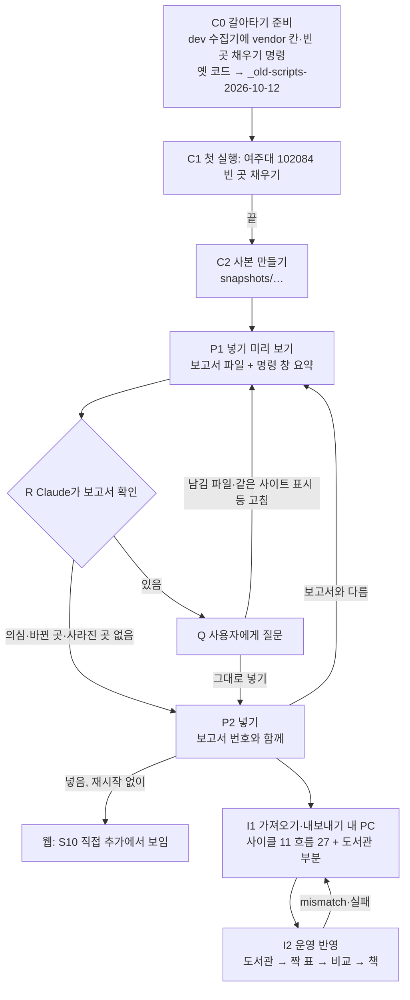
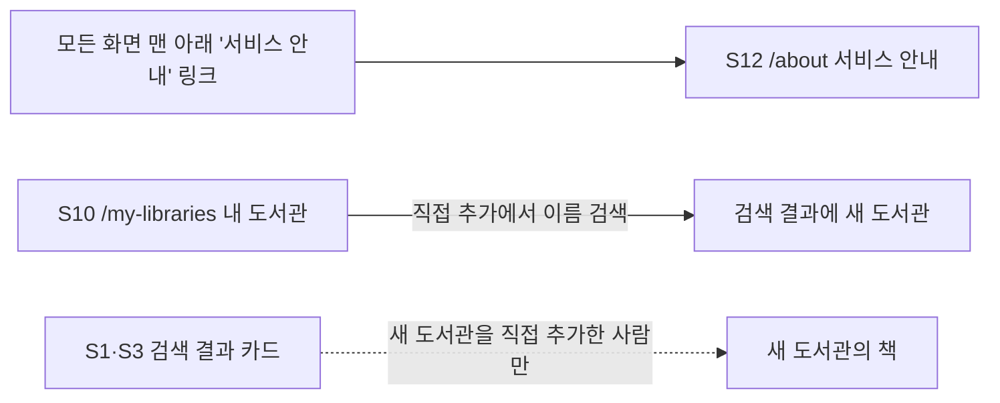

# 화면 흐름: 사이클 13 수집기

- 작성 2026-10-12. 근거: `spec.md`
- 웹 화면은 거의 바뀌지 않음. 새 도서관이 기존 화면에 나타나는 것과 S12 서비스 안내의 공지 한 줄뿐
- 이 사이클의 대부분은 운영자(사용자·Claude)가 명령으로 하는 흐름이라, 명령 창과 보고서 파일을 "화면"처럼 적음
- 그림: `easy/2026-10-12-flow.html` (아래 Mermaid를 그린 것, 폰에서 보기용)

## 1. 운영자 흐름 (명령)

### C0·C1 갈아타기와 첫 실행 (명령 창)

- 목적: 앞으로의 수집을 dev 코드로. 첫 시험으로 여주대 빈 곳을 채움
- 보이는 것: dev `resume.cmd`의 시작 줄(설정: 동시 수, IP 줄), 빈 곳 채우기 시작·끝 줄(`refill done`, 줄 수 전후)
- 상태
  - 기본: 끝까지 돌고 줄 수가 늘거나 같음(AC-1)
  - 옛 수집기가 돌고 있음: 시작하지 않음
  - 사이트가 막음(403·시간 초과가 이어짐): 그 도서관만 받지 않음 표시(R1-7)
- 옛 코드: 데이터 폴더에서 옛 `resume.cmd`를 찾을 수 없음(AC-2)

### P1 넣기 미리 보기 (보고서 파일 + 명령 창)

- 목적: 넣기 전에 무엇이 들어가는지 봄. DB에 쓰지 않음
- 보고서 파일: 데이터 폴더, 보고서 번호가 이름에 들어감
  - 4개 목록:
    - 새로 넣을 도서관: 번호, 이름, 업체, 대출 방식, 종류, 가입 상태
    - 바뀐 도서관: 주소, 이름, 화면 종류·대출 방식, 받지 않음·실패
    - 사라진 도서관
    - 의심: 같은 호스트에 책 코드가 겹침, 순번 2 이상
  - 끝에 "가입 조건 조사 기준일"
- 명령 창: 네 목록의 개수와 보고서 파일 경로
- 상태
  - 넣을 곳 있음: 기본
  - 넣을 곳 0: "넣을 도서관 없음"
  - 의심 있음: 표시, 종료 코드로 구분
  - 규칙 파일 오류(종류 없음, 알 수 없는 업체, 지역 못 읽음): 보고서 없이 멈추고 이유를 보임
- 2026-10-12 사본 기대값(AC-3): 새로 넣을 곳 6, 바뀐 곳·사라진 곳 0, 의심 0(여주대 두 곳은 남김 파일에 있음)

### R·Q 확인 (대화)

- Claude(수집 세션)가 보고서를 읽음
- 의심·바뀐 곳·사라진 곳이 있으면 사용자에게 묻기 창으로 물음(사용자는 폰에서 봄)
- 없으면 넣기까지 하고 결과를 알림 (R2-8)

### P2 넣기 (명령 창)

- 보이는 것: 넣은 도서관 수, 보고서 번호, 실행 기록 줄
- 상태
  - 넣음: 기본. 앱을 다시 켜지 않아도 다음 요청부터 보임
  - 보고서 번호가 없거나 내용이 달라짐: 넣지 않음, 다른 점을 보임(AC-5)
  - DB 제약 위반: 아무것도 넣지 않음(한 트랜잭션), 실패 기록
  - 같은 사본으로 다시: 넣을 곳 0(AC-8)

### I1·I2 운영 반영 (사이클 11 흐름 27·28 확장)

- 내 PC 내보내기 파일에 이번에 넣은 도서관·가입 규칙·짝 줄을 표 COMMENT로 실음(판 2)
- 운영 반영 순서
  1. 도서관 부분 넣기
  2. 비교(도서관·짝 표 해시, 책 표)
  3. 복원·색인·바꿔 끼우기
  4. 더 실은 것은 바꿔 끼우기 전에 지움
- 상태: 사이클 11과 같음(`mismatch`, 복원 실패, 잠금 실패). 도서관 부분 넣기가 실패하면 반영을 시작하지 않음 [확정] (사용자 승인, 2026-10-12)

## 2. 웹 화면

### S12 서비스 안내 (`/about`, 사이클 07에 만듦)

- 바뀌는 것: 공지 한 줄을 더함 — "가입 조건은 2026년 10월에 조사한 내용입니다." [확정] 자리·문구 (spec R5)
- 놓는 곳 [확정] (사용자 승인, 2026-10-12): 첫 문단("책첵은 …") 바로 아래, 제휴 안내 문단 위
- 날짜: 넣기 실행 기록의 최신 "가입 조건 조사 기준일"에서 읽어 "YYYY년 M월"로 보임 (spec R5-2). 읽어 오는 API 이름은 design-delta에서 정함
- 상태
  - 기본: 한 줄 보임(AC-10)
  - 로딩: 그 줄 자리는 비워 둠(나머지 글은 바로 보임) [확정] (사용자 승인, 2026-10-12)
  - 기준일이 없음(실행 기록이 아직 없음)·오류: 그 줄을 보이지 않음 [확정] (사용자 승인, 2026-10-12)
- 태블릿·모바일: 지금 S12와 같은 흰 카드 한 열, 다른 점 없음

### S10 내 도서관 (`/my-libraries`) — 바뀌는 것 없음

- "직접 추가"에서 이름으로 찾으면 새로 넣은 도서관(예: 여주대학교 교보·YES24)이 나옴(AC-4)
- 이름 옆 분류 표시("교보 · 소장" 등)는 사이클 09 그대로(흐름 23-2)
- 도서관 1215는 "한화S&C"로 보임(AC-9)

### S1·S3 검색 결과 — 바뀌는 것 없음

- 새 도서관은 가입 조사 상태가 소속 전용(`MEMBERS_ONLY`)이라 직접 추가한 사람의 검색에만 들어감(ADR-0053)
- 그 도서관의 책은 다음 가져오기 뒤에 보임(그 전에는 0권)

## 수용 기준 대응

| AC | 화면 |
|---|---|
| AC-1 여주대 빈 곳 채우기 | C1 명령 창 |
| AC-2 옛 코드 보관, dev만 시작 | C0 |
| AC-3 미리 보기 기대값 | P1 보고서 파일 |
| AC-4 재시작 없이 직접 추가에서 여주대 | P2 → S10 |
| AC-5 보고서와 다르면 넣지 않음 | P2 상태 |
| AC-6 옛 스크립트와 결과 같음 | P1 보고서와 옛 스크립트 출력 비교(dev 시험) |
| AC-7 운영 반영 mismatch 없이 | I1·I2 |
| AC-8 다시 돌리면 0 | P2 상태 |
| AC-9 1215 이름 | S10·S1 |
| AC-10 공지 한 줄 | S12 |
| AC-11 "후보" 이름 없음 | (코드·문서 검색, 화면 없음) |
| AC-12 넣기 실행 기록 | P2 명령 창, 실행 기록 줄 |

| spec 상태별 동작 | 화면 상태 |
|---|---|
| 넣을 곳 0 | P1 "넣을 도서관 없음" |
| 의심 있음 | P1 의심 목록, R·Q |
| 규칙 파일 오류 | P1 멈춤 |
| 보고서 번호 없음·다름 | P2 멈춤 |
| DB 제약 위반 | P2 실패 |
| 넣은 뒤 서비스 | S10 직접 추가 |
| 넣은 도서관의 책 | S1·S3 (다음 가져오기 뒤) |
| 사이트가 막음 | C1 |
| 옛 수집기가 돌고 있음 | C0·C1 시작하지 않음 |
