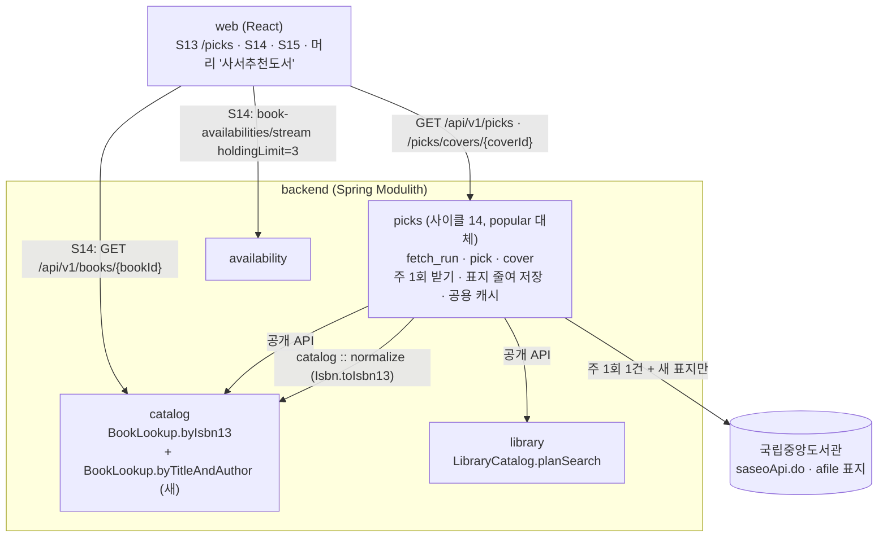
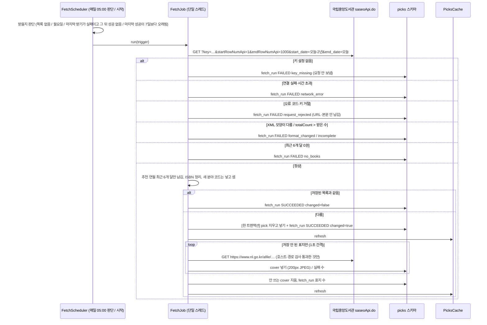
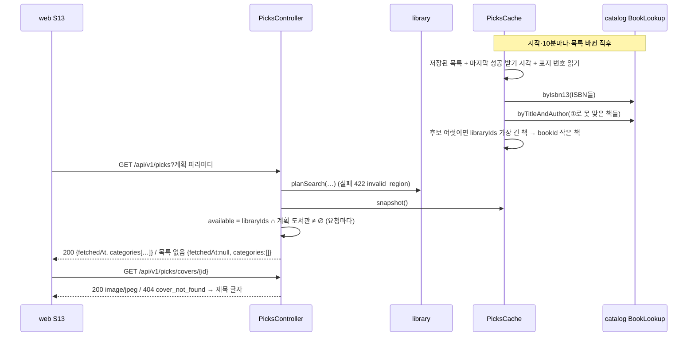
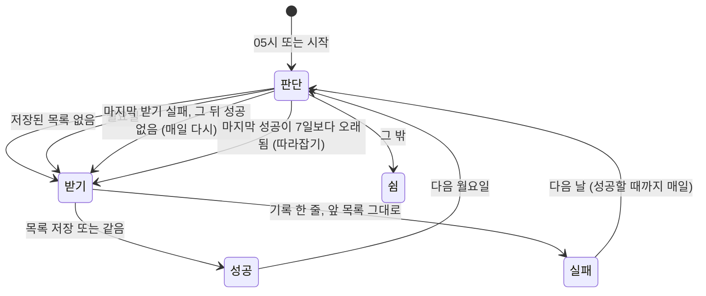
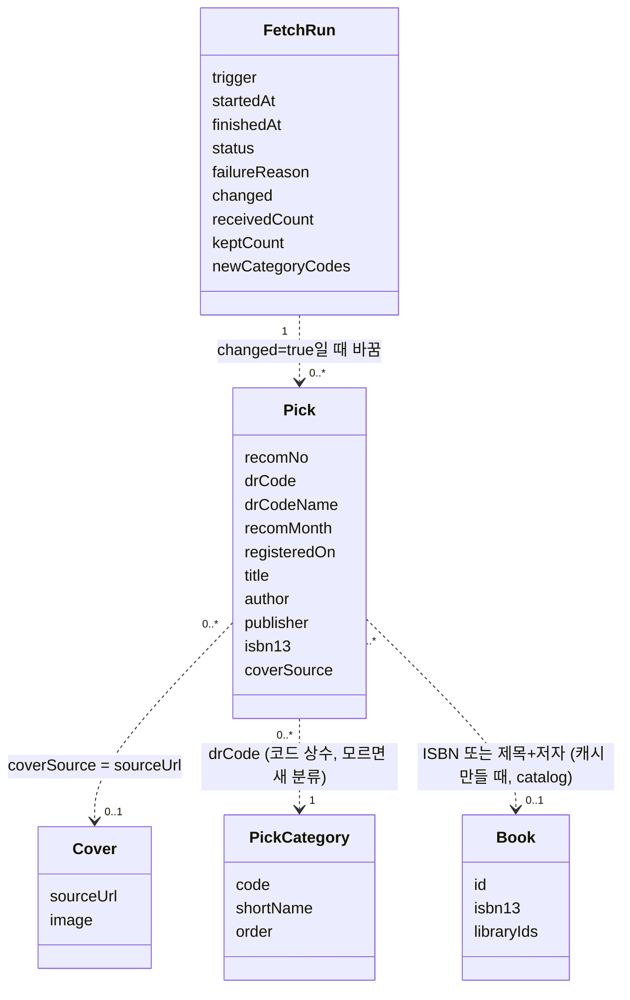
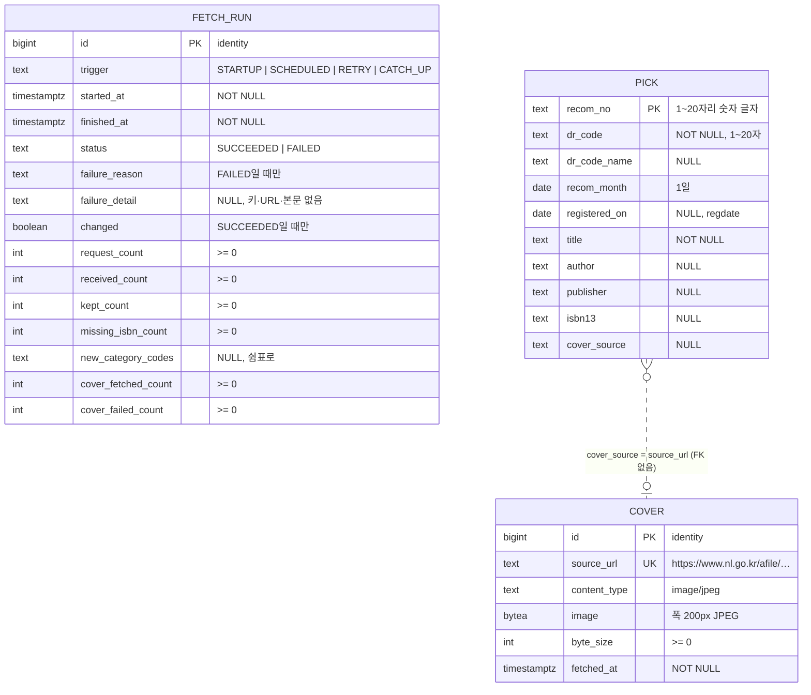

# 설계 변경: 사이클 14 인기 도서 → 사서추천도서

- 근거: `scope.md`, `spec.md`, `flow.md`, 제안 `architect-proposal.md`(architect, 2026-10-12), 결정 ADR-0089·0090·0091
- `docs/current/`와의 차이만 적음. `docs/current/`는 `/cycle-close`에서 고침
- 지금(사이클 10, 배포 전): 모듈 `popular`, 스키마 `popular`(`fetch_run`, `ranking_month`, `ranking_category`, `ranking_entry`, `cover`), `GET /api/v1/popular-books`, 웹 `/popular` — 이것을 모두 `picks`로 바꿈
- 이름(모듈·표·칸·설정·클래스)은 [확정] (사용자 승인 "이름·값: … 승인", 2026-10-12), 단 코드 안 이름은 dev가 바꿀 수 있음(dev가 바꾸면 회고에 적음)

## 먼저 알릴 것 (설계 중 확인한 사실)

| 사실 | 영향 | 근거 |
|---|---|---|
| 서비스 DB에 우리 전자책 표지가 없음(`catalog`에 표지 칸 없음, 가져오기가 표지 주소를 옮기지 않음) | spec R4-4 ① 빠짐 → 이번엔 국립중앙도서관 표지 → 제목 글자 [확정] (ADR-0091) | architect dev 코드 확인 (2026-10-12) |
| `recomNo`가 옛 추천은 1~4자리 수, 최근 추천은 20자리 글자(예 `20260922163135829100`, 등록 시각 모양) | `bigint`에 안 들어감 → `text`로 저장. spec R4-2 "같은 달이면 추천 번호 큰 순(나중 등록 먼저)"은 뜻대로 **등록일(`regdate`) 늦은 순 → `recomNo` 글자 순**으로 구현 [확정] (사용자 승인, 2026-10-12: 뜻 "나중 등록 먼저" 그대로, 등록일 기준으로) | API 호출 시험 (2026-10-12, 전체 1,468건과 2년 범위 108건 비교) |
| 2년 범위 요청 1건 = 108건(12개 달), 응답 1.56MB, 0.46초, `endRowNumApi=1000`으로 다 옴. 기간을 주면 최신 추천이 앞에 옴 | R1-1 요청 1건 가능. 본문 상한은 10MB [확정] (사용자 승인, 2026-10-12) | API 호출 시험 (2026-10-12, `start_date=20241012&end_date=20261012`) |
| 2026.10 추천의 등록일은 2026.09.22~28 | spec R1-2 근거 글("2026.10 추천 등록일 2026.10.01")을 바로잡음. 받는 때(주 1회)는 그대로 | 같은 시험 |

## 구조 그림

### 모듈 구성도



### 주요 흐름: 받기 (주 1회, 실패하면 성공할 때까지 매일)



### 주요 흐름: 화면 열기와 공용 캐시



### 받기 판단 상태



### 도메인 모델



## 모듈

| 모듈 | 신규/변경 | 책임 | 공개 API | 발행/구독 이벤트 | 소유 테이블 |
|---|---|---|---|---|---|
| `picks` | 신규 (`popular` 대체, ADR-0089) | 국립중앙도서관 사서추천 받기(주 1회)·저장, 표지 받아 줄이기, 공용 캐시, REST | 없음 | 없음 (캐시 알림은 모듈 안 인터페이스, 지금 `RankingChanged`처럼) | `picks.fetch_run`, `picks.pick`, `picks.cover` |
| `popular` | **지움** | — | — | — | 스키마 `popular` 지움 |
| `catalog` | 변경 | 제목+저자 조회 추가 (ADR-0090) | `BookLookup.byTitleAndAuthor` 추가 | 없음 | 바뀌지 않음 |
| `library`, `availability` | 바뀌지 않음 | | | | |

- `picks/package-info.java`: `@ApplicationModule(allowedDependencies = {"catalog", "catalog :: normalize", "library"})`. `catalog :: normalize`는 받은 ISBN 정리(`Isbn.toIsbn13`, 하이픈·10자리)에 씀(`collection`과 같은 선례). `catalog`·`library`는 `picks`를 모름, 고리 없음
- 안쪽(예시, 위치는 dev가 정함): `internal/fetch`(`NlkClient`, `SaseoXmlParser`), `schedule`(`FetchDecision`, `FetchScheduler`, `FetchJob`), `store`(`PicksStore`, JdbcClient), `cover`(`CoverResizer` 옮김), `cache`(`PicksCache`), `web`(`PicksController`). 지우는 것: `Kpipa*`, `RankPageParser`, `SalesCountParser`, `CategoryOrder`, `PopularCategory`, 시험 `Kpipa*Tests`·`FakeKpipaSite`·`fixtures/kpipa/`. 옮겨 다시 쓰는 것: `CoverResizer`, `BodyLimit`, 예약·실행 중 표시(`AtomicBoolean`), 캐시 틀, 계획 파라미터 처리
- 분류 `PickCategory`(코드 상수 enum): `ALL` 0 "전체", `11` 1 "문학", `6` 2 "인문", `5` 3 "사회", `4` 4 "자연", `425` 5 "테마" [확정] (spec R2-1·R2-2). 모르는 `drCode`는 enum에 없어도 받음: "전체"에 넣고 분류 목록 맨 뒤에 API의 `drCodeName`(비면 "기타")으로, 코드 순 [확정] (ADR-0089)
- `catalog` 새 공개 API [확정] (ADR-0090):
  ```
  BookLookup.byTitleAndAuthor(Collection<TitleAuthor> queries) -> List<TitleAuthorBook>
  record TitleAuthor(String title, String author)                  // 원문 그대로
  record TitleAuthorBook(TitleAuthor query, long bookId, long[] libraryIds)  // 맞는 후보 전부
  ```
  `catalog`가 spec R3-1 ② 규칙으로 제목 키(새 함수, 예 `CatalogText.pickTitleKey` — 지금 `mainTitleNorm`과 규칙이 다름)와 첫 저자(역할어 "지음·옮김·글·그림·엮음" 뗌, `Contributors`)를 만들고, `title_norm` pg_bigm으로 후보를 좁힌 뒤 키가 같고 저자가 `book_contributor.name_exact`에 있는 책을 모두 돌려줌. 읽기 전용, 표·색인 변경 없음. 하나 고르기(R3-2)는 `picks`가 함

## 데이터

- 스키마: `picks` (소유 `picks`). changelog `db/changelog/picks/001-picks-schema.yaml`. `popular/001-popular-schema.yaml`은 지우고 마스터의 include를 바꿈 — **배포 전 규칙으로 기존 changelog를 바꾸는 것** [확정] (ADR-0089, dev `CLAUDE.md` 배포 전 규칙, 사이클 10 회고 `display_order` 선례)
- 로컬 DB(`db`, `db-test`) 정리 [확정] (ADR-0089): `DROP SCHEMA popular CASCADE`; `DELETE FROM databasechangelog WHERE id LIKE 'popular-001-%'`. `catalog` 등 다른 스키마는 그대로(다시 가져오지 않음). 빠뜨리면 표가 남으므로 AC-22로 확인



| 테이블.컬럼 | 타입 | 제약 | 설명 | 상태 태그 |
|---|---|---|---|---|
| `fetch_run.trigger` | text | CHECK `STARTUP`·`SCHEDULED`·`RETRY`·`CATCH_UP` | 시작(목록 없음)·월요일·실패 뒤 매일 다시·따라잡기(마지막 성공이 7일보다 오래됨, 서버 시작 또는 05:00 판단 때) | [확정] (따라잡기: 사용자 "켜질 때 따라잡기 (추천)", 2026-10-12) |
| `fetch_run.status` | text | CHECK `SUCCEEDED`·`FAILED` | | [확정] |
| `fetch_run.failure_reason` | text | `FAILED`일 때만 NOT NULL. CHECK `key_missing`·`network_error`·`request_rejected`·`format_changed`·`incomplete`·`no_books` | | [확정] |
| `fetch_run.failure_detail` | text | NULL | HTTP 상태·API 오류 코드만. 키·요청 URL·응답 본문은 넣지 않음 | [확정] |
| `fetch_run.changed` | boolean | `(status = 'SUCCEEDED') = (changed IS NOT NULL)` | 목록을 바꿨는지 | [확정] |
| `fetch_run.new_category_codes` | text | NULL | 모르는 `drCode`가 왔으면 그 코드들 (ADR-0089) | [확정] |
| `fetch_run` 개수 칸 | int | NOT NULL DEFAULT 0, CHECK >= 0 | 요청·받은·남긴·ISBN 없는·표지 받은·표지 실패 | [확정] |
| `fetch_run` 색인 | | `(status, started_at)` | 받을지 판단, 출처 줄 "받은 날"(마지막 `SUCCEEDED`의 `finished_at`) | [확정] |
| `pick.recom_no` | text | PK, CHECK `^[0-9]{1,20}$` | 옛 추천 1~4자리, 최근 20자리 (2026-10-12 시험) | [확정] |
| `pick.dr_code` | text | NOT NULL, CHECK `length(dr_code) BETWEEN 1 AND 20` | 11·6·5·4·425, 모르는 코드도 받음(모양을 묶지 않아 새 코드에 받기가 막히지 않게) | [확정] (ADR-0089) |
| `pick.dr_code_name` | text | NULL | API 이름(테마는 빈 값 → NULL). 새 분류 이름에 씀 | [확정] |
| `pick.recom_month` | date | NOT NULL, CHECK 1일 | `recomYear`·`recomMonth` | [확정] |
| `pick.registered_on` | date | NULL | `regdate`(`YYYY.MM.DD`). 같은 달 안 정렬(늦은 순) | [확정] |
| `pick.isbn13` | text | NULL, CHECK `^97[89][0-9]{10}$` | `Isbn.toIsbn13`로 정리, 안 되면 NULL | [확정] |
| `pick.cover_source` | text | NULL, CHECK `LIKE 'https://www.nl.go.kr/afile/%'` | http → https 바꾼 뒤. 규칙에 안 맞으면 NULL | [확정] |
| `cover.source_url` | text | NOT NULL UNIQUE | 같은 주소는 다시 받지 않음 | [확정] |
| `cover.image` | bytea | NOT NULL | 폭 200px JPEG, 품질 0.8 (ADR-0091) | [확정] |

- 다른 모듈과 FK·조인 없음. `catalog`와는 값으로만 맞춤(ADR-0090)
- `updated_at` 칸 없음 → 트리거 없음
- 크기: `pick` 52줄 안팎, `cover` 52장 × 10KB대 [안: 추정]

## API

| 메서드 | 경로 | 설명 | 요청 | 응답 | 에러 |
|---|---|---|---|---|---|
| GET | `/api/v1/picks` | 최근 6번 사서추천(분류별) + 있음/없음. 인증 없음. `/api/v1/popular-books` 대체 | `residenceRegionIds`, `workRegionIds`, `scope`, `visit`, `libraryIds` (`/api/v1/books`와 같은 이름·검사) | 200 아래 예시 | 400 `validation_error`, 422 `invalid_region`, 500 `internal_error` (ProblemDetail) |
| GET | `/api/v1/picks/covers/{coverId}` | 저장한 표지(200px JPEG). `/api/v1/popular-books/covers/{coverId}` 대체 | | 200 `image/jpeg`, `Cache-Control: public, max-age=2592000, immutable` | 404 `cover_not_found` |

```json
{
  "fetchedAt": "2026-10-12T05:00:41+09:00",
  "categories": [
    {
      "code": "ALL",
      "name": "전체",
      "books": [
        { "recomNo": "20260922163135829100", "category": "11", "recommendedMonth": "2026-10",
          "title": "…", "coverUrl": "/api/v1/picks/covers/31", "bookId": 1203344, "available": true },
        { "recomNo": "20260928084907621100", "category": "6", "recommendedMonth": "2026-10",
          "title": "…", "coverUrl": null, "bookId": null, "available": false }
      ]
    },
    { "code": "11", "name": "문학", "books": ["…"] }
  ]
}
```

- `categories`: `ALL` → 11 → 6 → 5 → 4 → 425 → (새 코드, 코드 순). 책 0권인 분류는 서버가 뺌(R2-3)
- `books`: 추천 연월 최근 → 등록일 늦은 순 → `recomNo` 글자 큰 순. `category`는 그 책의 분야 코드(S14 "· 문학"), `recommendedMonth` `YYYY-MM`
- `fetchedAt`: 마지막으로 성공한 받기(`changed`와 상관없음) [확정] (사용자: "마지막으로 받기 성공한 날 (추천)", 2026-10-12)
- `coverUrl`: 저장된 표지가 있으면 우리 주소, 없으면 null(웹은 제목 글자)
- `bookId`·`available`: 사이클 10과 같은 뜻, 맞추기만 ADR-0090
- 목록이 없으면 200 `{"fetchedAt": null, "categories": []}`
- 사이클 10에서 없어지는 칸: `month`, `rank`
- S14·S15용 새 API 없음(`GET /api/v1/books/{bookId}`, 스트림 `holdingLimit=3` 그대로)

## 웹

- 경로 `/popular` → `/picks`, 폴더 `features/popular` → `features/picks`(이름은 dev). 옛 경로 남기지 않음 [확정] (flow)
- 머리 링크 "사서추천도서", 카드 머리 "1 - 9 / 10", 순위 칩 없앰, "? 추천 기준 보기", 도움말·출처 줄·S14 추천 줄·S12 `/about` 문구 — `flow.md` 그대로 [확정]
- 새 분류(모르는 코드)도 같은 카드로 그림. 이름은 응답의 `name`

## 설정·인증키

| 설정 | 값 | 상태 태그 |
|---|---|---|
| `chaekcheck.picks.fetch.enabled` | 환경 변수 `CHAEKCHECK_PICKS_FETCH_ENABLED`, 기본 true. 시험·`collection-import` 프로필 false | [확정] |
| `chaekcheck.picks.fetch.api-key` | 환경 변수 `CHAEKCHECK_PICKS_NLK_API_KEY`, 기본 빈 값. 로컬 `.env`(git 밖), 운영은 배포 비밀값 | [확정] |
| `cron` | `0 0 5 * * *`, `zone Asia/Seoul` (매일 05:00 판단, 받는 날은 월요일 + 실패 뒤 성공할 때까지 매일 + 따라잡기) | [확정] (ADR-0092) |
| `base-url` | `https://nl.go.kr` | [확정] |
| `window` / `end-row` | 2년 / 1000 | [확정] |
| `connect-timeout` / `read-timeout` | 5초 / 10초 | [확정] |
| `max-body-size` | 10MB (2년 범위 실측 1.56MB) | [확정] (사용자 승인, 2026-10-12) |
| 표지 | `cover-max-body-size` 5MB (사이클 10은 50MB. 사용자 "5MB (추천)", 2026-10-12 설계 검토 — ADR-0091 이유 줄의 "사이클 10 값 그대로"는 이 값만 다름, 질문에 5MB로 적어 승인받음), `cover.width` 200, `jpeg-quality` 0.8, `max-pixels` 16,000,000, `request-interval` 1초 | [확정] (ADR-0091) |
| `cache.refresh-interval` | 10분 | [확정] |
| `user-agent` | 지금 값(`book search service`, 배포 때 주소 붙임) | [확정] (사이클 10 회고) |

- 키가 비면 요청을 보내지 않고 `fetch_run FAILED key_missing` + WARN 한 줄
- 키가 쿼리(`key=`)에 들어가므로: 로그에는 키를 뺀 경로만(또는 `key=***`), 예외·`failure_detail`에 요청 URI·응답 본문을 넣지 않음, 설정 클래스 `toString`에서 가림. 로그를 붙잡아 키 문자열이 없는지 보는 시험 하나 [확정]
- XML 파싱: DTD·외부 엔티티 끔(XXE)
- 표지 받기: http → https로 바꾼 뒤 호스트 `www.nl.go.kr`, 경로 `/afile/`만, redirect 따르지 않음 (ADR-0091)
- 지우는 설정: `chaekcheck.popular.*`, `.env`의 `CHAEKCHECK_POPULAR_FETCH_ENABLED`

## 외부 연동

| 대상 | 방식 | 제한·키 관리 | 실패 시 동작 | 상태 태그 |
|---|---|---|---|---|
| 국립중앙도서관 사서추천도서 `https://nl.go.kr/NL/search/openApi/saseoApi.do` | GET, XML, 주 1건(실패하면 성공할 때까지 하루 1건) | 인증키(환경 변수). 하루 한도 모름 | 앞 목록 그대로, `fetch_run` 실패 한 줄 + 서버 오류 기록 | 받기 [확정], 한도 [확인 필요] |
| 국립중앙도서관 표지 `https://www.nl.go.kr/afile/fileDownload/<id>` | GET, 새 표지만, 1초 간격 | 키 필요 없음 | 그 책은 제목 글자, 받기는 성공 | [확정], 이용 조건 [확인 필요] |
| 출판유통통합전산망 | **쓰지 않음** (요청 0건) | — | — | [확정] (ADR-0089) |

## 결정 기록

- ADR-0089 인기 도서를 사서추천도서로: 국립중앙도서관 Open API, 새 모듈 `picks`, `popular` 지움 (ADR-0072·0073·0080 대체)
- ADR-0090 공용 캐시를 만들 때 ISBN → 제목+첫 저자로 맞춤 (ADR-0074 대체)
- ADR-0091 국립중앙도서관 표지를 받아 200px JPEG로, 우리 전자책 표지는 이번에 안 씀 (ADR-0081 대체)
- ADR-0092 받기 실패 뒤 성공할 때까지 매일, 놓친 주는 따라잡기 (ADR-0089의 "다음 날 한 번 더"를 바꿈)
- ADR-0075·0077은 이미 대체됨. ADR-0072~0081 가운데 사이클 10 표지 경로 규칙(`/files/…`)·분류 빼기는 더 쓰지 않음
- ADR 없이 이 문서에 둔 작은 결정 (설계 검토 2026-10-12에서 정리, 모두 사용자 승인):
  - 출처 줄 "받은 날" = 마지막으로 성공한 받기 ("마지막으로 받기 성공한 날 (추천)")
  - 같은 달 정렬 = 등록일 늦은 순 → `recomNo` 글자 순, `recom_no`는 `text` ("등록일 기준 … 승인")
  - 월요일을 놓치면 따라잡기 ("켜질 때 따라잡기 (추천)"), 실패 뒤 성공할 때까지 매일 ("성공할 때까지 매일") → ADR-0092
  - 표지 원본 상한 5MB ("5MB (추천)"), 목록 본문 상한 10MB ("승인")
  - ADR-0090의 동점 규칙(책 번호 작은 것)은 spec 질문 #5 "모두 승인"으로 정함 — ADR-0090 이유 줄에는 빠짐
  - `pick`과 `cover`는 FK 없이 `cover_source = source_url`로 잇고, `picks`는 `catalog :: normalize`에 기댐(설계 그대로, 이름·값 "승인")

## 확인 필요

| 항목 | 확인 방법 | 막는 단계 |
|---|---|---|
| 국립중앙도서관 표지를 저장해 보여 줘도 되는지(공공누리 제1유형이 표지 그림에도 해당하는지) | 공식 문서 확인 (Open API 가이드 파일·이용약관) / 문의 (정보기술기반과 02-590-0727) | 배포 |
| Open API 하루 호출 한도 | 공식 문서 확인 | 없음 (주 1~2건) |
| 제목+저자 조회 52권 시간, dev DB에서 맞는 비율(수집 DB 측정 32/52) | 프로토타입 (dev, 개발 때) | 없음 — 무거우면 캐시 새로 고침 간격만 늘림 |
| 같은 달 같은 등록일·`recomNo` 글자 순이 사서가 올린 순서와 맞는지 | API 호출 시험 (웹 목록 순서와 비교) | 없음 |
| ADR 번호 0089~0091: 사이클 12·13 세션이 같은 번호를 쓰지 않았는지 | 커밋 전에 `docs/adr/` 확인 | 커밋 |
