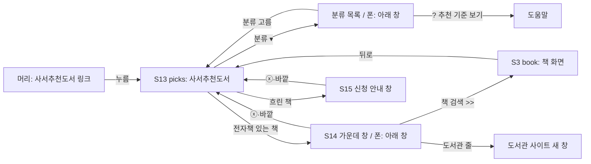

# 화면 흐름: 인기 도서 → 사서추천도서

- 근거: `scope.md`, `spec.md`(R1~R7, AC). 결정 출처는 그 두 문서에 있어 여기서는 태그만 붙임
- 바탕: 사이클 10 흐름 `../10-popular-books/flow.md`와 **지금 만들어진 화면**(`docs/current/module-map.md` "사이클 10 웹", 시안 A — 떠 있는 [분류 ▾], 카드 머리, 한 번 밀면 한 분류 등). **여기 적지 않은 것은 지금 화면 그대로**이고 바뀌는 것만 적음
- 새 화면 없음. 화면 ID는 그대로 둠(S13, S13c, S13i, S14, S15)

## 화면별 내용 (바뀌는 것만)

### 머리 (모든 화면 공통)
- 글자 링크 "인기 도서" → **"사서추천도서"**. 자리(로고 바로 옆)·숨기는 화면(S8·S9, `/terms`·`/privacy`)은 그대로 [확정] (R7-1)
- 폰에서 글자가 길어져(5자 → 6자) 로그인 버튼과 겹치지 않는지 dev가 320px에서 확인 [확정] (사용자 승인, 2026-10-12, flow 질문)

### S13 picks (지금 S13 popular를 바꿈)
- 경로: `/popular` → `/picks` [확정] (사용자 승인, 2026-10-12, flow 질문). 배포 전이라 옛 경로를 남길 필요 없음 [확정] (사용자 승인, 2026-10-12, flow 질문)
- 분류 묶음: 전체 → 문학 → 인문 → 사회 → 자연 → 테마 (고정 순서). 범위 안에 책이 0권인 분류는 묶음도 목록 줄도 없음 [확정] (R2-1~R2-3)
- 카드 머리: 큰 분류 이름 + "1 - 9 / 18"(지금 쪽의 권 번호 / 그 분류 권수, "위"를 뺌) + 쪽 표시 점 [확정] (사용자 승인, 2026-10-12, flow 질문). 권수 18(테마 36)은 범위 12번 [확정] (사용자 결정, dev 2026-10-14 — 처음 예시 "/ 10")
- 표지: **순위 칩 없음** — 지금 왼쪽 위 둥근 순위 칩(있음 = 보라, 없음 = 흰 바탕)을 뺌. "있음/없음"은 흐림 하나로만 [확정] (R4-3)
- 표지 그림: 국립중앙도서관 표지(우리 서버가 줄여 넘겨줌) → 제목 글자 [확정] (R4-4·R4-5, ADR-0091). 처음 정한 "우리 전자책 표지 먼저"는 서비스 DB에 표지가 없어 backlog로
- 순서: 추천 연월 최근 먼저, 같은 달은 등록일(`registered_on`) 늦은 순 → `recomNo` 글자 큰 순 [확정] (R4-2)
- 맨 아래 출처 줄: "출처: 국립중앙도서관 사서추천도서 (공공누리 제1유형) · 10월 12일 받음" [확정] (R7-2)
- 상태 문구: 목록 없음 "아직 사서추천도서를 준비하고 있어요", 오류 "사서추천도서를 불러오지 못했어요. 잠시 뒤에 다시 해 주세요." [확정]. 로딩(회색 빈 카드 9개)은 그대로
- 마지막 쪽: 분류마다 18권(테마 36권)이라 2쪽(테마 4쪽)이 꽉 참 [확정] (사용자 결정, dev 2026-10-14 — 처음 "10권 안팎이라 2쪽째는 1~3권"). 권수가 9의 배수가 아니면 마지막 쪽도 3×3 크기(빈 칸) 그대로 [확정] (지금 화면)

### S13c 분류 목록
- 줄: 전체 + 책이 있는 분류(보통 6줄 이하, 새 분야가 오면 맨 뒤에 더) [확정] (R2-1, R2-3, R2-5)
- 맨 아래 "? 순위 기준 보기" → "? 추천 기준 보기" [확정] (사용자 승인, 2026-10-12, flow 질문)

### S13i 도움말
- 문구: "국립중앙도서관 사서가 고른 신간 추천 도서 중 최근 12번(2년) 추천분이에요", "보통 2달에 한 번, 한 번에 8권(문학·인문·사회·자연 각 2권)을 추천해요. 테마 추천 때는 12권이에요", "흐린 책은 검색하는 도서관에 전자책이 없어요", "있음/없음은 검색 화면에서 고른 지역·범위 기준이에요", 출처·받은 날 [확정] (R7-2, 셋째·넷째 문장은 지금 그대로). 첫 두 문장 [확정] (사용자 결정, dev 2026-10-14: "좀 더 구체적으로 12번(2년)이라고 알려주고 … 이 정보도 알려줘"; 처음 문구 "…최근 6번 추천분이에요"를 바꿈, "테마 추천 때는 12권이에요"는 dev가 받은 자료로 덧붙임 [이유 미확인])
- "종이책 순위라서 전자책이 없는 책도 있어요"는 뺌 [확정] (사용자 승인, 2026-10-12, flow 질문) — 순위가 아니므로. 대신 "신간이라 아직 전자책이 없는 책도 있어요" [확정] (사용자 승인, 2026-10-12, flow 질문)

### S14 가운데 창
- 제목 아래 한 줄 "2026년 10월 사서추천 · 문학" [확정] (R6-1). 자리: 제목 바로 아래, 지은이·출판사 위 [확정] (사용자 승인, 2026-10-12, flow 질문)
- 표지: 격자에서 누른 그 표지(국립중앙도서관 표지, 없으면 제목 글자) [확정] (R4-4, 지금처럼 격자 표지를 그대로)
- 나머지(지은이·출판사는 우리 책 값, 대출 줄 앞 3곳, [책 검색 >>], 오류 문구) 그대로 [확정]

### S15 신청 안내 — 그대로

### S12 `/about`
- "인기 도서 순위·표지는 출판유통통합전산망 자료 …" 문구 → "사서추천도서 목록과 일부 표지는 국립중앙도서관 자료(공공누리 제1유형)예요. 표지 게시를 원하지 않는 권리자는 [연락처]로" [확정] (사용자 승인, 2026-10-12, flow 질문) (연락처는 배포 때, 지금과 같음)

## 수용 기준 대응

| AC | 화면 |
|---|---|
| AC-1 3×3 숫자 없음, 출처 줄 | S13 |
| AC-2 세모 (C10) | S13 |
| AC-3 다음 분류 (C10) | S13 |
| AC-4 분류 순서·빈 분류 없음 | S13, S13c |
| AC-5 분류 목록 (C10) | S13c |
| AC-6 ISBN·제목+저자로 있음/흐림 | S13 |
| AC-7 검색 기준 (C10) | S1 → 머리 → S13 |
| AC-8·9 가운데 창 (C10) | S14 → S3, 도서관 사이트 |
| AC-10 신청 안내 (C10) | S15 |
| AC-11·12·13·17·22 받기·요청 수·범위·옛 자료 지움 | 화면 없음(서버·DB). S13은 앞 목록 / "준비하고 있어요" |
| AC-14·14b 표지 순서 | S13, S14 |
| AC-15 "사서추천도서" 이름, "인기 도서" 글자 없음 | 머리, S13, S13c, S13i, S12 |
| AC-16 로그인 전 (C10) | S13 |
| AC-18~21 (C10) | S13c, S13i, S14, S15 |

## 상태별 동작 대응

| spec 상태 | 화면 상태 |
|---|---|
| 목록이 아직 없음 | S13 "아직 사서추천도서를 준비하고 있어요" |
| 받기 실패 | S13 기본(출처 줄 받은 날이 앞 받기) |
| 화면 요청 실패 | S13 오류 문구 |
| 그 밖의 상태 (C10) | C10 표 그대로 |
