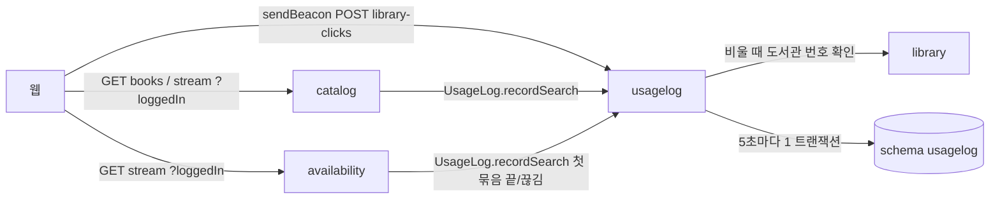
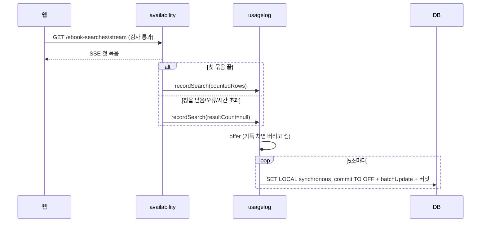

# 설계 대안: 사이클 15 사용자 행동 기록 (architect 제안, 2026-10-13)

> **이 문서는 2026-10-13에 받은 대안 비교 기록입니다.** 지금 설계는 [design-delta.md](design-delta.md)(초안)와 [spec.md](spec.md)가 기준입니다. 아래 본문의 결정 2 DDL과 결정 4는 그 뒤 결정으로 바뀌어 **폐기**되었고, 그 밖의 바뀐 곳도 아래 "지금 기준" 표에 모았습니다. 결정 기록: [ADR-0096](../../adr/0096-usage-log-storage-and-fields.md), [ADR-0097](../../adr/0097-usagelog-module-and-write-path.md), [ADR-0102](../../adr/0102-access-cookie-api-v1-and-login-status-reader.md)

| 본문에 적힌 것 | 지금 기준 | 근거 |
|---|---|---|
| 클릭 알림 `sendBeacon`, `URLSearchParams`, 이 주소만 CSRF 예외 | `fetch` keepalive + JSON, CSRF 그대로 | spec R2-1·R2-4 |
| 주소 `POST /api/v1/library-clicks` | `POST /api/v1/usage-events` (`type`으로 구분) | spec R2-1, [늘린 기록 설계](easy/2026-10-13-more-actions-design.html) #1 |
| 웹이 `loggedIn` 쿼리·본문 값으로 로그인 여부를 보냄, 확인 중이면 "모름" | 서버가 `access_token` 쿠키(경로 `/api/v1`)로 판별, `auth`의 판별 부품, `signed_in`/`signed_out`/`login_off` | spec R1-6, ADR-0102 |
| 표 셋, `logged_in boolean`, IP 칸 없음, `beacon_rejection_daily` | 표 여덟: `search_event`, `book_view`, `search_more`, `library_click`, `screen_event`, `library_response_daily`, `rejected_event`, `dropped_batch`. 모든 사용 기록에 `login_status`, `client_ip`(30일) | design-delta 데이터 절 |
| 도서관 응답 요청마다 | 도서관마다 하루 요약, 1년 | spec R6-4 |
| `allowedDependencies = { "library" }` | `{ "library", "auth" }` | [로그인 판별](easy/2026-10-14-login-status.html) #1 |
| 확인 필요 #1·#2·#3·#5·#8 | 해결됨 (아래 "확인 결과" 절과 spec) | — |

## 고른 방향 기록 (2026-10-13)

> **2026-10-13 명세 결정 뒤 고친 점** (당시 기록 — 지금 기준은 맨 위 표)
> - 클릭 알림은 `sendBeacon`이 아니라 `fetch` keepalive, CSRF 검사 그대로 (spec R2-1·R2-4) → 결정 4의 CSRF 예외·form 본문 제약이 없어짐. 본문은 JSON(`application/json`) [안], 응답 `204`
> - IP를 검색·클릭·책 상세 세 기록에 남김, IP 칸만 30일 뒤 비움 (spec R5-2) → 세 표에 `client_ip inet` 칸 [안], 매일 04:30에 `UPDATE … SET client_ip = NULL WHERE received_at < now() - interval '30 days' AND client_ip IS NOT NULL`
> - 책 상세 열기 기록 (spec R5-1) → 표 `usagelog.book_view(id, received_at, book_id, residence_region_ids, work_region_ids, library_ids, logged_in, client_ip)` [안], `catalog`의 `GET /api/v1/books/{bookId}`에서 `UsageLog.recordBookView(…)`
> - 이상한 클릭 알림은 개수가 아니라 IP와 함께 한 줄씩, 30일 (spec R2-3) → `beacon_rejection_daily` 대신 `usagelog.rejected_click(id, received_at, client_ip, reason, raw_values jsonb)` [안], 30일 뒤 DELETE
> - 버린 묶음 기록 (spec R3-3) → `usagelog.dropped_batch(id, dropped_at, row_count, reason)` [안], 다음 성공 묶음과 같은 트랜잭션으로 넣음 + 서버 로그
> - IP 값: nginx `X-Real-IP`(=`$remote_addr`). 사이클 17이 nginx에서 `CF-Connecting-IP`를 사용자 주소로 읽게 해야 실제 사용자 IP [확인 필요: 17 설정]
> - 더 남기는 행동 (spec R6, 2026-10-13 승인): 더 보기 세 종류 → `search_more`, 사서 추천 보기·지역/내 도서관 바꾸기 → `screen_event`(화면 알림), 직접 찾기 도서관별 응답 → `library_response`. `UsageLog.recordMore`·`recordLibraryResponse` 추가 [안]
> - 로봇: robots.txt(`/api/` 금지) + nginx가 이름 밝힌 로봇을 직접 찾기·대출 조회 location에서 403 (spec R1-7·R1-8). 서버 쪽 로봇 건너뛰기(R1-5)도 그대로
> 결정 기록: ADR-0096(무엇을·어디에·얼마나), ADR-0097(서버 안 기록 방식), 둘 다 Proposed
>
> **고른 방향 (2026-10-13, `easy/2026-10-13-design-decisions.html`, 회고 뒤 코드에 맞춰 확정)**
> - #1 검색·책 상세 기록은 usagelog 공개 창구를 catalog·availability가 직접 부름 [확정: 방향] (사용자 승인). 질문 "모듈로 두면 부하가 더 심해지지 않아?" → 같은 프로그램 안 함수 호출이라 늘지 않음, 답은 페이지 #1 아래
> - #2 표 다섯(`search_event`, `library_click`, `book_view`, `rejected_click`, `dropped_batch`), 칸 나눔, 파티션 없음 [확정: 방향] (사용자 승인)
> - #3 IP는 같은 줄의 칸, 매일 04:30에 30일 지난 줄의 IP를 비움 [확정: 방향] (사용자 승인)
> - #4 `JdbcTemplate.batchUpdate`, 기록 트랜잭션만 비동기 커밋 [확정: 방향] (사용자 승인)
> - #5 클릭 알림 주소 `POST /api/v1/library-clicks`, JSON, 204 [확정: 방향] (사용자 승인)
> - #6 모듈·schema 이름 `usagelog` [확정] (사용자 승인)
> - #7 IP는 `X-Real-IP`, 사이클 17 설정과 맞춤 [확정: 방향] (사용자 승인)
- 12·13·14 회고 전에 만든 대안입니다. 설계 확정은 회고 뒤 [확정] (scope). 따로 적지 않은 이름·숫자는 모두 [안]
- 입력: `scope.md`, `spec.md`(2026-10-13 #1~#6 반영), `docs/research/usage-log/storage.md`, 사이클 16 `architect-proposal.md`(모듈 `sitecontent` [안]), dev `BookSearchController.java`, `EbookSearchStreamController.java`, `deploy/nginx/chaekcheck-locations.conf`

## 결정 1: 검색 기록을 새 모듈로 넘기는 방법

| 안 | 내용 | 장점 | 단점 | 되돌리는 비용 |
|---|---|---|---|---|
| **A (추천 [안])** | 새 모듈 루트 공개 인터페이스 `com.chaekcheck.usagelog.UsageLog.recordSearch(SearchRecord, userAgent)`를 `catalog`(`books()`, page 1, 성공 뒤)와 `availability`(첫 묶음 완료 또는 `onCompletion`/`onError`/`onTimeout` 중 처음 하나, `AtomicBoolean`)가 직접 부름. 큐에 `offer`만 하고 돌아옴 | 결과 수(`totalCount`, `countedRows`)를 아는 곳이 넘김. `verify()`로 의존이 보임. 이벤트 표 쓰기 없음 | 검색 모듈 둘이 기록 모듈을 앎 | 낮음 |
| B | `usagelog`의 `OncePerRequestFilter`가 쿼리·응답 상태로 기록 | `catalog`·`availability` 안 고침 | SSE `countedRows`·응답 본문 `totalCount`를 못 봄, 검색어 다듬기 규칙 두 벌. R1-4·AC-3·AC-4 어려움 | 중간 |
| C | `catalog`·`availability`가 각자 표 (클릭만 새 모듈) | 모듈 사이 호출 없음 | 버퍼·지우기 세 벌, `catalog` schema는 가져오기 때 바꿔 끼우는 대상, scope "새 모듈 하나" [확정]과 어긋남 | 높음 |

- 나중에 분리할 때: A는 `UsageLog` 구현만 HTTP·메시지로 바꾸면 부르는 쪽은 그대로

## 결정 2: 표 모양 (DDL은 폐기, 지금은 design-delta)

- **A (추천 [안])**: 표 둘(`search_event`, `library_click`) + 버린 알림 하루 개수 표(`beacon_rejection_daily`). 종류 값은 `text` + `CHECK`(SQL로 바로 읽힘, R4-1), 지역·도서관 목록은 `bigint[]`
- B: 표 하나 + `jsonb payload` — DDL 없이 모양을 바꾸지만 타입 검사 없음, AC-12를 표 정의로 확인하기 어려움
- 파티션: 하지 않음 [안] (1년 1~2GB 어림, 공식 문서 기준 서버 메모리보다 클 때 이점, `storage.md` 2.1). 나중에 월 단위로 바꾸려면 표를 다시 만듦

```sql
CREATE TABLE usagelog.search_event (
  id bigint GENERATED ALWAYS AS IDENTITY PRIMARY KEY,
  received_at timestamptz NOT NULL,
  kind text NOT NULL CHECK (kind IN ('catalog','direct')),
  title text, author text, publisher text,
  exact boolean, roles text[], sort text,       -- catalog만
  filter text,                                  -- direct만
  scope text NOT NULL, visit text NOT NULL,
  residence_region_ids bigint[] NOT NULL DEFAULT '{}',
  work_region_ids      bigint[] NOT NULL DEFAULT '{}',
  library_ids          bigint[] NOT NULL DEFAULT '{}',
  result_count integer,                         -- direct가 첫 묶음 전에 끊기면 NULL
  logged_in boolean NOT NULL
);
CREATE INDEX search_event_received_at_brin ON usagelog.search_event USING brin (received_at);

CREATE TABLE usagelog.library_click (
  id bigint GENERATED ALWAYS AS IDENTITY PRIMARY KEY,
  received_at timestamptz NOT NULL,
  library_id bigint NOT NULL,                   -- FK 없음
  place text NOT NULL CHECK (place IN ('result_card','join_link','join_guide','home_page','logo','summary_bar')),
  screen text NOT NULL CHECK (screen IN ('direct_results','catalog_results','book_page','picks','my_libraries')),
  book_id bigint,                               -- FK 없음
  logged_in boolean NOT NULL
);
CREATE INDEX library_click_received_at_brin ON usagelog.library_click USING brin (received_at);

CREATE TABLE usagelog.beacon_rejection_daily (
  day date NOT NULL,                            -- 서울 날짜
  reason text NOT NULL,                         -- unknown_library, invalid_place, invalid_screen, invalid_book_id, malformed, bot
  rejected_count integer NOT NULL,
  PRIMARY KEY (day, reason)
);
```

- `id` PK를 뺄지는 넣기 비용 측정으로 [확인 필요: 프로토타입]
- `beacon_rejection_daily`는 이어서 결정 #3(이상한 값은 이유별 개수만)이 승인되면 씀

## 결정 3: 한 번에 넣는 방법

| 안 | 내용 | 장단점 |
|---|---|---|
| **A (추천 [안])** | `JdbcTemplate.batchUpdate`, `reWriteBatchedInserts` 꺼 둠 | 가장 단순, 배열 칸 그대로 바인딩 |
| B | A + PgJDBC `reWriteBatchedInserts=true` | 왕복 감소, 연결 URL 설정이라 풀 전체에 걸림 |
| C | 직접 만든 여러 줄 `INSERT … VALUES` | 가장 빠를 수 있으나 SQL 조립, 파라미터 상한 [확인 필요: PgJDBC 공식 문서] |

- `TransactionTemplate`: `SET LOCAL synchronous_commit TO OFF` → 두 표 `batchUpdate` → `beacon_rejection_daily` UPSERT → 커밋 한 번. JPA 엔티티 없음(IDENTITY 키는 Hibernate가 묶지 못함)

## 결정 4: 클릭 알림 엔드포인트 (폐기: fetch keepalive·usage-events·CSRF 그대로로 바뀜)

- `POST /api/v1/library-clicks` [안], 늘 `204`
- 본문: **A (추천 [안])** `URLSearchParams`(`application/x-www-form-urlencoded`) → `@RequestParam` / B 문자열 JSON(`text/plain`) → 직접 파싱. `Blob` + `application/json` 가능 여부 [확인 필요: 공식 문서·브라우저 시험]
- 필드: `libraryId`, `place`, `screen`, `bookId`(있을 때), `loggedIn`
- 검사: 형식·정한 값·로봇은 받을 때, 도서관 번호는 비울 때 묶어서 `library` 공개 API 한 번 → 없으면 `unknown_library`. 새 의존 `usagelog → library`
- 보안: 이 경로만 `ignoringRequestMatchers` + `permitAll` (webhook과 같은 방식)
- nginx: `location = /api/v1/library-clicks`에 `limit_req` [안: 60r/m, 사용자 결정 대기], 넘치면 `error_page 429 =204`. nginx에서 버린 것은 이유별 개수에서 빠짐

## 그 밖

- 로그인 여부: 웹이 두 검색 주소에 `loggedIn=true|false` 쿼리 값(`EventSource`는 헤더를 못 넣음). `BookParams`가 모르는 값을 거절하는지 [확인 필요: dev 코드]
- 버퍼: `ArrayBlockingQueue` 상한 10,000, `offer` 실패 수는 비울 때 로그 한 줄, 비우기 실패는 버리고 로그
- 스케줄: `@Scheduled(fixedDelay = 5s)` 비우기, `@Scheduled(cron = "0 30 4 * * *", zone = "Asia/Seoul")` 지우기(1만 줄씩 나눠), 종료 때 비우기는 `SmartLifecycle.stop()` — DataSource보다 먼저 [확인 필요: Boot 4.1 종료 순서 문서]
- Liquibase: `db/changelog/usagelog/001-usagelog-schema.yaml`을 master 끝에. 사이클 13·16도 master 끝을 고치므로 병합 순서 확인
- 모듈: `@ApplicationModule(allowedDependencies = { "library" })`, `usagelog`는 `catalog`·`availability`를 모름(순환 없음)





## 테스트 [안]

- `ApplicationModules.verify()` (새 의존 셋, 순환 없음)
- `@ApplicationModuleTest`(usagelog): 한 트랜잭션 비우기, 상한 넘침, 실패 시 버림(AC-14), 종료 때 비우기(AC-15), 1년 1일 전/364일 전(AC-13), 금지 칸 없음(AC-12)
- 컨트롤러: `page=2`·400·422 기록 안 함(AC-2·5), 스트림 완료·끊김 각각 한 번(AC-3·4), 다음 묶음 기록 안 함, 로봇 기록 안 함(AC-6), 클릭 잘못된 값도 204·로그인 켠 상태 CSRF 없이 204(AC-9·10)
- dev 측정: nginx 한도(AC-11), AC-16

## 12·13·14가 영향을 줄 곳

- 12: `catalog` 검색 코드·`BookParams`가 바뀌면 부르는 자리와 `totalCount` 위치
- 13: `LibraryRegistry.listAll()`(꺼진 도서관 포함) → 도서관 번호 확인 기준(켜진 곳만/전체) [확인 필요: 13 회고 뒤 사용자에게 질문], master changelog 끝줄
- 14: `popular` → `picks`, 사서 추천 창 결과 줄 링크·책 번호, `ResultRow` 변경

## 확인 필요 / 사용자 결정 (2026-10-13 당시, 대부분 해결)

| # | 항목 | 확인 방법 |
|---|---|---|
| 1 | 모듈·schema 이름 `usagelog` | 사용자에게 질문 |
| 2 | 엔드포인트 경로, 필드 이름, 이유 값 | 사용자에게 질문 |
| 3 | nginx 클릭 한도 값 | 사용자에게 질문 (spec 결정 페이지 #9) |
| 4 | 도서관 번호 확인 기준 (켜진 곳만/전체) | 13 회고 뒤 사용자에게 질문 |
| 5 | `sendBeacon` + `Blob application/json` | 공식 문서 확인, 브라우저 시험 |
| 6 | PgJDBC 파라미터 상한, `reWriteBatchedInserts` 영향 | 공식 문서 확인, 프로토타입 |
| 7 | Boot 4.1 종료 순서 (`SmartLifecycle`, DataSource) | 공식 문서 확인 |
| 8 | `BookParams`·스트림 컨트롤러가 모르는 쿼리 값을 거절하는지 | dev 코드 확인 |
| 9 | `id` PK를 둘지 | 프로토타입 |

## 확인 결과 (2026-10-13, 설계 확정 전 미리 풀어 둔 것)

| # | 항목 | 결과 |
|---|---|---|
| 8 | 검색 API가 모르는 쿼리 값(`loggedIn`)을 거절하나 | 거절하지 않음, 조용히 무시. `BookSearchController.java:38,45`(`MultiValueMap`), `BookParams.java:167-182`(정한 이름만 꺼냄), `SearchConditionParam.java:33-55`. 같은 규칙을 복사한 `popular/internal/web/PopularPlanParams.java:17`(14에서 `picks`로 바뀜)도 함께 볼 것 |
| — | 로그인 꺼짐 때 화면 CSRF 코드 | `web/src/api/auth.ts` `send()`(공개 안 됨)는 쿠키가 없으면 `GET /api/v1/auth/csrf-token`을 먼저 부르는데, 로그인이 꺼지면 이 주소가 없어(`CsrfTokenController.java:17-19` `@ConditionalOnAuthEnabled`, `AuthDisabledTests.java:45`) 404로 예외 → 클릭 알림이 안 나감. 그래서 클릭 알림은 "로그인 기능이 켜졌을 때만 표시 받아 오기"로 갈라야 함 [안]. 화면은 `/api/v1/me` 응답(404=`off`)으로 로그인 기능 상태를 앎(`auth.ts:107-117`) |
| 7 | 정상 종료 때 `SmartLifecycle.stop()`에서 DataSource를 쓸 수 있나 | 보통 종료면 Lifecycle 정지가 destroy보다 먼저라 쓸 수 있음, 단계마다 기본 30초 (https://docs.spring.io/spring-framework/reference/core/beans/factory-nature.html , 확인 2026-10-13). 웹 서버 정지(phase MAX−2048, https://docs.spring.io/spring-boot/api/java/constant-values.html)보다 늦게 멈추도록 phase를 작게 [안: `Integer.MAX_VALUE/2` 이하]. Hikari가 그 뒤 닫힌다는 문장은 Boot 문서에서 못 찾음 [확인 필요: 프로토타입] |
| 6 | pgjdbc 문장당 바인드 파라미터 상한 | 65,535 (42.4.0부터, https://jdbc.postgresql.org/changelogs/2022-06-09-42.4.0-release/ , 확인 2026-10-13). `batchUpdate`(채택)는 줄마다 따로 바인딩이라 해당 없음, 여러 줄 INSERT를 쓸 때만 행×열 제한. dev의 실제 pgjdbc 버전 [확인 필요: 의존성 트리] |
| — | 화면이 로그인 상태를 어디서나 아나 | 예. `AuthProvider`가 앱 전체를 감쌈(`main.tsx:31-77`), 상태 `checking/off/signed-out/signed-in`(`features/auth/AuthContext.tsx:9-13,32-50`), `useAuth()`/`useOptionalAuth()`. 첫 응답 전 `checking` 때 일어난 검색의 로그인 여부를 정해야 함 → 결정 페이지 |
