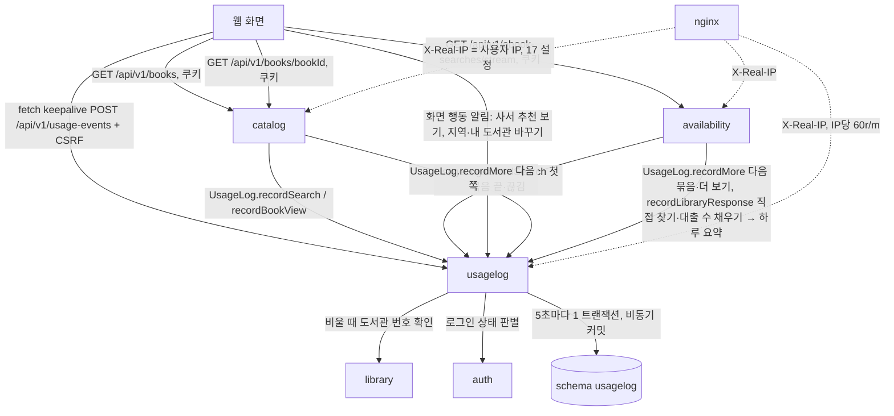
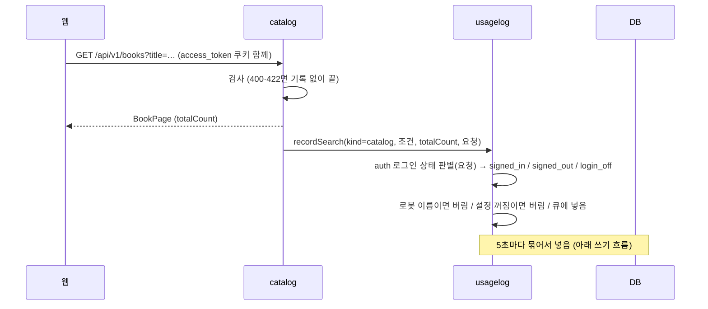
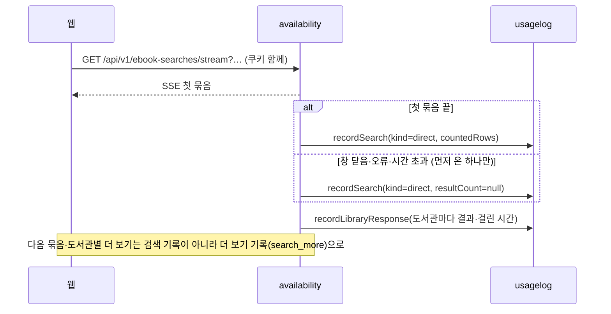
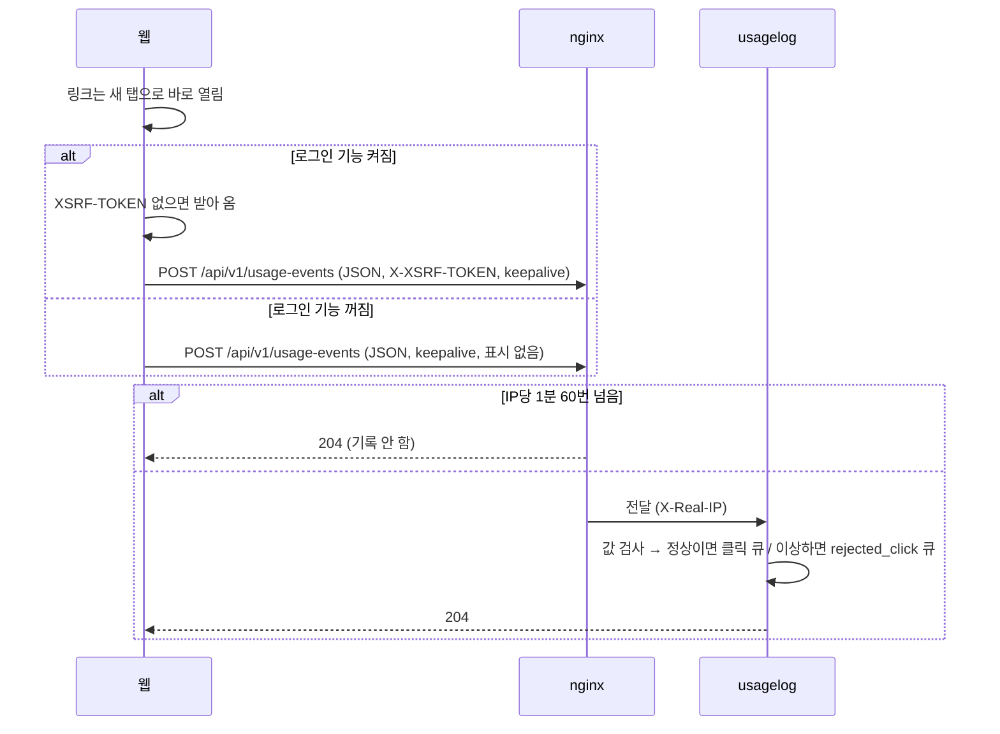
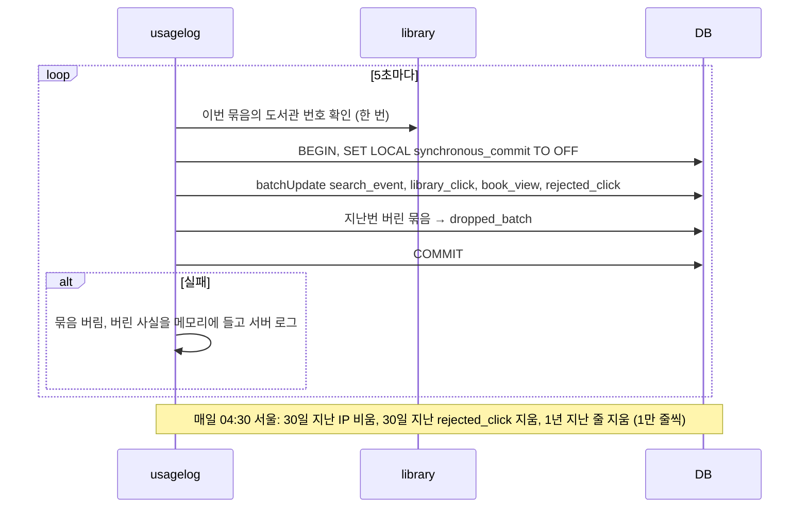
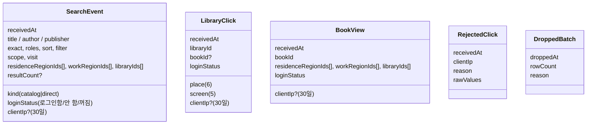
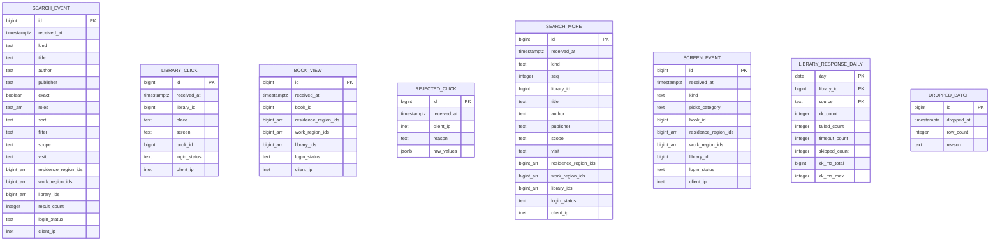

# 설계 변경: 사이클 15 사용자 행동 기록 (검색·책 상세·도서관 클릭)

> **초안 (2026-10-13)**. 2026-10-13 더 남기는 행동(spec R6) 반영: 표 다섯 → 여덟 (`search_more`, `screen_event`, `library_response_daily` 추가), 클릭 알림 주소를 화면 행동 알림으로 넓힘 [안]. 방향은 사용자가 정함(`architect-proposal.md` "고른 방향", ADR-0096·0097 Proposed). 12·13·14 회고에서 실제 코드를 본 뒤, 확정합니다 (IP 값은 Cloudflare 공식 문서로 확인함, 배포 때 `nginx -V`만 남음) [확정: 순서] (scope). 그때까지 아래 이름·숫자 중 따로 적지 않은 것은 [안]

## 구조 그림

### 모듈 구성도



### 주요 흐름

수집 목록 검색 (첫 쪽)



도서관에서 직접 찾기 (첫 묶음)



**질문에 대한 답 (2026-10-13): "다음 묶음·도서관별 더 보기는 기록 안 함, 이건 왜?"**

사람이 한 검색 한 번을 기록 한 줄로 세기 위해서입니다. 명세 결정 #2("처음 검색 요청만 한 줄", 2026-10-13 승인)를 따른 것입니다.

- "다음 묶음"은 같은 검색의 뒷부분입니다. 직접 찾기는 도서관을 묶음으로 나눠 차례로 묻기 때문에, 한 번 검색해도 화면이 묶음 요청을 여러 번 보냅니다. 이것까지 세면 검색 한 번이 여러 줄이 되어 "검색 수"가 부풀어 오릅니다.
- "도서관별 더 보기"도 같은 검색어로 한 도서관의 다음 쪽을 보는 것이라 새 검색이 아닙니다.
- 그래서 검색 조건·결과 수는 첫 요청 한 줄에 다 들어가고, 뒤 요청은 같은 내용의 반복이라 남기지 않습니다.
- 다만 "사람들이 더 보기를 얼마나 누르나"를 알고 싶으시면, 검색 기록과 따로 "더 보기 누름" 기록을 더할 수 있습니다(클릭 기록처럼 한 줄씩). 원하시면 다음 회고 때 범위에 넣을지 여쭙겠습니다.

도서관 클릭 알림



쓰기와 지우기



### 도메인 모델



- 기록끼리 잇는 관계 없음 (검색·클릭을 잇지 않기로 함, spec R2-6)

## 모듈

| 모듈 | 신규/변경 | 책임 | 공개 API | 발행/구독 이벤트 | 소유 테이블 |
|---|---|---|---|---|---|
| `usagelog` | 신규 | 기록 받기·모으기·5초 넣기·04:30 지우기·클릭·화면 행동 알림 주소, 로봇·설정 꺼짐 거르기 | `UsageLog` (`recordSearch`, `recordBookView`, `recordMore`, `recordLibraryResponse`), 공개 record [안] | 없음 | `usagelog.*` 다섯 |
| `catalog` | 변경 | 첫 쪽 검색·책 상세 성공 뒤 `UsageLog` 호출 (로그인은 모름) | 변경 없음 | 없음 | 변경 없음 |
| `availability` | 변경 | 직접 찾기 첫 묶음 끝·끊김에 한 번 `UsageLog` 호출 | 변경 없음 | 없음 | 변경 없음 |
| `auth` | 변경 | 로그인 상태 판별 부품 공개 (켜짐: 쿠키 서명 확인, 만료돼도 로그인함 / 꺼짐: 쿠키를 보지 않고 `login_off`), `access_token` 쿠키 경로 `/api/v1` | `LoginStatusReader` [안: 이름] | 없음 | 변경 없음 |
| `library` | 변경 없음 | `usagelog`이 도서관 번호 확인에 쓰는 공개 API (13 회고 뒤 `listAll` 등 어느 것을 쓸지 정함) | 기존 | 없음 | — |

- `usagelog`: `@ApplicationModule(allowedDependencies = { "library", "auth" })` [확정] (auth 추가: 사용자 승인, 2026-10-14, `easy/2026-10-14-login-status.html` #1; 처음 #6은 library만) (사용자 승인, 2026-10-14, `easy/2026-10-14-remaining-proposals.html` #6). `catalog → usagelog`, `availability → usagelog` 의존이 새로 생김 (순환 없음)
- 기록 설정 값: `chaekcheck.usagelog.enabled` [확정] (사용자 승인, 2026-10-14, `easy/2026-10-14-remaining-proposals.html` #2), 기본 꺼짐, 공개일에 켬 [확정] (spec)

## 데이터

- 스키마: `usagelog` [확정] (ADR-0097)



| 테이블.컬럼 | 타입 | 제약 | 설명 | 상태 태그 |
|---|---|---|---|---|
| 모든 표 `id` | `bigint GENERATED ALWAYS AS IDENTITY` | PK | 지우기를 나눠 할 때 | [안] (뺄지 프로토타입) |
| `*.received_at` | `timestamptz` | NOT NULL | 서버가 받은 시각 | [확정] (spec) |
| `search_event.kind` | `text` | CHECK (`catalog`,`direct`) | 검색 종류 | [확정] 값 이름 (사용자 승인, 2026-10-14, `easy/2026-10-14-remaining-proposals.html` #2) |
| `search_event.title/author/publisher` | `text` | 셋 중 하나 이상 | 서버가 다듬은 검색어, 2~50자 | [확정] (spec #1) |
| `search_event.exact`, `roles`, `sort` | `boolean`, `text[]`, `text` | 수집 목록만 | 받은 값, 없으면 기본값 | [확정] |
| `search_event.filter` | `text` | 직접 찾기만 | `all`/`available` | [확정] |
| `search_event.scope`, `visit` | `text` | NOT NULL | 받은 값 | [확정] |
| `*.residence_region_ids`, `work_region_ids`, `library_ids` | `bigint[]` | NOT NULL DEFAULT `'{}'` | 받은 값 그대로 | [확정] (값), [안] (타입) |
| `search_event.result_count` | `integer` | NULL 가능 | 직접 찾기가 첫 묶음 전 끊기면 NULL | [확정] |
| `*.login_status` | `text` | CHECK (`signed_in`,`signed_out`,`login_off`) [안: 값 이름] | `auth`의 로그인 상태 판별 부품이 정함: 로그인함 / 안 함 / 로그인 기능 꺼짐 | [확정] (사용자 승인, 2026-10-14, `easy/2026-10-14-login-status.html` #2) |
| `*.client_ip` | `inet` | NULL 가능 | `X-Real-IP`, 30일 뒤 NULL | [확정] (값·기간), [안] (타입) |
| `library_click.library_id` | `bigint` | NOT NULL, FK 없음 | 확인된 서비스 도서관 번호 | [확정] |
| `library_click.place` | `text` | CHECK 여섯 값 | `result_card`,`join_link`,`join_guide`,`home_page`,`logo`,`summary_bar` | [확정] 값 이름 (사용자 승인, 2026-10-14, `easy/2026-10-14-remaining-proposals.html` #2) |
| `library_click.screen` | `text` | CHECK 다섯 값 | `direct_results`,`catalog_results`,`book_page`,`picks`,`my_libraries` | [확정] 값 이름 (사용자 승인, 2026-10-14, `easy/2026-10-14-remaining-proposals.html` #2) |
| `library_click.book_id`, `book_view.book_id` | `bigint` | FK 없음 | 책 번호 (catalog 번호는 가져오기 때 이어 씀, ADR-0062) | [확정] |
| `rejected_click.reason` | `text` | CHECK | `unknown_library`,`invalid_place`,`invalid_screen`,`invalid_book_id`,`malformed` | [확정] (사용자 승인, 2026-10-14, `easy/2026-10-14-remaining-proposals.html` #2) |
| `rejected_click.raw_values` | `jsonb` | 2KB 넘으면 잘라 냄 | 받은 값 | [확정] (사용자 승인, 2026-10-14, `easy/2026-10-14-remaining-proposals.html` #4) |
| `search_more.kind` | `text` | CHECK (`direct_next_batch`,`library_more`,`catalog_next_page`) | 더 보기 종류 (R6-1) | [확정] (기록), [안] (값 이름) |
| `search_more.seq` | `integer` | | 묶음 번호·쪽 번호 | [안] |
| `search_more.library_id` | `bigint` | 도서관별 더 보기만 | | [안] |
| `search_more` 조건 칸 | 검색 기록과 같은 조건 칸 전부 (검색 방식·범위·지역·도서관) | | 더 보기 줄만으로 어떤 검색인지 알게 | [확정] (사용자 승인, 2026-10-13, `easy/2026-10-13-more-actions-design.html` #4) |
| `screen_event.kind` | `text` | CHECK (`picks_list_view`,`picks_book_view`,`region_change`,`my_library_add`,`my_library_remove`) | 화면 행동 (R6-2·R6-3) | [확정] (기록), [안] (값 이름) |
| `screen_event.picks_category`, `book_id`, `residence_region_ids`, `work_region_ids`, `library_id` | 종류별 칸, 맞지 않는 칸은 NULL (CHECK로 검사) | | 분야·책 / 바뀐 지역 / 도서관(넣기·빼기는 kind로) — JSON 칸 없음, 회원 번호 없음 | [확정] (사용자 승인, 2026-10-13, `easy/2026-10-13-more-actions-design.html` #3) |
| `library_response_daily` | (day, library_id, source) PK, 수 칸 `integer`, 시간 `integer` ms | 서울 날짜 | 도서관마다 하루 한 줄 요약: 성공·실패·시간 초과·건너뜀 수, 성공 시간 합 `ok_ms_total`·가장 긴 성공 시간 `ok_ms_max`(평균은 볼 때 계산). 서비스 메모리에서 세다가 5초 묶음 때 `ON CONFLICT (day, library_id, source) DO UPDATE SET …count = …count + EXCLUDED…, ok_ms_max = GREATEST(…)`로 더함 [확정: 방법·숫자·세는 단위] (사용자 승인, 2026-10-13, `easy/2026-10-13-summary-method.html`). 보관 1년. 여러 대로 늘릴 때 고려: `docs/research/scaling/in-memory-state.md` | [확정] (사용자 제안: "보통은 요청마다 DB에 남기기보다 집계 숫자(횟수·실패·평균 시간)로 모아요 … 이렇게 해줘", 2026-10-13, `easy/2026-10-13-more-actions-design.html` #6) |
| `dropped_batch.reason` | `text` | CHECK | `db_failure`,`buffer_full` | [확정] (사용자 승인, 2026-10-14, `easy/2026-10-14-remaining-proposals.html` #2) |
| 색인 | BRIN `(received_at)` 각 표, `client_ip IS NOT NULL` 부분 색인 [안: 부분 색인] | — | 지우기·기간 조회 | [확정] BRIN·`bigint[]`·`inet` (사용자 승인, 2026-10-14, `easy/2026-10-14-remaining-proposals.html` #3) |

- 파티션 없음 [확정: 방향] (ADR-0097)
- 다른 schema로 FK 없음 (모듈 경계, 번호만 남김)
- Liquibase: 새 파일 `db/changelog/usagelog/001-usagelog-schema.yaml`을 master 끝에 [확정] (사용자 승인, 2026-10-14, `easy/2026-10-14-remaining-proposals.html` #2). 기존 changeset 수정 없음. 사이클 13·16도 master 끝을 고치므로 병합 순서 확인

## API

| 메서드 | 경로 | 설명 | 요청 | 응답 | 에러 |
|---|---|---|---|---|---|
| POST | `/api/v1/usage-events` | 화면 행동 알림 하나로 받음: 도서관 클릭, 사서 추천 보기, 지역·내 도서관 바꾸기 (`type`으로 구분) [확정] (사용자 승인, 2026-10-13, `easy/2026-10-13-more-actions-design.html` #1) — 설계 #5의 `/api/v1/usage-events`를 바꿈 | JSON (아래) | `204`, 본문 없음 | 로그인 기능 켜짐에서 CSRF 표시 없음·틀림 → `403` (기존 규칙). 값이 틀려도 `204` (rejected_click에 남김). nginx 한도 초과도 `204` |
| GET | `/api/v1/books` | 변경 없음 (로그인 여부는 쿠키로, ADR-0102) | — | 변경 없음 | 변경 없음 |
| GET | `/api/v1/books/{bookId}` | 변경 없음 (쿠키) | — | 변경 없음 | 변경 없음 |
| GET | `/api/v1/ebook-searches/stream` | 변경 없음 (쿠키) | — | 변경 없음 | 변경 없음 |

```json
POST /api/v1/usage-events
{ "type": "library_click", "libraryId": 12, "place": "result_card", "screen": "picks", "bookId": 345 }
{ "type": "region_change", "residenceRegionIds": [1114], "workRegionIds": [1102] }
```

- (바뀜 2026-10-14) `loggedIn` 쿼리 값은 쓰지 않음. 서버가 로그인 쿠키로 직접 확인 (사용자 #5 미승인). 쿠키 범위 등은 `easy/2026-10-14-login-cookie.html`

## 외부 연동

| 대상 | 방식 | 제한·키 관리 | 실패 시 동작 | 상태 태그 |
|---|---|---|---|---|
| 없음 (외부 서비스 호출 없음) | — | — | — | — |
| nginx (배포 설정) | `X-Real-IP`, `location = /api/v1/usage-events` IP당 60r/m(넘치면 204), 직접 찾기·대출 조회 location에서 bot·crawler·spider UA 403, `public/robots.txt` | 사이클 17 `CF-Connecting-IP` 설정에 기댐 | 설정 없으면 IP가 모두 cloudflared 주소 | [확정] (값), [확인 필요] (17 설정) |

## 결정 기록

- ADR-0096 사용자 행동 기록은 같은 PostgreSQL에, IP 30일·나머지 1년 (Proposed)
- ADR-0102 액세스 쿠키 경로 `/api/v1`, 로그인 상태 판별은 `auth` 부품 하나 (Proposed)
- ADR-0097 기록 전용 모듈 `usagelog`, 공개 창구 직접 호출, 5초 묶음·비동기 커밋, fetch keepalive + CSRF (Proposed)

## 확인 필요

| 항목 | 확인 방법 | 막는 단계 |
|---|---|---|
| 12·13·14 뒤 검색·책 상세·결과 줄 코드 위치, 도서관 번호 확인 API(13 `listAll`), master changelog 끝 | 12·13·14 회고 | 설계 확정 |
| 터널에서 `CF-Connecting-IP`가 붙는지 | **조사로 확인됨** (Cloudflare 공식: Tunnel 원 서버는 cloudflared 주소를 보고 HTTP는 `CF-Connecting-IP`로 방문자 IP, spec R5-2) | — |
| nginx 이미지의 realip 모듈, `set_real_ip_from`에 적을 compose 네트워크 범위(17 R3, 예 `172.30.0.0/24`), "Remove visitor IP headers" 꺼짐 | 배포 때 `nginx -V` 한 줄, 지인 기간 시험에서 기록된 IP 확인 | 없음 (설계는 안 막음) |
| `SmartLifecycle` 정지 phase와 Hikari 닫힘 순서 | 프로토타입 | 개발 |
| dev pgjdbc 실제 버전 | 의존성 트리 | 개발 |
| `id` PK·부분 색인을 둘지 (넣기 비용) | 프로토타입, AC-16 측정 | 개발 |
| 광고 차단으로 빠지는 클릭 비율 | 지인 기간 실서버 시험 | 없음 |

- 사이클 17 확정(2026-10-13): nginx 접속 기록 14일, 쿼리 문자열 빼고 경로만, DB 백업 매일 03:00 → 04:30 기록 지우기와 겹치지 않음
